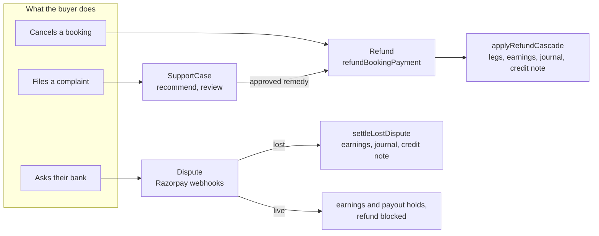

# Refunds, chargebacks and service complaints

Three different things move or threaten to move a buyer's money, and they are handled by three different mechanisms. Mixing them up is the commonest mistake in this area, so the first job of this section is to name them.

| Term              | What it is                                                                                                                | Record        | Page                                                                     |
| ----------------- | ------------------------------------------------------------------------------------------------------------------------- | ------------- | ------------------------------------------------------------------------ |
| Refund            | Money the platform sends back to the payer for a booking, on a cancellation, a rejection, an incident or a remedy         | `Refund`      | [refunds](01-refunds.md)                                                 |
| Dispute           | A gateway chargeback: the cardholder's bank asks Razorpay to pull the money back. Always means a chargeback in these docs | `Dispute`     | [chargebacks](02-chargebacks.md)                                         |
| Service complaint | A person's complaint about a booking, worked by support staff. It moves no money by itself                                | `SupportCase` | [service complaints and remedies](03-service-complaints-and-remedies.md) |

A service complaint can lead to a refund, and a dispute can be filed on a payment that was also refunded, but each keeps its own record, status vocabulary and owner. A `SupportCase` never carries a `DisputeStatus`, and a `Dispute` never carries a case status.

## The map

## What is shared

- **One front door for refunds.** Every refund, whatever started it, goes through `refundBookingPayment`, which picks the gateway, in-ledger or credits rail from the payment's intent.
- **Hard limits that apply to all three.** A payment can never have more refunded and charged back than it was paid: the `payment_refunds_within_amount` trigger refuses a `Refund` write that would exceed `Payment.amount` once chargebacks lost are counted. A live dispute blocks a new refund, and an uncascaded or pending refund blocks a payout.
- **Money in integer paise, INR only, with balanced immutable journals.** See [the double-entry model](../20-ledger/01-double-entry-model.md).

Legal credit-note and GST treatment is in [GST invoices and credit notes](../60-tax/02-gst-invoices-and-credit-notes.md). The support product that owns a complaint end to end is in [the support docs](../../support/README.md); its refund and hold doors are in [support money remedies](../../support/05-money-remedies.md).

## Where in code

- `lib/payments/operations/`: `booking-refund.ts`, `refund.ts`, `refund-owed.ts`, `cancellation-policy.ts`.
- `app/api/webhooks/utils.ts`, `lib/payments/dispute-status.ts`: disputes.
- `lib/support/case-actions.ts`, `refund-door.ts`, `case-holds.ts`: complaints.

## Deprecated & Superseded Approaches

Stripe-era refund and dispute descriptions, a webhook-only account of Razorpay evidence, and any statement that a gateway accepting a refund means the buyer's bank has credited them are superseded: the platform records the gateway's state and reference and promises nothing about bank arrival. Delete any internal "dispute" wording that refers to a service complaint, and any totals computed from the latest page of a list instead of server-side aggregates.
