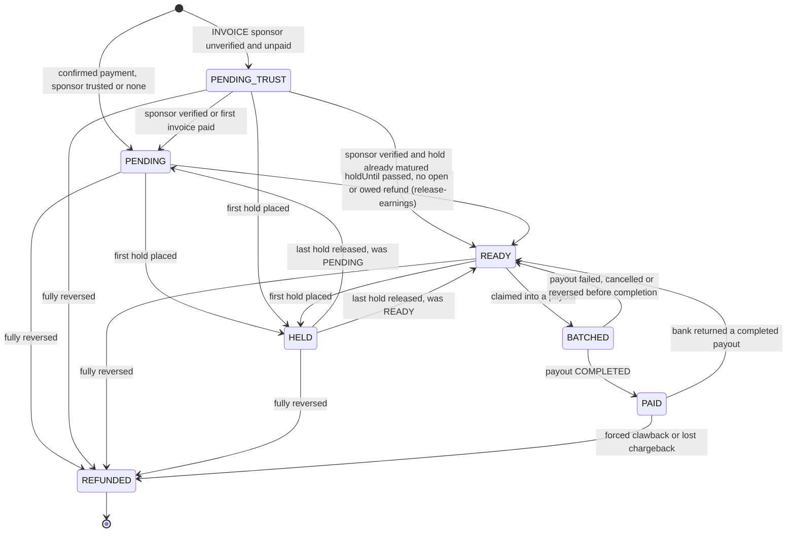

# Earnings lifecycle

An earning is the platform's record of what one party is owed from one payment. A confirmed booking mints one `ConsultantEarnings` row for the expert and, when the expert settles to a host organisation, an `OrganizationEarnings` row for the organisation as well. Both row types share one status enum, `EarningStatus`, and one set of transition rules. This page is the reference for how a row is minted, every status it can occupy, how it is held and released, how a refund reverses it, and where it appears in the ledger. The batching that consumes a READY row lives in [consultant payouts](03-consultant-payouts.md) and [organisation payouts](05-org-payouts-and-clawbacks.md).

An earning is a reconciled cache, not the source of truth. The `BOOKING` journal posted in the same transaction is authoritative (see [postings](../20-ledger/04-postings.md)), and the ledger auditor checks the cached amounts against it (`EARNINGS_LEDGER_DRIFT`).

## How a row is minted

`createEarningsFromPayment` (`lib/payments/payouts/earnings-service.ts`) mints earnings from a confirmed payment, never from a booking request, so a payment that never captures accrues nothing. It runs in one transaction and is idempotent: it first looks for an existing earning for the same payment and expert and returns it, so a redelivered webhook cannot mint twice. A payment whose capture was parked in `UNAPPLIED_RECEIPTS` mints nothing (see [gateway clearing](../20-ledger/05-gateway-clearing-and-settlement.md)).

The gross amount of an earning is `Payment.originalAmount`, the list price before discounts, credits and GST. The split depends on who hosts the session.

- **Marketplace expert, no host organisation.** The platform fee is the latest approved `PlatformFeeSchedule` rate for the payment's source, `marketplaceBps` or `ownLinkBps` for a buyer the expert brought through their own link (`readActiveFeeSchedule` and `feeBpsForSource` in `lib/payments/pricing/platform-fee.ts`). The basis points charged are stamped on the payment (`platformFeeBps`). A live `ConsultantFeeWaiver` can zero the fee for a number of sessions, unless the order carries platform-funded promo, which the fee must cover. When no schedule is approved the fallback is 20 percent. The expert's pool is the gross less that fee.
- **Host organisation.** The split uses the `RateCard` effective when the payment was created (`resolveOrgSplit`), as integer basis points: platform, organisation and consultant shares, with the organisation share computed as the remainder so the three always sum to the gross. A card at 1000, 1000 and 8000 basis points on a ₹10,000 (1,000,000 paise) booking gives 100,000 to the platform, 100,000 to the organisation and 800,000 to the expert. The card in force at creation is snapshotted on the row (`rateCardIdApplied` and the applied basis points), so a later rate change never restates earnings already minted.

| Settlement path                                     | `ConsultantEarnings`                                   | `OrganizationEarnings`                            |
| --------------------------------------------------- | ------------------------------------------------------ | ------------------------------------------------- |
| Marketplace expert, no host organisation            | one row, the full pool                                 | none                                              |
| Host organisation, `payoutRecipient = SELF`         | one row per party (owner, collaborators)               | one row when the organisation share is above zero |
| Host organisation, `payoutRecipient = ORGANIZATION` | none; the expert slice collapses into the organisation | one row                                           |

A payment can carry several `OrganizationEarnings` rows, for the primary expert's organisation and for each collaborator who settles to a different host. The sidecar index `organization_earnings_split_key` (`prisma/sql/check-constraints.sql`) makes the combination of payment, organisation, consultant, role and cycle unique.

## The status machine

`EarningStatus` has seven values: `PENDING`, `HELD`, `READY`, `BATCHED`, `PAID`, `REFUNDED` and `PENDING_TRUST`.

`assertEarningStatusTransitionLegal` (`lib/payments/payouts/earning-status.ts`) guards the writers that go through it: a PAID row may only become REFUNDED, and a REFUNDED row is terminal. The bank-return path (`markConsultantPayoutReversed`, `markOrgPayoutReversed`) reopens PAID rows as READY by a conditional bulk update that does not go through the guard. That reopening is deliberate, because the cash really came back.

### PENDING and the hold window

An earning starts PENDING with a `holdUntil` timestamp. `computeHoldUntil` sets it to the later of the capture time and the end of the last live session, plus the hold for the appointment type: 48 hours for a consultation, so the 48-hour scope-claim window closes before release, 24 hours for a class, 48 hours for a webinar, 168 hours (7 days) for a subscription (`PAYOUT_CONSTANTS.HOLD_PERIOD_HOURS`, `lib/payments/payouts/constants.ts`). A session that was cancelled, rescheduled or voided never anchors the hold. A rescheduled session moves the release with it.

A new expert waits longer. `withNewExpertHold` adds 3 days (`NEW_EXPERT_EXTRA_HOLD_DAYS`) when the expert's first earning on a succeeded payment is under 30 days old or they have none, or when their lifetime share net of refunds is under ₹10,000 (1,000,000 paise, `NEW_EXPERT_LIFETIME_SHARE_PAISE`).

A subscription is the exception to a hold set at mint: its earnings are one row per cycle with `holdUntil` unset, and the hold is stamped when the cycle's last session completes. Cancelled-session and trial settlements stamp holds later in the same way (`stampConsultantHolds`).

The `release-earnings` job (`scripts/earnings/release-earnings.ts`) runs on the ticker every 15 minutes. In a Serializable transaction it moves each PENDING row whose `holdUntil` has passed to READY, for consultant and organisation earnings separately. It skips a row when its payment has a refund still pending or still owes a refund (`Payment.refundOwedKey` set), when the booking has a live session not yet delivered, when a session is parked as an unsettled miss or awaiting a human, or when a session reads `LEARNER_ABSENT` and nobody has confirmed the verdict (`RELEASABLE_PAYMENT`; an unsettled miss and an unconfirmed learner absence do not gate a subscription's earning, while a session awaiting a human does). The sweep writes a learner absence unconfirmed, and the window-close pass in `auto-complete-appointments` confirms it 48 hours later on strong evidence, so the earning of a forfeited session matures after the later of its hold and that confirmation; a weak verdict waits on the ops needs-human list. The cohort read, the claim's `WHERE`, the ticker's idle probe (`hasReleasableEarningsWork`) and the sponsor trust-park release (`releaseSponsorTrustPark`) all read that one constant. It never touches HELD rows.

### An owed refund holds the payment's earnings

A door that ends a booking with money to return (a cancel, a trial cancel, rejection or expiry, a seat leave, a whole-event cancel, a no-show, a moderation cancel, a maintenance freeze, an incident remedy, an overage credit-back, or the plan-end settlement) stamps an owed-refund marker on the payment in the same commit (`stampRefundOwed`, `lib/payments/operations/refund-owed.ts`) and drives it after commit. While the marker is set, every PENDING earning on that payment, consultant and organisation, stays PENDING even after its `holdUntil` passes. The marker is a hold, not a clawback: the refund's own cascade sizes the reversal when the money moves. Support and operator refunds stamp no marker; they settle one by hand. The release run's Serializable transaction does not block a door that stamps a marker at READ COMMITTED without touching the earnings rows, so a marker stamped during a release run may miss that run's gate; the refund's cascade then claws back the released row. The plan-end settlement writes the earnings rows in the same commit, so it conflicts with the run instead.

- **A drive that refunds, or a replay that finds the refund already done,** clears the marker by CAS on its key (`driveRefundOwed`), and the next release run releases what the refund left. A gateway answer still settling (a PENDING `Refund` row) keeps the marker, and the PENDING refund holds the earnings on its own. Whoever settles that refund later (the webhook, the reconcile sweep or the drive itself) clears its own marker in the settling transaction (`applyRefundCascade`).
- **A failed drive** keeps the marker and counts an attempt; `retry-auto-refunds` re-drives it after 1 hour, then 4 hours. A gateway error that leaves its refund PENDING (a timeout, say) counts no attempt: the money may have moved, and reconcile settles that refund by lookup. If reconcile or the gateway's webhook then fails it, the failing transaction counts the attempt (`failRefund` → `countOwedDriveFailure`), so a gateway that keeps answering ambiguously still reaches the cap.
- **A marker whose attempts are spent** (`MAX_REFUND_OWED_ATTEMPTS`, 3) pages ops once, shows in the ops queue, and makes any later booking change answer `REFUND_NEEDS_SUPPORT`. Its earnings stay held until support refunds by hand through an ops refund door, which settles the marker (`settleOwedByHand`): a refund that covers what is owed clears it and lifts the hold, and a smaller one reduces it and keeps the hold. A hand refund on a marker whose own refund already went out is refused (`OWED_REFUND_ALREADY_SENT`) and clears the stale marker. The refusal names that refund's amount, date and reference ("₹250.00 already went back to the buyer on 2 Nov 2026 (refund rfnd_…), so nothing is owed on this payment. Only submit again if you mean to refund more on top of this."), so the operator does not pay the same money twice.

A door whose stamp loses to another door's partial marker (first writer wins) and still ends the booking (rejection, moderation of a 1:1 booking or a removed attendee, a consultant no-show, a maintenance freeze, an overage credit-back) adds no marker, so its own amount would otherwise wait on nothing. In its own transaction it places an `OPERATOR` hold on every unpaid earning of the payment, consultant and organisation (PENDING, PENDING_TRUST, READY, or already HELD), with the `owed-already-held:<payment>:<key>` event as the hold's source and the note "Another refund is still owed on this payment; refund the remaining ₹X by hand, then release the hold." (`stampOwedOrHeld` / `heldInsteadOf`). A replay finds its own hold; a row that keeps moving refuses the door with a retryable 409 (`PAYMENT_BUSY`) and rolls it back, so the HELD-iff-active-hold rule holds. A full-balance holding marker already covers the door, so nothing is held. The Refunds tab lists the payment while the top-up is unpaid, then offers **Release hold**: `releaseTopUpHold` releases only that top-up's hold (match on its `sourceRef`), refused while the top-up or another top-up on the payment is unpaid or a refund or dispute is open. `releaseHeldEarnings` (the Earnings tab) skips top-up holds (`exceptSourceRefPrefix`) and answers `EARNING_HELD_FOR_TOP_UP` when only one remains. A whole-event cancel never gets here: it refuses instead.

For example, a ₹1,000 plan of 4 sessions ends with 1 session unused. The settlement stamps the tranche holds (168 hours) and a ₹250 owed refund in one commit, and the gateway keeps failing. Seven days later the tranche's `holdUntil` has passed, but the release job leaves it PENDING until the refund goes out or support settles it.

### PENDING_TRUST

An organisation that is still `PENDING_VERIFICATION` and funds bookings by INVOICE could otherwise accrue earnings for experts against bookings it has not paid for and then vanish. `checkSponsorTrustPark` therefore parks every earning the booking writes, consultant and organisation alike, in PENDING_TRUST when the sponsoring organisation (`Payment.organizationId`, not the host) is unverified, funds by INVOICE and has no PAID invoice. A parked row is invisible to batching and to the release job. It leaves the park in two ways. When an administrator verifies the sponsor, `releaseSponsorTrustPark` (called from the organisation verify route) sends matured, releasable rows to READY and the rest to PENDING. When the sponsor's first invoice is paid, `settleOrgInvoicePaid` moves its parked rows to PENDING.

### HELD and the five holds

A row is HELD exactly when it carries at least one active `EarningsHold`. `lib/payments/payouts/earnings-holds.ts` is the only writer of HELD. It places holds on PENDING, PENDING_TRUST and READY rows by conditional update, so a PAID or REFUNDED row can never be frozen. The first hold records the row's prior status in `preHoldStatus`, and the last release restores exactly that status. A legacy row with no recorded prior returns to PENDING, never straight to READY, so the release job's guards (`RELEASABLE_PAYMENT`) decide when it is payable.

| Reason         | Placed by                                                                                                                                    | Released by                                                                                           |
| -------------- | -------------------------------------------------------------------------------------------------------------------------------------------- | ----------------------------------------------------------------------------------------------------- |
| `DISPUTE`      | `placeDisputeHolds` when a chargeback opens (`app/api/webhooks/utils.ts`)                                                                    | The chargeback's own settlement                                                                       |
| `MODERATION`   | A ban of the expert                                                                                                                          | An administrator, through `releaseHeldEarnings`                                                       |
| `OPERATOR`     | An administrator, through `holdEarnings` (PENDING or READY rows only); or a refund door whose refund another door's owed refund held (below) | An administrator, through `releaseHeldEarnings`; a held top-up's hold only through `releaseTopUpHold` |
| `OVERAGE`      | A member overage on the payment that is still unpaid                                                                                         | The overage settlement                                                                                |
| `SUPPORT_CASE` | Staff, through `holdPaymentForCase` (`lib/support/case-holds.ts`)                                                                            | Staff, through the release door, or the case lifecycle (below)                                        |

Each owner releases only its own hold, so winning a chargeback does not free money that a ban or an operator still holds. Three constraints in `prisma/sql/check-constraints.sql` keep this honest: `earnings_hold_one_earning` makes each hold name exactly one earning, and `earnings_hold_active_consultant_key` and `earnings_hold_active_org_key` allow one active hold per earning, reason and source.

An operator release is refused while the payment has an open refund or an open chargeback, and it clears only `OPERATOR` and `MODERATION` holds. Operator hold and release are admin money doors, so they carry step-up, a reason and an ops-log row, and they are blocked while maintenance is DEGRADED (`/api/admin/earnings` in `WRITE_BLOCKED_IN_DEGRADED`, `lib/maintenance-edge.ts`).

A chargeback hold first cancels any PENDING or APPROVED payout that had batched the payment's earnings (`cancelOpenPayoutsForPayment`), returning them to READY so the hold can freeze them. A payout already PROCESSING is left alone, which is why a chargeback can only freeze money that has not yet left.

A service-complaint hold works the same way and adds a rule about who may release it. The case timeline owns the intent: `HOLD_APPLIED` and `HOLD_RELEASED` events decide whether a hold stands, so earnings created later for a held payment start held (`applyCaseHoldsToNewEarnings`). Releasing holds is audited. A case move that would release active holds (a status change, a decision, or the problem cascade) needs a session re-authenticated within 15 minutes (`REAUTH_REQUIRED`), open money doors (the same maintenance check as every money door) and no undecided refund recommendation (`RECOMMENDATION_OPEN`), and it writes one `support.case.release-holds` row to the ops log naming the holds released. The problem cascade, which resolves incidents when their parent problem resolves, never releases a hold placed after the problem's latest RESOLVED event (`HOLD_AFTER_PROBLEM_RESOLVED`). Staff release such a hold through the step-up hold door. Releasing a service hold never releases a chargeback, operator or overage hold.

## Refunds reverse an earning; they never delete it

A refund never deletes an earning and never subtracts from its principal columns. It increments a cumulative refunded column, `refundedShareAmount` on `ConsultantEarnings` and `refundedAmountPaise` on `OrganizationEarnings`, and moves the row to REFUNDED only when the cumulative figure reaches the full share. Every payout computation reads `share − refunded` directly off the row.

Two concurrent partial refunds must not both read the same stale cumulative figure, so all bounded reversals go through `lib/payments/payouts/earning-reversal-cas.ts`. `applyCappedEarningReversal` and `applyCappedOrgEarningReversal` pin the status and the cumulative figure they read in the `WHERE`, write the absolute value `min(share, alreadyRefunded + request)`, and on a lost race re-read once and take only the residual. A row whose status is not in `REFUNDABLE_UNPAID_EARNING_SOURCE` (`PENDING`, `PENDING_TRUST`, `READY`, `HELD`) is refused unless the caller forces it. Partial refunds are proportional: refunding 40 percent of a payment reverses 40 percent of every linked earning.

A refund of an earning that is already PAID is a clawback, and it is gated: `refundEarnings` refuses it unless `forceRefund` is set, and the lost-chargeback settlement `settleLostDispute` reverses it directly. A lost chargeback reverses `lost amount ÷ payment amount` of each share. For example, if Priya's ₹5,000 payment is hit by a chargeback and the platform loses half of it, half of Hannah's 400,000 paise share, 200,000 paise, is reversed and the other 200,000 stays payable. When a PAID row's payout is COMPLETED, the cash cannot be pulled back, so the shortfall is booked as a receivable and netted from the expert's next payouts (see [clawbacks](05-org-payouts-and-clawbacks.md)). The TDS already withheld on the reversed share is unwound by a reversal record, capped at the original withholding (see [TDS withholding](06-tds-withholding.md)).

## Worked example

Priya pays ₹5,000 (500,000 paise) before GST on Monday 2026-10-05 at 15:00 IST for a one-hour consultation with Hannah on Monday 2026-10-12 from 10:00 to 11:00 IST. Hannah is an established expert at the 20 percent marketplace rate.

1. **2026-10-05 15:05 IST.** The capture is confirmed. One `ConsultantEarnings` row is minted: gross 500,000, platform fee 100,000, share 400,000, status PENDING. The `BOOKING` journal credits `CONSULTANT_PAYABLE` 400,000.
2. **The hold.** The session ends 2026-10-12 11:00 IST, which is later than the capture, so `holdUntil` is 2026-10-14 11:00 IST. For a new expert it would be 2026-10-17 11:00 IST.
3. **2026-10-14 11:05 IST.** The release job runs, finds the payment has no pending refund and no undelivered session, and moves the row to READY.
4. **Monday batch.** The row is claimed into Hannah's payout and becomes BATCHED. When the payout is COMPLETED it becomes PAID.
5. **What if.** If Priya's bank opened a chargeback on 2026-10-15, `placeDisputeHolds` would freeze the row as HELD with `preHoldStatus` READY. A win releases the hold and restores READY. A loss of half reverses 200,000 paise and leaves the rest payable.

## What the consultant sees

The Earnings page never shows these enum names. `deriveEarningPresentation` (`lib/dashboard/earnings-state.ts`) maps the statuses onto three tiles plus a Refunded segment: Available is READY and BATCHED, Pending is PENDING, HELD and PENDING_TRUST, Paid out is PAID. While live payouts are off, a READY or BATCHED row reads "Reserved for you until payouts begin".

## Rules and their enforcers

| Rule                                                                                                                                                       | Enforcer                                                                                                             | Test                                                                                                                 | Repair                                                                         |
| ---------------------------------------------------------------------------------------------------------------------------------------------------------- | -------------------------------------------------------------------------------------------------------------------- | -------------------------------------------------------------------------------------------------------------------- | ------------------------------------------------------------------------------ |
| Only `earnings-holds.ts` writes HELD, and a hold names one earning                                                                                         | `placeEarningsHolds`, `earnings_hold_one_earning`, the two active-key unique indexes                                 | `__tests__/payments/earnings-hold.test.ts`                                                                           | Release the stray hold through its owner                                       |
| A guarded writer moves a PAID row only to REFUNDED; the bank-return reopen to READY is the one bulk exception                                              | `assertEarningStatusTransitionLegal`                                                                                 | `__tests__/enterprise/earning-status-transitions.test.ts`                                                            | A forced refund with a TDS reversal                                            |
| Concurrent partial refunds never over-reverse                                                                                                              | Compare-and-set in `applyCappedEarningReversal` and `applyCappedOrgEarningReversal`                                  | `__tests__/payments/earning-refund-cas.test.ts`                                                                      | The helper re-reads once and takes the residual                                |
| An earning is never released while its session's `LEARNER_ABSENT` verdict is unconfirmed (a subscription excepted)                                         | `UNCONFIRMED_LEARNER_ABSENT` (`lib/booking/misses.ts`) inside `RELEASABLE_PAYMENT` (release, idle probe, trust park) | `__tests__/maintenance/release-earnings-unconfirmed-learner-absent.test.ts`                                          | The window-close pass confirms a strong verdict after 48 hours, or ops confirm |
| An earning is never released with a refund in flight                                                                                                       | `RELEASABLE_PAYMENT` repeated in the claim's WHERE in `release-earnings`                                             | `__tests__/maintenance/release-earnings-open-refund.test.ts`                                                         | The next sweep releases it once the refund settles                             |
| An earning is never released while its payment still owes a refund (a row already READY when the marker is stamped is clawed back by the refund's cascade) | `refundOwedKey: null` in `RELEASABLE_PAYMENT` (release, idle probe, trust park)                                      | `__tests__/maintenance/release-earnings-owed-refund.test.ts`, `__tests__/db/booking/owed-refund-earnings.db.test.ts` | A successful drive or support's hand refund clears the marker                  |
| An unverified sponsor's earnings never reach a payout                                                                                                      | `checkSponsorTrustPark` at mint; the release job selects only PENDING                                                | `__tests__/payments/pending-trust-hold-release.test.ts`                                                              | Verify the organisation or pay its invoice                                     |
| A chargeback freezes only unsent money                                                                                                                     | `cancelOpenPayoutsForPayment` cancels PENDING and APPROVED payouts and leaves PROCESSING ones                        | `__tests__/payments/dispute-payout-block.test.ts`                                                                    | The chargeback settlement and clawback                                         |

## Where in code

- `lib/payments/payouts/earnings-service.ts` — `createEarningsFromPayment`, `refundEarnings`, the split and the trust park.
- `lib/payments/payouts/earnings-hold.ts` — `computeHoldUntil`, `withNewExpertHold`, `stampConsultantHolds`.
- `lib/payments/payouts/earnings-holds.ts` — `placeEarningsHolds`, `releaseEarningsHolds`, `HOLDABLE_EARNING_STATUSES`.
- `lib/payments/payouts/earnings-hold-ops.ts` — `holdEarnings`, `releaseHeldEarnings`.
- `lib/payments/payouts/earning-reversal-cas.ts` — the capped reversal helpers.
- `lib/payments/payouts/trust-park.ts` — `releaseSponsorTrustPark`.
- `lib/support/case-holds.ts` — the service-complaint holds.
- `scripts/earnings/release-earnings.ts` — `releaseEarningsFromHold`.

## Related

- [How payouts work](01-how-payouts-work.md)
- [Postings](../20-ledger/04-postings.md)
- [Service complaints and remedies](../30-refunds-disputes/03-service-complaints-and-remedies.md)

## Deprecated & Superseded Approaches

- **A losing door's refund tracked only by a log line.** A door that lost the owed-marker stamp and proceeded recorded a WARN event nobody read, and the payment's earnings released once the first marker cleared. It now places an `OPERATOR` hold and lists the top-up for ops.
- **Releasing on a PENDING `Refund` row alone.** The release used to wait only for a refund already in flight, so an owed marker whose gateway call kept failing (a plan-end refund, for one) let the earnings mature and release. The release now also waits for `Payment.refundOwedKey` to clear.
- **A hold anchored at earnings-creation time.** Earlier text described the hold as "completed time plus 3 days" or as measured from creation. The hold is the later of capture and last session end plus the per-type hours. There is no 3-day default; an unknown type falls back to the 24-hour consultation window.
- **A flat 20 percent marketplace fee.** The fee is the approved `PlatformFeeSchedule`; 20 percent is only the fallback. Documents that show a fixed 20/80 split predate the schedule.
- **A separate release job for PENDING_TRUST by age.** No cron releases a park. Only an administrator's verification or a paid invoice does, and `PENDING_TRUST_PARK_STALE` merely reports old parks.
- **A `preDisputeStatus` field.** The code field is `preHoldStatus`; only the database column keeps the old name through `@map("preDisputeStatus")`.
- **`buildPayoutSettlementPostings`.** The payout journal builders are `buildPayoutCompletionPostings` and `buildPayoutReversalPostings` in `lib/payments/payouts/shared-lifecycle.ts`.
