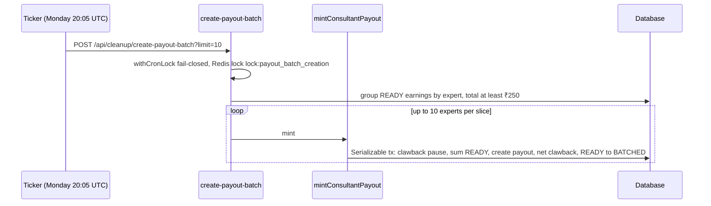
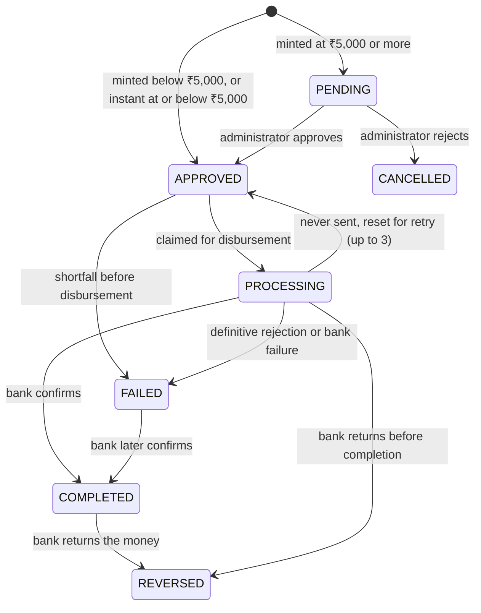

# Consultant payouts

A consultant payout (`ConsultantPayout`) pays an individual expert the sum of their READY earnings in one bank transfer. This page is the reference for the whole rail: who is eligible, how a batch is built, what approves it, every check that runs before money leaves, how the answer from the bank is applied, and how the platform recovers when the answer is lost. The organisation rail has the same shape and is in [organisation payouts and clawbacks](05-org-payouts-and-clawbacks.md). The bank rail itself is in [RazorpayX](04-razorpayx.md), and the tax taken out is in [TDS withholding](06-tds-withholding.md).

## Constants

All amounts are integer paise. They live in `PAYOUT_CONSTANTS` (`lib/payments/payouts/constants.ts`) unless noted.

| Constant                            | Value               | Meaning                                                                                            |
| ----------------------------------- | ------------------- | -------------------------------------------------------------------------------------------------- |
| `MINIMUM_PAYOUT_AMOUNT`             | 25,000 (₹250)       | A payout below this is never minted                                                                |
| `AUTO_APPROVE_THRESHOLD`            | 500,000 (₹5,000)    | A batch payout strictly below this is approved at mint; at or above it waits for an administrator  |
| `INSTANT_PAYOUT_AUTO_APPROVE_PAISE` | 500,000 (₹5,000)    | An instant payout at or below this is approved and sent at once; the default is the constant above |
| `CLAWBACK_RECOVERY_PAUSE_PAISE`     | 1,000,000 (₹10,000) | An expert owing more than this in clawback is skipped by mint                                      |
| `MAX_RETRY_ATTEMPTS`                | 3                   | Resets of a payout that was never sent before it is failed for good                                |
| `PAYOUT_ACCOUNT_COOLING_OFF_MS`     | 48 hours            | A new default payout account cannot be paid sooner (`payout-requirements.ts`)                      |

## Who is eligible

`checkPayoutEligibility` and `payoutEligibilityReason` (`lib/payments/payouts/payout-requirements.ts`) answer with the first gate that fails, in the order the batch job would refuse.

1. `LIVE_PAYOUTS_OFF` — the `ENABLE_LIVE_PAYOUTS` flag is off.
2. `NON_INDIA` — the expert's tax information says they are not an Indian resident.
3. `NO_ACCOUNT` — there is no default payout account.
4. `UNVERIFIED` — the default account has not passed verification (penny drop or reverse penny drop).
5. `PAYOUT_ACCOUNT_FROZEN` or `PAYOUT_ACCOUNT_COOLING_OFF` — the payee froze the account, or it became the default less than 48 hours ago (`payoutAccountHold`).
6. `CLAWBACK_RECOVERY_PAUSE` — the expert owes more than ₹10,000.
7. `BELOW_MINIMUM` — READY earnings net of refunds are under ₹250.

The same function feeds the Earnings banner, the Get-paid page and the Home needs-you row, so the three cannot disagree. `payoutRequirements` adds what the expert still has to give: a payout account and its verification block a transfer outright, while a missing PAN or entity type only raises the withholding rate, so those are due now only once earnings exist. A missing GSTIN is only ever "eventually due".

## Building a batch

`runCreatePayoutBatches` (`lib/payments/payouts/scheduled-runs.ts`) runs the consultant and organisation rails in one cron lease. The ticker fires it every 15 minutes at :05, :20, :35 and :50 on Mondays from 20:00 to 23:00 UTC (Tuesday 01:30 to 04:30 IST). Each slice mints at most 10 payouts per rail, and `createPayoutBatchSlice` skips an expert who already received a batch payout since the window opened, so every slice of one window batches each expert at most once. Only a minted payout spends the slice's budget.

`mintConsultantPayout` in `payout-service.ts` builds one expert's payout. It does the following, mostly inside one Serializable transaction.

1. Skips the expert if there is no verified default account, if the account is frozen or cooling off, or if the account is on a gateway with no implementation (`isUnimplementedGateway`).
2. Skips the expert if the outstanding clawback exceeds ₹10,000, so a clawback committing after the read conflicts and retries.
3. Sums the READY earnings net of refunds. Below ₹250 it mints nothing.
4. Creates the payout with the idempotency key `payout_<consultantProfileId>_<batchId>`, status APPROVED with approver `SYSTEM_AUTO_APPROVE` if the amount is below ₹5,000 and PENDING otherwise, the bank method (BANK_TRANSFER or UPI) from the account type, and an MSME deadline `mustPayByDate` (see [MSME and statutory exports](../60-tax/04-msme-statutory-exports-and-calendar.md)).
5. Nets any outstanding clawback against the payout, up to what leaves the payout minimum and room for the highest withholding rate (`recoverClawbackOnPayout`, `recoverablePaise`).
6. Claims the earnings READY to BATCHED with a conditional update and rolls the whole transaction back if the count differs from what was read.

The batch lock is a short-lived Redis mutex that fails closed: if Redis is mocked or unreachable the run throws `CronLockUnavailableError` rather than risk two runners batching the same experts. Cron mutual exclusion itself is the Postgres lease from `withCronLock`.

A person can also mint a batch on demand through `POST /api/admin/payouts` (an admin money door with step-up, reason and ops log), naming the experts.

## Approval

A PENDING payout is decided at `POST /api/admin/payouts/[id]` with `approve` or `reject` and a reason. `approvePayout` moves PENDING to APPROVED by conditional update, so a concurrent reject cannot produce an APPROVED payout with no backing. `rejectPayout` moves PENDING to CANCELLED and returns the BATCHED earnings to READY. Maker-checker applies while the platform has more than one active administrator: the administrator who created a payout cannot approve it (`PAYOUT_MAKER_CHECKER_VIOLATION`). With a single administrator the self-approval is allowed and recorded as a `PAYOUT_SOLO_ADMIN_SELF_APPROVAL` system event. In the back office, approving ₹10,000 or more asks the administrator to type a confirmation word.

An instant payout (`createInstantPayout`) is the expert's own request, `POST /api/consultant/payouts/instant`, which needs a recently re-authenticated session and is rate-limited. It is refused with `PAYOUTS_DISABLED` while the live flag is off, `NOTHING_AVAILABLE` when nothing is READY, `PAYOUT_NOT_ELIGIBLE` when a gate fails, `PAYOUT_BUSY` while a batch is running and `INSTANT_ALREADY_TODAY` for a second request on the same India day. The day's idempotency key is `instant_<consultantProfileId>_<YYYYMMDD in IST>`, so a second request on the same day finds the existing row. At or below ₹5,000 it is approved and sent immediately; above that it queues for an administrator. `previewInstantPayout` runs the same planner as disbursement so the preview matches the payout.

## Disbursement

`processApprovedPayouts` takes APPROVED payouts oldest first, with fewer than three resets. It runs only while `ENABLE_LIVE_PAYOUTS` is on, it holds the Redis lock `lock:payout_processing`, and it checks the RazorpayX balance before the run (`assertPayoutBalance`, which holds the batch on a known shortfall and fails open but loudly on an unknown balance). The ticker passes `limit=5`, so each hourly run attempts at most five consultant payouts and five organisation payouts. An on-demand run through `POST /api/admin/payouts/process` is bound to a 20-second budget.

For each payout, `processSinglePayout` does the following in order.

1. **Maker-checker on disbursement.** An administrator who approved a payout cannot also trigger its disbursement by hand while more than one administrator exists.
2. **The claim gate**, in a Serializable transaction (`runConsultantPayoutClaimGate`). It refuses to send while any earning's payment has a live chargeback (`DISPUTE_GATED_PAYMENT_WHERE`) or a refund that is still pending or has not cascaded (`REFUND_GATED_PAYMENT_WHERE`), both in `shared-lifecycle.ts`. It fails the payout with `SHORTFALL_BEFORE_DISBURSEMENT` and returns the earnings to READY if refunds since batching mean the earnings now owe less than the payout. Otherwise it claims APPROVED to PROCESSING by conditional update; a lost claim means another runner owns the row.
3. **Destination.** The payout is sent to the account recorded at mint, never to a later default. A pre-snapshot payout falls back to the current default, which must also be out of cooling-off.
4. **Residency.** A non-resident expert's payout is refused: section 195 withholding is not implemented.
5. **TDS plan.** `planConsultantPayoutTds` computes the withholding, any carry from earlier payouts and any credit, and `stage` writes the result to the row before the gateway call, so an immediate completion webhook posts the correct cash leg. If a second payout wins the one TDS catch-up allowed per financial year, the loser re-plans on its own gross (see [TDS withholding](06-tds-withholding.md)).
6. **Zero cash.** If clawback recovery and TDS absorb the whole payout, `completeZeroCashConsultantPayout` completes it locally with no gateway call.
7. **Submit.** The payout goes to RazorpayX with the net amount, a bank mode chosen by amount and account type, and an idempotency header derived from the stored key. `submittedToGateway` is set just before the request leaves.

### When the answer is not clear

`handleProcessSinglePayoutError` applies one rule: a payout fails only if the request never left (`submittedToGateway` false) or the gateway rejected it definitively. A definitive rejection is an HTTP 4xx other than 408, 409 and 429 (`isDefinitiveGatewayRejection`).

| Situation                                                             | Result                                                                                                              |
| --------------------------------------------------------------------- | ------------------------------------------------------------------------------------------------------------------- |
| The gateway accepted the payout but the database write failed         | Stays PROCESSING with the gateway id saved if possible; a fatal Sentry report names the payout                      |
| The request left and the failure is a timeout, 5xx or unknown         | Stays PROCESSING with a note that the outcome is unknown; the stuck-payout job asks the gateway by reference id     |
| The request never left, or the gateway answered with a definitive 4xx | PROCESSING to FAILED by conditional update, earnings back to READY, TDS fields cleared, clawback recovery re-opened |

## The outcome

`handlePayoutWebhook` applies the bank's status inside a Serializable transaction and is idempotent: a terminal status is never overwritten. The payout is found by the gateway id, or by the platform's own id carried as the reference when the gateway id was never saved.

- **COMPLETED.** The earnings move BATCHED to PAID. If refunds landed while the payout was in flight and the earnings now owe less than the payout, the shortfall is added to `clawbackAmountPaise` and booked as a clawback. The ledger posts `payout:<id>`: `Dr CONSULTANT_PAYABLE` for the amount less any recovered clawback, `Cr CASH` for the net sent, and `Cr TDS_PAYABLE` for the TDS withheld (a TDS credit posts the other way). A `TDSRecord` for section 194O is written, and a credit writes a negative record with a `TdsAdjustment` (see [TDS withholding](06-tds-withholding.md)).
- **FAILED or CANCELLED.** The earnings return to READY, the TDS records and staged TDS fields are cleared, and clawback recovery is re-opened, so the next Monday batch pays them again.
- **FAILED, then the bank confirms.** `completeLocallyFailedPayoutInTx` completes the payout, re-attaches the earnings that are still READY under it, books the rest as a clawback, and records an ERROR `PAYOUT_COMPLETED_AFTER_LOCAL_FAILED` event.
- **REVERSED** (`markConsultantPayoutReversed`, from the `payout.reversed` event). After completion, the inverse of the completion journal posts under `payout-reversal:<id>`, PAID earnings reopen as READY, the TDS deduction is reversed, clawback recovery is released, and clawbacks raised against that payout are voided so the reopened earnings are not netted twice. Before completion, the earnings simply detach to READY with no journal.

## When the answer never arrives

Two jobs on the ticker repair what a webhook missed. Both hold fail-closed locks and are held while maintenance is DEGRADED.

- `handle-stuck-payouts` runs every two hours, with up to five rows per rail, and looks at payouts that have been PROCESSING for more than 24 hours. With no gateway id it asks RazorpayX by the platform's own reference id. A payout the gateway holds is settled through `handlePayoutWebhook`. A payout the gateway has no record of is reset to APPROVED for a safe retry under the same idempotency key, up to `MAX_RETRY_ATTEMPTS` (3) attempts in all; at the third "no record" it is failed with its earnings released instead of being reset again, because the disbursement run selects only APPROVED payouts below that count. For example, an expert's ₹12,000 payout whose reply is lost on Monday and whose two retries meet a RazorpayX 5xx is failed on Thursday, and the ₹12,000 goes into the next batch. Any other answer (a lookup error, two payouts on one reference, a gateway id bound meanwhile) leaves it PROCESSING with its earnings linked. An id the gateway does not know is retired as FAILED. An ambiguous lookup raises an error for a person.
- `reconcile-payout-status` runs every two hours, offset from the stuck handler, with up to eight rows per cohort. It polls consultant payouts that are PENDING or PROCESSING, older than 48 hours and younger than 30 days, with a gateway id, and applies the status through `handlePayoutWebhook`. A second cohort is payouts COMPLETED within the last 14 days: if RazorpayX now reports the payout reversed, `markConsultantPayoutReversed` runs. The organisation rail has matching cohorts. Both jobs rotate through rows by the least recently reconciled, so a large backlog drains.

## Routes

| Route                                                                                                         | Who                                                       | Does                                       |
| ------------------------------------------------------------------------------------------------------------- | --------------------------------------------------------- | ------------------------------------------ |
| `GET /api/admin/payouts`                                                                                      | Back office, `payouts.read`                               | Lists payouts                              |
| `POST /api/admin/payouts`                                                                                     | Administrator, `payouts.manage`, step-up, reason, ops log | Mints a batch for named experts            |
| `POST /api/admin/payouts/[id]`                                                                                | Administrator, `payouts.manage`, step-up, reason, ops log | Approves or rejects a PENDING payout       |
| `POST /api/admin/payouts/process`                                                                             | Administrator, `payouts.manage`, step-up, reason, ops log | Runs disbursement for APPROVED payouts     |
| `POST /api/consultant/payouts/instant` and `/preview`                                                         | The expert, fresh session                                 | Requests or previews a Get-paid-now payout |
| `POST /api/cleanup/create-payout-batch`, `process-payouts`, `handle-stuck-payouts`, `reconcile-payout-status` | The ticker, `Authorization: Bearer $CRON_SECRET`          | Runs the scheduled job in a bounded slice  |

While maintenance is DEGRADED, `/api/admin/payouts`, `/api/consultant/payouts/instant` and the four financial jobs above are blocked (`WRITE_BLOCKED_IN_DEGRADED` in `lib/maintenance-edge.ts`, `FINANCIAL_JOB_NAMES` in `lib/cron/financial-jobs.ts`). Webhooks are exempt, so a bank confirmation is still applied.

## Worked examples

**A clawback is netted.** Hannah was paid ₹12,000 on 2026-10-20. Later Priya's ₹5,000 session in that payout is refunded in full, and Hannah's 400,000 paise share was already paid out with no TDS withheld. The refund posts `Dr CONSULTANT_RECEIVABLE 400,000 / Cr CONSULTANT_PAYABLE 400,000` (key `clawback:<refundId>:<payoutId>`). On Monday 2026-10-26 Hannah has 1,000,000 paise READY. Her outstanding clawback of 400,000 is below the ₹10,000 pause, so the payout is minted with the clawback netted: the recoverable ceiling is 1,000,000 − 25,000 − 200,000 = 775,000, and 400,000 is recovered under `clawback-recovery:<payoutId>` (`Dr CONSULTANT_PAYABLE / Cr CONSULTANT_RECEIVABLE`). The payout row keeps its 1,000,000 gross, and 600,000 paise, less any TDS, reaches Hannah's bank. If the payout fails, the recovery journal is mirrored back and the clawback is owed again.

**A lost answer.** A payout of 1,200,000 paise is sent at 12:00 IST, and the request times out. The payout stays PROCESSING with its idempotency key stored. The next stuck-payout run asks RazorpayX for a payout with reference equal to the payout id. If RazorpayX holds it, its status is applied. If RazorpayX has no record, the payout resets to APPROVED and the retry sends it under the same key, so RazorpayX can deduplicate a request it did accept. The retry sends the amount and TDS staged by the first attempt (`netAmount` and the TDS columns) instead of planning again, because RazorpayX rejects a different body under a used key; A payout planned while the retry waits counts its staged TDS, so it does not take the year's catch-up or credit a second time. Two cases cannot be resent as staged: another payout took the year's 194-O catch-up (`TDS_CATCH_UP_TAKEN`, possible only for a payout planned before staged retries were counted), or the TDS was staged in a financial year that has ended (`TDS_FY_CROSSED`). Either way the payout asks RazorpayX by reference again, outside any transaction. With no payout found, it fails unsent with its TDS cleared and its earnings released, and the next batch pays them under a new key with the TDS planned in the current year. With a payout found, the gateway id is recorded and the row moves to PROCESSING (dropping a catch-up flag another payout holds), so the webhook or a reconciler completes it with the staged TDS; nothing is sent. A lookup error or two payouts on one reference changes nothing, and the next run asks again. A payout that carries a gateway id is never released this way. A payout sent on 31 March whose completion arrives on 1 April is not a retry and keeps its March plan. That protection lasts only as long as RazorpayX keeps the idempotency key, which its documentation does not state, so an empty lookup is strong evidence, not proof, that the first request was never accepted.

## Rules and their enforcers

| Rule                                                    | Enforcer                                                                          | Test                                                        | Repair                                            |
| ------------------------------------------------------- | --------------------------------------------------------------------------------- | ----------------------------------------------------------- | ------------------------------------------------- |
| A payout is approved from PENDING only                  | Conditional `updateMany` in `approvePayout`                                       | `__tests__/enterprise/payout-approval-cas.test.ts`          | Re-read; the other decision won                   |
| Two runners never disburse the same payout              | The APPROVED to PROCESSING claim in `runConsultantPayoutClaimGate`                | `__tests__/payments/money-races.test.ts`                    | The loser skips the row                           |
| A chargeback or in-flight refund blocks disbursement    | `DISPUTE_GATED_PAYMENT_WHERE`, `REFUND_GATED_PAYMENT_WHERE`                       | `__tests__/payments/dispute-payout-block.test.ts`           | The payout waits; the gate lifts when they settle |
| A timed-out submission is never failed on a guess       | `isDefinitiveGatewayRejection`, `handleProcessSinglePayoutError`                  | `__tests__/enterprise/process-payouts-false-failed.test.ts` | The stuck-payout job asks by reference            |
| A payout is not sent while live payouts are off         | `ENABLE_LIVE_PAYOUTS` check in `processApprovedPayouts` and `createInstantPayout` | `__tests__/payments/process-payouts-flag-off.test.ts`       | Turn the flag on at go-live                       |
| An expert gets at most one instant payout per India day | The unique `idempotencyKey` `instant_<profile>_<YYYYMMDD>`                        | `__tests__/payments/instant-payout.test.ts`                 | Wait until midnight IST                           |
| A bank webhook applies once                             | Terminal statuses are excluded in `handlePayoutWebhook`'s conditional update      | `__tests__/enterprise/payout-webhook-reconciler.test.ts`    | None needed                                       |

## Where in code

- `lib/payments/payouts/payout-service.ts` — `createPayoutBatchSlice`, `mintConsultantPayout`, `approvePayout`, `rejectPayout`, `processApprovedPayouts`, `createInstantPayout`, `handlePayoutWebhook`, `markConsultantPayoutReversed`.
- `lib/payments/payouts/scheduled-runs.ts` — `runCreatePayoutBatches`, `runProcessPayouts`.
- `lib/payments/payouts/payout-requirements.ts` — eligibility and requirements.
- `lib/payments/payouts/balance-preflight.ts` — `assertPayoutBalance`.
- `lib/payments/payouts/clawback-recovery.ts`, `paid-consultant-clawback.ts` — clawbacks.
- `scripts/payouts/handle-stuck-payouts.ts`, `scripts/payouts/reconcile-payout-status.ts` — the repair jobs.

## Related

- [How payouts work](01-how-payouts-work.md)
- [Earnings lifecycle](02-earnings-lifecycle.md)
- [Money console and admin doors](../70-operations/02-admin-money-doors.md)

## Deprecated & Superseded Approaches

- **Stripe transfers and a `STRIPE_CONNECT` payout rail.** Stripe was removed. `PayoutAccountType.STRIPE_CONNECT` and `PayoutMethod.STRIPE_TRANSFER` remain as enum values, and `resolvePayoutMethodFromAccountType` still maps them, but no code sends money through them and a non-RAZORPAY provider throws `Unsupported provider`.
- **RTGS.** The mode selector chooses only UPI, IMPS or NEFT. The exported `PAYOUT_MODES` constant, with `IMPS_LIMIT` and `RTGS_MIN`, is read nowhere and can be deleted.
- **A model called `Payout`.** The model is `ConsultantPayout`; the organisation twin is `OrganizationPayout`.
- **Failing a payout when the gateway call times out.** It released the earnings into the next batch and paid twice. A payout now fails only when the request never left or the gateway rejected it definitively.
- **An instant-payout auto-approve of ₹25,000.** The value is ₹5,000.
