# RazorpayX Payouts & Fund Account Validation Implementation Guide

> Technical reference for consultant and organization payouts in this repository using **RazorpayX Payouts** (`Contacts` → `Fund Accounts` → `Fund Account Validations` → `Payouts`).
> For the B2B/enterprise ledger and batch pipeline, also see [`docs/enterprise/10-money-and-ledger/07-payout-pipeline.md`](../../enterprise/10-money-and-ledger/07-payout-pipeline.md) and [`02-earnings-lifecycle.md`](02-earnings-lifecycle.md).

**Last Updated**: 2026-10-05

---

## 1. Architecture Overview

Familiarise uses **RazorpayX Payouts** (`https://api.razorpay.com/v1/contacts`, `/v1/fund_accounts`, `/v1/fund_accounts/validations`, `/v1/payouts`) to disburse net earnings to Indian consultants and organizations.

```mermaid
flowchart TD
    subgraph "1. Payee Onboarding & Verification"
        A["Consultant / Org Adds Bank or UPI"] --> B{"Verification Method"}
        B -->|"Bank Account (Penny Drop)"| C["POST /v1/contacts + POST /v1/fund_accounts (fa_...)"]
        C --> E["POST /v1/fund_accounts/validations (fav_...)"]
        B -->|"UPI Intent (Reverse Penny Drop)"| F["POST /v1/fund_accounts/validations (validation_type: upi_intent)"]
        E --> G["Webhook / Poll: fund_account.validation.completed"]
        F --> H["Poll GET /v1/fund_accounts/validations/:id + Create Contact & Fund Account"]
        G --> I["PayoutAccount.isVerified = true"]
        H --> I
    end

    subgraph "2. Earnings & Payout Lifecycle"
        J["Payment Captured"] --> K["ConsultantEarnings (PENDING / ON_HOLD)"]
        K -->|"Hold Expires (24h–168h)"| L["Earnings (READY)"]
        L -->|"Batch / Instant Payout"| M["Withhold Sec 194-O TDS + Create Payout (BATCHED)"]
        M -->|"POST /v1/payouts + X-Payout-Idempotency"| N["RazorpayX Processing (payout.initiated)"]
        N -->|"payout.processed"| O["Payout COMPLETED + Earnings PAID"]
        N -->|"payout.failed / reversed / rejected"| P["Payout FAILED + Restore Earnings to READY + Reverse TDS"]
    end
```



---

## 2. Canonical Source Files

| File                                                                                                      | Responsibility                                                                                                                                                                                              |
| --------------------------------------------------------------------------------------------------------- | ----------------------------------------------------------------------------------------------------------------------------------------------------------------------------------------------------------- |
| [`lib/payments/payouts/razorpay-payouts.ts`](../../../lib/payments/payouts/razorpay-payouts.ts)           | RazorpayX REST client: Contacts, Fund Accounts, Fund Account Validations, Payouts, `determinePayoutMode`, `boundPayoutIdempotencyKey`, `getRazorpayPayoutsService` (PM-10 live-key guard)                   |
| [`lib/payments/payouts/reverse-penny-drop.ts`](../../../lib/payments/payouts/reverse-penny-drop.ts)       | UPI Intent Reverse Penny Drop (`startReversePennyDrop`, `settleReversePennyDrop`) via `POST /v1/fund_accounts/validations` (`validation_type: "upi_intent"`) and reference-only `PayoutAccount` persistence |
| [`lib/payments/payouts/payout-service.ts`](../../../lib/payments/payouts/payout-service.ts)               | Consultant payout batching, approval, execution, Section 194-O TDS withholding, and `handlePayoutWebhook` / `markConsultantPayoutReversed` state transitions                                                |
| [`lib/payments/payouts/org-payout-service.ts`](../../../lib/payments/payouts/org-payout-service.ts)       | Organization payout execution (`OrganizationPayout`), `markOrgPayoutCompleted`, `markOrgPayoutFailed`, `markOrgPayoutReversed`                                                                              |
| [`lib/payments/payouts/payout-gateway-lookup.ts`](../../../lib/payments/payouts/payout-gateway-lookup.ts) | Reconciler polling helper (`getRazorpayPayoutStatus`, `findRazorpayPayoutByReference`, `mapGatewayStatus`)                                                                                                  |
| [`lib/payments/tax/tds-service.ts`](../../../lib/payments/tax/tds-service.ts)                             | Section 194-O TDS withholding (`0.1%` above ₹5,00,000 FY threshold for Resident Individual/HUF with PAN; `5%` under Sec 206AA without PAN)                                                                  |
| [`lib/payments/payouts/constants.ts`](../../../lib/payments/payouts/constants.ts)                         | Hold periods (`24h` consultation/class, `48h` webinar, `168h` subscription), minimum payout (`₹500`), auto-approve thresholds, SAC `999293`                                                                 |
| [`app/api/webhooks/utils.ts`](../../../app/api/webhooks/utils.ts)                                         | `handleRazorpayPayoutWebhook` — routes `payout.*` events to `ConsultantPayout` and `OrganizationPayout` handlers                                                                                            |

---

## 3. Contacts & Fund Accounts (`lib/payments/payouts/razorpay-payouts.ts`)

### 3.1 Contacts (`POST /v1/contacts`)

- **Payload**: `{ name, email, contact, type: "vendor", reference_id, notes }`.
- **Composite Idempotency**: RazorpayX deduplicates contacts when `{ name, email, contact, type, reference_id }` match an existing contact, returning the existing `cont_...` ID. Changing any field creates a new `cont_...`.
- **No `DELETE` endpoint**: Contacts cannot be deleted, only deactivated via `PATCH /v1/contacts/:id` with `{ active: false }`.

### 3.2 Fund Accounts (`POST /v1/fund_accounts`)

- **Bank Account**: `{ contact_id, account_type: "bank_account", bank_account: { name, ifsc, account_number } }`.
- **UPI (VPA)**: `{ contact_id, account_type: "vpa", vpa: { address } }`.
- **Deduplication**: Identical details under the same `contact_id` return the existing `fa_...` ID.
- **Immutability**: Fund account details cannot be edited once created; deactivate (`PATCH /v1/fund_accounts/:id { active: false }`) and create a new Fund Account when a consultant changes bank details.

---

## 4. Fund Account Validation: Penny Drop & Reverse Penny Drop (`lib/payments/payouts/reverse-penny-drop.ts`)

### 4.1 Penny Drop (`POST /v1/fund_accounts/validations`)

Used to verify bank accounts (`account_type: "bank_account"`) and VPAs:

```json
{
  "account_number": "<RAZORPAYX_ACCOUNT_NUMBER>",
  "fund_account": { "id": "fa_..." },
  "amount": 100,
  "currency": "INR",
  "notes": { "consultantProfileId": "..." }
}
```

- **Important Official Behavior**:
  - **Not available in Test Mode**: `POST /v1/fund_accounts/validations` is a live-banking operation and is not supported in RazorpayX test mode.
  - **₹1.00 is NOT reversed**: For bank accounts, RazorpayX transfers ₹1.00 (`100` paise) via IMPS to the beneficiary's bank account so the bank returns the registered account holder name; the ₹1.00 remains with the beneficiary.
  - **`status: "completed"` ≠ valid account**: `status: "completed"` only means the check finished. Always verify `results.account_status === "active"` (vs `"invalid"` / `"inactive"`), normalized via `summariseFundAccountValidation` in `lib/payments/payouts/razorpay-payouts.ts`.
  - **Field name**: Official RazorpayX responses and webhooks (`fund_account.validation.completed`, `fund_account.validation.failed`) use `results: { account_status, registered_name }` on standard Penny Drop and `validation_results` on Reverse Penny Drop / VPA validations. `summariseFundAccountValidation` checks `validation_results ?? results` for resilience.

### 4.2 Reverse Penny Drop (UPI Intent Flow)

Used when a consultant verifies via UPI Intent (`lib/payments/payouts/reverse-penny-drop.ts`):

1. `startReversePennyDrop(consultantProfileId)` calls `POST /v1/fund_accounts/validations` with `source_account_number: RAZORPAYX_ACCOUNT_NUMBER`, `validation_type: "upi_intent"`, and `reference_id: consultantProfileId`, returning `{ validationId: "fav_...", upiIntent }` (deep links + QR code).
2. Consultant pays ₹1.00 in their UPI app (RazorpayX **automatically refunds the ₹1.00 in real time / instantly** and resolves the underlying bank account).
3. Both `settleReversePennyDrop(consultantProfileId, validationId)` (client poll Path A) and `handleFundAccountValidationWebhook` (`fund_account.validation.completed` Path B when `entity.fund_account` is omitted) acquire Redis lock `rpd:settle:<validationId>` and invoke `persistVerifiedAccount` to create the RazorpayX Contact (`cont_...`) + `bank_account` Fund Account (`fa_...`) and persist a reference-only `PayoutAccount` row (`isVerified: true`, `accountNumberLast4`, `ifscCode`, `bankName`, `accountHolderName`).

---

## 5. Payout Execution & Idempotency (`POST /v1/payouts`)

### 5.1 Mandatory `X-Payout-Idempotency` Header

Since **15 March 2025**, RazorpayX requires the `X-Payout-Idempotency` header on every `POST /v1/payouts` request:

- **Constraints**: **4 to 36 characters**, allowed charset `[A-Za-z0-9 _-]`, retained by RazorpayX for **7 calendar days**.
- **Deterministic Folding (`boundPayoutIdempotencyKey`)**: Internal payout keys (`payout_<uuid>` = 43 chars, or `payout_<profileId>_<batchId>` = 72 chars) exceed 36 characters. `boundPayoutIdempotencyKey()` in `lib/payments/payouts/razorpay-payouts.ts` deterministically folds keys longer than 36 characters into `p_<32_hex_chars>` (34 chars) so retries always map to the exact same RazorpayX idempotency slot.
- **HTTP Error Semantics**: Reusing the same idempotency key with modified body parameters returns **`HTTP 400 / 422 BAD_REQUEST_ERROR`**, whereas concurrent in-flight requests sharing a key return **`HTTP 409 Conflict`**.

### 5.2 Payout Modes, Limits & Field Rules

| Mode   | Min Amount             | Max Amount per Txn  | Availability                                                                                                                           | Selection Rule (`determinePayoutMode`)                                                     |
| ------ | ---------------------- | ------------------- | -------------------------------------------------------------------------------------------------------------------------------------- | ------------------------------------------------------------------------------------------ |
| `UPI`  | ₹1 (`100` paise)       | **₹1,00,000** (₹1L) | **24×7 instant** (RazorpayX Lite, and **RBL / Yes Bank** Current Accounts only)                                                        | Selected when Fund Account is `vpa` (`amount <= 10_000_000` paise; throws above ₹1,00,000) |
| `IMPS` | ₹1 (`100` paise)       | **₹5,00,000** (₹5L) | **24×7 instant** across RazorpayX Lite & Current Account partner banks                                                                 | Selected for `bank_account` when `amount <= ₹5,00,000`                                     |
| `NEFT` | ₹1 (`100` paise)       | No upper limit      | Partner bank NEFT hours (`02:00–18:00` IDFC/RBL, `01:00–18:45` ICICI/Yes; 24×7 enabled via RazorpayX Support on RBL/Yes Bank)          | Selected for `bank_account` when `amount > ₹5,00,000`                                      |
| `RTGS` | **>= ₹2,00,000** (₹2L) | No upper limit      | Real-time during partner bank RTGS hours (`02:00–18:00` IDFC, `07:00–18:30` Yes, `08:00–17:30` RBL, `09:30–17:15` ICICI; working days) | Available for high-value transfers `>= ₹2,00,000`                                          |
| `IFT`  | ₹1 (`100` paise)       | Partner bank policy | **24×7 instant** internal transfer when source and beneficiary share the same partner bank (`ICICI`, `Axis`, `Yes`, `RBL`, `IDFC`)     | Available when source & beneficiary share a partner bank                                   |

- **`purpose`**: Must match an active purpose on the RazorpayX account (`"payout"`, `"refund"`, `"cashback"`, `"salary"`, `"utility bill"`, `"vendor bill"` — note the space in `"utility bill"` and `"vendor bill"`, immutable once created, up to 400 custom purposes). We pass `"payout"`.
- **`narration`**: Max **30 characters**, **alphanumeric and spaces only** (no hyphens, underscores, or punctuation). Appears on the payee's bank statement (`"Familiarise Consultant Payout"` / `"Familiarise org payout"`).
- **`reference_id`**: Max **40 characters**, set to `payout.id`.

---

## 6. Payout Status Machine & Webhooks

| RazorpayX Status | Webhook Event(s)                     | Internal `PayoutStatus`                   | Handler Action (`lib/payments/payouts/payout-service.ts` & `org-payout-service.ts`)                                                                   |
| ---------------- | ------------------------------------ | ----------------------------------------- | ----------------------------------------------------------------------------------------------------------------------------------------------------- |
| `queued`         | `payout.queued`                      | `PENDING` (`PROCESSING` on poll)          | Queued due to low balance (`queue_if_low_balance: true`) or partner bank window; auto-expires after **3 months**                                      |
| `pending`        | `payout.pending`                     | `PENDING`                                 | Awaiting RazorpayX workflow approval; auto-rejected after **3 months**                                                                                |
| `processing`     | `payout.initiated`, `payout.updated` | `PROCESSING`                              | In flight with partner bank (up to T+3 working days on NPCI Deemed Success)                                                                           |
| `processed`      | `payout.processed`, `payout.updated` | `COMPLETED`                               | Stores `utr` (including delayed NEFT/RTGS `utr` delivered via `payout.updated`), marks `ConsultantEarnings` / `OrganizationEarnings` as `PAID`        |
| `failed`         | `payout.failed`                      | `FAILED`                                  | Extracts reason from `failure_reason ?? status_details.description ?? status_details.reason`; restores earnings to `READY` and reverses TDS           |
| `reversed`       | `payout.reversed`, `payout.updated`  | `REVERSED`                                | Bank returned funds pre- or post-settlement (`markConsultantPayoutReversed` / `markOrgPayoutReversed`); restores earnings to `READY` and reverses TDS |
| `rejected`       | `payout.rejected`                    | `FAILED`                                  | Rejected in approval workflow; restores earnings to `READY`                                                                                           |
| `cancelled`      | `payout.cancelled`, `payout.updated` | `CANCELLED` (consultant) / `FAILED` (org) | Queued payout cancelled before processing                                                                                                             |

---

## Appendix: Why RazorpayX Payouts Was Chosen Over Razorpay Route

Earlier design drafts considered **Razorpay Route** (`LinkedAccount` `acc_...` + `transfers` `trf_...`). Familiarise deliberately uses **RazorpayX Payouts** instead because:

1. **No Consultant KYC Friction**: Razorpay Route requires onboarding each consultant as a sub-merchant Linked Account with full Razorpay KYC. With RazorpayX Payouts, the platform only collects bank/UPI details and verifies ownership via Penny Drop or Reverse Penny Drop.
2. **Wallet, Credit & B2B Invoice Funding**: Bookings can be funded by organization wallets, post-paid B2B invoices (`OrganizationInvoice`), or multi-leg payments where there is no single 1:1 consultee Razorpay payment to split via Route.
3. **Consolidated Weekly Batching & Section 194-O TDS**: RazorpayX lets us aggregate multiple `READY` earnings rows into a single weekly (or instant) payout, compute cumulative FY Section 194-O TDS across all earnings cleanly in `lib/payments/tax/tds-service.ts`, and disburse the exact post-TDS net amount in one transfer.
