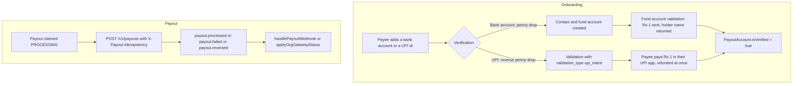

# RazorpayX payouts and account validation

The platform disburses expert and organisation earnings through RazorpayX, Razorpay's payouts product. The client lives in `lib/payments/payouts/razorpay-payouts.ts` and calls four RazorpayX resources. Onboarding a payout account creates a contact and a fund account and validates it (by bank or by UPI); paying then submits only the payout, against the fund account already on file. RazorpayX is the only payout rail in the code. Card collection is a separate Razorpay product with separate credentials (see [Razorpay gateway and currency](../10-money-in/04-razorpay-gateway-and-currency.md)).

## Source files

| File                                            | Responsibility                                                                                                           |
| ----------------------------------------------- | ------------------------------------------------------------------------------------------------------------------------ |
| `lib/payments/payouts/razorpay-payouts.ts`      | The REST client, `determinePayoutMode`, `boundPayoutIdempotencyKey`, `isDefinitiveGatewayRejection`, the live-key guards |
| `lib/payments/payouts/reverse-penny-drop.ts`    | UPI intent verification: `startReversePennyDrop`, `settleReversePennyDrop`, `handleFundAccountValidationWebhook`         |
| `lib/payments/payouts/payout-gateway-lookup.ts` | Polling helpers: `getRazorpayPayoutStatus`, `findRazorpayPayoutByReference`, `mapGatewayStatus`                          |
| `lib/payments/payouts/balance-preflight.ts`     | `assertPayoutBalance`, the check before a run                                                                            |
| `app/api/webhooks/utils.ts`                     | `handleRazorpayPayoutWebhook`, which routes `payout.*` events to the consultant or organisation handler                  |

## Contacts and fund accounts

A contact (`POST /v1/contacts`) carries the payee's name, email and phone with the type `vendor`. A fund account (`POST /v1/fund_accounts`) attaches a bank account (name, IFSC, account number) or a UPI address to a contact. RazorpayX deduplicates identical contacts and identical fund accounts and returns the existing ids, and fund account details cannot be edited, so a payee who changes bank details gets a new fund account. The platform stores only a reference to the account (`PayoutAccount`, `OrganizationPayoutAccount`): the last four digits, the IFSC, the bank name, the holder name and the RazorpayX ids, never a full account number.

## Verifying an account

**Penny drop** (`POST /v1/fund_accounts/validations`) is for a bank account. It is a live-banking operation and does not run in RazorpayX test mode. RazorpayX sends Rs 1 by IMPS so the bank returns the registered holder name, and the Rs 1 stays with the beneficiary. A validation that has `status: "completed"` has only finished; the account is valid only if `results.account_status` is `active`. `summariseFundAccountValidation` reads `validation_results` first and `results` second, because the two response shapes differ, and returns `valid`, `invalid` or `unknown`.

**Reverse penny drop** is for a UPI payee. `startReversePennyDrop` creates a validation with `validation_type: "upi_intent"` and the payee's profile id as the reference, and returns deep links and a QR code. The payee pays Rs 1 in their UPI app, RazorpayX refunds it at once and resolves the underlying bank account. Two paths can finish the flow: the client polling `settleReversePennyDrop`, and the `fund_account.validation.completed` webhook (`handleFundAccountValidationWebhook`). Both take the Redis lock `rpd:settle:<validationId>` so only one creates the contact and fund account and saves the verified reference-only account.

A payee's first account can be paid at once. A change of default account starts a 48-hour cooling-off (see [how payouts work](01-how-payouts-work.md)).

## Sending a payout

`createPayout` posts to `/v1/payouts` from the RazorpayX account number `RAZORPAYX_ACCOUNT_NUMBER`. It sends the fund account id, the amount in paise, the currency (INR only), the mode, the purpose `payout`, `queue_if_low_balance: true`, a `reference_id` equal to the platform's payout id, a narration, and notes.

**Idempotency.** RazorpayX requires an `X-Payout-Idempotency` header of 4 to 36 characters from letters, digits, space, underscore and hyphen, and refuses anything else with a 400. The platform's keys are longer: a consultant payout uses `payout_<consultantProfileId>_<batchId>` and an organisation payout `payout_<uuid>`. `boundPayoutIdempotencyKey` folds a key that is too long or has a forbidden character into `p_` plus the first 32 hex characters of its SHA-256, which is a pure function of the key. The same payout row therefore always maps to the same RazorpayX slot, and a request that timed out after RazorpayX accepted it returns the original payout instead of paying a second time, for as long as RazorpayX keeps the key. Its API reference does not state that window, so the stuck-payout and redrive paths look the payout up by `reference_id` before any stale row is resubmitted. Reusing a key with a different body is refused by RazorpayX.

**Mode.** `determinePayoutMode` chooses by account type and amount.

| Account type | Amount                             | Mode                                            |
| ------------ | ---------------------------------- | ----------------------------------------------- |
| UPI address  | up to ₹1,00,000 (10,000,000 paise) | `UPI`                                           |
| UPI address  | above ₹1,00,000                    | The function throws; a bank account is required |
| Bank account | up to ₹5,00,000 (50,000,000 paise) | `IMPS`                                          |
| Bank account | above ₹5,00,000                    | `NEFT`                                          |

The organisation rail always sends to a bank account, so it chooses IMPS or NEFT. RTGS and same-bank transfers exist at RazorpayX but the code never selects them.

**Narration** is optional: organisation payouts send one and consultant payouts omit it. When present it is limited to 30 characters of letters, digits and spaces, and the client strips anything else. **`reference_id`** is the platform's payout id, which is how a lost submission is found again (`listPayouts` by reference).

**Timeout and definitive failure.** Every call has a 30-second ceiling. After the request leaves, only an HTTP 4xx other than 408, 409 and 429 counts as a definitive rejection (`isDefinitiveGatewayRejection`). A timeout, a socket error, an unreadable success body or a 5xx cannot tell "rejected" from "accepted but the reply was lost", so it never fails a payout. An error response keeps its HTTP status even when its body cannot be parsed, so an unreadable 400 is still definitive.

## Status mapping

Webhook events reach `handleRazorpayPayoutWebhook` in `app/api/webhooks/utils.ts`, which first looks for an organisation payout by gateway id or reference, and otherwise treats the event as a consultant payout. The dispatcher in `app/api/webhooks/razorpay-dispatch.ts` accepts `payout.queued`, `payout.pending`, `payout.initiated`, `payout.processed`, `payout.failed`, `payout.rejected`, `payout.reversed`, `payout.cancelled` and `payout.updated`.

| RazorpayX status            | Consultant payout                                                                                          | Organisation payout                                                                                                                 |
| --------------------------- | ---------------------------------------------------------------------------------------------------------- | ----------------------------------------------------------------------------------------------------------------------------------- |
| `queued`, `pending`         | PENDING, or unchanged while PROCESSING                                                                     | No change                                                                                                                           |
| `processing`, `initiated`   | PROCESSING                                                                                                 | No change (already PROCESSING)                                                                                                      |
| `processed`                 | COMPLETED, earnings PAID, UTR stored                                                                       | COMPLETED, earnings PAID, UTR stored                                                                                                |
| `failed`, `rejected`        | FAILED, earnings back to READY, TDS cleared                                                                | FAILED, earnings back to READY                                                                                                      |
| `cancelled`                 | CANCELLED                                                                                                  | FAILED                                                                                                                              |
| `reversed`                  | REVERSED: after completion with the inverse journal, before completion with the earnings detached to READY | REVERSED: the same two cases                                                                                                        |
| `payout.updated` with a UTR | UTR backfilled, including a late NEFT or RTGS UTR                                                          | UTR written unconditionally, and the event's status is applied through the status helpers, which ignore a stale terminal transition |

An unknown status is recorded as a system event and leaves the payout unchanged. The consultant polling jobs use `mapGatewayStatus`, which treats `queued` and `pending` as PROCESSING and `rejected`, `failed` and `reversed` as FAILED for a payout that was never completed. Organisation polling instead passes the raw status to `applyOrgGatewayStatus`, which stores a pre-completion reversal as REVERSED and writes a UTR only while none is stored. A reversal of a payout the platform already marked COMPLETED arrives through the webhook or through the reconcile job's completed-payout check.

## Live-key guards

Two guards stop money from silently going nowhere.

- **Test key with live payouts.** `getRazorpayPayoutsService` refuses to start with a `rzp_test_` key while `ENABLE_LIVE_PAYOUTS` is on (`RAZORPAYX_TEST_KEYS_IN_LIVE_MODE`). In test mode no bank account is debited while the ledger would mark the payout COMPLETED. `isRazorpayPayoutsConfigured` rethrows that error rather than answering "not configured", so the balance guard cannot fail open on test keys.
- **Static egress.** Live RazorpayX answers only allowlisted IP addresses, and the hosting platform has no static address. With a live key and no `RAZORPAYX_EGRESS_PROXY_URL`, every call is refused with `RAZORPAYX_EGRESS_NOT_CONFIGURED`. With the variable set, calls go through the proxy agent.

Credentials come from `resolveRazorpayXCredentials`: `RAZORPAYX_KEY_ID` and `RAZORPAYX_KEY_SECRET`, falling back to the checkout keys, so the disbursement path and the status pollers authenticate as the same merchant. The balance check (`getAccountBalance`) reads the RazorpayX account, and `assertPayoutBalance` holds a batch on a known shortfall and fails open with a warning when the balance cannot be read. RazorpayX's `queue_if_low_balance` is the gateway-side backstop.

## Rules and their enforcers

| Rule                                                  | Enforcer                                                          | Test                                                         | Repair                                           |
| ----------------------------------------------------- | ----------------------------------------------------------------- | ------------------------------------------------------------ | ------------------------------------------------ |
| One payout row maps to one RazorpayX idempotency slot | `boundPayoutIdempotencyKey` (pure function of the stored key)     | `__tests__/payments/razorpay-productionization.test.ts`      | None needed                                      |
| A transient failure never fails a payout              | `isDefinitiveGatewayRejection`                                    | `__tests__/payments/org-payout-error-classification.test.ts` | The stuck-payout job asks RazorpayX by reference |
| Live payouts never run on test keys                   | `RAZORPAYX_TEST_KEYS_IN_LIVE_MODE` in `getRazorpayPayoutsService` | `__tests__/payments/razorpay-test-key-guard.test.ts`         | Set the live keys                                |
| A low RazorpayX balance holds the run                 | `assertPayoutBalance`                                             | `__tests__/enterprise/payout-balance-preflight.test.ts`      | Fund the RazorpayX account                       |
| A reverse penny drop settles once                     | The Redis lock `rpd:settle:<validationId>`                        | none                                                         | Re-poll the validation                           |

## Where in code

See the source file table above. The ticker jobs that repair a missed webhook are in [consultant payouts](03-consultant-payouts.md).

## Related

- [How payouts work](01-how-payouts-work.md)
- [Organisation payouts and clawbacks](05-org-payouts-and-clawbacks.md)
- [Go-live checklist](../70-operations/07-go-live-checklist.md)

## Deprecated & Superseded Approaches

- **Razorpay Route** (linked accounts and transfers) was considered and not built. Route needs every expert onboarded as a sub-merchant with full Razorpay KYC, and it assumes one payment funds one transfer. Bookings here can be funded by wallets, invoices and multi-leg payments, so there is no single payment to split. RazorpayX lets the platform batch many earnings into one weekly transfer and withhold TDS on the cumulative figure. If you find `LinkedAccount` or `transfers.create` code, it is dead.
- **Stripe Connect** payouts. Stripe is removed; the `STRIPE_CONNECT` account type is a dead enum value.
- **RTGS in the mode table.** Older text listed RTGS and IFT as selectable. The code selects only UPI, IMPS and NEFT.
