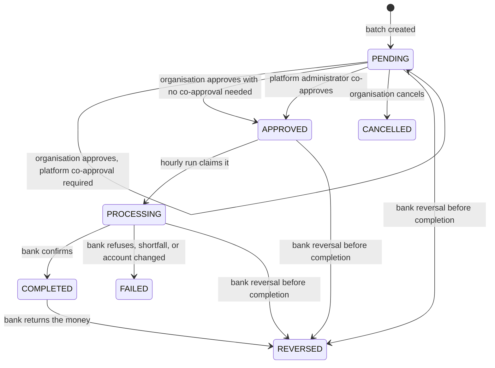

# Organisation payouts and clawbacks

A host organisation earns a share of every booking its experts deliver. That share accrues as `OrganizationEarnings` rows, and an `OrganizationPayout` pays it out. The rail mirrors the [consultant rail](03-consultant-payouts.md) but adds an approval step inside the organisation, a second approval by the platform for large or recently changed payouts, a platform hold, and tax withholding computed on the organisation's net share. This page also covers clawbacks, the way the platform recovers money after a refund or a lost chargeback arrives once a payout has already left. Clawbacks apply to both rails.

## What an organisation payout holds

An organisation payout rolls up READY organisation earnings. Each earning stores the gross amount, the platform fee, the organisation's share (`orgSharePaise`) and the refunded amount (`refundedAmountPaise`), all snapshotted from the rate card in force at booking (see [earnings lifecycle](02-earnings-lifecycle.md)). The payout stores these totals:

- `grossRevenuePaise`, `platformFeePaise`, `refundsPaise` — sums over the batched earnings.
- `netPayoutPaise` — the organisation share less refunds. This is the base for tax and for the payable that the ledger clears.
- `tdsAmountPaise` and `tdsRateAppliedBps` — the tax withheld.
- `amountPaise` — the cash actually sent: `netPayoutPaise − tdsAmountPaise − recovered clawback`.

The identity `amountPaise + tdsAmountPaise + recovered clawback = netPayoutPaise` is asserted before any ledger posting (`assertOrgPayoutWithholdingIdentity`). A violation refuses the posting, raises a `ORG_PAYOUT_WITHHOLDING_MISMATCH` error and a Sentry report, and leaves the payout where it is.

## Building a batch

`createOrgPayoutBatch` (`lib/payments/payouts/org-payout-service.ts`) makes one payout for one organisation and one time window, inside a Serializable transaction guarded by a short Redis lock (`org:<orgId>:payout-batch`).

1. The organisation's payout account must be VERIFIED and out of cooling-off or freeze. The payout records the account's id.
2. It creates the payout row PENDING, then claims every READY, un-batched earning with `createdAt` in the window to this payout in one conditional update. Zero rows claimed refuses the batch. Earnings in mixed currencies are refused.
3. It sums the earnings and refuses a batch whose net would be zero or negative.
4. It computes TDS on the net payout (see below), nets any outstanding clawback, and stamps the MSME deadline.
5. It moves the claimed earnings READY to BATCHED and writes an audit row.

The scheduled path is `createOrgPayoutBatches`, run inside `runCreatePayoutBatches` on Monday from 20:00 to 23:00 UTC with ten payouts per slice. Each organisation's window starts at its oldest READY earning, so an earning that was released late is still batched, and the idempotency key is a hash of the organisation and the window end, so one payout exists per window. An organisation in an organisation-specific OFFLINE maintenance window is skipped. A person with `payouts.manage` can also create a batch on the organisation's payouts page, through `POST /api/organizations/[orgId]/payouts`, which needs a recently re-authenticated session and delegates to the same function.

## Approval

The transitions are defined in `PAYOUT_ALLOWED_FROM` (`lib/enterprise/transitions.ts`), whose only `REVERSED` source is COMPLETED; the reversal of a PENDING, APPROVED or PROCESSING payout is a separate conditional update inside `markOrgPayoutReversed`. Every move is a conditional update on the expected prior status.

**Inside the organisation.** `PATCH /api/organizations/[orgId]/payouts/[payoutId]` with `status: "APPROVED"` needs `payouts.manage`, a fresh session and the role permission `payouts.approve`, which Owner and Billing admin hold. The person who created the batch cannot approve it while the organisation has a second person who can. When only one person can approve, they approve their own batch by typing the organisation's slug, and the audit row records `selfApproved`. A cron-built batch has no human creator, so anyone holding the permission may approve it.

**By the platform.** The organisation's approval is not enough when `orgPayoutNeedsPlatformApproval` says so: the payout's `amountPaise` (the cash after TDS and any clawback recovery) is above ₹50,000 (5,000,000 paise), or it was created within 7 days of the organisation changing its payout account. The payout then stays PENDING with `platformApprovalRequiredAt` and `orgApprovedBy` set, and a platform administrator co-approves it at `POST /api/admin/org-payouts/[id]/approve` (step-up and a reason). `approveOrgPayout` refuses an administrator who created the payout or who approved it at the organisation (`PayoutMakerCheckerError`). The door also needs a second administrator when the payout's net exceeds ₹25,000 and two or more administrators are active (an `OpsActionProposal`, see [admin money doors](../70-operations/02-admin-money-doors.md)).

**Platform hold.** An administrator can hold a PENDING or APPROVED payout at `POST /api/admin/org-payouts/[id]/hold` (step-up, reason). `holdOrgPayout` stamps `platformHeldAt`. The run's claim refuses a held payout and `processPendingOrgPayouts` does not select it, so a held payout is never sent. `.../release` clears the stamp. A payout already PROCESSING cannot be held.

While maintenance is DEGRADED, the admin approve, hold and release doors are blocked, and so are the organisation's own payout and payout-account writes (`/api/admin/org-payouts`, `/api/organizations/*/payouts` and `/api/organizations/*/payout-account` in `WRITE_BLOCKED_IN_DEGRADED`, `lib/maintenance-edge.ts`). Webhooks stay open.

## Disbursement

`processPendingOrgPayouts` runs inside `process-payouts`, five organisation payouts per run. It takes approved payouts least recently touched first, so a payout moved back to APPROVED after an attempt waits behind every payout untouched since then, and it skips a payout that the administrator who started the run approved (maker-checker). It then reads the RazorpayX balance once for what the run can disburse, as the consultant rail does: if the balance is short it holds them all as APPROVED for the next run. It then calls `processOrgPayout` for each payout.

1. If live payouts are off, `processOrgPayout` returns the current status and claims nothing. An approved payout stays APPROVED.
2. In one Serializable transaction, it reads the payout and its account. A payout that already carries a RazorpayX payout id (a webhook can bind one by reference to an APPROVED payout) is moved to PROCESSING and sent nothing: the re-drive below reconciles it by that id, and it is never failed or sent again from here.
3. In the same transaction it runs the account checks, in this order: the payout uses RazorpayX; for a payout minted before account snapshots, the organisation's current account is neither frozen nor cooling off; the account recorded at mint exists and has a RazorpayX fund account; payouts on it are not frozen; it is VERIFIED; and it has not changed since the payout was created (the organisation's account row is edited in place, so a changed destination is a different destination). A refusal moves the payout APPROVED to FAILED through the same fail path as every other unpaid failure, and only while no RazorpayX payout id is bound. The failure reason names the check, for example `PAYOUT_ACCOUNT_PAYOUTS_FROZEN` or `PAYOUT_ACCOUNT_CHANGED`. The earnings return to READY, the payout's TDS rows are dropped, clawback recovery is released, and the organisation gets the audit row, the `payout.failed` webhook, and the payout-failed bell and email. Nothing was sent, so nothing can arrive later. For example, a ₹40,000 payout whose account is frozen after approval is failed at the next run, and the ₹40,000 waits as READY until the account can receive payouts again. The weekly batch mints nothing while the account is frozen, SUSPENDED or cooling off.
4. Still in that transaction, it refuses to send while any batched earning's payment has a live chargeback or an unresolved refund (the same `DISPUTE_GATED_PAYMENT_WHERE` and `REFUND_GATED_PAYMENT_WHERE` gates as the consultant rail). It then claims APPROVED to PROCESSING, only when `platformHeldAt` is null. Last, it fails the payout with `SHORTFALL_BEFORE_DISBURSEMENT` and returns the earnings to READY when refunds since batching mean the earnings now owe less than the batch.
5. After commit, it reads the account again immediately before the send. A freeze or change that commits after the transaction's read can still be ordered after the claim under Serializable, so the claim alone does not stop it. A refusal there moves the payout PROCESSING to FAILED while no RazorpayX payout id is bound, with the same outcome as step 3. Otherwise `submitOrgPayoutToGateway` creates the payout at the fund account just read, with mode IMPS up to ₹5,00,000 and NEFT above, and the idempotency key `payout_<id>`. `queue_if_low_balance` is set, so a balance that fell since the run's read queues it at RazorpayX.

A run reports its account refusals and its short or unknown balance once each, however many payouts they touched (`org-payout.account-refused`, `RAZORPAYX_BALANCE_INSUFFICIENT`, `RAZORPAYX_BALANCE_UNKNOWN`); each refused payout keeps its own reason.

A permanent 4xx from the gateway fails the payout and returns its earnings to READY. Any other error is rethrown and the payout stays PROCESSING. A PROCESSING payout older than an hour is reconciled by `redriveStaleProcessingOrgPayouts`, which never sends: it finds the RazorpayX payout by gateway id or by reference and applies RazorpayX's status, and if RazorpayX has no record it moves the payout back to APPROVED, so the next run's `processOrgPayout` runs steps 1 to 5 again before sending under the same key. The move back to APPROVED matches only the `updatedAt` the re-drive read, so a newer claim made while its lookup was out is never pulled back; `handle-stuck-payouts` fences its own reset the same way. The organisation rail has no retry counter, so a payout can go round APPROVED and PROCESSING for as long as RazorpayX answers "no record"; every round runs all of those checks. `handle-stuck-payouts` and `reconcile-payout-status` cover the organisation rail with the same cohorts as the consultant rail.

## Completion, failure and reversal

- **Completed** (`markOrgPayoutCompleted`): PROCESSING to COMPLETED, earnings BATCHED to PAID. A shortfall since disbursement becomes a clawback. The ledger posts `orgpayout:<id>` (kind `ORG_PAYOUT`): `Dr ORG_PAYABLE` for the net less recovered clawback, `Cr CASH` for `amountPaise`, `Cr TDS_PAYABLE` for the TDS. A `TDSRecord` is written for the organisation when TDS was withheld and the payout carries a positive applied rate; withheld TDS with no applied rate writes no record and raises an `ORG_PAYOUT_TDS_RATE_MISSING` system error instead. A `payout.completed` outbound webhook and the notices are staged in the same transaction.
- **Failed** (`markOrgPayoutFailed`): PROCESSING to FAILED, earnings back to READY, TDS records deleted, clawback recovery released. A FAILED organisation payout is final; a new batch pays the earnings.
- **Reversed** (`markOrgPayoutReversed`): after completion the inverse journal posts under `orgpayout-reversal:<id>`, PAID earnings reopen as READY, the TDS record is reversed in full and recovery is released. Before completion, the earnings simply detach.

## Tax withholding on the organisation rail

The organisation rail withholds under the default section, 194-O (10 basis points, or 0.1 percent), on `netPayoutPaise`, from the first rupee. Its computation (`computeResidentPayoutTds`) has no exemption step, so the ₹5,00,000 yearly exemption that an individual expert can use does not apply to an organisation. The base is the organisation's share after the platform fee, less refunds (`createOrgPayoutBatch`), whereas the consultant rail withholds on the gross consideration (`resolve194OTaxablePaise`); whether the organisation rail should also use the gross is an open owner question. The no-PAN rate is 500 basis points; the organisation counts as having a PAN when an encrypted PAN is on file. See [TDS withholding](06-tds-withholding.md) for the rate precedence.

## Clawbacks

A clawback is the platform recovering money it already paid out. It arises when a refund or a lost chargeback reverses an earning whose payout has COMPLETED.

**Consultant rail.** The refund journal leaves a debit on `CONSULTANT_PAYABLE`, because the payable was cleared when the payout completed. The clawback reclassifies it: `Dr CONSULTANT_RECEIVABLE / Cr CONSULTANT_PAYABLE` under `clawback:<refundId>:<payoutId>` (`postConsultantPayoutClawback`; a lost chargeback passes `dispute:<disputeId>` as the driver), net of the TDS fraction that was withheld. The payout's `clawbackAmountPaise` increases. The payout's status never changes, because that would reopen PAID earnings for a second payout.

**Organisation rail.** `postPayoutClawback` posts `Dr ORG_RECEIVABLE / Cr ORG_PAYABLE` under `clawback:<refundId>:<payoutId>:<orgEarningsId>` for the organisation share reversed net of the TDS withheld on it (one journal per share, so two collaborators' shares on one payout reversed by one refund each post their own), and increases the payout's `clawbackAmountPaise` by the same net figure. `orgClawbackNetOfTds` first reverses that TDS pro rata (`recordOrgTdsReversal`, the reversed share over `netPayoutPaise`), because the organisation never received the withheld tax. No cash moves on any funding rail: the refund journal left a debit on the host's `ORG_PAYABLE`, and the clawback moves it onto a receivable owed by the host. A top-up never settles it (`clawback:` is not in `TOPUP_SETTLED_RECEIVABLE_KEYS` in `lib/api/organizations/wallet.ts`), and the organisation's accrued-usage panel (`getOrgReceivables`) leaves the clawback-family journals out, so a clawback is never shown as invoiceable usage. A bank-returned payout reverses whatever TDS remains in full. A shortfall found at completion posts the same journal with `shortfall:<payoutId>` as the driver and no share suffix, after the completion `TDSRecord` is written so its reversal has an original to net against.

**Recovery.** When the next payout is built, `recoverClawbackOnPayout` nets the outstanding clawback from it. The ceiling is the payable less the ₹250 minimum payout and, on the consultant rail, room for the highest withholding rate (`recoverablePaise`). The recovery posts `clawback-recovery:<payoutId>` (`Dr *_PAYABLE / Cr CONSULTANT_RECEIVABLE` or `Cr ORG_RECEIVABLE`). The TDS base is untouched on both rails. On the consultant rail the payout row keeps its gross amount and the recovery lives only in the ledger; on the organisation rail `amountPaise` is reduced by the recovery while `netPayoutPaise` is not. `outstandingClawbackPaise` is the amount still owed: the receivable balance on the consultant rail and the net of `clawback:*` journals on the organisation rail. An expert owing more than ₹10,000 is skipped by the batch until the debt comes down (`CLAWBACK_RECOVERY_PAUSE_PAISE`).

If a payout that recovered a clawback later fails, is cancelled or is reversed, `releaseClawbackRecovery` mirrors the recovery journal (`clawback-recovery-release:<payoutId>`) so the debt is owed again. When the bank returns a consultant payout, `voidClawbacksRaisedOnPayout` voids the still-unrecovered part of clawbacks raised against it, because the reopened earnings are already net of the refund and would otherwise be netted twice (`clawback-void:<key>`). Whatever had already been recovered stays booked, and an `ERROR` event names the sum owed back to the expert. The organisation rail does the same: when the bank returns an organisation payout, `markOrgPayoutReversed` releases the payout's own recovery and calls `voidClawbacksRaisedOnPayout` with the `organizationId` in the same transaction. There the debt is the net credit of the `clawback:*` journals on the organisation's `ORG_PAYABLE`, and the `clawback-void:` journals reduce it. Only what later payouts have not already recovered is voided; the rest is recorded as `PAYOUT_REVERSED_CLAWBACK_ALREADY_RECOVERED`, the sum owed back to the organisation.

A clawback unrecovered after 90 days raises the `CLAWBACK_RECEIVABLE_STALE` finding in the nightly audit, so a person recovers it another way.

**Notices.** Each newly created clawback journal stages a bell in the transaction that posts it (`stageClawbackNotice`, `lib/payments/payouts/clawback-notifications.ts`): `payout-clawback` for the consultant, `org-payout-clawback` for the organisation's billing roster. A raised clawback also emails (`ClawbackNoticeEmail`), because it is the only step that creates a debt; a recovery, a release and a void are bells only, and one bank return rings one `VOIDED` bell for the sum it voided. A replayed journal stages nothing, and a broken email template leaves a `review:render_failed` row instead of rolling the clawback back (notification decision 17).

## Worked examples

**A payout that needs the platform.** LearnPro Academy hosts experts on the seeded card of 1000, 1000 and 8000 basis points. In one week 60 bookings of ₹10,000 are READY, each giving LearnPro 100,000 paise, so the org share is 6,000,000 paise (₹60,000) with no refunds. On Monday 2026-10-26 at 20:05 UTC (Tuesday 01:35 IST) the batch creates a payout PENDING. TDS at 10 basis points of 6,000,000 is 6,000 paise, so `amountPaise` is 5,994,000. That is above ₹50,000, so after the Owner approves it, it waits for a platform administrator. Because the net is above ₹25,000 and two administrators are active, the co-approval is itself held as a proposal until a different administrator approves it. After approval the hourly run sends 5,994,000 paise by IMPS. On completion the journal is `Dr ORG_PAYABLE 6,000,000`, `Cr CASH 5,994,000`, `Cr TDS_PAYABLE 6,000`.

**A clawback is recovered.** Later one of those bookings is refunded in full, reversing LearnPro's 100,000 paise share, after the payout completed. The payout withheld 6,000 on 6,000,000, so the TDS on that share is 6,000 × 100,000 ÷ 6,000,000 = 100: a reversal record of −100 is written, and the clawback journal is `Dr ORG_RECEIVABLE 99,900 / Cr ORG_PAYABLE 99,900`. The next week LearnPro has 1,000,000 paise net. TDS is 1,000, the recoverable ceiling is 1,000,000 − 1,000 − 25,000 = 974,000, so 99,900 is recovered. `amountPaise` is 1,000,000 − 1,000 − 99,900 = 899,100. The creation journal `clawback-recovery:<payoutId>` posts `Dr ORG_PAYABLE 99,900 / Cr ORG_RECEIVABLE 99,900`, and completion posts `Dr ORG_PAYABLE 900,100`, `Cr CASH 899,100`, `Cr TDS_PAYABLE 1,000`.

## Rules and their enforcers

| Rule                                                                   | Enforcer                                                                       | Test                                                           | Repair                                         |
| ---------------------------------------------------------------------- | ------------------------------------------------------------------------------ | -------------------------------------------------------------- | ---------------------------------------------- |
| A batched organisation earning always points at a payout               | `org_earnings_batched_has_payout` in `prisma/sql/check-constraints.sql`        | none (database constraint)                                     | None needed                                    |
| `amount + TDS + recovered = net` before a payout is journaled          | `assertOrgPayoutWithholdingIdentity`                                           | `__tests__/enterprise/org-payout-withholding-postings.test.ts` | Investigate the payout; the posting is refused |
| The maker of a payout cannot also approve it at the platform           | `approveOrgPayout` maker-checker                                               | `__tests__/payments/org-payout-platform-controls.test.ts`      | A different administrator approves             |
| A held payout is never sent                                            | `platformHeldAt` is null in the claim `WHERE` and the run's selection          | `__tests__/payments/org-payout-platform-controls.test.ts`      | Release the hold                               |
| A payout goes only to the account recorded at mint                     | `resolveOrgPayoutDestination`, in the claim transaction                        | `__tests__/enterprise/org-payout-redrive-gates.test.ts`        | The next batch, with a fresh approval          |
| A clawback is recovered at most once and re-opened if the payout fails | The `clawback-recovery:<id>` and `clawback-recovery-release:<id>` journal keys | `__tests__/payments/clawback-recovery-netting.test.ts`         | The release journal restores the debt          |
| Every journal balances                                                 | `ledger_txn_balanced` in `prisma/sql/ledger-triggers.sql`                      | `__tests__/enterprise/ledger-invariants.test.ts`               | None needed                                    |

## Where in code

- `lib/payments/payouts/org-payout-service.ts` — `createOrgPayoutBatch`, `createOrgPayoutBatches`, `approveOrgPayout`, `processOrgPayout`, `markOrgPayoutCompleted`, `markOrgPayoutFailed`, `markOrgPayoutReversed`, `applyOrgGatewayStatus`.
- `lib/payments/payouts/org-payout-platform-hold.ts` — `holdOrgPayout`, `releaseOrgPayoutHold`.
- `lib/payments/payouts/payout-requirements.ts` — `orgPayoutNeedsPlatformApproval`.
- `lib/payments/payouts/clawback-recovery.ts` — netting, release and void.
- `lib/payments/payouts/paid-consultant-clawback.ts` and `lib/payments/operations/reversal-engine.ts` — the clawback journals.
- `app/api/organizations/[orgId]/payouts/` and `app/api/admin/org-payouts/` — the routes.

## Related

- [How payouts work](01-how-payouts-work.md)
- [TDS withholding](06-tds-withholding.md)
- [Disputes and chargebacks](../30-refunds-disputes/02-chargebacks.md)

## Deprecated & Superseded Approaches

- **"With live payouts off the row freezes at PROCESSING."** Older runbooks say so. `processOrgPayout` returns before claiming, so an approved organisation payout stays APPROVED.
- **A clawback journal of `Dr CASH / Cr ORG_PAYABLE`.** Organisation clawbacks were once debited to `CASH`, which overstated cash until recovery posted a matching `Cr CASH`. They are now `Dr ORG_RECEIVABLE / Cr ORG_PAYABLE`; older CASH-shaped journals stay as posted, and their release and void mirrors still unwind to `CASH`, and `stepClawbackGap` reads the `ORG_PAYABLE` credit common to both shapes.
- **A model called `OrganizationReimbursement`.** It does not exist.
- **Treating FAILED organisation payouts as retryable.** A FAILED payout is final; its earnings return to READY and a new batch carries them.
- **Posting an organisation payout against `PAYOUT`.** The kind is `ORG_PAYOUT`; `PAYOUT` is the consultant kind.
