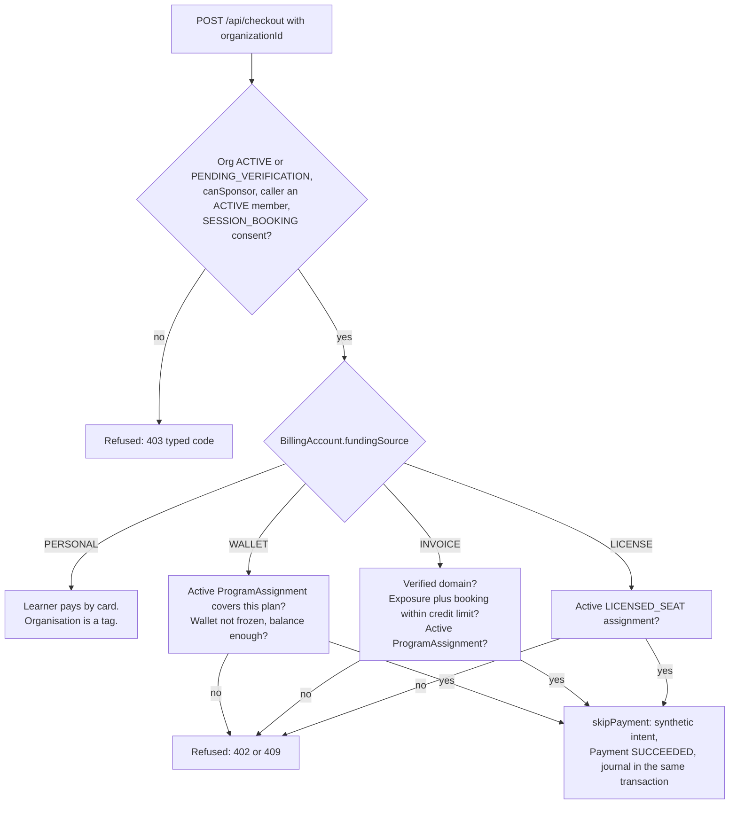

# Funding rails and permutations

A consumer booking and an organisation-sponsored booking go through the same checkout, the same confirmation writer and the same ledger. They differ in one thing: which rail pays. This page explains the four rails, the fields on a `Payment` that record whose money moved, the gates checkout applies before an organisation may sponsor a booking, and how the engine treats every combination of rail, programme type and overage behaviour. The wallet, the overage engine, and the invoice machinery each have their own page; this one is the map between them. The booking-side view of the same rail is [org-funded checkout](../../booking/17-org-funded-checkout.md).

## The four rails

An organisation's rail is `BillingAccount.fundingSource` (enum `FundingSource`). Checkout reads it in `resolveOrgFunding` (`lib/payments/checkout/org-funding.ts`), defaulting to `PERSONAL` when the organisation has no billing account.

| Rail       | Who pays, and when                                                                      | Gateway call                     | `Payment.paymentMethod` | Synthetic intent              | Funding leg          |
| ---------- | --------------------------------------------------------------------------------------- | -------------------------------- | ----------------------- | ----------------------------- | -------------------- |
| `PERSONAL` | The learner's own card at checkout; the organisation is a reporting tag only.           | Yes, the ordinary two-phase flow | `CARD`                  | `order_...` from Razorpay     | `CARD`               |
| `WALLET`   | The organisation's prepaid wallet, debited in the checkout transaction.                 | No                               | `WALLET`                | `org_wallet_<time>_<random>`  | `WALLET`             |
| `INVOICE`  | Nobody at checkout; the price accrues to the organisation's monthly invoice.            | No                               | `INVOICE`               | `org_invoice_<time>_<random>` | `INVOICE_ACCRUAL`    |
| `LICENSE`  | A flat-fee licensed-seat contract already pays for the seat; the booking bills nothing. | No                               | `LICENSE`               | `org_license_<time>_<random>` | `LICENSE` of 0 paise |

For the three sponsored rails the gateway is skipped entirely. The orchestrator (`lib/payments/checkout/orchestrate.ts`) mints the synthetic intent locally, and `commitCheckout` (`lib/payments/checkout/commit/index.ts`) sets `skipPayment`, which writes the appointment confirmed rather than tentative, writes the `Payment` row already `SUCCEEDED` with no expiry, and creates the earnings and the `booking:<paymentId>` journal in the same transaction (`recordSynchronousEarnings`). No webhook is needed to complete the booking. The `org_` prefix is also how refunds know the money is internal: `isInternalFundedIntent` (`lib/payments/funding-rail.ts`) sends such a payment through a purely in-ledger reversal instead of a gateway refund.

## What a `Payment` records about the organisation

Four nullable columns on `Payment` answer four different questions. They are set when the payment row is written (`writeCheckoutPayment`, `lib/payments/checkout/commit/payment-row.ts`).

| Column                   | Question it answers                      | Notes                                                                                                                                                                                                |
| ------------------------ | ---------------------------------------- | ---------------------------------------------------------------------------------------------------------------------------------------------------------------------------------------------------- |
| `organizationId`         | Which organisation's member booked this? | A reporting tag, used by analytics, the audit feeds and ledger attribution. On `SetNull`. It can be empty even when organisation money moved (see below).                                            |
| `billingAccountId`       | Whose `BillingAccount` is charged?       | Set for `WALLET`, `INVOICE` and `LICENSE`. `BillingAccount.ownerOrgId` is the definitive owner.                                                                                                      |
| `hostOrganizationId`     | Which organisation earns the host share? | Resolved from the expert's `ACTIVE` `EXPERT` membership at a `canHost` organisation, preferring the organisation that owns the plan, else the oldest membership. Only when `ENABLE_HOST_ORGS` is on. |
| `billableToOrgInvoiceId` | Which invoice billed this accrual?       | Stamped by the monthly rollup. Empty means still unbilled; the credit-limit check and the rollup both read it.                                                                                       |

Buyer organisation and host organisation can differ: a Wipro learner booking an expert hosted at LearnPro Academy debits Wipro's rail and credits LearnPro's `ORG_PAYABLE`. They are two postings in the same balanced `booking:<paymentId>` journal and never net inside one account.

**The invisible path.** `Payment.organizationId` can be empty on a wallet-funded booking if the client did not pass its organisation context. The wallet is still debited through `billingAccountId`. To keep refunds and the ledger attributed, `walletCredit` returns the `BillingAccount.ownerOrgId`, and the refund cascade uses `payment.organizationId ?? ownerOrgId` for both the audit row and the wallet ledger line. The owner of the wallet, not the tag on the payment, is the ground truth.

## The gates checkout applies

`resolveOrgFunding` runs before pricing or locking and fails closed at each gate, in this order:

1. The organisation exists and is `ACTIVE`, or `PENDING_VERIFICATION` (allowed only under the INVOICE credit limit below). Anything else answers 403 `ORG_NOT_OPERATIONAL`.
2. `canSponsor` is true, else 403 `ORG_CANNOT_SPONSOR`.
3. Overdue-invoice suspension, only when `ENABLE_DUNNING_SUSPEND` is on: any `OVERDUE` invoice with `dunningSuspendedAt` set blocks new sponsored bookings with 402 `BILLING_SUSPENDED_DUNNING` until it is paid.
4. The caller holds an `ACTIVE` `Membership` at the organisation, else 403 `ORG_MEMBERSHIP_REQUIRED`.
5. The member has a live `SESSION_BOOKING` consent artifact (`checkConsent`, DPDP), else 403 `CONSENT_REQUIRED`.
6. Personal referral credits are stripped from the request on any non-`PERSONAL` rail, so organisation money and personal credits never stack.
7. For `INVOICE` only: the organisation has a verified domain (`assertVerifiedDomainOrThrow`), and open exposure plus this booking stays within the effective credit limit. Exposure is unbilled accruals netted of their reversal legs plus issued and overdue invoices (`readInvoiceExposurePaise`). The effective limit is the explicit `BillingAccount.creditLimit`, and for an organisation not yet `ACTIVE` also the governance starter limit `getInvoiceCreditLimitPaise` (the constant `MAX_INVOICE_BOOKING_PAISE`, 5,000,000 paise or ₹50,000, in `lib/enterprise/governance.ts`), whichever is lower. The same check is repeated inside the Serializable booking transaction so two concurrent bookings cannot both pass it: the loser is aborted and retried, then refused with 402 `ORG_CREDIT_LIMIT_REACHED`.
8. For every non-`PERSONAL` rail: an `ACTIVE` `ProgramAssignment` for the member, on an `ACTIVE` programme that covers this appointment type, under an `ACTIVE` contract inside its effective window. A missing assignment answers 409 `PROGRAM_ASSIGNMENT_INACTIVE`. Checkout refuses; it never falls back to charging the learner's card.
9. Inside the lock, the curated-panel allowlist and exclusive-engagement checks (`revalidateInsideLock`, `lib/payments/checkout/revalidate.ts`).

After these gates, `handleCheckout` refuses any non-`PERSONAL` rail with 403 `GST_REGISTRATION_REQUIRED` while the platform is not GST-registered (`assertOrgBillingAvailable`, `lib/payments/tax/gst-regime.ts`): "Booking on your organisation's account isn't available yet. You can still pay yourself."

The checkout payer picker (`OrgPayerSelector`) asks the same two questions before it offers an organisation. `orgFundingRefusal` (`lib/payments/checkout/org-funding.ts`) runs gate 8 through the shared `findCoveringAssignment` and then the GST gate, and the preview route `GET /api/organizations/[orgId]/checkout/overage-preview` returns the result as `fundingRefusal`. An organisation with a refusal is shown disabled with that refusal's sentence, so a learner whose only programme covers consultations cannot pick the organisation for a webinar. The other gates are still answered only at Pay.

Inside the transaction, for a wallet-funded booking, a frozen wallet refuses with `WalletFrozenError` and a short balance with `WALLET_INSUFFICIENT_FUNDS` (402), both described in [the wallet page](02-wallet-and-top-ups.md).

## Legs per rail

`recordCheckoutUtilization` (`lib/payments/checkout/commit/org-utilization.ts`) writes one funding leg for a sponsored booking: `WALLET` for the amount, `LICENSE` for 0, or `INVOICE_ACCRUAL` for the amount, each with the programme assignment as `sourceRef`. Legs are append-only and unique per source (`@@unique([paymentId, source])`); a refund appends a negative `*_REVERSAL` sibling rather than editing the original. The database enforces that the non-reversal legs, excluding `REFERRAL_CREDIT` and `LICENSE`, sum to `Payment.amount` (`payment_legs_sum_to_amount`, a constraint trigger checked at commit; see [payment legs](../20-ledger/03-payment-legs.md)). Overage adds the `OVERAGE_INVOICE_ACCRUAL` leg and changes `Payment.amount` by exactly what it adds, which is how the sum stays true; see [rate cards and overage](03-rate-cards-and-overage.md).

## Every combination is accepted

The engine accepts every pairing of rail, programme type and overage behaviour for sponsor and hybrid organisations. `overageConfigRefusals` (`lib/enterprise/reachable-paths.ts`) returns no refusals, so nothing is rejected at configuration time except a programme whose settings are internally inconsistent (`assertMergedOverageConfigValid` answers 400 `INVALID_OVERAGE_CONFIG`: overage settings on an unlimited seat cap, a surcharge under `BLOCK`, or a charging behaviour with no positive `maxOveragePerCyclePaise` ceiling). Acceptance at configuration time does not guarantee every booking: checkout can still refuse a member charge whose parent rail cannot carry it (`OVERAGE_CHARGE_MEMBER_UNSUPPORTED`, see [rate cards and overage](03-rate-cards-and-overage.md)). Instead of refusing configurations, `getPermutationGuidance` classifies the combination into a tier that the admin UI turns into a banner or a confirmation:

| Tier          | Meaning                                                               | Examples (guidance code)                                                                                                                                                                                                                 |
| ------------- | --------------------------------------------------------------------- | ---------------------------------------------------------------------------------------------------------------------------------------------------------------------------------------------------------------------------------------- |
| `RECOMMENDED` | The standard path, no confirmation.                                   | `STANDARD_ENTERPRISE_PATH` is the default for everything not named below, for example `WALLET` with a credit pool, `INVOICE` with licensed seats, or `LICENSE` with licensed seats, each under `BLOCK` or an un-surcharged `CHARGE_ORG`. |
| `ADVANCED`    | Works, with a trade-off the admin should read.                        | `SPLIT_TENDER_CHARGE_MEMBER` (the member pays the over-cap part by card, and earnings are held until it lands), `CHARGE_ORG_WITH_SURCHARGE`, `WALLET_LICENSED_SEAT`, `INVOICE_CREDIT_POOL`, `PERSONAL_PROGRAM_ALLOWANCE`.                |
| `DISCOURAGED` | Supported but operationally awkward, so the UI asks for confirmation. | `WALLET_CHARGE_ORG_SURCHARGE` (a surcharge debited straight from a prepaid wallet), `LICENSE_CHARGE_ORG`, `PERSONAL_CHARGE_ORG`, `LICENSE_CREDIT_POOL`.                                                                                  |

A new programme's default overage behaviour is `CHARGE_ORG` on an `INVOICE` rail, so over-cap bookings ride the invoice the organisation already pays, and `BLOCK` on every other rail (`defaultOverageBehaviorForFunding`). The capability matrix is `REACHABLE_ORG_FUNDING_PATHS` in the same file: a `SPONSOR` or `HYBRID` organisation can pair any rail with any programme type, a `HOST` organisation has no billing account, and a `HYBRID` organisation runs the sponsor and host flows independently on the same payment.

## Refunds across the seam

A refund on an organisation-funded booking reverses the funding leg internally and leaves up to three audit rows on the organisation, written by the refund cascade (`applyRefundCascade`, `lib/payments/operations/refund.ts`):

| Rail or situation                                                             | Money effect                                                                                          | Org audit row      |
| ----------------------------------------------------------------------------- | ----------------------------------------------------------------------------------------------------- | ------------------ |
| `WALLET` leg reversed                                                         | `walletCredit` raises the cache and the journal credits `WALLET`                                      | `WALLET_REFUND`    |
| Organisation earnings already paid out                                        | The payout is clawed back and netted against the host organisation's future payouts                   | `PAYOUT_CLAWBACK`  |
| Invoice-funded or licence-funded refund with no wallet credit and no clawback | An `INVOICE_ACCRUAL` reversal leg nets the unbilled amount, or engagements are restored for a licence | `INVOICE_REFUNDED` |

The cascade steps, the credit note and the cancellation policy that governs the refund amount are in [refunds](../30-refunds-disputes/01-refunds.md). An organisation may publish its own cancellation ladder, and that ladder governs bookings the organisation funds; a booking a member pays personally keeps the platform ladder.

## Where in code

| Concern                                 | File                                                                                 |
| --------------------------------------- | ------------------------------------------------------------------------------------ |
| Gates and funding resolution            | `lib/payments/checkout/org-funding.ts`                                               |
| Skip-gateway decision, synthetic intent | `lib/payments/checkout/orchestrate.ts`, `lib/payments/checkout/commit/index.ts`      |
| Payment row, legs, utilisation          | `lib/payments/checkout/commit/payment-row.ts`, `.../org-utilization.ts`              |
| Settlement and journal                  | `lib/payments/checkout/commit/ledger.ts`, `lib/payments/payouts/earnings-service.ts` |
| Rail and permutation guidance           | `lib/enterprise/reachable-paths.ts`                                                  |
| Rail detection for refunds              | `lib/payments/funding-rail.ts`                                                       |

## Related

- [Wallet and top-ups](02-wallet-and-top-ups.md), [rate cards and overage](03-rate-cards-and-overage.md), [invoices and purchase orders](04-invoices-purchase-orders-and-dunning.md), and the [worked examples](05-worked-examples.md).
- [Org-funded checkout](../../booking/17-org-funded-checkout.md) for allocation and the cancellation policy resolver.

## Deprecated & Superseded Approaches

1. **Refusing combinations at the API.** Earlier designs hard-refused `CHARGE_MEMBER` on a wallet rail, wallet `CHARGE_ORG`, and licence overage. All are supported now, with guidance tiers instead of refusals; delete any code or document that treats them as unreachable.
2. **A flat 20 % platform fee in the funding docs.** The platform take is read from the approved `PlatformFeeSchedule` (20 % only as the fallback when none exists), and a rate card sets the split for a host organisation; see rate cards and overage.
3. **A gateway call for sponsored bookings, or a webhook to confirm them.** Sponsored rails confirm in the checkout transaction.
4. **Posting `Dr CASH` for a card capture or top-up.** Card money is debited to `GATEWAY_CLEARING` until a settlement moves it.
