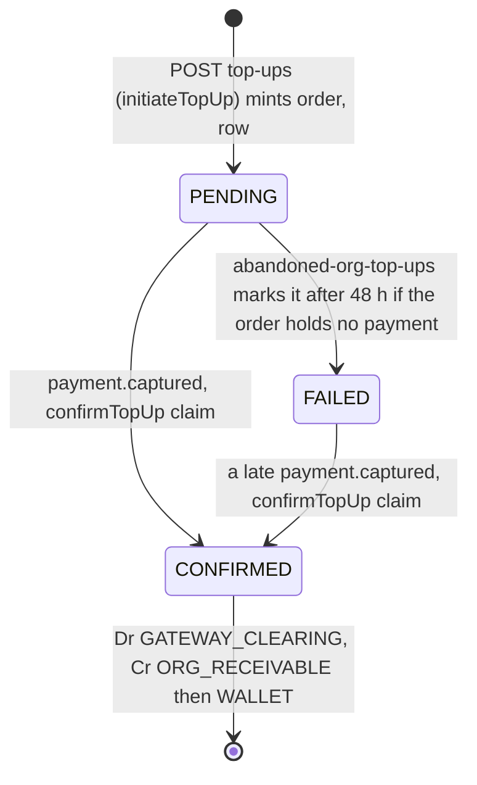

# Wallet and top-ups

An organisation on the `WALLET` rail prepays Familiarise and spends that balance on sponsored bookings. The wallet is a liability the platform owes the organisation, not a bank account the platform holds. This page defines the records behind it, the top-up lifecycle, the debit guard, the freeze, the top-up refund, the operator doors and the low-balance alert. The rail itself is introduced in [funding rails](01-funding-rails-and-permutations.md).

## The three records

| Record                                                    | What it is                                       | Role                                                                                                                                                              |
| --------------------------------------------------------- | ------------------------------------------------ | ----------------------------------------------------------------------------------------------------------------------------------------------------------------- |
| `LedgerAccount` of kind `WALLET`, one per organisation    | A credit-normal liability account in the journal | The source of truth for "how much do we owe this organisation".                                                                                                   |
| `BillingAccount.walletBalance` (nullable `BigInt`, paise) | A cache of that account                          | Exists only so an overdraft guard can be one atomic conditional statement.                                                                                        |
| `WalletTopUp`                                             | One top-up attempt                               | Lifecycle and idempotency record: `providerOrderId` is unique, `amountPaise` is stored up front, `status` is `PENDING`, `CONFIRMED` or, once abandoned, `FAILED`. |

The cache is reconciled, never trusted: `reconcile-ledgers` asserts `-balance(WALLET) == walletBalance` per account and raises `WALLET_BALANCE_DRIFT` when they differ, which also freezes the wallet's spend (below). The database backs the cache with `billing_account_wallet_nonnegative` (`prisma/sql/check-constraints.sql`), so a negative cached balance cannot commit. The column is nullable, and an account never credited holds `NULL`, which matters because `NULL + amount` is `NULL`. Every cache mutation in `lib/api/organizations/wallet.ts` (`walletDebit`, `walletCredit`, `adjustWallet`) therefore first writes zero over a `NULL` in the same transaction (`seedNullWalletBalance`) and reads the result back off the mutated row. The top-up refund reads a `NULL` as zero and books the whole refund as a shortfall (below).

## Top-up lifecycle



1. **Initiate.** `POST /api/organizations/[orgId]/billing-account/wallet/top-ups` needs a `WALLET` billing account (404 otherwise), a minimum of ₹100 (10,000 paise), and accepts an optional `clientIdempotencyKey` (a UUID) so a double click reuses the pending row. It mints a Razorpay order and writes a `PENDING` `WalletTopUp` keyed by `providerOrderId`. A missing gateway key answers 503 rather than pretending money was charged. No journal exists yet. Replaying the same `clientIdempotencyKey` on a top-up that is no longer `PENDING` (for example an abandoned one) answers 409 `TOPUP_NOT_PENDING`; the client starts a new top-up with a new key.
2. **Pay.** The organisation admin completes Razorpay checkout.
3. **Confirm.** `payment.captured` reaches `handleOrgPaymentSuccess` (`app/api/webhooks/utils.ts`), where the order's `notes.type` is `credit_purchase`. It first compares `notes.amountPaise` to the amount the gateway actually captured and, on a mismatch, writes an audit row and refuses to credit (answering 200 so Razorpay stops retrying). Otherwise it calls `confirmTopUp`.
4. **`confirmTopUp`.** Before its transaction it stamps `capturedAt` and `providerPaymentId` on the row outside the transaction, so the trace of captured money survives a rollback. Inside one transaction a conditional `updateMany` flips `PENDING` to `CONFIRMED` and, only when that matched nothing, a second one flips an abandoned `FAILED` row to `CONFIRMED` (below); only one racing delivery sees a count of 1, and a redelivery is a no-op that returns the current balance. It then refuses to credit if the confirmed amount differs from the authorised `amountPaise`, row-locks the billing account, and settles the organisation's open shortfall receivable first: the net `ORG_RECEIVABLE` debit under `overage-restore:`, `topup-refund-shortfall:` and `chargeback:` keys, less what a late overage recarve cancelled under `overage-recarve:` (invoice accruals are excluded). Only the rest raises the cache through `walletCredit`, and the receipt email shows the settled amount. Because only a top-up settles that receivable, both funding-switch doors (`PATCH /api/organizations/[orgId]/billing-account` and the platform `PATCH /api/admin/organizations/[orgId]/billing-account`) refuse to move an account off `WALLET` while it is open (409 `WALLET_SHORTFALL_OPEN`) or while a member overage on a wallet-funded booking is still `PENDING` or `FAILED` and could restore onto the wallet (409 `WALLET_OVERAGE_UNSETTLED`); `assertWalletFundingSwitchable` row-locks the account first, as `confirmTopUp` does.

```
LedgerTransaction  kind TOPUP   key topup:<providerOrderId>
  Dr GATEWAY_CLEARING     amountPaise   (Razorpay holds the cash for the platform)
  Cr ORG_RECEIVABLE(org)  settled       (open shortfall paid down first; omitted when zero)
  Cr WALLET(org)          the rest      (the platform now owes the organisation)
```

The transaction is idempotent twice: the status claim and the unique journal key. Card money is debited to `GATEWAY_CLEARING`, not `CASH`; the daily `reconcile-gateway-settlements` run later moves the net to `CASH`.

**A failed payment keeps the row.** `payment.failed` for a top-up (`handleOrgPaymentFailure`) writes an audit row but leaves the `PENDING` row so the same order can be paid again. `FAILED` for a top-up means one thing only: abandoned. `abandoned-org-top-ups` writes it, after proving the gateway order held no payment.

**An abandoned top-up is kept, and a late payment on it is credited.** A Razorpay order cannot be cancelled and has no expiry, so the order of an abandoned top-up can still be paid days later. When the abandoned row was deleted, that money had nothing to land on. The row is therefore kept as `FAILED`, and `confirmTopUp` claims it exactly as it claims a `PENDING` one: first a conditional `updateMany` from `PENDING`, and only if that matched nothing, a second one from `FAILED`, both to `CONFIRMED` under the same journal key `topup:<providerOrderId>`. The verify route (`.../top-ups/[topUpId]/verify`) and the orphaned-captures sweep both accept `FAILED` for the same reason. Example: Charlotte Anderson opens a ₹2,00,000 (20,000,000 paise) top-up at 10:00 IST on Mon 9 Nov 2026 and closes the tab. On Wed 11 Nov, after the 48-hour grace window, the job proves the order empty and marks the row `FAILED`. At 09:15 IST on Thu 12 Nov her bank finally completes the payment; the capture webhook credits ₹2,00,000 to the wallet as if nothing had happened.

A late capture is sent back to the card instead of credited in two cases, decided inside the claim transaction by `lateTopUpRefundReason`: the wallet is frozen (`WALLET_FROZEN`, see the freeze below) or the organisation is deactivated or deleted (`ACCOUNT_CLOSED`). The row is still claimed and credited, and a note saying a card refund is owed is added to it in the same transaction. After the commit `refundTopUpCapture` (`lib/payments/operations/wallet-refund.ts`) refunds the whole capture under the same dedupe key the refund-remaining door uses, so the two can never refund one top-up twice; only once that call succeeds does the note say the card refund was issued. The audit row says whether the refund was issued or is owed, and the owners are not notified of a top-up that went back to the card.

Honest limits. If the refund call to the gateway fails in that case, nothing retries it automatically: the top-up's note and the audit row say a card refund is owed, and the capture stays where `confirmTopUp` booked it. The part that went to the wallet can be returned through the refund-remaining door. The part that settled an open shortfall receivable is not in the wallet, so that door cannot return it; an operator refunds the capture from the Razorpay dashboard instead, and the refund webhook books it like any top-up refund (`bookTopUpRefund`): it claws back what the wallet still holds and books the rest as `ORG_RECEIVABLE` again. The replayed client key on a `FAILED` top-up answers 409 as above rather than reviving the row. The owner chose this over refunding every late capture and over handling late payments by hand; see [the 2026-11-12 decision record](../../decisions/2026-11-12-bug-hunt-money-doors.md).

**Recovery of lost credits.** Two jobs close the gap between "money captured" and "wallet credited". `sweep-orphaned-topup-captures` (every 15 minutes) re-runs `confirmTopUp` for rows that are still `PENDING` or `FAILED` but carry `capturedAt` and `providerPaymentId`, from 5 minutes to 30 days after capture. `abandoned-org-top-ups` (daily window) looks at `PENDING` rows with no payment and no capture that are older than the 48-hour grace window (longer than Razorpay's 24-hour retry window), asks Razorpay what the order holds, and acts: a captured order is handed to `confirmTopUp`, a still-payable order is kept, and an order proven empty is marked `FAILED` by a conditional write (so a webhook confirming in between wins). A row with no minted order id is never marked. See [the runbooks](../70-operations/05-money-runbooks.md).

## Spending: `walletDebit`

A wallet-funded checkout first reads the freeze state inside the booking transaction (`isWalletFrozen`; a frozen wallet throws `WalletFrozenError`, 409). Then `walletDebit` runs the overdraft guard as one conditional update:

```
UPDATE BillingAccount SET walletBalance = walletBalance - :amount
 WHERE id = :id AND walletBalance >= :amount
```

Because the predicate and the decrement are one statement, two concurrent bookings cannot both spend the last rupee; the loser matches zero rows and `WalletInsufficientFundsError` rolls the booking back. The refusal carries the stable code `WALLET_INSUFFICIENT_FUNDS` and HTTP 402, so checkout rethrows it unchanged and the buyer is told to ask their billing admin for a top-up. It reports only the requested amount: reading the balance back would add a query inside a transaction that runs on a single connection.

`walletDebit` moves only the cache. The `Dr WALLET` line is posted in the same checkout transaction, inside the `booking:<paymentId>` journal that `createEarningsFromPayment` writes, where the fee, payable and GST split is known. The line is asserted rather than assumed: after earnings are created, `assertWalletDebitJournaled` (called from `recordSynchronousEarnings`) looks for a `Dr WALLET` line in that journal and throws `WALLET_DEBIT_UNJOURNALED` if it is missing, rolling the whole checkout back so the cache can never move without its journal line. This check does not replace the nightly audit. `walletCredit` is the mirror and posts a journal only for a top-up; refund credits post their own `WALLET` line from the refund layer.

## The freeze

When `reconcile-ledgers` finds `WALLET_BALANCE_DRIFT`, `freezeDriftedWallets` (`lib/payments/wallet-freeze.ts`) freezes that wallet's spend. The state lives in the append-only `SystemEvent` log as a `WALLET_FREEZE` and `WALLET_UNFREEZE` pair keyed `wallet-freeze:<billingAccountId>`; the latest event wins. The check fails closed: an unreadable log blocks the spend. The freeze gates only discretionary checkout spend, never a top-up credit and never recovery of a lost chargeback. `POST /api/admin/billing-accounts/[billingAccountId]/unfreeze` lifts it, but re-reads that wallet's drift first and answers 409 `WALLET_STILL_DRIFTED` while the cache and journal disagree. The repair steps are in the [ledger drift runbook](../70-operations/06-ledger-drift-runbook.md).

## Top-up refund

A top-up has no `Payment` row, so its refund lives on the journal alone. Two paths book it through the same function, `bookTopUpRefund` (`lib/payments/operations/wallet-refund.ts`), under the same key, so whichever arrives second is a no-op:

- **The admin door** `POST /api/admin/billing-accounts/[billingAccountId]/refund-remaining` (`refundRemainingWalletBalance`) returns the organisation's own top-up money as gateway refunds against its `CONFIRMED` top-ups, newest first: the cached balance less the operator-granted credit it holds (below). Each refund carries the dedupe key `wallet-refund:<billingAccountId>:<topUpId>`. It is a step-up door that answers `202` when that refundable balance is above ₹25,000 and two admins are active, and it refuses a drifted wallet with 409 `WALLET_DRIFTED` before any money moves. It freezes wallet spend for the run and lifts the freeze only when this run set it and nothing but operator-granted credit is left. It stops on the first gateway failure and answers 207 naming the top-up where it stopped.
- **Operator-granted credit stays.** `grantedWalletCreditPaise` (`lib/payments/operations/wallet-refund.ts`) is the net of the organisation's `WALLET_ADJUSTMENT` journal lines (credits less debits, never below zero), that is, value an operator gave through the wallet-adjustment door. It was never paid by card, so there is nothing to refund it to. The door treats it as spent last: it is held back from every refund, stays in the wallet, and is reported as `retainedGrantedCreditPaise` in the answer. Before each refund the door reads the balance and the granted credit together in one Repeatable Read snapshot (`spendableSnapshot`), so a grant that commits while the walk runs raises both figures and none of it is sent to the card. The second-admin threshold is priced on the balance less that credit too. Example: Rachel Anderson's organisation holds ₹10,000.00 (1,000,000 paise), of which an operator granted ₹3,000.00 (300,000 paise) and the rest came from a top-up. The door refunds ₹7,000.00 (700,000 paise) to the card and leaves ₹3,000.00 in the wallet.
- **A refund issued at the gateway** (for example from the Razorpay dashboard). The refund webhook finds the `CONFIRMED` top-up by `providerPaymentId` and books it.

```
LedgerTransaction  kind TOPUP_REFUND   key topup-refund:<gatewayRefundId>
  Dr WALLET(org)        refundAmt
  Cr GATEWAY_CLEARING   refundAmt
```

The key names the gateway refund, not the payment, because Razorpay allows several partial refunds per payment. The amount is clamped to the top-up's `amountPaise`. **The wallet floor wins:** the cache is decremented only by what it still holds, with a conditional update, because the nonnegative constraint would otherwise reject the write and the webhook would redeliver forever. Whatever could not be clawed back books as a receivable under `topup-refund-shortfall:<gatewayRefundId>` (`Dr ORG_RECEIVABLE / Cr WALLET`). No `Refund` row is written, because `Refund.paymentId` belongs to the consumer `Payment` table; the journal is the record.

## Operator doors

| Door                         | Effect                                                                                                                                                                                                                        | Guards                                                                                                                                                                                                                                   |
| ---------------------------- | ----------------------------------------------------------------------------------------------------------------------------------------------------------------------------------------------------------------------------- | ---------------------------------------------------------------------------------------------------------------------------------------------------------------------------------------------------------------------------------------- |
| `POST .../wallet-adjustment` | `adjustWallet` posts `WALLET_ADJUSTMENT` under `walletadj:<billingAccountId>:<idempotencyKey>` and moves the cache by the same amount: a credit is `Dr PLATFORM_PROMO / Cr WALLET`, a debit is `Dr WALLET / Cr PLATFORM_FEE`. | `payments.manage`, step-up, the money-ops throttle, second admin above ₹25,000; a replay returns `replayed`; the same key with another amount is 409 `IDEMPOTENCY_KEY_REUSED`; a debit above the balance is `WALLET_INSUFFICIENT_FUNDS`. |
| `POST .../unfreeze`          | Lifts a freeze.                                                                                                                                                                                                               | `payments.manage` and step-up only (no amount, so no second admin and no money-ops throttle); 409 `NOT_FROZEN` or `WALLET_STILL_DRIFTED`.                                                                                                |
| `POST .../refund-remaining`  | Returns the top-up money to the card; granted credit stays.                                                                                                                                                                   | `payments.manage`, step-up, the money-ops throttle, second admin when the refundable balance (cached balance less granted credit) is above ₹25,000; 409 `WALLET_DRIFTED`.                                                                |

`adjustWallet` moves the cache and the journal by the same signed amount, so it cannot repair a drift between them. Use it to give or take real value from an organisation, never to correct the cache.

## Low-balance alert (notify-only)

An organisation can set `BillingAccount.minBalancePaise`. The `wallet-low-balance` job (daily window from 23:30 UTC, after `dunning`) selects wallet accounts with a floor whose `autoTopUpLastFiredAt` is empty or older than 24 hours, skips any whose live balance is at or above the floor, claims the row with a conditional update on the value it read, and notifies the finance roster. `autoTopUpLastFiredAt` doubles as the 24-hour cooldown and the claim key, so an organisation is alerted at most once a day. The job moves no money and creates no `WalletTopUp`; the wallet never auto-charges.

## Worked example: IIT Madras

IIT Madras (`HYBRID`, `WALLET`, seeded) holds three confirmed top-ups of ₹5,00,000 (50,000,000 paise each) and has spent five bookings of ₹5,000 (500,000 paise each): ₹15,00,000 minus ₹25,000 is ₹14,75,000, or 147,500,000 paise in both the `WALLET` account and the cache.

1. Charlotte Anderson, the organisation's owner, tops up ₹2,00,000 (20,000,000 paise) on the dashboard. After capture the journal holds `Dr GATEWAY_CLEARING 20,000,000 / Cr WALLET 20,000,000`, and the balance reads ₹16,75,000 (167,500,000 paise).
2. Rachel Anderson, a learner, books a ₹4,000 session with GST (₹4,720, 472,000 paise). The debit leaves ₹16,70,280 (167,028,000 paise); the `booking:<paymentId>` journal carries `Dr WALLET 472,000` against the split credits described in [the worked examples](05-worked-examples.md).
3. Months later, after the organisation has spent the wallet down to ₹10,000, it asks Razorpay to refund the whole ₹5,00,000 of one earlier top-up. The refund books `Dr WALLET 50,000,000 / Cr GATEWAY_CLEARING 50,000,000`. The cache falls by the ₹10,000 (1,000,000 paise) it still holds, and the other ₹4,90,000 (49,000,000 paise) books as `Dr ORG_RECEIVABLE 49,000,000 / Cr WALLET 49,000,000`, a receivable from the organisation. The net `WALLET` debit is 1,000,000 paise, which equals the cache decrement, so the audit stays clean.

## Where in code

| Concern                                                   | File                                                                                                   |
| --------------------------------------------------------- | ------------------------------------------------------------------------------------------------------ |
| Debit, credit, adjust, top-up, confirm, journal assertion | `lib/api/organizations/wallet.ts`                                                                      |
| Top-up route                                              | `app/api/organizations/[orgId]/billing-account/wallet/top-ups/route.ts`                                |
| Webhook success and failure                               | `app/api/webhooks/utils.ts`                                                                            |
| Freeze                                                    | `lib/payments/wallet-freeze.ts`                                                                        |
| Top-up refund, late-capture refund, granted credit        | `lib/payments/operations/wallet-refund.ts` (`refundTopUpCapture`, `grantedWalletCreditPaise`)          |
| Recovery jobs                                             | `scripts/cleanup/sweep-orphaned-topup-captures.ts`, `scripts/cleanup/cleanup-abandoned-org-top-ups.ts` |
| Low-balance alert                                         | `jobs/billing/wallet-low-balance.ts`                                                                   |

## Related

- [Admin money doors](../70-operations/02-admin-money-doors.md), [ledger integrity](../20-ledger/06-integrity-and-reconciliation.md), [chart of accounts](../20-ledger/02-chart-of-accounts.md).

## Deprecated & Superseded Approaches

1. **A per-row `WalletEntry` log** with a zero-delta placeholder for pending top-ups. Wallet history is the `LedgerEntry` rows on the `WALLET` account and the lifecycle is `WalletTopUp`. Some route comments still say "WalletEntry"; they mean `WalletTopUp`.
2. **Auto-top-up and mandates.** The `autoTopUpEnabled`, `autoTopUpAmountPaise` and `autoTopUpMandateId` columns were removed. Recurring debit would need a fresh design inside RBI's e-mandate rules.
3. **Deleting an abandoned top-up.** The abandoned-top-up job once hard-deleted a row whose order held no payment, so a payment made later on that order had nothing to land on. The row is now marked `FAILED` and kept, and a late capture is credited (or refunded when the wallet is frozen or the organisation closed). Delete any code that expects `FAILED` to be unwritten, or that deletes a top-up row.
4. **Posting `Dr CASH` for a top-up.** It is `GATEWAY_CLEARING`.
5. **Posting the wallet debit at settlement time as a separate transaction.** The `Dr WALLET` line is part of the checkout's own `booking:` journal and is asserted.
