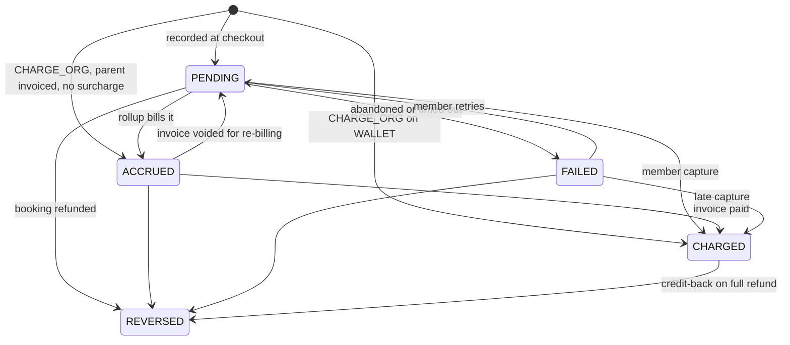

# Rate cards and overage

Two rules decide who gets what from a sponsored booking. A **rate card** splits the price between the platform, a host organisation and the expert. **Overage** decides what happens when a booking goes past the cap of the programme that sponsors it. This page defines both, with the arithmetic, the enforcers and the states. The journal lines a booking produces are in [postings](../20-ledger/04-postings.md); the rails are in [funding rails](01-funding-rails-and-permutations.md).

## Who sets the platform's cut

The split depends on whether the expert settles through a host organisation.

| Case                                                                             | Platform cut                           | Organisation share                       | Expert share               |
| -------------------------------------------------------------------------------- | -------------------------------------- | ---------------------------------------- | -------------------------- |
| Independent expert (no `ACTIVE` `EXPERT` membership at a `canHost` organisation) | The payment's stamped `platformFeeBps` | none                                     | the rest                   |
| Expert at a host organisation, `payoutRecipient = SELF`                          | The resolved rate card's `platformBps` | The card's `orgBps`                      | The card's `consultantBps` |
| Expert at a host organisation, `payoutRecipient = ORGANIZATION` (salaried)       | The card's `platformBps`               | The card's `orgBps` plus `consultantBps` | none                       |
| Plan owned by an organisation with no expert split                               | The org-scoped card's `platformBps`    | The rest                                 | none                       |

The stamped `platformFeeBps` comes from the latest approved `PlatformFeeSchedule` (`readActiveFeeSchedule`, `lib/payments/pricing/platform-fee.ts`): `marketplaceBps` for a marketplace sale and `ownLinkBps` for an expert's own link. It is stamped on the `Payment` at checkout by `resolveCheckoutAttribution`, so a later schedule change never rewrites a sale. When no schedule has been approved the fallback is 20 % (`PAYOUT_CONSTANTS.PLATFORM_FEE_PERCENTAGE`), not a fixed rule. A new schedule needs a different admin to approve it, or the single active admin once it is 24 hours old (`feeScheduleApprovalRefusal`, `SELF_APPROVAL_WAIT_MS`). A host organisation's rate card, not the stamped figure, sets the cut for a host-organisation expert. See [checkout and pricing](../10-money-in/01-checkout-and-pricing.md) for how the fee interacts with discounts and referral credit.

## The rate card

A `RateCard` holds three basis-point numbers that sum to 10,000: `platformBps`, `orgBps`, `consultantBps`. It is owned by an organisation (`ownerOrgId`) or by one contract (`ownerContractId`), and optionally narrowed to a plan type (`planType`) or one plan (`planId`). Basis points are integers, so there is no float drift.

| Rule                                                                                                                     | Enforcer                                                                                                                                                                                                                                                                    |
| ------------------------------------------------------------------------------------------------------------------------ | --------------------------------------------------------------------------------------------------------------------------------------------------------------------------------------------------------------------------------------------------------------------------- |
| The three numbers are non-negative and sum to exactly 10,000                                                             | `rate_card_bps_sum_is_whole` CHECK (`prisma/sql/check-constraints.sql`)                                                                                                                                                                                                     |
| A card is never edited. A change closes the old card (`effectiveTo = now`) and inserts a new one in the same transaction | `bumpRateCard` (`lib/api/organizations/rate-card.ts`)                                                                                                                                                                                                                       |
| At most one open card per scope                                                                                          | `rate_card_one_open_window`, a partial unique index declared `NULLS NOT DISTINCT` over owner, contract, plan type and plan; the POST route also runs the bump at Serializable isolation with a retry, and a residual collision answers 409 `RATE_CARD_OPEN_WINDOW_CONFLICT` |
| A booking is split on the card that was effective at the payment's creation time, snapshotted onto the earnings row      | `resolveEffectiveRateCard` is called with `at = payment.createdAt`; the earnings rows store `platformBpsApplied`, `orgBpsApplied`, `consultantBpsApplied`                                                                                                                   |

**Resolution order** (`resolveEffectiveRateCard`), most specific first:

1. The expert's `Membership.rateCardOverride`, if it belongs to the resolving organisation or contract.
2. Contract-scoped card for the plan.
3. Organisation-scoped card for the plan.
4. Contract-scoped card for the plan type.
5. Organisation-scoped card for the plan type.
6. Contract-scoped default.
7. Organisation-scoped default.
8. The built-in `DEFAULT_RATE_CARD`: 1,000 / 1,000 / 8,000 bps, which is 10 % platform, 10 % organisation, 80 % expert. It has no id, which is how the code knows a default was used.

Which of these a settling booking can reach depends on one setting. Settlement always passes the host organisation and the membership override. It passes the contract, plan type and plan as well only when `RATE_CARD_SCOPED_RESOLUTION` (trimmed) is `on`. Unset, blank and `off` read as off silently; any other value also reads as off and is reported to Sentry once. That is deliberate: turning it on changes which card pays live money, so an organisation should audit its scoped cards first. With it off, a contract- or plan-scoped card can exist and never be chosen. When it is on, the contract is reachable only if the buyer and the host are the same organisation, because a contract belongs to the buying organisation and must never select another tenant's negotiated split.

## The split arithmetic

`resolveOrgSplit` (`lib/payments/payouts/earnings-service.ts`) works in integer paise on the booking's `originalAmount` (the price before GST). Each independent share is floored with `prorate`, and the organisation takes whatever is left, so the three always add up exactly:

```
platformFee     = floor(gross x platformBps / 10000)
consultantShare = floor(gross x consultantBps / 10000)
orgShare        = gross - platformFee - consultantShare
```

For a salaried expert the organisation absorbs the consultant slice, and the persisted basis points say so (`orgBps + consultantBps`, `consultantBps = 0`). If a malformed card ever yields a negative organisation share, the split clamps it to zero and gives the remainder to the expert, and reports to Sentry; the CHECK above makes that unreachable for a card created today.

Worked example, LearnPro Academy (seeded card 10 / 10 / 80) on a ₹8,000 session (800,000 paise):

```
platformFee     = floor(800,000 x 1000 / 10000) =  80,000   (10 %)
consultantShare = floor(800,000 x 8000 / 10000) = 640,000   (80 %)
orgShare        = 800,000 - 80,000 - 640,000    =  80,000   (the organisation's 10 %)
```

On ₹8,001 (800,100 paise) the floors give 80,010 and 640,080, and the organisation takes 800,100 - 80,010 - 640,080 = 80,010. The remainder lands on the organisation, never lost.

The independent-expert path takes the stamped fee instead: Grace Anderson, an independent marketplace consultant, on the same ₹8,000 session at the 20 % fallback keeps 640,000 paise (₹6,400) and the platform recognises 160,000 paise (₹1,600), with no organisation leg.

**Cross-organisation bookings.** When the buyer organisation differs from the host (`Payment.organizationId` is not `hostOrganizationId`), the buyer's rail funds the debit and the host's card sets the split. Each collaborator on a multi-expert event resolves their own host organisation's card without the seller's contract scope, so one tenant's contract never selects another tenant's card.

**The earnings rows are caches.** `ConsultantEarnings` and `OrganizationEarnings` carry the amounts and the applied basis points, so payout reads one row instead of re-summing the journal. The reconciler asserts that the cached amounts equal the booking journal's `PLATFORM_FEE`, `CONSULTANT_PAYABLE` and `ORG_PAYABLE` credits (`EARNINGS_LEDGER_DRIFT`). `OrganizationEarnings` is unique on `(paymentId, organizationId, consultantProfileId, role, cycleOrdinal)`, which lets several experts of one host organisation earn from one group session and gives each recurring subscription cycle its own row.

## Overage: when a booking passes the cap

A programme caps how much it sponsors per cycle: a `LICENSED_SEAT` programme by engagements (`coveredEngagementsPerCycle`), a `CREDIT_POOL` programme by money (`creditBudgetPerCycle`, one credit equals ₹1). What happens past the cap is the programme's `OverageBehavior`.

`computeOverage` (`lib/payments/billing/overage.ts`) is a pure function shared by the pre-checkout preview and the at-checkout recorder, so the two cannot disagree:

1. **Covered and marginal.** For a credit pool, covered is the smaller of the price, the remaining budget and any per-engagement cap; the rest is marginal. For licensed seats, if the seats left cover the engagements the booking consumes, nothing is marginal; otherwise the over-cap engagements are priced at the per-engagement price, optionally capped by `priceCapPerEngagementPaise`, and never more than the price. Here "price" is the tax-inclusive amount of the booking.
2. **Surcharge.** `basePaise` is that marginal. `surchargePaise = floor(basePaise x overageSurchargeBps / 10000)`. `marginalPaise = basePaise + surchargePaise`. The surcharge is the only part of an overage that carries new GST, because the base is a slice of a price whose GST the booking journal already posted. How that GST should be divided between the organisation's invoice and a member's document when the member pays is an open question for the accountant ([open GST questions](../60-tax/06-open-gst-questions-for-the-accountant.md)).
3. **Circuit breaker.** If `maxOveragePerCyclePaise` is set and the cycle's overage so far plus this marginal exceeds it, the decision is `BLOCK` whatever the behaviour. Checkout then throws `PROGRAM_CAP_EXHAUSTED` (HTTP 402) and the whole booking transaction rolls back, so nothing is booked and no money moves.
4. **Behaviour.** `BLOCK` refuses (`PROGRAM_SESSION_CAP_REACHED`, 402, with a bell to the assignee and organisation operators). `CHARGE_MEMBER` lets the booking proceed and charges the member. `CHARGE_ORG` lets it proceed and charges the organisation. An unknown value fails safe to `BLOCK`.

`previewOverageForBooking` (`POST /api/organizations/[orgId]/checkout/overage-preview`) runs the same mapper before payment so the buyer sees the charge. A programme with settings that cannot take effect is refused at configuration (400 `INVALID_OVERAGE_CONFIG`); a charging behaviour needs a positive `maxOveragePerCyclePaise`.

### What each rail does

`recordOverageAtCheckout` (`lib/payments/billing/overage-settlement.ts`) runs inside the Serializable booking transaction and writes an `OverageEvent` (`overage_marginal_is_base_plus_surcharge` guarantees `marginalPaise >= basePaise + surchargePaise`, and `marginalPaise` is the GST-inclusive charged total).

| Behaviour on the rail                                                                                 | What happens at checkout                                                                                                                                                                                                                                                                                                                                                                                                                                                                                                                                                                                                                                                                                                                                                                                                                                      | Collected when                                                                                                                                                                                                                                                                                                                                                                                                                                                                                                                                                           |
| ----------------------------------------------------------------------------------------------------- | ------------------------------------------------------------------------------------------------------------------------------------------------------------------------------------------------------------------------------------------------------------------------------------------------------------------------------------------------------------------------------------------------------------------------------------------------------------------------------------------------------------------------------------------------------------------------------------------------------------------------------------------------------------------------------------------------------------------------------------------------------------------------------------------------------------------------------------------------------------- | ------------------------------------------------------------------------------------------------------------------------------------------------------------------------------------------------------------------------------------------------------------------------------------------------------------------------------------------------------------------------------------------------------------------------------------------------------------------------------------------------------------------------------------------------------------------------ |
| `CHARGE_ORG` on `INVOICE`                                                                             | `basePaise` is carved out of the `INVOICE_ACCRUAL` leg (up to what that leg holds) and an `OVERAGE_INVOICE_ACCRUAL` leg of base + surcharge + GST on the surcharge is written; `Payment.amount` grows by the surcharge and its GST. `OverageEvent` is `PENDING`.                                                                                                                                                                                                                                                                                                                                                                                                                                                                                                                                                                                              | The monthly rollup bills it (`ACCRUED`); paying the invoice marks it `CHARGED`.                                                                                                                                                                                                                                                                                                                                                                                                                                                                                          |
| `CHARGE_ORG` on `WALLET`                                                                              | The wallet debit already took the whole price. A surcharge, if any, plus its GST is debited again and added to the `WALLET` leg, `Payment.amount` and `taxAmount`. If the parent's booking journal has already posted, a separate `overage-accrual:<overageEventId>` journal (`Dr WALLET / Cr PLATFORM_FEE / Cr GST_PAYABLE`) records it; otherwise the booking journal tallies the larger leg itself. `OverageEvent` is born `CHARGED`.                                                                                                                                                                                                                                                                                                                                                                                                                      | At commit.                                                                                                                                                                                                                                                                                                                                                                                                                                                                                                                                                               |
| `CHARGE_ORG` on `LICENSE`, on a lazily allocated subscription session, or on a `PERSONAL` card parent | The parent is untouched. A child `Payment` is minted, born `SUCCEEDED`, carrying one `OVERAGE_INVOICE_ACCRUAL` leg (on a `PERSONAL` parent only the surcharge, since the base was already paid by card). `OverageEvent` is `PENDING`.                                                                                                                                                                                                                                                                                                                                                                                                                                                                                                                                                                                                                         | The monthly rollup.                                                                                                                                                                                                                                                                                                                                                                                                                                                                                                                                                      |
| `CHARGE_MEMBER`                                                                                       | The base is carved out of the parent (from `INVOICE_ACCRUAL`, or from `WALLET`, crediting the wallet cache back). On a `WALLET` parent whose booking journal has already posted, the carve also posts `Dr DISCOUNT / Cr WALLET` under `overage-carve-credit:<overageEventId>` (`journalWalletCarveCredit`) in the same transaction; a parent whose booking journal has not posted yet tallies the smaller `WALLET` leg itself. A `LICENSE` parent has nothing to carve, so the member pays the whole base; a `PERSONAL` parent already paid the base by card, so the member pays only the surcharge. A child `Payment` is created `PENDING` for the carved base + surcharge + GST on the surcharge, with its own `CARD` leg, and the event is `PENDING`; when that sum is zero no child or event is written. The parent's earnings are held (`OVERAGE` hold). | The member pays through the resume-checkout page; the capture webhook moves the child and the event to `CHARGED` (`handleOverageMemberSuccess`) and posts `Dr GATEWAY_CLEARING / Cr DISCOUNT (base) / Cr PLATFORM_FEE (surcharge) / Cr GST_PAYABLE` under `overage:<childPaymentId>`, so the member's base reverses the discount that funded the carve and the organisation is credited nothing; the hold releases. A late capture after the parent was invoiced also posts `Dr DISCOUNT / Cr ORG_RECEIVABLE` for the base (`overage-recarve-invoice:<childPaymentId>`). |
| Parent already invoiced                                                                               | `CHARGE_ORG`: the parent and its legs are untouched; a surcharge plus its GST goes on a child accrual `Payment` (`PENDING` event), and with no surcharge the event is born `ACCRUED` with a zero marginal. `CHARGE_MEMBER`: nothing is carved, so the member pays only the surcharge.                                                                                                                                                                                                                                                                                                                                                                                                                                                                                                                                                                         | As above.                                                                                                                                                                                                                                                                                                                                                                                                                                                                                                                                                                |

If the parent's rail cannot support the chosen behaviour, checkout refuses with a stable code: `OVERAGE_CHARGE_MEMBER_UNSUPPORTED` for a member charge on an unsupported parent, `OVERAGE_UNSUPPORTED_FUNDING` for an organisation charge with no leg to charge against. Both are configuration mistakes, so they are reported to Sentry. `PROGRAM_CAP_EXHAUSTED` is a modelled outcome and is not.

### The `OverageEvent` states



`BLOCKED` is a defined status that the ceiling's sum excludes, but it is unused: no code writes it, because the circuit breaker refuses by throwing, which rolls the whole booking back, so no event is persisted. Every move is one guarded `updateMany` whose `WHERE` lists the legal from-states, so an illegal transition matches zero rows. Most go through `transitionOverage` (`lib/payments/billing/overage-transitions.ts`); invoice payment (`ACCRUED` to `CHARGED`, `org-invoice-settlement.ts`) and the 14-day timeout (`PENDING` to `FAILED`) write the same guard inline. Apart from a full refund, which moves the charged event itself to `REVERSED` and stamps `reversedAt`, corrections are new events rather than edits of a charged row.

### A member who never pays

A `PENDING` member overage counts toward the per-cycle ceiling, so two jobs retire it (both are in [scheduled jobs](../70-operations/01-scheduled-jobs.md)). `sweep-abandoned-overage-charges` fails a side charge whose order was never started after 7 days, silently, to free the ceiling. `timeout-member-overages` fails any member overage still unpaid after 14 days, stamps `chargeTimedOutAt` and tells the member. Both restore the carved base to the parent in the same transaction as the `FAILED` claim (`restoreOverageBaseCarve`): back onto the `INVOICE_ACCRUAL` leg, or onto the `WALLET` leg with a fresh `walletDebit` and, once the parent's booking journal has posted, `Dr WALLET / Cr DISCOUNT` under `overage-restore:<overageEventId>`; the part the wallet no longer holds debits `ORG_RECEIVABLE` instead of `WALLET`. A retry or a late capture carves it back out (`recarveOverageBase`): the wallet-covered part leaves the `WALLET` leg and returns to the wallet, and the receivable is cancelled under `overage-recarve:<overageEventId>`, or credited to the wallet where a top-up already settled it; a `LICENSE` parent has nothing to take back. They cannot both take a row, because a failed event no longer matches `PENDING`. If the carved base cannot be restored because the parent was invoiced meanwhile, or because the parent is on `LICENSE` (whose earnings then stay held), an admin settles the overage to the organisation with `POST /api/admin/organizations/[orgId]/overages/[overageEventId]/settle-to-org` (priced at base + surcharge + GST for the second-admin rule), which accrues it to the organisation's next rollup and releases the parent's hold.

## Where in code

| Concern                          | File                                                                                                               |
| -------------------------------- | ------------------------------------------------------------------------------------------------------------------ |
| Rate card resolution and bump    | `lib/api/organizations/rate-card.ts`, `app/api/organizations/[orgId]/rate-cards/route.ts`                          |
| Split arithmetic, earnings rows  | `lib/payments/payouts/earnings-service.ts`                                                                         |
| Platform fee                     | `lib/payments/pricing/platform-fee.ts`                                                                             |
| Overage calculator and preview   | `lib/payments/billing/overage.ts`, `overage-preview.ts`                                                            |
| Overage recording and settlement | `lib/payments/billing/overage-settlement.ts`, `overage-base-carve.ts`, `lib/payments/webhooks/overage-handlers.ts` |
| Overage state machine            | `lib/payments/billing/overage-transitions.ts`                                                                      |

## Related

- [Worked examples](05-worked-examples.md) put numbers through each rail, including a circuit-breaker refusal.
- [Invoices](04-invoices-purchase-orders-and-dunning.md) for the rollup that bills `CHARGE_ORG` overage.
- [Open GST questions for the accountant](../60-tax/06-open-gst-questions-for-the-accountant.md) for the member-paid overage tax question.

## Deprecated & Superseded Approaches

1. **A flat 20 % platform fee as the marketplace rule.** The fee is the approved schedule's rate, stamped at checkout; 20 % is only the fallback. The `PLATFORM_FEE_PERCENTAGE` constant is read only for that fallback and for legacy rows with no stamp.
2. **Float revenue-share columns** (`sharePercentage`, `revenueSharePercentage`). Splits are integer basis points; `ConsultantEarnings.shareBps` carries a collaborator's share.
3. **A synchronous split-leg co-pay** (one payment with an organisation-covered leg plus a learner card leg) for member overage. It is not implemented; the member pays a separate child payment while the parent's earnings are held.
4. **Refusing `CHARGE_MEMBER` on a wallet rail.** It is supported through the wallet carve above; any guard or document saying otherwise is stale.
5. **Mutable rate cards that settlement reads live.** A retroactive change would restate posted bookings; cards are time-scoped and snapshotted.
