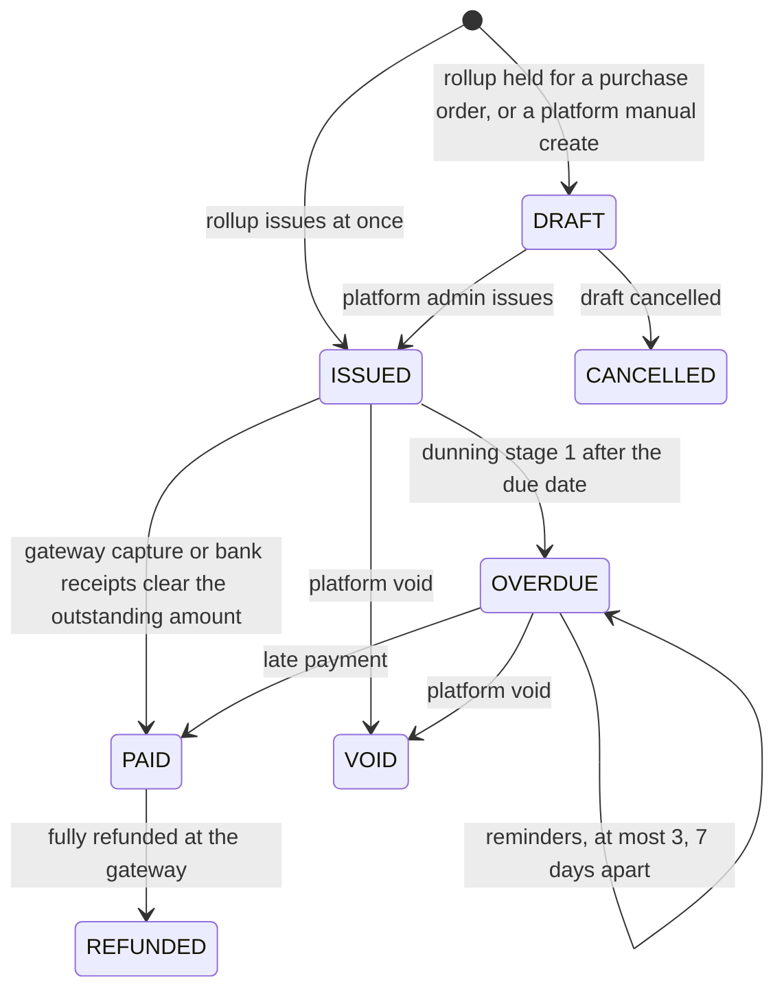

# Invoices, purchase orders and dunning

An organisation on the `INVOICE` rail does not pay at booking. Each sponsored booking accrues a receivable, a monthly rollup turns the accruals into one `OrganizationInvoice`, and the organisation pays it later by card or bank transfer. This page defines the invoice lifecycle, which invoices post a journal when they are issued, the platform-only doors that change an invoice, the purchase-order control, and the dunning job that chases an overdue invoice. The tax content of the document (GST heads, place of supply, e-invoicing and credit-note numbering) is in [GST invoices and credit notes](../60-tax/02-gst-invoices-and-credit-notes.md); the rail is in [funding rails](01-funding-rails-and-permutations.md).

## Lifecycle

`OrgInvoiceStatus` is `DRAFT`, `ISSUED`, `PAID`, `OVERDUE`, `VOID`, `CANCELLED`, `REFUNDED`. `VOID` is the platform cancelling an unpaid invoice; `REFUNDED` is a paid invoice later refunded. A tenant can only cancel a `DRAFT` (`PATCH .../billing-account/invoices/[invoiceId]`); anything else answers 403 `INVOICE_CHANGE_PLATFORM_ONLY`. Issuing, voiding and recording payments are platform doors. Dunning does not add a status: it loops inside `OVERDUE` and stamps `dunningReminderCount`.

An invoice number is `<PREFIX>-<FY>-<SEQ>`: the organisation's `invoiceNumberPrefix` or its upper-cased slug, the Indian fiscal year (April to March, reckoned in IST), and a four-digit sequence allocated atomically per organisation and fiscal year from `OrgInvoiceCounter`. The prefix is shortened so the whole number never exceeds 16 characters (`fitPrefixToRule46`). `@@unique([organizationId, invoiceNumber])` is the backstop.

An invoice's issue date, due date and billing period are India calendar dates wherever they are printed: the PDF ("Dates (IST)"), the Billing list and drawer, the Licence tab, the CSV export (`issue_date_ist`, `due_date_ist`), the invoice emails and the bell all go through `formatInvoiceDate` (`lib/time/invoice-date.ts`). The stored values stay instants, and `dueDate` is still `issuedAt + paymentTermsDays`. The Paid date on screen is a payment moment and reads in the viewer's profile zone; the CSV's `paid_at` is a UTC timestamp. See [document dates](../60-tax/02-gst-invoices-and-credit-notes.md#document-dates-are-india-dates).

## Where invoices come from, and what issuing posts

| Invoice                          | Created by                                                      | GST already booked elsewhere?                                                   | Journal at issue             |
| -------------------------------- | --------------------------------------------------------------- | ------------------------------------------------------------------------------- | ---------------------------- |
| Accrual rollup                   | `rollupOrgInvoiceAccruals`, driven by `settle-invoice-accruals` | Yes: each billed booking's `booking:<paymentId>` journal credited `GST_PAYABLE` | none                         |
| Licence subscription fee         | `generate-subscription-invoices`                                | No: licensed bookings book no GST, so the fee is taxed once, here               | `invoice-issued:<invoiceId>` |
| Manual programme or contract fee | `POST /api/admin/organizations/[orgId]/invoices`                | No                                                                              | `invoice-issued:<invoiceId>` |
| Wallet top-up                    | not an invoice                                                  | The later wallet-funded bookings book their own GST                             | not applicable               |

`postInvoiceIssuedJournal` (`lib/payments/billing/org-invoice-journal.ts`) decides from the invoice itself, inside the issuing transaction, so the job, the manual `POST` and the `DRAFT` to `ISSUED` `PATCH` share one rule: an invoice that bills bookings (`billedPayments` exist) posts nothing, because the receivable and the GST were booked booking by booking; any other invoice posts `Dr ORG_RECEIVABLE(total) / Cr PLATFORM_FEE(subtotal) / Cr GST_PAYABLE(tax)` under `invoice-issued:<invoiceId>`. A supply whose GST is already in the journal is never booked twice.

## The monthly rollup

`settle-invoice-accruals` runs in a window on the 1st of each month (04:00 to 20:00 UTC, in bounded slices of 10 organisations; see [scheduled jobs](../70-operations/01-scheduled-jobs.md)). For each organisation `rollupOrgInvoiceAccruals` (`lib/payments/billing/invoice-rollup.ts`) gathers the unbilled `SUCCEEDED` payments carrying `INVOICE_ACCRUAL` or `OVERAGE_INVOICE_ACCRUAL` legs, nets any `*_REVERSAL` legs a refund appended, writes one `InvoiceLineItem` per booking, computes the GST from each payment's tax, stamps `Payment.billableToOrgInvoiceId` so the next run cannot bill the same booking, and sets `dueDate = issuedAt + paymentTermsDays` (60 days when unset). The read, create and stamp run in one Serializable transaction, so two overlapping runs cannot both bill the same accrual set; the loser aborts with `P2034` and is retried or skipped. An organisation whose bookings are all covered by a flat licence (0-paise legs) but which has `CHARGE_ORG` overage is still scanned, so its overage is billed. A domestic organisation with no GST state is skipped, not guessed.

For each rolled `CHARGE_ORG` overage event the rollup moves the event `PENDING` to `ACCRUED` and records the line it landed on; paying the invoice later moves it to `CHARGED`. The base and surcharge are itemised on the `OverageEvent`; the invoice line is the combined amount.

## Paying, void and receipts

Each door below is a `withOpsAction` door (ADMIN, step-up, reason, one ops-log row), and above ₹25,000 each needs a second admin; see [admin money doors](../70-operations/02-admin-money-doors.md).

- **Gateway payment.** The tenant `POST .../invoices/[invoiceId]/pay` mints a Razorpay order for `invoiceOutstandingPaise` (the total less issued credit notes and receipts). It reuses a cached order only while the invoice is unpaid and the amount is unchanged; a stored paid order is checked for its captured payment before another order can be minted. The `reconcile-org-invoice-payments` ticker job rotates through ISSUED, OVERDUE and retained-pointer PAID invoices with stored Razorpay order IDs, recovering captures whose webhook was missed. It selects up to five candidates at 03:55, 07:55, 11:55, 15:55, 19:55 and 23:55 UTC; see [worker recovery](../../maintenance/12-worker-recovery.md#invoice-captures-and-uncertain-checkout-state) for admission limits, queue rotation and the lost-reference coverage boundary. Both paths use `applyOrgInvoiceCapture` (`lib/payments/billing/org-invoice-settlement.ts`), which posts `invoicepaid:<invoiceId>` (`Dr GATEWAY_CLEARING / Cr ORG_RECEIVABLE`) for the captured amount in the same transaction that writes the receipt and flips the status. A capture that does not equal the outstanding amount cannot settle the invoice: it is parked in `UNAPPLIED_RECEIPTS` with one `SystemEvent` (`ORG_INVOICE_CAPTURE_UNAPPLIED`) and never auto-refunded. An organisation awaiting verification may pay; a suspended one may not.

A booking-refund credit or bank receipt retains the existing checkout reference,
so the healer and dunning can still discover a capture whose webhook is missing.
Bank settlement preserves the reference even after PAID. The healer parks any
additional captured money canonically, then retires only the inspected PAID/order
reference and its audit together. Live or unconfirmed evidence stays retryable;
an apparently empty PAID order needs identity and unpaid-status confirmation too.

An unpaid stale-amount order is replaced only after a bounded gateway payment
inspection finds no live or captured payment. Attachment CASes the inspected ID,
rechecks current debt and records the replaced ID in its initiation audit. Failed
payment attempts retain their reference. This prevents the permanent stale-amount
Pay conflict without discarding an already visible capture.

Inspection does not revoke an external order. A checkout tab can capture after
the read/replacement; if its webhook is also lost, audit history aids operators
but is not consumed by this healer. VOID/overage-credit clearers and older lost
references remain separate limits. See the [worker contract](../../maintenance/12-worker-recovery.md#invoice-captures-and-uncertain-checkout-state)
and its primary provider references before claiming single-charge behavior.

- **Bank-transfer receipt.** `POST .../invoices/[invoiceId]/payments` (`recordBankTransferReceipt`) records a UTR, an amount (part-payments allowed) and a received-on date as an `OrganizationInvoiceReceipt` (the UTR is unique per organisation), posts `invoicereceipt:<receiptId>` as `Dr CASH / Cr ORG_RECEIVABLE`, and once nothing is outstanding settles the invoice through `settleOrgInvoicePaid`, the same transition a gateway capture uses (owner notice, `CHARGE_ORG` overages to `CHARGED`, release of parked trust earnings).
- **Void is a credit note.** `POST .../invoices/[invoiceId]/void` (`voidOrgInvoice`) moves an `ISSUED` or `OVERDUE` invoice to `VOID` with a compare-and-set, mints a credit note for what the invoice still carries, and returns the purchase-order draw. `mode: "REBILL"` clears the bookings' `billableToOrgInvoiceId` so the next rollup bills them again and no revenue is reversed. `mode: "FORGIVE"` posts `invoice-voided:<invoiceId>`, writing the receivable off against the note's GST (`GST_PAYABLE`) and the rest against `PLATFORM_FEE`, and the experts keep their share. A paid invoice answers `INVOICE_PAID_USE_REFUND`, and one with receipts answers `INVOICE_PART_PAID_USE_REFUND`.
- **Issue a held draft.** `POST .../invoices/[invoiceId]/issue` (`issueDraftOrgInvoice`) issues a `DRAFT`, naming the purchase order when the organisation requires one.

## Purchase orders

A `PurchaseOrder` declares a budget. When an organisation has `requiresPO`, raising a manual invoice, issuing a rollup or subscription invoice without cover, or signing a contract without a purchase order answers 409 `PO_REQUIRED`; a rollup or subscription invoice that has no covering order is held as a `DRAFT` and records one `SystemEvent` per run (`ROLLUP_PO_NOT_COVERED` or `SUBSCRIPTION_PO_NOT_COVERED`) so an operator can attach one.

The draw is an atomic compare-and-swap. `drawPurchaseOrder` (`lib/payments/billing/purchase-order-draw.ts`) is an `updateMany` that decrements `remainingAmountPaise` only while the order is `ACTIVE`, in the invoice's currency, unexpired, and still large enough; it answers `PO_BALANCE_EXCEEDED` when the claim misses. Two requests racing for the last rupee cannot both win, because the predicate is the lock. The rollup uses `drawCoveringPurchaseOrder`, which tries the oldest unexpired `ACTIVE` order that covers the total. A cancelled draft and a void return the draw, and every credit note returns its share (`restorePurchaseOrderForCredit`), capped at what the order has spent so `purchase_order_amounts_coherent` holds.

## Dunning

`dunning` runs in a daily window starting at 23:30 UTC (slots at 00:10, 01:10 and 02:10 UTC), after invoice generation. Every stage measures its cutoffs from the window start, so all slices of one window see one cohort. Each stamp is an idempotency gate inside a conditional `updateMany`, so two replicas or a same-day re-run cannot double-notify.

| Stage                                                     | Selects                                                                                                               | Claim                                                                                                | Effect                                                                                                                                    |
| --------------------------------------------------------- | --------------------------------------------------------------------------------------------------------------------- | ---------------------------------------------------------------------------------------------------- | ----------------------------------------------------------------------------------------------------------------------------------------- |
| 1 first notice                                            | `ISSUED`, `dueDate` past, `markedOverdueAt` empty                                                                     | `ISSUED` to `OVERDUE`, stamp `markedOverdueAt`                                                       | Notify the finance roster, write an `INVOICE_OVERDUE` audit row                                                                           |
| 2 reminder                                                | `OVERDUE`, `dunningReminderCount < 3`, last touch (`lastDunningReminderAt`, else `markedOverdueAt`) older than 7 days | Conditional on the `lastDunningReminderAt` it read; count plus one                                   | Re-notify at the next stage                                                                                                               |
| 3 suspend, only when `ENABLE_DUNNING_SUSPEND` is `"true"` | `OVERDUE`, three reminders sent, not yet suspended, last reminder older than 7 days                                   | Serializable transaction stamping `dunningSuspendedAt` with an `INVOICE_DUNNING_SUSPENDED` audit row | `resolveOrgFunding` then refuses the organisation's new sponsored bookings with 402 `BILLING_SUSPENDED_DUNNING` until the invoice is paid |

Only organisations in `ACTIVE`, `PENDING_VERIFICATION` or `SUSPENDED` status are dunned; a `DEACTIVATED` organisation is being torn down. Stage 3 suspends at most 20 invoices per run, oldest final reminder first, so switching the flag on cannot suspend the whole backlog in one tick. The reminder count and the 7-day interval are code constants, not settings. With the flag off, dunning is notify-only and a human takes over after the third reminder.

Before stage 3, the worker reads the retained gateway order. A discovered capture
uses `applyOrgInvoiceCapture` and its existing durable notice outboxes; it does
not issue a new charge. Live, unavailable or unapplied payment evidence holds
suspension and increments the job failure count. New suspension work is admitted
for ten seconds from entry to stage 3, after reminder work, with each provider
wait capped at five seconds.
The Serializable suspension claim rechecks positive net outstanding through its
transaction client and CASes the order reference that was inspected. A credit
or concurrent checkout cannot inherit a stale suspension decision. This covers
retained order IDs; it cannot discover a capture whose reference was lost.
Earlier reminder stages still use their existing status/date cohorts.

## Credit notes

A refund against an invoiced booking mints a credit note, the legal document that reverses output tax. `mintRefundCreditNote` (`lib/payments/operations/refund.ts`) is called from the refund cascade and from the gateway-refund webhook, so exactly one note is issued per refund: `CreditNote.refundId` is unique, and a replay returns the existing note. It does nothing for a payment that is not invoiced, refuses a `DRAFT` invoice (those accruals are netted on the leg instead), reverses the accrual legs in strict proportion to the refund, and takes its number from a separate gapless per-organisation series (`OrgCreditNoteCounter`). `mintInvoiceRefundCreditNote` covers the case where the organisation paid an invoice directly through the gateway and that payment was refunded. Past 30 November following the financial year of the supply the note is commercial: base amount only, every tax head zero, and the refund cascade then posts no `GST_PAYABLE` debit. The rules for the note itself are in the [tax page](../60-tax/02-gst-invoices-and-credit-notes.md); the cascade is in [refunds](../30-refunds-disputes/01-refunds.md).

## Worked example: Wipro's month

Wipro Limited (`INVOICE`, NET-60, purchase order `WIP-PO-2026-0042` of ₹50,00,000) accrues sponsored bookings through September 2026. On Thu 1 Oct 2026, in the 04:45 UTC slot (10:15 IST), the rollup bills ₹1,00,000 of bookings plus ₹18,000 of GST: an invoice of ₹1,18,000 (11,800,000 paise), number `WIPRO-2026-0001`. It draws 11,800,000 paise from the purchase order, leaving ₹48,82,000 (488,200,000 paise of 500,000,000), and posts no journal at issue because the receivable and GST were booked per booking. The due date is 60 days later, Mon 30 Nov 2026 at 04:45 UTC, so the PDF and the Billing tab read Issued 1 Oct 2026 and Due 30 Nov 2026 (IST).

On Mon 5 Oct a finance user records a ₹50,000 (5,000,000 paise) bank transfer with its UTR: `Dr CASH 5,000,000 / Cr ORG_RECEIVABLE(wipro) 5,000,000`. The invoice stays `ISSUED` with ₹68,000 outstanding, and `/pay` now charges 6,800,000 paise. A second transfer of ₹68,000 settles it and flips it to `PAID`.

Had Wipro paid nothing, dunning stage 1 marks the invoice `OVERDUE` in the window that opens at 23:30 UTC on Mon 30 Nov, at the 00:10 UTC slot on Tue 1 Dec (05:40 IST). Reminders follow at the same slot on Wed 9, Wed 16 and Wed 23 Dec 2026, and then stop. With the suspend flag on, the invoice would stamp `dunningSuspendedAt` in the Thu 31 Dec 00:10 UTC slot, and Wipro's new sponsored bookings would be refused with `BILLING_SUSPENDED_DUNNING` until it is paid.

## Where in code

| Concern                        | File                                                                                       |
| ------------------------------ | ------------------------------------------------------------------------------------------ |
| Rollup, numbering, journals    | `lib/payments/billing/invoice-rollup.ts`, `invoice-numbering.ts`, `org-invoice-journal.ts` |
| Payment, receipts, void, issue | `org-invoice-settlement.ts`, `org-invoice-void.ts`, `create-org-invoice.ts`                |
| Purchase orders                | `purchase-order-draw.ts`                                                                   |
| Dunning                        | `jobs/billing/dunning.ts`, `lib/payments/checkout/org-funding.ts`                          |
| Credit notes                   | `lib/payments/operations/refund.ts`, `credit-note-numbering.ts`                            |

## Related

- [Rate cards and overage](03-rate-cards-and-overage.md) for how `CHARGE_ORG` overage reaches the rollup, and [worked examples](05-worked-examples.md).
- [Money runbooks](../70-operations/05-money-runbooks.md) for an invoice that is overdue or not generated.

## Deprecated & Superseded Approaches

1. **Invoice workflows on GitHub Actions** (`dunning.yml`, `irp-uploader.yml`). Every invoice job runs on the Netlify ticker.
2. **An `items` JSON blob on the invoice.** Lines are typed `InvoiceLineItem` rows.
3. **`MAX(seq) + 1` numbering.** It races; numbers come from the counter upsert, and the fiscal year is reckoned in IST.
4. **A status per reminder.** Dunning loops inside `OVERDUE`.
5. **Dunning described as two stages only.** Suspension is the third stage behind `ENABLE_DUNNING_SUSPEND`, with gateway and net-debt checks before its claim.
