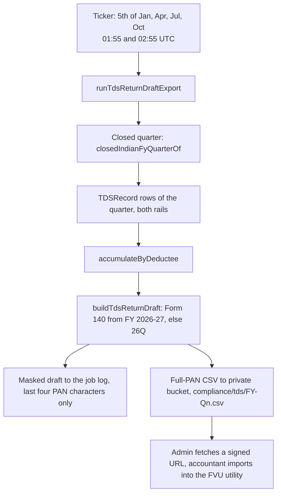

# TDS rules and returns

This page states the tax-deducted-at-source rules as the code encodes them, and how the quarterly return draft is produced. It does not say what the law requires beyond that. A rule appears here only if `lib/compliance/` or `lib/payments/tax/` implements it, and a rule the code does not implement is listed as not implemented, with the place in the code that refuses it. The mechanics of withholding on a payout, such as the catch-up and the carry, are in [TDS withholding](../40-payouts/06-tds-withholding.md).

## Which regime applies

The platform withholds as an e-commerce operator when it pays a seller. The Income-tax Act 2025 applies from 1 April 2026 and renames the provisions and forms. The code carries both labels.

| Concept                          | Income-tax Act 1961 | Income-tax Act 2025                              | In the code                                                      |
| -------------------------------- | ------------------- | ------------------------------------------------ | ---------------------------------------------------------------- |
| E-commerce operator withholding  | Section 194-O       | Section 393(1) Table Sl. 8(v), payment code 1035 | `TdsRate` rows `194O` and `393-8(v)`; records are stamped `194O` |
| No-PAN rate                      | Section 206AA       | Section 397(2)                                   | `noPanRateBps` on the rate row, `NO_PAN_BPS_194O` fallback       |
| Quarterly return, resident payee | Form 26Q            | Form 140 (from FY 2026-27)                       | `formLabel` in `buildTdsReturnDraft`                             |

## The rules as encoded

| Rule                                      | Value                                                                                                                                     | Where                                                      |
| ----------------------------------------- | ----------------------------------------------------------------------------------------------------------------------------------------- | ---------------------------------------------------------- |
| Rate with a PAN                           | 10 basis points (0.1 percent), effective 1 October 2024                                                                                   | `TdsRate` rows, `TDS_SECTION_DEFAULT_BPS`                  |
| Rate without a PAN                        | 500 basis points (5 percent)                                                                                                              | `noPanRateBps`, `NO_PAN_BPS_194O`                          |
| Rate for sections 194J and 194C           | 1,000 and 200 basis points, with 2,000 as their no-PAN rate; reachable only through an explicit section override, which payouts never set | `TDS_SECTION_DEFAULT_BPS`, `PAN_FALLBACK_BPS`              |
| Taxable base                              | The gross consideration of the sale, after refunds, without GST; the commission the platform keeps is not deducted from it                | `resolve194OTaxablePaise`, `earningsGrossPaise`            |
| Yearly exemption                          | ₹5,00,000 (50,000,000 paise) of gross in the financial year, only for an individual or HUF with a PAN on file                             | `TDS_194O_EXEMPTION_PAISE`, `TDS_194O_EXEMPT_ENTITY_TYPES` |
| Above the exemption                       | The whole year-to-date gross is the base, not only the excess                                                                             | `crossingTaxablePaise`                                     |
| Company, firm, LLP or unknown entity type | Taxed from the first rupee, no threshold                                                                                                  | `resolve194OTaxablePaise`                                  |
| A PAN counts as on file                   | An encrypted PAN is stored and `panVerified` is true (consultant); an encrypted PAN is stored (organisation)                              | `consultantPanOnFile`, `createOrgPayoutBatch`              |
| Financial year and quarter                | April to March in India time; Q1 April to June, Q2 July to September, Q3 October to December, Q4 January to March                         | `getIndianFinancialYear`, `getIndianFYQuarter`             |
| Rate lookup                               | The latest `TdsRate` row in force for the section on the date; built-in defaults if the table has no row                                  | `resolveEffectiveTdsRate`                                  |
| Rate rows are append-only                 | A rate change is a new row with a new `effectiveFrom`; existing rows are never rewritten                                                  | `prisma/seedFiles/15a-create-tds-rates.ts`                 |

The seeded `TdsRate` rows are: 194-O at 10 basis points from 2024-10-01 to 2026-03-31, 194J at 1,000 and 194C at 200 under the 1961 Act, and under the 2025 Act from 2026-04-01 the section `393-8(v)` with code 1035 at 10 basis points, 194J with code 1027 at 1,000, 194C with code 1017 at 200 and section 195 with code 1057 at 2,000. Every row carries its no-PAN rate and its yearly threshold.

A worked example. Hannah is an individual with a verified PAN and ₹4,90,000 (49,000,000 paise) of gross earned in FY 2026-27. A ₹20,000 booking in a new payout takes her year-to-date gross to ₹5,10,000 (51,000,000 paise), which is above the exemption, so the base becomes the whole ₹5,10,000 and 0.1 percent of it is ₹510 (51,000 paise), not ₹10. The financial year runs April to March in India time, so a payout completing at 00:30 IST on 1 April counts toward the new year.

The pure function `computeTdsForPayout` (`lib/compliance/tds.ts`) also contains a Section 197 lower-rate-certificate branch and a DTAA lookup for non-residents. Payout code never reaches them: it passes no certificate, no section override and a resident status. They are inert.

## Not implemented

- **Non-resident payees (section 195, forms 144, 145 and 146).** There is no withholding for a non-resident. `payoutEligibilityReason` answers `NON_INDIA`, and `processSinglePayout` refuses a non-resident payout with a message that section 195 is not implemented. Such a payout is processed manually outside the platform. `payoutRequirements` does not ask a non-resident for a PAN.
- **Form 15CA and 15CB, and cross-border remittance filing.** No code produces or files them.
- **Return filing itself.** No code generates the FVU file the official utility needs, a Form 131 (old 16A) certificate for the payee, or a TRACES submission. The draft in the next section is an input to a person's filing.
- **Per-payment 194-O reporting on challans.** The deposit of withheld tax with the government is not automated.

## Quarterly return draft

`tds-return-draft` turns a quarter of `TDSRecord` rows into the deductee-wise draft an accountant works from. It is `runTdsReturnDraftExport` (`jobs/compliance/tds-26q-draft-export.ts`), reached through the twin `POST /api/cleanup/tds-return-draft`.

**When.** The ticker fires it on the fifth of January, April, July and October in a two-hour window from 01:00 UTC, so it runs at 01:55 and 02:55 UTC, which is 07:25 and 08:25 IST. The second run is harmless because the export overwrites one private CSV. It builds the quarter that has just closed: on 5 April it builds January to March of the year that ended, not the five days of the new year (`closedIndianFyQuarterOf`). To build a different quarter, set `TDS_RETURN_FY` in the form `2026-27` and `TDS_RETURN_QUARTER` to a digit from 1 to 4 where the route runs; a malformed value fails the job rather than emitting a mislabelled artifact. The lock is fail-open because the export is read-only and safe to repeat. The job is not in the financial-jobs list, so it also runs while maintenance is DEGRADED.

**What goes in.** Both rails are in scope: a `TDSRecord` names a consultant or an organisation, and the draft groups by deductee type, deductee id and section. The amount credited on a line is the sum of the quarter's completed payout amounts for that deductee (the consultant payout amount, or the organisation net payout), net of reversal base reductions. Records already stamped as reported are excluded, and the draft says how many. The financial year and quarter of a record come from the payout's completion time, not the batch time.

**What comes out.** The first output is a masked draft, printed as JSON in the job log: each deductee's type, name, section, payment code, credited amount and net TDS, and the last four PAN characters only. The second is a full-PAN CSV written to the private `org-invoices` bucket at `compliance/tds/<FY>-Q<quarter>.csv`. The job logs only that path, and there is deliberately no downloadable log artifact, because a decrypted PAN exists nowhere else outside the database. The CSV columns are `deductee_type,pan,deductee_name,section,payment_code,amount_credited_paise,tds_deducted_paise,quarter,financial_year,is_reversal`. A deductee whose withholding was reversed in the quarter gets a second row with `is_reversal` true, a credited amount of zero and the negative figure, because the return treats a reversal as an adjustment against an earlier credit. Cells are escaped against spreadsheet formula injection, but a plain number is left alone so negatives import as numbers.

**Getting the file.** An administrator calls `GET /api/admin/compliance/tds-return?financialYear=2026-27&quarter=3`. The route is ADMIN-only, because the file carries decrypted PANs. It validates an April-to-March pair and a quarter from 1 to 4, answers 404 if the job has not run for that quarter, and otherwise redirects to a signed URL that expires after ten minutes. The bucket creates itself as a private bucket with a 25 MB object limit on first write (`ensurePrivateFinanceBucket`).

**Warnings to read before filing.** A deductee with no PAN on file must be withheld at the higher no-PAN rate, so the draft counts those lines and the withheld amount should be checked. From FY 2026-27 the draft also flags any line with no payment code. The code is looked up from the `TdsRate` row whose `section` equals the record's section and that was in force at the quarter end. Payouts stamp their records with section `194O`, while the seeded 2025-Act row that carries code 1035 is named `393-8(v)`, so a `194O` line finds no code unless a `194O` rate row carries one, and the draft shows the warning.

**The filing step is human.** The CSV is an input to the official return preparation utility. Nothing here generates or validates an FVU file or files anything. The job also deliberately does not stamp records as reported, so a re-run for the same quarter is safe and the flag `reportedInForm26Q` keeps meaning "a person filed this". The flag keeps its old 26Q name; its meaning is unchanged for Form 140. `markTDSAsFiled` and the filing-detail fields (challan number, BSR code, acknowledgement number, certificate number) are written through `/api/admin/tds`, which answers 404 unless `ENABLE_TDS_ADMIN_VIEW` is on.

### Quarterly due dates

These are the statutory dates the draft feeds; the code does not enforce them. Returns are due on 31 July, 31 October, 31 January and 31 May for the quarters ending June, September, December and March, and the dates did not change under the 2025 Act. TDS itself is deposited by the 7th of the following month.

### Worked example

Hannah's two payouts complete in October to December 2026, Q3 of FY 2026-27: the crossing payout with 51,000 paise withheld and a later payout with 1,000 paise. Priya's refund of one booking later reverses 2,000 paise of the first payout's withholding (a refunded ₹20,000 gross at 10 basis points), recorded as a negative `TDSRecord`. On 2027-01-05 at 01:55 UTC (07:25 IST) the job builds Hannah's line for Q3 with deductions of 52,000 and a reversal of −2,000, net 50,000. The CSV has one row with `tds_deducted_paise` 52000 and a second with `is_reversal` true and `tds_deducted_paise` −2000. LearnPro Academy, withheld at 6,000 paise on its payout in the same quarter, appears as a separate `ORGANIZATION` line.

## Rules and their enforcers

| Rule                                                      | Enforcer                                                                    | Test                                                       | Repair                                       |
| --------------------------------------------------------- | --------------------------------------------------------------------------- | ---------------------------------------------------------- | -------------------------------------------- |
| The 194-O base and exemption follow the three conditions  | `resolve194OTaxablePaise`                                                   | `__tests__/payments/payout-194o-individual-exempt.test.ts` | Correct the entity type or verify the PAN    |
| The quarterly draft names Form 140 from FY 2026-27        | `buildTdsReturnDraft`                                                       | `__tests__/compliance/tds-return-draft.test.ts`            | None needed                                  |
| The draft builds the closed quarter, not the current one  | `closedIndianFyQuarterOf`                                                   | `__tests__/compliance/tds-return-draft.test.ts`            | Set `TDS_RETURN_FY` and `TDS_RETURN_QUARTER` |
| Reversals are separate lines and net against the quarter  | `buildTdsReturnDraft`, `buildTdsReturnCsv`                                  | `__tests__/compliance/tds-return-draft.test.ts`            | None needed                                  |
| The full PAN never reaches a log                          | The draft carries `panLast4`; decryption happens only while writing the CSV | `__tests__/compliance/tds-return-draft.test.ts`            | Rotate access to the private bucket          |
| A TDS record has one deductee and the right rail's payout | `tds_record_deductee_xor`, `tds_record_payout_rail_matches`                 | none (database constraint)                                 | None needed                                  |

## Where in code

- `lib/compliance/tds-194o.ts`, `tds.ts`, `tds-return.ts`.
- `lib/payments/tax/tds-service.ts`, `pan-crypto.ts`.
- `lib/payments/payouts/consultant-tds.ts`.
- `jobs/compliance/tds-26q-draft-export.ts`, `app/api/admin/compliance/tds-return/route.ts`, `app/api/admin/tds/route.ts`.
- `prisma/seedFiles/15a-create-tds-rates.ts`.

## Related

- [Tax in plain language](01-tax-explainer.md)
- [TDS withholding](../40-payouts/06-tds-withholding.md)
- [MSME, statutory exports and the calendar](04-msme-statutory-exports-and-calendar.md)

## Deprecated & Superseded Approaches

Nothing in this list is live. It exists so that nobody re-implements it.

- **Equalisation levy.** The 2 percent levy on e-commerce supply was abolished from 1 August 2024, and the 6 percent levy on advertising from 1 April 2025. Do not add code or references for either.
- **Section 206C(1H), tax collected on the sale of goods.** Omitted from 1 April 2025, and it never applied to services.
- **Sections 206AB and 206CCA, higher rates for non-filers.** Omitted from 1 April 2025. There is no PAN-versus-return-filing check.
- **Section 206AA.** Its rule lives on as section 397(2) of the 2025 Act, with the 5 percent e-commerce rate. Cite 397(2), not 206AA, in new code.
- **GST TCS under section 52, a GSTR-8 builder, `GstTcsBatch`.** Never part of the principal-supplier model; deleted.
- **A consultant path at 194J, ₹50,000 and 10 percent.** Older notes describe it as the live consultant rule. It survives only behind `TDS_ENGINE=LEGACY`, at the 194-O rate.
- **`getUnreportedRecordsForQuarter` and a `quarterly-return-prep` job.** Neither exists. The draft job is `tds-26q-draft-export`.
