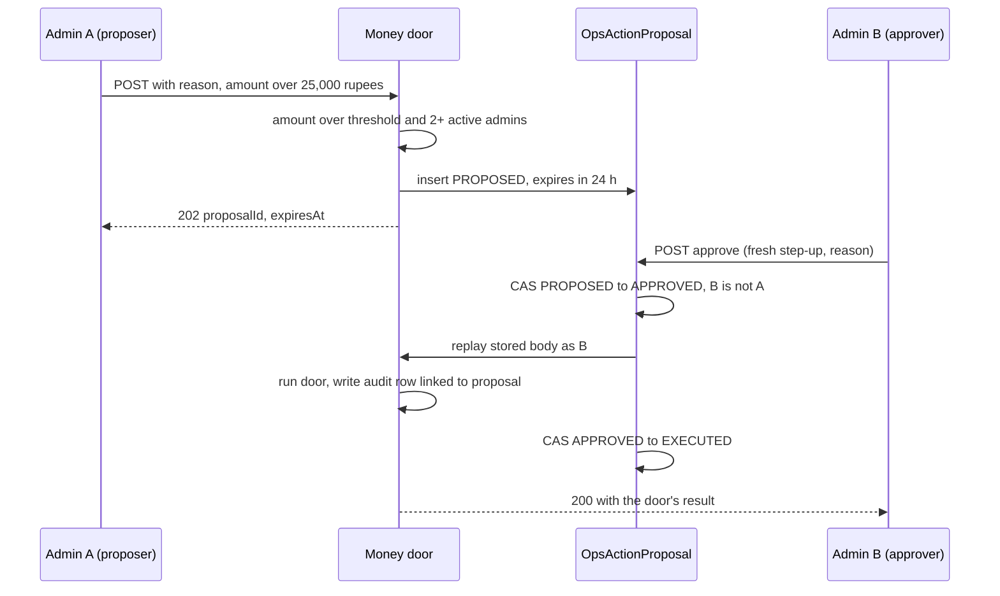

# Admin money doors and the Money console

Every back-office action that moves money, holds money or runs a money job goes through one shell, `withOpsAction` in `lib/backoffice/ops-action-log.ts`, and is surfaced in one place: the Money console at `/dashboard/admin/money/<section>` for admins and `/dashboard/staff/money/<section>` for staff. This page lists the sections, the checks every door applies, the exact thresholds, which doors need a second admin, and the on-demand jobs the console can start. The rule behind all of it is simple: staff see every money surface and own support; only an admin executes money, and staff executes only bounded support refunds and holds.

## The sections and who sees them

`lib/backoffice/money-tabs.ts` declares the list once. The sidebar and the shared `[tab]` page both filter it through `BACKOFFICE_PERMISSIONS` (`lib/auth/backoffice-permissions.ts`), so a role never sees a section its route guard would refuse. `OPERATORS` below means ADMIN and STAFF.

| Section       | Surface that gates it | Held by   | What it is for                                                                                                                                      |
| ------------- | --------------------- | --------- | --------------------------------------------------------------------------------------------------------------------------------------------------- |
| Payments      | `payments.read`       | Operators | Every payment with its status and rail.                                                                                                             |
| Refunds       | `refunds.read`        | Operators | Refunds issued, pending and failed; the refund and credit-restore doors need `refunds.manage` (admin).                                              |
| Disputes      | `disputes.read`       | Operators | Chargebacks and their evidence deadlines; the update door needs `disputes.manage` (admin).                                                          |
| Payouts       | `payouts.read`        | Operators | Consultant payouts waiting, in flight and paid, with the instant-payout approval queue.                                                             |
| Org payouts   | `payouts.manage`      | Admin     | Organisation payouts with platform co-approval, hold and release.                                                                                   |
| Earnings      | `payouts.manage`      | Admin     | Consultant and organisation earnings with hold and release.                                                                                         |
| Reconcile     | `payouts.manage`      | Admin     | Starts four reconcile jobs on demand and shows when each last ran.                                                                                  |
| Approvals     | `payments.manage`     | Admin     | Money actions above ₹25,000 waiting for a second admin.                                                                                             |
| Incidents     | `incidents.read`      | Operators | Declared platform outages, the sessions they voided and each learner's remedy; declaring needs `incidents.declare` (admin).                         |
| Support spend | `opsLog.read`         | Operators | Refunds and holds per operator against the staff limits. A staff viewer sees only their own row.                                                    |
| Audit log     | `opsLog.read`         | Operators | Every console action: who, what, on which row, and why. It sits at the end of the sidebar outside the Money group but keeps the `/money/audit` URL. |

Every payment row in the Payments and Refunds sections, the payment detail page and the Payments and Bookings sections of User 360 carry a **Trace** action. It opens `/dashboard/<tree>/trace`, a read-only timeline of one payment's or booking's life across payments, legs, refunds, disputes, the ledger, earnings and holds, payouts, invoices and credit notes, booking history, support cases and console actions, gated by `payments.read`. The System Jobs page (`systemJobs.manage`, admin) shows seven-day run metrics per job above the job list. Both are described in [the three observability layers](../../observability/three-layers.md).

The four index pages the console replaced (`/dashboard/admin/payments`, `refunds`, `disputes`, `payouts`) and the old `/money/class-series` URL no longer exist; use `/dashboard/<tree>/money/<section>` and Appointments filtered to classes. `moneyHubHref` builds the section URL with a query.

## What every door checks

A door is a route built by `withOpsAction(surface, action, shape, door, options)`. The shell applies the first four checks before the door runs, in this order; the door's own handler applies the maintenance and throttle checks when it runs, which for a proposal is when the approved replay runs. Each check has a named enforcer:

| Check        | Rule                                                                                                                                                                                                                                                                                              | Enforcer                                                                                         |
| ------------ | ------------------------------------------------------------------------------------------------------------------------------------------------------------------------------------------------------------------------------------------------------------------------------------------------- | ------------------------------------------------------------------------------------------------ |
| Surface      | The caller's role must hold the door's surface, for example `payments.manage`, `refunds.manage`, `payouts.manage`, `invoices.manage`, `disputes.manage`, `incidents.declare`, `referrals.manage` or a bounded staff surface; the door index below names each door's surface.                      | `requireBackofficeSurface`                                                                       |
| Step-up      | The session must have been created or re-authenticated in the last 15 minutes, else 403 `REAUTH_REQUIRED`. Most money doors set `stepUp: true`; the earnings hold and release, dispute update and dispute evidence, referral credit, fee-schedule, class-series and session-outcome doors do not. | `requireFreshSession`, `STEP_UP_WINDOW_MS` in `lib/auth/step-up.ts`                              |
| Reason       | A typed `reason` of 5 to 1,000 characters is required; shorter answers 400 `INVALID_BODY`.                                                                                                                                                                                                        | `opsReasonSchema`                                                                                |
| Second admin | An amount strictly above ₹25,000 (2,500,000 paise) becomes a proposal when at least two active admins exist. This is decided before the door runs.                                                                                                                                                | `requiresSecondApprover`, `SECOND_APPROVAL_THRESHOLD_PAISE` in `lib/backoffice/ops-proposals.ts` |
| Maintenance  | The edge gate blocks the listed admin routes in DEGRADED. Inside the door, the support case doors, the support refund approval and the platform cancel refuse 503 `MAINTENANCE` outside phase `OFF` and 503 `MAINTENANCE_UNKNOWN` when the phase cannot be read.                                  | `assertMoneyDoorsOpen`; see [the maintenance gate](03-maintenance-gate-and-recovery.md)          |
| Throttle     | The refund, payout create and process, wallet adjustment and refund-remaining, dispute-evidence, class-series refund, support refund approval and platform cancel doors share a budget of 10 money actions per minute per actor, else 429 `RATE_LIMITED`.                                         | `assertMoneyOpsBudget`, `moneyOpsLimiter`                                                        |
| Audit        | Exactly one `OpsActionLog` row per door.                                                                                                                                                                                                                                                          | `recordOpsAction`                                                                                |

There are two shapes of door. A **transactional door** runs its handler and writes the audit row in one database transaction, so a refused or rolled-back door leaves no row. A **gateway door** (a Razorpay call, for example) cannot sit inside a Postgres transaction, so it writes its row right after the call returns, with `after.status` set to `SUCCEEDED`, or to `FAILED` with the refusal code. That row is written once and never retried. If the write fails after money has moved, the failure is paged to Sentry and the door still answers with the call's outcome, because a lost audit row is better than a false failure for money that already moved. Typed refusals (`OpsRefusal` in `lib/backoffice/ops-refusal.ts`) return their own codes, such as `ALREADY_RUNNING` or `WALLET_STILL_DRIFTED`, instead of a generic 500.

## Second-admin approval

When a door's amount is above ₹25,000 and at least two admins are active (`countActiveAdmins`: role `ADMIN`, not banned), the door does not act. It answers `202` with a `PROPOSED` row in `OpsActionProposal`, and writes an `ops-proposal.propose` audit row. A **different** admin approves it at `POST /api/admin/ops-proposals/[id]/approve`, which needs a fresh step-up and a reason. The approval replays the stored request body through the same door, as the approver, links that door's `OpsActionLog` row to the proposal and marks it `EXECUTED`. The proposer may withdraw their own proposal at `.../reject` but may not approve it (`SAME_ADMIN`).

The rules that keep this honest:

- **One open proposal per action and target.** The partial unique index `ops_action_proposal_one_open_key` refuses a second; the door answers `PROPOSAL_PENDING`. An expired row is flipped to `EXPIRED` when the next proposal opens, so it never holds the slot.
- **Expiry is read, not swept.** A proposal lives 24 hours (`PROPOSAL_TTL_MS`). The console and the list route compute "expired" from `expiresAt`, so no job runs for it. Approving after expiry answers `PROPOSAL_EXPIRED`.
- **Status changes are compare-and-set.** `decideProposal` and `markProposalExecuted` use `updateMany` with the expected prior status, so two admins deciding at once cannot both win (`PROPOSAL_DECIDED`).
- **A failed replay leaves the row `APPROVED`** with the failure noted on it, so the approval is never silently lost.
- **An amount that cannot be priced counts as above the threshold.**
- **One admin only.** With a single active admin the door acts at once; the rule needs two.

The doors that take a second approver, with the amount each is priced at:

| Door                                                                                                                                                                           | Priced at                                                                                                  |
| ------------------------------------------------------------------------------------------------------------------------------------------------------------------------------ | ---------------------------------------------------------------------------------------------------------- |
| Refund issue (`POST /api/admin/refunds/issue`) and the legacy refund door (`POST /api/admin/refunds`, which also requires an `Idempotency-Key` header of 10 to 255 characters) | The refund amount                                                                                          |
| Support refund approval (`reviewSupportRefundDoor`, `lib/support/refund-door.ts`)                                                                                              | The recommended refund, or the referral credit it restores on a credit-funded payment (`remedyValuePaise`) |
| Organisation invoice issue and void                                                                                                                                            | The invoice total                                                                                          |
| Bank-transfer receipt on an invoice                                                                                                                                            | The transfer amount                                                                                        |
| Overage settle-to-org                                                                                                                                                          | Base plus surcharge plus the organisation's GST                                                            |
| Credit-limit change (`PATCH .../billing-account`)                                                                                                                              | The raise; switching to `INVOICE` funding counts as raising from zero, and unlimited is unbounded          |
| Organisation payout approve (platform co-approval)                                                                                                                             | The net payout                                                                                             |
| Wallet adjustment                                                                                                                                                              | The absolute amount                                                                                        |
| Wallet refund-remaining                                                                                                                                                        | The cached balance less operator-granted credit (`grantedWalletCreditPaise`)                               |

For example, with three active admins, Olivia Brown asks to refund ₹40,000 (4,000,000 paise) on Wed 21 Oct 2026 at 11:00 IST. The door answers 202, and the proposal expires at 11:00 IST on Thu 22 Oct. Patrick Brown re-authenticates at 15:00 IST and approves at 15:10 IST, inside the 15-minute step-up window (at 15:30 he would get `REAUTH_REQUIRED` and have to re-authenticate first). The refund then runs as Patrick, under his own dedupe key. A refund of exactly ₹25,000 would have run at once, because the rule is "strictly above". If nobody approved by Thursday 11:00 IST, Olivia would have to propose it again.

## Door index

Every route below is a `withOpsAction` door unless marked a read. `2nd` marks a door that takes a second admin above ₹25,000. Reads do not go through the shell, so they need no step-up or reason and write no ops-log row.

| Route                                                        | Verb      | Surface             | Purpose                                                                                                                                                                                 | 2nd |
| ------------------------------------------------------------ | --------- | ------------------- | --------------------------------------------------------------------------------------------------------------------------------------------------------------------------------------- | --- |
| `/api/admin/refunds/issue`                                   | POST      | `refunds.manage`    | Issue a refund, or a ladder override with `tierOverridePct`, through `refundBookingPayment`                                                                                             | yes |
| `/api/admin/refunds`                                         | POST      | `refunds.manage`    | Legacy refund door (payment or whole event); needs `Idempotency-Key`                                                                                                                    | yes |
| `/api/admin/refunds/credits`                                 | POST      | `refunds.manage`    | Return N sessions of credits to a credit-funded seat                                                                                                                                    | no  |
| `/api/admin/payouts`                                         | POST      | `payouts.manage`    | Create a consultant payout batch                                                                                                                                                        | no  |
| `/api/admin/payouts/[id]`                                    | POST      | `payouts.manage`    | Approve or reject a consultant payout                                                                                                                                                   | no  |
| `/api/admin/payouts/process`                                 | POST      | `payouts.manage`    | Disburse approved payouts now                                                                                                                                                           | no  |
| `/api/admin/org-payouts/[id]/approve`                        | POST      | `payouts.manage`    | Platform co-approval of an organisation payout; refuses the batch creator and the organisation's approver                                                                               | yes |
| `/api/admin/org-payouts/[id]/hold`, `.../release`            | POST      | `payouts.manage`    | Place or clear a platform hold on a `PENDING` or `APPROVED` organisation payout                                                                                                         | no  |
| `/api/admin/org-payouts`                                     | GET       | `payouts.read`      | List organisation payouts with `platformApprovalRequiredAt` and `platformHeldAt` (read)                                                                                                 | n/a |
| `/api/admin/payout-accounts/unfreeze`                        | POST      | `payouts.manage`    | Lift a payee's payout freeze                                                                                                                                                            | no  |
| `/api/admin/earnings/[id]/hold`, `.../release`               | POST      | `payouts.manage`    | Operator hold or release of one earning (no step-up)                                                                                                                                    | no  |
| `/api/admin/disputes/[disputeId]`                            | PATCH     | `disputes.manage`   | Assign or update a dispute                                                                                                                                                              | no  |
| `/api/admin/billing-accounts/[id]/wallet-adjustment`         | POST      | `payments.manage`   | Signed wallet correction                                                                                                                                                                | yes |
| `/api/admin/billing-accounts/[id]/refund-remaining`          | POST      | `payments.manage`   | Return the organisation's own top-up money to the card; operator-granted credit stays in the wallet                                                                                     | yes |
| `/api/admin/billing-accounts/[id]/unfreeze`                  | POST      | `payments.manage`   | Lift a wallet-spend freeze after the drift is repaired                                                                                                                                  | no  |
| `/api/admin/organizations/[orgId]/billing-account`           | PATCH     | `invoices.manage`   | Set `creditLimit` and switch to `INVOICE` funding behind the verified-domain gate and the wallet-exit guard                                                                             | yes |
| `/api/admin/organizations/[orgId]/invoices`                  | POST      | `invoices.manage`   | Raise a manual invoice                                                                                                                                                                  | no  |
| `.../invoices/[invoiceId]/issue`, `.../void`, `.../payments` | POST      | `invoices.manage`   | Issue a draft, void as a credit note, record a bank-transfer receipt                                                                                                                    | yes |
| `.../overages/[overageEventId]/settle-to-org`                | POST      | `invoices.manage`   | Settle an unpaid member overage to the organisation                                                                                                                                     | yes |
| `/api/admin/reconcile/[job]`                                 | POST      | `payouts.manage`    | Run one of the four reconcile jobs                                                                                                                                                      | no  |
| `/api/admin/reconcile-ledgers`                               | POST, GET | `payouts.manage`    | Run the ledger audit now, or list reports                                                                                                                                               | no  |
| `/api/admin/ops-proposals`                                   | GET       | `payments.manage`   | List second-approval proposals by effective status (read)                                                                                                                               | n/a |
| `/api/admin/ops-proposals/[id]/approve`, `.../reject`        | POST      | `payments.manage`   | Approve (replays the stored request) or close a proposal                                                                                                                                | n/a |
| `/api/admin/incidents`, `.../[incidentId]/settle`            | POST      | `incidents.declare` | Declare a platform incident, or settle one now                                                                                                                                          | no  |
| `/api/payments/[paymentId]/recover`                          | POST      | `payments.manage`   | Build the booking for a captured payment whose metadata failed validation, from corrected metadata; refuses a payment whose money was returned or is contested (409 `PAYMENT_RETURNED`) | no  |
| `/api/payments/disputes`                                     | POST      | `disputes.manage`   | Draft or submit dispute evidence (no step-up); the multipart file upload on this route is not a door                                                                                    | no  |
| `/api/admin/fee-schedules`, `.../[scheduleId]/approve`       | POST      | `payments.manage`   | Propose or approve a platform fee schedule (its own maker-checker rule, no step-up)                                                                                                     | no  |
| `/api/admin/referrals/credits`, `.../[creditId]/reverse`     | POST      | `referrals.manage`  | Grant or reverse a referral credit (no step-up)                                                                                                                                         | no  |
| `/api/admin/settlements/lines`                               | GET       | `payouts.read`      | Settlement reconciliation lines, filterable by status (read)                                                                                                                            | n/a |
| `/api/admin/support-spend`                                   | GET       | `opsLog.read`       | Per-operator refund and hold spend (read)                                                                                                                                               | n/a |

## The recover door refuses returned money

The recover door (`POST /api/payments/[paymentId]/recover`) books an appointment for a payment that is `SUCCEEDED` with no booking. It refuses when the payment's money has been returned or is contested: any `PENDING` or `SUCCEEDED` refund, an owed-refund marker (`refundOwedKey`), an `Auto-refund pending:`, `Auto-refunded:` or `Auto-refund stuck:` description, or a dispute that is open or lost. The refusal is the typed 409 `PAYMENT_RETURNED`. The predicate is `unreturnedCaptureWhere` (`lib/payments/webhooks/auto-refund-marker.ts`); the route checks it first, and the capture handler checks it again inside its own Serializable transaction (`RecoveryRefusedError`), so a refund or dispute that lands between the two aborts the booking.

The reason is that there is no `REFUNDED` payment status. A late capture that was refunded automatically still reads `SUCCEEDED` with no booking, which looks exactly like a capture waiting for recovery. Booking it would create an appointment and expert earnings on money that already went back to the buyer. Example: Charlotte Brown's late capture of ₹1,724.00 (172,400 paise) was refunded automatically and its description now starts `Auto-refunded:`. An operator who presses recover gets `PAYMENT_RETURNED`.

## Staff caps on support money

Staff can move money only through bounded support doors. `assertBoundedRefund` (`lib/support/money-policy.ts`) refuses a STAFF refund that would push either limit, with 403 `ADMIN_REQUIRED` for the per-payment limit and 403 `STAFF_DAILY_LIMIT` for the rolling limit:

| Limit                          | Value                                                    | How it is counted                                                                                                            |
| ------------------------------ | -------------------------------------------------------- | ---------------------------------------------------------------------------------------------------------------------------- |
| Per payment                    | ₹5,000 (500,000 paise, `STAFF_REFUND_PER_PAYMENT_PAISE`) | Every live refund on the payment (pending or succeeded, whichever door made it) plus every approved support remedy on it.    |
| Per operator, rolling 24 hours | ₹50,000 (5,000,000 paise, `STAFF_REFUND_ROLLING_PAISE`)  | The sum of `after.movedPaise` on that operator's own `support.refund.review` and `appointment.cancel.platform` ops-log rows. |

A credit restoration counts at its credit value. A credit-funded payment (one paid with referral credit and no card money) has no cash to refund, so a refund of it restores the credit instead. For the per-payment limit, the rolling limit and the second-approver price, the remedy is counted at the credit still in use on that payment (`remedyValuePaise` in `lib/support/case-actions.ts`, using `creditStillUsedPaise`), not at the cash amount, which is nothing on a payment that carried no card money. For example, a staff approval that restores ₹6,000 (600,000 paise) of referral credit is over the ₹5,000 per-payment limit and answers `ADMIN_REQUIRED`. The same figure prices the second-admin rule, so an ADMIN credit restoration above ₹25,000 now also becomes a proposal for a second admin when two admins are active.

The staff lock (`lockStaffRefunds`, one refund in flight per staff member) is released by the support refund door only when the outcome is a refusal decided before money could move (a typed 4xx). Any other outcome, including a 5xx or an unexpected error, keeps the lock to its time-to-live (120 seconds, `STAFF_REFUND_LOCK_TTL_MS`), so a refund whose result is unknown cannot be followed by a second refund that the rolling limit has not yet counted. The platform cancel door behaves the same way.

An admin is not capped, but above ₹25,000 the second-admin rule still applies. For example, a STAFF operator refunded ₹3,000 (300,000 paise) on one payment for a service complaint on Mon 19 Oct 2026 at 11:00 IST. A further ₹2,500 on the same payment would total ₹5,500, so the staff execute attempt answers `ADMIN_REQUIRED` and an admin sends it. A service complaint (`SupportCase`) is not a dispute: it ends in a `SupportFinancialRecommendation` that a second operator decides and that then goes through `refundBookingPayment`; see [service complaints and remedies](../30-refunds-disputes/03-service-complaints-and-remedies.md). The Support spend section reads those same ops-log rows (`readSupportSpend` in `lib/backoffice/support-spend.ts`) and enforces nothing itself.

## Class-series doors and per-booking ops actions

The class doors have no section of their own. A booking's detail dialog under Operations, Appointments carries an Ops actions panel (`BookingOpsPanel`) that opens only existing door routes. The class doors are split across two surfaces: `classSeries.support` (operators: cancel a session for the host, grant a make-up including the reason-gated bypass of the 14-day window, set or clear the reliability flag, leave a note) and `classSeries.money` (admin only: skip a make-up, cancel a whole series with refunds, the 14-day settle sweep for one session). Every refund or credit-restore door is also `refunds.manage`. The Refunds tab's "Ladder override" reprices the same cancellation quote with an operator-supplied percentage (`ladderOverrideAmount`, `lib/backoffice/refund-doors.ts`) and then calls the same refund door, so it can never move money outside the quote arithmetic. "Return N sessions of credits" calls `restoreClassSeatCredits` for a credit-funded seat whose partial return the automatic credit rail cannot express. The decisions behind these doors are in [the class-series money rules](../../decisions/2026-09-25-class-series-money-rules.md).

The same panel carries the booking-level platform doors. "Reschedule booking" (and a per-session "Reschedule" for subscription and class sessions) calls `POST /api/staff/appointments/[id]/reschedule` under `appointments.manage`, after step-up and only while booking doors are open (`assertBookingDoorsOpen`, closed in DEGRADED or OFFLINE maintenance). It only releases the time, so the customer picks the new times, and it is the only way an operator who is not a party moves a booking. "Cancel booking" calls `POST /api/staff/appointments/[id]/cancel` under `appointments.cancelForPlatform`, behind the refund preview, a reason and step-up, for the whole booking only; a STAFF refusal at the caps above (`ADMIN_REQUIRED`, `STAFF_DAILY_LIMIT`, `STAFF_REFUND_IN_PROGRESS`) says an admin has to send it. The Subscriptions inspector cancels through the same door. Operators who are not parties see a link to this panel instead of the participant Reschedule and Cancel buttons.

## Running jobs from the console

The Reconcile section starts four jobs without exposing the `CRON_SECRET`, through `POST /api/admin/reconcile/[job]` (surface `payouts.manage`, step-up, reason, one ops-log row). `RECONCILE_JOBS` (`lib/backoffice/reconcile-jobs.ts`) names them:

| Job id           | Lock name                   | What it does                                                        |
| ---------------- | --------------------------- | ------------------------------------------------------------------- |
| `ledgers`        | `reconcile-ledgers`         | Advances a persisted audit page; repeat until the report completes. |
| `refunds`        | `reconcile-pending-refunds` | Asks the gateway about every refund still pending.                  |
| `payment-status` | `reconcile-payment-status`  | Asks the gateway about every payment still pending.                 |
| `earnings`       | `sync-payment-earnings`     | Writes the earnings rows a captured payment is missing.             |

Each job runs in-process under its own `withCronLock` lease, so a job already running answers 409 `ALREADY_RUNNING`. For refunds, payment status and earnings a click takes one bounded batch of 25 rows. The ledger job advances the same bounded core used by scheduled cleanup, with at most 100 primary entities per comparison and a six-second page-start budget. RUNNING means continue, completed discrepancies return 207, and failures return 500. The console distinguishes unfinished reports from completed drift; authenticated manual requests can start a fresh audit after completion. The route refuses with 503 `MAINTENANCE` in DEGRADED and OFFLINE. A bounded, optionally organisation-scoped ledger slice is also exposed as `POST /api/admin/reconcile-ledgers`. Any other registered job can be run from `POST /api/admin/system-jobs/run`; see [scheduled money jobs](01-scheduled-jobs.md).

## Declaring a platform incident

When the call platform or the app fails for everyone, no presence evidence exists, and the session-outcome classifier could read the silence as a learner absence and forfeit the learner's money. The Incidents section lets an admin declare the failure window so every eligible overlapping session is voided as the platform's miss and each learner gets the remedy for their product. The declare door only records the window; the `settle-platform-incidents` sweep does the voiding and refunding. `POST /api/admin/incidents` is a `withOpsAction` door on `incidents.declare` with step-up, audit action `incident.declare`, target kind `PlatformIncident`. `incidentWindowSchema` (`lib/booking/platform-incidents.ts`) enforces the window:

| Rule                         | Message on 400 `INVALID_WINDOW`                       |
| ---------------------------- | ----------------------------------------------------- |
| Start before end             | The window must start before it ends.                 |
| Already ended                | Only a window that has already ended can be declared. |
| Ended within the last 7 days | The window must have ended within the last 7 days.    |
| At most 24 hours long        | A window can be at most 24 hours long.                |

An exact repeat of an earlier window returns the first incident with 200 instead of 201, because `PlatformIncident` has `@@unique([startsAt, endsAt])` and `declareIncident` inserts with `skipDuplicates`. There is no edit and no delete door: a session voided by mistake is overturned through the `session.set-outcome` door, and the refund door re-checks under the appointment lock that the session is still `VOIDED`. The suggestion panel (`readIncidentSuggestions`, `lib/backoffice/incidents-read.ts`) buckets the last seven days by hour and suggests an hour with at least 5 signals and at least three times the hourly mean; it only pre-fills the form. "Run now" (`POST /api/admin/incidents/[incidentId]/settle`, step-up, audit action `incident.settle`) runs the same sweep under the same lease scoped to one incident, and refuses 503 `MAINTENANCE` outside phase `OFF`. The procedure for following an incident is in [the money runbooks](05-money-runbooks.md).

## The audit log

`OpsActionLog` has no admin-only write path: every row on it was written by a `withOpsAction` door, and the audit log is a paged read over exactly those rows, answered `Cache-Control: no-store`. Staff see only the rows they wrote; admins see all. Filters are actor, surface and target, so "what did this operator do to this refund" is one query.

## Where in code

| Concern                      | File                                                                                 |
| ---------------------------- | ------------------------------------------------------------------------------------ |
| Door shell, proposals, audit | `lib/backoffice/ops-action-log.ts`, `lib/backoffice/ops-proposals.ts`                |
| Approve and reject           | `app/api/admin/ops-proposals/[id]/approve/route.ts`, `.../reject/route.ts`           |
| Console sections             | `lib/backoffice/money-tabs.ts`, `lib/dashboard/backoffice-nav.ts`                    |
| Permissions                  | `lib/auth/backoffice-permissions.ts`                                                 |
| Step-up                      | `lib/auth/step-up.ts`                                                                |
| Staff caps                   | `lib/support/money-policy.ts`                                                        |
| Reconcile from the console   | `app/api/admin/reconcile/[job]/route.ts`, `lib/backoffice/reconcile-jobs.ts`         |
| Entity trace                 | `lib/backoffice/entity-trace.ts`, `app/dashboard/(backoffice)/[tree]/trace/page.tsx` |

## Related

- [The maintenance gate](03-maintenance-gate-and-recovery.md) for which doors DEGRADED blocks and which fail closed.
- [Wallet and top-ups](../50-b2b/02-wallet-and-top-ups.md) for the wallet adjustment, unfreeze and refund-remaining doors.
- [Organisation payouts](../40-payouts/05-org-payouts-and-clawbacks.md) for co-approval and platform hold.

## Deprecated & Superseded Approaches

1. **Four separate money pages**, each with its own guard and no shared record. They were replaced by the console; the old URLs only redirect.
2. **A tab bar inside one money page.** Each section is its own sidebar item and URL.
3. **Class-series as a Money section.** The doors moved onto each class booking's Ops actions panel.
4. **A direct staff refund route.** Staff refunds are only the bounded support doors above; no door lets staff exceed the caps.
5. **Editing a `Refund` or `OpsActionProposal` row by hand to unstick it.** Status moves are compare-and-set; use the door, the reconcile job or a new proposal.
6. **Counting a credit restoration as zero rupees, and returning the whole wallet balance.** The staff limits once counted a credit-funded refund at its cash amount, which carries no value, and the refund-remaining door once returned the whole cached balance, including credit an operator had granted. Both now count the credit value (see above). The recover door once booked any `SUCCEEDED` payment without a booking, including one already refunded; it now refuses it.
