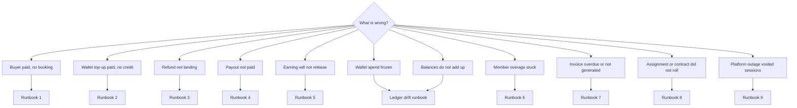

# Money runbooks

Each runbook here starts from a symptom someone reported, shows how to confirm it with a query or a console view, says what it costs, gives the fix, and says how to verify the fix. The recovery work itself is done by the scheduled jobs listed in [scheduled money jobs](01-scheduled-jobs.md); where a runbook says "run the job", that is `POST /api/cleanup/<slug>?limit=10` with `Authorization: Bearer $CRON_SECRET`, or the admin system-jobs runner. Try any command against a Netlify deploy preview before production. None of these procedures edits a money row by hand: every status change on a `Payment`, `Refund`, `Payout` or earning is a compare-and-set, and a hand `UPDATE` defeats it. Never run `prisma db push` or any `db:*` script to fix data.



## 1. A buyer paid but has no booking

**Confirm.** A captured payment with no appointment is the stranded cohort. The detector `alert-orphaned-payments` files one `SystemEvent` per payment (category `PAYMENT`, severity `ERROR`, correlation id `orphaned-payment:<paymentId>`), so look there first, then in `Payment`:

```sql
SELECT id, "paymentIntent", "gatewayPaymentId", amount, "createdAt"
FROM "Payment"
WHERE "paymentStatus" = 'SUCCEEDED' AND "appointmentId" IS NULL
  AND "deletedAt" IS NULL AND "parentPaymentId" IS NULL
  AND "paymentIntent" NOT LIKE 'overage:%'
ORDER BY "createdAt" DESC LIMIT 25;
```

**Impact.** The buyer was charged ₹ and holds nothing; the only remedies are a booking or a refund.

**Fix, in order.**

1. Wait for the healers, which run on the ticker. `reconcile-orphaned-confirmations` re-runs slot confirmation for a payment whose slots are still tentative and keeps the first confirmed booking, so a genuine double-booking loser is not force-confirmed. `reconcile-orphaned-payments` (every 30 minutes, for payments older than 60 minutes and younger than 7 days) links a late appointment, or refunds the payment through the refund front door.
2. If the capture event itself was lost, see [webhook recovery](04-webhook-recovery.md): the capture is confirmed by `reconcile-payment-status` through the single confirmer, `handlePaymentSuccess`.
3. If the payment is `SUCCEEDED` because the gateway metadata failed validation, use the admin recover door `POST /api/payments/[paymentId]/recover` (step-up, reason) with corrected metadata. The target must equal the notes the server minted on the Razorpay order.
4. A payment older than 7 days is not healed automatically. The job files one `WARN` `SystemEvent` (correlation id `orphan-escrow:<paymentId>`) and one Sentry message, and the money waits for an operator: link it by recovering it, or refund it from the Refunds section, "Issue refund".

**Verify.** The payment shows an appointment, or a `Refund` of the full amount reaches `SUCCEEDED`, and the `SystemEvent` no longer reappears.

## 2. A wallet top-up was paid but not credited

**Confirm.** A captured top-up that rolled back its credit keeps `capturedAt` and `providerPaymentId` while `status` stays `PENDING`:

```sql
SELECT "providerOrderId", "providerPaymentId", "amountPaise", "capturedAt", status
FROM "WalletTopUp"
WHERE status = 'PENDING' AND "providerPaymentId" IS NOT NULL
ORDER BY "capturedAt" ASC LIMIT 25;
```

**Fix.** `sweep-orphaned-topup-captures` (every 15 minutes) re-runs the idempotent `confirmTopUp` for rows captured at least 5 minutes ago and at most 30 days ago. Run it by hand to skip the wait. The abandoned-top-up job never deletes a row with `capturedAt` set, so the money is not lost. **Verify:** `status = 'CONFIRMED'` and the wallet shows the credit. A `207` from the sweep means a top-up is still not credited; read the `errors` list. See [wallet and top-ups](../50-b2b/02-wallet-and-top-ups.md).

## 3. A refund is not landing

**Confirm.**

```sql
SELECT r.id, r.status, r."amountPaise", r."createdAt", r."paymentId"
FROM "Refund" r
WHERE r.status = 'PENDING' AND r."createdAt" < now() - interval '1 hour'
ORDER BY r."createdAt" LIMIT 25;

SELECT id, "refundOwedKey", "refundOwedAttempts", "refundOwedNextAt"
FROM "Payment" WHERE "refundOwedKey" IS NOT NULL;
```

**Fix.** A refund is two-phase: reserve the amount, call the gateway, finalise. A crash between the gateway call and the database write leaves a `PENDING` row. `reconcile-refunds` asks the gateway about every `PENDING` refund older than one hour and settles it, and re-drives the earnings cascade for refunds that finished at the gateway but whose cascade did not commit (after 10 minutes, at most 3 attempts). A refund the booking door owed but could not send is a marker on the payment (`refundOwedKey`), driven by `retry-auto-refunds` until `MAX_REFUND_OWED_ATTEMPTS` (3) failures, after which an operator is paged once and the marker reads `Auto-refund stuck:`. The sweep backs off between failures: after the first it waits 1 hour (`refundOwedNextAt`), after the second 4 hours, so the page comes about 5 hours after the door committed. A marker with `refundOwedNextAt` in the future is still being retried; leave it unless the buyer needs the money now. A marker still open after 6 hours also appears once a day as a `WARN` system event. A Razorpay 404 (`GATEWAY_NOT_FOUND`, a payment these keys do not know) spends the whole budget on its first attempt, because no retry can succeed. "Issue refund" would hit the same 404, so do not use it for this case: first confirm the stored `gatewayPaymentId` and which Razorpay account (test or live keys) captured the payment, because the refund has to be made in that account. For any other owed refund, stuck or still retrying, send the refund from the Refunds section ("Issue refund"). The operator refund settles the owed refund in the same transaction. If it covers the owed amount, the marker is cleared and the dialog says "The owed ₹Y is fully settled." If it is smaller, the owed amount drops by what you sent and the marker keeps retrying for the rest: "Settled ₹X of the owed ₹Y; ₹Z still owed and retrying." The Refund row records the outcome under `metadata.settledOwed`. If your refund later fails, the owed amount it settled goes back on the payment automatically, in the same transaction, and the sweep retries it. A credit-funded booking's owed restoration is whole, so a partial "Return credits" is refused while it is owed. If the owed refund is already at the gateway, the door answers `OWED_REFUND_IN_FLIGHT`; wait for it to settle, then check what is still owed. **Do not** edit a `Refund` row by hand. **Verify:** `Refund.status = 'SUCCEEDED'`, the credit note exists, and the payment's `refundOwedKey` is cleared.

## 4. A payout was not paid

**Confirm** which of these it is:

```sql
SELECT id, status, "retryCount", "providerPayoutId", "failureReason", "processedAt"
FROM "ConsultantPayout"
WHERE status IN ('APPROVED', 'PROCESSING', 'FAILED')
ORDER BY "createdAt" DESC LIMIT 25;
```

For an organisation payout, which also shows platform co-approval and holds:

```sql
SELECT id, "organizationId", status, "gatewayPayoutId", "failureReason", "processedAt",
       "approvedAt", "orgApprovedBy", "platformApprovalRequiredAt", "platformHeldAt"
FROM "OrganizationPayout"
WHERE status IN ('APPROVED', 'PROCESSING', 'FAILED')
ORDER BY "createdAt" DESC LIMIT 25;
```

- **`APPROVED` and never claimed.** If `ENABLE_LIVE_PAYOUTS` is not `"true"`, this is the freeze working: the consultant run returns nothing and an approved organisation payout is not claimed (`submittedToGateway: false`); `process-payouts` reports "parked by design" in its `notice`. Rows stay `APPROVED`; they do not move to `PROCESSING`. If the flag is on, check the `process-payouts` answer for a held lock or a short RazorpayX balance, and for an organisation payout that still waits for platform co-approval or carries `platformHeldAt` (see [admin money doors](02-admin-money-doors.md)).
- **`PROCESSING` for more than a day.** `handle-stuck-payouts` asks RazorpayX about payouts stuck in `PROCESSING` for over 24 hours, and `reconcile-payout-status` polls `PENDING` and `PROCESSING` rows older than 48 hours. A row with a `providerPayoutId` is reconciled against the gateway rather than re-submitted, so a retry cannot double-pay. A payout can legitimately take longer than a day on a bank rail; do not retry it by hand.
- **`PROCESSING` with a `gateway-outcome-unknown` note.** The gateway call may have been accepted, so the row deliberately stays `PROCESSING`; the two reconcilers above resolve it against RazorpayX. Do not retry it by hand.
- **`FAILED`.** The payout was never submitted or was definitively rejected. Its batched earnings return to `READY`, any clawback recovery on it is released, and the next batch picks the earnings up; read `failureReason`, and fix the payout account first if it names one.

**Fix** is to run the job that matches, or fix the account the failure reason names. **Verify:** the row reaches `COMPLETED` on the live `payout.processed` webhook, and `reconcile-ledgers` finds no `COMPLETED_PAYOUT_WITHOUT_LEDGER_TXN`. The details of the pipeline are in [consultant payouts](../40-payouts/03-consultant-payouts.md) and [organisation payouts](../40-payouts/05-org-payouts-and-clawbacks.md).

## 5. An earning will not release

**Confirm.** An earning is `HELD` while it has an active `EarningsHold` row; `preHoldStatus` remembers where it was.

```sql
SELECT e.id, e.status, e."holdUntil", h.reason, h."sourceRef", h."placedAt"
FROM "ConsultantEarnings" e
JOIN "EarningsHold" h ON h."consultantEarningsId" = e.id AND h."releasedAt" IS NULL
ORDER BY h."placedAt" DESC LIMIT 25;
```

**Fix by reason.** The earning stays held until every active hold is released, and only the last release restores the prior status.

- `DISPUTE`: released when the dispute settles; it cannot be released by hand.
- `OVERAGE`: released when the member overage is paid or settled to the organisation (see runbook 6).
- `SUPPORT_CASE`: released by the support case that placed it, through the case doors, which need a fresh step-up, the maintenance gate and an ops-log row.
- `OPERATOR` and `MODERATION`: released from the Earnings section ("Release"). The door refuses while the payment has an open refund or dispute, and a hold on an earning that is not `PENDING`, `PENDING_TRUST` or `READY` is refused.

A `PENDING` earning past its hold-until time whose payment still owes a refund is held by the owed marker, not by an `EarningsHold` row. Find it with:

```sql
SELECT 'consultant' AS arm, e.id, e."consultantSharePaise" AS "sharePaise",
       e."holdUntil", p.id AS payment, p."refundOwedKey",
       p."refundOwedAttempts", p."refundOwedAt"
FROM "ConsultantEarnings" e
JOIN "Payment" p ON p.id = e."paymentId"
WHERE e.status = 'PENDING' AND e."holdUntil" <= now()
  AND p."refundOwedKey" IS NOT NULL
UNION ALL
SELECT 'organisation', o.id, o."orgSharePaise", o."holdUntil", p.id,
       p."refundOwedKey", p."refundOwedAttempts", p."refundOwedAt"
FROM "OrganizationEarnings" o
JOIN "Payment" p ON p.id = o."paymentId"
WHERE o.status = 'PENDING' AND o."holdUntil" <= now()
  AND p."refundOwedKey" IS NOT NULL
ORDER BY "refundOwedAt" LIMIT 25;
```

It releases on the next run after the marker clears. A marker still retrying (`refundOwedAttempts` under 3) is re-driven by `retry-auto-refunds` and clears when its refund goes out. Every confirmed failure counts toward the 3, including an ambiguous gateway answer that reconcile later fails, so a refund that never goes out reaches the ops queue. A spent marker is in the ops queue ("Refunds the bookings owe"); refund it by hand through an ops refund door, which settles the marker. Never clear `refundOwedKey` by SQL to release earnings: the buyer is still owed the money.

**A spent marker whose refund already went out.** Before the fix of 2026-11-04, a refund that settled after its drive's attempts were spent (an ambiguous gateway answer that reconcile later settled) never cleared its marker, so its earnings stay held although the buyer has the money. Find them:

```sql
SELECT p.id AS payment, p."refundOwedKey", p."refundOwedAttempts",
       r.id AS refund, r."refundId", r."amountPaise", r."createdAt"
FROM "Payment" p
JOIN "Refund" r ON r."dedupeKey" = p."refundOwedKey" AND r.status = 'SUCCEEDED'
WHERE p."deletedAt" IS NULL
ORDER BY r."createdAt";
```

For each row:

1. Confirm the refund in the gateway dashboard by its reference (`refundId`).
2. Open the payment, choose **Issue refund**, and submit. The door refuses with "… already went back to the buyer on … (refund …), so nothing is owed on this payment" and clears the marker in the same step; no money moves.
3. Submit again only if more is owed on top of that refund.
4. **Verify:** the query no longer lists the payment, and its earnings are `READY` after the next `release-earnings` run.

Never clear `refundOwedKey` by SQL.

A `PENDING` earning that is simply young is not held: `release-earnings` moves it to `READY` after its hold-until time (48 hours for a consultation, 48 for a webinar, 168 for a subscription, 24 for a class, plus 3 days for a new expert). **Verify:** the earning is `READY` and appears in the next payout batch.

## 6. A member overage is stuck pending

**Confirm.** A `CHARGE_MEMBER` overage that is still `PENDING` counts toward the program's per-cycle ceiling, so enough of them wedge new overage on that assignment.

```sql
SELECT id, "chargeStatus", "chargeAttemptCount", "chargeFailureReason",
       "chargeTimedOutAt", "createdAt"
FROM "OverageEvent"
WHERE "overageBehavior" = 'CHARGE_MEMBER' AND "chargeStatus" = 'PENDING'
ORDER BY "createdAt" LIMIT 50;
```

**Fix.** Two jobs own it, and they never overlap, because a row they both could take is no longer `PENDING` once the first moves it. `sweep-abandoned-overage-charges` fails a never-started side charge after 7 days, silently, to free the ceiling. `timeout-member-overages` fails a charge still unpaid after 14 days, stamps `chargeTimedOutAt` and tells the member. If rows are older than those windows and still `PENDING`, run the matching job. If they are younger, the member really owes the money: do not fail them early. If a base could not be returned to the accrual, an admin can settle the overage to the organisation with the settle-to-org door (second admin above ₹25,000). **Never** set `chargeStatus` to `CHARGED` by hand; only the side-payment confirmation moves `PENDING` to `CHARGED`. **Verify:** the ceiling frees and `OVERAGE_COUNT_DRIFT` does not fire.

## 7. An invoice is overdue, escalating wrongly, or not generated

**Dunning** (`dunning`, daily window from 23:30 UTC) moves an `ISSUED` invoice past its due date to `OVERDUE` and notifies the organisation's finance roster (stage 1), then re-notifies every 7 days up to `MAX_REMINDERS` = 3 (stage 2). Only organisations in `ACTIVE`, `PENDING_VERIFICATION` or `SUSPENDED` status are dunned. A third stage exists behind the `ENABLE_DUNNING_SUSPEND` flag: 7 days after the last reminder it stamps `dunningSuspendedAt`, and checkout then blocks the organisation's new sponsored bookings until the invoice is paid; it is off unless the flag is `"true"`. For duplicate reminders, check Novu delivery first, because the claim on `lastDunningReminderAt` makes a double-claim near-impossible. For an invoice stuck `ISSUED` past due with no reminder, confirm `dueDate < now` and the organisation status, then run `dunning`. Stopping at three reminders is by design; further collection is a manual finance action. Reminder count and interval are code constants, not environment settings.

**Not generated.** `generate-subscription-invoices` (daily window from 03:00 UTC) bills each `BillingSubscription` whose `nextInvoiceDate` is due; `settle-invoice-accruals` (the 1st of the month) rolls accrued bookings into one invoice per organisation. Run the job and read its summary; the claim advances `nextInvoiceDate` atomically, so a re-run never double-bills. See [invoices and purchase orders](../50-b2b/04-invoices-purchase-orders-and-dunning.md).

## 8. A program assignment or contract did not roll

**Assignment not rolled.** An assignment with `status = 'ACTIVE'`, `rolledAt` empty and `periodEnd` in the past is waiting for `advance-program-cycles` (daily window, 25 per run). It rolls only when its contract is `ACTIVE`, auto-renew is on and the successor period fits the term; otherwise it closes with no successor. It deliberately skips assignments on a program that is not `ACTIVE` or is archived. Never mint a successor assignment by hand: the unique `[programId, membershipId, periodStart]` and `rolledToAssignmentId` are the only double-mint guards.

**Contract not renewed.** A contract with `autoRenew`, `status = 'ACTIVE'`, `effectiveTo` in the past and `autoRenewedAt` empty is waiting for `auto-renew-contracts`. The job claims it by stamping `autoRenewedAt`, mints the successor, re-points the old contract's programs to it, and expires the old one in the same transaction. A `P2002` on `supersededByContractId` means another run already renewed it; that is success. Never leave two `ACTIVE` contracts on one organisation. When unsticking by hand, run `expire-contracts` last: it leaves an un-renewed auto-renew contract alone for one day, but a hand run after a failed renewal should renew first. Fix the contract before re-running `advance-program-cycles`, because a failed renewal makes the engine close every assignment instead of rolling it.

## 9. A platform outage voided sessions (incident settlement)

When the call platform or the app fails for everyone, an admin declares the window in the Incidents section (the rules are in [admin money doors](02-admin-money-doors.md)). The `settle-platform-incidents` sweep then voids every eligible overlapping session and writes one remedy per live seat.

1. **Declare** a window that has ended, covers every affected session and is at most 24 hours. A window that is too wide voids healthy sessions that overlap it, because any overlap counts. For example, an outage from Sun 18 Oct 2026 00:30 to 02:30 IST is declared with exactly that window.
2. **Know the remedies.** Consultation: 100 % of the remaining balance, refunded 48 hours after the void. Paid trial: the same 48-hour refund, and the trial is cancelled in the same commit, freeing the expert pair. Free trial: cancelled at once. Subscription: the session returns to the plan allowance and the plan end moves seven days later. Webinar: 100 % of the seat, refunded at once. Class: nothing beyond the void; the existing 14-day make-up window or one-unit refund applies. Each learner gets one `PLATFORM_INCIDENT_DIGEST` email once their immediate remedies apply, and operations gets one report when the incident settles.
3. **Read the tab.** Within about an hour the status reads "Remedies in progress"; "Settled" follows after the last refund. A refund appears under the key `incident:<incident>:<occurrence>:<user>`.
4. **"Need a human".** A remedy is dead-lettered after three counted failures, with `lastError` starting `dead-letter:`. The usual cause is that the payment already owes another door's refund under a different key, and the marker is never overwritten. Let the other refund finish or fail, then refund the learner with "Issue refund". A dead-lettered refund leaves the session unsettled, so the day-14 `settle-cancelled-sessions` sweep also refunds it under its own key, capped to the remaining balance, so a manual refund and the sweep can never pay twice.
5. **Never retry by editing rows.** "Run now" on the incident is the only supported lever; it does not bring forward the 48-hour wait or retry a dead-lettered row.

## 10. A finance alert did not arrive

The MSME digest, the dispute-deadline alerts and the SLA alerts are emails sent through the single delivery function, so a missing email is first a configuration or a bounce question. For the MSME digest (`msme-payment-alerts`, one slot a day at 03:45 UTC) check the provider for bounces and run the job. It notifies every admin user (a bell notification and an email) and also emails `COMPLIANCE_ALERT_EMAIL` (a constant in `lib/company.ts`) when that address is not already an admin. The digest lists organisation payouts within 5 days (`ALERT_WINDOW_DAYS`) of their Section 43B(h) deadline that are not yet `COMPLETED`; the window is a code constant, not an environment setting. The dispute-deadline and SLA alert emails dedupe on the staged `FailedEmail` row, so a re-run of `support-sla-sweep` does not send twice.

## Alerts that lead to a runbook

An alert names a condition; this table names the runbook. Page for the first group, post to chat for the second; a `console` row pages nobody and is read on the operations console. The thresholds are starting points to tune after a month of traffic.

| Alert                              | Condition                                                                                                                                                                   | Severity | Runbook                                                   |
| ---------------------------------- | --------------------------------------------------------------------------------------------------------------------------------------------------------------------------- | -------- | --------------------------------------------------------- |
| Webhook events stuck               | `SystemEvent` finding "sweep-stuck-webhook-events: N webhook event(s) still unprocessed" on the console, or `WebhookEvent` rows with `processed = false` older than an hour | console  | [Webhook recovery](04-webhook-recovery.md)                |
| Re-driven webhook still failing    | Sentry error "sweep-stuck-webhook-events: N re-driven webhook event(s) still failing"                                                                                       | page     | [Webhook recovery](04-webhook-recovery.md)                |
| Dispute deadline near or past      | Sentry warning "N dispute(s) due within 12 h or past due with no response", once per dispute, beside the admin bell and `dispute-deadline-alert` email                      | page     | [Chargebacks](../30-refunds-disputes/02-chargebacks.md)   |
| Ledger audit failing               | `reconcile-ledgers` answers 207, or a `LedgerReconciliationReport` has `ok = false`                                                                                         | page     | [Ledger drift runbook](06-ledger-drift-runbook.md)        |
| Wallet drift                       | A `WALLET_BALANCE_DRIFT` finding, which also freezes the wallet's spend                                                                                                     | page     | [Ledger drift runbook](06-ledger-drift-runbook.md)        |
| Webhook signature failing          | The Razorpay webhook answers 400 `Invalid signature` repeatedly, or a `WEBHOOK` `WARN` `SystemEvent` says the previous secret is still in use                               | page     | [Go-live checklist](07-go-live-checklist.md), section 1.4 |
| Payout or reconcile crash          | A `PAYOUT` or `RECONCILE` `SystemEvent` with `severity = ERROR`, or a `failed` target for `process-payouts` in the tick's log line                                          | page     | Runbook 4 and [scheduled jobs](01-scheduled-jobs.md)      |
| Invoice generation stalled         | No invoice created for two days while `BillingSubscription` rows with `nextInvoiceDate` in the past exist                                                                   | page     | Runbook 7                                                 |
| Cycle engine stalled               | `ProgramAssignment` with `status = ACTIVE`, `rolledAt` empty and `periodEnd` more than 24 hours ago                                                                         | page     | Runbook 8                                                 |
| Contract renewal stalled           | `Contract` with `autoRenew`, `status = ACTIVE`, `autoRenewedAt` empty and `effectiveTo` more than an hour ago                                                               | page     | Runbook 8                                                 |
| Overage ceiling wedged             | `OverageEvent` `CHARGE_MEMBER` still `PENDING` more than 14 days                                                                                                            | chat     | Runbook 6                                                 |
| Dunning not escalating             | `OVERDUE` invoices with `dunningReminderCount < 3` and no `markedOverdueAt` or reminder movement for 48 hours                                                               | chat     | Runbook 7                                                 |
| Wallet floor breached              | A `WALLET` account with `walletBalance < minBalancePaise`; the job only notifies                                                                                            | chat     | [Wallet and top-ups](../50-b2b/02-wallet-and-top-ups.md)  |
| MSME or finance alert not arriving | No MSME digest for 48 hours while payouts approach their deadline                                                                                                           | chat     | Runbook 10                                                |

## Where in code

| Concern                           | File                                                                                                                                                                                                           |
| --------------------------------- | -------------------------------------------------------------------------------------------------------------------------------------------------------------------------------------------------------------- |
| Orphan detection and healing      | `scripts/alerts/alert-orphaned-payments.ts`, `scripts/payments/reconcile-orphaned-confirmations.ts`                                                                                                            |
| Top-up sweep                      | `scripts/cleanup/sweep-orphaned-topup-captures.ts`                                                                                                                                                             |
| Refund reconcilers                | `scripts/refunds/reconcile-pending-refunds.ts`, `scripts/payments/retry-auto-refunds.ts`, `lib/payments/operations/refund-owed.ts`                                                                             |
| Payout reconcilers                | `scripts/payouts/handle-stuck-payouts.ts`, `scripts/payouts/reconcile-payout-status.ts`, `lib/payments/payouts/scheduled-runs.ts`                                                                              |
| Holds                             | `lib/payments/payouts/earnings-holds.ts`, `lib/payments/payouts/earnings-hold-ops.ts`, `lib/support/case-holds.ts`                                                                                             |
| Dunning, overage, cycles, renewal | `jobs/billing/dunning.ts`, `jobs/billing/timeout-member-overages.ts`, `scripts/cleanup/sweep-abandoned-overage-charges.ts`, `jobs/billing/advance-program-cycles.ts`, `jobs/contracts/auto-renew-contracts.ts` |
| Incidents                         | `lib/booking/platform-incidents.ts`, `scripts/appointments/settle-platform-incidents.ts`                                                                                                                       |

## Related

- [Ledger drift runbook](06-ledger-drift-runbook.md) for reconcile findings and a frozen wallet.
- [Webhook recovery](04-webhook-recovery.md) for events that did not process.
- [Maintenance gate and recovery](03-maintenance-gate-and-recovery.md) for what to re-run after a maintenance window.
- [Go-live checklist](07-go-live-checklist.md) for the payout flag.

## Deprecated & Superseded Approaches

1. **A `webhookEvent.status` of `QUEUED`, with `attempts` and `last_error`.** `WebhookEvent` has none of these; see [webhook recovery](04-webhook-recovery.md).
2. **Replaying a webhook by re-posting its payload and signature.** Use the sweep or the dashboard resend.
3. **Forcing a job with `npx tsx jobs/...`.** The jobs are reached through `/api/cleanup/<slug>`; the standalone entry points were for the retired Actions scheduler.
4. **A `cascade-refund-earnings` job.** The refund cascade runs inline in the refund transaction, with `reconcile-refunds` re-driving a cascade that did not commit.
5. **"`ENABLE_LIVE_PAYOUTS` off freezes payouts at `PROCESSING`."** Rows stay `APPROVED`.
6. **"Dunning has two stages and never suspends."** Stage 3 (stamp `dunningSuspendedAt`, refuse new sponsored bookings) runs when `ENABLE_DUNNING_SUSPEND` is `"true"`. The header comment of `jobs/billing/dunning.ts` still describes two stages and is a pending code-comment fix.
7. **A wallet floor that auto-charges.** `wallet-low-balance` is notify-only; it creates no `WalletTopUp` and charges no mandate.
8. **A hand refund that touched only spent markers.** "Issue refund" used to settle only a marker that had used all its attempts, and only when the hand refunds since the stamp covered it. Every operator refund now settles the owed refund as far as its amount goes.
