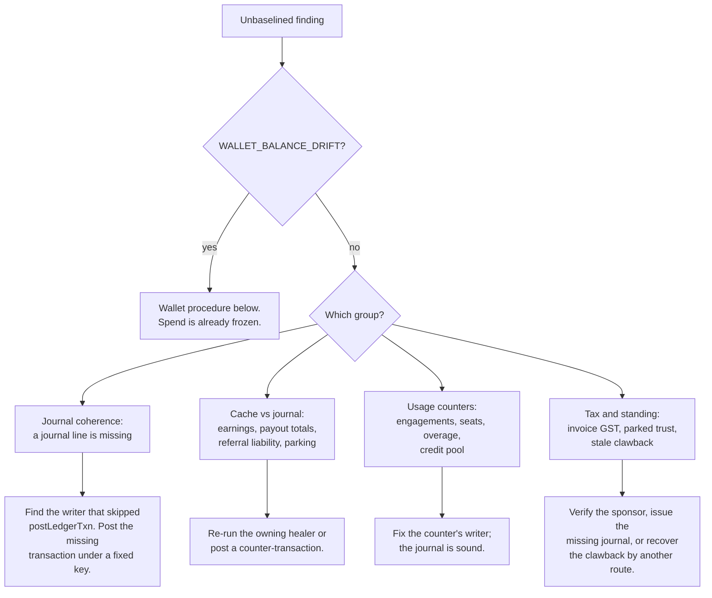

# Ledger drift runbook

Use this page when the nightly ledger audit answers 207, Sentry or a `SystemEvent` reports a ledger finding, an operator-started reconcile returns `ok: false`, or an organisation's wallet spend is frozen. The auditor, `reconcile-ledgers` (`scripts/reconcile/reconcile-ledgers.ts`), never corrects a balance: it proves that the cached numbers (a wallet balance, an earnings total, a usage counter) still agree with the journal and writes a `LedgerReconciliationReport`. Its one protective side effect is that a run finding wallet drift, nightly or operator-started, freezes spend on each drifted wallet (`freezeDriftedWallets`). What each check asserts is in [integrity and reconciliation](../20-ledger/06-integrity-and-reconciliation.md). This page is the procedure to follow when a check fires.

The rule that governs every step: **a finding is an incident signal, never a thing to patch.** The journal is append-only (`ledger_entry_immutable` and `ledger_transaction_immutable` refuse an `UPDATE` or `DELETE` of a posted row), and a balanced transaction is already guaranteed at commit by `ledger_txn_balanced`, so the auditor never re-checks balance. Drift means a writer moved a cache without its journal line, or a journal line without its cache. The fix is to find that writer, then post one balanced correcting `LedgerTransaction` for the side that is wrong. Overwriting a cache to match the journal is not a repair.

## Step 1: confirm what fired

Read the newest failing report. From the console use Reconcile, then the ledger run; over HTTP an admin session can call `GET /api/admin/reconcile-ledgers?onlyDirty=true`, which lists only reports with `ok = false`. From SQL:

```sql
SELECT id, "runAt", scope, ok,
       summary->>'unbaselinedCount' AS unbaselined,
       summary->>'baselinedCount'   AS baselined,
       summary->'baselineProblems'  AS baseline_problems,
       jsonb_array_length(findings::jsonb) AS findings
FROM "LedgerReconciliationReport"
ORDER BY "runAt" DESC
LIMIT 5;
```

Read `summary` before `findings`. `unbaselinedCount` is the number of findings that are not excused by the checked-in baseline and therefore failed the run; `baselinedCount` findings are known and still listed; a non-empty `baselineProblems` means the baseline file itself is malformed (a missing owner, reason or expiry, a bad date, or an unknown kind), which fails the run on its own. A finding is excused only when its kind, its delta and every identifier it carries match an entry that has not expired.

## Step 2: triage by group



| Group                 | Finding kinds                                                                                                                                                                           | First thing to look at                                                                                                                                                                                                                                          |
| --------------------- | --------------------------------------------------------------------------------------------------------------------------------------------------------------------------------------- | --------------------------------------------------------------------------------------------------------------------------------------------------------------------------------------------------------------------------------------------------------------- |
| Journal coherence     | `EARNINGS_WITHOUT_BOOKING_TXN`, `REVERSED_EARNING_WITHOUT_REFUND_TXN`, `COMPLETED_PAYOUT_WITHOUT_LEDGER_TXN`, `LEDGER_DUAL_WRITE_GAP`, `SPLIT_SUM_MISMATCH`, `REFUND_BOOKING_COHERENCE` | The business row exists but its journal does not. Find which door wrote the row without `postLedgerTxn`, using the idempotency key convention (`booking:<paymentId>`, `refund:<refundId>`, `clawback:<refundId>:<payoutId>`). These are rare and high severity. |
| Cache against journal | `WALLET_BALANCE_DRIFT`, `EARNINGS_LEDGER_DRIFT`, `ORG_PAYOUT_TOTAL_MISMATCH`, `REFERRAL_CREDIT_LIABILITY_DRIFT`, `UNAPPLIED_RECEIPTS_RESIDUE`                                           | Which writer changed the cached figure last. A missed half-applied transaction is the usual cause.                                                                                                                                                              |
| Usage counters        | `PROGRAM_ASSIGNMENT_ENGAGEMENTS_DRIFT`, `CREDIT_POOL_CONSUMED_DRIFT`, `OVERAGE_COUNT_DRIFT`, `OVERAGE_CHARGESTATUS_INTEGRITY`, `OVERAGE_SETTLEMENT_MISMATCH`, `ACTIVE_SEAT_COUNT_DRIFT` | The journal is sound; a denormalised counter or a status moved without its companion write. A charged-then-refunded overage awaiting a credit note is the expected benign cause of `OVERAGE_COUNT_DRIFT`.                                                       |
| Tax and standing      | `ORG_INVOICE_GST_MISMATCH`, `PENDING_TRUST_PARK_STALE`, `CLAWBACK_RECEIVABLE_STALE`                                                                                                     | These are detect-only. A stale park needs an admin sponsor verification or a paid invoice; a stale clawback needs recovery outside payouts. Age never releases or writes anything.                                                                              |

Several findings that carry `details.unit` hold counts, not paise, in the `*Paise` fields. Read `details.unit` before reading a delta as money.

## Step 3: correct

For every kind except the wallet, the order is the same. First stop the writer from diverging again: if a code path caused it, the correction waits for the fix, otherwise the next run finds a new drift. Then post the correction as a new balanced `LedgerTransaction` under one fixed idempotency key tied to the finding, so a retry cannot post it twice; after a timeout, look that key up before posting again. A correction is an owner-applied SQL change run once and reviewed, not an application code path. Never auto-close a finding, and never `UPDATE` a balance or a posted ledger row; the immutability triggers will refuse it anyway.

### Wallet balance drift

`WALLET_BALANCE_DRIFT` means `BillingAccount.walletBalance`, the cache, differs from the signed balance of the organisation's `WALLET` ledger account. The auditor freezes that organisation's discretionary wallet spend (`freezeDriftedWallets`, `lib/payments/wallet-freeze.ts`) before it evaluates the baseline, and the nightly run also pages. The freeze lives in the append-only `SystemEvent` log as a `WALLET_FREEZE` and `WALLET_UNFREEZE` pair keyed on `wallet-freeze:<billingAccountId>`. It fails closed if the log cannot be read. It blocks checkout spend only, never a top-up credit and never the recovery of a lost chargeback.

1. **Find the root cause.** Which writer moved the cache without its journal line, or the journal without the cache. Do not replay a webhook for this finding.
2. **Decide which side is wrong.** Then post one balanced correcting journal for that side. `adjustWallet` (the wallet-adjustment door) cannot close a cache-versus-journal gap, because it moves the cache and the journal by the same amount.
3. **Unfreeze through the door**, `POST /api/admin/billing-accounts/[billingAccountId]/unfreeze` (surface `payments.manage`, step-up, reason, ops-log row). It re-reads that one wallet's drift first and answers 409 `WALLET_STILL_DRIFTED` while the cache and the journal still disagree, and 409 `NOT_FROZEN` for a wallet that is not frozen.

**Worked example (two lazy member-overage carves, 18 October 2026).** On a wallet-funded booking with a `CHARGE_MEMBER` overage, the overage base is carved off the parent payment and back onto the organisation's wallet. On 18 Oct 2026 two such carves on one organisation each credited the wallet cache by ₹2,850.18 (285,018 paise) with no ledger line, about twenty seconds after each booking's journal had debited `WALLET` at full price. The cache was therefore right and the journal was short on the credit side by 2 × 285,018 = 570,036 paise (₹5,700.36). The nightly audit raised `WALLET_BALANCE_DRIFT` and froze the organisation's spend. Both payments had since been fully refunded, so the matching amount sat on `PLATFORM_FEE`, not `DISCOUNT`. The owner's correction for that incident was one journal for the missing side, `Dr PLATFORM_FEE / Cr WALLET 570,036` paise under its own correction key, followed by the unfreeze door. That is a one-off incident correction, not the writer's shape. For a live payment whose booking journal has already posted, the writer now posts `Dr DISCOUNT / Cr WALLET` per carve under `overage-carve-credit:<overageEventId>` (`journalWalletCarveCredit` in `lib/payments/billing/overage-settlement.ts`) in the carve's own transaction; a carve made before the booking journal posts is tallied by that journal's smaller `WALLET` leg. Either way a new carve cannot drift.

## Step 4: verify

Start a fresh run: from the console's Reconcile section, or `POST /api/cleanup/reconcile-ledgers` with the bearer secret, or an organisation-scoped `POST /api/admin/reconcile-ledgers` with `{ organizationId, reason }` to re-check only the affected organisation (the full-scope-only checks are skipped in that mode). Confirm the new report has `ok = true`. A full-scope run that is already `RUNNING` answers 409. If the finding persists, you corrected the wrong side or the writer is still diverging.

## Updating the baseline

The baseline, `scripts/reconcile/ledger-findings-baseline.ts`, exists so that a known finding does not keep the nightly run red forever. Add an entry only for a finding that is knowingly carried: name the kind, the delta, every identifier the finding carries, an owner, a one-line reason and an expiry date. An entry excuses exactly that finding and stops excusing it after its expiry. This is a reviewed code change; never loosen an entry to silence a new finding.

## Prevention

The checks the database already enforces are not repeated in the auditor (see [integrity and reconciliation](../20-ledger/06-integrity-and-reconciliation.md)). The gateway-side residual (`GATEWAY_CLEARING` against Razorpay's settlements) is checked by `reconcile-gateway-settlements`, not by this auditor; see [gateway clearing and settlement](../20-ledger/05-gateway-clearing-and-settlement.md).

## Related

- [Admin money doors](02-admin-money-doors.md) for the unfreeze and wallet-adjustment doors.
- [Wallet and top-ups](../50-b2b/02-wallet-and-top-ups.md) for the debit guard that refuses a debit with no journal line.
- [Scheduled money jobs](01-scheduled-jobs.md) for when the nightly audit runs.

## Deprecated & Superseded Approaches

1. **Hand-patching a cache or a journal row with `UPDATE`.** The immutability triggers refuse it for the journal, and overwriting a cache hides the writer bug. Post a counter-transaction.
2. **Replaying a webhook to clear a wallet finding.** A wallet drift is a missing journal line, not a missed event.
3. **A Netlify background function that looped the audit.** The set-based auditor finishes a full run in one request, so `POST /api/admin/reconcile-ledgers` runs it in-process under the `reconcile-ledgers` lease and no background driver exists.
4. **A baseline keyed to one entity id.** The current baseline pins kind, delta and every identifier, expires, and fails the run when malformed.
