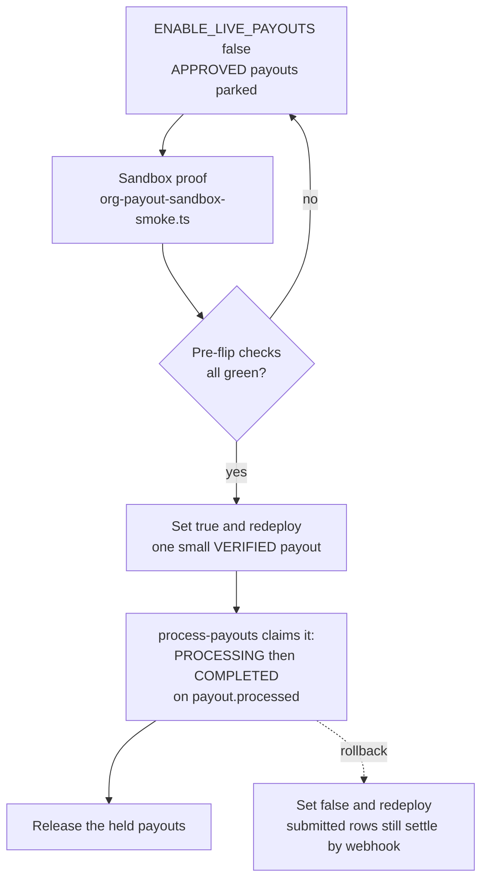

# Money go-live checklist

Use this page to take the money subsystem from sandbox to real money: first the collection side (Razorpay accepting real cards and UPI), then the disbursement side (RazorpayX paying real people). The two can be cut over together or separately. Each section ends with the proof that the step worked, because the failure mode at go-live is not a crash but a wrong amount or a wrong recipient on a path that was never exercised with live credentials. Items that live in the Razorpay dashboards rather than in code are marked "dashboard"; record a screenshot or a signed delivery log against the cutover issue for each.

**Resume the paused job fleet first (paused 2026-11-05 to save invocations on mock data).** Delete the Upstash key `ops:active_cron_platform`, or set it to `netlify`. Confirm a new production `cron-tick` row appears. Then unpause the Better Stack tick heartbeat, digest heartbeat and probe monitor, and re-enable the Sentry `cron-tick` monitor and uptime detector. The exact commands are in [the pause decision](../../decisions/2026-11-06-pause-scheduled-jobs-prelaunch.md#how-to-resume-go-live-or-any-time). Do this before Part 1: the digest checks in 1.2 and Part 3, and the job-freshness monitor in 2.1, all need the fleet running.

## Company prerequisites (before Part 1)

These steps decide whether the live accounts can exist. They are owner and company actions, not code; the dates, amounts and names are kept in Notion (Familiarise / Tax & CA Working Notes / Tax, Legal & Regulatory Register).

- [ ] The company PAN is in hand and matches the registered company.
- [ ] A current account in the company's name is open and the capital deposit is made. The settlement account in 1.1 is this account.
- [ ] INC-20A (the declaration that business can commence) is filed.
- [ ] Razorpay is activated as a registered company. Activation reviews the public site, so the legal pages (`app/(pages)/terms`, `privacy`, `refund`) are live and describe what the platform does. An earlier individual application was rejected at KYC.
- [ ] The expert-card badge wording is decided. Public marketing copy says experts are personally interviewed by the founder, but the badge on expert cards (`app/explore/experts/components/ExpertMiniCard.tsx`, `ExpertDetailsSheet.tsx`, `FeaturedExperts.tsx`) still reads "Verified by Familiarise" when the expert's `isVerified` flag is true. The owner kept it on purpose; confirm the wording with the lawyer before go-live, or reword it to match the public claims.
- [ ] RazorpayX: the bank account and the GSTIN question are confirmed, namely whether it can use the same current account and whether it needs a GSTIN while `PLATFORM_GSTIN` is unset.

## Part 1: accepting real money (Razorpay)

### 1.1 Account (dashboard)

- Razorpay Payments is activated, and the settlement bank account is the platform's current account with a beneficiary name that matches the registered entity exactly.
- The platform GSTIN is recorded on Razorpay, so the monthly fee invoices carry input tax credit. This is separate from the consumer and organisation tax invoices the platform mints itself.
- International cards, if you accept them, are enabled and the cross-border limits are understood. The platform still settles in INR only; see [the gateway page](../10-money-in/04-razorpay-gateway-and-currency.md).

### 1.2 Keys and the test-key guard

- Before the live keys go in, the daily ops digest reads clean ([Part 3](#part-3-the-daily-ops-digest-reads-clean)). Live collection keys are what turn a standing config skip into a page, except the expected GST skips while `PLATFORM_GSTIN` is unset.
- `RAZORPAY_KEY_ID` and `RAZORPAY_SECRET` hold the live pair (`rzp_live_...`). `NEXT_PUBLIC_RAZORPAY_KEY_ID` holds the same key id. A secret is never given a `NEXT_PUBLIC_` prefix.
- `RAZORPAY_ALLOW_TEST_KEYS_IN_PRODUCTION` is deleted from production. While it is unset, `lib/payments/core/razorpay.ts` throws `RAZORPAY_TEST_KEY_IN_PRODUCTION` at boot if a test key ever reaches production; set to `true` it only logs, which is for a pre-launch deploy that must not move money.
- `RAZORPAY_WEBHOOK_SECRET` holds the live payment-webhook secret.
- `PLATFORM_GSTIN` holds the platform's GSTIN as soon as GST registration is granted. Until then `heal-consumer-invoices`, `gst-outward-register-export`, `irp-uploader` and `settle-invoice-accruals` record a config skip on every run (reason `PLATFORM_GSTIN not configured`), and checkout mints no consumer tax invoice. These skips are expected: the digest lists them as a note and `/api/health/jobs` does not page on them. After setting it and redeploying, run `heal-consumer-invoices` from the System Jobs page and confirm its row is `completed`, then confirm `/api/health/jobs` no longer lists any of the four under `configSkips`. From then on any config skip pages. A malformed or other-state value fails these runs instead of skipping them.

### 1.3 Webhooks (dashboard)

Both products post to the same endpoint, `https://<production-host>/api/webhooks/razorpay`, each signed with its own secret.

| Product           | Secret                     | Events to subscribe (the ones `razorpay-dispatch.ts` handles)                                                                                                                                                                                         |
| ----------------- | -------------------------- | ----------------------------------------------------------------------------------------------------------------------------------------------------------------------------------------------------------------------------------------------------- |
| Razorpay Payments | `RAZORPAY_WEBHOOK_SECRET`  | `payment.captured`, `order.paid`, `payment.failed`, `refund.created`, `refund.processed`, `refund.failed`, `refund.speed_changed`, `payment.dispute.created`, `.under_review`, `.action_required`, `.won`, `.lost`, `.closed`, `settlement.processed` |
| RazorpayX         | `RAZORPAYX_WEBHOOK_SECRET` | `payout.initiated`, `.queued`, `.pending`, `.processed`, `.updated`, `.failed`, `.reversed`, `.rejected`, `.cancelled`, `fund_account.validation.completed`, `fund_account.validation.failed`                                                         |

The RazorpayX secret is tried only for `payout.*` and `fund_account.*` events (`isPayoutEventName`, `app/api/webhooks/razorpay/signature.ts`), so a leaked RazorpayX secret cannot forge a `payment.captured`. Set the monitored alert email on both dashboards: Razorpay retries a non-2xx answer with backoff for 24 hours, and a receiver that answers 503 while its database is unreachable keeps that retry alive.

### 1.4 Rotating a webhook secret without downtime

Each secret has a grace slot. To rotate the payment secret: set `RAZORPAY_WEBHOOK_SECRET_PREVIOUS` to the old value and `RAZORPAY_WEBHOOK_SECRET` to the new one, deploy, and only then change the secret in the Razorpay dashboard. Until the dashboard changes, events signed with the old secret still verify through the previous slot, and the route records a `WEBHOOK` `WARN` `SystemEvent` for every delivery that lands on the previous secret, so you know when it is safe to retire. Rotate the RazorpayX secret the same way with `RAZORPAYX_WEBHOOK_SECRET_PREVIOUS`. After the rotation, remove the previous value, then start a `reconcile-ledgers` run to confirm nothing was lost in the transition. Resolution lives in `resolveRazorpayPaymentSecrets` and `resolveRazorpayXSecrets`. API keys are rotated by replacing `RAZORPAY_KEY_ID` and `RAZORPAY_SECRET` and redeploying; a live key never goes into the repository. The inventory of every other production secret and the ordered rotation procedures are in the [secret rotation runbook](../../maintenance/19-secret-rotation-runbook.md).

### 1.5 Clear sandbox identities from the database

Razorpay rejects every test-mode identifier under a live key (`The id provided does not exist`). The deployment shares one Postgres database between preview and production, so any customer, contact or fund-account id minted under a test key is still stored. Before the first live traffic, the owner runs this once in the cutover window. It has no test-mode predicate and clears every stored Razorpay identity, so never run it again once a live key has minted any: a rerun would orphan live customers and reset verified payout accounts.

```sql
BEGIN;
UPDATE users SET "razorpayCustomerId" = NULL WHERE "razorpayCustomerId" IS NOT NULL;
UPDATE "PayoutAccount"
   SET "razorpayContactId" = NULL, "razorpayFundAccId" = NULL, "isVerified" = false
 WHERE "razorpayContactId" IS NOT NULL OR "razorpayFundAccId" IS NOT NULL;
UPDATE "OrganizationPayoutAccount"
   SET "razorpayContactId" = NULL, "razorpayFundAccountId" = NULL,
       status = 'PENDING_VERIFICATION'
 WHERE "razorpayContactId" IS NOT NULL OR "razorpayFundAccountId" IS NOT NULL;
COMMIT;
```

`createRazorpayOrder` also clears a stale `users.razorpayCustomerId` and retries when Razorpay rejects a cross-mode customer id, so a missed row heals itself at the next checkout; the payout accounts do not, which is why the purge matters.

### 1.6 Proof for collection: two live ₹1 tests

1. **₹1.00 checkout.** Pay ₹1 by UPI. Confirm the `Payment` is `SUCCEEDED`, the appointment is confirmed, the consumer tax invoice number is at most 16 characters, and `SELECT COALESCE(SUM(CASE WHEN direction = 'DEBIT' THEN "amountPaise" ELSE -"amountPaise" END), 0) FROM "LedgerEntry"` is `0`.
2. **₹1.00 full refund.** Cancel the same booking for a full refund. Confirm the `Refund` becomes `SUCCEEDED` through the live `refund.processed` webhook, the credit note number is at most 16 characters, and the ledger imbalance is still `0`.

## Part 2: paying out real money (RazorpayX)

Payouts stay frozen until `ENABLE_LIVE_PAYOUTS` is `"true"`. With it off, batches are still created and approved, but an approved consultant payout is held in `APPROVED` (`processApprovedPayouts` returns nothing) and an approved organisation payout is not claimed (`processOrgPayout` reports `submittedToGateway: false`), so no money leaves. The consultant rail reads the flag from `lib/feature-flags.ts` at build and boot, and the organisation rail reads `process.env.ENABLE_LIVE_PAYOUTS` per call, so set it through a redeploy. Flipping it makes the very next `process-payouts` run (hourly, see [scheduled money jobs](01-scheduled-jobs.md)) submit `APPROVED` payouts up to its per-rail limit, which is real money on the first run; the checks below are hard gates.



### 2.1 Pre-flip checks

- **RazorpayX account** is live, KYB is complete, and its balance covers the first batch. `RAZORPAYX_KEY_ID`, `RAZORPAYX_KEY_SECRET` and `RAZORPAYX_ACCOUNT_NUMBER` hold live values (the key pair falls back to the Razorpay pair if unset). With the flag on, `getRazorpayPayoutsService` throws `RAZORPAYX_TEST_KEYS_IN_LIVE_MODE` for a test key, because a test key would let the ledger mark payouts `COMPLETED` while no bank account is ever debited.
- **Static egress.** Live RazorpayX APIs answer only allowlisted source IPs, and Netlify has no static egress. `RAZORPAYX_EGRESS_PROXY_URL` must be set: without it every payout call with a live key refuses with `RAZORPAYX_EGRESS_NOT_CONFIGURED`, and the boot check reports it to Sentry once per process. The proxy is bought when its trigger fires, and at the latest before the first live payout ([owner decision of 2026-11-01](../../decisions/2026-11-01-observability-gaps-and-launch-posture.md), refined by [the 2026-11-11 levers record](../../decisions/2026-11-11-cfo-csmo-levers.md)); the trigger is kept in Notion (Familiarise / Finance and Pricing / Vendors & Spend). The vendor is open: any fixed-IP proxy works, because the code reads only the URL.
  1. Buy a static-egress proxy and copy its proxy URL and its static egress addresses. It must be an HTTP or HTTPS forward proxy that supports `CONNECT`, because the payout client sends through undici's `ProxyAgent` (`lib/payments/payouts/razorpay-payouts.ts`); QuotaGuard Static or Fixie's HTTP proxy fit, a SOCKS-only product does not.
  2. Set `RAZORPAYX_EGRESS_PROXY_URL` to the proxy URL in the Netlify production environment (Functions scope) and redeploy. The `ProxyAgent` in `lib/payments/payouts/razorpay-payouts.ts` then routes every RazorpayX call through it.
  3. Add every egress address to the RazorpayX API allowlist.
  4. Make the ₹1 canary payout in 2.3. A `RAZORPAYX_EGRESS_NOT_CONFIGURED` refusal means the variable is missing. An authentication error can mean either wrong live keys or a missing allowlist entry, so first confirm `RAZORPAYX_KEY_ID` and `RAZORPAYX_KEY_SECRET` are the live pair, and only then check that the proxy's egress addresses are on the allowlist.
- **Payout accounts verified** for every payee in the first batch: `PayoutAccount.isVerified` for consultants and `OrganizationPayoutAccount.status = VERIFIED` for organisations. RazorpayX test mode does not run penny-drop or reverse-penny-drop, so an account "verified" on a preview was verified by hand and must be verified again after the purge in 1.5.
- **Payout constants are set.** The consultation hold (`PAYOUT_CONSTANTS.HOLD_PERIOD_HOURS.CONSULTATION`) covers the 48-hour scope-claim window of the public promise, and `NEW_EXPERT_EXTRA_HOLD_DAYS`, `NEW_EXPERT_LIFETIME_SHARE_PAISE` and `MINIMUM_PAYOUT_AMOUNT` hold the approved values from Notion (Familiarise / Finance and Pricing / Finance Lever Register); all four live in `lib/payments/payouts/constants.ts` and change only through a reviewed code pull request. Set them before the first live payment: `computeHoldUntil` (`lib/payments/payouts/earnings-hold.ts`) stamps each earning's `holdUntil` when the earning is created, so a later change to the hold does not move earnings that already exist. If live payments were taken before the change, review those earnings' saved hold dates (and any approved payouts) before enabling payouts. The batch runs weekly (`create-payout-batch`), and no page or email may promise a faster payout.
- **Per-format minimum prices (planned).** A price-bounds constants file under `lib/payments/pricing/` is planned; it does not exist yet. When it ships, its minimum and default prices are the one pricing lever kept in code and are enforced when a plan is saved and at checkout; until then the only floor this checklist relies on is the trial-price floor `PlatformPricingConfig.minTrialPriceInPaise`.
- **PAN and TDS.** Every payable consultant has a verified PAN, otherwise withholding uses the no-PAN rate. Confirm `TDS_ENGINE` is unset (the default is the Section 194-O engine; `LEGACY` is a flag-only fallback) and `ENABLE_TDS_194O_GROSS` is not `"false"`. See [TDS withholding](../40-payouts/06-tds-withholding.md).
- **Idempotency.** Every payout carries its deterministic idempotency key so a retry cannot pay twice; the schema makes it unique.
- **Reconcile is clean:** `reconcile-ledgers` reports `ok: true` with no unbaselined findings, including `ORG_PAYOUT_TOTAL_MISMATCH`.
- **Monitoring is on:** `handle-stuck-payouts` and the webhook sweep report to Sentry, and a Sentry alert exists for them.
- **The Better Stack responder seat is bought when its trigger fires.** Until then Better Stack stays on the free plan (3-day logs, email and Slack alerts); the trigger for the responder seat and the Telemetry Nano bundle is kept in Notion (Familiarise / Finance and Pricing / Vendors & Spend). Once the seat exists, add phone and SMS to the four money backlog alerts (`refundsOwed`, `payoutsStuck`, `dunningNotices`, `disputesDue`) described in the [Better Stack setup guide](../../maintenance/00-betterstack-setup.md#owner-step-the-oldest-pending-age-alerts). Without it those four alert by email and Slack, and someone must read them daily.
- **The job-freshness monitor exists and is green.** A Better Stack uptime monitor polls `https://familiarisenow.com/api/health/jobs` every 5 minutes with `Authorization: Bearer <CRON_SECRET>` and alerts on any non-2xx status (keyword `"healthy":false` as a belt). It exists since 2026-11-05 (monitor `familiarise job fleet probe (prod)`; see [the detector rollout decision](../../decisions/2026-11-05-detector-rollout-and-redundancy.md)). At launch, confirm it still shows Up, is not paused, and that its body reads `"healthy":true`; the [runbook](../../maintenance/00-betterstack-setup.md#runbook-create-the-better-stack-monitor-owner-step-done-2026-11-05) recreates it.
- **Better Stack backlog alerts are unmuted.** The freshness alert and the seven backlog alerts were created paused on 2026-11-05 (ids in the [runbook](../../maintenance/00-betterstack-setup.md#owner-step-the-oldest-pending-age-alerts)). They are paused before launch because seeded and QA money rows on the shared database would fire them. Unmute them after the go-live data reset, once every money gauge in the latest `cron-tick summary` event reads zero. The digest cannot see these Telemetry alerts, so tick each one off here:
  - [ ] `Ticker telemetry stale` (the tick-summary freshness alert)
  - [ ] `Backlog: refundsOwed`
  - [ ] `Backlog: payoutsStuck`
  - [ ] `Backlog: dunningNotices`
  - [ ] `Backlog: disputesDue`
  - [ ] `Backlog: webhookEvents`
  - [ ] `Backlog: emailRetries`
  - [ ] `Backlog: notificationRetries`

### 2.2 Sandbox proof

Run `npx tsx scripts/smoke/org-payout-sandbox-smoke.ts` with a RazorpayX test key and the flag off. It refuses to run otherwise, and it writes one throwaway organisation and payout to the shared database and deletes them, so run it deliberately. It asserts that an organisation payout on any rail but RazorpayX is refused, that with the flag off `processOrgPayout` makes no gateway submission and leaves the payout unclaimed, and that the test credentials authenticate with a read-only balance call. A real sandbox submission, to see `payout.processed` arrive and `markOrgPayoutCompleted` fire, is a manual step against the RazorpayX sandbox host.

### 2.3 Flip, canary, rollback

1. Set `ENABLE_LIVE_PAYOUTS=true` in the production environment and redeploy.
2. Make exactly one small payout to a verified account eligible for the first run; hold or leave unapproved everything else (an organisation batch nobody has approved stays out of the run by itself).
3. Watch the payout go `PROCESSING` then `COMPLETED`, and confirm the live `payout.processed` webhook arrived, the bank reference is stored, and the ledger imbalance is `0`. A ₹1.00 payout is a sufficient canary.
4. Run `reconcile-ledgers` and expect no unbaselined findings, then release the held payouts.

**Rollback:** set the flag to `false` and redeploy. New runs stop submitting; payouts already submitted keep settling through their webhooks, because a transfer cannot be un-sent. A wrong disbursement is recovered by the clawback path, which nets the amount against the payee's future payouts; see [organisation payouts and clawbacks](../40-payouts/05-org-payouts-and-clawbacks.md). A row stuck in `PROCESSING` with no terminal webhook is polled by `handle-stuck-payouts`.

## Part 3: the daily ops digest reads clean

The [daily ops digest](../../maintenance/00-betterstack-setup.md#daily-ops-digest-and-its-heartbeat) lists everything that is parked, held or muted. Before the first live key, its latest email must show:

- **Zero unexpected config skips.** The "Config skips" section lists no item. While `PLATFORM_GSTIN` is unset, the section carries only the note "Expected while unregistered for GST: …" (`heal-consumer-invoices`, `gst-outward-register-export`, `irp-uploader` and `settle-invoice-accruals`; `generate-subscription-invoices` logs the skip but records a completed run). Once `RAZORPAY_KEY_ID` is live, any paging job that has skipped for a missing setting for more than 7 days makes `/api/health/jobs` answer 503 (`STANDING_CONFIG_SKIP`) at once, and the streak usually started weeks earlier. Set each other missing setting, redeploy, run the skipping jobs and then `ops-digest` from the System Jobs page, and confirm the section is empty.
- **No paused or muted Better Stack monitor or heartbeat.** For each one the "Better Stack" section lists, unmute it or resume it, and record the date here:
  - [ ] every monitor and heartbeat in the digest's "Better Stack" section is active (list each by name in the cutover issue)
- **`EMAIL_DELIVERY_MODE=live`.** The "Settings" line reads `EMAIL_DELIVERY_MODE: live`. Any other value holds every email to a domain other than ours and the allowlist; the "Held email" line counts what it held in the last 24 hours.
- **The digest heartbeat and the second watcher exist.** The "ops digest" Better Stack heartbeat is Up, and the Sentry uptime monitor on `/api/health/jobs` shows a recent successful check.
- **Release lag is known, or knowingly unknown.** `GITHUB_RELEASE_LAG_TOKEN` is optional by owner decision (2026-11-05), so the "Release lag" section may read "Unknown" and nothing pages. If it does, record that a held release is then caught only by reading the digest and the deploy list. Create the token when releases become routine enough that a held one would go unnoticed. A commit count also needs `BUILD_SHA`, which `next.config.mjs` inlines only when the host provides `COMMIT_REF` (Netlify) or `VERCEL_GIT_COMMIT_SHA` (Vercel), and a successful GitHub read; a host with neither, such as a plain Docker build, stays "Unknown".

## Part 4: notifications (Resend and Novu)

Email and in-app notifications do not move money, but a wrong cutover silently drops mail or rings a bell twice. The full runbook is [the notifications pre-production checklist](../../notifications/05-pre-production-checklist.md); this part lists the steps that belong to the cutover.

### 4.1 Resend domains and webhook

- [ ] Both sending subdomains, `mail.familiarisenow.com` and `news.familiarisenow.com`, show as verified in Resend (region `ap-northeast-1`), with the DKIM, return-path MX, SPF and `rsend` CNAME records live in Netlify DNS ([Domains and DNS records](../../deployment/README.md#domains-and-dns-records)).
- [ ] The one Svix webhook, `https://<production-host>/api/webhooks/resend`, is enabled and subscribed to exactly `email.sent`, `email.delivered`, `email.delivery_delayed`, `email.bounced`, `email.complained`, `email.failed`, `email.suppressed`, `domain.updated` and `domain.deleted` (set 2026-11-07). Its signing secret is stored as `RESEND_WEBHOOK_SECRET` in the production context. Check this in the dashboard or with `mcp__resend__list-webhooks`, not from the code: the handler also understands `contact.*` and `domain.created`, but the app does not use Resend Contacts, so those are deliberately not subscribed.
- [ ] Vendor-side settings match this list. The code cannot show them, and they drifted unnoticed before 2026-11-07. Check the webhook events above, Novu Production HMAC on the In-App integration (4.2), the DMARC report-authorisation TXT `familiarisenow.com._report._dmarc` on `practitionist.com` (`v=DMARC1`), Netlify's "contains secret values" flag on `RESEND_API_KEY`, `NOVU_DEVELOPMENT_KEY` and `NOVU_PRODUCTION_KEY`, no stale `RESEND_API_KEY` in the `dev` context, and a sending-only Resend key for the app.
- [ ] Resend is on a plan that fits launch volume. The Free plan stops sending at 100 emails a day ([Resend billing guardrails](../../../.claude/skills/billing-guardrails/references/resend.md)).
- [ ] Then flip `EMAIL_DELIVERY_MODE=live` ([Part 3](#part-3-the-daily-ops-digest-reads-clean)). Until it is live, mail to outside recipients is held as `DEAD_LETTER` `held:pre-launch`.

### 4.2 Novu Production at the release promotion

**Done on 2026-11-08**, in the same window as the promotion of "Release 2026-11-08". The sync ran only after the release, because old production code still wrote subscriber preferences and an earlier sync would have fought it. Nothing here needs repeating before launch.

1. Stray native mutes: the dry run found 0 mutes across 86 subscribers, so there was nothing to apply.
2. `npm run novu:sync -- --env production` applied all 16 families.
3. `npm run novu:check -- --env production` was clean on two runs (08:29 and 08:34 UTC). Novu's read API serves stale workflows for about three minutes after a sync, so wait five minutes and expect two clean runs in a row after any future sync.
4. Mirrored profile data: 24 of the 86 Production subscribers still carried the email, names, phone, avatar and `data` flags that the old mirror copied on; they were scrubbed and the follow-up dry run showed 0. Development was scrubbed on 2026-11-07 (333 of 712 subscribers).
5. "Security HMAC encryption" is on for the Novu In-App integration in Production (Novu dashboard, Production, Integrations, Novu In-App), verified by behaviour: an inbox session with no `subscriberHash` or a wrong one gets 400 "Please provide a valid HMAC hash", and the correct hash gets 201.
6. `novu-step-failure-probe` ran once and completed with 0 failed steps. It reads Production's activity feed with `NOVU_PRODUCTION_KEY`; there is no Novu webhook endpoint or `NOVU_WEBHOOK_SECRET` (decision 16 of the decision record). Until the production job fleet is resumed, only a manual run exercises it: System Jobs, or `curl -X POST -H "Authorization: Bearer $CRON_SECRET" https://familiarisenow.com/api/cleanup/novu-step-failure-probe`. A `skipped` run with `NOVU_PRODUCTION_KEY not configured` or a `401` from Novu means the key is missing or wrong.

**Proof:** `npm run novu:check -- --env production` exits `0`, and a test booking rings one bell for each recipient who has not opted out. Novu Free allows 10,000 workflow runs a month across Development and Production together, so keep Development testing small ([Novu billing reference](../../../.claude/skills/billing-guardrails/references/novu.md)).

### 4.3 Outbox recount and legacy-guard cleanup

**Done on 2026-11-08.** The read-only recount (Step 7 of [the notifications checklist](../../notifications/05-pre-production-checklist.md#step-7-outbox-cutover-recount-no-backfill)) found 0 `PENDING` or `RETRY` rows in `FailedEmail`, `FailedEmailBatch` and `NotificationOutbox`, so no `firstAttemptAt` backfill was needed and the cleanup PR deleted the legacy cutover guards from `lib/novu/outbox.ts` together with the two one-time Novu scripts. Sentry also holds two source-map artifact bundles (7,036 and 735 files) for release `f3e67afb6`.

## Part 5: GitHub plan and CI at launch

Owner steps in GitHub, from [the CI decision](../../decisions/2026-11-07-ci-before-and-at-launch.md): move the `Practitionist` organisation to Team with one seat per active contributor (the count is kept in Notion (Familiarise / Finance and Pricing / Vendors & Spend)), cancel the personal Pro on `teetangh` only once nothing personal depends on it (for example a private personal repository that relies on branch protection), pay with an eligible Indian credit card (a debit card works only for a one-time "Pay now" fallback), set the Actions budget to about $15 with stop-usage, and require the `Release checks` status check on `prod`.

## Where in code

| Concern                                             | File                                                                                                           |
| --------------------------------------------------- | -------------------------------------------------------------------------------------------------------------- |
| Test-key boot guard, order creation                 | `lib/payments/core/razorpay.ts`                                                                                |
| Webhook secrets and rotation                        | `app/api/webhooks/razorpay/signature.ts`                                                                       |
| Event dispatch                                      | `app/api/webhooks/razorpay-dispatch.ts`                                                                        |
| RazorpayX credentials, egress guard, live-key guard | `lib/payments/payouts/razorpay-payouts.ts`                                                                     |
| Live-payout gate                                    | `lib/feature-flags.ts`, `lib/payments/payouts/payout-service.ts`, `lib/payments/payouts/org-payout-service.ts` |
| Sandbox smoke                                       | `scripts/smoke/org-payout-sandbox-smoke.ts`                                                                    |
| Novu sync and drift check                           | `scripts/novu/sync-workflows.ts`                                                                               |

## Related

- [Razorpayx implementation](../40-payouts/04-razorpayx.md) for contacts, fund accounts, modes and status mapping.
- [Webhook recovery](04-webhook-recovery.md) for events that do not land after the switch.

## Deprecated & Superseded Approaches

1. **The top-level `payment_capture: 1` order parameter.** Orders now set the nested `payment` capture options (`holdCaptureSettings` in `lib/payments/core/razorpay.ts`).
2. **Webhook secret rotation without a grace slot.** Both products now have a `_PREVIOUS` slot.
3. **`RAZORPAY_KEY_SECRET` as the secret name.** `RAZORPAY_SECRET` is the only name any code reads; the legacy spelling is no longer accepted anywhere, including the `reconcile-payment-status` script.
4. **A purge that clears `isVerified` on `OrganizationPayoutAccount`.** That table has `status`, not `isVerified`.
5. **One-time Novu scripts.** The `clear-native-mutes` script (reset stray native mutes before the first read-only sync) and the `scrub-subscriber-pii` script (null mirrored profile data) ran on Production on 2026-11-08 and are deleted.
