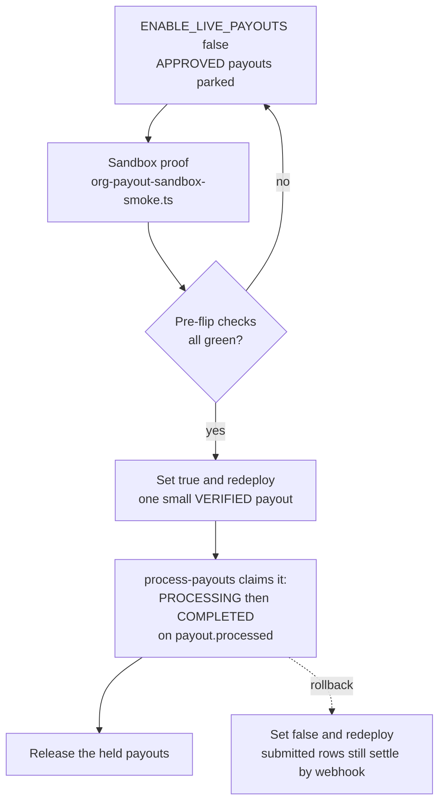

# Money go-live checklist

Use this page to take the money subsystem from sandbox to real money: first the collection side (Razorpay accepting real cards and UPI), then the disbursement side (RazorpayX paying real people). The two can be cut over together or separately. Each section ends with the proof that the step worked, because the failure mode at go-live is not a crash but a wrong amount or a wrong recipient on a path that was never exercised with live credentials. Items that live in the Razorpay dashboards rather than in code are marked "dashboard"; record a screenshot or a signed delivery log against the cutover issue for each.

## Part 1: accepting real money (Razorpay)

### 1.1 Account (dashboard)

- Razorpay Payments is activated, and the settlement bank account is the platform's current account with a beneficiary name that matches the registered entity exactly.
- The platform GSTIN is recorded on Razorpay, so the monthly fee invoices carry input tax credit. This is separate from the consumer and organisation tax invoices the platform mints itself.
- International cards, if you accept them, are enabled and the cross-border limits are understood. The platform still settles in INR only; see [the gateway page](../10-money-in/04-razorpay-gateway-and-currency.md).

### 1.2 Keys and the test-key guard

- `RAZORPAY_KEY_ID` and `RAZORPAY_SECRET` hold the live pair (`rzp_live_...`). `NEXT_PUBLIC_RAZORPAY_KEY_ID` holds the same key id. A secret is never given a `NEXT_PUBLIC_` prefix.
- `RAZORPAY_ALLOW_TEST_KEYS_IN_PRODUCTION` is deleted from production. While it is unset, `lib/payments/core/razorpay.ts` throws `RAZORPAY_TEST_KEY_IN_PRODUCTION` at boot if a test key ever reaches production; set to `true` it only logs, which is for a pre-launch deploy that must not move money.
- `RAZORPAY_WEBHOOK_SECRET` holds the live payment-webhook secret.

### 1.3 Webhooks (dashboard)

Both products post to the same endpoint, `https://<production-host>/api/webhooks/razorpay`, each signed with its own secret.

| Product           | Secret                     | Events to subscribe (the ones `razorpay-dispatch.ts` handles)                                                                                                                                                                                         |
| ----------------- | -------------------------- | ----------------------------------------------------------------------------------------------------------------------------------------------------------------------------------------------------------------------------------------------------- |
| Razorpay Payments | `RAZORPAY_WEBHOOK_SECRET`  | `payment.captured`, `order.paid`, `payment.failed`, `refund.created`, `refund.processed`, `refund.failed`, `refund.speed_changed`, `payment.dispute.created`, `.under_review`, `.action_required`, `.won`, `.lost`, `.closed`, `settlement.processed` |
| RazorpayX         | `RAZORPAYX_WEBHOOK_SECRET` | `payout.initiated`, `.queued`, `.pending`, `.processed`, `.updated`, `.failed`, `.reversed`, `.rejected`, `.cancelled`, `fund_account.validation.completed`, `fund_account.validation.failed`                                                         |

The RazorpayX secret is tried only for `payout.*` and `fund_account.*` events (`isPayoutEventName`, `app/api/webhooks/razorpay/signature.ts`), so a leaked RazorpayX secret cannot forge a `payment.captured`. Set the monitored alert email on both dashboards: Razorpay retries a non-2xx answer with backoff for 24 hours, and a receiver that answers 503 while its database is unreachable keeps that retry alive.

### 1.4 Rotating a webhook secret without downtime

Each secret has a grace slot. To rotate the payment secret: set `RAZORPAY_WEBHOOK_SECRET_PREVIOUS` to the old value and `RAZORPAY_WEBHOOK_SECRET` to the new one, deploy, and only then change the secret in the Razorpay dashboard. Until the dashboard changes, events signed with the old secret still verify through the previous slot, and the route records a `WEBHOOK` `WARN` `SystemEvent` for every delivery that lands on the previous secret, so you know when it is safe to retire. Rotate the RazorpayX secret the same way with `RAZORPAYX_WEBHOOK_SECRET_PREVIOUS`. After the rotation, remove the previous value, then start a `reconcile-ledgers` run to confirm nothing was lost in the transition. Resolution lives in `resolveRazorpayPaymentSecrets` and `resolveRazorpayXSecrets`. API keys are rotated by replacing `RAZORPAY_KEY_ID` and `RAZORPAY_SECRET` and redeploying; a live key never goes into the repository.

### 1.5 Clear sandbox identities from the database

Razorpay rejects every test-mode identifier under a live key (`The id provided does not exist`). The deployment shares one Postgres database between preview and production, so any customer, contact or fund-account id minted under a test key is still stored. Before the first live traffic, the owner runs this once in the cutover window. It has no test-mode predicate and clears every stored Razorpay identity, so never run it again once a live key has minted any: a rerun would orphan live customers and reset verified payout accounts.

```sql
BEGIN;
UPDATE users SET "razorpayCustomerId" = NULL WHERE "razorpayCustomerId" IS NOT NULL;
UPDATE "PayoutAccount"
   SET "razorpayContactId" = NULL, "razorpayFundAccId" = NULL, "isVerified" = false
 WHERE "razorpayContactId" IS NOT NULL OR "razorpayFundAccId" IS NOT NULL;
UPDATE "OrganizationPayoutAccount"
   SET "razorpayContactId" = NULL, "razorpayFundAccountId" = NULL,
       status = 'PENDING_VERIFICATION'
 WHERE "razorpayContactId" IS NOT NULL OR "razorpayFundAccountId" IS NOT NULL;
COMMIT;
```

`createRazorpayOrder` also clears a stale `users.razorpayCustomerId` and retries when Razorpay rejects a cross-mode customer id, so a missed row heals itself at the next checkout; the payout accounts do not, which is why the purge matters.

### 1.6 Proof for collection: two live ₹1 tests

1. **₹1.00 checkout.** Pay ₹1 by UPI. Confirm the `Payment` is `SUCCEEDED`, the appointment is confirmed, the consumer tax invoice number is at most 16 characters, and `SELECT COALESCE(SUM(CASE WHEN direction = 'DEBIT' THEN "amountPaise" ELSE -"amountPaise" END), 0) FROM "LedgerEntry"` is `0`.
2. **₹1.00 full refund.** Cancel the same booking for a full refund. Confirm the `Refund` becomes `SUCCEEDED` through the live `refund.processed` webhook, the credit note number is at most 16 characters, and the ledger imbalance is still `0`.

## Part 2: paying out real money (RazorpayX)

Payouts stay frozen until `ENABLE_LIVE_PAYOUTS` is `"true"`. With it off, batches are still created and approved, but an approved consultant payout is held in `APPROVED` (`processApprovedPayouts` returns nothing) and an approved organisation payout is not claimed (`processOrgPayout` reports `submittedToGateway: false`), so no money leaves. The consultant rail reads the flag from `lib/feature-flags.ts` at build and boot, and the organisation rail reads `process.env.ENABLE_LIVE_PAYOUTS` per call, so set it through a redeploy. Flipping it makes the very next `process-payouts` run (hourly, see [scheduled money jobs](01-scheduled-jobs.md)) submit `APPROVED` payouts up to its per-rail limit, which is real money on the first run; the checks below are hard gates.



### 2.1 Pre-flip checks

- **RazorpayX account** is live, KYB is complete, and its balance covers the first batch. `RAZORPAYX_KEY_ID`, `RAZORPAYX_KEY_SECRET` and `RAZORPAYX_ACCOUNT_NUMBER` hold live values (the key pair falls back to the Razorpay pair if unset). With the flag on, `getRazorpayPayoutsService` throws `RAZORPAYX_TEST_KEYS_IN_LIVE_MODE` for a test key, because a test key would let the ledger mark payouts `COMPLETED` while no bank account is ever debited.
- **Static egress.** Live RazorpayX APIs answer only allowlisted source IPs, and Netlify has no static egress. `RAZORPAYX_EGRESS_PROXY_URL` must be set: without it every payout call with a live key refuses with `RAZORPAYX_EGRESS_NOT_CONFIGURED`, and the boot check reports it to Sentry once per process. The proxy is bought only for the first live payout ([owner decision of 2026-11-01](../../decisions/2026-11-01-observability-gaps-and-launch-posture.md)):
  1. Buy QuotaGuard Static in the Mumbai region and copy its proxy URL and its static egress addresses.
  2. Set `RAZORPAYX_EGRESS_PROXY_URL` to the proxy URL in the Netlify production environment (Functions scope) and redeploy. The `ProxyAgent` in `lib/payments/payouts/razorpay-payouts.ts` then routes every RazorpayX call through it.
  3. Add every egress address to the RazorpayX API allowlist.
  4. Make the ₹1 canary payout in 2.3. A `RAZORPAYX_EGRESS_NOT_CONFIGURED` refusal means the variable is missing; an authentication or IP error from RazorpayX means the allowlist is wrong.
- **Payout accounts verified** for every payee in the first batch: `PayoutAccount.isVerified` for consultants and `OrganizationPayoutAccount.status = VERIFIED` for organisations. RazorpayX test mode does not run penny-drop or reverse-penny-drop, so an account "verified" on a preview was verified by hand and must be verified again after the purge in 1.5.
- **PAN and TDS.** Every payable consultant has a verified PAN, otherwise withholding uses the no-PAN rate. Confirm `TDS_ENGINE` is unset (the default is the Section 194-O engine; `LEGACY` is a flag-only fallback) and `ENABLE_TDS_194O_GROSS` is not `"false"`. See [TDS withholding](../40-payouts/06-tds-withholding.md).
- **Idempotency.** Every payout carries its deterministic idempotency key so a retry cannot pay twice; the schema makes it unique.
- **Reconcile is clean:** `reconcile-ledgers` reports `ok: true` with no unbaselined findings, including `ORG_PAYOUT_TOTAL_MISMATCH`.
- **Monitoring is on:** `handle-stuck-payouts` and the webhook sweep report to Sentry, and a Sentry alert exists for them.
- **Better Stack launch plan is bought.** Until launch Better Stack stays on the free plan (3-day logs, email and Slack alerts). At launch buy the responder seat (phone and SMS, about $29 to $34 a month) and the Telemetry Nano bundle (30-day retention, about $25 a month billed yearly, EU region), then add phone and SMS to the four money backlog alerts (`refundsOwed`, `payoutsStuck`, `dunningNotices`, `disputesDue`) described in the [Better Stack setup guide](../../maintenance/00-betterstack-setup.md#owner-step-the-oldest-pending-age-alerts).

### 2.2 Sandbox proof

Run `npx tsx scripts/smoke/org-payout-sandbox-smoke.ts` with a RazorpayX test key and the flag off. It refuses to run otherwise, and it writes one throwaway organisation and payout to the shared database and deletes them, so run it deliberately. It asserts that an organisation payout on any rail but RazorpayX is refused, that with the flag off `processOrgPayout` makes no gateway submission and leaves the payout unclaimed, and that the test credentials authenticate with a read-only balance call. A real sandbox submission, to see `payout.processed` arrive and `markOrgPayoutCompleted` fire, is a manual step against the RazorpayX sandbox host.

### 2.3 Flip, canary, rollback

1. Set `ENABLE_LIVE_PAYOUTS=true` in the production environment and redeploy.
2. Make exactly one small payout to a verified account eligible for the first run; hold or leave unapproved everything else (an organisation batch nobody has approved stays out of the run by itself).
3. Watch the payout go `PROCESSING` then `COMPLETED`, and confirm the live `payout.processed` webhook arrived, the bank reference is stored, and the ledger imbalance is `0`. A ₹1.00 payout is a sufficient canary.
4. Run `reconcile-ledgers` and expect no unbaselined findings, then release the held payouts.

**Rollback:** set the flag to `false` and redeploy. New runs stop submitting; payouts already submitted keep settling through their webhooks, because a transfer cannot be un-sent. A wrong disbursement is recovered by the clawback path, which nets the amount against the payee's future payouts; see [organisation payouts and clawbacks](../40-payouts/05-org-payouts-and-clawbacks.md). A row stuck in `PROCESSING` with no terminal webhook is polled by `handle-stuck-payouts`.

## Where in code

| Concern                                             | File                                                                                                           |
| --------------------------------------------------- | -------------------------------------------------------------------------------------------------------------- |
| Test-key boot guard, order creation                 | `lib/payments/core/razorpay.ts`                                                                                |
| Webhook secrets and rotation                        | `app/api/webhooks/razorpay/signature.ts`                                                                       |
| Event dispatch                                      | `app/api/webhooks/razorpay-dispatch.ts`                                                                        |
| RazorpayX credentials, egress guard, live-key guard | `lib/payments/payouts/razorpay-payouts.ts`                                                                     |
| Live-payout gate                                    | `lib/feature-flags.ts`, `lib/payments/payouts/payout-service.ts`, `lib/payments/payouts/org-payout-service.ts` |
| Sandbox smoke                                       | `scripts/smoke/org-payout-sandbox-smoke.ts`                                                                    |

## Related

- [Razorpayx implementation](../40-payouts/04-razorpayx.md) for contacts, fund accounts, modes and status mapping.
- [Webhook recovery](04-webhook-recovery.md) for events that do not land after the switch.

## Deprecated & Superseded Approaches

1. **The top-level `payment_capture: 1` order parameter.** Orders now set the nested `payment` capture options (`holdCaptureSettings` in `lib/payments/core/razorpay.ts`).
2. **Webhook secret rotation without a grace slot.** Both products now have a `_PREVIOUS` slot.
3. **`RAZORPAY_KEY_SECRET` as the secret name.** `RAZORPAY_SECRET` is the only name any code reads; the legacy spelling is no longer accepted anywhere, including the `reconcile-payment-status` script.
4. **A purge that clears `isVerified` on `OrganizationPayoutAccount`.** That table has `status`, not `isVerified`.
