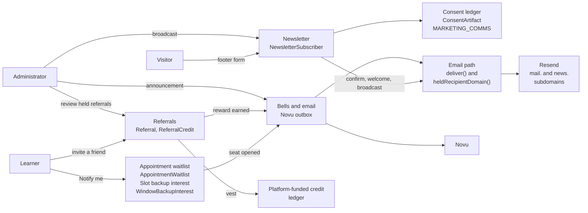

# Growth — Overview and High-Level Design

Growth is three small features that share four pieces of machinery. This page explains what the features are, what they share, why the shared parts are shared, and where to find the code. It does not repeat the detail of each feature; the numbered pages that follow do that.

Behaviour that is not on `dev` yet carries the tag of the pull request that brings it (`#2655`, `#2656` or `#2657`; see [the index](./README.md#which-pull-request-carries-which-code)). The decision record for all of this is [2026-11-08-growth-waitlist-newsletter-referrals.md](../decisions/2026-11-08-growth-waitlist-newsletter-referrals.md), which lists the owner's 19 decisions. **(arrives with #2655)**

## The three parts

**The newsletter and announcements.** A visitor gives an email address in the site footer, confirms it by clicking a link in a reply email (double opt-in), and from then on can receive product news and launch email. An administrator sends those emails from the back office to a chosen audience. Announcements are a different thing: a product notice for people who already have an account, shown as a site banner and, if the administrator ticks a box, as an in-app notification. Announcements never go by email and never need marketing consent.

**The appointment waitlist and slot backup interest.** When a webinar or class is sold out, a learner presses "Notify me". When a seat frees up, every waiter is told at the same moment and the first to pay gets the seat. Slot backup interest is the same idea for a one-to-one session: a learner asks to be told when a time window that another learner is holding frees up. Neither list reserves anything.

**Referrals.** A learner can invite a friend and earn a platform credit, and an expert can invite learners or other experts and earn a lower platform fee or fee-free sessions. Rewards are released only after the invited person has paid for, and received, a real session.

## What the three parts share

The parts are separate in code but they lean on the same four things.

1. **One consent ledger.** Marketing consent is recorded once, as a `ConsentArtifact` for the purpose `MARKETING_COMMS` (`lib/compliance/dpdp.ts`). The newsletter confirmation writes it, every unsubscribe withdraws it, and the account settings consent switch writes and withdraws the same record. Nothing else decides whether a person has agreed to marketing. **(after #2655)**
2. **One email path and one pre-launch guard.** Every email goes out through `deliver()` (`lib/email/deliver.ts`). The newsletter broadcast sends in batches of 100 for speed, so it calls `heldRecipientDomain()` (`lib/email/delivery-guard.ts`) for each recipient instead. Either way, the guard controlled by `EMAIL_DELIVERY_MODE` sees every recipient, and until the owner sets the mode to `live`, mail goes only to our own domain and the allowlist.
3. **In-app bells through Novu.** The waitlist and slot backup interest notices, the referral reward notices and announcements are bell notifications staged in the Postgres outbox and delivered by Novu (`lib/novu/outbox.ts`, `lib/novu/scoped-pages.ts`). Postgres owns the preference for every bell; see [notifications](../notifications/README.md).
4. **Platform-funded credits.** A referral reward is a credit paid from the platform's own margin and never from an expert's earnings. It is tracked in the ledger as a liability (`REFERRAL_CREDIT_LIABILITY`) against a promotion cost (`PLATFORM_PROMO`); see [the referral credits ledger](../finance/20-ledger/07-referral-credits.md).

## The vocabulary

One word per concept, in code, on screen and in docs. The ban on the older words is in the closing section.

| Concept                                                       | Term                                                   | Model                  |
| ------------------------------------------------------------- | ------------------------------------------------------ | ---------------------- |
| People who asked for product news and launch email            | **newsletter subscribers** (the newsletter list)       | `NewsletterSubscriber` |
| A learner queued for a seat on a sold-out webinar or class    | **appointment waitlist** (the button says "Notify me") | `AppointmentWaitlist`  |
| A learner asking to be told when a one-to-one window frees up | **slot backup interest**                               | `WindowBackupInterest` |

The Postgres table is still called `"Waitlist"` until the owner runs the rename script at release (see [the roadmap](./05-roadmap.md)). Code on `dev` that refers to `NewsletterSubscriber` therefore fails against the live database for the short gap between deploying and running the script. **(after #2655)**

## Why the parts are built this way

- **Postgres is the evidence, not the vendor.** The newsletter list stays in our own database and our own batch send path, rather than in a Resend audience. Consent, suppression and erasure then live in one database with no second copy of the list that an erasure would also have to reach. Resend Broadcasts is a documented later option; see [the newsletter page](./02-newsletter-and-announcements.md#resend-broadcasts-as-a-later-option).
- **Nothing is reserved for a waiter.** A reserved seat needs an offer timer and a re-offer sweep, and it blocks a seat while a waiter ignores the email. Telling everyone at once needs neither. See [the waitlist page](./01-appointment-waitlist-and-backup-interest.md).
- **A reward waits for something hard to fake.** A referral reward vests only after the friend has paid for and received a session and the refund window has closed. See [the referrals page](./03-referrals.md).
- **One signing key.** Every emailed link is signed with a key derived from `BETTER_AUTH_SECRET`, so there is no separate secret to rotate or leak. **(after #2655)**

## The repository versus Notion

The repository holds mechanisms, invariants, configuration field names and the terms a user sees on screen. The owner's Notion workspace ("Familiarise / Growth & Marketing") holds the referral budget, the fraud and hold thresholds, vendor costs and plan choices, growth targets, detailed competitor research and conversion read-outs. Whoever needs one of those values reads it from Notion. A page here that depends on one says "set by the owner; the value is kept in Notion (Familiarise / Growth & Marketing)". Vendor plan limits taken from a public pricing page, such as "the free plan stops at 100 emails a day", are allowed because they are not our spend. The enforcer of this rule is review: nothing in CI checks it, so a reviewer reading a growth pull request should reject any budget, threshold or vendor cost.

## Where things live

| Concern                                  | Location                                                                                                                                             |
| ---------------------------------------- | ---------------------------------------------------------------------------------------------------------------------------------------------------- |
| Newsletter sign-up, confirm, unsubscribe | `lib/newsletter/service.ts`, `app/api/newsletter/**`                                                                                                 |
| Newsletter consent and lock order        | `lib/newsletter/consent-link.ts`, `lib/newsletter/notice.ts`                                                                                         |
| Signed links                             | `lib/auth/link-signing.ts`, `lib/newsletter/tokens.ts`                                                                                               |
| Broadcast and audience                   | `app/api/admin/newsletter/broadcast/route.ts`, `lib/newsletter/broadcast-audience.ts`, `components/admin/NewsletterManagement.tsx`                   |
| Email delivery and the guard             | `lib/email/deliver.ts`, `lib/email/delivery-guard.ts`, [`docs/email/README.md`](../email/README.md)                                                  |
| Announcements                            | `schemas/announcements.ts`, `components/dashboard/shared/AnnouncementsPage.tsx`, [notifications workflows](../notifications/02-workflows-and-api.md) |
| Appointment waitlist                     | `lib/booking/event-waitlist.ts`, `app/api/scheduling/event-waitlist/route.ts`                                                                        |
| Slot backup interest                     | `lib/booking/backup-interest.ts`                                                                                                                     |
| Shared interest lifecycle                | `lib/booking/interest/lifecycle.ts`, `lib/booking/interest/query-keys.ts`, `schemas/interest.ts`                                                     |
| Event capacity                           | `lib/events/capacity.ts`, the two `crud-with-plan` routes under `app/api/bookings/`                                                                  |
| Host demand counts and the `demand` view | `lib/offerings/stats.ts`, `components/booking/WaitingCountBadge.tsx`, `prisma/sql/analytics-views.sql`                                               |
| Learner "My alerts"                      | `components/appointments/consultee/MyAlerts.tsx`                                                                                                     |
| Referral engine                          | `lib/referrals/**`, [`docs/referrals/`](../referrals/00-overview.md)                                                                                 |
| Backoffice review queue                  | `app/api/admin/referrals/held/route.ts`, `components/dashboard/backoffice/referrals/HeldReferralsPanel.tsx`                                          |
| The sweep that purges and re-notices     | `scripts/appointments/expire-stale-requests.ts`, registered as `expire-stale-requests` in `lib/cron/cleanup-registry.ts`                             |
| Erasure                                  | `lib/compliance/erasure/scrub-user.ts`, `lib/compliance/erasure/mail-footprint.ts`                                                                   |

## Related issues

- #2508 "Newsletter system design v1": the campaign outbox that raises the broadcast ceiling.
- #2562 "Consent-gated marketing path": a retention item that depends on the consent ledger.

## Deprecated & Superseded Approaches

- **"Waitlist" as the name of the newsletter list.** The pre-launch email list was called the waitlist in routes (`/api/waitlist/*`), templates, email types (`WAITLIST_*`), the rate limiter, the secret and the Postgres table. It has one name now, the newsletter. Delete any leftover reference; no alias was kept.
- **The sold-out toast that captured emails.** Sold-out events once offered a newsletter sign-up with the source `EVENT_SOLD_OUT`. The appointment waitlist replaced it and the source value is dropped.
- **`WAITLIST_HMAC_SECRET`.** A standalone secret that signed every unauthenticated link. The derived key replaced it; the owner deletes the variable from Netlify after the release.
- **The old `WaitlistOfferBanner`.** A banner on the learner's appointments page that showed one waitlist offer. "My alerts" replaced it and the file is deleted. **(after #2656)**
- **The per-event capacity pin.** The plan editor used to write the plan's capacity onto every event it saved, which fixed a per-event override that later plan edits could not reach. The server now stores an override only when it differs from the plan. **(after #2656)**
- **The first referral reward plan.** A flat ₹500 for the referrer and ₹200 for the friend, paid in cash at the friend's first payment. It could be farmed with refunds and tiny payments and capped nothing. The vested platform credit replaced it; see [referrals](./03-referrals.md).
