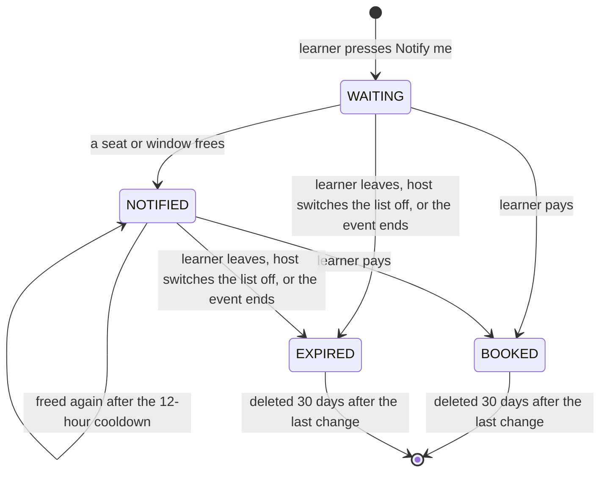

# The Appointment Waitlist and Slot Backup Interest

This page explains how a learner asks to be told when a seat or a time opens up, why the platform tells everyone at once, and what keeps the two lists tidy. The rules for the sold-out gate itself are in [the 2026-11-07 decision](../decisions/2026-11-07-event-seat-waitlist.md); the owner's 2026-11-08 additions are in [the growth decision record](../decisions/2026-11-08-growth-waitlist-newsletter-referrals.md) **(arrives with #2655)**. Behaviour not yet on `dev` carries the tag of the pull request that brings it (see [the index](./README.md#which-pull-request-carries-which-code)).

## The two lists

- The **appointment waitlist** (`AppointmentWaitlist`) belongs to a webinar or class. When every seat is taken, the event page shows "Notify me". Pressing it adds a row keyed on the event's shared roster (the appointment).
- **Slot backup interest** (`WindowBackupInterest`) belongs to an expert's time window. When another learner is holding a one-to-one window that has not been paid for, a learner can ask to be told if it frees up.

They stay two tables because they match differently. A group event is matched by equality on the appointment. A one-to-one window is matched by a time-range overlap on the expert's calendar. A single table would branch on kind in every query. Both tables carry the same lifecycle columns, so merging them later is cheap if a real need appears. **(after #2656)**

## Why everyone is told at once

When a seat frees, every eligible waiter hears at the same moment and the first to pay gets it. There is no queue position, no reservation and no claim window. The reasons are practical:

1. A reserved seat needs an offer timer and a sweep that re-offers it. That is two more moving parts and one more way to be wrong.
2. A reserved seat is blocked while a waiter ignores the email. Telling everyone means a seat is never held back from a buyer who is ready now.
3. No Indian ticketing or creator platform publishes a stronger standard; see [the research page](./04-market-research-india-first.md#sold-out-queues).

If the monthly conversion read-out or learner complaints show waiters losing races, the owner can move to ordered offer waves. Rows are already ordered by `createdAt`, so that change is a `take` on the same compare-and-set and needs no migration. **(planned: post-launch, only if data shows lost races)**

The enforcer of "first to pay wins" is the checkout's own seat gate: the per-event mutex `lockEventCheckout` followed by a Serializable recount of the roster, which aborts the loser of a last-seat race (see [concurrency and locking](../booking/12-concurrency-and-locking.md)). The waitlist never grants a seat; it only sends a notice.

## The lifecycle

Both tables use the same four states, defined in `lib/booking/interest/lifecycle.ts`. **(after #2656)**

- `WAITING` and `NOTIFIED` are the two **open** states (`OPEN_INTEREST`). `BOOKED` and `EXPIRED` are **settled** (`SETTLED_INTEREST`).
- A row moves to `NOTIFIED` in one compare-and-set that matches only rows still eligible (`notifiableInterest`: `WAITING`, or `NOTIFIED` for longer than the cooldown). A concurrent release that flips the same row first makes the second update match zero rows, so nobody is told twice by two racing releases.
- A `NOTIFIED` row is eligible again after `INTEREST_RENOTIFY_COOLDOWN_MS`, which is 12 hours, so a waiter receives at most two notices a day per row. Notice keys carry `renoticeBucket(now)`, the number of whole 12-hour periods since the Unix epoch, so a retried transaction re-stages the same keys and a genuinely later notice gets a new key.
- Settled rows are deleted after `INTEREST_RETENTION_MS`, which is 30 days. For the appointment waitlist the clock is the row's last write (`updatedAt`). For slot backup interest it is the end of the window (`windowEnd`), because nothing can change a row after its window.
- The purge and the expiry of open rows on ended events run in the existing stale-requests job (`expire-stale-requests`, `scripts/appointments/expire-stale-requests.ts`), through `expireEventWaitlist` and `expireBackupInterest`. There is no new job: the job's idle probe (`hasLapsedEventWaitlist`, `hasLapsedBackupInterest`) wakes it when a row needs work. Each run deletes at most `maxRequests` rows per table.

## The release paths

A release path is any code that can free a seat or a window. Each one stages the notice **inside its own transaction** (`stageSeatOpenedNotices` for events) and finishes it **after the commit** (`finishSeatOpenedNotices`), so a rolled-back release tells nobody. The paths for the appointment waitlist are:

| Release path                              | Where                                                                   |
| ----------------------------------------- | ----------------------------------------------------------------------- |
| The host raises the capacity              | The webinar and class `crud-with-plan` routes under `app/api/bookings/` |
| A learner leaves, or the host removes one | `lib/booking/seat-leave.ts`                                             |
| A learner abandons an unpaid held seat    | `lib/booking/abandon.ts`, `lib/payments/operations/cancel-pending.ts`   |
| An unpaid hold times out                  | `scripts/payments/cleanup-abandoned-payments.ts`                        |

`stageSeatOpenedNotices` tells nobody when the event is not on sale, the host has switched the list off, or no seat is actually free. For a plan that belongs only to an organisation, it drops waiters who are not active members. It also marks a waiter `BOOKED` as a backstop when they already hold a paid seat whose booking hook did not run.

The normal `BOOKED` hook runs when the payment is captured (`markEventWaitlistBooked`, called from the payment commit and the Razorpay webhook handlers).

Slot backup interest has its own release paths, because a window frees in different ways: the cancel route, an abandoned or lapsed request (`lib/booking/abandon.ts`, `lib/booking/lapse-approved-request.ts`, `lib/booking/request-route-guards.ts`, `lib/payments/checkout/order-reuse.ts`), a reschedule that moves the held time (`lib/booking/reschedule-respond.ts`, `lib/booking/reschedule-auto-confirm.ts`, `lib/booking/session-return.ts`), and the stale-requests sweep. They call `stageNoticesForAppointmentHolds` and `stageNoticesForFreedWindows` in `lib/booking/backup-interest.ts`.

**Adding a release path** means calling the stage function inside the transaction that frees the seat, passing a `now` captured outside any retry, and calling the finish function after the commit. The skill's [common tasks](../../.claude/skills/growth/SKILL.md) list the steps.

## The caps

| Cap                                        | Value                          | Enforcer                                                                                                    |
| ------------------------------------------ | ------------------------------ | ----------------------------------------------------------------------------------------------------------- |
| Open appointment-waitlist rows per learner | 5                              | `EVENT_WAITLIST_USER_CAP`, checked inside the Serializable join transaction (`EVENT_WAITLIST_CAP`)          |
| Open slot backup interest rows per learner | 3                              | `BACKUP_INTEREST_CAP` in `lib/booking/backup-interest.ts` (`BACKUP_INTEREST_CAP` error)                     |
| Open rows on one event                     | `min(waitlistMax ?? 200, 200)` | `listCap` in `lib/booking/event-waitlist.ts` (`WAITLIST_FULL`); the 200 is `MAX_GROUP_SESSION_PARTICIPANTS` |

The host can also switch the list off per plan (`waitlistEnabled`). Switching it off expires the plan's open rows silently (`expireEventWaitlistForPlan`), and the editor first says how many open entries will expire. **(after #2656)**

## Capacity normalisation

A webinar or class has a plan with a default capacity and each event instance can carry its own override (`Webinar.maxParticipants`, `Class.maxParticipants`). `effectiveMaxParticipants` in `lib/events/capacity.ts` reads the override and falls back to the plan.

The plan editor used to send the plan's capacity along with every event it saved, which wrote an override that later plan edits could not reach. Now the two `crud-with-plan` routes call `capacityOverrideFor(submitted, plan)`, which returns `null` (no override) when the submitted value equals the plan's and the submitted value when it differs. The editor loads the event's effective capacity so that the form shows the number a learner will see. **(after #2656)**

For example, Hannah Anderson has a webinar plan with capacity 30. She saves an event with 30: the event stores `null` and inherits the plan. She later raises the plan to 40: the event now has 40 seats, with no per-event edit. If she instead saves an event with 25, the event stores 25 and stays at 25 when the plan changes. The pre-launch rows are seed data, so no backfill was written.

An organiser cannot shrink an event below the people already in it. `CapacityBelowEnrollmentError` rolls the edit back and the route answers 400.

## What hosts see

A host sees how many people are waiting, never who. **(after #2656)**

- `lib/offerings/stats.ts` returns `waitingCount` for a webinar or class plan and `waitingByEvent` for each instance, to hosts only. The planner and offerings event cards show "N waiting" (`components/booking/WaitingCountBadge.tsx`), and the capacity field in the editor shows the count beside it (`components/offerings/editor/waiting-count.tsx`).
- The enforcer of "counts only" is the shape of the query: it is a `groupBy` count over open rows, and no name or user id is selected.

## What learners see: My alerts

"My alerts" (`components/appointments/consultee/MyAlerts.tsx`) is the learner's single list of open waits. It reads the open appointment-waitlist rows from `GET /api/scheduling/event-waitlist` and the open backup-interest rows from `GET /api/scheduling/backup-interest`, validated by `schemas/interest.ts`. Each row offers "Leave", and an appointment-waitlist row whose seat is free right now links straight to checkout (`eventCheckoutHref`). The buttons on the event and window pages share one toggle (`components/booking/NotifyToggleButton.tsx`), and both lists invalidate the same query keys (`lib/booking/interest/query-keys.ts`). The old `WaitlistOfferBanner` is gone. **(after #2656)**

## The `demand` view

`demand` is a read-only SQL view over both tables, defined in `prisma/sql/analytics-views.sql`. It has one row per interest row with `kind` (`EVENT` or `WINDOW`), `planKind`, `planId`, `consultantProfileId`, `status`, `createdAt`, `notifiedAt` and `bookedAt`, and no user id or email. It excludes direct learner identifiers, but it is not anonymous: `consultantProfileId` identifies the expert, so treat the view as personal data about experts. The view is created with `security_invoker`, and its privileges are revoked from the `anon` and `authenticated` roles, so it is not reachable through the Supabase data API. The owner creates it with `npm run db:sidecars`. Nothing in the app reads it yet; the host demand dashboard is a [post-launch item](./05-roadmap.md). **(after #2656)**

## Erasure

Erasing an account deletes the learner's rows in both tables (`scrub-user.ts` in `lib/compliance/erasure/`). A row holds no content beyond the learner, the event and the timestamps, so deletion is complete.

## Worked example

Hannah Anderson hosts a webinar on Sat 5 Dec 2026 at 18:00 IST. The plan and the event both have capacity 2 and the price is ₹1,180 (₹1,000 plus ₹180 GST, so 118,000 paise). Plan values here are illustrative; the seed draws prices at random. The cast is Olivia Anderson and Patrick Anderson (seat holders) and Daniel Brown and Priya Anderson (waiters).

1. **Thu 12 Nov, 10:00 and 10:05 IST.** Olivia and Patrick each pay ₹1,180. The roster is 2 of 2, so the event page shows "Notify me".
2. **Thu 12 Nov, 11:00 IST.** Daniel presses "Notify me". `joinEventWaitlist` re-reads the event inside a Serializable transaction, finds no free seat and inserts a `WAITING` row. At 11:20 IST Priya does the same. Each holds 1 of 5 allowed rows.
3. **Fri 13 Nov, 09:00 IST.** Patrick leaves his seat through the seat-leave path; the refund follows the cancellation rules and is outside this example. In the same transaction `stageSeatOpenedNotices` sees one free seat, finds both waiters eligible and flips both rows to `NOTIFIED` with `notifiedAt` 09:00 IST. It stages one bell each, keyed `seat-opened:<appointmentId>:<bucket>`. After the commit, `finishSeatOpenedNotices` attempts the bells and stages the emails. 09:00 IST is 03:30 UTC, in the 12-hour bucket that runs from 05:30 IST to 17:30 IST.
4. **Fri 13 Nov, 09:14 IST.** Priya follows the link and pays ₹1,180. The checkout seat gate admits her. On capture, `markEventWaitlistBooked` sets her row to `BOOKED` with `bookedAt` 09:14 IST. The roster is 2 of 2 again.
5. **Fri 13 Nov, 09:20 IST.** Daniel opens the same link. The seat gate refuses the sold-out event. His row stays `NOTIFIED`, and "My alerts" still offers "Leave".
6. **Fri 13 Nov, 20:00 IST.** Hannah raises the event's capacity from 2 to 3 (the event now stores an override of 3, because it differs from the plan's 2). A seat is free, but Daniel is not told again: his `notifiedAt` is 09:00 IST, only 11 hours ago, and the cooldown is 12. He could still pay from the link he already has. This is the cost of the cooldown.
7. **Fri 13 Nov, 21:30 IST.** Olivia leaves. Daniel's `notifiedAt` is now more than 12 hours old, so he is eligible. 21:30 IST is 16:00 UTC, in the next 12-hour bucket, so the bell and email keys are new and are not swallowed as duplicates. He pays at 21:41 IST and becomes `BOOKED`.
8. **Sun 13 Dec 2026, about 09:14 IST.** Thirty days after Priya's last write, the next stale-requests run deletes her settled row. Daniel's follows at about 21:41 IST.

If nobody had paid, the rows would have turned `EXPIRED` after the session ended (the sweep treats an event with no live future session as ended) and been deleted 30 days later.

## Failure modes

- **A notice email fails after the commit.** The bell is already in the Postgres outbox and the relay retries it. The email is best-effort and keyed per waiter and bucket, so a retry cannot send twice.
- **Two releases race.** The compare-and-set matches rows only once, so one of them notifies and the other finds nothing.
- **The stale-requests job is down.** Open rows on ended events stay open and settled rows stay past 30 days. The open rows still count toward the learner's cap of five (`EVENT_WAITLIST_USER_CAP` counts every open row, ended or not), so a learner can be refused a new join with `EVENT_WAITLIST_CAP` until they leave an ended entry in "My alerts" or the job runs again. Restoring the job expires and then purges those rows.

## Related issues

- The host demand dashboard, the ordered-wave trigger and the other follow-ups are in [the roadmap](./05-roadmap.md).

## Deprecated & Superseded Approaches

- **A `Waitlist` meaning the sold-out queue.** The word meant two things: the pre-launch email list and this queue. The newsletter table itself was called `"Waitlist"` in Postgres, next to `AppointmentWaitlist`. The queue is now the **appointment waitlist** and the email list is the **newsletter**.
- **The sold-out toast's `EVENT_SOLD_OUT` capture.** A sold-out event once offered a newsletter signup instead of queueing the learner. The appointment waitlist replaced it on 2026-11-07, and the `EVENT_SOLD_OUT` source value is dropped with the newsletter rename. Delete any reader of that source.
- **The per-event capacity pin.** The plan editor wrote the plan's capacity onto every event it saved, which pinned an override that later plan edits could no longer reach. `capacityOverrideFor` replaced it.
- **Demand visible only on the participants page.** A host could see how many people were waiting only on one event's participants page, not where capacity is decided. The "N waiting" counts on the planner, the offering cards and the capacity field replaced it.
- **The `WaitlistOfferBanner`.** A banner on the learner's Appointments and Home tabs that listed only slot backup interest, so appointment-waitlist rows had no learner-facing list. "My alerts" replaced it with one list of both.
- **Per-feature purge code.** The backup interest list had no purge and no re-notice. Both tables now share `lib/booking/interest/lifecycle.ts`; do not add a second lifecycle module.
