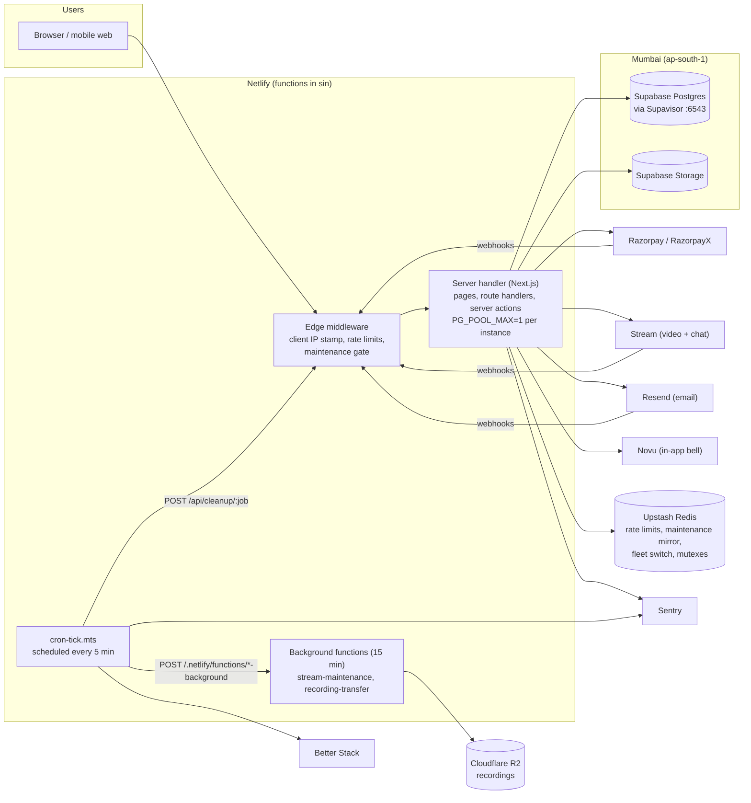
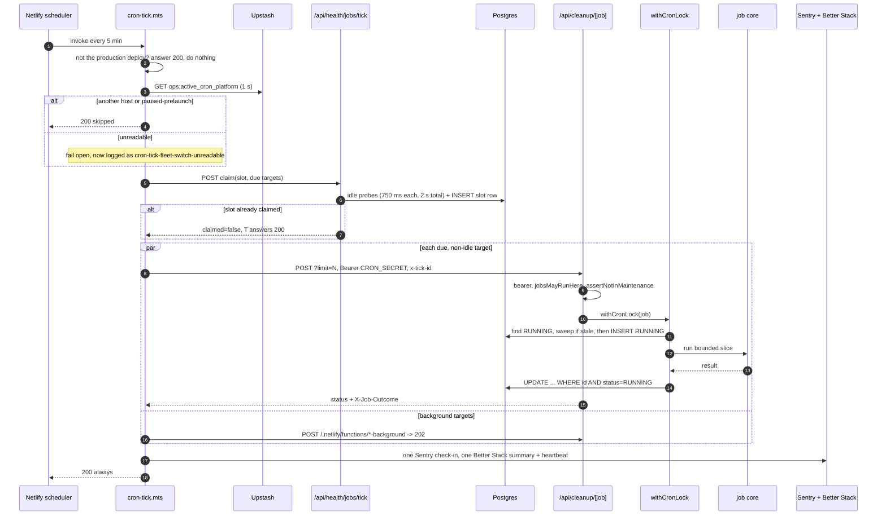
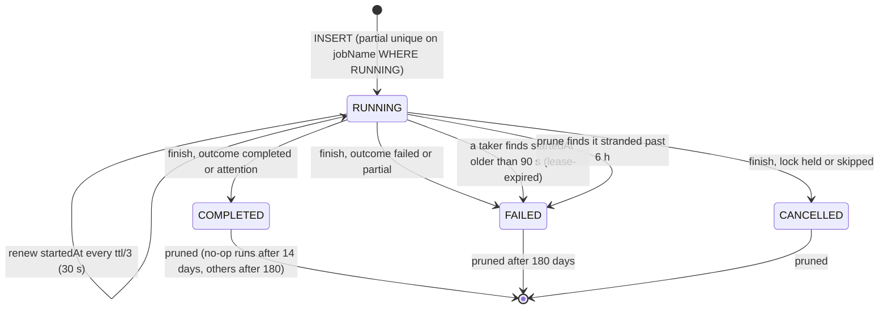
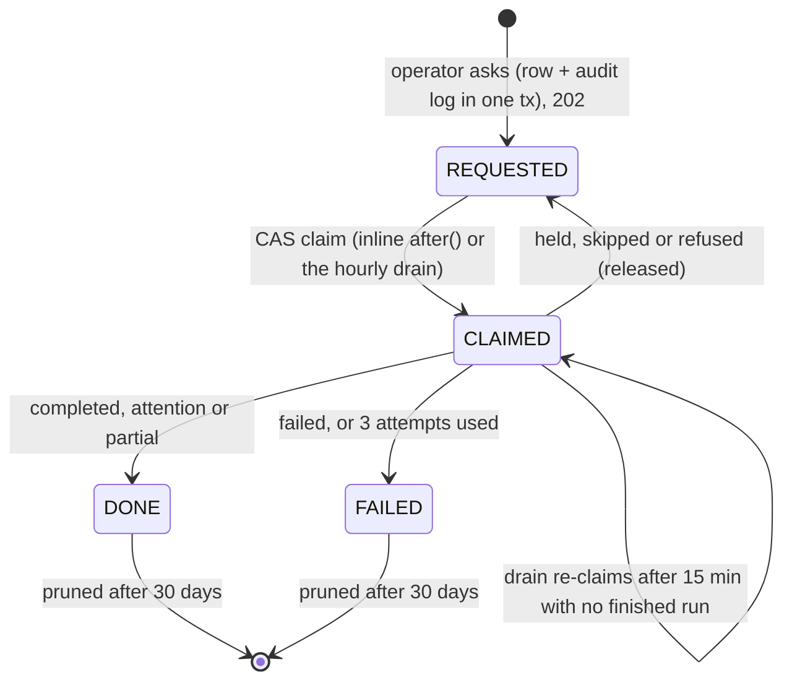
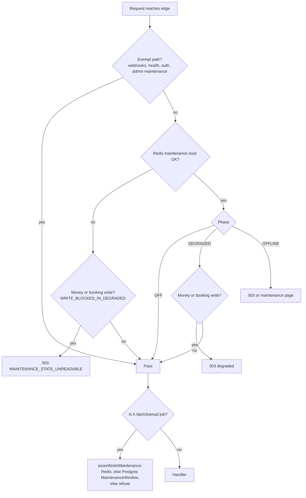
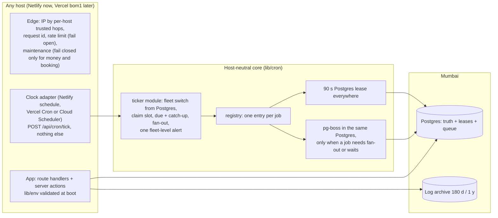

# Platform operations audit (November 2026)

This page is a one-stop explanation of how Familiarise runs in production: where the code runs, how the background-job fleet is scheduled and kept safe, how failures are detected and healed, which vendor boundaries can fail and what recovers them. It ends with what is wrong, what is missing, and a prioritised plan (P0 to P3). It was written from a read-only audit of `dev` at `827f0ce85` (2026-11-11), with every claim checked in code, and it is meant to be the source for later updates to the `docs/start-here/` explainers.

Read it top to bottom once. After that, use the [plan](#8-the-implementation-plan-p0p3) and the [owner decisions](#7-decisions-taken-and-decisions-still-open) as the working list.

> **Status before launch.** The scheduled job fleet is **paused on purpose** since 2026-11-05: the Upstash key `ops:active_cron_platform` is `paused-prelaunch`, and the ticker stands down on every tick. The job monitors are paused with it. See the [decision record](../decisions/2026-11-06-pause-scheduled-jobs-prelaunch.md) and the resume step in the [go-live skill](../../.claude/skills/go-live/SKILL.md). Every job bug below is therefore **latent today and live from the first resumed tick**.

---

## 1. The system in one picture (HLD)

Familiarise is one Next.js 15 App Router application (React 18.3, Prisma 7 over `pg`) deployed as a single Netlify site whose functions run in Singapore (`sin`). Everything stateful lives in managed services, most of them in Mumbai.



The load-bearing ideas, each with its enforcer:

| Idea                                     | What it means                                                                                                        | Enforced by                                                                       |
| ---------------------------------------- | -------------------------------------------------------------------------------------------------------------------- | --------------------------------------------------------------------------------- |
| The database is the last line of defence | Overlap, non-negative money, balanced ledger, funding-leg sums are Postgres constraints and triggers, not app checks | `prisma/sql/*.sql` sidecars                                                       |
| State as outbox                          | A follow-up that must survive a crash is a nullable stamp or a retry row on the domain table, re-checked by a sweep  | ADR 27, the registry sweeps                                                       |
| Compare-and-set transitions              | Every `Payment`/`Appointment`/`Refund`/`Payout` status change is `updateMany` with the prior status in `WHERE`       | Root `AGENTS.md` §2.2, code review                                                |
| One implementation per job               | A job is one function registered once in `lib/cron/cleanup-registry.ts`, reached only through `/api/cleanup/[job]`   | `lib/cron/AGENTS.md`, `__tests__/maintenance/cleanup-job-scheduler-drift.test.ts` |
| One scheduler                            | `netlify/functions/cron-tick.mts` is the only clock; no GitHub Actions workflow runs a registry job                  | `lib/cron/schedule.ts`, `npm run cron:coverage`                                   |
| Leases, not locks in Redis               | Job mutual exclusion is a Postgres row (`SystemJobExecution`, partial unique index on `RUNNING`)                     | `lib/cron/with-cron-lock.ts`                                                      |

---

## 2. Where the code runs (deployment)

| Runtime              | Lives in                                                        | Limits that matter                                                                                                                                              | Notes                                                                                    |
| -------------------- | --------------------------------------------------------------- | --------------------------------------------------------------------------------------------------------------------------------------------------------------- | ---------------------------------------------------------------------------------------- |
| Edge middleware      | `middleware.ts`, `lib/maintenance-edge.ts`, `lib/request-ip.ts` | Deno edge, no Node APIs                                                                                                                                         | Stamps `x-familiarise-client-ip`, applies the maintenance gate and rate limits           |
| Server handler       | Netlify's Next runtime                                          | 60 s function limit, but the edge gives up near 26–38 s; a new instance can stall about 26–28 s under concurrent creation (platform-side, confirmed by Netlify) | `PG_POOL_MAX=1`, so never global `prisma` inside `$transaction`                          |
| Scheduled function   | `netlify/functions/cron-tick.mts`                               | 30 s budget; Netlify retries a dispatch that does not answer 2xx in time                                                                                        | Always answers 200                                                                       |
| Background functions | `netlify/functions/*-background.*`                              | 15 min, answer 202 at once                                                                                                                                      | Recording copy to R2 and Stream maintenance                                              |
| Container (latent)   | `Dockerfile.prod`                                               | none live                                                                                                                                                       | Not deployable as-is: passes 3 of the 12 `NEXT_PUBLIC_*` build args and has no scheduler |

**Region.** Netlify has no Mumbai region on any plan (Netlify support confirmed it in writing on 2026-11-11; the self-serve list tops out at Singapore). Every sequential query therefore pays a Singapore-to-Mumbai round trip of roughly 60 ms. New Netlify sites default to US East (`cmh`), so a standby or preview site must be pinned to `sin` explicitly. Fly.io no longer lists Mumbai (`bom`) in its public region list, so the Fly rows in the [multi-platform evaluation](../deployment/multi-platform-evaluation.md) are invalid until `fly platform regions` shows it.

**Portability (dual boot).** Root `AGENTS.md` §2.5 promises that every `dev`/`prod` SHA builds on the active host and on hot-standby Netlify, with failback under 90 seconds. Today only Netlify is real. What is true and what is not:

| Rule                                                   | State in code                                                                                                                                        |
| ------------------------------------------------------ | ---------------------------------------------------------------------------------------------------------------------------------------------------- |
| Client IP resolved once at the edge, by runtime        | Implemented exactly (`lib/request-ip.ts`); every IP-reading route is inside the matcher                                                              |
| `sharp` excluded only on Netlify or Vercel             | Implemented in this PR (`next.config.mjs` was excluding it everywhere)                                                                               |
| Lease length identical on every host                   | Implemented in this PR (90 s everywhere)                                                                                                             |
| Conditional `output: "standalone"` for container hosts | Not implemented                                                                                                                                      |
| A scheduler adapter for any host other than Netlify    | Not implemented; the ticker logic lives inside the Netlify function                                                                                  |
| `PG_POOL_MAX` required on every host                   | Only enforced on Netlify; elsewhere `pg` defaults to 10 per instance                                                                                 |
| Failback under 90 s                                    | Never measured; DNS is still at Netlify, the ticker notices a switch only at its next 5-minute tick, and the edge caches maintenance state for 180 s |

---

## 3. The background-job system (LLD)

### 3.1 The pieces

| Piece            | File                                                                       | Job                                                                                                                                                 |
| ---------------- | -------------------------------------------------------------------------- | --------------------------------------------------------------------------------------------------------------------------------------------------- |
| Schedule catalog | `lib/cron/schedule.ts`                                                     | `TARGETS` (76 HTTP targets) plus `STREAM_LIFECYCLE_JOBS` (5 background targets), each with a cadence, an optional UTC window and a per-tick `limit` |
| Registry         | `lib/cron/cleanup-registry.ts`                                             | 81 job keys, each `{ build, idle? }`; `build` wraps the job core in `cleanupRoute`                                                                  |
| HTTP twin        | `app/api/cleanup/[job]/route.ts` → `lib/cron/cleanup-route.ts`             | Bearer check (SHA-256 then `timingSafeEqual`), `jobsMayRunHere`, `assertNotInMaintenance`, run, record                                              |
| Lease            | `lib/cron/with-cron-lock.ts`                                               | One `RUNNING` row per job; renew every `ttl/3`; finish with CAS on `RUNNING`                                                                        |
| Tick claim       | `app/api/health/jobs/tick/route.ts`                                        | Inserts the slot row (id derived from the 5-minute slot) so a duplicate tick stands down; runs idle probes                                          |
| Admin runs       | `lib/cron/admin-run-requests.ts`, `app/api/admin/system-jobs/run/route.ts` | Operator-requested runs, durable as `AdminRunRequest` rows, drained hourly                                                                          |
| Health readers   | `app/api/health/jobs/*`, `lib/cron/operational-health.ts`                  | Freshness per job, failure streaks, pending ages                                                                                                    |

Inventory by cadence (from the registry, 2026-11-11): 20 jobs every 15 minutes, 2 every 10, 9 every 30, 33 hourly, 3 every 2 hours, 1 every 4, 2 every 6 and 11 daily. 57 leases fail **closed** (a lease the database cannot grant means "do not run"), 22 fail **open**, 2 lease inside the core. The per-job table is in [Appendix A](#appendix-a-every-registered-job) and the generated reference is [04-cron-jobs-reference.md](../maintenance/04-cron-jobs-reference.md).

### 3.2 One tick, end to end (sequence)



Why the tick always answers 200: Netlify re-invokes a scheduled function that answers 5xx, and every re-invocation re-fires every due target. A failure is read from the logged `failed` list and the run rows, never from the status.

### 3.3 The lease row (state machine)



**Worked example (the lease bug this PR fixes).** Before this PR the lease was 90 s on Netlify and 15 or 35 minutes elsewhere, and a taker judged staleness by **its own** lease. A developer runs `create-payout-batch` from `next dev` against the shared database at 10:00:00; it renews every 11.7 minutes (a third of 35). At 10:01:31 the production tick's run of the same job finds the row 91 s old, sweeps it as expired and starts a second batch. Two payout batches now run at once, held apart only by CAS writes. With one 90 s cap everywhere, the local run renews every 30 s and the production taker sees a live lease.

### 3.4 The admin run request (state machine)



### 3.5 Maintenance admission (flowchart, after this PR)



Before this PR an unreadable Redis turned every non-GET request into a 503, including every job the ticker dispatched, so an Upstash quota blip stopped the site's writes and the whole fleet. The Postgres `MaintenanceWindow` row was always the truth; Redis is only its mirror.

---

## 4. Failure modes and recovery

### 4.1 Inbound vendor events

| Vendor            | Verification                                              | Dedup store                                                | Vendor retry                                               | If our DB is down      | Healing job(s)                                                                                                                                                                                                                      | Gap                                                                                                                              |
| ----------------- | --------------------------------------------------------- | ---------------------------------------------------------- | ---------------------------------------------------------- | ---------------------- | ----------------------------------------------------------------------------------------------------------------------------------------------------------------------------------------------------------------------------------- | -------------------------------------------------------------------------------------------------------------------------------- |
| Razorpay payments | HMAC over raw body, current then previous secret          | `WebhookEvent.eventId` unique, 5-min claim lease           | Non-2xx retried for 24 h, then the webhook is **disabled** | 503, Razorpay retries  | `sweep-stuck-webhook-events`, `reconcile-payment-status`, `reconcile-orphaned-payments`, `reconcile-refunds`, `reconcile-disputes`, `sweep-orphaned-topup-captures`, `reconcile-invoice-payments`, `reconcile-standalone-purchases` | No alert when Razorpay disables the webhook; invalid signatures each write a `SystemEvent` (unauthenticated write amplification) |
| RazorpayX payouts | Separate secret, only for `payout.*` and `fund_account.*` | same                                                       | same                                                       | same                   | `reconcile-payout-status`, `handle-stuck-payouts`                                                                                                                                                                                   | Payout mutex lives in Redis                                                                                                      |
| Stream            | `x-signature` HMAC plus API key                           | `WebhookEvent` by webhook id, receipt saved before the ack | About 15 s total, then dropped                             | Events lost after 15 s | `reconcile-orphaned-recordings`, `reconcile-stream-memberships`, `stream-control-plane-drift`, `stream-sync`                                                                                                                        | Lost call-ended or attendance signals heal only where a reconciler polls Stream                                                  |
| Resend            | Svix verify                                               | `EmailEvent.svixId` unique                                 | About a day                                                | 500, Svix retries      | none inbound                                                                                                                                                                                                                        | A bounce lost past Svix's window is never suppressed                                                                             |

### 4.2 Outbound side effects

| Effect                                | Durable record                                        | Driver                       | Idempotency                                                    |
| ------------------------------------- | ----------------------------------------------------- | ---------------------------- | -------------------------------------------------------------- |
| Transactional email                   | `FailedEmail` written before the send                 | `retry-failed-emails`        | Resend idempotency key, 24 h; rows older than 23 h are refused |
| In-app bell                           | `NotificationOutbox` staged in the domain transaction | `drain-notification-outbox`  | Novu transaction id per row and recipient                      |
| Outbound webhooks                     | `OutboundWebhookDelivery`                             | `dispatch-outbound-webhooks` | Delivery id                                                    |
| Chat channel creation, recording copy | Nullable stamps on the domain row                     | The owning sweep             | Ensure-style steps                                             |

Delivery semantics are **at least once everywhere**, made safe by vendor ids, CAS writes and the leases. Nothing assumes exactly once.

### 4.3 Platform failures

| Failure                                    | Detection                                                                            | Automatic recovery                                                                          | Gap                                                                                                                                                  |
| ------------------------------------------ | ------------------------------------------------------------------------------------ | ------------------------------------------------------------------------------------------- | ---------------------------------------------------------------------------------------------------------------------------------------------------- |
| Upstash unreachable or over quota          | `/api/health` body, Sentry throttled capture                                         | After this PR: non-money writes and the fleet continue; jobs read maintenance from Postgres | Rate limits fail open; the Node Upstash client retries 5 times with no timeout, so slow Redis adds seconds                                           |
| Postgres unreachable                       | After this PR: `/api/health` answers **503**                                         | Vendors retry webhooks; sweeps heal later                                                   | Better Stack's status-code monitor must point at `/api/health`                                                                                       |
| Ticker silently stops                      | Better Stack heartbeat, Sentry cron monitor, job-fleet probe (all paused pre-launch) | none                                                                                        | Resume the monitors with the fleet                                                                                                                   |
| One job keeps failing                      | Failure streak in `lib/cron/failure-streak.ts`                                       | Next due tick retries                                                                       | Streaks are measured against the slot interval: a daily job pages after about 3 days, an hourly windowed job pages on its first failure each morning |
| A daily or weekly job misses its only slot | Job-absence probe only                                                               | none                                                                                        | No catch-up slot                                                                                                                                     |
| A killed run                               | Lease swept after 90 s                                                               | Next tick re-runs                                                                           | none                                                                                                                                                 |
| Sentry quota exhausted                     | Ingest canary + 70 % quota alert                                                     | none                                                                                        | Both skip every run while `SENTRY_STATS_TOKEN` is unset                                                                                              |
| Function logs needed after an incident     | none                                                                                 | none                                                                                        | Netlify keeps function logs about 7 days; CERT-In expects 180 days of logs                                                                           |

---

## 5. What the audit found

Severity: **P0** stops money or loses data now; **P1** will bite at launch or under the first incident; **P2** correctness or cost debt with a bounded blast radius; **P3** hygiene. "Fixed here" means fixed in the pull request that adds this page.

### 5.1 Job machinery

| ID  | Sev | Finding                                                                                                                                                                                                                                 | Status                                                                                |
| --- | --- | --------------------------------------------------------------------------------------------------------------------------------------------------------------------------------------------------------------------------------------- | ------------------------------------------------------------------------------------- |
| M1  | P1  | A taker judged lease staleness by its own host's lease (90 s on Netlify, up to 35 min elsewhere), so production could sweep a live local or standby run and run a money job twice                                                       | Fixed here (`effectiveLeaseTtlMs` caps at 90 s everywhere)                            |
| M2  | P2  | `abandoned-payments` takes the lock three times in one request; a stand-down on pass 2 or 3 rewrites pass 1's COMPLETED row as CANCELLED (`recordRouteRun`)                                                                             | Open: one lock around the three passes, never rewrite a finished row for a stand-down |
| M3  | P2  | The same route called `prisma.$disconnect()` mid-request; harmless on Netlify, breaks concurrent requests on Cloud Run, Vercel Fluid or Fly                                                                                             | Fixed here, with 22 dead `disconnectDatabase` exports deleted                         |
| M4  | P2  | No catch-up for jobs with one slot per period (daily non-windowed jobs, `ops-digest`, three weekly jobs)                                                                                                                                | Open                                                                                  |
| M5  | P2  | Failure streaks measured against the slot interval, not consecutive failures                                                                                                                                                            | Open                                                                                  |
| M6  | P2  | The fleet-switch read fails open silently, which also bypasses `paused-prelaunch`                                                                                                                                                       | Partly fixed here (it now logs); decide whether a paused fleet should fail closed     |
| M7  | P2  | Ticker logic lives only in the Netlify function; background targets hard-code `/.netlify/functions/`                                                                                                                                    | Open (thin adapter, logic in a new ticker module in `lib/cron/`)                      |
| M8  | P2  | About 29 % of slots were dispatched twice since 2026-11-02. Netlify's scheduler logs show one dispatch per slot, so these are platform retries when a tick holds its response too long; the slot claim makes them harmless but billable | Open: send Netlify the request ids; make the tick answer within a few seconds         |
| M9  | P3  | Renewal racing the finish write records a false `leaseLost`                                                                                                                                                                             | Open                                                                                  |
| M10 | P3  | Checkpoints and the no-op prune ignore environment, so a dev run can affect production's run history                                                                                                                                    | Open                                                                                  |
| M11 | P3  | The ticker rounds the slot with `Math.round`; a tick 4.5 min late claims the next slot                                                                                                                                                  | Open                                                                                  |
| M12 | P3  | `failMode: "open"` on jobs with external effects (`dispatch-outbound-webhooks`, `auto-complete-appointments`, `expire-reschedule-proposals`)                                                                                            | Open                                                                                  |
| M13 | P3  | A dead command-line layer: the Actions-era `transfer-recordings` wrapper, `require.main` tails, `runJob`/`runJobWithSentry`/`abortIfMaintenance`, `GITHUB_OUTPUT` writes                                                                | Fixed here                                                                            |
| M14 | P3  | `VERCEL_CRON_SECRET` fallback copied into six files with no `vercel.json`                                                                                                                                                               | Fixed here                                                                            |

### 5.2 Individual jobs

All 81 jobs were checked for bounded reads, CAS transitions, `tx` use inside transactions, vendor calls inside transactions, per-row Sentry captures and poison-row handling. **No global `prisma` inside an interactive transaction, no vendor call inside a transaction, no read-then-write status change and no retention job deleting a row a `Payment` references were found.**

| ID  | Sev            | Job                                                                                                | Finding                                                                                                                                                                          |
| --- | -------------- | -------------------------------------------------------------------------------------------------- | -------------------------------------------------------------------------------------------------------------------------------------------------------------------------------- |
| J1  | P2             | `alert-orphaned-payments`                                                                          | Reads `limit` rows oldest first, then drops fully refunded ones in JavaScript; ten refunded payments hide new "charged, nothing booked" payments                                 |
| J2  | P2             | `reconcile-orphaned-payments` (escrow arm)                                                         | Escrowed rows stay in the 10-row read; after 10 unresolved escrows later orphans are never escrowed or alerted                                                                   |
| J3  | P2             | `reconcile-orphaned-payments` (heal arm)                                                           | Skipped rows are never stamped, so 10 of them block auto-heal for up to 7 days                                                                                                   |
| J4  | P2 (suspected) | `reconcile-gateway-settlements`                                                                    | The page offset counts stored lines filtered by `settledAt`; a day can be marked fully read early and its journal posted from a partial sum, then blocked by its idempotency key |
| J5  | P2             | `irp-uploader`                                                                                     | No duplicate-IRN recovery; a crash after the portal issues an IRN leaves the invoice FAILED with no IRN stored                                                                   |
| J6  | P2             | `reconcile-occurrence-availability`                                                                | The top-up pass has a 60 s budget but the HTTP abort is 24 s                                                                                                                     |
| J7  | P2             | `generate-subscription-invoices`                                                                   | Unbounded due read; ten always-failing subscriptions use up every slice. The claim is not a true CAS and there is no unique constraint per cycle (P3)                            |
| J8  | P2 at scale    | `create-payout-batch`, `settle-invoice-accruals`, `expire-referral-credits`, `prune-system-events` | Fixed windows cap throughput (for example 120 payees per rail per week) with no alarm when work is left over                                                                     |
| J9  | P2 at scale    | `reconcile-document-storage`, `process-data-exports`                                               | Whole-bucket listing twice per run; whole-organisation export in one request                                                                                                     |
| J10 | P3             | `expire-reschedule-proposals`, `reconcile-orphaned-payments`, `process-payouts` (org arm)          | Per-row Sentry captures inside loops (forbidden by `AGENTS.md` §4.2)                                                                                                             |
| J11 | P3             | `appointment-reminders`, `expire-stale-collaborator-invites`, `purge-unverified-users`             | Poison rows re-head the read every run                                                                                                                                           |
| J12 | P3             | `consent-retention-sweeper`                                                                        | Counts and never deletes on schedule                                                                                                                                             |
| J13 | P3             | `sweep-orphaned-topup-captures`                                                                    | Captured top-ups that keep failing drop out silently after 30 days                                                                                                               |
| J14 | P3             | `wallet-low-balance`                                                                               | Unbounded read; a never-seeded NULL balance reads as 0                                                                                                                           |

Redundant pairs worth merging: `alert-orphaned-payments` with `reconcile-orphaned-payments` (merging also fixes J1); `heal-consumer-invoices` with the GST export's built-in healer; `sweep-abandoned-overage-charges` (7 days) with `timeout-member-overages` (14 days).

### 5.3 Deployment and observability

| ID  | Sev | Finding                                                                                                                                            | Status                                                                                                                                           |
| --- | --- | -------------------------------------------------------------------------------------------------------------------------------------------------- | ------------------------------------------------------------------------------------------------------------------------------------------------ |
| D1  | P1  | An unreadable Redis stopped every write and every job                                                                                              | Fixed here (money and booking writes only; jobs fall back to Postgres)                                                                           |
| D2  | P1  | `/api/health` always answered 200, so status-code monitors and the container health check never fired                                              | Fixed here (`/api/health` answers 503 when the database or maintenance state is unreadable; `/api/health/live` for liveness; Dockerfiles use it) |
| D3  | P1  | `SENTRY_STATS_TOKEN` unset, so the ingest canary and quota alert skip every run                                                                    | Owner action                                                                                                                                     |
| D4  | P2  | Portability rules exist mostly in prose (§2)                                                                                                       | Partly fixed here (`sharp`, lease); rest planned                                                                                                 |
| D5  | P2  | Behind Cloudflare's proxy or a Google load balancer, the rightmost `x-forwarded-for` hop is the proxy, so all users would share rate-limit buckets | Plan: per-host trusted-hop configuration before any proxy goes in front                                                                          |
| D6  | P2  | Invalid Razorpay signatures each write a `SystemEvent` kept 400 days; `/api/webhooks/*` has no rate limit                                          | Open                                                                                                                                             |
| D7  | P2  | The ticker sends one Sentry event per failing target per hour (about 240 a day in a fleet-wide failure against a 5,000-a-month quota)              | Open: one fleet-level event when three or more targets fail                                                                                      |
| D8  | P2  | The Upstash client keeps 5 retries and no timeout; the in-memory circuit breaker needs 20 requests on one instance and so never opens on Netlify   | Open: 750 ms timeout, one retry, delete the breaker                                                                                              |
| D9  | P3  | `removeConsole` strips structured `console.log` events in production builds; no request id joins logs to Sentry events                             | Open: one structured logger                                                                                                                      |

### 5.4 Scripts and CI

| ID  | Sev        | Finding                                                                                                                                                                                                                                | Status                                                                    |
| --- | ---------- | -------------------------------------------------------------------------------------------------------------------------------------------------------------------------------------------------------------------------------------- | ------------------------------------------------------------------------- |
| C1  | P0 (owner) | `ci.yaml` shows as active again and ran 95 times on 8–9 Nov, against the 2026-11-07 decision that keeps it off before launch. At that pace the Actions budget runs out mid-month, the failure that silently stopped 14 jobs in October | Owner action: disable it in the repository's Actions settings             |
| C2  | P1         | `npm run db:migrate` ran `prisma migrate dev --name init` against the shared database                                                                                                                                                  | Fixed here (deleted)                                                      |
| C3  | P1         | `cron-heartbeat.yml` watches Actions from Actions, so it stops with the budget it watches                                                                                                                                              | Open: Better Stack heartbeat from each scheduled workflow, then delete it |
| C4  | P2         | `npm run scripts:cleanup-abandoned-payments` and `scripts:release-earnings` ran money jobs unbounded from a laptop against the shared database, outside the registry and its maintenance check                                         | Fixed here (scripts and their CLI tails deleted)                          |
| C5  | P2         | Dated expiries that turn checks red: `known-drift.json` (33 entries, **21 Nov**), the npm-audit allowlist (**8 Dec**, the zod 4 migration), the ledger-findings baseline (**15 Dec**)                                                  | Owner and Session F action                                                |
| C6  | P2         | CI skips every job for Dependabot PRs and a skipped check reads as passing; actions are pinned by tag, not SHA                                                                                                                         | Open                                                                      |
| C7  | P2         | `load-test.yml` sends test credentials to any `base_url` and has never run                                                                                                                                                             | Open: delete                                                              |
| C8  | P3         | `MONEY_CRITICAL_JOBS` in `scripts/ci/notify-ops-failure.sh` names jobs that no longer exist                                                                                                                                            | Open                                                                      |
| C9  | P3         | `check-cron-heartbeat.ts` passes when every GitHub API lookup fails                                                                                                                                                                    | Open                                                                      |

### 5.5 Missing jobs and runbooks

Checked by grep before being called missing:

| Missing                                                                                      | Why it matters                                                       | Priority                  |
| -------------------------------------------------------------------------------------------- | -------------------------------------------------------------------- | ------------------------- |
| Log archive to Mumbai (180 days, and a year for DPDP security logs)                          | CERT-In 2022 directions require 180 days; Netlify keeps about 7      | P1 before launch          |
| One breach runbook with a 6-hour (CERT-In) and a 72-hour (DPDP) clock                        | Two regimes, one incident                                            | P1 before launch          |
| DPDP grievance and erasure-request ageing alert                                              | Only the breach deadline job exists                                  | P1                        |
| Webhook-absence heartbeat per provider                                                       | Razorpay disables a webhook after 24 h of failures and nothing pages | P1                        |
| Leftover-work alarm for windowed jobs (J8)                                                   | Fixed windows silently cap throughput                                | P2                        |
| Backup restore drill (scheduled, evidenced)                                                  | Free-tier Supabase has no backups; a restore was never rehearsed     | P1 (with the Pro upgrade) |
| GST e-invoicing turnover threshold (the registration alarm already exists in the ops digest) | Statutory threshold                                                  | P2                        |
| Database bloat and vacuum check                                                              | Long-lived ledger and event tables                                   | P3                        |
| Secret and API key expiry tracking                                                           | Rotations are manual                                                 | P3                        |
| Organisation domain DNS re-verification                                                      | Verified domains can lapse                                           | P3                        |

### 5.6 Environment variables

The code reads **145** variables: 20 set by the platform and 125 set by us (47 secrets, 32 vendor ids or endpoints, 17 tuning knobs, 14 feature flags, 4 kill switches, 5 seed, 3 build, 3 computed). Only 5 are Zod-validated; about 25 have hand-rolled checks; the rest are read raw. There is no single env module, and `utils/env.ts` has 11 unused exports. No secret leaks to the client and every read variable is in `.env.sample`.

| Verdict                        | Count    | Examples                                                                                                                                                                                                                                                                                                                                                                                                             |
| ------------------------------ | -------- | -------------------------------------------------------------------------------------------------------------------------------------------------------------------------------------------------------------------------------------------------------------------------------------------------------------------------------------------------------------------------------------------------------------------- |
| Keep                           | 100      | Vendor secrets and endpoints, `CRON_SECRET`, `PG_POOL_MAX`                                                                                                                                                                                                                                                                                                                                                           |
| Delete                         | 20       | `VERCEL_CRON_SECRET` and `DIRECTUS_WEBHOOK_SECRET` (done here); `PAYOUT_MAKER_CHECKER_REQUIRED`, `ENABLE_CONSOLIDATED_INVOICE`, `RATE_CARD_SCOPED_RESOLUTION`, `ENABLE_HOST_ORGS` (duplicates `Organization.canHost`), `ENABLE_TDS_ADMIN_VIEW`, `ENABLE_BETTERSTACK_TELEMETRY`, `NEXT_PUBLIC_ENABLE_DEV_TOOLS`; at the cutover `RAZORPAY_ALLOW_TEST_KEYS_IN_PRODUCTION`, `ENABLE_SAVED_CARDS`, `ENABLE_CHECKOUT_EMI` |
| To code constant               | 18       | The `PG_*` timeouts except `PG_POOL_MAX`, `ALLOCATION_TX_*`, Sentry org and URLs, `UPSTASH_MONTHLY_COMMAND_CAP`, seed batch sizes                                                                                                                                                                                                                                                                                    |
| To one audited DB settings row | 5 into 4 | `ENABLE_LIVE_PAYOUTS`, `INSTANT_PAYOUT_AUTO_APPROVE_PAISE`, the dunning suspend switch, and `TDS_ENGINE` + `ENABLE_TDS_194O_GROSS` merged into one `tdsBasis`                                                                                                                                                                                                                                                        |
| Rename                         | 2        | `NEXT_PUBLIC_SENTRY_ENVIRONMENT` → `NEXT_PUBLIC_APP_ENV` behind one `appEnv()` (it is the production marker in 11 files)                                                                                                                                                                                                                                                                                             |

Duplicate reads that can drift: `NEXT_PUBLIC_RAZORPAY_KEY_ID` versus `RAZORPAY_KEY_ID` (three routes disagree on which they return); `RAZORPAYX_KEY_* || RAZORPAY_*` and `STREAM_WEBHOOK_SECRET || STREAM_API_SECRET` fallbacks; `BETTER_AUTH_URL` overwritten at build by `next.config.mjs`.

Target: one validated module, a new `lib/` env module (shared, edge and server entry points), reading every `NEXT_PUBLIC_*` key by name (so Next still inlines it) and `process.env.NETLIFY` as a literal; the server throws at boot from `instrumentation.ts` only for core and production-required variables; an ESLint path rule bans `process.env` outside that module; the `.env.sample` coverage test checks both directions.

---

## 6. The honest architecture review

**What is genuinely good.** The data layer is the strongest part of the system: constraints and triggers own the invariants, every money transition is compare-and-set, the ledger balances at commit, and delivery is at least once with real idempotency keys. The job machinery is small in concept (one registry, one twin, one lease, one clock) and its correctness properties were checked and mostly hold. Few pre-launch products have reconcilers on every money rail.

**What is over-built.** The surrounding machinery has grown faster than the product. There are 33 `lib/cron` modules for one ticker; three Sentry throttle layers compensating for 382 direct `Sentry.capture*` call sites instead of one reporting door; a Redis circuit breaker that can never open on single-concurrency functions; a Postgres maintenance window mirrored into Redis with four separate cache TTLs; a ten-platform scorecard and a sub-90-second failback promise for hosts that do not exist; and roughly eight write-ups of the same October runtime research. Every one of these is maintained by hand and reviewed by agents as if it were real.

**What is under-built.** The boring production basics: backups and a rehearsed restore, readiness that a monitor can read, a log archive long enough for Indian law, an alert when a payment provider stops calling us, versioned migrations instead of `db push`, and a second environment so previews stop sharing production's database, Redis and Stream app.

**The ideal shape, regardless of code churn.**



The principles behind it:

1. **Postgres is the only coordination store.** Leases, the fleet switch, maintenance truth and, when needed, the queue (pg-boss) live in Postgres. Redis stays for rate limits and short interactive mutexes, and its outage never blocks anything but those.
2. **The host provides a clock and HTTP, nothing more.** All scheduling logic moves into a new ticker module in `lib/cron/`; Netlify, Vercel or Cloud Scheduler only call one route. Moving host becomes a configuration change.
3. **Fewer, louder signals.** One structured logger with a request id; one Sentry reporting door; one fleet-level alert; readiness answered with a status code; per-provider absence heartbeats.
4. **Delete before adding.** Collapse research into one decision page per question; delete flags whose answer is settled; move money switches into one audited settings row.

---

## 7. Decisions taken and decisions still open

Taken by the owner on 2026-11-11 (recommended option in each case):

| Question                    | Decision                                                                                                                                                                                        |
| --------------------------- | ----------------------------------------------------------------------------------------------------------------------------------------------------------------------------------------------- |
| Hosting                     | Launch on Netlify Pro pinned to `sin`. Move to Vercel Pro `bom1` at about 300 concurrent users or when database wait dominates latency. Keep the code host-neutral so the move is configuration |
| Job runtime                 | Keep the Postgres-leased ticker; add pg-boss in the same database only when a job needs durable fan-out or waits. Revisit on a host move                                                        |
| Redis outage                | Fail closed only for money and booking writes; jobs fall back to the Postgres maintenance window                                                                                                |
| Health                      | Split liveness (`/api/health/live`, no dependencies) from readiness (`/api/health`, 503 on database or maintenance failure)                                                                     |
| Skills                      | No new folder: rename `maintenance` to `jobs` and move Next.js caching to `nextjs`, env sync and serverless gotchas to `deployment`                                                             |
| Docs                        | Fix every stale fact now; merge and renumber the overlapping folders in a second, docs-only PR after the open docs PRs land                                                                     |
| Env                         | Safe deletions now; flag deletions, the money settings row and the validated env module in their own PRs                                                                                        |
| Money-job bugs (J1–J7, J10) | A separate, focused money PR with its own tests and a preview replay                                                                                                                            |

Still open, with a recommendation:

| Question                                                        | Recommendation                                                                                                                                                                                                                                                                                                                                                                                                       |
| --------------------------------------------------------------- | -------------------------------------------------------------------------------------------------------------------------------------------------------------------------------------------------------------------------------------------------------------------------------------------------------------------------------------------------------------------------------------------------------------------- |
| Netlify legacy Pro or credit-based Pro                          | Switch to credit-based Pro **after** Netlify billing confirms the proration in writing, because deploy previews and branch deploys (most of today's invocations) use no credits there. Turn on auto-recharge with a monthly cap and an 80 % usage alert: with auto-recharge off, function execution is blocked at zero credits. The figures are kept in Notion (Familiarise / Finance and Pricing / Vendors & Spend) |
| Should a paused fleet fail closed when the switch is unreadable | Yes for `paused-prelaunch`: store the switch in Postgres (read in the claim route) so an Upstash blip cannot resume a paused fleet                                                                                                                                                                                                                                                                                   |
| Supabase plan                                                   | Pro before any real money (Free has no backups and pauses on inactivity); point-in-time recovery at the first live payouts                                                                                                                                                                                                                                                                                           |
| Static egress for RazorpayX                                     | A static-IP egress proxy at the first live payout; on Cloud Run, Cloud NAT instead                                                                                                                                                                                                                                                                                                                                   |

---

## 8. The implementation plan (P0–P3)

Each row says who acts. "PR" items are code; "Owner" items are console or vendor steps only the owner can take.

### P0 — now

| #    | Item                                                                                                  | Who               |
| ---- | ----------------------------------------------------------------------------------------------------- | ----------------- |
| P0-1 | Disable `ci.yaml` in the repository's Actions settings (it is active against the 2026-11-07 decision) | Owner             |
| P0-2 | Renew or fix the `known-drift.json` entries before 21 Nov, or `db-live-drift` turns red daily         | Session F (#2700) |
| P0-3 | Land this PR (lease, Redis scope, readiness, dead layers)                                             | PR                |

### P1 — before launch

The subsystem sweep on [page 09](./09-subsystem-obligations-sweep-2026-11.md) adds 18 launch blockers (its section 3) and 21 owner decisions (its section 6); they extend this list.

| #     | Item                                                                                                                                                                                                                                         | Who               |
| ----- | -------------------------------------------------------------------------------------------------------------------------------------------------------------------------------------------------------------------------------------------- | ----------------- |
| P1-1  | Money-job PR: J1–J3 (orphan alert and reconciler starvation), J7 (subscription invoicing bound + CAS + unique per cycle), J10 (per-row Sentry)                                                                                               | PR (money)        |
| P1-12 | Sweep contract on every recovery sweep before launch, money reconcilers first (owner decision D21 on page 09): attempts and backoff, quarantine with an alarm, eligibility in SQL, a time budget, `remaining` and oldest-due age on run rows | PR                |
| P1-2  | Zod 4 migration before 8 Dec (the audit allowlist expires)                                                                                                                                                                                   | PR (#2648)        |
| P1-3  | Set `SENTRY_STATS_TOKEN`; point the Better Stack status monitor at `/api/health` (now 503 when not ready)                                                                                                                                    | Owner             |
| P1-4  | Supabase Pro, the first restore drill, and the prod/dev database split                                                                                                                                                                       | Owner + Session F |
| P1-5  | Log archive to Mumbai and one breach runbook (6 h and 72 h clocks), CERT-In point of contact                                                                                                                                                 | PR + owner        |
| P1-6  | Per-provider webhook-absence heartbeat (Razorpay first)                                                                                                                                                                                      | PR                |
| P1-7  | DPDP grievance and erasure ageing alert                                                                                                                                                                                                      | PR                |
| P1-8  | Replace `cron-heartbeat.yml` with a Better Stack heartbeat at the end of each scheduled workflow                                                                                                                                             | PR                |
| P1-9  | Move the fleet switch to Postgres and fail closed while paused (M6)                                                                                                                                                                          | PR                |
| P1-10 | Versioned migrations and the schema freeze (baseline, `migrate deploy` from CI)                                                                                                                                                              | Session F (#2700) |
| P1-11 | Resume the fleet and its monitors from the go-live checklist; verify one full day of run rows                                                                                                                                                | Owner             |

### P2 — first month after launch

| #     | Item                                                                                                                                                                              | Who        |
| ----- | --------------------------------------------------------------------------------------------------------------------------------------------------------------------------------- | ---------- |
| P2-1  | Thin ticker: move the logic into a new ticker module in `lib/cron/`, answer the scheduler within a few seconds (ends the retry duplicates, M8), one fleet-level Sentry event (D7) | PR         |
| P2-2  | Catch-up slots for single-slot jobs (M4) and consecutive-failure streaks (M5)                                                                                                     | PR         |
| P2-3  | One lock per route, never rewrite finished rows (M2)                                                                                                                              | PR         |
| P2-4  | `reconcile-gateway-settlements` offset (J4), IRP duplicate recovery (J5), occurrence top-up budget (J6)                                                                           | PR (money) |
| P2-5  | Leftover-work alarm for windowed jobs (J8); bound the whole-dataset jobs (J9)                                                                                                     | PR         |
| P2-6  | Upstash client timeout and single retry; delete the in-memory breaker (D8)                                                                                                        | PR         |
| P2-7  | Webhook signature-failure aggregation and an edge limiter on `/api/webhooks/*` (D6)                                                                                               | PR         |
| P2-8  | Validated env module, ESLint ban on raw `process.env`, the settled-flag deletions, money settings row                                                                             | PR (×3)    |
| P2-9  | Docs IA merge: one home per concern, research folded into `docs/infrastructure/`, renumbered contiguously                                                                         | PR (docs)  |
| P2-10 | Dependabot CI gap and SHA-pinned actions (C6); delete `load-test.yml` (C7)                                                                                                        | PR         |
| P2-11 | Decide legacy versus credit-based Netlify Pro (§7)                                                                                                                                | Owner      |

### P3 — hygiene and scale triggers

| #    | Item                                                                                                                                                                 | Who        |
| ---- | -------------------------------------------------------------------------------------------------------------------------------------------------------------------- | ---------- |
| P3-1 | M9–M12, J11–J14, C8, C9                                                                                                                                              | PR         |
| P3-2 | One structured logger with a request id; one Sentry reporting door (D9)                                                                                              | PR         |
| P3-3 | Portability made real or downgraded: standalone output, complete build args, `PG_POOL_MAX` required everywhere, per-host trusted hops, a failback rehearsal (D4, D5) | PR + owner |
| P3-4 | Merge the redundant job pairs (§5.2)                                                                                                                                 | PR         |
| P3-5 | Bloat, secret-expiry and domain re-verification checks; GST e-invoicing turnover threshold                                                                           | PR         |
| P3-6 | Move to Vercel `bom1` when the hosting trigger fires                                                                                                                 | Owner + PR |

### Landing order with the open pull requests

The infra work avoids files that open pull requests own. Land in this order: the skills and docs PRs (#2704, #2703), the Dependabot batch and #2699, the schema PRs in Session F's phase 0 (#2683, #2636), the booking mega PR (#2701), **this PR**, then rebase #2595 (it adds a registry job and a schedule slot) and #2376, then the #2700 cutover, then #2256. Draft #2127 re-adds per-job routes, bare-Node job wrappers and two Actions schedules, all banned by `lib/cron/AGENTS.md`; close it and re-scope.

Files this PR deliberately did not touch: `prisma/**` and the schema skill (Session F), `docs/booking/13-cron-jobs-and-background-tasks.md` and `docs/booking/05-troubleshooting-and-changelog.md` (#2701, #2595), `scripts/appointments/{auto-complete-appointments,expire-stale-requests}.ts` (#2701), `scripts/cleanup/retry-moderation-enforcement.ts` (#2636), `scripts/stream/**` (#2376), and the booking, stream, workflow and billing-guardrails skills.

---

## 9. How to verify the claims on this page

Read-only, from a checkout:

```bash
npx jest __tests__/maintenance/with-cron-lock.test.ts __tests__/maintenance/degraded-write-block.test.ts __tests__/maintenance/assert-not-in-maintenance.test.ts __tests__/maintenance/health-route.test.ts
```

```bash
npm run cron:coverage
```

```bash
rg -n "process.env.CRON_SECRET" lib/cron app/api/health
```

Against production (owner): `curl -s -o /dev/null -w "%{http_code}" https://<site>/api/health` answers 200 when ready and 503 when the database or maintenance state is unreadable; `/api/health/live` always answers 200.

---

## Appendix A: every registered job

Generated by the audit from `lib/cron/cleanup-registry.ts` and `lib/cron/schedule.ts` on 2026-11-11. "Lease" is the `withCronLock` fail mode; "Bounded" is the per-tick limit the ticker sends; "Verdict" points at the findings above. The generated [job reference](../maintenance/04-cron-jobs-reference.md) is the canonical inventory; this table is the audit's snapshot.

| #   | Job key                             | Cadence (UTC)                     | Implementation `file:function`                                                                                                              | Lease        | Bounded?                                                        | Idempotent / CAS                             | `tx` in `$transaction` | Per-row Sentry | Poison / ordering                                                   | Vendor in DB tx | Deadline                                 | Verdict                                                    |
| --- | ----------------------------------- | --------------------------------- | ------------------------------------------------------------------------------------------------------------------------------------------- | ------------ | --------------------------------------------------------------- | -------------------------------------------- | ---------------------- | -------------- | ------------------------------------------------------------------- | --------------- | ---------------------------------------- | ---------------------------------------------------------- |
| 1   | `abandoned-org-top-ups`             | 1h 03:00-20:00Z                   | `scripts/cleanup/cleanup-abandoned-org-top-ups.ts:cleanupAbandonedOrgTopUps`                                                                | closed       | limit 25 (core default)/200 sent (sent: 200)                    | CAS                                          | ✓                      | no             | rotate                                                              | none            | yes                                      | OK                                                         |
| 2   | `abandoned-payments`                | 15m                               | `scripts/payments/cleanup-abandoned-payments.ts:cleanupAbandonedPayments, cleanupExpiredApprovalPendingPayments, remindApprovalPaymentsDue` | closed       | 10 split over 3 passes (sent: 10)                               | CAS + gateway re-read                        | ✓                      | no             | rotateUnit(updatedAt)                                               | none            | partial                                  | OK; route calls prisma.$disconnect() on shared client (M3) |
| 3   | `advance-program-cycles`            | 1h 03:00-20:00Z                   | `jobs/billing/advance-program-cycles.ts:runAdvanceProgramCycles`                                                                            | closed       | 25 (sent: 25)                                                   | CAS claim                                    | ✓                      | no             | no rotation stamp; Serializable per row                             | none            | yes                                      | OK                                                         |
| 4   | `alert-orphaned-payments`           | 15m                               | `scripts/alerts/alert-orphaned-payments.ts:alertOrphanedPayments`                                                                           | open         | take 10 BEFORE JS refund filter (sent: 10)                      | dedupe via SystemEvent                       | ✓                      | no             | **starves** (J1)                                                    | none            | none                                     | BUG P2                                                     |
| 5   | `appointment-reminders`             | 15m                               | `scripts/appointments/send-appointment-reminders.ts:sendAppointmentReminders`                                                               | closed       | 25/window (sent: 25)                                            | outbox key dedupe                            | ✓                      | no             | null-recipient slots never staged -> re-head cohort (J11)           | none            | yes                                      | minor                                                      |
| 6   | `archive-webhook-events`            | 24h Sun 00:00-01:00Z              | `scripts/cleanup/archive-webhook-events.ts:archiveWebhookEvents`                                                                            | open         | 2k-row DELETE batches, 16 s (sent: not sent)                    | predicate re-applied                         | ✓                      | no             | n/a                                                                 | none            | yes                                      | OK                                                         |
| 7   | `auth-tokens`                       | 24h                               | `lib/auth/cleanup-auth-tokens.ts:cleanupAuthTokens`                                                                                         | open         | 100/arm, max 500 (sent: not sent)                               | predicate re-applied                         | ✓                      | no             | n/a                                                                 | none            | yes                                      | OK                                                         |
| 8   | `auto-complete-appointments`        | 30m                               | `scripts/appointments/auto-complete-appointments.ts:autoCompleteAppointments`                                                               | open         | 25/bite, drain deadline (sent: 25)                              | CAS                                          | ✓                      | no             | checkpoint                                                          | none            | yes                                      | OK (scan)                                                  |
| 9   | `auto-renew-contracts`              | 1h 03:00-20:00Z                   | `jobs/contracts/auto-renew-contracts.ts:runAutoRenewContracts`                                                                              | closed       | 10 (sent: 10)                                                   | CAS claim                                    | ✓                      | no             | no rotation                                                         | none            | yes                                      | OK                                                         |
| 10  | `consent-retention-sweeper`         | 24h Sun 00:00-01:00Z              | `lib/compliance/consent-retention.ts:runConsentRetentionSweeper`                                                                            | closed       | 500 count (sent: 500)                                           | n/a                                          | ✓                      | no             | n/a                                                                 | none            | yes                                      | **count-only on schedule: retention never enforced** (J12) |
| 11  | `create-payout-batch`               | 15m Mon 20:00-23:00Z              | `lib/payments/payouts/scheduled-runs.ts:runCreatePayoutBatches`                                                                             | closed       | 10 minted/rail/slice (sent: 10)                                 | idempotency key per batch                    | ✓                      | no             | failures do not spend budget                                        | none            | no                                       | capacity 120 payees/rail/week (J8)                         |
| 12  | `databreach-deadline-alerts`        | 1h                                | `lib/compliance/databreach-deadline-alerts.ts:runDataBreachDeadlineAlerts`                                                                  | closed       | 50 (sent: 50)                                                   | stamp                                        | ✓                      | no             | n/a                                                                 | none            | yes                                      | OK                                                         |
| 13  | `detect-consultant-no-shows`        | 30m                               | `scripts/appointments/detect-consultant-no-shows.ts:detectConsultantNoShows`                                                                | closed       | 10 (sent: 10)                                                   | CAS                                          | ✓                      | no             | no rotation stamp                                                   | none            | yes                                      | OK (scan)                                                  |
| 14  | `dispatch-outbound-webhooks`        | 15m                               | `scripts/cleanup/dispatch-outbound-webhooks.ts:dispatchOutboundWebhooks`                                                                    | open         | 15, chunked parallel, 4.5 s/req (sent: 15)                      | CAS IN_FLIGHT                                | ✓                      | no             | nextRetryAt                                                         | none            | implicit                                 | OK; backlog SystemEvent every tick (J10)                   |
| 15  | `drain-admin-run-requests`          | 1h                                | `lib/cron/cleanup-registry.ts:drainAdminRunRequests`                                                                                        | inspect core | 2 (sent: 2)                                                     | lease                                        | ✓                      | no             | n/a                                                                 | none            | yes                                      | OK; reference doc says "no lease resolved"                 |
| 16  | `drain-notification-outbox`         | 10m                               | `jobs/notifications/drain-notification-outbox.ts:drainNotificationOutbox`                                                                   | closed       | 100, waves stop at 12 s (sent: 100)                             | outbox CAS                                   | ✓                      | no             | nextRetryAt                                                         | none            | yes                                      | OK                                                         |
| 17  | `dunning`                           | 1h 23:30-02:30Z                   | `jobs/billing/dunning.ts:runDunning`                                                                                                        | closed       | 25 shared budget (sent: 25)                                     | CAS (prior stamp)                            | ✓                      | no             | orderBy dueDate/id; failures skip                                   | none            | yes                                      | OK                                                         |
| 18  | `expire-contracts`                  | 1h 03:00-20:00Z                   | `jobs/contracts/expire-contracts.ts:runExpireContracts`                                                                                     | closed       | 10 (sent: 10)                                                   | CAS                                          | ✓                      | no             | no rotation                                                         | none            | yes                                      | OK                                                         |
| 19  | `expire-event-channels`             | 1h 08:00-11:00Z                   | `jobs/stream/expire-event-channels.ts:dispatchBackgroundJob`                                                                                | closed       | background 15 min (sent: not sent)                              | CAS + vendor idempotent                      | ✓                      | no             | checkpoint                                                          | none            | bg                                       | OK                                                         |
| 20  | `expire-onboarding-drafts`          | 24h Sun 00:00-01:00Z              | `scripts/cleanup/expire-onboarding-drafts.ts:expireOnboardingDrafts`                                                                        | open         | 100, max 500 (sent: not sent)                                   | predicate re-applied                         | ✓                      | no             | n/a                                                                 | none            | yes                                      | OK                                                         |
| 21  | `expire-recordings`                 | 1h 00:00-03:00Z                   | `lib/stream/recording-retention.ts:dispatchBackgroundJob`                                                                                   | closed       | background; 10 expire/25 scan (sent: not sent)                  | soft-delete CAS                              | ✓                      | no             | n/a                                                                 | none            | bg                                       | OK; purchased rows excluded                                |
| 22  | `expire-referral-credits`           | 1h d1 03:10-06:10Z                | `lib/referrals/vesting.ts:runExpireReferralCredits`                                                                                         | closed       | 50/slice, 3 slices/month (sent: 50)                             | Serializable per credit                      | ✓                      | no             | n/a                                                                 | none            | yes                                      | capacity 150 credits/month (J8)                            |
| 23  | `expire-stale-collaborator-invites` | 24h                               | `lib/collaborators/cleanup.ts:expireStaleCollaboratorInvites`                                                                               | open         | 50 (sent: not sent)                                             | CAS                                          | ✓                      | no             | **one throwing row aborts the run every day** (J11)                 | none            | none                                     | BUG P3                                                     |
| 24  | `expire-stale-requests`             | 15m                               | `scripts/appointments/expire-stale-requests.ts:expireStaleRequests`                                                                         | closed       | 20/arm (sent: 20)                                               | CAS                                          | ✓                      | no             | arms ordered; some rotation                                         | none            | yes                                      | OK (scan)                                                  |
| 25  | `expire-unpaid-trials`              | 15m                               | `scripts/trials/expire-unpaid-trials.ts:expireUnpaidTrials`                                                                                 | closed       | 25 (sent: 25)                                                   | CAS + refund front door                      | ✓                      | no             | no rotation stamp                                                   | none            | partial                                  | OK (scan)                                                  |
| 26  | `generate-subscription-invoices`    | 1h 03:00-20:00Z                   | `jobs/billing/generate-subscription-invoices.ts:runGenerateSubscriptionInvoices`                                                            | closed       | **cohort read unbounded**; 10 attempts (sent: 10)               | CAS on `nextInvoiceDate<=asOf` only (J7)     | ✓                      | no             | **failing subs spend budget each slice** (J7)                       | none            | none                                     | BUG P2/P3                                                  |
| 27  | `gst-outward-register-export`       | 1h d2 04:00-23:00Z                | `jobs/compliance/gst-outward-register-export.ts:runGstOutwardRegisterExport`                                                                | closed       | 25 heals; export whole period (sent: 25)                        | stamps via batch tx                          | ✓                      | no             | n/a                                                                 | none            | partial                                  | OK; duplicate healer (R-02)                                |
| 28  | `handle-stuck-payouts`              | 2h                                | `scripts/payouts/handle-stuck-payouts.ts:handleStuckPayouts`                                                                                | closed       | 5/model (sent: 5)                                               | CAS                                          | ✓                      | no             | lastReconciledAt                                                    | none            | yes                                      | OK                                                         |
| 29  | `heal-consumer-invoices`            | 6h 01:50-01:50Z                   | `lib/payments/billing/consumer-invoice-healer.ts:healConsumerInvoices`                                                                      | closed       | 25 (sent: 25)                                                   | unique(paymentId) + rollback                 | ✓                      | no             | random UUID pivot                                                   | none            | yes                                      | OK                                                         |
| 30  | `irp-uploader`                      | 1h 03:00-20:00Z                   | `jobs/compliance/irp-uploader.ts:runIrpUploader`                                                                                            | closed       | 10 (sent: 10)                                                   | plain update of irpStatus                    | ✓                      | no             | retryCount, 12 max                                                  | none            | none                                     | **no duplicate-IRN recovery** (J5)                         |
| 31  | `maintenance-booking-remediation`   | 15m                               | `lib/maintenance-remediation.ts:runMaintenanceRemediationSlice`                                                                             | closed       | 1 (sent: 1)                                                     | CAS                                          | ✓                      | no             | cursor                                                              | none            | yes                                      | OK                                                         |
| 32  | `msme-payment-alerts`               | 1h 03:00-04:00Z                   | `jobs/compliance/msme-payment-alerts.ts:runMsmePaymentAlerts`                                                                               | open         | daily, small (sent: not sent)                                   | n/a                                          | ✓                      | no             | n/a                                                                 | none            | yes                                      | OK                                                         |
| 33  | `novu-step-failure-probe`           | 2h                                | `jobs/notifications/novu-step-failure-probe.ts:probeNovuStepFailures`                                                                       | open         | page-capped time window (sent: not sent)                        | read-only                                    | ✓                      | no             | n/a                                                                 | none            | yes                                      | OK                                                         |
| 34  | `ops-digest`                        | 24h                               | `lib/cron/cleanup-registry.ts:runOpsDigest`                                                                                                 | open         | one digest (sent: not sent)                                     | n/a                                          | ✓                      | no             | n/a                                                                 | none            | yes                                      | OK                                                         |
| 35  | `process-data-exports`              | 10m                               | `scripts/cleanup/process-data-exports.ts:processDataExports`                                                                                | closed       | 50 jobs; **whole-org unbounded reads per export** (sent: 50)    | attempt CAS                                  | ✓                      | no             | attempts                                                            | none            | yes                                      | scale risk (J9)                                            |
| 36  | `process-payouts`                   | 1h                                | `lib/payments/payouts/scheduled-runs.ts:runProcessPayouts`                                                                                  | closed       | 5/rail; consultant budget 20 s, **org arm no budget** (sent: 5) | CAS + gateway idempotency + reference lookup | ✓                      | yes (J10)      | org errors spend budget                                             | none            | partial                                  | J10, per-row Sentry (J10)                                  |
| 37  | `prune-audit-logs`                  | 24h                               | `scripts/cleanup/prune-audit-logs.ts:pruneAuditLogs`                                                                                        | open         | 500/phase/day (sent: 500)                                       | predicate re-applied                         | ✓                      | no             | documented head-of-line risk                                        | none            | yes                                      | OK                                                         |
| 38  | `prune-system-events`               | 1h 20:00-23:30Z                   | `lib/cron/cleanup-registry.ts:pruneSystemEvents`                                                                                            | inspect core | 500 (sent: 500)                                                 | predicate re-applied                         | ✓                      | no             | n/a                                                                 | none            | yes                                      | capacity 2,000/day (J8)                                    |
| 39  | `prune-system-job-executions`       | 30m 20:00-23:30Z                  | `scripts/cleanup/prune-system-job-executions.ts:pruneSystemJobExecutions`                                                                   | closed       | 1k-row batches, 16 s (sent: 500)                                | predicate re-applied                         | ✓                      | no             | n/a                                                                 | none            | yes                                      | OK                                                         |
| 40  | `purge-deleted-documents`           | 1h                                | `lib/documents/document-purge.ts:purgeDeletedDocuments`                                                                                     | open         | 100 (sent: 100)                                                 | CAS                                          | ✓                      | no             | n/a                                                                 | none            | yes                                      | OK (scan)                                                  |
| 41  | `purge-unverified-users`            | 24h                               | `lib/auth/purge-unverified-users.ts:purgeUnverifiedUsers`                                                                                   | open         | 200 (sent: not sent)                                            | predicate re-applied                         | ✓                      | no             | **FK-failing user re-picked daily** (J11)                           | none            | none                                     | minor; 200 Novu deletes/day                                |
| 42  | `reconcile-digital-product-storage` | 6h                                | `lib/digital-products/storage-sweep.ts:reconcileDigitalProductStorage`                                                                      | closed       | 25/arm (sent: 25)                                               | checkpoint                                   | ✓                      | no             | checkpoint                                                          | none            | none                                     | OK                                                         |
| 43  | `reconcile-disputes`                | 1h                                | `scripts/disputes/reconcile-disputes.ts:reconcileDisputes`                                                                                  | closed       | 10 (sent: 10)                                                   | CAS on status                                | ✓                      | no             | updatedAt touched on every pass/error                               | none            | no per-row                               | OK                                                         |
| 44  | `reconcile-document-storage`        | 24h                               | `scripts/cleanup/reconcile-document-storage.ts:reconcileDocumentStorage`                                                                    | open         | **full bucket listing x2, unbounded** (sent: not sent)          | grace window                                 | ✓                      | no             | n/a                                                                 | none            | none                                     | scale risk (J9)                                            |
| 45  | `reconcile-gateway-settlements`     | 1h 06:30-12:30Z                   | `jobs/reconcile/reconcile-gateway-settlements.ts:runReconcileGatewaySettlements`                                                            | closed       | 1 page/day/slice (sent: not sent)                               | unique(entity,type), ledger key              | ✓                      | no             | **offset = count(settledAt in day)** (J4)                           | none            | yes                                      | BUG P2 (suspected)                                         |
| 46  | `reconcile-ledgers`                 | 1h                                | `scripts/reconcile/reconcile-ledgers.ts:runReconcileLedgers, respondToLedgerDrift, reportWalletDriftFreeze`                                 | closed       | paged steps, resumable (sent: not sent)                         | report-only + wallet freeze                  | ✓                      | no             | cursor                                                              | none            | yields on crowded tick                   | OK; internal-cache reconciler (see §4)                     |
| 47  | `reconcile-occurrence-availability` | 1h                                | `scripts/appointments/reconcile-occurrence-availability.ts:reconcileOccurrenceAvailability`                                                 | open         | 20k-row scan + top-up pass (sent: not sent)                     | allocation idempotency key                   | ✓                      | no             | topUp rotation                                                      | none            | **60 s top-up budget > 24 s abort** (J6) | BUG P2                                                     |
| 48  | `reconcile-org-invoice-payments`    | 4h                                | `lib/payments/billing/reconcile-invoice-payments.ts:reconcileOrgInvoicePayments`                                                            | closed       | 5 (sent: 5)                                                     | CAS                                          | ✓                      | no             | lastReconciledAt                                                    | none            | yes                                      | OK                                                         |
| 49  | `reconcile-orphaned-confirmations`  | 15m                               | `scripts/payments/reconcile-orphaned-confirmations.ts:reconcileOrphanedConfirmations`                                                       | closed       | 10 + channel pass (sent: 10)                                    | Serializable re-drive                        | ✓                      | no             | no rotation                                                         | none            | partial                                  | OK                                                         |
| 50  | `reconcile-orphaned-payments`       | 30m                               | `scripts/payments/reconcile-orphaned-confirmations.ts:reconcileOrphanedPayments`                                                            | closed       | 10 per arm, filtered in JS (sent: 10)                           | claimAndNotifyOnce                           | ✓                      | yes (J10)      | **escrow arm starves; heal arm skips stay at head** (J2, J3)        | none            | none                                     | BUG P2                                                     |
| 51  | `reconcile-orphaned-recordings`     | 1h 00:00-03:00Z                   | `scripts/stream/reconcile-orphaned-recordings.ts:dispatchBackgroundJob`                                                                     | closed       | background, 5 min budget (sent: not sent)                       | idempotent                                   | ✓                      | no             | checkpoint                                                          | none            | bg                                       | OK                                                         |
| 52  | `reconcile-payment-status`          | 15m                               | `scripts/payments/reconcile-payment-status.ts:reconcilePaymentStatus`                                                                       | closed       | 50 (sent: 50)                                                   | handlePaymentSuccess CAS                     | ✓                      | no             | lastReconciledAt                                                    | none            | yes                                      | OK                                                         |
| 53  | `reconcile-payout-status`           | 2h                                | `scripts/payouts/reconcile-payout-status.ts:reconcilePayoutStatus`                                                                          | closed       | 8 x 3 cohorts (sent: 8)                                         | handler CAS                                  | ✓                      | no             | lastReconciledAt rotation                                           | none            | yes                                      | OK                                                         |
| 54  | `reconcile-refunds`                 | 15m                               | `scripts/refunds/reconcile-pending-refunds.ts:reconcilePendingRefunds`                                                                      | closed       | 10 (sent: 10)                                                   | CAS                                          | ✓                      | no             | lastReconciledAt                                                    | none            | yes                                      | OK                                                         |
| 55  | `reconcile-sessions`                | 30m                               | `lib/meetings/reconcile-orphaned-sessions.ts:reconcileOrphanedSessions`                                                                     | closed       | 5 (sent: 5)                                                     | CAS                                          | ✓                      | no             | rotation                                                            | none            | yes                                      | OK                                                         |
| 56  | `reconcile-standalone-purchases`    | 1h                                | `scripts/payments/reconcile-standalone-purchases.ts:reconcileStandalonePurchases`                                                           | closed       | 5/rail (sent: 5)                                                | CAS                                          | ✓                      | no             | reconciledAt                                                        | none            | partial                                  | OK                                                         |
| 57  | `reconcile-stream-memberships`      | 1h 00:00-03:00Z                   | `lib/stream/membership-reconciler.ts:reconcileStreamMemberships`                                                                            | closed       | 50 channels (sent: 50)                                          | vendor idempotent                            | ✓                      | no             | checkpoint                                                          | none            | yes                                      | OK                                                         |
| 58  | `release-earnings`                  | 15m                               | `scripts/earnings/release-earnings.ts:releaseEarningsFromHold`                                                                              | closed       | 50 per table (sent: 50)                                         | CAS PENDING->READY in Serializable tx        | ✓                      | no             | consultant arm has no orderBy (harmless)                            | none            | n/a                                      | OK                                                         |
| 59  | `reschedule-proposals`              | 15m                               | `scripts/appointments/expire-reschedule-proposals.ts:expireRescheduleProposals`                                                             | open         | 25 (sent: 25)                                                   | CAS + appointment lock                       | ✓                      | yes (J10)      | n/a                                                                 | none            | yes                                      | per-row Sentry (J10)                                       |
| 60  | `retry-auto-refunds`                | 15m                               | `scripts/payments/retry-auto-refunds.ts:retryAutoRefunds`                                                                                   | closed       | 10 (sent: 10)                                                   | refund dedupe key                            | ✓                      | no             | rotation                                                            | none            | yes                                      | OK                                                         |
| 61  | `retry-failed-emails`               | 15m                               | `jobs/email/retry-failed-emails.ts:retryFailedEmails`                                                                                       | closed       | 20 (sent: 20)                                                   | outbox CAS                                   | ✓                      | no             | nextRetryAt                                                         | none            | yes                                      | OK; alerts keyed per type                                  |
| 62  | `retry-moderation-enforcement`      | 30m                               | `scripts/cleanup/retry-moderation-enforcement.ts:retryModerationEnforcement`                                                                | closed       | 50 (sent: 50)                                                   | attempts                                     | ✓                      | no             | attempts/backoff                                                    | none            | yes                                      | OK                                                         |
| 63  | `sentry-ingest-canary`              | 24h                               | `lib/cron/cleanup-registry.ts:checkSentryIngest, sendSentryIngestAlert, checkSentryQuota`                                                   | open         | 1 check (sent: 50)                                              | n/a                                          | ✓                      | no             | n/a                                                                 | none            | yes                                      | OK                                                         |
| 64  | `settle-cancelled-sessions`         | 30m                               | `scripts/appointments/settle-cancelled-sessions.ts:settleCancelledSessions`                                                                 | closed       | 10 (sent: 10)                                                   | CAS                                          | ✓                      | no             | checkpoint cursor                                                   | none            | yes                                      | OK                                                         |
| 65  | `settle-invoice-accruals`           | 1h d1 04:00-20:00Z                | `jobs/billing/settle-invoice-accruals.ts:runSettleInvoiceAccruals`                                                                          | closed       | 10/slice, 16 slices on d1 (sent: 10)                            | Serializable rollup                          | ✓                      | no             | lastAccrualRollupAt                                                 | none            | none                                     | capacity 160 orgs/month (J8)                               |
| 66  | `settle-platform-incidents`         | 1h                                | `scripts/appointments/settle-platform-incidents.ts:settlePlatformIncidents`                                                                 | closed       | 10 (sent: 10)                                                   | CAS                                          | ✓                      | no             | cursor                                                              | none            | yes                                      | OK                                                         |
| 67  | `stream-control-plane-drift`        | 1h 01:15-02:15Z                   | `lib/stream/control-plane-drift.ts:detectStreamControlPlaneDrift`                                                                           | open         | read-only (sent: not sent)                                      | n/a                                          | ✓                      | no             | n/a                                                                 | none            | yes                                      | OK                                                         |
| 68  | `stream-sync`                       | 1h 08:00-11:00Z                   | `scripts/stream/stream-sync.ts:dispatchBackgroundJob`                                                                                       | closed       | background (sent: not sent)                                     | vendor idempotent                            | ✓                      | no             | checkpoint                                                          | none            | bg                                       | OK                                                         |
| 69  | `support-sla-sweep`                 | 30m                               | `lib/support/sla-sweep.ts:runSupportSlaSweep`                                                                                               | open         | 20 (sent: 20)                                                   | CAS                                          | ✓                      | no             | cursor                                                              | none            | yes                                      | OK                                                         |
| 70  | `sweep-abandoned-overage-charges`   | 1h 03:00-20:00Z                   | `scripts/cleanup/sweep-abandoned-overage-charges.ts:sweepAbandonedOverageCharges`                                                           | closed       | 25 (sent: 25)                                                   | CAS                                          | ✓                      | no             | no rotation                                                         | none            | partial                                  | OK; overlaps timeout-member-overages (R-03)                |
| 71  | `sweep-orphaned-topup-captures`     | 15m                               | `scripts/cleanup/sweep-orphaned-topup-captures.ts:sweepOrphanedTopupCaptures`                                                               | closed       | 50 (sent: 50)                                                   | confirmTopUp CAS                             | ✓                      | no             | **persistent failures head cohort; 30-day cliff then silent** (J13) | none            | none                                     | minor                                                      |
| 72  | `sweep-stuck-webhook-events`        | 15m                               | `scripts/cleanup/sweep-stuck-webhook-events.ts:sweepStuckWebhookEvents`                                                                     | closed       | 50/batch, 15 s between batches (sent: 50)                       | claimedAt CAS                                | ✓                      | no             | claimedAt rotation                                                  | none            | batch-level only                         | OK                                                         |
| 73  | `sweep-verification`                | 24h                               | `scripts/cleanup/sweep-verification.ts:sweepVerification`                                                                                   | open         | BATCH (sent: not sent)                                          | CAS                                          | ✓                      | no             | n/a                                                                 | none            | none                                     | OK                                                         |
| 74  | `sync-payment-earnings`             | 15m                               | `scripts/earnings/sync-payment-earnings.ts:syncPaymentEarnings`                                                                             | closed       | 50 (sent: 50)                                                   | unique earnings per payment                  | ✓                      | no             | retires paged rows; erroring rows re-head (suspected)               | none            | partial                                  | OK                                                         |
| 75  | `tds-return-draft`                  | 1h d5 m[1, 4, 7, 10] 01:00-03:00Z | `jobs/compliance/tds-26q-draft-export.ts:runTdsReturnDraftExport`                                                                           | open         | quarterly export (sent: not sent)                               | export idempotent                            | ✓                      | no             | n/a                                                                 | none            | none                                     | OK                                                         |
| 76  | `tentative-occurrences`             | 15m                               | `scripts/appointments/cleanup-tentative-occurrences.ts:cleanupTentativeOccurrences`                                                         | closed       | 200 (sent: 200)                                                 | CAS                                          | ✓                      | no             | n/a                                                                 | none            | yes                                      | OK                                                         |
| 77  | `timeout-member-overages`           | 1h 23:30-02:30Z                   | `jobs/billing/timeout-member-overages.ts:runTimeoutMemberOverages`                                                                          | closed       | 25 (sent: 25)                                                   | CAS                                          | ✓                      | no             | failures stay PENDING at head                                       | none            | none                                     | OK (low volume)                                            |
| 78  | `transfer-recordings`               | 15m                               | `netlify/functions/recording-transfer-background.mts:dispatchBackgroundJob`                                                                 | closed       | background 12 min (sent: not sent)                              | CAS                                          | ✓                      | no             | n/a                                                                 | none            | bg                                       | OK                                                         |
| 79  | `vest-referral-credits`             | 30m                               | `lib/referrals/vesting.ts:runVestReferralCredits`                                                                                           | closed       | 10 (sent: 10)                                                   | Serializable                                 | ✓                      | no             | n/a                                                                 | none            | yes                                      | OK                                                         |
| 80  | `wallet-low-balance`                | 1h 23:30-02:30Z                   | `jobs/billing/wallet-low-balance.ts:runWalletLowBalance`                                                                                    | open         | **cohort unbounded**, 25 claims (sent: 25)                      | CAS on cooldown stamp                        | ✓                      | no             | n/a                                                                 | none            | none                                     | minor (J14)                                                |
| 81  | `wind-down-deactivated-orgs`        | 1h 03:00-06:00Z                   | `jobs/stream/wind-down-deactivated-orgs.ts:dispatchBackgroundJob`                                                                           | closed       | background (sent: not sent)                                     | vendor idempotent                            | ✓                      | no             | checkpoint                                                          | none            | bg                                       | OK                                                         |

---

## Deprecated & Superseded Approaches

- **GitHub Actions as a job scheduler.** The daily, weekly and intra-day workflow fleet was deleted; the ticker is the only clock. Its leftovers (the bare-Node entry points, `runJob`, `abortIfMaintenance`, `GITHUB_OUTPUT` writes) were deleted with this page.
- **Host-dependent lease length.** The 90 s lease applied only on Netlify; it now applies everywhere so hosts sharing one database agree on staleness.
- **Fail closed on every write when Redis is unreadable.** Replaced by failing closed only for money and booking writes, with Postgres as the fallback truth for jobs.
- **A health endpoint that always answers 200.** Replaced by a liveness route and a readiness status code.
- **`VERCEL_CRON_SECRET` and the Directus webhook placeholder.** Speculative; deleted.
