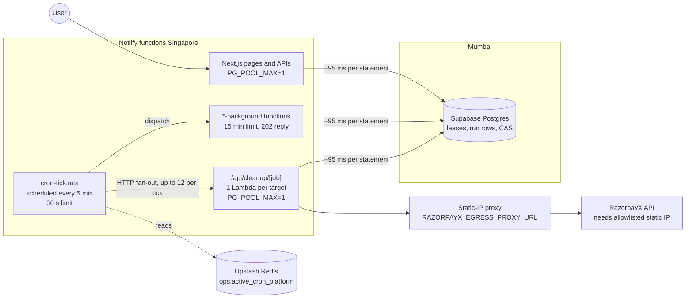
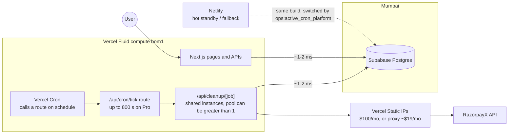
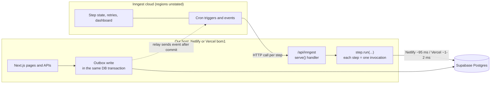
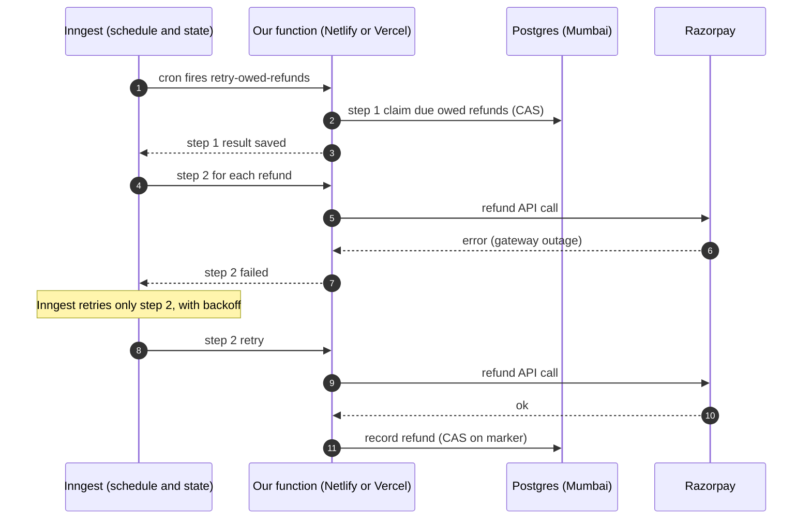
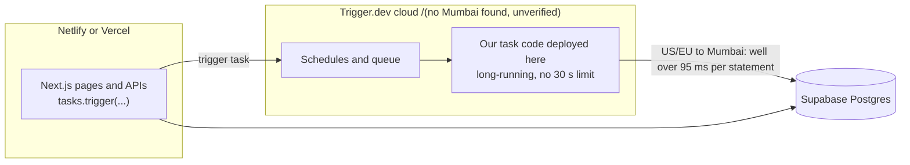
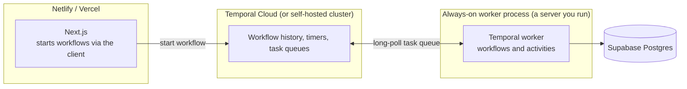
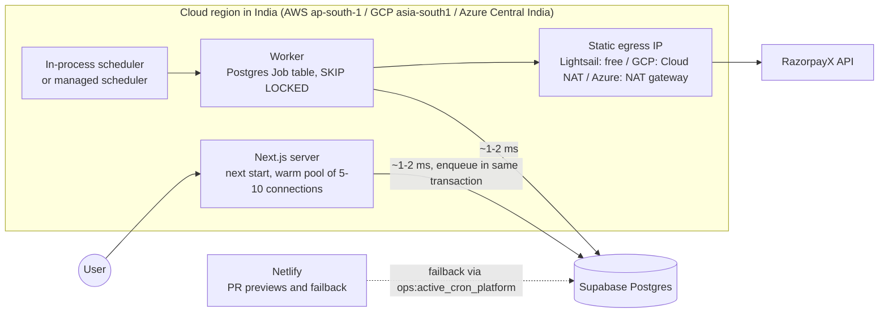

# Background jobs: system-design pictures for each candidate runtime

This page was moved from a GitHub issue into the docs on 2026-10-31. It is research evidence, not a decision. The owner decisions are in [Ticker through launch, the scale path, the phase 2 queue and the database plan](../decisions/2026-10-31-ticker-scale-path-and-queue.md) and in the [architecture at scale review](../decisions/2026-10-30-architecture-at-scale-review.md); where this page disagrees with them, they win. The labels VERIFIED (read on a primary source), UNVERIFIED (no primary source was read) and ESTIMATE (arithmetic from stated assumptions) are kept from the source.

## Why this page exists

The owner asked for a side-by-side picture of how background jobs would run under each candidate runtime, so the system-design difference is visible before anything is chosen. It is a companion to #2484 (the unbiased jobs and runtime review) and #2472 (the scale-path research). The measurements will come from the spike prompt in #2484, which tests Vercel bom1 with Vercel Cron, Vercel bom1 with Inngest, Netlify with Inngest, and a Netlify baseline.

**Nothing here is adopted as a plan.** Prices and regions marked _unverified_ must be checked on the vendor pages before a decision.

**Legend:**

- A subgraph title ending in "Mumbai" means the component runs in Mumbai (ap-south-1 or bom1), next to Supabase. "Singapore" and "US or EU" name where the other components run.
- "~95 ms" is the measured cost of one SQL statement from Netlify's Singapore functions to the Mumbai database (#2466).

---

## 1. Today: Netlify (Singapore) and the cron ticker



**What we own:**

- the ticker;
- the schedule table (cap 12 per tick);
- per-job Postgres leases;
- run records;
- the retry and slot de-dupe;
- the background adapters;
- the production-only gates;
- the cron reference generator.

**Cost:** $0 extra.

**Pain points:**

- 95 ms on every query;
- one connection per function;
- the 30 s tick;
- duplicate deliveries;
- about 9k lines of machinery (#2484).

---

## 2. Vercel (Mumbai bom1) and Vercel Cron, with the same ticker idea



**What changes:** the scheduler is Vercel's instead of Netlify's, everything sits next to the database, ticks can run longer, and connections are shared.

**What stays:** our registry, leases, run records and CAS.

**Cost:** Vercel Pro is $20 per seat plus usage, and a static IP is $100/mo (or a proxy).

**Still missing:** per-message retries and a queue, which are the same gap as today.

---

## 3. Netlify or Vercel with Inngest: schedules and retries in Inngest, code still on our host





**What it deletes:** the ticker, the background functions, our retry and de-dupe code, and part of the ops console (Inngest's dashboard).

**What it keeps:**

- leases or CAS for correctness;
- an **outbox**, because Inngest events are sent outside our database transaction.

**Cost:** about $99/mo at our ~87k runs a month (each run bills steps + 1) — unverified. The free tier is 50k a month, or 100k through the Vercel Marketplace, and it **pauses** at the quota.

**Latency:** unchanged on Netlify; fixed only if the host is Vercel bom1.

---

## 4. Trigger.dev: our job code runs on Trigger.dev's machines



**What it deletes:** the ticker and the background functions. There are no time limits.

**What's worse:** job database calls travel even further. It's a second deploy target for the same code, and money jobs still need an outbox.

**Cost:** about $17/mo now and about $170 at 10× — unverified.

---

## 5. Temporal: durable workflows, but you run the workers



**What it gives:** the strongest durability for long, multi-step workflows.

**The catch:** it needs an **always-on worker server anyway**, plus Temporal Cloud billing or running a cluster. It's the heaviest option for a one-engineer team.

---

## 6. AWS / GCP / Azure in India: one region next to the DB, with the scheduler in-process



| Variant                              | Shape                                                   | Approx. cost now            | Ops load                                 |
| ------------------------------------ | ------------------------------------------------------- | --------------------------- | ---------------------------------------- |
| AWS Lightsail VM (#2484 option 1)    | One box runs web, the scheduler and the worker          | ~$24 VM, ~$69 all-in        | You patch the OS, deploy and handle TLS  |
| GCP Cloud Run + Cloud Scheduler      | A managed container, with the scheduler calling a route | ~$200 (#2484)               | Low; Cloud NAT is needed for a static IP |
| Azure Container Apps (Central India) | A managed container with built-in scheduled jobs        | Not costed yet (unverified) | Low to medium                            |

**What it deletes:** almost all of the ticker workarounds. The queue lives in Postgres, so money jobs enqueue in the same transaction.

**What it adds:** a cloud account and some server or container ownership.

---

## 7. ASCII summary

```
                 where code runs    DB latency   scheduler/retries         money enqueue      new vendor     extra cost/mo (now)
Netlify+ticker   Netlify SG         ~95 ms       ours (ticker+leases)      same tx (ours)     none           $0
Vercel+Cron      Vercel bom1        ~1-2 ms      ours (Vercel Cron)        same tx (ours)     Vercel         ~$20/seat + $100 IP*
Net/Vercel+Inngest host (SG or bom1) 95 / 1-2 ms Inngest steps+retries     outbox needed      Inngest        ~$99 (+Vercel)*
Trigger.dev      TD US/EU           >95 ms       Trigger.dev queue         outbox needed      Trigger.dev    ~$17*
Temporal         your worker        depends      Temporal (strongest)      outbox needed      Temporal+svr   cloud + server*
AWS/GCP/Azure IN India region       ~1-2 ms      in-process + PG queue     same tx (ours)     cloud acct     ~$69 (Lightsail) to ~$200*
* = unverified, or depends on traffic; static IP via proxy ~$19/mo is an alternative to Vercel's $100.
```

## 8. Reading the pictures

- **Only two things fix the ~95 ms:** running our code in Mumbai, which means Vercel bom1 or an India cloud region. Inngest, Trigger.dev and Temporal change how jobs are scheduled and retried, not where the queries run.
- **Anything outside Postgres needs an outbox for money jobs:** Inngest, Trigger.dev and Temporal all do. Only a Postgres queue enqueues in the same transaction as the money change.
- **Measurements:** the runtime spike prompt from #2484 measures Vercel bom1 with Vercel Cron, Vercel bom1 with Inngest, Netlify with Inngest, and a Netlify baseline, before the owner decides.

Related: #2484, #2472, #2466, #2460.
