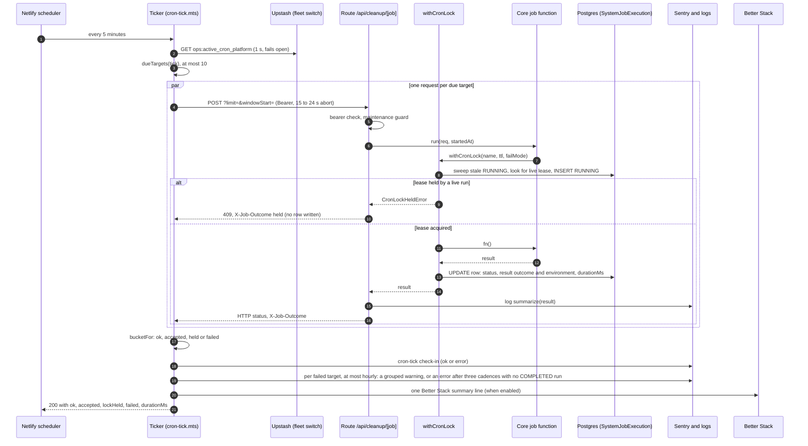

# Job machinery catalog and operations dashboard spec

This page records how every scheduled and background job really runs on `dev`, and what a person debugging a stuck refund, payout or invoice can and cannot see afterwards from stored data. It is the specification for the staff and admin operations dashboard described in [the dashboard design issue](https://github.com/Practitionist/familiarise_web/issues/2424), which is built in a later session. Everything below was checked against the code on `dev` at commit `d8e04d234` (26 October 2026). The ticker, lease and Sentry-posture statements were re-checked at `c852d4fbb` (27 October 2026), after the observability and ticker hardening change (#2420) merged. Behaviour that exists only in an open pull request is labelled **(pending)** and collected in [section 6](#6-pending-in-open-pull-requests).

The generated [configured cron jobs reference](./04-cron-jobs-reference.md) owns the inventory of entrypoints and declared leases, and [the cron and reconciliation reference](./10-cron-and-reconciliation-reference.md) owns the response-code contract, the sidecars and the reconciler rules. This page does not repeat them. It adds what neither records: which signals each run leaves behind, how each job recovers from a failure, a kill or partial work, and where the evidence is missing.

## Glossary

| Term             | Meaning                                                                                                                                                                                               |
| ---------------- | ----------------------------------------------------------------------------------------------------------------------------------------------------------------------------------------------------- |
| Tick             | One firing of the Netlify scheduled function `netlify/functions/cron-tick.mts`, every five minutes.                                                                                                   |
| Target           | One entry of `TARGETS` in `lib/cron/schedule.ts`. A tick calls every target that is due.                                                                                                              |
| Slice            | The bounded amount of work one request does, set by `?limit=` or by an in-core budget. A backlog is drained over many ticks.                                                                          |
| Window           | A UTC calendar span in `TARGET_WINDOWS` inside which a target fires on its slots, for example "03:00 UTC for 17 hours".                                                                               |
| Lease            | The right to run one job, held as a `RUNNING` row in `SystemJobExecution`. At most one live row per job name exists (`SystemJobExecution_running_jobName_key` in `prisma/sql/check-constraints.sql`). |
| CAS              | Compare-and-set: an `updateMany` whose `WHERE` names the expected prior state, so a concurrent writer makes it match zero rows.                                                                       |
| Owed marker      | A set of columns written in the same commit that creates an obligation, so the table itself is the work queue (for example `Payment.refundOwedKey`). Sweeps drive the marker until it clears.         |
| Dead letter      | A terminal state a row is moved to after its attempt budget is spent, so the sweep stops retrying and a human takes over.                                                                             |
| Standing finding | A condition reported to Sentry once per new set of ids per window, with the ids remembered in `SystemEvent` (`reportStandingFinding` in `lib/observability/standing-finding.ts`).                     |
| Config skip      | A run that does nothing because a required setting is absent, and answers 200 (`reportConfigSkip` in `lib/cron/config-skip.ts`).                                                                      |
| Seeded cast      | The people used in examples, from `prisma/seedFiles/1a-create-users.ts` and the start-here guides: Hannah Anderson (independent consultant), Priya Anderson (learner), Olivia Brown (platform admin). |

## 1. Lifecycle of one tick

### 1.1 The path from a tick to a job run

The numbered steps below match the diagram.

1. **The scheduler fires the ticker.** Netlify runs the function on `*/5 * * * *` (`config.schedule` in `netlify/functions/cron-tick.mts`). The ticker always answers 200, because Netlify re-invokes a scheduled function that answers 5xx and each retry would re-fire every due target (`statusFor` in the same file).
2. **The fleet switch is read once.** The ticker reads the Upstash key `ops:active_cron_platform` with a one-second timeout. If it names another platform the tick does nothing; an absent key, missing credentials, a timeout or an unreadable reply all mean "run" (`otherActivePlatform`). A skipped tick leaves no record anywhere except one log line.
3. **Due targets are chosen.** `dueTargets()` in `lib/cron/schedule.ts` keeps targets whose UTC minute of day, minus their offset, is within the first five minutes of their interval, and whose calendar window is open. The calendar test pins at most ten targets per tick (`MAX_TARGETS_PER_TICK`), and `reconcile-ledgers` yields its slot when a tick is over that number.
4. **One authenticated request per target, in parallel.** `hitTarget()` POSTs `targetRequest()`'s URL with only an `Authorization: Bearer` header. No tick id or any other correlation value is sent. The per-target timeout is 15, 20 or 24 seconds (`TARGET_TIMEOUTS_MS`) and is capped by an overall 24-second deadline for the tick.
5. **The route authenticates and checks maintenance.** `cleanupRoute()` in `lib/cron/cleanup-route.ts` checks the bearer secret in constant time, then calls `assertNotInMaintenance`. Both can refuse before any lease exists, so a refusal leaves no `SystemJobExecution` row.
6. **The core takes the lease.** The job's core function calls `withCronLock()` (`lib/cron/with-cron-lock.ts`). The lease is acquired by sweeping `RUNNING` rows older than the time-to-live to `FAILED`, looking for a live `RUNNING` row, and inserting a new one. The partial unique index is the arbiter when two requests race.
7. **A live lease answers 409.** The loser throws `CronLockHeldError`, which `cleanupRoute()` maps to HTTP 409 with `X-Job-Outcome: held`. This is expected and writes nothing.
8. **The job runs and the row is finished.** On return or throw, `recordJobFinish()` updates the row by CAS on `status = RUNNING` with the status, the outcome and the Sentry environment, the end time and the duration. This is the only write `withCronLock` makes about the run's content.
9. **The route logs a summary.** `cleanupRoute()` runs the registry's `summarize` function and writes the result to the console and to `Sentry.logger.info`. The summary is not stored in Postgres (see [section 4](#4-observability-gaps)).
10. **The ticker classifies each answer.** `bucketFor()` reads the status and the `X-Job-Outcome` header and files each target as ok, accepted, held or failed. A 207 is a failure only for `process-payouts`, `reconcile-ledgers`, `sweep-orphaned-topup-captures` and every windowed target.
11. **The ticker reports.** It sends one Sentry cron check-in (`ok`, or `error` if anything failed) and, when `ENABLE_BETTERSTACK_TELEMETRY` is `true`, one Better Stack summary line with the ok, accepted, lock-held and failed lists (`emitTickSummary`). A failed target is judged only on its own first due tick of an hour (`isFirstDueTickOfHour`). The report is one grouped Sentry warning (fingerprint `cron-tick` / `target-failed-once`, the target in its `target` tag) unless the target has had no `COMPLETED` run for three of its own cadences, which `isRepeatedFailure` reads from `GET /api/health/jobs/streaks`; only then is it an error fingerprinted per target. `sentry-ingest-canary` is never reported through Sentry (`reportableToSentry`).

Background targets differ in one place. The ticker posts straight to a Netlify background function (`netlify/functions/recording-transfer-background.mts` or `netlify/functions/stream-maintenance-background.ts`), which acknowledges with 202 at once and then runs the same `cleanupRoute()` and core in the background. The ticker therefore records only "accepted". The completion, if any, is a `SystemJobExecution` row written minutes later by the worker, and nothing links it to the tick that started it.

### 1.2 What a run leaves behind

| Record                             | Written by                                                     | Holds                                                                                                                                          | Kept                                                                        | Cannot answer                                                                                              |
| ---------------------------------- | -------------------------------------------------------------- | ---------------------------------------------------------------------------------------------------------------------------------------------- | --------------------------------------------------------------------------- | ---------------------------------------------------------------------------------------------------------- |
| `SystemJobExecution` row           | `withCronLock()`                                               | Job name, status, lease time, end time, duration, error text, and a `result` of only `outcome`, `environment` and an optional `checkpoint`     | 90 days, pruned by `prune-system-job-executions` (an Actions-scheduled job) | How many items, which ids, which rows failed, whether it was a manual or ticker run, which tick started it |
| Console and Sentry logger line     | `cleanupRoute()`                                               | The `summarize()` fields for the run                                                                                                           | Netlify log and Sentry logs, not queried                                    | Anything after the log retention of those vendors                                                          |
| Netlify function log of the ticker | `cronTick()`                                                   | The tick body: ok, accepted, lock-held and failed target names, duration. The same body is sent to Better Stack as a summary line when enabled | Netlify's and Better Stack's retention                                      | Anything in Postgres. A 409 appears only here                                                              |
| Sentry cron check-in               | `sendCheckIn()`                                                | One ok or error per tick, monitor `cron-tick`, 5-minute schedule, 3-minute margin, failure threshold 3, recovery 1                             | Sentry                                                                      | Which target failed                                                                                        |
| Sentry error or warning            | The job itself, `cleanupRoute()`'s catch-all, or the ticker    | Message, fingerprint, tags, a capped `extra` sample of ids                                                                                     | Sentry, 5,000 errors a month                                                | Every id: reports are once per run and capped                                                              |
| `SystemEvent` row                  | Many jobs, through `recordSystemEvent` and `recordSystemError` | Category, severity, message, `context` JSON, an optional `correlationId`                                                                       | 400 days, pruned by `prune-system-events` (an Actions-scheduled job)        | Which run wrote it, unless the job put its own id in `correlationId`                                       |
| Entity columns                     | The job, on the row it worked on                               | Attempt counters, cursors and markers such as `Payment.refundOwedAttempts`, `Refund.lastReconciledAt`, `OrganizationInvoice.irpRetryCount`     | With the row                                                                | What each attempt returned. Only the count survives                                                        |
| `OpsActionLog` row                 | `/api/admin/system-jobs/run`                                   | Actor, reason, target job id, `ACCEPTED`, `SUCCEEDED` or `FAILED`                                                                              | With the log                                                                | Which `SystemJobExecution` row the manual run produced                                                     |
| Redis `cron:heartbeat:last`        | `withCronLock()` after a `COMPLETED` finish                    | One timestamp, read by `/api/health`                                                                                                           | Overwritten                                                                 | Which job                                                                                                  |

### 1.3 How a core's answer becomes a status, an HTTP code and a ticker bucket

Two different functions read the same result, and they can disagree. The row's status comes from `jobOutcome(result)` in `lib/cron/job-outcome.ts` and nothing else. The HTTP status and the `X-Job-Outcome` header come from the route's own `status()` override when one is registered, otherwise from `jobOutcome(result)` as well.

| What the core returns or does                                                                     | `SystemJobExecution.status` and `result.outcome`                       | HTTP and `X-Job-Outcome`                                                 | Ticker bucket                                            |
| ------------------------------------------------------------------------------------------------- | ---------------------------------------------------------------------- | ------------------------------------------------------------------------ | -------------------------------------------------------- |
| `success: true` or `overallSuccess: true`, whatever the counters say                              | `COMPLETED`, `success`                                                 | 200, or the route's override                                             | ok                                                       |
| `success: false` or `overallSuccess: false`                                                       | `FAILED`, `failure`, error text "Job returned failure"                 | 500 by default                                                           | failed                                                   |
| `held: true` or `skipped: true`                                                                   | `CANCELLED`, `held`                                                    | 503, `held`                                                              | held                                                     |
| No verdict, but `failed > 0`, `exhaustedReported > 0`, a non-empty `errors` array, or `ok: false` | `FAILED`, `partial_failure`, error text "Job returned partial_failure" | 207, `partial_failure` (default route) or the override's status          | failed (default route); 207 allowlist decides (override) |
| A string `skipped` such as `PLATFORM_GSTIN not configured`                                        | `COMPLETED`, `success`                                                 | 200                                                                      | ok                                                       |
| The core throws                                                                                   | `FAILED`, `failure`, stack truncated to 8,000 characters               | 500, one throttled Sentry error                                          | failed                                                   |
| Another run holds the lease                                                                       | No row                                                                 | 409, `held`                                                              | held                                                     |
| Fail-closed job and the lease table is unreachable                                                | No row                                                                 | 503, one throttled Sentry warning                                        | failed                                                   |
| Maintenance phase refuses the job                                                                 | No row                                                                 | 503 with `phase`, `held`                                                 | held                                                     |
| Bad bearer secret, bad `?limit=` or bad `?windowStart=`                                           | No row                                                                 | 401 or 400                                                               | failed                                                   |
| The process is killed or the platform ceiling is hit                                              | `RUNNING` until the next acquisition sweeps it to `FAILED`             | No answer or a platform 5xx: the ticker records status 0 after its abort | failed                                                   |

The enforcer for the left column is `jobOutcome()`. A job's own `success` boolean outranks every counter, so a job that returns `success: true` with `stillFailing: 3` is `COMPLETED`. Section 4 lists the jobs that rely on this.

### 1.4 Worked example: a refund that fails three times

Hannah Anderson cancels Priya Anderson's one-hour consultation on Monday 26 October 2026 at 10:00 IST (04:30 UTC). Priya paid ₹1,180 (118,000 paise: ₹1,000 plus 18 % GST) by card. The cancel door ends the booking and, in the same commit, stamps the refund obligation on the payment (`stampRefundOwed` in `lib/payments/operations/refund-owed.ts`): `refundOwedKey`, `refundOwedPaise`, `refundOwedReason`, `refundOwedAt` and `refundOwedAttempts = 0`. The `retry-auto-refunds` sweep drives it.

| Time (IST / UTC) | What happens                                                                                                                                     | What is stored afterwards                                                                                                                                                                                                                                                                          |
| ---------------- | ------------------------------------------------------------------------------------------------------------------------------------------------ | -------------------------------------------------------------------------------------------------------------------------------------------------------------------------------------------------------------------------------------------------------------------------------------------------- |
| 10:10 / 04:40    | `retry-auto-refunds` is due (every 15 minutes, offset 10). The marker is younger than the 15-minute grace, so nothing is selected.               | A `COMPLETED` row with `result.outcome = success`. Nothing says the run looked at nothing.                                                                                                                                                                                                         |
| 10:25 / 04:55    | The marker is eligible. The gateway answers 5xx. `driveRefundOwed()` counts attempt 1 by CAS on `refundOwedAttempts`.                            | `Payment.refundOwedAttempts = 1`. The row is `COMPLETED` because the core's `success` is `errors === 0`, and a failed drive in this cohort is counted in `owed.failed`, not in `errors`. HTTP 200, ticker "ok". One Sentry error, fingerprint `retry-auto-refunds` / `owed`, with a sample of ids. |
| 10:40 / 05:10    | Attempt 2 fails the same way.                                                                                                                    | `refundOwedAttempts = 2`. Another `COMPLETED` row and another Sentry event.                                                                                                                                                                                                                        |
| 10:55 / 05:25    | Attempt 3 fails. The attempt budget (`MAX_REFUND_OWED_ATTEMPTS = 3`) is spent, so the marker is retired from the sweep and an operator is paged. | `refundOwedAttempts = 3`; a `SystemEvent` of category `PAYMENT`, severity `ERROR`, "Refund owed on payment … failed 3 times — refund by hand", plus a Sentry exception. HTTP 207, which the ticker files as ok for this target.                                                                    |
| 12:25 / 06:55    | `reportAgedRefundsOwed()` surfaces markers older than two hours once per distinct id set per day.                                                | One `SystemEvent` keyed `retry-auto-refunds:owed:<hash>`.                                                                                                                                                                                                                                          |

A person asking "what happened to Priya's ₹1,180" can read the counter, the three Sentry events if the quota allowed them, and the final `SystemEvent`. They cannot read what the gateway said on attempts 1 and 2, or which tick made each attempt, and the three `COMPLETED` rows look identical to three runs that found no work.

## 2. Shared behaviours

### 2.1 The lease: time-to-live, renewal and takeover

- **Time-to-live.** The default is 15 minutes (`DEFAULT_TTL_MS`). Money and reconcile jobs that may run long use `LONG_JOB_TTL_MS`, 35 minutes. The generated reference lists the value per job. On Netlify (`NETLIFY=true`) every lease is capped at 90 seconds (`effectiveLeaseTtlMs`), because renewal keeps a live run's row fresh.
- **Renewal.** While `fn()` runs, a timer rewrites the row's `startedAt` every third of the time-to-live (at least one second), by CAS on `status = RUNNING` (`startLeaseRenewal`). If the update matches zero rows the lease was lost, and the run logs one warning and one `cron.lock_ownership_lost` metric. The job is not stopped. Because renewal rewrites `startedAt`, that column is the last renewal, not the real start. The duration is correct because it is measured from an in-memory timestamp.
- **Takeover.** A `RUNNING` row whose `startedAt` is older than the time-to-live is swept to `FAILED` with the error text "Lease expired (stale RUNNING row swept)" by whichever request next acquires the lease. The sweep sets `endedAt` to the sweep time, so the row says nothing about when the run actually died.
- **Fail modes.** `closed` jobs throw `CronLockUnavailableError` when the lease table cannot be used, so a money job never runs unlocked. `open` jobs run unlocked with a console warning, except that a database connection or pool error (`isDbConnectionOrPoolError`) is always treated as unavailable, even for an `open` job.
- **What a killed run costs.** A run killed by the platform leaves its `RUNNING` row. Until the time-to-live passes, every tick for that job answers 409 and writes nothing. On Netlify the 90-second cap means a killed run blocks at most the next one or two ticks. On another host the full time-to-live applies: one skipped slot for a 15-minute lease on a 15-minute target, and two or three for a 35-minute lease.
- **Cron mutual exclusion is Postgres only.** `AGENTS.md` forbids Redis locks for cron jobs. The Redis heartbeat is a liveness timestamp, not a lock.

### 2.2 Time budgets

Four limits apply, and none of them cancels a running job.

| Limit                     | Value                                                                                                       | Enforcer                                                           | Effect                                                                                                                  |
| ------------------------- | ----------------------------------------------------------------------------------------------------------- | ------------------------------------------------------------------ | ----------------------------------------------------------------------------------------------------------------------- |
| Ticker request abort      | 15 s default, 20 s or 24 s for listed targets, and never beyond 24 s after the tick began                   | `TARGET_TIMEOUTS_MS`, `hitTarget()`                                | The ticker records status 0 and files the target as failed. The Next function keeps running until the platform ceiling. |
| Next function ceiling     | About 26 s (the comment in `lib/cron/schedule.ts`); the platform may kill the process                       | Netlify                                                            | A killed job leaves a `RUNNING` row (section 2.1).                                                                      |
| In-core start deadline    | 16 s from the request (`SWEEP_START_DEADLINE_MS` in `lib/cron/run-deadline.ts`); 12 s for the referral jobs | `startDeadline()`, `RUN_DEADLINE_MS` in `lib/referrals/vesting.ts` | The job stops starting new rows. It does not stop a row in flight.                                                      |
| Background worker ceiling | 15 minutes                                                                                                  | Netlify background functions                                       | The five Stream lifecycle jobs and `transfer-recordings` run here.                                                      |

Jobs with an in-core start deadline are `reconcile-payment-status`, `reconcile-refunds` (its pending pass stops at 8 s and its cascade re-drive at 12 s), `detect-consultant-no-shows`, `settle-platform-incidents`, `auto-complete-appointments`, `expire-stale-requests`, `handle-stuck-payouts`, `reconcile-payout-status`, `reconcile-gateway-settlements`, `reconcile-stream-memberships`, `abandoned-org-top-ups` and the two referral jobs. Two of those, `reconcile-payment-status` and `reconcile-refunds`, are not passed the request start by their registry entries, so their deadline counts from the core's own start and does not include a cold boot. Every other job is bounded only by its `limit` and the abort.

### 2.3 Retry and recovery patterns

Jobs on this platform do not keep a retry queue. The table that holds the work is the queue (state-as-outbox), and each pattern below is a column on that table.

| Pattern                    | How it works                                                                                                                                                                                                         | Examples                                                                                                                                                                                  |
| -------------------------- | -------------------------------------------------------------------------------------------------------------------------------------------------------------------------------------------------------------------- | ----------------------------------------------------------------------------------------------------------------------------------------------------------------------------------------- |
| Rotation cursor            | Each pass stamps the row so a failing row moves behind fresh ones. `lastReconciledAt` is ordered nulls first (`LEAST_RECENTLY_RECONCILED` in `lib/payments/payouts/reconcile-cursor.ts`), or `updatedAt` is touched. | `reconcile-payment-status`, `reconcile-refunds`, `handle-stuck-payouts`, `reconcile-payout-status`, `abandoned-payments`, `vest-referral-credits`                                         |
| Owed marker with a counter | The obligation and its attempt count sit on the entity. At the cap the entity leaves the sweep and a human is paged.                                                                                                 | `Payment.refundOwedAttempts` (cap 3), `Refund.metadata.cascadeRedriveAttempts` (cap 3), `MaintenanceRemediationItem.attempts`                                                             |
| Backoff ladder             | `nextRetryAt` follows 1 min, 5 min, 30 min, 2 h, 8 h (`lib/retry/backoff.ts`), then `DEAD_LETTER` or `FAILED`.                                                                                                       | `retry-failed-emails`, `drain-notification-outbox`, `dispatch-outbound-webhooks`, `retry-moderation-enforcement` (6 attempts)                                                             |
| Claim then act             | A CAS stamp claims the row, and a partial failure leaves the stamp unset so the next run retries only what is missing.                                                                                               | `settle-cancelled-sessions` (`seatsSettledAt`), `dunning` (`markedOverdueAt`, `lastDunningReminderAt`), `wallet-low-balance` (`autoTopUpLastFiredAt`)                                     |
| Checkpoint in the trail    | The job returns `checkpoint` and the next run reads it back with `readJobCheckpoint()`.                                                                                                                              | `reconcile-stream-memberships`, `reconcile-orphaned-sessions`, `reconcile-orphaned-recordings`, `stream-sync`, `expire-event-channels`, `wind-down-deactivated-orgs`, `expire-recordings` |
| Durable report row         | The sweep keeps its own run record outside `SystemJobExecution`.                                                                                                                                                     | `reconcile-ledgers` (`LedgerReconciliationReport` with status, cursor, calls and interruptions)                                                                                           |
| Ageing and give-up         | A row older than a cap is marked terminal rather than retried forever.                                                                                                                                               | `sweep-stuck-webhook-events` (7 days), `reconcile-payment-status` (orphan age, default 7 days), `irp-uploader` (12 tries)                                                                 |

**Checkpoint limits.** `readJobCheckpoint()` looks at the latest five `COMPLETED` or `FAILED` rows of that job name and returns the first `checkpoint` it finds. If none of the latest five carries one, the walk silently restarts from the beginning. A job that returns no `checkpoint` for five consecutive runs, such as five consecutive config skips, loses its position. `CANCELLED` (held) rows are ignored.

### 2.4 Configuration skips

`irp-uploader` is the only job on `dev` that uses the typed `ConfigSkip` value (`PLATFORM_GSTIN not configured`, or a list of missing `CLEARTAX_*` settings). It returns `skipped` as a string, which `jobOutcome()` classifies as `success`, so the run is `COMPLETED` and answers 200. `reportConfigSkip()` logs every run and warns Sentry only on the first slot of the job's window (fingerprint `cron-config-skip` / job), which is about once a day for a daily window. A second configuration problem in the same job, an unreadable supplier state, returns an all-zero result with no marker at all. `gst-outward-register-export` takes the opposite approach and throws before it takes a lease when `PLATFORM_GSTIN` is missing, so it fails loudly and leaves no row.

### 2.5 Sentry and alert posture

- **Once per run.** Per-row failures are collected and reported once, through `createRunFailureReporter()` (`lib/observability/run-failures.ts`), a `firstError` plus a sample in `extra`, or `reportStandingFinding()`. Every job follows this; section 4.2 states the rule for new code.
- **Previews.** Deploy previews send errors only: `beforeSend` drops warnings and info there (`isBelowErrorOnPreview` in `sentry.shared.config.ts`) and keeps a tenth of ordinary errors.
- **Uncaught errors.** `cleanupRoute()` reports any error a core throws through `captureThrottled`, keyed `cron:<job>`, at most once an hour per instance, level error, tags `subsystem: cron` and `job`.
- **Durable escalations.** `recordSystemError()` writes a `SystemEvent` and also calls `Sentry.captureException`, with no run-level de-duplication.
- **Ops chat.** `retry-failed-emails` and `drain-notification-outbox` post to the ops chat webhook (`postOpsChat`) when they dead-letter a row. This is a third channel and is the only one that does not depend on Sentry.
- **Ticker.** Section 1.1, step 11.

### 2.6 Manual runs

The admin console's run door (`/api/admin/system-jobs/run`, surface `systemJobs.manage`) requires a reason and writes an `OpsActionLog` row (`system-job.run`, target kind `SystemJob`, target id the job id, after-status `ACCEPTED`, `SUCCEEDED` or `FAILED`). It then calls the same core in the same process, so the same lease applies and the resulting `SystemJobExecution` row is indistinguishable from a ticker run: `triggeredBy` is `cron` (or `github-actions`), never the operator. `process-payouts` and `create-payout-batch` run after the response is sent; the five Stream lifecycle jobs and `transfer-recordings` are dispatched to the background functions. The staff executions list (`/api/staff/system-jobs/executions`) has labels for `manual` and `system` triggers that nothing writes.

## 3. Per-job catalog

There are 61 ticker targets, 10 registered jobs that only the Actions fleet schedules, and 3 workflow-only steps. Sections 3.1, 3.3 and 3.4 describe the ticker targets in the order of `TARGETS`, and section 3.2 describes the Actions-scheduled jobs. A job's registry key is the slug in `/api/cleanup/[job]`. Its lease name is the key unless the table says otherwise.

### 3.1 Ticker targets: schedule, slice, lease, budget, money and SLO

Generated from `lib/cron/schedule.ts`, `lib/cron/financial-jobs.ts`, `lib/cron/operational-health.ts` and the lease column of the [generated reference](./04-cron-jobs-reference.md). "Cadence" is every N minutes, with the offset in minutes inside the interval, both in UTC minutes of the day; a window restricts it further. "Slice" is the `?limit=` the ticker sends. "HTTP abort" is the ticker's per-request timeout in seconds. "Money" says whether the job moves or re-drives money; "gated" means the maintenance gate also holds it in the DEGRADED phase (`FINANCIAL_JOB_NAMES`). "SLO" is the completion deadline in `OPERATIONAL_COMPLETION_REQUIREMENTS`; a dash means `/api/health/jobs` does not watch the job.

| Registry key                                                    | Cadence and window (UTC)                                                | Slice              | Lease (mode, TTL)       | HTTP abort (s) | Money          | SLO    |
| --------------------------------------------------------------- | ----------------------------------------------------------------------- | ------------------ | ----------------------- | -------------- | -------------- | ------ |
| `sweep-stuck-webhook-events`                                    | every 15 min, +0                                                        | 50                 | closed, 15 min          | 15             | Yes, not gated | 45 min |
| `reconcile-refunds` lock `reconcile-pending-refunds`         | every 15 min, +5                                                        | 10                 | closed, 35 min          | 20             | Yes, gated     | 45 min |
| `abandoned-payments` lock `cleanup-abandoned-payments`       | every 15 min, +5                                                        | 10                 | closed, 15 min          | 20             | Yes, gated     | -      |
| `reconcile-payment-status`                                      | every 15 min, +5                                                        | 50                 | closed, 35 min          | 15             | Yes, gated     | 45 min |
| `reconcile-orphaned-confirmations`                              | every 15 min, +5                                                        | 10                 | closed, 15 min          | 20             | Yes, not gated | -      |
| `sweep-orphaned-topup-captures`                                 | every 15 min, +0                                                        | 50                 | closed, 15 min          | 15             | Yes, not gated | -      |
| `dispatch-outbound-webhooks`                                    | every 15 min, +0                                                        | 15                 | open, 15 min            | 15             | No             | -      |
| `sync-payment-earnings`                                         | every 15 min, +0                                                        | 50                 | closed, 35 min          | 15             | Yes, gated     | -      |
| `release-earnings`                                              | every 15 min, +5                                                        | 50                 | closed, 15 min          | 15             | Yes, gated     | -      |
| `retry-failed-emails`                                           | every 15 min, +5                                                        | 20                 | closed, 15 min          | 20             | No             | 45 min |
| `drain-notification-outbox`                                     | every 10 min, +5                                                        | 20                 | closed, 15 min          | 20             | No             | 45 min |
| `expire-unpaid-trials`                                          | every 15 min, +5                                                        | 25                 | closed, 15 min          | 15             | Yes, gated     | -      |
| `reschedule-proposals` lock `expire-reschedule-proposals`    | every 15 min, +10                                                       | 25                 | open, 15 min            | 20             | No             | -      |
| `appointment-reminders` lock `send-appointment-reminders`    | every 15 min, +10                                                       | 25                 | open, 15 min            | 20             | No             | 45 min |
| `tentative-occurrences` lock `cleanup-tentative-occurrences` | every 15 min, +10                                                       | 200                | closed, 35 min          | 15             | No             | -      |
| `expire-stale-requests`                                         | every 15 min, +10                                                       | 20                 | closed, 15 min          | 20             | Yes, gated     | -      |
| `auto-complete-appointments`                                    | every 30 min, +15                                                       | 25                 | open, 15 min            | 24             | Indirect       | 1.5 h  |
| `detect-consultant-no-shows`                                    | every 30 min, +20                                                       | 10                 | closed, 15 min          | 24             | Yes, gated     | 1.5 h  |
| `settle-cancelled-sessions`                                     | every 30 min, +25                                                       | 10                 | closed, 15 min          | 20             | Yes, gated     | -      |
| `settle-platform-incidents`                                     | every 60 min, +30                                                       | 10                 | closed, 15 min          | 20             | Yes, gated     | -      |
| `maintenance-booking-remediation`                               | every 15 min, +0                                                        | 1 (sent, ignored)  | closed, 15 min          | 15             | Yes, gated     | -      |
| `retry-auto-refunds`                                            | every 15 min, +10                                                       | 10                 | closed, 15 min          | 20             | Yes, gated     | 45 min |
| `alert-orphaned-payments`                                       | every 15 min, +0                                                        | 10                 | open, 15 min            | 20             | Indirect       | -      |
| `reconcile-orphaned-payments`                                   | every 30 min, +10                                                       | 10                 | closed, 15 min          | 20             | Yes, gated     | -      |
| `sentry-ingest-canary`                                          | every 360 min, +50                                                      | 50 (sent, ignored) | none: no row is written | 15             | No             | -      |
| `handle-stuck-payouts`                                          | every 120 min, +40                                                      | 5                  | closed, 35 min          | 24             | Yes, gated     | -      |
| `reconcile-payout-status`                                       | every 120 min, +100                                                     | 8                  | closed, 35 min          | 24             | Yes, gated     | -      |
| `process-data-exports`                                          | every 10 min, +0                                                        | 50 (sent, ignored) | open, 35 min            | 20             | No             | -      |
| `retry-moderation-enforcement`                                  | every 30 min, +25                                                       | 50 (sent, ignored) | closed, 15 min          | 20             | No             | -      |
| `reconcile-stream-memberships`                                  | every 60 min, +20; window 00:00 UTC for 180 min                         | 50                 | closed, 15 min          | 24             | No             | -      |
| `vest-referral-credits`                                         | every 30 min, +5                                                        | 10                 | closed, 15 min          | 20             | Yes, gated     | -      |
| `support-sla-sweep`                                             | every 30 min, +10                                                       | 20                 | open, 15 min            | 15             | No             | 1 h    |
| `purge-deleted-documents`                                       | every 60 min, +25                                                       | 100                | open, 15 min            | 20             | No             | -      |
| `process-payouts`                                               | every 60 min, +0                                                        | 5                  | closed, 15 min          | 24             | Yes, gated     | -      |
| `reconcile-disputes`                                            | every 60 min, +0                                                        | 10                 | closed, 35 min          | 20             | Yes, gated     | -      |
| `create-payout-batch`                                           | every 15 min, +5; window 20:00 UTC for 180 min, Mon                     | 10                 | closed, 15 min          | 20             | Yes, gated     | -      |
| `settle-invoice-accruals`                                       | every 60 min, +45; window 04:00 UTC for 960 min, day 1                  | 10                 | closed, 35 min          | 20             | Yes, gated     | -      |
| `expire-referral-credits`                                       | every 60 min, +50; window 03:10 UTC for 180 min, day 1                  | 50                 | closed, 35 min          | 20             | Yes, gated     | -      |
| `gst-outward-register-export`                                   | every 60 min, +45; window 04:00 UTC for 1140 min, day 2                 | 25                 | closed, 15 min          | 24             | Yes, gated     | -      |
| `generate-subscription-invoices`                                | every 60 min, +5; window 03:00 UTC for 1020 min                         | 10                 | closed, 35 min          | 20             | Yes, gated     | -      |
| `abandoned-org-top-ups` lock `cleanup-abandoned-org-top-ups` | every 60 min, +10; window 03:00 UTC for 1020 min                        | 200                | closed, 15 min          | 15             | Yes, not gated | -      |
| `advance-program-cycles`                                        | every 60 min, +15; window 03:00 UTC for 1020 min                        | 25                 | closed, 35 min          | 20             | Yes, gated     | -      |
| `auto-renew-contracts`                                          | every 60 min, +20; window 03:00 UTC for 1020 min                        | 10                 | closed, 15 min          | 20             | Yes, gated     | -      |
| `irp-uploader`                                                  | every 60 min, +25; window 03:00 UTC for 1020 min                        | 10                 | closed, 15 min          | 20             | Yes, gated     | -      |
| `sweep-abandoned-overage-charges`                               | every 60 min, +30; window 03:00 UTC for 1020 min                        | 25                 | closed, 15 min          | 20             | Yes, gated     | -      |
| `expire-contracts`                                              | every 60 min, +35; window 03:00 UTC for 1020 min                        | 10                 | closed, 15 min          | 20             | Yes, gated     | -      |
| `msme-payment-alerts`                                           | every 60 min, +45; window 03:00 UTC for 60 min                          | none               | open, 15 min            | 20             | Indirect       | -      |
| `timeout-member-overages`                                       | every 60 min, +35; window 23:30 UTC for 180 min                         | 25                 | closed, 15 min          | 20             | Yes, gated     | -      |
| `dunning`                                                       | every 60 min, +10; window 23:30 UTC for 180 min                         | 25                 | closed, 15 min          | 20             | Yes, gated     | -      |
| `wallet-low-balance`                                            | every 60 min, +45; window 23:30 UTC for 180 min                         | 25                 | open, 15 min            | 20             | Indirect       | -      |
| `reconcile-gateway-settlements`                                 | every 60 min, +55; window 06:30 UTC for 360 min                         | none               | closed, 15 min          | 20             | Yes, gated     | -      |
| `reconcile-ledgers`                                             | every 60 min, +55                                                       | none               | closed, 35 min          | 20             | Yes, not gated | -      |
| `tds-return-draft` lock `tds-26q-draft-export`               | every 60 min, +55; window 01:00 UTC for 120 min, day 5, months 1,4,7,10 | none               | open, 15 min            | 20             | Indirect       | -      |
| `stream-control-plane-drift`                                    | every 60 min, +15; window 01:15 UTC for 60 min                          | none               | none: no row is written | 15             | No             | -      |
| `transfer-recordings`                                           | every 15 min, +0                                                        | none               | closed, 15 min          | 15 (ack only)  | No             | 45 min |
| `reconcile-sessions` lock `reconcile-orphaned-sessions`      | every 30 min, +10                                                       | 5                  | closed, 15 min          | 24             | No             | 1.5 h  |
| `expire-recordings`                                             | every 60 min, +5; window 00:00 UTC for 180 min                          | none               | closed, 15 min          | 15 (ack only)  | No             | 27 h   |
| `reconcile-orphaned-recordings`                                 | every 60 min, +25; window 00:00 UTC for 180 min                         | none               | closed, 15 min          | 15 (ack only)  | No             | 27 h   |
| `wind-down-deactivated-orgs`                                    | every 60 min, +55; window 03:00 UTC for 180 min                         | none               | closed, 15 min          | 15 (ack only)  | No             | 27 h   |
| `stream-sync`                                                   | every 60 min, +50; window 08:00 UTC for 180 min                         | none               | closed, 15 min          | 15 (ack only)  | No             | 27 h   |
| `expire-event-channels`                                         | every 60 min, +55; window 08:00 UTC for 180 min                         | none               | closed, 15 min          | 15 (ack only)  | No             | 27 h   |

### 3.2 Jobs not on the ticker

Ten registered jobs and three workflow-only steps run from the GitHub Actions fleet workflows. Per `AGENTS.md`, the Actions batch jobs are currently budget-blocked and not running, so their retention and housekeeping work may not be happening at all. All thirteen are non-money.

| Key                                 | Configured schedule                                             | Lease (mode, TTL) | Recovery                                                                                                                                                                                                                                    | Outcomes                                 | Sentry                          |
| ----------------------------------- | --------------------------------------------------------------- | ----------------- | ------------------------------------------------------------------------------------------------------------------------------------------------------------------------------------------------------------------------------------------- | ---------------------------------------- | ------------------------------- |
| `archive-webhook-events`            | Weekly, Sunday 00:25 UTC (`cron-weekly.yml`)                    | open, 15 min      | One pass that deletes processed and terminal webhook events and old outbound deliveries. Deletes are idempotent and there is no cursor.                                                                                                     | C; F on a throw                          | None in the job.                |
| `auth-tokens`                       | Daily 03:00 UTC (`cron-daily.yml`)                              | open, 15 min      | One pass: deletes expired verification tokens, sessions and idempotency records, and expires stale invitations. Idempotent, no cursor.                                                                                                      | C; F on a throw                          | None in the job.                |
| `expire-onboarding-drafts`          | Weekly, Sunday 00:25 UTC (`cron-weekly.yml`)                    | open, 15 min      | Deletes `OnboardingDraft` rows idle for 90 days. Implemented inline in the registry. Idempotent.                                                                                                                                            | C; F on a throw                          | None in the job.                |
| `expire-stale-collaborator-invites` | Daily 03:00 UTC (`cron-daily.yml`)                              | open, 15 min      | Expires stale invites, 50 per run by default. A row not reached is picked up the next day.                                                                                                                                                  | C; F on a throw                          | None in the job.                |
| `prune-audit-logs`                  | Daily 03:00 UTC (`cron-daily.yml`)                              | open, 15 min      | Deletes organisation audit rows past a two-window retention: seven years for invoice, payout, wallet, contract and consent categories, two years for operational ones. Idempotent.                                                          | C; F on a throw                          | None in the job.                |
| `prune-system-job-executions`       | Daily 03:00 UTC (`cron-daily.yml`)                              | open, 15 min      | Closes `RUNNING` rows older than 6 hours as `FAILED` ("stranded"), then deletes rows older than 90 days in batches of 5,000, then scrubs sent email bodies after 7 days and prunes the email and notification outboxes. HTTP is always 200. | C; F on a throw                          | None in the job.                |
| `purge-unverified-users`            | Daily 03:00 UTC (`cron-daily.yml`)                              | open, 15 min      | Purges unverified accounts up to a default limit; a failed purge is counted in `failed` and retried the next day.                                                                                                                           | C; P when `failed > 0`; F on a throw     | Two capture sites in the purge. |
| `reconcile-document-storage`        | Daily 03:00 UTC (`cron-daily.yml`)                              | open, 35 min      | Finds storage objects with no row and rows with no object, deletes orphans past the grace window, and reports missing files.                                                                                                                | C; 207 when files are missing            | None in the job.                |
| `reconcile-occurrence-availability` | Hourly at :17 UTC (`cron-intra-day.yml`)                        | open, 35 min      | Clears stale tentative flags, detects double bookings and tops up sessions. Double bookings are reported, never edited.                                                                                                                     | C; 207 when a double booking is detected | Nine capture sites in the job.  |
| `sweep-verification`                | Daily 03:00 UTC (`cron-daily.yml`)                              | open, 15 min      | Deletes unlinked verification records, sends reminders and closes stale requests; per-row errors are collected.                                                                                                                             | C; 207 when `errors` is non-empty        | None in the job.                |
| `prune-system-events`               | Daily 03:00 UTC (`cron-daily.yml`); no registry entry           | closed, 15 min    | Deletes `SystemEvent` rows older than 400 days. Idempotent.                                                                                                                                                                                 | C; F on a throw                          | Two capture sites in the job.   |
| `databreach-deadline-alerts`        | Hourly at :17 UTC (`cron-intra-day.yml`); no registry entry     | open, 15 min      | Alerts on the 72-hour breach-notification deadline and its 12-hour warning. Delivery is inline on `dev`.                                                                                                                                    | C; F on a throw                          | Four capture sites in the job.  |
| `consent-retention-sweeper`         | Weekly, Sunday 00:25 UTC (`cron-weekly.yml`); no registry entry | open, 15 min      | Two modes: by default it only counts expired consent artefacts, and with `DPDP_SWEEPER_DELETE=true` it deletes them.                                                                                                                        | C; F on a throw                          | None found in the job.          |

### 3.3 Recovery and outcomes of each ticker target

Outcome codes: **C** completed, **P** partial (some rows failed, others done), **F** failed, **H** held, **S** config skip. Every lease-protected job can also be held by a live lease (409) or by the maintenance gate (503), as section 1.3 shows, so **H** is listed only where a job holds itself. The "row" in this table means the `SystemJobExecution` row.

| Registry key                       | Failure, timeout, kill and partial work; cursor, owed marker, dead letter                                                                                                                                                                                                                                                                                                                                                                                                                                                                                                                           | Outcomes it can produce                                                                                                                                                                                |
| ---------------------------------- | --------------------------------------------------------------------------------------------------------------------------------------------------------------------------------------------------------------------------------------------------------------------------------------------------------------------------------------------------------------------------------------------------------------------------------------------------------------------------------------------------------------------------------------------------------------------------------------------------- | ------------------------------------------------------------------------------------------------------------------------------------------------------------------------------------------------------ |
| `sweep-stuck-webhook-events`       | Re-drives `WebhookEvent` rows left unprocessed for 6 minutes (Razorpay, Stream, Novu), oldest first, each claimed by CAS on `claimedAt`, with a 15 s limit per event. `deferCount` counts deferrals; a row older than 168 h is given up (`gaveUp`). It loops in passes of `limit` until a pass is short or makes no progress, so only the ticker abort ends a long backlog.                                                                                                                                                                                                                         | C; 207 when `stillFailing > 0` (the ticker files it ok, because the target is not in `PARTIAL_FAILURE_TARGETS`) while the row stays `COMPLETED` because the core returns `success: true`; F on a throw |
| `reconcile-refunds`                | Two cohorts, each ordered by `Refund.lastReconciledAt` (written in a `finally`, so a failing row rotates). Placeholders `pending_<uuid>` are matched to the gateway by the reservation id in the refund notes and failed only after 24 h with a successful gateway listing and no match. Real-id PENDING refunds are polled by id and never aged out locally. A backstop re-drives the cascade of SUCCEEDED refunds whose `cascadedAt` is empty, with `metadata.cascadeRedriveAttempts` capped at 3, after which the refund is dead-lettered. Then `notifyFailedRefunds` sends the failure notices. | C; F when `errors` is non-empty (`success: false`, default route); H never by itself                                                                                                                   |
| `abandoned-payments`               | Three passes in one request, each taking the lease `cleanup-abandoned-payments` in turn, so one request writes up to three rows. Pass 1 asks the gateway before expiring a PENDING payment; a live gateway payment skips the unit and is reported. Pass 2 resets expired `APPROVED_PENDING_PAYMENT` requests. Pass 3 sends payment reminders. A skipped or failed appointment is rotated by touching `Appointment.updatedAt`.                                                                                                                                                                       | C; P (207) when a pass reports errors; F when a pass returns `success: false`                                                                                                                          |
| `reconcile-payment-status`         | Two PENDING cohorts ordered by `lastReconciledAt`: payments 5 minutes to 7 days old, and orphans older than 7 days (`RECONCILE_ORPHAN_PENDING_MAX_AGE_MS`) that are retired only when the gateway does not know the id. A payment on an unsupported gateway is dead-lettered by stamping a manual-recovery prefix on `description`. Stops starting rows at the 16 s deadline.                                                                                                                                                                                                                       | C; F when `errors` is non-empty; 207 when a payment succeeded, was unresolvable or was retired                                                                                                         |
| `reconcile-orphaned-confirmations` | Finds SUCCEEDED payments whose slots are still tentative after 15 minutes and re-runs `confirmExistingAppointment` under Serializable retry. A booking that loses the first-confirmed-wins check stays tentative and is reported for refund, never forced. A second pass ensures the Stream chat channel for confirmed bookings with `chatChannelEnsuredAt` empty, within a buyer-operations budget; a pair that can never get a channel is stamped terminal.                                                                                                                                       | C; 207 (filed ok) when channel creation failed; F on a throw                                                                                                                                           |
| `sweep-orphaned-topup-captures`    | Selects `WalletTopUp` rows still PENDING whose `capturedAt` is 5 minutes to 30 days old, oldest capture first, and re-runs the idempotent `confirmTopUp`. A failure leaves the row PENDING and it is retried on every run, with no attempt counter and no cap.                                                                                                                                                                                                                                                                                                                                      | C; 207 (the ticker files it failed) when `stillFailing > 0` while the row stays `COMPLETED` (`success: true`); F on a throw                                                                            |
| `dispatch-outbound-webhooks`       | Row-state outbox `OutboundWebhookDelivery`: PENDING to IN_FLIGHT to SUCCESS or RETRY. An IN_FLIGHT row is stale after 10 minutes. Backoff is 1 min, 5 min, 30 min, 2 h, 8 h, then FAILED after the fifth failed attempt.                                                                                                                                                                                                                                                                                                                                                                            | C; F on a throw                                                                                                                                                                                        |
| `sync-payment-earnings`            | Creates missing `ConsultantEarnings` for SUCCEEDED payments, up to 500 per run, skipping refunded or disputed payments and parked captures. A payment with no consultant to accrue to is paged once per payment through a `SystemEvent` and then retired from the cohort.                                                                                                                                                                                                                                                                                                                           | C; F when `errors` is non-empty                                                                                                                                                                        |
| `release-earnings`                 | Moves PENDING earnings past `holdUntil` to READY in one Serializable transaction, claiming exactly the ids it read and skipping any with an open refund. A conflict aborts the run and the next run reaps the rows. The core catches its own error and returns `success: false` rather than throwing.                                                                                                                                                                                                                                                                                               | C; F (the error text is in the result, not thrown, so the row has no stack)                                                                                                                            |
| `retry-failed-emails`              | Outbox relay over `FailedEmail`, `nextRetryAt` ascending, nulls first, 50 rows and 5 batch rows per tick. The stored message is re-sent verbatim. The backoff ladder is 1 min, 5 min, 30 min, 2 h, 8 h; `DEAD_LETTER` after 5 attempts or on a terminal error (dead key, unverified domain) or for a single-use code that was never sent.                                                                                                                                                                                                                                                           | C; F (HTTP 500) when any row errored                                                                                                                                                                   |
| `drain-notification-outbox`        | Outbox relay over `NotificationOutbox`: rows whose `nextRetryAt` and `notBefore` have passed are re-triggered under the same `transactionId`, so Novu de-duplicates a row that was sent but not marked. The same backoff ladder; `DEAD_LETTER` after the maximum attempts or on a terminal 4xx.                                                                                                                                                                                                                                                                                                     | C; F (HTTP 500) when any row errored                                                                                                                                                                   |
| `expire-unpaid-trials`             | Three arms: lapsed unpaid trials (cancel and tombstone the held appointment), a repair arm, and paid trials nobody answered within 48 h (refund per payment). Each arm is ordered by `updatedAt` and `id` so a failing row rotates. A failure in one arm is recorded and the next arm still runs.                                                                                                                                                                                                                                                                                                   | C; F when any arm recorded an error                                                                                                                                                                    |
| `reschedule-proposals`             | Restores the released slots and the request's status through the same helper a withdrawal uses. If the original time was taken while the proposal was open, the restore meets the overlap constraint, the proposal expires without it, and the miss is counted in `proposalsExpiredUnrestored`. Ordered by `id`.                                                                                                                                                                                                                                                                                    | C; F when `errors` is non-empty                                                                                                                                                                        |
| `appointment-reminders`            | Sends 24 h and 1 h reminders for sessions in two windows. On `dev` the sweep takes a Redis claim per slot and window, and a Redis error silently skips the slot (**pending** removal). The email row is staged before sending and the bell outbox row is keyed by workflow and slot, which is what de-duplicates a repeat.                                                                                                                                                                                                                                                                          | C; F when `errors` is non-empty                                                                                                                                                                        |
| `tentative-occurrences`            | Releases `isTentative` slots with no successful payment after 24 hours: a cheap soft cancel behind an expensive read. Ordered by `updatedAt`.                                                                                                                                                                                                                                                                                                                                                                                                                                                       | C; F when `errors` is non-empty                                                                                                                                                                        |
| `expire-stale-requests`            | Arms for stale consultation and subscription requests, unpaid payment-pending requests and RESCHEDULED slot releases. Refund obligations are stamped on the payment and driven through the owed-marker door; a refund still pending counts as `deferred`. `hasMore` is true when a cap or the deadline stopped the run.                                                                                                                                                                                                                                                                             | C; F when `errors` is non-empty                                                                                                                                                                        |
| `auto-complete-appointments`       | Completes sessions after their end in bites until the 16 s deadline. A paid session with an inconclusive or host-absent verdict is left `UNVERIFIED` for a human (`AWAITING_HUMAN` in `lib/booking/misses.ts`); a needs-human item older than 72 h is warned about. The lease is fail-open.                                                                                                                                                                                                                                                                                                         | C; F when `errors` is non-empty                                                                                                                                                                        |
| `detect-consultant-no-shows`       | Consultations only, after a 120 minute grace. Candidates are read oldest `updatedAt` first in bites until the deadline; each is claimed by CAS (APPROVED or SCHEDULED to CANCELLED) and corroborated against Stream presence (`contradicted` counts attendance rows Stream disproves). The refund is stamped as an owed marker and driven at once; a failed drive writes a `PAYMENT` `SystemEvent`. On `dev` a both-absent consultation raises a support ticket instead (**pending** removal).                                                                                                      | C; F when `errors` is non-empty                                                                                                                                                                        |
| `settle-cancelled-sessions`        | A host-cancelled class session is made up, or after 14 days every seat gets one unit refunded under the key `occ:<occurrence>:pay:<payment>`. `seatsSettledAt` is the claim; a gateway failure leaves it unset so the next run retries only the seats whose key is missing. A paid seat still held for a missed session writes a `held-paid-seat:<occurrence>:<payment>` `SystemEvent` once.                                                                                                                                                                                                        | C; F when any seat failed                                                                                                                                                                              |
| `settle-platform-incidents`        | Every step is a CAS or a unique-key upsert, so a killed run converges: void the overlapping sessions (`enumeratedAt` once complete), apply each remedy when `dueAt` passes (poison rows rotate by `updatedAt`; a remedy is dead-lettered after `MAX_REMEDY_ATTEMPTS`), send one digest per learner, then stamp the incident settled.                                                                                                                                                                                                                                                                | C; F when `errors > 0`                                                                                                                                                                                 |
| `maintenance-booking-remediation`  | One booking per run, the item with the fewest `attempts` first. `attempts` is incremented before the work; on failure `lastError` (1,000 characters) is stored and the item stays open for the next run. The remediation completes when its last item does. This is the best-instrumented job on the platform.                                                                                                                                                                                                                                                                                      | C; F when the cancellation errored (the failure is stored on the item)                                                                                                                                 |
| `retry-auto-refunds`               | Two cohorts. The first is SUCCEEDED payments carrying the `Auto-refund pending:` description marker, oldest `updatedAt` first, after a 15 minute grace; after 3 failed gateway refunds the marker becomes `Auto-refund stuck:` and an operator is paged once. The second is the owed-marker cohort (section 1.4). Payments with a PENDING refund belong to `reconcile-refunds`, and payments under a live dispute wait.                                                                                                                                                                             | C; 207 (filed ok) when a marker went stuck; F only when the first cohort threw for a row                                                                                                               |
| `alert-orphaned-payments`          | An alert, not a repair: SUCCEEDED payments with no appointment from the last 7 days, oldest first, each recorded once as a `SystemEvent` with `correlationId` `orphaned-payment:<paymentId>` and a Sentry message. Overage side-charges and replay sales are excluded. The lease is fail-open.                                                                                                                                                                                                                                                                                                      | C; HTTP 500 whenever any orphan exists (so the ticker alerts) while the row is `COMPLETED`                                                                                                             |
| `reconcile-orphaned-payments`      | Heals a SUCCEEDED payment with no appointment after 60 minutes by linking it, refunding it through the front door under a dedupe key, or, past 7 days, escrowing it: one `SystemEvent` `orphan-escrow:<paymentId>` and a Sentry message, then the money waits for an operator. Wallet top-ups and non-gateway rails are skipped.                                                                                                                                                                                                                                                                    | C; 207 (filed ok) when a payment was escrowed; F (`success: false`) when a payment is still failing                                                                                                    |
| `sentry-ingest-canary`             | No lease and no row. Sends a raw envelope to Sentry and judges the answer. When unhealthy it emails an alert, de-duplicated by `canaryAlertNeeded`, and checks the Sentry quota.                                                                                                                                                                                                                                                                                                                                                                                                                    | C when healthy; HTTP 503 when unhealthy (filed failed, but not reported to Sentry by the ticker)                                                                                                       |
| `handle-stuck-payouts`             | Consultant payouts in PROCESSING for over 24 h are polled at RazorpayX, rotated by `lastReconciledAt`. A payout reset to APPROVED for retry increments `retryCount`; at 3 it is marked FAILED permanently. A gateway that does not know the id retires the payout FAILED. Permanent failure or a crash writes a `PAYOUT` `SystemEvent`.                                                                                                                                                                                                                                                             | C; F when `errors` is non-empty                                                                                                                                                                        |
| `reconcile-payout-status`          | Three cohorts of PENDING or PROCESSING payouts older than 48 h and younger than 30 days, each rotated by `lastReconciledAt`. A mismatch between the database and the gateway is a discrepancy: it is listed and the run answers 207; it is not edited.                                                                                                                                                                                                                                                                                                                                              | C; 207 (filed ok) with discrepancies; F when `errors` is non-empty                                                                                                                                     |
| `process-data-exports`             | Picks PENDING `OrgDataExportJob` rows, marks each PROCESSING, builds the bundle and marks it READY; a failure marks it FAILED with the error, writes an audit row and a `SystemEvent`. A run killed mid-export leaves the row PROCESSING indefinitely on `dev` (**pending** fix).                                                                                                                                                                                                                                                                                                                   | C; F is recorded per export, not on the run (`success: true`)                                                                                                                                          |
| `retry-moderation-enforcement`     | The `ModerationAction.sideEffects` JSON is the outbox. A failed Stream step is re-driven oldest first; `attempts` is incremented by CAS, the ladder applies, and at 6 attempts the row is marked terminal (`gaveUp`).                                                                                                                                                                                                                                                                                                                                                                               | C; 207 (filed ok) when a row is still failing or gave up; the row is `FAILED` when errors exist or a row gave up (`success: false`)                                                                    |
| `reconcile-stream-memberships`     | Walks Stream channels by `created_at`, resuming from `result.checkpoint` of the previous run. A verdict that would empty most of a channel is skipped as suspicious. A transient checkpoint-read failure currently throws (**pending** change to a warning).                                                                                                                                                                                                                                                                                                                                        | C; 207 (filed failed: windowed target) when `failures > 0`                                                                                                                                             |
| `vest-referral-credits`            | QUALIFYING referrals, one Serializable transaction each, until the 12 s deadline. Waiting and failing rows are rotated by touching `updatedAt` so they do not starve ready ones.                                                                                                                                                                                                                                                                                                                                                                                                                    | C; P when `failed > 0`: the outcome is `partial_failure`, HTTP 207, the row `FAILED`, and the ticker files it failed                                                                                   |
| `support-sla-sweep`                | Candidates ordered by SLA due time, then the auto-close, incident-cascade, evidence-purge and chat-access arms. Errors are collected across arms and reported once. The lease is fail-open.                                                                                                                                                                                                                                                                                                                                                                                                         | C; F when `errors` is non-empty                                                                                                                                                                        |
| `purge-deleted-documents`          | Arm 1 tombstones documents 90 days after the last session; arm 2 purges tombstones after the grace window, versions before roots and objects before rows. `remaining` counts what the cap left. When a run with no explicit limit leaves rows, it warns Sentry once.                                                                                                                                                                                                                                                                                                                                | C; F when any storage delete, row delete or tombstone failed                                                                                                                                           |
| `process-payouts`                  | Consultant disbursements then organisation payouts, five per rail per run. Each payout is claimed by CAS before the RazorpayX call. With live payouts disabled, APPROVED rows are parked by design and the run reports a notice. `success` is false only when APPROVED rows wait behind a held processing lock or a balance hold.                                                                                                                                                                                                                                                                   | C (including parked); 207 (the ticker files it failed) when a row failed or an org payout errored; F when rows wait behind the lock or balance hold                                                    |
| `reconcile-disputes`               | Open disputes ordered by `updatedAt` then `dueBy`, with a third of a bounded run reserved for the stale cohort. A dispute due within 48 h counts as urgent. Settlement runs in a Serializable transaction; a paid consultant earning that needs clawback writes a `PAYOUT` `SystemEvent`.                                                                                                                                                                                                                                                                                                           | C; F when `errors` is non-empty                                                                                                                                                                        |
| `create-payout-batch`              | On Mondays 20:00 to 23:00 UTC. Mints consultant payouts and organisation payouts in slices of ten per rail; the organisation period ends at `windowStart`, so every slice of one window reuses the same idempotency key. `remaining` counts the work the slice did not reach.                                                                                                                                                                                                                                                                                                                       | C always (`success: true`); 207 (filed failed: windowed target) when `failed > 0`                                                                                                                      |
| `settle-invoice-accruals`          | On day 1 of the month from 04:00 UTC. Rolls up organisation accruals into an invoice per organisation in a Serializable transaction. Only organisations with an accrual from before the window start are selected, so a later slice cannot re-invoice. Failures are gathered into one `INVOICE` `SystemEvent` with the organisation ids; GST-state and purchase-order gaps are one row each per run. An explicit `ENABLE_CONSOLIDATED_INVOICE=false` skips the run and records an error.                                                                                                            | C; 207 (filed failed) when `failed > 0`, and the row is `FAILED` (`partial_failure`)                                                                                                                   |
| `expire-referral-credits`          | Expires referral credits and books breakage, one Serializable transaction each, until the 12 s deadline. Day 1 of the month.                                                                                                                                                                                                                                                                                                                                                                                                                                                                        | C; P when `failed > 0` (`partial_failure`, HTTP 207, row `FAILED`, ticker failed)                                                                                                                      |
| `gst-outward-register-export`      | Day 2 of the month. First the invoice healer mints missing consumer invoices from the gapless series (25 per run), then the CSV is uploaded, then `gstr1ExportedAt` is stamped by CAS on null so a repeat does not move a first-reported time. A missing `PLATFORM_GSTIN` throws before the lease is taken.                                                                                                                                                                                                                                                                                         | C (HTTP always 200); F on a throw, with no row when the throw is the missing identity                                                                                                                  |
| `generate-subscription-invoices`   | Claims each due subscription; a duplicate invoice number rolls back with the number reservation and is retried next run, and is reported as an error. Other failures are logged and reported once per run. A subscription that fails leaves no marker, so it is retried silently with no attempt count. Held-for-purchase-order drafts get one `SystemEvent` per run.                                                                                                                                                                                                                               | C; 207 (filed failed) and a `FAILED` row when `failed > 0`                                                                                                                                             |
| `abandoned-org-top-ups`            | Settles PENDING `WalletTopUp` rows older than the grace window against the gateway: a captured order is confirmed, an order holding no payment is hard-deleted, anything else is kept. A row with no minted order id or an unreadable gateway state is never deleted. Starts no new row after the 16 s deadline.                                                                                                                                                                                                                                                                                    | C; F when `errors` is non-empty (one bad row fails the run)                                                                                                                                            |
| `advance-program-cycles`           | Rolls program assignments to their next cycle. A unique constraint on the successor is the double-mint backstop: Prisma error P2002 is a clean skip. A failed assignment is counted and reported once per run, and is retried on the next slice.                                                                                                                                                                                                                                                                                                                                                    | C; 207 (filed failed) and a `FAILED` row when `failed > 0`                                                                                                                                             |
| `auto-renew-contracts`             | Renews expiring auto-renew contracts. `supersededByContractId` is unique, so a concurrent renewal is a clean skip. A failed contract is counted and retried on the next slice.                                                                                                                                                                                                                                                                                                                                                                                                                      | C; 207 (filed failed) and a `FAILED` row when `failed > 0`                                                                                                                                             |
| `irp-uploader`                     | Submits pending organisation invoices to the e-invoice portal. A retryable failure leaves `irpStatus` PENDING and increments `irpRetryCount`; at 12 tries, or past the 30 day cut-off, the invoice becomes FAILED. A missing seller or provider setting skips the whole run and leaves every row PENDING.                                                                                                                                                                                                                                                                                           | C; S (completed row) for missing configuration; 207 (filed failed) when an invoice reached FAILED                                                                                                      |
| `sweep-abandoned-overage-charges`  | Fails never-started CHARGE_MEMBER side-charges after 7 days in a per-event transaction (PENDING to FAILED by CAS plus the base restore). A parent already invoiced writes a `SystemEvent` for a manual billing adjustment. A row whose transaction threw stays PENDING for the next run.                                                                                                                                                                                                                                                                                                            | C always (`success: true`, even when rows errored)                                                                                                                                                     |
| `expire-contracts`                 | Moves ACTIVE contracts past `effectiveTo` to EXPIRED, closes their live program assignments, and runs after `auto-renew-contracts` in the same window.                                                                                                                                                                                                                                                                                                                                                                                                                                              | C; F on a throw. The result has no failure counter                                                                                                                                                     |
| `msme-payment-alerts`              | Alerts finance about payouts within the statutory window of their Section 43B(h) deadline. A failure is captured and the run continues.                                                                                                                                                                                                                                                                                                                                                                                                                                                             | C; F on a throw                                                                                                                                                                                        |
| `timeout-member-overages`          | Times out CHARGE_MEMBER overages after 14 days, notifies the member, and books an organisation receivable when the wallet is short. A row whose claim threw stays PENDING. One aggregated `SystemEvent` lists the receivable ids and errors.                                                                                                                                                                                                                                                                                                                                                        | C always: rows whose claim threw are counted in `errored`, which `jobOutcome()` does not read                                                                                                          |
| `dunning`                          | Two stages over organisation invoices, each stamp being the idempotency gate of its claim: first notice (ISSUED to OVERDUE, `markedOverdueAt`) and escalation every 7 days up to 3 reminders. A suspension stage exists behind a flag that is off. A failed claim is counted and retried on the next slice.                                                                                                                                                                                                                                                                                         | C; 207 (filed failed) and a `FAILED` row when `failed > 0`                                                                                                                                             |
| `wallet-low-balance`               | Notify-only. `autoTopUpLastFiredAt` is the 24 hour cooldown, claimed by conditional `updateMany` so two replicas cannot double-notify. The lease is fail-open.                                                                                                                                                                                                                                                                                                                                                                                                                                      | C                                                                                                                                                                                                      |
| `reconcile-gateway-settlements`    | Reads one page of the settlement report per slice for yesterday's or the day before's IST date, stores the lines, matches each to our money row, books a missing capture fee under `gatewayfee:<pay_id>`, and when a day is fully read posts one `settlement:<setl_id>` journal. Stops at the deadline with a stored prefix so the next slice resumes at the right `skip`.                                                                                                                                                                                                                          | C; 207 (filed failed) when lines disagree with the books                                                                                                                                               |
| `reconcile-ledgers`                | Resumable audit with its own durable record, `LedgerReconciliationReport` (status, step, cursor, calls and interruptions in `summary`). Wallet drift freezes the affected account's spend as each page is read. A same-day completed verdict is reused. A run interrupted without a checkpoint is closed and restarted.                                                                                                                                                                                                                                                                             | C; 207 (filed failed) when the audit finished and is not ok; the row is `COMPLETED` (`success: true`)                                                                                                  |
| `tds-return-draft`                 | Quarterly (day 5 of January, April, July and October). Aggregates TDS records into a deductee-wise draft and uploads the full-PAN CSV to private storage. Read-only apart from the upload; the `reportedInForm26Q` stamp is a deliberate follow-up.                                                                                                                                                                                                                                                                                                                                                 | C (HTTP always 200); F on a throw                                                                                                                                                                      |
| `stream-control-plane-drift`       | No lease and no row. Compares the Stream control plane with the expected settings and reports drift once.                                                                                                                                                                                                                                                                                                                                                                                                                                                                                           | C; 207 (filed failed: windowed target) when drift is found                                                                                                                                             |
| `transfer-recordings`              | Copies at most one retry-eligible recording per run, soonest-expiring first, from Stream to R2 with an attempt-isolated object key. A claim left by a crashed run is reclaimed. `MAX_TRANSFER_ATTEMPTS` is 12 with a backoff table; a recording is reported when its source expires within 72 h or 3 attempts are consumed.                                                                                                                                                                                                                                                                         | C; F when a copy failed or a recording is at risk (`exhaustedReported`)                                                                                                                                |
| `reconcile-sessions`               | Reconciles a rotating slice of rooms whose booked end passed over an hour ago, returning `checkpoint` and `hasMore`; failures are reported once per run.                                                                                                                                                                                                                                                                                                                                                                                                                                            | C; F when `errors > 0`                                                                                                                                                                                 |
| `expire-recordings`                | Daily-window retention: applies the platform retention rule and deletes stored assets, resuming from `result.checkpoint`. Vendor failures are reported once per run.                                                                                                                                                                                                                                                                                                                                                                                                                                | C (the result is created with `success: true`); vendor failures are reported to Sentry once per run                                                                                                    |
| `reconcile-orphaned-recordings`    | Scans meetings aged 2 hours to 14 days that claim a recording but have no `Recording` row, and builds the row from what Stream holds; resumes from `result.checkpoint`; `hasMore` when a cap stopped it.                                                                                                                                                                                                                                                                                                                                                                                            | C; F (`success: false`) when the scan failed                                                                                                                                                           |
| `wind-down-deactivated-orgs`       | Tears down Stream resources for deactivated organisations, resuming from `result.checkpoint`. The first error of a run is reported once.                                                                                                                                                                                                                                                                                                                                                                                                                                                            | C always (`success: true`)                                                                                                                                                                             |
| `stream-sync`                      | Fetches at most five Stream user pages per run and soft-deletes principals the database no longer has. The cursor is `lastStreamUserId` in `result.checkpoint`; a dry run keeps the prior checkpoint.                                                                                                                                                                                                                                                                                                                                                                                               | C; F when a deletion failed (`success: false`)                                                                                                                                                         |
| `expire-event-channels`            | Freezes ended event channels and dormant DMs and requests retention deletion, resuming from `result.checkpoint`. The first error of a run is reported once.                                                                                                                                                                                                                                                                                                                                                                                                                                         | C; F (`success: false`) when a step failed                                                                                                                                                             |

### 3.4 What each ticker target logs and reports

The "Logged summary" column lists the fields the registry's `summarize` function prints to the console and the Sentry logger. **None of these fields is stored in `SystemJobExecution.result`**, whose only keys are `outcome`, `environment` and an optional `checkpoint` (section 1.2). Where a registry entry has no `summarize`, the whole result is logged. A job that returns `checkpoint` has that one field stored.

| Registry key                       | Logged summary (not stored)                                                                                                                                                                                                                                                                                                | Sentry and other alerts                                                                                                                                                                                                                                                                                                                                              |
| ---------------------------------- | -------------------------------------------------------------------------------------------------------------------------------------------------------------------------------------------------------------------------------------------------------------------------------------------------------------------------- | -------------------------------------------------------------------------------------------------------------------------------------------------------------------------------------------------------------------------------------------------------------------------------------------------------------------------------------------------------------------- |
| `sweep-stuck-webhook-events`       | `scanned`, `recovered`, `stillFailing`                                                                                                                                                                                                                                                                                     | Two standing findings, each once per new id set per 24 h: a warning "N webhook event(s) still unprocessed" (tags `subsystem: payments`, `job`), and an error "N re-driven webhook event(s) still failing" (`subsystem: jobs`, level error). Ids go in `extra`, 20 at most.                                                                                           |
| `reconcile-refunds`                | `totalProcessed`, `reconciledCount`, `failedCount`, `skippedCount`, `failedUnknownId`, `redrivenCount`, `redriveFailedCount`, `redriveDeadLettered`, `errors`                                                                                                                                                              | Expected warnings once per run for refunds retired as GATEWAY_DISABLED, failed as an unknown order, or failed as an unknown refund id (ids in `extra`); a standing finding for ambiguous placeholders; an error once per run for cascade dead letters (`refund-reconcile.cascade-dead-letter`, refund ids in `extra`).                                               |
| `abandoned-payments`               | `paymentSuccess`, `consultationSuccess`, `reminderSuccess`, `errorCount`                                                                                                                                                                                                                                                   | A standing-finding warning (expected) when an order is skipped over a live gateway payment, once per new id set.                                                                                                                                                                                                                                                     |
| `reconcile-payment-status`         | `totalProcessed`, `reconciledCount`, `succeededCount`, `failedCount`, `unresolvableCount`, `retiredCount`, `deadLettered`, `errors`                                                                                                                                                                                        | A warning (expected) when orphans were retired, with ids; a standing-finding warning for unresolvable ids, fingerprint `reconcile-payment-status` / `unresolvable`; `recordSystemErrorSafe` for unsupported-gateway dead letters, which also raises a Sentry exception.                                                                                              |
| `reconcile-orphaned-confirmations` | `scanned`, `confirmed`, `stillBlocked`, `channelsEnsured`, `channelsFailed`, `channelsSkipped`, `channelBuyerOps`, `channelsDeferred`                                                                                                                                                                                      | A warning once per run when appointments are marked terminal (fingerprint `reconcile-orphaned-confirmations` / `dm_not_permitted`).                                                                                                                                                                                                                                  |
| `sweep-orphaned-topup-captures`    | `scanned`, `recredited`, `stillFailing`                                                                                                                                                                                                                                                                                    | None inside the job. A stuck top-up is visible only through the ticker's hourly error for the target.                                                                                                                                                                                                                                                                |
| `dispatch-outbound-webhooks`       | `scanned`, `succeeded`, `retried`, `failed`                                                                                                                                                                                                                                                                                | A warning-level exception once per tick when deliveries dead-lettered, listing the delivery ids (`component: outbound-webhooks`); a `WEBHOOK` `SystemEvent` when the queue backlog passes its threshold and when an endpoint is auto-disabled after consecutive failures; Sentry logger lines for tick start and finish.                                             |
| `sync-payment-earnings`            | `totalProcessed`, `createdCount`, `skippedCount`, `errorCount`                                                                                                                                                                                                                                                             | An error message "EARNINGS_UNACCRUABLE_NO_CONSULTANT" once per run with up to 20 payment ids, plus one `PAYMENT` `SystemEvent` per payment (`correlationId` is the payment key) as the de-duplication row. "EARNINGS_SKIPPED_REFUNDED" is an expected message once per run.                                                                                          |
| `release-earnings`                 | `releasedCount`, `organizationEarningsReleased`, `errorCount`                                                                                                                                                                                                                                                              | None. The core swallows its error into `result.errors`; only the ticker's hourly error and the 500 body (first 500 characters) reach Sentry.                                                                                                                                                                                                                         |
| `retry-failed-emails`              | `scanned`, `sent`, `retried`, `deadLettered`, `batchesScanned`, `batchesSent`, `batchesRetried`, `batchesDeadLettered`, `errors`                                                                                                                                                                                           | One error message per dead-lettered email type per run (tags `subsystem: email`, `outbox_dead_letter`), Sentry metrics, and an ops-chat post when anything dead-lettered.                                                                                                                                                                                            |
| `drain-notification-outbox`        | `scanned`, `sent`, `retried`, `deadLettered`, `errors`                                                                                                                                                                                                                                                                     | One exception per tick covering all failures, level error when something dead-lettered, else warning (tags `subsystem: novu`, `op: drain-outbox`); Sentry metrics; an ops-chat post for dead letters.                                                                                                                                                                |
| `expire-unpaid-trials`             | `trialsExpired`                                                                                                                                                                                                                                                                                                            | `createRunFailureReporter("trials")`: one event per failing op per run (fingerprint `trials` / op) with a sample of ten.                                                                                                                                                                                                                                             |
| `reschedule-proposals`             | `proposalsExpired`, `proposalsExpiredUnrestored`                                                                                                                                                                                                                                                                           | An exception for the run's errors and a `reportSentryError` for the first miss that could not restore a slot; each such miss also writes a `SystemEvent` (`recordSystemEventSafe`).                                                                                                                                                                                  |
| `appointment-reminders`            | `reminders24h`, `reminders1h`                                                                                                                                                                                                                                                                                              | None in the sweep. Errors are returned in the result.                                                                                                                                                                                                                                                                                                                |
| `tentative-occurrences`            | `slotsReleased`, `appointmentsAffected`                                                                                                                                                                                                                                                                                    | None in the sweep. Errors are returned in the result.                                                                                                                                                                                                                                                                                                                |
| `expire-stale-requests`            | `consultationsExpired`, `subscriptionsExpired`, `subscriptionNudgesSent`, `paymentPendingExpired`, `unallocatedHasMore`, `unallocatedRefundsDeferred`                                                                                                                                                                      | None in the sweep. Errors are returned in the result, and failed refunds retry through their owed markers.                                                                                                                                                                                                                                                           |
| `auto-complete-appointments`       | `webinarsCompleted`, `classesCompleted`, `consultationsCompleted`, `subscriptionsCompleted`                                                                                                                                                                                                                                | Warnings once per run: "attendance feed gap" and "attendance witness unavailable" (`subsystem: stream`); a throttled alert for needs-human items older than 72 h (`alertStaleNeedsHuman`); per-mentee failures are flushed once.                                                                                                                                     |
| `detect-consultant-no-shows`       | `detected`, `refunded`, `contradicted`, `bothAbsentTickets`                                                                                                                                                                                                                                                                | Standing-finding warnings (`subsystem: jobs`, `job: detect-consultant-no-shows`) for refusals; a warning when a no-show claim loses its CAS; a `SystemEvent` per failed refund, while Sentry gets one event per run through `createRunFailureReporter`.                                                                                                              |
| `settle-cancelled-sessions`        | `scanned`, `stamped`, `refunded`, `errors`                                                                                                                                                                                                                                                                                 | One error per run (fingerprint `settle-cancelled-sessions`, `failed` count and a sample of ten ids) and a run-failure flush; one `SystemEvent` per held paid seat.                                                                                                                                                                                                   |
| `settle-platform-incidents`        | `incidents`, `voided`, `remediesCreated`, `remediesDone`, `deadLettered`, `digests`, `settled`, `errors`                                                                                                                                                                                                                   | `createRunFailureReporter`: one event per failing op per run (void, remedy, notice).                                                                                                                                                                                                                                                                                 |
| `maintenance-booking-remediation`  | `processed`                                                                                                                                                                                                                                                                                                                | None. The failure is stored on the item (`lastError`).                                                                                                                                                                                                                                                                                                               |
| `retry-auto-refunds`               | `scanned`, `refunded`, `settled`, `failed`, `stuck`, `errors`, `owed`                                                                                                                                                                                                                                                      | At most two errors per run: fingerprint `retry-auto-refunds` (first cohort) and `retry-auto-refunds` / `owed` (owed cohort), each with a failed count and ten ids. At the attempt cap, `recordSystemErrorSafe` (a `SystemEvent` and a Sentry exception). A `SystemEvent` for aged markers, once per id set per day.                                                  |
| `alert-orphaned-payments`          | `totalOrphaned`, `criticalCount`, `totalAmount`, `sideChargeCount`                                                                                                                                                                                                                                                         | A Sentry message plus one `SystemEvent` per orphaned payment (`orphaned-payment:<paymentId>`), once per payment.                                                                                                                                                                                                                                                     |
| `reconcile-orphaned-payments`      | `scanned`, `linked`, `refunded`, `escrowed`, `nonGatewaySkipped`, `topupSkipped`, `stillFailing`                                                                                                                                                                                                                           | A message when anything healed (fingerprint `orphaned-payments-healed`), a standing finding for payments still failing (`orphaned-payments-still-failing`), and for escrow past 7 days a message (fingerprint `orphan-escrow`) with one `SystemEvent` per payment.                                                                                                   |
| `sentry-ingest-canary`             | the whole result                                                                                                                                                                                                                                                                                                           | An email alert, not Sentry, when ingest is unhealthy, because a Sentry report would not arrive. The probe event has fingerprint `sentry-ingest-canary`.                                                                                                                                                                                                              |
| `handle-stuck-payouts`             | `totalProcessed`, `reconciledCount`, `retriedCount`, `failedCount`                                                                                                                                                                                                                                                         | A `PAYOUT` `SystemEvent` (severity ERROR, no payout id key) when any payout failed permanently or the run was not successful, and `recordSystemError` (with a Sentry exception) on a crash. Payouts whose gateway reference is ambiguous are aggregated by `createRunFailureReporter` into one error per run, and retired payouts give one expected warning per run. |
| `reconcile-payout-status`          | `totalProcessed`, `reconciledCount`, `completedCount`, `failedCount`, `discrepanciesCount`                                                                                                                                                                                                                                 | An expected warning once per run for payouts retired because the gateway does not know them. Discrepancies appear only in the result and the console.                                                                                                                                                                                                                |
| `process-data-exports`             | `picked`, `succeeded`, `failed`                                                                                                                                                                                                                                                                                            | `recordSystemError` per failed export (a `SystemEvent` and a Sentry exception, per row) and an audit row for the owner.                                                                                                                                                                                                                                              |
| `retry-moderation-enforcement`     | `scanned`, `recovered`, `collaboratorRecovered`, `erasureRevocationsRecovered`, `accessRevocationsRecovered`, `stillFailing`, `gaveUp`                                                                                                                                                                                     | None in the sweep file. Rows that gave up are counted in `gaveUp` and marked terminal.                                                                                                                                                                                                                                                                               |
| `reconcile-stream-memberships`     | `channelsScanned`, `channelsSkipped`, `channelsSkippedSuspicious`, `membersRemoved`, `failures`, `checkpoint`                                                                                                                                                                                                              | `reportSentryError` for Stream failures; up to ten sample lines in the result's `errors`.                                                                                                                                                                                                                                                                            |
| `vest-referral-credits`            | `scanned`, `vested`, `voided`, `deferred`, `budgetExhausted`, `failed`                                                                                                                                                                                                                                                     | One warning per run, `REFERRAL_VEST_FAILURES`, with the failed count and 20 failures.                                                                                                                                                                                                                                                                                |
| `support-sla-sweep`                | `scanned`, `slaNoticesStaged`, `orgEscalationEmailsSent`, `autoClosedCount`, `incidentsCascaded`, `incidentsHeldOpen`, `evidenceCasesPurged`, `evidenceFilesDeleted`, `chatAccessEnded`, `chatInterventionsJoined`, `chatInterventionsLeft`, `chatBoundariesSynced`, `chatReviewNotices`, `disputeNoticesStaged`, `errors` | One error per run when `errors` is non-empty (`subsystem: support`, `op: support-sla-sweep`, count and ten errors); warnings for specific arms through `reportSentryMessage`.                                                                                                                                                                                        |
| `purge-deleted-documents`          | `tombstoned`, `failedTombstones`, `purged`, `failedStorage`, `failedRows`, `remaining`, `byReason`                                                                                                                                                                                                                         | A warning "purge-deleted-documents left rows for the next run" when a run without an explicit limit leaves a backlog.                                                                                                                                                                                                                                                |
| `process-payouts`                  | `succeeded`, `failed`, `processed`, `orgAdvanced`, `orgErrors`, `notice`                                                                                                                                                                                                                                                   | None in the wrapper. Row errors are strings in the result. A failed run reaches Sentry only through the ticker.                                                                                                                                                                                                                                                      |
| `reconcile-disputes`               | `totalProcessed`, `reconciledCount`, `urgentCount`, `razorpayManualReviewCount`                                                                                                                                                                                                                                            | `recordSystemErrorSafe` (with a Sentry exception) when a paid consultant earning needs clawback. Urgent disputes (due within 48 h) produce only a console warning.                                                                                                                                                                                                   |
| `create-payout-batch`              | `batchId`, `consultantPayoutsMinted`, `orgPayoutsCreated`, `failed`, `remaining`                                                                                                                                                                                                                                           | None in the wrapper. The ticker reports a 207 as a failed target.                                                                                                                                                                                                                                                                                                    |
| `settle-invoice-accruals`          | `orgsProcessed`, `invoicesCreated`, `failed`, `remaining`                                                                                                                                                                                                                                                                  | `recordSystemError` once per run listing the failed organisations (also a Sentry exception); `recordSystemEvent` once per run for each expected gap. No per-organisation Sentry event.                                                                                                                                                                               |
| `expire-referral-credits`          | `expired`, `breakagePaise`, `failed`                                                                                                                                                                                                                                                                                       | One warning per run, `REFERRAL_BREAKAGE_FAILURES`.                                                                                                                                                                                                                                                                                                                   |
| `gst-outward-register-export`      | `period`, `storagePath`, `mintedByHealer`, `documentCount`, `warnings`                                                                                                                                                                                                                                                     | Sentry logger lines only (healed invoices, register warnings). A throw reaches Sentry through the route's throttled catch-all.                                                                                                                                                                                                                                       |
| `generate-subscription-invoices`   | the whole result                                                                                                                                                                                                                                                                                                           | Failures aggregated by `createRunFailureReporter` and flushed once per run, with a separate error issue for a duplicate invoice number and an `INVOICE` `SystemEvent` per such subscription.                                                                                                                                                                         |
| `abandoned-org-top-ups`            | `reaped`, `confirmed`, `kept`, `errors`, `graceHours`, `success`                                                                                                                                                                                                                                                           | None in the job.                                                                                                                                                                                                                                                                                                                                                     |
| `advance-program-cycles`           | the whole result                                                                                                                                                                                                                                                                                                           | Failures aggregated by `createRunFailureReporter` and flushed once per run.                                                                                                                                                                                                                                                                                          |
| `auto-renew-contracts`             | the whole result                                                                                                                                                                                                                                                                                                           | Failures aggregated by `createRunFailureReporter` and flushed once per run.                                                                                                                                                                                                                                                                                          |
| `irp-uploader`                     | the whole result                                                                                                                                                                                                                                                                                                           | A config-skip warning on the first slot of each window (`cron-config-skip` / `irp-uploader`). Per-invoice failures are stored on the invoice (`irpLastError`), not sent to Sentry.                                                                                                                                                                                   |
| `sweep-abandoned-overage-charges`  | `scanned`, `failed`                                                                                                                                                                                                                                                                                                        | A `SystemEvent` per invoiced parent, batched (with `skipSentry`, so Sentry gets one event per run through `createRunFailureReporter`), and one aggregated record for receivables and errors.                                                                                                                                                                         |
| `expire-contracts`                 | the whole result                                                                                                                                                                                                                                                                                                           | None in the job.                                                                                                                                                                                                                                                                                                                                                     |
| `msme-payment-alerts`              | the whole result                                                                                                                                                                                                                                                                                                           | `Sentry.captureException` at three failure points of the alert path.                                                                                                                                                                                                                                                                                                 |
| `timeout-member-overages`          | the whole result                                                                                                                                                                                                                                                                                                           | A `SystemEvent` per row whose base cannot be restored (with `skipSentry`, so Sentry gets one event per run through `createRunFailureReporter`), plus one aggregated record for receivables and errors.                                                                                                                                                               |
| `dunning`                          | the whole result                                                                                                                                                                                                                                                                                                           | None in the job. Failed claims are console errors.                                                                                                                                                                                                                                                                                                                   |
| `wallet-low-balance`               | the whole result                                                                                                                                                                                                                                                                                                           | None in the job.                                                                                                                                                                                                                                                                                                                                                     |
| `reconcile-gateway-settlements`    | the whole result                                                                                                                                                                                                                                                                                                           | A warning once per slice, "Razorpay settlement lines disagree with the books" (fingerprint `reconcile-gateway-settlements` / `mismatch`), not de-duplicated across slices.                                                                                                                                                                                           |
| `reconcile-ledgers`                | `runId`, `status`, `ok`, `discrepanciesCount`, `unbaselinedCount`, `frozenWallets`                                                                                                                                                                                                                                         | A `RECONCILE` `SystemEvent` keyed by the report id, a standing finding "Ledger reconciliation: N discrepancies found" (an exception with a weekly reminder), and a wallet-drift page per report (**pending**: keyed per billing account).                                                                                                                            |
| `tds-return-draft`                 | `financialYear`, `quarter`, `deducteeCount`, `alreadyReported`, `warnings`, `storagePath`                                                                                                                                                                                                                                  | Sentry logger warnings only.                                                                                                                                                                                                                                                                                                                                         |
| `stream-control-plane-drift`       | `drifted`, `findings`, `unverified`                                                                                                                                                                                                                                                                                        | One warning when drift is found (fingerprint `stream-control-plane-drift`).                                                                                                                                                                                                                                                                                          |
| `transfer-recordings`              | the whole result, by the background worker                                                                                                                                                                                                                                                                                 | A message "Recording copies at risk" when a source expires within 72 h or 3 attempts are consumed.                                                                                                                                                                                                                                                                   |
| `reconcile-sessions`               | the whole result                                                                                                                                                                                                                                                                                                           | `createRunFailureReporter("stream")`: one event per failing op per run.                                                                                                                                                                                                                                                                                              |
| `expire-recordings`                | the whole result, by the background worker                                                                                                                                                                                                                                                                                 | `createRunFailureReporter("stream")` for vendor failures, and a warning (fingerprint `expire-recordings` / `scan-cap`) when the scan cap hides due rows.                                                                                                                                                                                                             |
| `reconcile-orphaned-recordings`    | the whole result, by the background worker                                                                                                                                                                                                                                                                                 | None in the job.                                                                                                                                                                                                                                                                                                                                                     |
| `wind-down-deactivated-orgs`       | the whole result, by the background worker                                                                                                                                                                                                                                                                                 | `reportSentryError` for the first error of a run.                                                                                                                                                                                                                                                                                                                    |
| `stream-sync`                      | the whole result, by the background worker                                                                                                                                                                                                                                                                                 | None in the sync file. The ticker reports a failed worker.                                                                                                                                                                                                                                                                                                           |
| `expire-event-channels`            | the whole result, by the background worker                                                                                                                                                                                                                                                                                 | `reportSentryError` for the first error of a run.                                                                                                                                                                                                                                                                                                                    |

## 4. Observability gaps

A gap here means a person debugging a stuck refund, payout or invoice cannot tell from stored data what happened. Each row says what is missing and what kind of change would supply it, using four classes: **code only** (no stored shape changes), **JSON field** (a new key inside an existing `Json` column, no DDL), **existing column** (a column that exists and is never written), and **schema** (a new column or table, which goes through `prisma/schema.prisma` and the owner-run push).

### 4.1 Gaps that apply to the whole platform

| #   | Gap                                                        | What is missing exactly                                                                                                                                                                                                                                                                                                                                                      | Fix class                                                                                       |
| --- | ---------------------------------------------------------- | ---------------------------------------------------------------------------------------------------------------------------------------------------------------------------------------------------------------------------------------------------------------------------------------------------------------------------------------------------------------------------- | ----------------------------------------------------------------------------------------------- |
| 1   | The run's content is not stored                            | `SystemJobExecution.result` holds only `outcome`, `environment` and `checkpoint`. The `summarize()` fields are logged and never persisted, so the counts, the stuck ids and the reason a run did nothing cannot be queried afterwards.                                                                                                                                       | JSON field                                                                                      |
| 2   | `itemsProcessed` and `errorCount` are never written        | Both columns exist and no code writes them. The staff list shows blanks, and the run metrics card in the pending entity-trace work sums `itemsProcessed`, which would always be empty.                                                                                                                                                                                       | Existing column                                                                                 |
| 3   | A held, refused or skipped request leaves no record        | A 409 from a live lease, a maintenance refusal, a failed bearer check, a bad `?limit=` and a fail-closed lease failure all write no row. The only trace of a 409 is the `lockHeld` list in the ticker's Netlify log line.                                                                                                                                                    | Schema (a per-tick or per-attempt record)                                                       |
| 4   | A killed run is invisible until the next sweep             | The row stays `RUNNING` until the next acquisition sweeps it to `FAILED` with "Lease expired", with `endedAt` set to the sweep time, no duration, no result and no record that a takeover happened. Meanwhile every tick answers 409 and writes nothing, for at most 90 seconds on Netlify.                                                                                  | JSON field (write the acquisition time at insert)                                               |
| 5   | `startedAt` is not the start                               | Lease renewal rewrites `startedAt` every third of the time-to-live, so a long background run shows the time of its last renewal.                                                                                                                                                                                                                                             | JSON field                                                                                      |
| 6   | No correlation between a tick, a run and the rows it wrote | The ticker sends no tick id. The row stores no tick id. A refund, payout or invoice written by a run carries no run id. A `SystemEvent`'s `correlationId` is an entity key (`orphaned-payment:<id>`, `wallet-freeze:<id>`, a ledger report id), never the run. A background run is not linked to the tick that started it.                                                   | JSON field for events; schema for entity rows                                                   |
| 7   | The row's verdict can disagree with HTTP and the ticker    | `alert-orphaned-payments` answers 500 while any orphan exists and its row is `COMPLETED`. `sweep-orphaned-topup-captures`, `reconcile-ledgers` and `retry-auto-refunds` answer 207 when something needs attention while their rows are `COMPLETED`, because a job's own `success: true` outranks its counters. The ticker files the first two as failed and the third as ok. | Code only                                                                                       |
| 8   | A skipped or empty run counts as a success                 | `irp-uploader` with no supplier identity is `COMPLETED`, and a zero-result run that looked at nothing is `COMPLETED`. Both satisfy "last success" and the completion SLO. The unreadable-supplier-state branch of `irp-uploader` has no marker at all.                                                                                                                       | Code only (a distinct outcome) plus JSON field                                                  |
| 9   | Only 17 of 74 jobs have a completion SLO                   | `OPERATIONAL_COMPLETION_REQUIREMENTS` covers refunds, payment status, webhooks, email, notifications, reminders, session outcomes, support, recordings and Stream lifecycle. No payout, dispute, ledger, settlement, invoice, dunning, IRP, referral or GST job is watched by `/api/health/jobs`.                                                                            | Code only                                                                                       |
| 10  | The tick's own outcome has no store                        | The per-target lists live only in the Netlify function log. A tick that dispatched nothing, a skipped tick (fleet switch) and a tick where every target answered 409 leave nothing in Postgres.                                                                                                                                                                              | Schema (the Better Stack summary line now records each tick but is not queryable from Postgres) |
| 11  | A background run that never starts leaves nothing          | The ticker records "accepted" on the 202. If the worker never runs or is killed before taking its lease, no row exists and only the SLO staleness (up to 27 hours for the Stream lifecycle jobs) reveals it.                                                                                                                                                                 | JSON field (accept row) or schema                                                               |
| 12  | Manual and ticker runs look the same                       | `triggeredBy` is `cron` or `github-actions` for every run, including an admin's manual run. The operator and reason are in `OpsActionLog`, with no link to the execution row.                                                                                                                                                                                                | Existing column (`triggeredBy` is a free string)                                                |
| 13  | Checkpoints are found by a five-row look-back              | `readJobCheckpoint()` scans the latest five finished rows. Five runs without a `checkpoint` restart a walk silently.                                                                                                                                                                                                                                                         | Code only                                                                                       |
| 14  | Per-attempt detail is lost                                 | Retry counters survive on the entity (`refundOwedAttempts`, `retryCount`, `irpRetryCount`, `FailedEmail.attempts`), but what each attempt returned does not, except for the first sample in a quota-limited Sentry event.                                                                                                                                                    | JSON field on the entity or event                                                               |
| 15  | Retention may not be running                               | Pruning the trail, the stranded-row sweep and `SystemEvent` retention are Actions-scheduled, and per `AGENTS.md` the Actions batch jobs are currently budget-blocked. The table grows, and a dashboard must page and filter.                                                                                                                                                 | Code only (move to the ticker)                                                                  |
| 16  | Environment is a string inside `result`                    | Previews share the database. A row written without `NEXT_PUBLIC_SENTRY_ENVIRONMENT` or `SENTRY_ENVIRONMENT` reads `unknown`. Every dashboard read must filter on `result.environment`, as `/api/health/jobs` does, with no index to help.                                                                                                                                    | Code only                                                                                       |

### 4.2 Sentry quota hazards in the jobs

`AGENTS.md` requires one report per run. The seven jobs that used to report once per row (`advance-program-cycles`, `auto-renew-contracts`, `generate-subscription-invoices`, `timeout-member-overages`, `sweep-abandoned-overage-charges`, `detect-consultant-no-shows` and `handle-stuck-payouts`) now collect failures through `createRunFailureReporter` and pass `skipSentry: true` to `recordSystemError` and `recordSystemErrorSafe`, so the `SystemEvent` row is still written per row while Sentry gets one event per failing operation per run. A jest test pins this. A new or changed job must follow the same pattern; a per-row `Sentry.captureException`, `reportSentryMessage` or a `recordSystemErrorSafe` without `skipSentry` inside a loop is a defect.

### 4.3 What a person can and cannot tell about a stuck refund, payout or invoice

| Stuck thing                   | What stored data shows                                                                                                                                                                                                      | What is missing                                                                                                                                                                                                                                              |
| ----------------------------- | --------------------------------------------------------------------------------------------------------------------------------------------------------------------------------------------------------------------------- | ------------------------------------------------------------------------------------------------------------------------------------------------------------------------------------------------------------------------------------------------------------ |
| Refund the booking owes       | `Payment.refundOwedKey`, `refundOwedPaise`, `refundOwedReason`, `refundOwedAt`, `refundOwedAttempts`; the final "refund by hand" `SystemEvent`; `Refund` rows and their dedupe key.                                         | The gateway's answer on each failed attempt; which run tried; why a payment is not being selected (a live dispute, a PENDING refund, the 15-minute grace and an exhausted counter all exclude it silently).                                                  |
| Refund pending at the gateway | `Refund.status`, `lastReconciledAt`, `failureReason`, `metadata.cascadeRedriveAttempts`.                                                                                                                                    | What the last poll returned. `lastReconciledAt` is written in a `finally`, so it moves even when the poll threw.                                                                                                                                             |
| Payout                        | `ConsultantPayout.status`, `retryCount`, `lastReconciledAt`, `updatedAt`; a `PAYOUT` `SystemEvent` after a permanent failure.                                                                                               | The payout id in that `SystemEvent` (it has no `correlationId`); the gateway status history; the reason a payout is parked (live payouts off, a held lock or a short RazorpayX balance appear only as a `notice` or `errors` string in the unstored result). |
| Disputed payment              | `Dispute.status`, `dueBy`, `updatedAt`.                                                                                                                                                                                     | An alert for a dispute due within 48 hours: `reconcile-disputes` prints a console warning and nothing else.                                                                                                                                                  |
| Org invoice and e-invoice     | `OrganizationInvoice.status`, `irpStatus`, `irpRetryCount`, `irpLastError`, `irpLastAttemptAt`, `markedOverdueAt`, `dunningReminderCount`; one aggregated `INVOICE` `SystemEvent` per rollup failure listing organisations. | A failed subscription invoice has no marker and no attempt count; a dunning claim failure is a console line; which run minted which invoice number.                                                                                                          |
| Consumer invoice              | `ConsumerInvoice` row, or its absence on a SUCCEEDED payment.                                                                                                                                                               | Why it is absent: a missing supplier identity, a crash after commit or a declined mint all look the same. The register export is the only healer on `dev`.                                                                                                   |
| Wallet top-up                 | `WalletTopUp.status`, `capturedAt`, `providerPaymentId`.                                                                                                                                                                    | How many times the credit was retried: there is no counter, and the sweep has no cap.                                                                                                                                                                        |
| Frozen wallet                 | Latest `SystemEvent` per `wallet-freeze:<billingAccountId>` (freeze or unfreeze) and the ledger report.                                                                                                                     | Which run froze it, and whether the freeze came from drift or an operator (the source tag is **pending**).                                                                                                                                                   |
| Session needing a decision    | `AppointmentOccurrence.completionStatus = UNVERIFIED` with the outcome (`AWAITING_HUMAN`), and a `held-paid-seat:` `SystemEvent`.                                                                                           | Nothing material: this is the model to copy.                                                                                                                                                                                                                 |

## 5. Dashboard spec

This section is the specification for the Operations console, the staff Operations health page and the later organisation money timeline described in [issue 2424](https://github.com/Practitionist/familiarise_web/issues/2424). It follows that issue's decisions: the dashboard extends the back-office, it is read-only apart from the existing run and pause controls, it is pull and not push, and alerting stays in Sentry and Better Stack. The three-layer model behind it is recorded in [the 2026-10-26 decisions record](../decisions/2026-10-26-launch-sweep-observability-and-money-holds.md).

**Two corrections to the issue's premise.** First, the issue describes `SystemJobExecution.result` as the registry's `summarize()` JSON including `hasMore`. On `dev` it is not: the result holds `outcome`, `environment` and `checkpoint` only (gap 1). Panels that need run content therefore need the summary persisted first, and the issue's `touchedIds` sample has nowhere to live until it is. Second, held runs, config skips and tick-level outcomes are not recorded (gaps 3, 8 and 10), so the outcome grid can show only recorded runs.

### 5.1 Panels, ranked by value

"No schema change" means the panel can be built from what is stored today (plus code). "New fields" names exactly what must be recorded first.

| Rank | Panel (issue 2424 name)                            | Audience                           | Data source                                                                                                                                                                                                                  | Needs                                                                                                                                                                                                    |
| ---- | -------------------------------------------------- | ---------------------------------- | ---------------------------------------------------------------------------------------------------------------------------------------------------------------------------------------------------------------------------- | -------------------------------------------------------------------------------------------------------------------------------------------------------------------------------------------------------- |
| 1    | Capability board                                   | Admin and staff                    | Latest `COMPLETED` `SystemJobExecution.endedAt` per `jobName`, filtered on `result.environment`, judged against `OPERATIONAL_COMPLETION_REQUIREMENTS` (the same function as `/api/health/jobs`).                             | **No schema change.** Add the missing money jobs to the SLO list (code, gap 9).                                                                                                                          |
| 2    | Backlog and oldest outstanding work per capability | Admin and staff                    | Read-only counts and `min(createdAt)` on the entity tables, listed in 5.2.                                                                                                                                                   | **No schema change.** Check `EXPLAIN` on each; add `@@index([jobName, startedAt])` only if the plan needs it.                                                                                            |
| 3    | Per-target outcome grid                            | Admin                              | The last N `SystemJobExecution` rows per job: `status`, `result.outcome`, `endedAt`, `durationMs`.                                                                                                                           | **No schema change** for recorded runs. **New fields** for held (409), maintenance refusals, config skips and verdict divergence (gaps 3, 7, 8).                                                         |
| 4    | Run drill-down                                     | Admin                              | One row: `status`, `startedAt` (last renewal), `endedAt`, `durationMs`, `errorLog`, `result.checkpoint`, `triggeredBy`. Links to the Sentry search and the Better Stack search.                                              | **New fields:** the persisted `summarize()` projection and an id sample (JSON field), `itemsProcessed` and `errorCount` populated (existing columns), acquisition time and takeover marker (JSON field). |
| 5    | Job metrics and missed window                      | Admin                              | `SystemJobExecution` grouped by job and status, plus `lib/cron/schedule.ts` and the SLO list, as the pending job-run metrics card does.                                                                                      | **No schema change** (the card's items column stays empty until gap 2 is fixed).                                                                                                                         |
| 6    | Money-job ledger links                             | Admin                              | `LedgerReconciliationReport` (status, findings, `runAt`) and the `RECONCILE` and wallet-freeze `SystemEvent` rows keyed by the report id and billing account. For payouts and invoices, the payout or invoice id in the run. | **No schema change** for ledger runs. **New fields** for payout and invoice runs: the run id on the event and an id sample in the persisted summary.                                                     |
| 7    | Ticker liveness strip and tick timeline            | Admin; staff sees one line         | Approximate from the newest `startedAt` across ticker-run jobs in five-minute buckets, the fleet switch, and a link to the Sentry `cron-tick` monitor. A true tick list needs the tick body.                                 | **No schema change** for the approximation. **New table or external line** for the true timeline (gap 10): either a `CronTick` row or a Better Stack query on the per-tick summary line (**pending**).   |
| 8    | Sentry and Better Stack links                      | Admin                              | A Sentry search URL built from `sentrySearchHref` with the job tag and the run's time window; a Better Stack log search for the same window.                                                                                 | **No schema change** for a time-window link. A per-run link needs the run id as a Sentry tag (code, gap 6).                                                                                              |
| 9    | Entity trace with the run that wrote each row      | Admin; staff without system events | The pending entity-trace reader, plus a run id on `SystemEvent.correlationId` and on domain rows written by jobs.                                                                                                            | **New fields.** `SystemEvent` can carry the run id with no DDL. Refund, payout and invoice rows need a column (schema), money rows first.                                                                |
| 10   | Controls (run now, pause, resume)                  | Admin                              | Existing `/api/admin/system-jobs/run` and its `OpsActionLog` row.                                                                                                                                                            | **No schema change.** Show the `OpsActionLog` row beside the resulting execution row once `triggeredBy` carries the operator (gap 12).                                                                   |

Staff must never see `result`, `errorLog`, ids from `SystemEvent`, or job names; the issue's `opsHealth.read` surface covers that boundary. Statement budgets are the issue's: sequential reads only on `PG_POOL_MAX=1`, at most eight for the admin page and six for the staff page.

### 5.2 Backlog queries per capability (no schema change)

Every query is a bounded read on an existing table. "Stuck" thresholds come from the job that owns the queue.

| Capability                  | Oldest outstanding work                                                                                                                           | Count that matters                                              |
| --------------------------- | ------------------------------------------------------------------------------------------------------------------------------------------------- | --------------------------------------------------------------- |
| Refunds the bookings owe    | `Payment` with `refundOwedKey` set: `min(refundOwedAt)`                                                                                           | Markers with `refundOwedAttempts >= 3` (retired to an operator) |
| Refunds pending at gateway  | `Refund` PENDING: `min(createdAt)`                                                                                                                | SUCCEEDED refunds with `cascadedAt` empty                       |
| Payments awaiting a verdict | `Payment` PENDING on Razorpay older than 5 minutes: `min(createdAt)`; SUCCEEDED payments with no appointment                                      | Orphans past 7 days (escrow)                                    |
| Webhook events              | `WebhookEvent` with `processed = false`: `min(receivedAt)`                                                                                        | Rows with `deferCount >= 5`                                     |
| Wallet top-ups              | `WalletTopUp` PENDING with `capturedAt` set: `min(capturedAt)`                                                                                    | Rows older than 30 days (outside the sweep)                     |
| Payouts                     | `ConsultantPayout` APPROVED with `retryCount` below the cap: `min(createdAt)`; PROCESSING older than 24 hours: `min(updatedAt)`                   | PROCESSING older than 48 hours                                  |
| Disputes                    | `Dispute` open: `min(dueBy)`                                                                                                                      | Due within 48 hours                                             |
| Earnings                    | `ConsultantEarnings` PENDING past `holdUntil`; SUCCEEDED payments with no earnings                                                                | Payments with no consultant to accrue to                        |
| Organisation invoices       | `OrganizationInvoice` with `irpStatus = PENDING`: max `irpRetryCount`; ISSUED past `dueDate`                                                      | `irpStatus = FAILED`                                            |
| Consumer invoices           | SUCCEEDED consumer payments with no `ConsumerInvoice`                                                                                             | Count older than 15 minutes                                     |
| Email and notifications     | `FailedEmail` and `NotificationOutbox` in PENDING or RETRY: `min(nextRetryAt)`                                                                    | `DEAD_LETTER` rows                                              |
| Outbound webhooks           | `OutboundWebhookDelivery` due: `min(nextRetryAt)`                                                                                                 | Deliveries FAILED                                               |
| Data exports                | `OrgDataExportJob` PENDING: `min(createdAt)`; PROCESSING: `min(startedAt)`                                                                        | PROCESSING for over an hour                                     |
| Recordings                  | `Recording` with `transferredAt` empty: `min(streamUrlExpiresAt)`, and the latest `lastTransferError`                                             | `transferAttempts` at the cap, or expiry within 72 hours        |
| Session decisions           | `AppointmentOccurrence` matching `AWAITING_HUMAN`: `min(endsAt)`                                                                                  | Items older than 72 hours                                       |
| Maintenance remediation     | `MaintenanceRemediationItem` with `completedAt` empty: max `attempts` and the `lastError` text (the item has no timestamp; use its parent window) | Items with `attempts >= 3`                                      |
| Ledger integrity            | Latest `LedgerReconciliationReport`: `ok`, `runAt`; wallets whose latest freeze event is a freeze                                                 | Unbaselined findings                                            |

## 6. Pending in open pull requests

This page describes `dev`. These open pull requests change the behaviour above when they merge, and this page should be revised in the same change as each one.

| Pull request                                               | Effect on this page                                                                                                                                                                                                                                                                                                                                        |
| ---------------------------------------------------------- | ---------------------------------------------------------------------------------------------------------------------------------------------------------------------------------------------------------------------------------------------------------------------------------------------------------------------------------------------------------- |
| Money holds, invoice healing, wallet freeze (#2421)        | Adds the `heal-consumer-invoices` target (every 6 hours, 25 per run, 90-day lookback, fail-closed lease, config skip without `PLATFORM_GSTIN`), removes `bothAbsentTickets` and `detectBothAbsent`, holds paid no-join and offline sessions for a human, tags drift freezes so only they auto-release, and keys the wallet-drift page per billing account. |
| Entity trace and job run metrics (#2422)                   | Adds the entity-trace reader, the Run metrics card, and the three-layers explainer. It records, as a limit, that no traced row names the job run that wrote it (gap 6).                                                                                                                                                                                    |
| Authentication abuse controls and legal identity (#2423)   | Changes the supplier identity and state source for `irp-uploader`, the consumer-invoice mint and the GST export; removes `SUPPLIER_STATE_CODE`.                                                                                                                                                                                                            |
| Export, expiry-refund and invoice-capture recovery (#2416) | `process-data-exports` gains a lease reclaim for stale `PROCESSING` exports; `expire-stale-requests` stages refund obligations on its older arms.                                                                                                                                                                                                          |
| Support auto-close rotation (#2392)                        | `support-sla-sweep` reports expected holds separately and rotates attempts using a new nullable `SupportCase.autoCloseLastAttemptAt`, which needs the SQL file applied before deploy.                                                                                                                                                                      |
| Reminders without Redis (#2295)                            | `appointment-reminders` stops taking a Redis claim per slot and relies on the staged email and outbox rows.                                                                                                                                                                                                                                                |
| Dead wrapper removal (#2324)                               | Removes four unreferenced Actions CLI wrappers (appointment completion, no-show detection, moderation retry and data exports).                                                                                                                                                                                                                             |

## 7. Where in code

| Concern                                              | File or function                                                                                                                               |
| ---------------------------------------------------- | ---------------------------------------------------------------------------------------------------------------------------------------------- |
| Ticker, fleet switch, bucket rules, Sentry reporting | `netlify/functions/cron-tick.mts` (`cronTick`, `hitTarget`, `bucketFor`, `alertFailedTargets`, `sendCheckIn`)                                  |
| Cadence, windows, limits, timeouts                   | `lib/cron/schedule.ts` (`dueTargets`, `targetRequest`, `windowStartFor`, `JOB_SCHEDULES`)                                                      |
| Registry and per-job `summarize`                     | `lib/cron/cleanup-registry.ts` (`CLEANUP_JOB_BUILDERS`)                                                                                        |
| Route wrapper, status mapping, error mapping         | `lib/cron/cleanup-route.ts` (`cleanupRoute`, `statusFor`, `cleanupFailure`)                                                                    |
| Lease and trail                                      | `lib/cron/with-cron-lock.ts` (`withCronLock`, `recordJobFinish`, `startLeaseRenewal`, `readJobCheckpoint`)                                     |
| Verdict rules                                        | `lib/cron/job-outcome.ts` (`jobOutcome`)                                                                                                       |
| Completion SLOs and the health probe                 | `lib/cron/operational-health.ts`, `app/api/health/jobs/route.ts`                                                                               |
| Start deadline                                       | `lib/cron/run-deadline.ts`                                                                                                                     |
| Money gate                                           | `lib/cron/financial-jobs.ts` (`FINANCIAL_JOB_NAMES`)                                                                                           |
| Background dispatch                                  | `lib/cron/dispatch-background.ts`, `netlify/functions/recording-transfer-background.mts`, `netlify/functions/stream-maintenance-background.ts` |
| Config skip                                          | `lib/cron/config-skip.ts` (`reportConfigSkip`)                                                                                                 |
| Once-per-run reporting                               | `lib/observability/run-failures.ts`, `lib/observability/standing-finding.ts`, `lib/observability/throttled-capture.ts`                         |
| Durable events                                       | `lib/enterprise/system-events.ts` (`recordSystemEvent`, `recordSystemError`)                                                                   |
| Retry ladder and rotation cursor                     | `lib/retry/backoff.ts`, `lib/payments/payouts/reconcile-cursor.ts`                                                                             |
| Owed refund marker                                   | `lib/payments/operations/refund-owed.ts`                                                                                                       |
| Manual run door and execution list                   | `app/api/admin/system-jobs/run/route.ts`, `app/api/staff/system-jobs/executions/route.ts`                                                      |
| Inventory generator                                  | `scripts/maintenance/generate-cron-reference.ts` (output: [04](./04-cron-jobs-reference.md))                                                   |
| Partial unique index                                 | `SystemJobExecution_running_jobName_key` in `prisma/sql/check-constraints.sql`                                                                 |

## Related issues

- The dashboard system design: [#2424](https://github.com/Practitionist/familiarise_web/issues/2424).
- The operations hardening umbrella: [#2402](https://github.com/Practitionist/familiarise_web/issues/2402).
- Ticker and Better Stack signals: [#2165](https://github.com/Practitionist/familiarise_web/issues/2165).

## Deprecated & Superseded Approaches

These are approaches the cron machinery used before, with the residue an engineer may still find. Delete the residue; do not rebuild the approach.

| Superseded approach                                                     | Why it was superseded                                                                                                                                                   | What remains to delete or avoid                                                                                                                                                                       |
| ----------------------------------------------------------------------- | ----------------------------------------------------------------------------------------------------------------------------------------------------------------------- | ----------------------------------------------------------------------------------------------------------------------------------------------------------------------------------------------------- |
| One GitHub Actions workflow step and `jobs/**` wrapper per job          | Three layers per job (script, wrapper, route) drifted apart. One registered function now serves the ticker, the HTTP twin and the admin door (`AGENTS.md` section 1.1). | `jobs/appointments/*.ts` and similar wrappers that only forward to a core, until the dead-wrapper removal lands; header comments such as "Imported by jobs/… (GitHub Actions)" in the cores.          |
| Redis locks for cron mutual exclusion                                   | The lease moved to Postgres (`SystemJobExecution`), which is the only lock cron may use (`AGENTS.md` section 2.4).                                                      | Comments that say a fail-closed job "refuses to run without a real Redis lock" (for example in `scripts/appointments/detect-consultant-no-shows.ts`). The Redis heartbeat is a timestamp, not a lock. |
| A Redis claim per slot in the reminder sweep                            | A Redis outage silently dropped every reminder in the window, and a cron job must not depend on Redis.                                                                  | The claim in `scripts/appointments/send-appointment-reminders.ts` until the pending change merges.                                                                                                    |
| A ticker that answered 500 when a target failed                         | Netlify re-invoked the scheduled function up to three times and re-fired every due target, tripling load for weeks.                                                     | Nothing; `statusFor` in `netlify/functions/cron-tick.mts` always answers 200. Never change it.                                                                                                        |
| A Sentry monitor per target                                             | Each cron monitor is a billed seat. One `cron-tick` monitor covers the ticker.                                                                                          | Any new per-target `monitor_config`.                                                                                                                                                                  |
| One Sentry capture per failing row                                      | A systemic fault spent the free-plan quota in a day. The rule is one report per run.                                                                                    | Any loop that captures, or calls `recordSystemErrorSafe` without `skipSentry`, per row; use `createRunFailureReporter`.                                                                               |
| Reconciling a Postgres-enforced invariant in JavaScript                 | The database already refuses the invalid state at commit (`AGENTS.md` section 1.3).                                                                                     | Any sweep that re-verifies a CHECK, an exclusion index or a constraint trigger.                                                                                                                       |
| Both-absent support tickets from the no-show detector                   | Two human paths for one case. A paid no-join session is now held in the needs-human queue instead.                                                                      | `detectBothAbsent` and `bothAbsentTickets` until the pending change merges.                                                                                                                           |
| The `SystemJobExecution.itemsProcessed` and `errorCount` columns        | Designed for the trail, never written by `withCronLock`, which stores only the verdict.                                                                                 | Either populate them (gap 2) or drop them in the schema-freeze cleanup; do not read them as zero.                                                                                                     |
| The `manual`, `system` and `cron-tick` trigger labels in the staff list | The writer only ever stores `cron` or `github-actions`.                                                                                                                 | `SYSTEM_TRIGGER_LABELS` entries that nothing produces.                                                                                                                                                |
| Hand-maintained job counts in prose                                     | The count drifted ("73 scheduled jobs") while the roster changed.                                                                                                       | State no count in prose; read the generated inventory.                                                                                                                                                |
