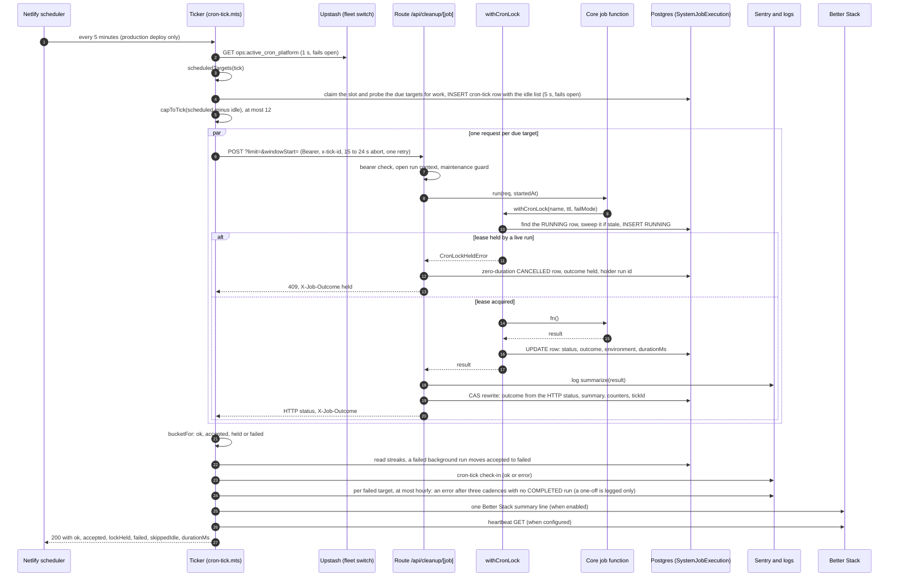
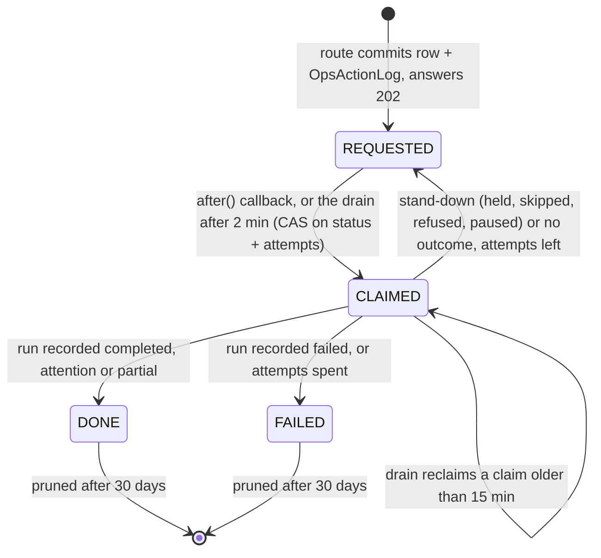

# Job machinery catalog and operations dashboard spec

This page records how every scheduled and background job really runs on `dev`, and what a person debugging a stuck refund, payout or invoice can and cannot see afterwards from stored data. It is the specification for the staff and admin operations dashboard described in [the dashboard design issue](https://github.com/Practitionist/familiarise_web/issues/2424), which is built in a later session. Everything below was checked against the code on `dev` at commit `d8e04d234` (26 October 2026). The ticker, lease and Sentry-posture statements were re-checked at `c852d4fbb` (27 October 2026), after the observability and ticker hardening change (#2420) merged. Behaviour that exists only in an open pull request is labelled **(pending)** and collected in [section 6](#6-pending-in-open-pull-requests). The ticker's production-only gate, slot claim, retry, background-outcome read and heartbeat, and the move of the last eleven Actions-scheduled jobs onto the ticker, were re-checked on 31 October 2026. The run record, the outcome vocabulary, the run context, the in-process admin Run door and the ticker-run retention jobs described below are Phase 1 of the operations console ("record the truth") and were re-checked against that change on 27 October 2026.

The generated [configured cron jobs reference](./04-cron-jobs-reference.md) owns the inventory of entrypoints and declared leases, and [the cron and reconciliation reference](./10-cron-and-reconciliation-reference.md) owns the response-code contract, the sidecars and the reconciler rules. This page does not repeat them. It adds what neither records: which signals each run leaves behind, how each job recovers from a failure, a kill or partial work, and where the evidence is missing.

## Glossary

| Term             | Meaning                                                                                                                                                                                                   |
| ---------------- | --------------------------------------------------------------------------------------------------------------------------------------------------------------------------------------------------------- |
| Tick             | One firing of the Netlify scheduled function `netlify/functions/cron-tick.mts`, every five minutes.                                                                                                       |
| Target           | One entry of `TARGETS` in `lib/cron/schedule.ts`. A tick calls every target that is due.                                                                                                                  |
| Slice            | The bounded amount of work one request does, set by `?limit=` or by an in-core budget. A backlog is drained over many ticks.                                                                              |
| Window           | A UTC calendar span in `TARGET_WINDOWS` inside which a target fires on its slots, for example "03:00 UTC for 17 hours".                                                                                   |
| Lease            | The right to run one job, held as a `RUNNING` row in `SystemJobExecution`. At most one live row per job name exists (`SystemJobExecution_running_jobName_key` in `prisma/sql/check-constraints.sql`).     |
| CAS              | Compare-and-set: an `updateMany` whose `WHERE` names the expected prior state, so a concurrent writer makes it match zero rows.                                                                           |
| Owed marker      | A set of columns written in the same commit that creates an obligation, so the table itself is the work queue (for example `Payment.refundOwedKey`). Sweeps drive the marker until it clears.             |
| Dead letter      | A terminal state a row is moved to after its attempt budget is spent, so the sweep stops retrying and a human takes over.                                                                                 |
| Standing finding | A condition reported to Sentry once per new set of ids per window, with the ids remembered in `SystemEvent` (`reportStandingFinding` in `lib/observability/standing-finding.ts`).                         |
| Config skip      | A run that does nothing because a required setting is absent (`reportConfigSkip` in `lib/cron/config-skip.ts`). The route stores it as outcome `skipped`, a `CANCELLED` row.                              |
| Outcome          | The verdict stored in `SystemJobExecution.result.outcome`: `completed`, `attention`, `partial`, `failed`, `held`, `skipped`, `refused` or `paused` (`lib/cron/run-outcome.ts`). Section 4.1 defines each. |
| Run context      | The per-run bag kept in `AsyncLocalStorage` (`lib/cron/run-context.ts`): the execution row ids, who triggered the run, the tick id, the ops-log id and the correctness counters.                          |
| Tick id          | A custom (version 8) UUID derived from the tick's five-minute slot (`tickIdForSlot`) and sent as `x-tick-id`. Each run row it dispatched stores it, and it is the primary key of the slot's claim row.    |
| Seeded cast      | The people used in examples, from `prisma/seedFiles/1a-create-users.ts` and the start-here guides: Hannah Anderson (independent consultant), Priya Anderson (learner), Olivia Brown (platform admin).     |

## 1. Lifecycle of one tick

### 1.1 The path from a tick to a job run

The numbered steps below match the diagram.

1. **The scheduler fires the ticker, and only the production deploy dispatches.** Netlify runs the function on `*/5 * * * *` (`config.schedule` in `netlify/functions/cron-tick.mts`). The function reads the deploy context from its second argument (`context.deploy.context`, per the Netlify Functions API) and answers `{skipped: true, deployContext}` without dispatching on any context other than `production` (`offProductionDeploy` in `lib/cron/deploy-context.ts`). A missing context is not refused, so another host that passes none still runs. Netlify's "Run now" button on a preview therefore does nothing. The ticker always answers 200, because Netlify re-invokes a scheduled function that answers 5xx and each retry would re-fire every due target (`statusFor` in the same file).
2. **The fleet switch is read once.** The ticker reads the Upstash key `ops:active_cron_platform` with a one-second timeout. If it names another platform the tick does nothing; an absent key, missing credentials, a timeout or an unreadable reply all mean "run" (`otherActivePlatform`). A skipped tick leaves no record anywhere except one log line.

   **The slot is claimed.** The tick id is deterministic: `tickIdForSlot` hashes the five-minute slot with SHA-256 into a custom (version 8, RFC 9562) UUID, so a second dispatch of the same slot carries the same id. Before dispatching, the ticker calls `claimTickSlot`, which POSTs `/api/health/jobs/tick?tickId=&slot=&due=<comma list of the scheduled targets>` (`app/api/health/jobs/tick/route.ts`, bearer-gated). The route first asks each due target's idle probe whether it has work (step 3), then inserts a `SystemJobExecution` row whose id is the tick id, job name `cron-tick`, status `COMPLETED` and result `{outcome: completed, reason: tick-claim, environment, tickId, slot, idle, idleCount}`, and answers `{claimed: true, idle}`. The primary key is the arbiter: the second dispatch gets `{claimed: false}`, and the tick answers 200 `{duplicate: true}` without dispatching, checking in or pinging. The idle list is therefore durable on the claim row before the ticker skips anything. A claim that cannot be reached, answers non-2xx, cannot be read or does not answer within 5 seconds (a cold start plus the probe budget) fails open: the tick dispatches every scheduled target, because a missed tick costs more than a rare duplicate that the leases already absorb. The probe is folded into the claim call on purpose: a separate call would add about 8,640 invocations a month, and a private `_due` folder under `app/api/cleanup` would not route in the App Router.

3. **Due targets are chosen, and idle ones are skipped.** `scheduledTargets()` in `lib/cron/schedule.ts` keeps targets whose UTC minute of day, minus their offset, is within the first five minutes of their interval, and whose calendar window is open. Inside the claim call, `probeTick()` (`lib/cron/idle-probe.ts`) then runs each scheduled target's `idle` probe from the registry, one at a time in one transaction on the single database connection. The transaction sets a 750 ms `statement_timeout` (`IDLE_PROBE_STATEMENT_TIMEOUT_MS`), and no statement starts after `IDLE_PROBE_BUDGET_MS` (2 seconds): every probe checks `outOfTime()` before each statement and answers "has work" once it is true, so probing ends by 2.75 seconds. A probe is an exported `has...Work` function in the job's own module that asks the same question the job's claim query asks, through shared `...Where` builders; `__tests__/maintenance/idle-probe-drift.test.ts` enforces that. A target whose probe answers "no work" is returned as idle and not dispatched. When the probes are done, no probe failed and the budget still has time, the same transaction reads the eight oldest-pending-age gauges (`readPendingAges` in `lib/cron/pending-ages.ts`): seven in one statement, then `parkedCaptures`, the seconds since the oldest parked, unreturned capture (0 when none), through the Stuck work queue's own `where`, a second statement that also starts only inside the budget (when the first spends it, the tick carries no gauges); the claim answers them as `pendingAges` and the ticker sends them on its Better Stack summary. A gauge fault never changes which targets run. A probe that throws or is cut short, a cancelled statement (which also stops probing for the rest of the tick), a job registered `alwaysRun` (vendor reconcilers, statutory exports, rarely due jobs, and any job that records a config skip on every run), and a target the budget never reached all stay in the dispatch list. Failed probes are one `idle-probe-failed` log line per tick and never reach Sentry. The ticker then dispatches `capToTick(scheduled minus idle)`; `dueTargets()` remains `capToTick(scheduledTargets(now))` for the cadence test. The calendar test pins at most twelve targets per tick (`MAX_TARGETS_PER_TICK`; the busiest tick today has 11, section 2.8), and `reconcile-ledgers` yields its slot when the dispatched list is over that number, which no tick reaches today. A skipped target writes no run row; step 11 and section 1.2 say where the skip is recorded.
4. **One authenticated request per target, in parallel.** `hitTarget()` POSTs `targetRequest()`'s URL with an `Authorization: Bearer` header and an `x-tick-id` header carrying the tick's UUID. The per-target timeout is 15, 20 or 24 seconds (`TARGET_TIMEOUTS_MS`) and is capped by an overall 24-second deadline for the tick. A request that never reached the app is retried once through `hitTargetOnceMore`: status 0 from a connection failure (but not the tick's own abort) or HTTP 500 carrying Netlify's own `Internal Server Error - Request ID` page (`isRetryable`), and only while at least 5 seconds of the 24-second budget remain. The retry logs `cron-tick-target-retry`. A retry that answers 409 keeps the first result, because the lease it met is most likely the one the crashed first call took, so the target stays under `failed` rather than `lockHeld`.
5. **The route opens a run context, authenticates and checks maintenance.** `cleanupRoute()` in `lib/cron/cleanup-route.ts` wraps the request in `withRunContext` (trigger `cron` or `github-actions`, and the tick id when `x-tick-id` is a valid UUID). It checks the bearer secret in constant time, then calls `assertNotInMaintenance`. A bad bearer leaves no `SystemJobExecution` row. A maintenance refusal leaves a zero-duration `CANCELLED` row with outcome `refused` and reason `maintenance:<phase>`, or `maintenance-state-unreadable` when the phase could not be read.
6. **The core takes the lease.** The job's core function calls `withCronLock()` (`lib/cron/with-cron-lock.ts`). It reads the job's one `RUNNING` row with a single `findFirst`. A live row means the lease is held. A stale row is swept to `FAILED` by CAS (section 2.1), and a new row is inserted with an id made up front. The partial unique index is the arbiter when two requests race. The new row id is added to the run context and set as the Sentry tag `job_run_id` for the rest of the request.
7. **A live lease answers 409.** The loser throws `CronLockHeldError`, which carries the holder's row id (`holderRunId`; null when a unique-index race hid it). `cleanupRoute()` maps it to HTTP 409 with `X-Job-Outcome: held` and writes a zero-duration `CANCELLED` row with outcome `held`, reason `lock-held` and the holder's id.
8. **The job runs and the row is finished.** On return or throw, `recordJobFinish()` updates the row by CAS on `status = RUNNING` with the status, the outcome and the Sentry environment, the end time and the duration, and tells the run context the write landed. This write is the safety net for callers that are not a cleanup route (CLI entrypoints, background functions).
9. **The route logs and records.** `cleanupRoute()` runs the registry's `summarize` function (or uses the whole result), writes it to the console and to `Sentry.logger.info`, then derives the outcome from the HTTP status it is about to answer and calls `recordRouteRun()` (`lib/cron/run-record.ts`). That is the single writer of the final row (section 1.2).
10. **The ticker classifies each answer.** `bucketFor()` reads the status and the `X-Job-Outcome` header and files each target as ok, accepted, held or failed. A 207 is a failure only for `process-payouts`, `reconcile-ledgers`, `sweep-orphaned-topup-captures` and every windowed target. The stored row does not depend on this list: a 207 is stored as `COMPLETED` with outcome `attention` when the job flags findings and no item failed, and as `FAILED` with outcome `partial` otherwise (section 1.3).
11. **The ticker reports.** It sends one Sentry cron check-in (`ok`, or `error` if anything failed). The console JSON line and the tick's answer carry `skippedIdle`, the scheduled targets that were not dispatched because they were idle. When `ENABLE_BETTERSTACK_TELEMETRY` is `true`, one Better Stack summary line with the tick id and the ok, accepted, lock-held and failed lists, plus the targets whose fail-closed lease the database could not grant and their count (`lockUnavailable`, `lockUnavailableCount`), and the idle skips and their count (`skippedIdle`, `skippedIdleCount`; `emitTickSummary`). The tick id is also in the console line. A failed target is judged only on its own first due tick of an hour (`isFirstDueTickOfHour`). The report is one grouped Sentry warning (fingerprint `cron-tick` / `target-failed-once`, the target in its `target` tag) unless the target has had no `COMPLETED` run for three of its own cadences, which `isRepeatedFailure` reads from `GET /api/health/jobs/streaks`; only then is it an error fingerprinted per target. `sentry-ingest-canary` is never reported through Sentry (`reportableToSentry`).
12. **The ticker pings the heartbeat.** When `BETTERSTACK_HEARTBEAT_URL` is set (optional, documented in `.env.sample`), the ticker sends one GET per completed tick with a 2-second timeout (`pingHeartbeat`). A failure is logged and never fails the tick; an unset key skips silently. A skipped, duplicate or fleet-switched tick sends none, so Better Stack's missing heartbeat is the "did not run" signal that no row can give.

Background targets differ in two places. The ticker posts straight to a Netlify background function (`netlify/functions/recording-transfer-background.mts` or `netlify/functions/stream-maintenance-background.ts`), which acknowledges with 202 at once and then runs the same `cleanupRoute()` and core in the background. The ticker therefore files the target as "accepted", and the run's own result is a `SystemJobExecution` row written minutes later by the worker, carrying the tick id because the worker hands the same request, `x-tick-id` header included, to the route.

The first difference is how a failure is seen. After the tick, for every target answered 202, the ticker reads `GET /api/health/jobs/streaks`, which also returns `lastFailedAt`. If the newest finished run failed (`lastRunFailed` in `lib/cron/failure-streak.ts`: a failure with no completion, or a failure newer than the last completion), the target moves from accepted to failed with status 202 and the error body "last background run failed". The check-in then turns error and the hourly Sentry escalation applies as for any other target. This judges the previous run, one tick late. A worker that never starts still leaves no row.

The second difference is that the worker never throws (`runBackgroundWorker` in `lib/cron/background-worker.ts`). Before any work it applies three gates, in order, and logs a `background-worker-refused` line with the reason when one fails: the production deploy only, by the same `context.deploy.context` rule as the ticker (`off-production`); a `POST` (`method-not-allowed`); and the `CRON_SECRET` bearer (`unauthorized`). Netlify answers 202 to every call of a background function whatever happens next, so an unauthenticated POST still gets a 202, but it does nothing. `stream-maintenance-background` also refuses a `job` outside the five Stream lifecycle jobs (`unknown-job`). A run whose `X-Job-Outcome` is `failure` or `partial_failure` is logged as `background-worker-failed`. A throw outside the route is logged the same way and recorded as a `FAILED` `SystemJobExecution` row with reason `background-adapter`. A `CRON_LOCK_UNAVAILABLE` response gets the same row, because a refused lease leaves no run row of its own and the ticker judges background targets only by their last finished run. Because the function never fails, Netlify's automatic retries after one and two minutes for background functions never fire, so a failed job is not silently run twice. Sentry events from the workers carry the tags `deploy_context` and `deploy_id`, since the branch name is not available to functions at runtime.

### 1.2 What a run leaves behind

| Record                             | Written by                                                                                | Holds                                                                                                                                                                                                                                                                                                                                                                                                                                                                                                                                                                                                                                                                                                  | Kept                                                                                                                                                                                                                                                                            | Cannot answer                                                                                       |
| ---------------------------------- | ----------------------------------------------------------------------------------------- | ------------------------------------------------------------------------------------------------------------------------------------------------------------------------------------------------------------------------------------------------------------------------------------------------------------------------------------------------------------------------------------------------------------------------------------------------------------------------------------------------------------------------------------------------------------------------------------------------------------------------------------------------------------------------------------------------------ | ------------------------------------------------------------------------------------------------------------------------------------------------------------------------------------------------------------------------------------------------------------------------------- | --------------------------------------------------------------------------------------------------- |
| `SystemJobExecution` row           | `withCronLock()` opens it and finishes it; `cleanupRoute()` makes the final write (below) | Job name, status, acquisition time (`createdAt`), last heartbeat (`startedAt`), end time, duration, error text, `triggeredBy`, `itemsProcessed`, `errorCount`, and a `result` with `outcome`, `reason`, `environment`, `checkpoint`, `summary`, `counters`, `tickId`, `httpStatus`, `opsActionLogId`, `holderRunId`                                                                                                                                                                                                                                                                                                                                                                                    | A no-op run (completed, nothing processed, no error, not an admin run, no checkpoint, no recorded idle skips, and not the job's newest completed run) 14 days; every other finished run 180 days. Pruned by `prune-system-job-executions` (a ticker target, 20:00 to 23:30 UTC) | Which items a run touched (there is no per-item table yet), what a gateway answered on each attempt |
| `SystemJobExecution` claim row     | The ticker, through `POST /api/health/jobs/tick`                                          | Id equal to the tick id, job name `cron-tick`, `COMPLETED`, zero duration, and a `result` of `outcome: completed`, `reason: tick-claim`, `environment`, `tickId`, `slot`, `idle` (the targets skipped as idle) and `idleCount`. It is also the only record of an idle skip: a skipped target writes no run row, and `readIdleCompletions` (`lib/cron/idle-skips.ts`) reads these arrays so health, streaks and the job console treat a skip as a healthy finished run. One per dispatched five-minute slot, 288 a day. It is bookkeeping, not a job run: `TICK_CLAIM_JOB` keeps it out of the job console metrics, the executions list (unless asked for by name) and the `/api/health` freshness read | 14 days when its `idle` array is empty, 180 days when it recorded idle skips, pruned with the other run rows by `prune-system-job-executions`                                                                                                                                   | What the tick did afterwards: the claim exists before any target runs                               |
| Console and Sentry logger line     | `cleanupRoute()`                                                                          | The `summarize()` fields for the run                                                                                                                                                                                                                                                                                                                                                                                                                                                                                                                                                                                                                                                                   | Netlify log and Sentry logs, not queried                                                                                                                                                                                                                                        | Anything after the log retention of those vendors                                                   |
| Netlify function log of the ticker | `cronTick()`                                                                              | The tick body: tick id, ok, accepted, lock-held, lock-unavailable, failed and idle-skipped (`skippedIdle`) target names, duration, and the oldest-pending-age gauges from the slot claim (`oldestPendingAgeS`). The same body is sent to Better Stack as a summary line when enabled                                                                                                                                                                                                                                                                                                                                                                                                                   | Netlify's and Better Stack's retention                                                                                                                                                                                                                                          | The per-target detail; read the run rows for that                                                   |
| Better Stack heartbeat             | `pingHeartbeat()`                                                                         | One GET per completed tick when `BETTERSTACK_HEARTBEAT_URL` is set                                                                                                                                                                                                                                                                                                                                                                                                                                                                                                                                                                                                                                     | Better Stack                                                                                                                                                                                                                                                                    | Which target failed. A missing ping is the signal that a tick did not run                           |
| Sentry cron check-in               | `sendCheckIn()`                                                                           | One ok or error per tick, monitor `cron-tick`, 5-minute schedule, 3-minute margin, failure threshold 3, recovery 1                                                                                                                                                                                                                                                                                                                                                                                                                                                                                                                                                                                     | Sentry                                                                                                                                                                                                                                                                          | Which target failed                                                                                 |
| Sentry error or warning            | The job itself, `cleanupRoute()`'s catch-all, or the ticker                               | Message, fingerprint, tags (every event of a run carries `job_run_id` once the lease row exists), a capped `extra` sample of ids                                                                                                                                                                                                                                                                                                                                                                                                                                                                                                                                                                       | Sentry, 5,000 errors a month                                                                                                                                                                                                                                                    | Every id: reports are once per run and capped                                                       |
| `SystemEvent` row                  | Many jobs, through `recordSystemEvent` and `recordSystemError`                            | Category, severity, message, `context` JSON (with `context.jobRunId` when a job run is active), an optional `correlationId` that stays the caller's own entity key                                                                                                                                                                                                                                                                                                                                                                                                                                                                                                                                     | 400 days, except the newest state-bearing event per `(correlationId, category)`, which is kept; pruned by `prune-system-events` (a ticker target, 20:00 to 23:30 UTC)                                                                                                           | Which run wrote an event raised outside a run                                                       |
| Entity columns                     | The job, on the row it worked on                                                          | Attempt counters, cursors and markers such as `Payment.refundOwedAttempts`, `Refund.lastReconciledAt`, `OrganizationInvoice.irpRetryCount`                                                                                                                                                                                                                                                                                                                                                                                                                                                                                                                                                             | With the row                                                                                                                                                                                                                                                                    | What each attempt returned. Only the count survives                                                 |
| `OpsActionLog` row                 | `/api/admin/system-jobs/run`                                                              | Actor, reason, target job id, `ACCEPTED`, `SUCCEEDED` or `FAILED`, and the HTTP status. Its id is stored on the run row as `result.opsActionLogId`                                                                                                                                                                                                                                                                                                                                                                                                                                                                                                                                                     | With the log                                                                                                                                                                                                                                                                    | Nothing material; the link runs from the run row to the log row                                     |
| `AdminRunRequest` row              | `/api/admin/system-jobs/run` for a `manualRun: "after"` job, then the run that claims it  | Job, `REQUESTED`/`CLAIMED`/`DONE`/`FAILED`, requesting admin, attempts, last error, the admitted window, claim and finish times, and the settling run's id (`runId`). Its id is also its `OpsActionLog` row's id                                                                                                                                                                                                                                                                                                                                                                                                                                                                                       | 30 days after it settles (`prune-system-job-executions`)                                                                                                                                                                                                                        | Nothing material; an open request stays until it settles                                            |
| Redis `cron:heartbeat:last`        | `withCronLock()` after a `COMPLETED` finish, production only (`mayWriteProductionState`)  | One timestamp, read by `/api/health`                                                                                                                                                                                                                                                                                                                                                                                                                                                                                                                                                                                                                                                                   | Overwritten                                                                                                                                                                                                                                                                     | Which job                                                                                           |

**One truth writer per run.** `withCronLock()` writes the row twice at most: at acquisition (`RUNNING`) and at its own finish, so that a caller that is not a cleanup route still leaves a verdict. When the run came through a cleanup route, `recordRouteRun()` in `lib/cron/run-record.ts` then rewrites every row whose own finish write landed, one CAS `updateMany` per row, with the route's outcome. A row whose finish write lost a race is never overwritten. The final `result` holds:

- `outcome`, and `reason` when there is one (`lock-held`, `lease-expired`, `maintenance:<phase>`, `job-declined`, or a config-skip text such as `PLATFORM_GSTIN not configured`);
- `environment`, the same label `/api/health/jobs` filters on;
- `checkpoint`, kept from the lock's own write so a paging job still resumes;
- `summary`, the `summarize()` projection (or the whole result), capped at 8,000 characters, above which only a size marker (`truncated`, `chars`) is stored;
- `counters`, the six correctness counters of the run (section 1.5);
- `tickId`, `httpStatus`, `opsActionLogId` and `holderRunId` where they apply;
- `telemetry`, the run's Better Stack sends as `{ sent, rejected: { "402", "403", "5xx", "network", "other" } }`, written when the run sent anything; the write waits for in-flight sends, each capped at 2 seconds;
- `failures`, at most 50 `{ entityId, reason, attempt }` entries from `createRunFailureReporter().add()`, ids and failure classes only, with `failuresOverflow` counting the rest. Both shapes are validated with Zod in `lib/cron/run-telemetry.ts`, and an invalid shape writes neither key rather than losing the row.

The `itemsProcessed` and `errorCount` columns are filled by a generic extractor that reads the first known counter of the summary (`itemsProcessed`, `totalProcessed`, `processed`, `scanned` and similar for items; `errorCount`, `failedCount`, `failed`, `errors`, `stillFailing` for errors, where an array counts its length). A summary with none of those keys leaves the columns null. The write is best effort: a failed write logs a warning and never changes the HTTP answer.

### 1.3 How a core's answer becomes a status, an HTTP code and a ticker bucket

Two functions read the same result. `jobOutcome(result)` in `lib/cron/job-outcome.ts` decides the HTTP status and the `X-Job-Outcome` header, unless the registry entry has its own `status()` override. The stored row follows the HTTP status, not `jobOutcome()`, so the row and the response always agree (`routeOutcome()` in `lib/cron/run-outcome.ts`). The status mapping is fixed: `completed` and `attention` are `COMPLETED`; `partial` and `failed` are `FAILED`; `held`, `skipped`, `refused` and `paused` are `CANCELLED`. A 207 splits two ways. A route whose 207 means findings declares `needsAttention` instead of a `status()` override, and when that run has no failing item (`hasItemFailures()`, the counter half of `jobOutcome()`) it is stored `COMPLETED`, outcome `attention`; every other 207 is `FAILED`, outcome `partial`.

| What the core returns or does                                                      | `SystemJobExecution.status` and `result.outcome`                                                                    | HTTP and `X-Job-Outcome`                                                 | Ticker bucket                                            |
| ---------------------------------------------------------------------------------- | ------------------------------------------------------------------------------------------------------------------- | ------------------------------------------------------------------------ | -------------------------------------------------------- |
| `success: true` or `overallSuccess: true` and the route answers 2xx other than 207 | `COMPLETED`, `completed`                                                                                            | 200                                                                      | ok                                                       |
| The route answers 207 through `needsAttention` and no item failed (findings only)  | `COMPLETED`, `attention`                                                                                            | 207                                                                      | 207 allowlist decides                                    |
| The route answers 207 (the job's own `status()` override, or a failure counter)    | `FAILED`, `partial`                                                                                                 | 207                                                                      | failed (default route); 207 allowlist decides (override) |
| `success: false` or `overallSuccess: false`, or any answer of 400 or above         | `FAILED`, `failed`, error text "Job returned failed"                                                                | 500 by default                                                           | failed                                                   |
| `held: true` or `skipped: true` from the core                                      | `CANCELLED`, `skipped`, reason `job-declined`                                                                       | 503, `held`                                                              | held                                                     |
| A string `skipped` ending " not configured" (a config skip)                        | `CANCELLED`, `skipped`, reason the skip text                                                                        | 200                                                                      | ok                                                       |
| The core throws                                                                    | `FAILED`, `failed`, reason the error name, stack truncated to 8,000 chars                                           | 500, one throttled Sentry error                                          | failed                                                   |
| Another run holds the lease                                                        | `CANCELLED`, `held`, reason `lock-held`, `holderRunId`; zero duration                                               | 409, `held`                                                              | held                                                     |
| Maintenance phase refuses the job                                                  | `CANCELLED`, `refused`, reason `maintenance:<phase>` or `maintenance-state-unreadable`; zero duration               | 503 with `phase`                                                         | held                                                     |
| Fail-closed job and the lease table is unreachable                                 | No row                                                                                                              | 503 with code `CRON_LOCK_UNAVAILABLE`, one throttled Sentry warning      | failed (and counted in the tick's `lockUnavailable`)     |
| Bad bearer secret, bad `?limit=` or bad `?windowStart=`                            | No row                                                                                                              | 401 or 400                                                               | failed                                                   |
| The process is killed or the platform ceiling is hit                               | `RUNNING` until the next acquisition sweeps it to `FAILED`, outcome `failed`, reason `lease-expired`, `takenOverBy` | No answer or a platform 5xx: the ticker records status 0 after its abort | failed                                                   |

The enforcers are `routeOutcome()` for the stored outcome, `statusFor()` and each entry's `status()` for the HTTP code, and `statusOfOutcome()` for the status column. Because the row follows the HTTP code, a job whose own `success: true` outranks its counters (a sweep that returns `success: true` with `stillFailing: 3` and answers 207) is stored `partial` and `FAILED`, not `COMPLETED`. A `FAILED` partial row counts as a failure for the streak escalation, and as a finished run for the freshness SLOs (section 4.2).

### 1.4 Worked example: a refund that fails three times

Hannah Anderson cancels Priya Anderson's one-hour consultation on Monday 26 October 2026 at 10:00 IST (04:30 UTC). Priya paid ₹1,180 (118,000 paise: ₹1,000 plus 18 % GST) by card. The cancel door ends the booking and, in the same commit, stamps the refund obligation on the payment (`stampRefundOwed` in `lib/payments/operations/refund-owed.ts`): `refundOwedKey`, `refundOwedPaise`, `refundOwedReason`, `refundOwedAt` and `refundOwedAttempts = 0`. The `retry-auto-refunds` sweep drives it.

| Time (IST / UTC) | What happens                                                                                                                                             | What is stored afterwards                                                                                                                                                                                                                                                                                                                                                                                                                |
| ---------------- | -------------------------------------------------------------------------------------------------------------------------------------------------------- | ---------------------------------------------------------------------------------------------------------------------------------------------------------------------------------------------------------------------------------------------------------------------------------------------------------------------------------------------------------------------------------------------------------------------------------------- |
| 10:10 / 04:40    | `retry-auto-refunds` is due (every 15 minutes, offset 10). The marker is younger than the 15-minute grace, so nothing is selected.                       | A `COMPLETED` row, outcome `completed`, with `summary` showing `scanned: 0` and `itemsProcessed = 0`, so the run is visibly a run that looked at nothing.                                                                                                                                                                                                                                                                                |
| 10:25 / 04:55    | The marker is eligible. The gateway answers 5xx. `driveRefundOwed()` counts attempt 1 by CAS on `refundOwedAttempts` and sets the next drive 1 hour out. | `Payment.refundOwedAttempts = 1`, `refundOwedNextAt = 11:25`. The failed drive is counted in `owed.failed`; the route answers 207 and the summary's `failed` includes it, so the row is `FAILED`, outcome `partial`, `httpStatus` 207, `errorCount = 1`. A gateway outage therefore reads red and escalates on repeats.                                                                                                                  |
| 10:40 / 05:10    | The marker is inside its backoff (`refundOwedNextAt` is 11:25), so the sweep does not select it. The 10:55 to 11:10 ticks do the same.                   | A `COMPLETED` row with `scanned: 0`.                                                                                                                                                                                                                                                                                                                                                                                                     |
| 11:25 / 05:55    | Attempt 2 fails the same way, and the next drive is set 4 hours out.                                                                                     | `refundOwedAttempts = 2`, `refundOwedNextAt = 15:25`. Another `FAILED`/`partial` row and another Sentry event.                                                                                                                                                                                                                                                                                                                           |
| 15:25 / 09:55    | Attempt 3 fails. The attempt budget (`MAX_REFUND_OWED_ATTEMPTS = 3`) is spent, so the marker is retired from the sweep and an operator is paged.         | `refundOwedAttempts = 3`, `refundOwedNextAt` empty; a `SystemEvent` of category `PAYMENT`, severity `ERROR`, "Refund owed on payment … failed 3 times — refund by hand", whose `context.jobRunId` names this run's row, plus a Sentry exception. The row is `FAILED`/`partial` because an attempt failed in this run. A later run in which the retired marker is the only finding and nothing fails is `COMPLETED`, outcome `attention`. |
| 16:10 / 10:40    | `reportAgedRefundsOwed()` surfaces markers older than six hours, now including this one, once per distinct id set per day.                               | One `SystemEvent` keyed `retry-auto-refunds:owed:<hash>`.                                                                                                                                                                                                                                                                                                                                                                                |

The next-drive time is set when the failed drive ends, a few seconds into its run, so a later tick that starts before that instant leaves the marker for the tick after it. The times above can therefore slip by one 15-minute tick.

A person asking "what happened to Priya's ₹1,180" can read the counter, the three failing run rows (each with its tick id, its summary and the owed failures), the three Sentry events if the quota allowed them, and the final `SystemEvent` with the run id that wrote it. They still cannot read what the gateway said on attempts 1 and 2, because the summary holds ids and counts and not the gateway's answer.

### 1.5 The run context and the correctness counters

`withRunContext()` (`lib/cron/run-context.ts`) holds one `AsyncLocalStorage` bag per run: `runIds` (the rows `withCronLock` opened), `triggeredBy`, `tickId`, `opsActionLogId`, the `counters`, and `finished` (the rows whose own finish write landed, with each row's checkpoint). `cleanupRoute()` opens it for a ticker or Actions request; the admin Run door opens it first with the operator as the trigger (section 2.6), and the route then reuses that trigger instead of `cron`. `triggeredBy` is `cron`, `github-actions` or `admin:<userId>`.

The counters live in `lib/cron/run-counters.ts`, a leaf module with no Node imports, because client-reachable compare-and-set helpers call it. `run-context.ts` installs the sink that adds to the active run's bag; outside a run the call does nothing. They are stored in `result.counters` of every row the route finishes.

| Counter                 | Counted by                                                                                                                                                                                                                                                                                                                                                                                 |
| ----------------------- | ------------------------------------------------------------------------------------------------------------------------------------------------------------------------------------------------------------------------------------------------------------------------------------------------------------------------------------------------------------------------------------------ |
| `casMiss`               | A conditional `updateMany` that matched zero rows because another writer moved the row first: the seven booking transition helpers (`lib/booking/transitions.ts`), the enterprise `finalize` (`lib/enterprise/transitions.ts`), three consultant payout claims (`payout-service.ts`), two refund claims (`refund.ts`) and two payment-confirm claims (`lib/payments/webhooks/handlers.ts`) |
| `serializationRetry`    | `reportSerializableRetry` in `lib/db/serializable-retry.ts` on a `40001` serialization failure                                                                                                                                                                                                                                                                                             |
| `deadlockOrLockTimeout` | The same function on any other retry reason (a deadlock or lock timeout)                                                                                                                                                                                                                                                                                                                   |
| `poolTimeout`           | `cleanupRoute()`'s catch when the error is Prisma `P2024` pool exhaustion (`isPoolExhaustion`)                                                                                                                                                                                                                                                                                             |
| `leaseLost`             | The lease renewer, when its CAS on `status = RUNNING` matches zero rows                                                                                                                                                                                                                                                                                                                    |
| `leaseTakeover`         | `withCronLock()` when it sweeps a stale `RUNNING` row                                                                                                                                                                                                                                                                                                                                      |

A `scheduleAfter` task spawned during a run inherits its context, but a counter incremented after the route has written the row is dropped, because nothing writes the row again.

A counter is evidence and not a verdict: a nonzero `casMiss` means two writers raced and Postgres or the CAS kept the state valid. Postgres constraints still prevent the bad states themselves.

## 2. Shared behaviours

### 2.1 The lease: time-to-live, renewal and takeover

- **Time-to-live.** The default is 15 minutes (`DEFAULT_TTL_MS`). Money and reconcile jobs that may run long use `LONG_JOB_TTL_MS`, 35 minutes. The generated reference lists the value per job. On Netlify every lease is capped at 90 seconds (`effectiveLeaseTtlMs`), because renewal keeps a live run's row fresh. "On Netlify" is `onNetlify()` in `lib/runtime-host.ts`: the build-inlined `NETLIFY === "true"` (which Next bundles see) or a runtime `SITE_ID` (the only one of the platform's variables that reaches `netlify/functions/*` at runtime, besides `URL` and `SITE_NAME`). The `PG_POOL_MAX` guard in `lib/prisma.ts` uses the same test. The cap and the guard therefore apply inside the two background functions too, which a bare `NETLIFY` read missed.
- **Renewal.** While `fn()` runs, a timer rewrites the row's `startedAt` every third of the time-to-live (at least one second), by CAS on `status = RUNNING` (`startLeaseRenewal`). If the update matches zero rows the lease was lost, and the run logs one warning and one `cron.lock_ownership_lost` metric and counts `leaseLost`. The job is not stopped. Renewal rewrites `startedAt`, so that column is the **last heartbeat**. The acquisition time is `createdAt`, set once at insert and never rewritten. The duration is measured from an in-memory timestamp taken at acquisition.
- **Takeover.** The next request to acquire the lease finds the job's one `RUNNING` row. If its `startedAt` is within the time-to-live the request is held (`CronLockHeldError` with `holderRunId`). If it is older, a CAS sweeps it to `FAILED` with the error text "Lease expired (stale RUNNING row swept)", `durationMs` equal to the sweep time minus `createdAt`, and a `result` of `{outcome: "failed", reason: "lease-expired", environment, takenOverBy: <the new run's id>}`, and counts `leaseTakeover`. `endedAt` is still the sweep time, so it says when the takeover happened and not when the run died.
- **Fail modes.** `closed` jobs throw `CronLockUnavailableError` when the lease table cannot be used, so a money job never runs unlocked. `open` jobs run unlocked with a console warning, except that a database connection or pool error (`isDbConnectionOrPoolError`) is always treated as unavailable, even for an `open` job.
- **What a killed run costs.** A run killed by the platform leaves its `RUNNING` row. Until the time-to-live passes, every tick for that job answers 409 and writes nothing. On Netlify (including a background function) the 90-second cap means a killed run blocks at most one later tick. On another host the full time-to-live applies: one skipped slot for a 15-minute lease on a 15-minute target, and two or three for a 35-minute lease.
- **Cron mutual exclusion is Postgres only.** `AGENTS.md` forbids Redis locks for cron jobs. The Redis heartbeat is a liveness timestamp, not a lock.

### 2.2 Time budgets

Four limits apply, and none of them cancels a running job.

| Limit                     | Value                                                                                                       | Enforcer                                                           | Effect                                                                                                                  |
| ------------------------- | ----------------------------------------------------------------------------------------------------------- | ------------------------------------------------------------------ | ----------------------------------------------------------------------------------------------------------------------- |
| Ticker request abort      | 15 s default, 20 s or 24 s for listed targets, and never beyond 24 s after the tick began                   | `TARGET_TIMEOUTS_MS`, `hitTarget()`                                | The ticker records status 0 and files the target as failed. The Next function keeps running until the platform ceiling. |
| Next function ceiling     | About 26 s (the comment in `lib/cron/schedule.ts`); the platform may kill the process                       | Netlify                                                            | A killed job leaves a `RUNNING` row (section 2.1).                                                                      |
| In-core start deadline    | 16 s from the request (`SWEEP_START_DEADLINE_MS` in `lib/cron/run-deadline.ts`); 12 s for the referral jobs | `startDeadline()`, `RUN_DEADLINE_MS` in `lib/referrals/vesting.ts` | The job stops starting new rows. It does not stop a row in flight.                                                      |
| Background worker ceiling | 15 minutes                                                                                                  | Netlify background functions                                       | The five Stream lifecycle jobs and `transfer-recordings` run here.                                                      |

Jobs with an in-core start deadline are `reconcile-payment-status`, `reconcile-refunds` (its pending pass stops at 8 s and its cascade re-drive at 12 s), `detect-consultant-no-shows`, `settle-platform-incidents`, `auto-complete-appointments`, `expire-stale-requests`, `handle-stuck-payouts`, `reconcile-payout-status`, `reconcile-gateway-settlements`, `reconcile-stream-memberships`, `abandoned-org-top-ups` and the two referral jobs. Two of those, `reconcile-payment-status` and `reconcile-refunds`, are not passed the request start by their registry entries, so their deadline counts from the core's own start and does not include a cold boot. Every other job is bounded only by its `limit` and the abort.

### 2.3 Retry and recovery patterns

Jobs on this platform do not keep a retry queue. The table that holds the work is the queue (state-as-outbox), and each pattern below is a column on that table.

| Pattern                    | How it works                                                                                                                                                                                                         | Examples                                                                                                                                                                                  |
| -------------------------- | -------------------------------------------------------------------------------------------------------------------------------------------------------------------------------------------------------------------- | ----------------------------------------------------------------------------------------------------------------------------------------------------------------------------------------- |
| Rotation cursor            | Each pass stamps the row so a failing row moves behind fresh ones. `lastReconciledAt` is ordered nulls first (`LEAST_RECENTLY_RECONCILED` in `lib/payments/payouts/reconcile-cursor.ts`), or `updatedAt` is touched. | `reconcile-payment-status`, `reconcile-refunds`, `handle-stuck-payouts`, `reconcile-payout-status`, `abandoned-payments`, `vest-referral-credits`                                         |
| Owed marker with a counter | The obligation and its attempt count sit on the entity. At the cap the entity leaves the sweep and a human is paged.                                                                                                 | `Payment.refundOwedAttempts` (cap 3), `Refund.metadata.cascadeRedriveAttempts` (cap 3), `MaintenanceRemediationItem.attempts`                                                             |
| Backoff ladder             | `nextRetryAt` follows 1 min, 5 min, 30 min, 2 h, 8 h (`lib/retry/backoff.ts`), then `DEAD_LETTER` or `FAILED`.                                                                                                       | `retry-failed-emails`, `drain-notification-outbox`, `dispatch-outbound-webhooks`, `retry-moderation-enforcement` (6 attempts)                                                             |
| Claim then act             | A CAS stamp claims the row, and a partial failure leaves the stamp unset so the next run retries only what is missing.                                                                                               | `settle-cancelled-sessions` (`seatsSettledAt`), `dunning` (`markedOverdueAt`, `lastDunningReminderAt`), `wallet-low-balance` (`autoTopUpLastFiredAt`)                                     |
| Checkpoint in the trail    | The job returns `checkpoint` and the next run reads it back with `readJobCheckpoint()`.                                                                                                                              | `reconcile-stream-memberships`, `reconcile-orphaned-sessions`, `reconcile-orphaned-recordings`, `stream-sync`, `expire-event-channels`, `wind-down-deactivated-orgs`, `expire-recordings` |
| Durable report row         | The sweep keeps its own run record outside `SystemJobExecution`.                                                                                                                                                     | `reconcile-ledgers` (`LedgerReconciliationReport` with status, cursor, calls and interruptions)                                                                                           |
| Ageing and give-up         | A row older than a cap is marked terminal rather than retried forever.                                                                                                                                               | `sweep-stuck-webhook-events` (7 days), `reconcile-payment-status` (orphan age, default 7 days), `irp-uploader` (12 tries)                                                                 |

**Checkpoint limits.** `readJobCheckpoint()` looks at the latest five `COMPLETED` or `FAILED` rows of that job name and returns the first `checkpoint` it finds. If none of the latest five carries one, the walk silently restarts from the beginning. A job that returns no `checkpoint` for five consecutive runs, such as five consecutive config skips, loses its position. `CANCELLED` (held) rows are ignored.

### 2.4 Configuration skips

Five jobs use the typed `ConfigSkip` value (a string ending " not configured"): `irp-uploader` (`PLATFORM_GSTIN not configured`, or a list of missing `CLEARTAX_*` settings), `heal-consumer-invoices` and `gst-outward-register-export` (`PLATFORM_GSTIN not configured`) `reconcile-gateway-settlements` (`RAZORPAY_KEY_ID or RAZORPAY_SECRET not configured`, when `getRazorpayClient()` returns null) and `novu-step-failure-probe` (`NOVU_PRODUCTION_KEY not configured`). The core returns `skipped` as a string and answers 200. `routeOutcome()` recognises the suffix and stores the run as `CANCELLED`, outcome `skipped`, with the skip text as `reason`, so a skipped run never satisfies "last success"; `/api/health/jobs` counts it only as proof that the job was reached. When the skip happens before a lease row exists, the route writes a zero-duration `CANCELLED` row itself. `reportConfigSkip()` only logs; a config skip never reaches Sentry, and `/api/health/jobs` lists the last day's skips under `configSkips`. `sentry-ingest-canary` also skips this way when `SENTRY_STATS_TOKEN` is unset. A second configuration problem in `irp-uploader`, an unreadable supplier state, returns an all-zero result with no marker, so it is stored as `completed`. The three GSTIN jobs read the supplier through `platformSupplierForJob()` (`lib/pdf/supplier.ts`): only an unset `PLATFORM_GSTIN` is a config skip, while a set but malformed or other-state value throws, so the run fails and reaches Sentry.

### 2.5 Sentry and alert posture

- **Once per run.** Per-row failures are collected and reported once, through `createRunFailureReporter()` (`lib/observability/run-failures.ts`), a `firstError` plus a sample in `extra`, or `reportStandingFinding()`. Every job follows this; section 4.3 states the rule for new code.
- **Previews.** Deploy previews report errors to Sentry as environment `preview` (since 2026-11-05); error-paging alert rules are scoped to production.
- **Escalations only.** A one-off ticker failure, a config skip and a business finding (orphaned-confirmation channel skips, Stream membership removals and brakes, the 72-hour needs-human queue, stalled webhook events, and consultant no-shows refused on Stream evidence) never reach Sentry. Money is the exception and pages once per new id set: wallet drift `fatal`, ledger drift `error`, the dispute deadline `warning` (each dispute once), and ambiguous placeholder refunds `warning`. A thrown error or failed run always reaches Sentry. See the noise policy in `docs/observability/00-system-design.md`.
- **Uncaught errors.** `cleanupRoute()` reports any error a core throws through `captureThrottled`, keyed `cron:<job>`, at most once an hour per instance, level error, tags `subsystem: cron` and `job`.
- **Durable escalations.** `recordSystemError()` writes a `SystemEvent` and also calls `Sentry.captureException`, with no run-level de-duplication.
- **Ops chat.** `retry-failed-emails` and `drain-notification-outbox` post to the ops chat webhook (`postOpsChat`) when they dead-letter a row. This is a third channel and is the only one that does not depend on Sentry.
- **Ticker.** Section 1.1, step 11.

### 2.6 Manual runs

The admin console's run door (`/api/admin/system-jobs/run`, surface `systemJobs.manage`) takes a registry slug and a reason. It has no job list of its own: `CLEANUP_JOB_BUILDERS` is the only list, and an id outside it answers 400. Each registry entry is `{meta: {title, description, category, manualRun}, build}`, where `manualRun` is `inline` or `after`. The System Jobs page builds its card list from the same registry (`systemJobCards()` in `lib/cron/job-catalog.ts`) and hands the client panel a serialisable list.

Where jobs may run, the door refuses a financial job in the DEGRADED phase and every job in OFFLINE (`FINANCIAL_JOB_NAMES`); off production it skips that read and answers the 409 refusal below in any phase. It pre-generates the `OpsActionLog` row id, then calls the registry handler's `invoke` (the same route run without the bearer check) in the same process, inside `withRunContext({triggeredBy: "admin:<userId>", opsActionLogId})`, with the ticker's own `?limit=` for that job. A calendar-windowed job (any target in `TARGET_WINDOWS`) also gets `windowStart`, the start of its latest due window (`latestWindowStart()` in `lib/cron/schedule.ts`), so a manual run repeats that window's slice idempotently: `settle-invoice-accruals`, `dunning` and `generate-subscription-invoices` mint nothing off-cycle, `expire-referral-credits` reuses its window, and `create-payout-batch` ends the org period at the window start, so each org's idempotency key is the scheduled one and already-batched consultants are skipped. A windowed job whose first window has not come due answers 409 with code `NO_DUE_WINDOW`, and its Run button is disabled with that reason. The run therefore takes the same lease, writes the same row, and the row says who started it (`triggeredBy`) and which audit entry it belongs to (`result.opsActionLogId`). `manualRun: "after"` (`process-payouts`, `create-payout-batch`) first commits an `AdminRunRequest` row (`REQUESTED`, with the requesting admin and the admitted window) and its `OpsActionLog` row (`after.status: REQUESTED`, same id) in one transaction, then answers 202 with the request id, and only then dispatches the run with `scheduleAfter` (section 2.7). A second click while the job has an open request returns that request instead of a new one. The ops-log `after.status` follows the outcome the run row recorded, read from the route's `X-Run-Outcome` header: `completed` and `attention` are `SUCCEEDED`, `partial` is `PARTIAL`, `failed` is `FAILED`, a stand-down is its own outcome in capitals (`HELD`, `SKIPPED`, `REFUSED`, `PAUSED`), and a background dispatch is `ACCEPTED`. The five Stream lifecycle jobs and `transfer-recordings` go to their background functions through the registry handler's `dispatchBackgroundJob`. Off production every job is refused before it starts: `cleanupRoute()` checks `jobsMayRunHere()` (`lib/cron/dispatch-refusal.ts`) after the bearer check and answers 409 `JOB_RUN_PRODUCTION_ONLY` (`JobRunRefusedError`, run-row reason `job-run-production-only`), on this door and on the `CRON_SECRET` door alike, because previews share production's database. `jobsMayRunHere()` is true on production and in a local process whose `NODE_ENV` is `development` or `test` (not a deploy), so local `next dev` still runs jobs. A refused `manualRun: "after"` job answers inline instead of 202. The background dispatch has its own refusal, `BackgroundDispatchRefusedError`, which is the case described next. Off production it refuses: the route answers 409 with code `BACKGROUND_DISPATCH_PRODUCTION_ONLY` and `X-Run-Outcome: refused`, records a zero-duration `CANCELLED` row with reason `background-dispatch-production-only`, logs the ops action as `REFUSED`, sends nothing to Sentry, and the System Jobs panel shows a "refused" toast instead of an error. On production the dispatch forwards the admin trigger as `x-run-trigger`; `cleanupRoute()` adopts that header only after the bearer check passes and only in the `cron` or `admin:<id>` shape, so the worker's row names the admin. A payout run started by an admin passes the admin as `createdBy` (the batch maker) and as `triggeredByUserId` (the disbursement maker), so the maker-checker rules see a human on both rails. On the organisation rail the admin becomes the payout's `createdBy`, so `approveOrgPayout()` refuses that admin's platform co-approval, and `processPendingOrgPayouts()` skips a payout whose platform or organisation approver is the triggering admin, through the shared `isMakerCheckerDisbursementBlocked()` (`lib/payments/payouts/maker-checker.ts`). Scheduled runs carry no actor and mint as `SYSTEM_CRON`. The staff executions list (`/api/staff/system-jobs/executions`) resolves `admin:<userId>` triggers to the user; rows older than this change hold a bare user id.

Three admin ids were renamed to registry slugs: `cleanup-abandoned-payments` is now `abandoned-payments`, `reconcile-orphaned-sessions` is now `reconcile-sessions`, and `cleanup-approval-payments` is gone because that work rides inside `abandoned-payments`. The execution rows keep the lock names (`cleanup-abandoned-payments`, `reconcile-orphaned-sessions`).

### 2.7 Admin run requests: dispatch now, the ticker as backstop

An `AdminRunRequest` row is the durable acknowledgement of an admin "Run now" for a `manualRun: "after"` job. The route commits it before the 202, so a lost `after()` callback leaves a `REQUESTED` row and never erases the run. The core is `lib/cron/admin-run-requests.ts`.

1. **Admission.** The route inserts the row (`job`, `requestedBy`, the admitted `windowStart`, the click's `idempotencyKey`) and the `OpsActionLog` row with the same id in one transaction. The panel mints one UUID per Run click and reuses it on a retry from the same dialog; an older client sends none and the route mints one. On a unique violation the route returns the request with the same `(job, idempotencyKey)` in any status, or else the job's open request (the sidecar index `admin_run_request_one_open_key` allows one `REQUESTED` or `CLAIMED` row per job), with `existing: true`, and dispatches nothing.
2. **Immediate dispatch.** `scheduleAfter(() => runAdminRunRequest(request))` claims the row with `updateMany` where `status` and `attempts` still hold their read values, commits the claim, and only then runs the registry handler's `invoke` in-process inside `withRunContext({triggeredBy: "admin:<requestedBy>", opsActionLogId: <request id>})`. The original admin therefore stays the payout maker on every attempt, and the admitted window is replayed rather than recomputed. Nothing holds a transaction across the run.
3. **Settlement.** The attempt reads `X-Run-Outcome` and finds its run row by `result.opsActionLogId` (the request id) and `createdAt` after the claim. The terminal write matches `status = CLAIMED` and the attempt's own `attempts`, so a stale claimant whose claim was taken over writes nothing. A run that reached the job settles `DONE` (`completed`, `attention`, `partial`) or `FAILED` (`failed`); a failed money slice is not re-run automatically. A partial run keeps `Run partial (HTTP 207)` in `lastError`. The same transaction moves the request's `OpsActionLog` row (same id) to the run's audit status, using the inline mapping (`auditStatusOf`), and keeps `requestId`. A stand-down or a thrown dispatch goes back to `REQUESTED` with `lastError` while attempts remain.
4. **Backstop.** `drain-admin-run-requests` runs hourly at :40. Its idle probe (`hasAdminRunRequestWork`) skips the tick unless a row is `REQUESTED` for more than 2 minutes (`lostDispatchWhere`) or `CLAIMED` for more than 15 (`staleClaimWhere`). A stale claim whose run already finished settles from that run without re-running. Otherwise the drain claims again, repeating the backlog predicate in the CAS, or settles `FAILED` once `MAX_ADMIN_RUN_ATTEMPTS` (3) are spent.
5. **Console.** The System Jobs page shows the last ten requests under "Run requests" (`GET /api/staff/system-jobs/requests`) and polls every 5 seconds only while one is open.

The contract is at least once per attempt, with at most three attempts. A crash after the job's domain writes but before settlement can run a second bounded slice; the job's own lease, CAS writes and gateway idempotency keys keep that safe. The drain is hourly, not every 5 minutes, because every busier cadence would put a tick over the tested cap of 11 targets. A lost dispatch is therefore recovered within about an hour. Raising the cap or rebalancing other offsets are owner decisions ([decision record](../decisions/2026-11-01-admin-run-requests.md)).

### 2.8 Capacity note: how full the ticker is

The ticker fires 288 times a day (every five minutes) and each tick may dispatch at most 12 targets (`MAX_TARGETS_PER_TICK`), so the schedule has 288 × 12 = 3,456 target slots a day. Measured over 400 simulated days, the current schedule starts about 2,909 targets a day, roughly 84 % of the slots, and its busiest tick starts 11 targets. The cadence test pins the busiest tick at no more than 11, which leaves one free slot on every tick. Before the eleven Actions jobs moved onto the ticker, the schedule used about 2,816 of the 2,880 slots of the old cap of 10 (98 %), with every tick carrying 9 or 10 targets. `reconcile-ledgers` yields its slot only on a tick above the cap, and no tick reaches the cap now.

The trigger for leaving the ticker is a tick that would need a 13th slot, or connection pressure from the parallel fan-out (each target is a separate function invocation with its own database connection). The planned destination is the always-on Mumbai worker: one process with a shared connection pool that executes the same registry functions, so no job is rewritten. Until then, a new target must either fit under the 11-per-tick pin or shift the offsets of existing ones so that it does.

New retention prunes add no target. Audit-class tables are pages of `prune-audit-logs` and telemetry and secondary tables are pages of `prune-system-job-executions`, which runs seven times a day and drains run history in 1,000-row batches within a 16-second budget (about 45,000 rows a run against an inflow of about 3,400 a day). The arithmetic is in [the retention windows record](../decisions/2026-11-01-data-retention-windows.md).

## 3. Per-job catalog

There are 81 ticker targets and no registered job outside the ticker: no GitHub Actions workflow schedules a registry job any more. Sections 3.1, 3.3 and 3.4 describe the ticker targets in the order of `TARGETS`, and section 3.2 explains where the former Actions-scheduled jobs went. A job's registry key is the slug in `/api/cleanup/[job]`. Its lease name is the key unless the table says otherwise.

### 3.1 Ticker targets: schedule, slice, lease, budget, money and freshness

Generated from `lib/cron/schedule.ts`, `lib/cron/financial-jobs.ts`, `lib/cron/operational-health.ts` and the lease column of the [generated reference](./04-cron-jobs-reference.md). "Cadence" is every N minutes, with the offset in minutes inside the interval, both in UTC minutes of the day; a window restricts it further. "Slice" is the `?limit=` the ticker sends. "HTTP abort" is the ticker's per-request timeout in seconds. "Money" says whether the job moves or re-drives money; "gated" means the maintenance gate also holds it in the DEGRADED phase (`FINANCIAL_JOB_NAMES`). "Freshness budget" is the job's `maxAgeMinutes` in `OPERATIONAL_COMPLETION_REQUIREMENTS`, derived from the target's longest gap between due slots (the formula and worked examples are in the [Better Stack setup guide](./00-betterstack-setup.md#where-the-budgets-come-from)). An unmarked budget is `paging` tier and decides whether `/api/health/jobs` answers 503; "(watched)" is housekeeping, which only turns the console red. The eleven jobs that moved from GitHub Actions are the last eleven rows of this table. The three weekly ones fire once on a Sunday inside the one-hour `WEEKLY_SUNDAY` window, are windowed targets, and so are judged failed on a 207.

| Registry key                                                    | Cadence and window (UTC)                                                | Slice              | Lease (mode, TTL) | HTTP abort (s) | Money          | Freshness budget         |
| --------------------------------------------------------------- | ----------------------------------------------------------------------- | ------------------ | ----------------- | -------------- | -------------- | ------------------------ |
| `sweep-stuck-webhook-events`                                    | every 15 min, +0                                                        | 50                 | closed, 15 min    | 15             | Yes, not gated | 60 min                   |
| `reconcile-refunds` lock `reconcile-pending-refunds`         | every 15 min, +5                                                        | 10                 | closed, 35 min    | 20             | Yes, gated     | 60 min                   |
| `abandoned-payments` lock `cleanup-abandoned-payments`       | every 15 min, +5                                                        | 10                 | closed, 15 min    | 20             | Yes, gated     | 60 min                   |
| `reconcile-payment-status`                                      | every 15 min, +5                                                        | 50                 | closed, 35 min    | 15             | Yes, gated     | 60 min                   |
| `reconcile-orphaned-confirmations`                              | every 15 min, +5                                                        | 10                 | closed, 15 min    | 20             | Yes, not gated | 60 min                   |
| `sweep-orphaned-topup-captures`                                 | every 15 min, +0                                                        | 50                 | closed, 15 min    | 15             | Yes, not gated | 60 min                   |
| `dispatch-outbound-webhooks`                                    | every 15 min, +0                                                        | 15                 | open, 15 min      | 15             | No             | 60 min                   |
| `sync-payment-earnings`                                         | every 15 min, +0                                                        | 50                 | closed, 35 min    | 15             | Yes, gated     | 60 min                   |
| `release-earnings`                                              | every 15 min, +5                                                        | 50                 | closed, 15 min    | 15             | Yes, gated     | 60 min                   |
| `retry-failed-emails`                                           | every 15 min, +5                                                        | 20                 | closed, 15 min    | 20             | No             | 60 min                   |
| `drain-notification-outbox`                                     | every 10 min, +5                                                        | 20                 | closed, 15 min    | 20             | No             | 50 min                   |
| `novu-step-failure-probe`                                       | every 120 min, +10                                                      | none               | open, 15 min      | 20             | No             | 4.5 h (watched)          |
| `expire-unpaid-trials`                                          | every 15 min, +5                                                        | 25                 | closed, 15 min    | 15             | Yes, gated     | 60 min                   |
| `reschedule-proposals` lock `expire-reschedule-proposals`    | every 15 min, +10                                                       | 25                 | open, 15 min      | 20             | No             | 60 min                   |
| `appointment-reminders` lock `send-appointment-reminders`    | every 15 min, +10                                                       | 25                 | open, 15 min      | 20             | No             | 60 min                   |
| `tentative-occurrences` lock `cleanup-tentative-occurrences` | every 15 min, +10                                                       | 200                | closed, 35 min    | 15             | No             | 60 min                   |
| `expire-stale-requests`                                         | every 15 min, +10                                                       | 20                 | closed, 15 min    | 20             | Yes, gated     | 60 min                   |
| `auto-complete-appointments`                                    | every 30 min, +15                                                       | 25                 | closed, 15 min    | 24             | Yes, gated     | 90 min                   |
| `detect-consultant-no-shows`                                    | every 30 min, +20                                                       | 10                 | closed, 15 min    | 24             | Yes, gated     | 90 min                   |
| `settle-cancelled-sessions`                                     | every 30 min, +25                                                       | 10                 | closed, 15 min    | 20             | Yes, gated     | 90 min                   |
| `settle-platform-incidents`                                     | every 60 min, +30                                                       | 10                 | closed, 15 min    | 20             | Yes, gated     | 2.5 h                    |
| `maintenance-booking-remediation`                               | every 15 min, +0                                                        | 1 (sent, ignored)  | closed, 15 min    | 15             | Yes, gated     | 60 min                   |
| `retry-auto-refunds`                                            | every 15 min, +10                                                       | 10                 | closed, 15 min    | 20             | Yes, gated     | 60 min                   |
| `alert-orphaned-payments`                                       | every 15 min, +0                                                        | 10                 | open, 15 min      | 20             | Indirect       | 60 min                   |
| `reconcile-orphaned-payments`                                   | every 30 min, +10                                                       | 10                 | closed, 15 min    | 20             | Yes, gated     | 90 min                   |
| `sentry-ingest-canary`                                          | every 1440 min, +50                                                     | 50 (sent, ignored) | open, 15 min      | 15             | No             | 30.5 h (paging)          |
| `handle-stuck-payouts`                                          | every 120 min, +40                                                      | 5                  | closed, 35 min    | 24             | Yes, gated     | 4.5 h                    |
| `reconcile-payout-status`                                       | every 120 min, +100                                                     | 8                  | closed, 35 min    | 24             | Yes, gated     | 4.5 h                    |
| `process-data-exports`                                          | every 10 min, +0                                                        | 50 (sent, ignored) | open, 35 min      | 20             | No             | 50 min                   |
| `retry-moderation-enforcement`                                  | every 30 min, +25                                                       | 50 (sent, ignored) | closed, 15 min    | 20             | No             | 90 min                   |
| `reconcile-stream-memberships`                                  | every 60 min, +20; window 00:00 UTC for 180 min                         | 50                 | closed, 15 min    | 24             | No             | 28.5 h                   |
| `vest-referral-credits`                                         | every 30 min, +5                                                        | 10                 | closed, 15 min    | 20             | Yes, gated     | 90 min                   |
| `support-sla-sweep`                                             | every 30 min, +10                                                       | 20                 | open, 15 min      | 15             | No             | 90 min                   |
| `purge-deleted-documents`                                       | every 60 min, +25                                                       | 100                | open, 15 min      | 20             | No             | 2.5 h                    |
| `process-payouts`                                               | every 60 min, +0                                                        | 5                  | closed, 15 min    | 24             | Yes, gated     | 2.5 h                    |
| `reconcile-disputes`                                            | every 60 min, +0                                                        | 10                 | closed, 35 min    | 20             | Yes, gated     | 2.5 h                    |
| `create-payout-batch`                                           | every 15 min, +5; window 20:00 UTC for 180 min, Mon                     | 10                 | closed, 15 min    | 20             | Yes, gated     | 7 d 3 h 45 min           |
| `settle-invoice-accruals`                                       | every 60 min, +45; window 04:00 UTC for 960 min, day 1                  | 10                 | closed, 35 min    | 20             | Yes, gated     | 30 d 15 h 30 min         |
| `expire-referral-credits`                                       | every 60 min, +50; window 03:10 UTC for 180 min, day 1                  | 50                 | closed, 35 min    | 20             | Yes, gated     | 31 d 4 h 30 min          |
| `gst-outward-register-export`                                   | every 60 min, +45; window 04:00 UTC for 1140 min, day 2                 | 25                 | closed, 15 min    | 24             | Yes, gated     | 30 d 12 h 30 min         |
| `generate-subscription-invoices`                                | every 60 min, +5; window 03:00 UTC for 1020 min                         | 10                 | closed, 35 min    | 20             | Yes, gated     | 14.5 h                   |
| `abandoned-org-top-ups` lock `cleanup-abandoned-org-top-ups` | every 60 min, +10; window 03:00 UTC for 1020 min                        | 200                | closed, 15 min    | 15             | Yes, not gated | 14.5 h                   |
| `advance-program-cycles`                                        | every 60 min, +15; window 03:00 UTC for 1020 min                        | 25                 | closed, 35 min    | 20             | Yes, gated     | 14.5 h                   |
| `auto-renew-contracts`                                          | every 60 min, +20; window 03:00 UTC for 1020 min                        | 10                 | closed, 15 min    | 20             | Yes, gated     | 14.5 h                   |
| `irp-uploader`                                                  | every 60 min, +25; window 03:00 UTC for 1020 min                        | 10                 | closed, 15 min    | 20             | Yes, gated     | 14.5 h                   |
| `sweep-abandoned-overage-charges`                               | every 60 min, +30; window 03:00 UTC for 1020 min                        | 25                 | closed, 15 min    | 20             | Yes, gated     | 14.5 h                   |
| `expire-contracts`                                              | every 60 min, +35; window 03:00 UTC for 1020 min                        | 10                 | closed, 15 min    | 20             | Yes, gated     | 14.5 h                   |
| `msme-payment-alerts`                                           | every 60 min, +45; window 03:00 UTC for 60 min                          | none               | open, 15 min      | 20             | Indirect       | 30.5 h                   |
| `timeout-member-overages`                                       | every 60 min, +35; window 23:30 UTC for 180 min                         | 25                 | closed, 15 min    | 20             | Yes, gated     | 28.5 h                   |
| `dunning`                                                       | every 60 min, +10; window 23:30 UTC for 180 min                         | 25                 | closed, 15 min    | 20             | Yes, gated     | 28.5 h                   |
| `wallet-low-balance`                                            | every 60 min, +45; window 23:30 UTC for 180 min                         | 25                 | open, 15 min      | 20             | Indirect       | 28.5 h                   |
| `reconcile-gateway-settlements`                                 | every 60 min, +55; window 06:30 UTC for 360 min                         | none               | closed, 15 min    | 20             | Yes, gated     | 25.5 h                   |
| `reconcile-ledgers`                                             | every 60 min, +55                                                       | none               | closed, 35 min    | 20             | Yes, not gated | 2.5 h                    |
| `tds-return-draft` lock `tds-26q-draft-export`               | every 60 min, +55; window 01:00 UTC for 120 min, day 5, months 1,4,7,10 | none               | open, 15 min      | 20             | Indirect       | 92 d 5 h 30 min          |
| `stream-control-plane-drift`                                    | every 60 min, +15; window 01:15 UTC for 60 min                          | none               | open, 15 min      | 15             | No             | 30.5 h (paging)          |
| `transfer-recordings`                                           | every 15 min, +0                                                        | none               | closed, 15 min    | 15 (ack only)  | No             | 60 min                   |
| `reconcile-sessions` lock `reconcile-orphaned-sessions`      | every 30 min, +10                                                       | 5                  | closed, 15 min    | 24             | No             | 90 min                   |
| `expire-recordings`                                             | every 60 min, +5; window 00:00 UTC for 180 min                          | none               | closed, 15 min    | 15 (ack only)  | No             | 28.5 h                   |
| `reconcile-orphaned-recordings`                                 | every 60 min, +25; window 00:00 UTC for 180 min                         | none               | closed, 15 min    | 15 (ack only)  | No             | 28.5 h                   |
| `wind-down-deactivated-orgs`                                    | every 60 min, +55; window 03:00 UTC for 180 min                         | none               | closed, 15 min    | 15 (ack only)  | No             | 28.5 h                   |
| `stream-sync`                                                   | every 60 min, +50; window 08:00 UTC for 180 min                         | none               | closed, 15 min    | 15 (ack only)  | No             | 28.5 h                   |
| `expire-event-channels`                                         | every 60 min, +55; window 08:00 UTC for 180 min                         | none               | closed, 15 min    | 15 (ack only)  | No             | 28.5 h                   |
| `heal-consumer-invoices`                                        | every 360 min, +110; window 01:50 UTC for 1440 min                      | 25                 | closed, 15 min    | 20             | Yes, gated     | 12.5 h                   |
| `prune-system-job-executions`                                   | every 30 min, +25; window 20:00 UTC for 210 min                         | 500                | closed, 15 min    | 24             | No             | 27.5 h (watched)         |
| `prune-system-events`                                           | every 60 min, +10; window 20:00 UTC for 210 min                         | 500                | closed, 15 min    | 20             | No             | 27.5 h (watched)         |
| `databreach-deadline-alerts`                                    | every 60 min, +15                                                       | 50                 | closed, 15 min    | 20             | No             | 2.5 h                    |
| `reconcile-occurrence-availability`                             | every 60 min, +30                                                       | none               | open, 35 min      | 24             | No             | 2.5 h                    |
| `auth-tokens` lock `cleanup-auth-tokens`                     | every 1440 min, +180 (03:00)                                            | none               | open, 15 min      | 20             | No             | 30.5 h                   |
| `reconcile-document-storage`                                    | every 1440 min, +185 (03:05)                                            | none               | open, 35 min      | 24             | No             | 30.5 h (watched)         |
| `prune-audit-logs`                                              | every 1440 min, +190 (03:10)                                            | 500                | open, 15 min      | 20             | No             | 30.5 h (watched)         |
| `sweep-verification`                                            | every 1440 min, +200 (03:20)                                            | none               | open, 15 min      | 24             | No             | 30.5 h (watched)         |
| `expire-stale-collaborator-invites`                             | every 1440 min, +205 (03:25)                                            | none               | open, 15 min      | 15             | No             | 30.5 h (watched)         |
| `purge-unverified-users`                                        | every 1440 min, +215 (03:35)                                            | none               | open, 15 min      | 20             | No             | 30.5 h (watched)         |
| `archive-webhook-events`                                        | every 1440 min, +20; window 00:00 UTC for 60 min, Sunday                | none               | open, 15 min      | 20             | No             | 7 d 6 h 30 min (watched) |
| `consent-retention-sweeper`                                     | every 1440 min, +25; window 00:00 UTC for 60 min, Sunday                | 500 (count only)   | closed, 15 min    | 20             | No             | 7 d 6 h 30 min           |
| `expire-onboarding-drafts`                                      | every 1440 min, +35; window 00:00 UTC for 60 min, Sunday                | none               | open, 15 min      | 20             | No             | 7 d 6 h 30 min (watched) |
| `ops-digest`                                                    | every 1440 min, +230 (03:50)                                            | none               | open, 15 min      | 24             | No             | 30.5 h (paging)          |

### 3.2 Jobs not on the ticker

None. Every registered job runs from the ticker, and the registry entry in `lib/cron/cleanup-registry.ts` is each job's only implementation entrypoint, reached at `/api/cleanup/<slug>`. The eleven non-money jobs that the GitHub Actions fleet used to schedule (`cron-daily.yml`, `cron-intra-day.yml` and `cron-weekly.yml`) moved to the ticker, those three workflows are deleted, and so are the six `tsx` wrappers under `jobs/` that existed only for them. The schedule of each moved job is in section 3.1, its recovery behaviour in section 3.3 and its alerting in section 3.4. The workflows that remain (`cron-heartbeat.yml`, `db-live-drift.yml`, `security-audit.yml` and similar) schedule checks, not registry jobs. `cron-heartbeat.yml` watches only the other Actions-scheduled workflows; it writes no Redis key and is no watchdog of a runtime job.

Three consequences for anyone running a moved job by hand:

- There is no `npx tsx jobs/...` command for them. Use the admin Run door (section 2.6), or `POST /api/cleanup/<slug>` with the `CRON_SECRET` bearer.
- `consent-retention-sweeper` is **count only** on the ticker. The ticker never sends the route's delete flag, so the weekly run counts expired consent artefacts and deletes nothing. Deleting is a deliberate manual call with the flag.
- A moved job no longer depends on Actions minutes, so the housekeeping that the budget block had stopped (token and session cleanup, audit-log pruning, storage reconciliation, verification sweeps, breach-deadline alerts) runs again.

### 3.3 Recovery and outcomes of each ticker target

Outcome codes: **C** completed, **P** partial (some rows failed, others done), **F** failed, **H** held, **S** config skip. Every lease-protected job can also be held by a live lease (409) or by the maintenance gate (503), as section 1.3 shows, so **H** is listed only where a job holds itself. The "row" in this table means the `SystemJobExecution` row. The codes describe what the core answers. The stored row follows the HTTP code the route answers (section 1.3), so wherever a cell below says the row stays `COMPLETED` while the job answers 207 or 500, read it as `FAILED` with outcome `partial` or `failed`; a config skip is `CANCELLED` with outcome `skipped`.

| Registry key                        | Failure, timeout, kill and partial work; cursor, owed marker, dead letter                                                                                                                                                                                                                                                                                                                                                                                                                                                                                                                                                                                                                                                                                                                                                                                                                                                                                                                                                                                                                                                                                                                                  | Outcomes it can produce                                                                                                                                                                                                         |
| ----------------------------------- | ---------------------------------------------------------------------------------------------------------------------------------------------------------------------------------------------------------------------------------------------------------------------------------------------------------------------------------------------------------------------------------------------------------------------------------------------------------------------------------------------------------------------------------------------------------------------------------------------------------------------------------------------------------------------------------------------------------------------------------------------------------------------------------------------------------------------------------------------------------------------------------------------------------------------------------------------------------------------------------------------------------------------------------------------------------------------------------------------------------------------------------------------------------------------------------------------------------- | ------------------------------------------------------------------------------------------------------------------------------------------------------------------------------------------------------------------------------- |
| `sweep-stuck-webhook-events`        | Re-drives `WebhookEvent` rows left unprocessed for 6 minutes (Razorpay, Stream), oldest first, each claimed by CAS on `claimedAt`, with a 15 s limit per event. `deferCount` counts deferrals; a row older than 168 h is given up (`gaveUp`). It loops in passes of `limit` until a pass is short or makes no progress, so only the ticker abort ends a long backlog.                                                                                                                                                                                                                                                                                                                                                                                                                                                                                                                                                                                                                                                                                                                                                                                                                                      | C; 207 when `stillFailing > 0` (the ticker files it ok, because the target is not in `PARTIAL_FAILURE_TARGETS`) (stored `partial`, `FAILED`); F on a throw                                                                      |
| `reconcile-refunds`                 | Two cohorts, each ordered by `Refund.lastReconciledAt` (written in a `finally`, so a failing row rotates). Placeholders `pending_<uuid>` are matched to the gateway by the reservation id in the refund notes and failed only after 24 h with a successful gateway listing and no match. Real-id PENDING refunds are polled by id and never aged out locally. A backstop re-drives the cascade of SUCCEEDED refunds whose `cascadedAt` is empty, with `metadata.cascadeRedriveAttempts` capped at 3, after which the refund is dead-lettered. Then `notifyFailedRefunds` sends the failure notices.                                                                                                                                                                                                                                                                                                                                                                                                                                                                                                                                                                                                        | C; F when `errors` is non-empty (`success: false`, default route); H never by itself                                                                                                                                            |
| `abandoned-payments`                | Three passes in one request, each taking the lease `cleanup-abandoned-payments` in turn, so one request writes up to three rows. Pass 1 asks the gateway before expiring a PENDING payment; a live gateway payment skips the unit and is reported. Each payment it expires also returns the credits, the discount use and the organisation engagement it consumed. Pass 2 resets expired `APPROVED_PENDING_PAYMENT` requests. Pass 3 sends payment reminders. A skipped or failed appointment is rotated by touching `Appointment.updatedAt`.                                                                                                                                                                                                                                                                                                                                                                                                                                                                                                                                                                                                                                                              | C; P (207) when a pass reports errors; F when a pass returns `success: false`                                                                                                                                                   |
| `reconcile-payment-status`          | Two PENDING cohorts ordered by `lastReconciledAt`: payments 5 minutes to 7 days old, and orphans older than 7 days (the `DEFAULT_ORPHAN_PENDING_MAX_AGE_MS` constant) that are retired only when the gateway does not know the id. A third cohort, `closedOrderSql` (one `$queryRaw`), holds real Razorpay orders (`order_` ids) we moved to `EXPIRED` with no `capturedAt`, `updatedAt` in the last 72 hours (`CLOSED_ORDER_REREAD_MS`), or past them but not read since, within a 24-hour grace (`CLOSED_ORDER_FINAL_READ_GRACE_MS`). Closed orders queue by `GREATEST(lastReconciledAt, updatedAt)`, and pending rows and closed orders alternate under one `limit`, so new closes never starve a repeat read or pending work and no order is read twice in a run. A booking capture is recorded with `deferLateCaptureRefund`, any refund already at the gateway is recorded through `handleRefundCreated`, and the rest is refunded; refund failures go to `errors` and one Sentry message per run. An authorisation alone is left to Razorpay. A payment on an unsupported gateway is dead-lettered by stamping a manual-recovery prefix on `description`. Stops starting rows at the 16 s deadline. | C; F when `errors` is non-empty; 207 when a payment succeeded, was unresolvable or was retired, or a closed order held a capture                                                                                                |
| `reconcile-orphaned-confirmations`  | Finds SUCCEEDED payments whose slots are still tentative after 15 minutes and re-runs `confirmExistingAppointment` under Serializable retry. A booking that loses the first-confirmed-wins check stays tentative and is reported for refund, never forced. A second pass ensures the Stream chat channel for confirmed bookings with `chatChannelEnsuredAt` empty, within a buyer-operations budget; a pair that can never get a channel is stamped terminal in the same transaction as its `SystemEvent` finding.                                                                                                                                                                                                                                                                                                                                                                                                                                                                                                                                                                                                                                                                                         | C; 207 (filed ok) when channel creation failed; F on a throw                                                                                                                                                                    |
| `sweep-orphaned-topup-captures`     | Selects `WalletTopUp` rows still PENDING whose `capturedAt` is 5 minutes to 30 days old, oldest capture first, and re-runs the idempotent `confirmTopUp`. A failure leaves the row PENDING and it is retried on every run, with no attempt counter and no cap.                                                                                                                                                                                                                                                                                                                                                                                                                                                                                                                                                                                                                                                                                                                                                                                                                                                                                                                                             | C; 207 (the ticker files it failed, the row is `partial`) when `stillFailing > 0`; F on a throw                                                                                                                                 |
| `dispatch-outbound-webhooks`        | Row-state outbox `OutboundWebhookDelivery`: PENDING to IN_FLIGHT to SUCCESS or RETRY. An IN_FLIGHT row is stale after 10 minutes. Backoff is 1 min, 5 min, 30 min, 2 h, 8 h, then FAILED after the fifth failed attempt.                                                                                                                                                                                                                                                                                                                                                                                                                                                                                                                                                                                                                                                                                                                                                                                                                                                                                                                                                                                   | C; F on a throw                                                                                                                                                                                                                 |
| `sync-payment-earnings`             | Creates missing `ConsultantEarnings` for SUCCEEDED payments, up to 500 per run, skipping refunded or disputed payments and parked captures. A payment with no consultant to accrue to is paged once per payment through a `SystemEvent` and then retired from the cohort.                                                                                                                                                                                                                                                                                                                                                                                                                                                                                                                                                                                                                                                                                                                                                                                                                                                                                                                                  | C; F when `errors` is non-empty                                                                                                                                                                                                 |
| `release-earnings`                  | Moves PENDING earnings past `holdUntil` to READY in one Serializable transaction, claiming exactly the ids it read and skipping any with an open refund. A conflict aborts the run and the next run reaps the rows. The core catches its own error and returns `success: false` rather than throwing.                                                                                                                                                                                                                                                                                                                                                                                                                                                                                                                                                                                                                                                                                                                                                                                                                                                                                                      | C; F (the error text is in the result, not thrown, so the row has no stack)                                                                                                                                                     |
| `retry-failed-emails`               | Outbox relay over `FailedEmail`, `nextRetryAt` ascending, nulls first, 50 rows and 5 batch rows per tick. The stored message is re-sent verbatim. The backoff ladder is 1 min, 5 min, 30 min, 2 h, 8 h; `DEAD_LETTER` after 5 attempts or on a terminal error (dead key, unverified domain) or for a single-use code that was never sent.                                                                                                                                                                                                                                                                                                                                                                                                                                                                                                                                                                                                                                                                                                                                                                                                                                                                  | C; F (HTTP 500) when any row errored                                                                                                                                                                                            |
| `drain-notification-outbox`         | Outbox relay over `NotificationOutbox`: rows whose `nextRetryAt` and `notBefore` have passed are re-triggered under the same `transactionId`, so Novu de-duplicates a row that was sent but not marked. The same backoff ladder; `DEAD_LETTER` after the maximum attempts or on a terminal 4xx.                                                                                                                                                                                                                                                                                                                                                                                                                                                                                                                                                                                                                                                                                                                                                                                                                                                                                                            | C; F (HTTP 500) when any row errored                                                                                                                                                                                            |
| `novu-step-failure-probe`           | Reads Novu's activity feed (`GET /v1/notifications?channels=in_app`) over the last 4 hours, 50 events a page for at most 10 pages, no page started after 10 s. Each failed in-app job whose `transactionId` `recipientTransactionId` reproduces gets one `SINGLE` `DEAD_LETTER` sibling `<row>:stepfailed:<recipient hash>` with `review:novu_step_failed: ...`, inserted with `skipDuplicates`, so a re-read writes nothing; the parent row is never written. A `429`, the page cap or the budget stops paging and marks the run `truncated`; the 4-hour window means the next run re-reads the gap. Anything else Novu answers fails the run.                                                                                                                                                                                                                                                                                                                                                                                                                                                                                                                                                            | `completed`; `attention` (207) when `truncated`; `skipped` without `NOVU_PRODUCTION_KEY`; `failed` on a Novu error                                                                                                              |
| `expire-unpaid-trials`              | Three arms: lapsed unpaid trials (expire the held appointment's `PENDING` payment, then cancel and tombstone the trial in the same transaction, and cancel the gateway order after commit), a repair arm, and paid trials nobody answered within 48 h (refund per payment). Each arm is ordered by `updatedAt` and `id` so a failing row rotates. A failure in one arm is recorded and the next arm still runs.                                                                                                                                                                                                                                                                                                                                                                                                                                                                                                                                                                                                                                                                                                                                                                                            | C; F when any arm recorded an error                                                                                                                                                                                             |
| `reschedule-proposals`              | Restores the released slots and the request's status through the same helper a withdrawal uses. If the original time was taken while the proposal was open, the restore meets the overlap constraint, the proposal expires without it, and the miss is counted in `proposalsExpiredUnrestored`. Ordered by `id`.                                                                                                                                                                                                                                                                                                                                                                                                                                                                                                                                                                                                                                                                                                                                                                                                                                                                                           | C; F when `errors` is non-empty                                                                                                                                                                                                 |
| `appointment-reminders`             | Sends 24 h and 1 h reminders for sessions in two windows. On `dev` the sweep takes a Redis claim per slot and window, and a Redis error silently skips the slot (**pending** removal). The email row is staged before sending and the bell outbox row is keyed by workflow and slot, which is what de-duplicates a repeat.                                                                                                                                                                                                                                                                                                                                                                                                                                                                                                                                                                                                                                                                                                                                                                                                                                                                                 | C; F when `errors` is non-empty                                                                                                                                                                                                 |
| `tentative-occurrences`             | Releases `isTentative` slots with no successful payment after 24 hours: a cheap soft cancel behind an expensive read. It skips a session whose booking has an open reschedule request and the session of a live trial. Ordered by `updatedAt`.                                                                                                                                                                                                                                                                                                                                                                                                                                                                                                                                                                                                                                                                                                                                                                                                                                                                                                                                                             | C; F when `errors` is non-empty                                                                                                                                                                                                 |
| `expire-stale-requests`             | Arms for stale consultation and subscription requests, unpaid payment-pending requests and RESCHEDULED slot releases. Refund obligations are stamped on the payment and driven through the owed-marker door; a refund still pending counts as `deferred`. `hasMore` is true when a cap or the deadline stopped the run.                                                                                                                                                                                                                                                                                                                                                                                                                                                                                                                                                                                                                                                                                                                                                                                                                                                                                    | C; F when `errors` is non-empty                                                                                                                                                                                                 |
| `auto-complete-appointments`        | Completes sessions after their end in bites until the 16 s deadline. A paid session with an inconclusive or host-absent verdict is left `UNVERIFIED` for a human (`AWAITING_HUMAN` in `lib/booking/misses.ts`); a needs-human item older than 72 h is warned about. A class completes in its own short transaction with every seat's class-end refund marker, only when every sold session is placed or its scheduling period has ended (`classIsFinished`), and no class starts after 8 s. The lease is fail-closed.                                                                                                                                                                                                                                                                                                                                                                                                                                                                                                                                                                                                                                                                                      | C; F when `errors` is non-empty                                                                                                                                                                                                 |
| `detect-consultant-no-shows`        | Consultations only, after a 120 minute grace. Candidates are read oldest `updatedAt` first in bites until the deadline; each judged session's Stream record is settled first (`unsettled` counts candidates skipped because a record is not stored yet), and a confirmed no-show is claimed by CAS (APPROVED or SCHEDULED to CANCELLED). The refund is stamped as an owed marker and driven at once; a failed drive writes a `PAYMENT` `SystemEvent`.                                                                                                                                                                                                                                                                                                                                                                                                                                                                                                                                                                                                                                                                                                                                                      | C; F when `errors` is non-empty                                                                                                                                                                                                 |
| `settle-cancelled-sessions`         | A host-cancelled class session is made up, or after 14 days every seat gets one unit refunded under the key `occ:<occurrence>:pay:<payment>`. `seatsSettledAt` is the claim; a gateway failure leaves it unset so the next run retries only the seats whose key is missing. A paid seat still held for a missed session writes a `held-paid-seat:<occurrence>:<payment>` `SystemEvent` once.                                                                                                                                                                                                                                                                                                                                                                                                                                                                                                                                                                                                                                                                                                                                                                                                               | C; F when any seat failed                                                                                                                                                                                                       |
| `settle-platform-incidents`         | Every step is a CAS or a unique-key upsert, so a killed run converges: void the overlapping sessions (`enumeratedAt` once complete), apply each remedy when `dueAt` passes (poison rows rotate by `updatedAt`; a remedy is dead-lettered after `MAX_REMEDY_ATTEMPTS`), send one digest per learner, then stamp the incident settled.                                                                                                                                                                                                                                                                                                                                                                                                                                                                                                                                                                                                                                                                                                                                                                                                                                                                       | C; F when `errors > 0`                                                                                                                                                                                                          |
| `maintenance-booking-remediation`   | One booking per run, the item with the fewest `attempts` first. `attempts` is incremented before the work; on failure `lastError` (1,000 characters) is stored and the item stays open for the next run. The remediation completes when its last item does. This is the best-instrumented job on the platform.                                                                                                                                                                                                                                                                                                                                                                                                                                                                                                                                                                                                                                                                                                                                                                                                                                                                                             | C; F when the cancellation errored (the failure is stored on the item)                                                                                                                                                          |
| `retry-auto-refunds`                | Two cohorts. The first is SUCCEEDED payments carrying the `Auto-refund pending:` description marker, oldest `updatedAt` first, after a 15 minute grace; after 3 failed gateway refunds the marker becomes `Auto-refund stuck:` and an operator is paged once. The second is the owed-marker cohort (section 1.4). Payments with a PENDING refund belong to `reconcile-refunds`, and payments under a live dispute wait.                                                                                                                                                                                                                                                                                                                                                                                                                                                                                                                                                                                                                                                                                                                                                                                    | C; 207 (filed ok) with row `partial` when a refund attempt failed in the run, or `COMPLETED`/`attention` when a marker went stuck and nothing failed; F only when the first cohort threw for a row                              |
| `alert-orphaned-payments`           | An alert, not a repair: SUCCEEDED payments with no appointment from the last 7 days, oldest first, each recorded once as a `SystemEvent` with `correlationId` `orphaned-payment:<paymentId>` and a Sentry message. Overage side-charges and replay sales are excluded. The lease is fail-open.                                                                                                                                                                                                                                                                                                                                                                                                                                                                                                                                                                                                                                                                                                                                                                                                                                                                                                             | C; HTTP 500 whenever any orphan exists, so the row is `FAILED` (`failed`) and the ticker alerts                                                                                                                                 |
| `reconcile-orphaned-payments`       | Heals a SUCCEEDED payment with no appointment after 60 minutes by linking it, refunding it through the front door under a dedupe key, or, past 7 days, escrowing it: one `SystemEvent` `orphan-escrow:<paymentId>` and a Sentry message, then the money waits for an operator. Wallet top-ups and non-gateway rails are skipped.                                                                                                                                                                                                                                                                                                                                                                                                                                                                                                                                                                                                                                                                                                                                                                                                                                                                           | C; 207 (filed ok) when a payment was escrowed; F (`success: false`) when a payment is still failing                                                                                                                             |
| `sentry-ingest-canary`              | Fail-open lease, so every run writes a row (a config skip writes a `CANCELLED` `skipped` row). Reads the last day's error outcomes from Sentry `stats_v2` and judges them; it sends no event. When unhealthy it emails and writes an error-level Better Stack line, then checks the 70 % quota. Without `SENTRY_STATS_TOKEN` it is a config skip.                                                                                                                                                                                                                                                                                                                                                                                                                                                                                                                                                                                                                                                                                                                                                                                                                                                          | C when healthy; HTTP 207 when unhealthy (stored as `attention`, which counts as having run); a crash is a `FAILED` run the ticker never reports to Sentry                                                                       |
| `handle-stuck-payouts`              | Consultant payouts in PROCESSING for over 24 h are polled at RazorpayX, rotated by `lastReconciledAt`. A payout reset to APPROVED for retry increments `retryCount`; at 3 it is marked FAILED permanently. A gateway that does not know the id retires the payout FAILED. Permanent failure or a crash writes a `PAYOUT` `SystemEvent`.                                                                                                                                                                                                                                                                                                                                                                                                                                                                                                                                                                                                                                                                                                                                                                                                                                                                    | C; F when `errors` is non-empty                                                                                                                                                                                                 |
| `reconcile-payout-status`           | Three cohorts of PENDING or PROCESSING payouts older than 48 h and younger than 30 days, each rotated by `lastReconciledAt`. A mismatch between the database and the gateway is a discrepancy: it is listed and the run answers 207; it is not edited.                                                                                                                                                                                                                                                                                                                                                                                                                                                                                                                                                                                                                                                                                                                                                                                                                                                                                                                                                     | C; 207 (filed ok) with discrepancies; F when `errors` is non-empty                                                                                                                                                              |
| `process-data-exports`              | Picks PENDING `OrgDataExportJob` rows, marks each PROCESSING, builds the bundle and marks it READY; a failure marks it FAILED with the error, writes an audit row and a `SystemEvent`. A run killed mid-export leaves the row PROCESSING indefinitely on `dev` (**pending** fix).                                                                                                                                                                                                                                                                                                                                                                                                                                                                                                                                                                                                                                                                                                                                                                                                                                                                                                                          | C; F is recorded per export, not on the run (`success: true`)                                                                                                                                                                   |
| `retry-moderation-enforcement`      | The `ModerationAction.sideEffects` JSON is the outbox. A failed Stream step is re-driven oldest first; `attempts` is incremented by CAS, the ladder applies, and at 6 attempts the row is marked terminal (`gaveUp`). `StreamRevocationRetry` seat, refund and erasure rows instead retry daily past 6 attempts. Without Stream's keys no Stream row is attempted; they are counted in `streamUnconfigured`.                                                                                                                                                                                                                                                                                                                                                                                                                                                                                                                                                                                                                                                                                                                                                                                               | C; 207 (filed ok) when a row is still failing or gave up; the row is `FAILED` when errors exist or a row gave up (`success: false`)                                                                                             |
| `reconcile-stream-memberships`      | Walks Stream channels by `created_at`, resuming from `result.checkpoint` of the previous run. A verdict that would empty most of a channel is skipped as suspicious. A transient checkpoint-read failure currently throws (**pending** change to a warning).                                                                                                                                                                                                                                                                                                                                                                                                                                                                                                                                                                                                                                                                                                                                                                                                                                                                                                                                               | C; 207 (filed failed: windowed target) when `failures > 0`                                                                                                                                                                      |
| `vest-referral-credits`             | QUALIFYING referrals, one Serializable transaction each, until the 12 s deadline. Waiting and failing rows are rotated by touching `updatedAt` so they do not starve ready ones.                                                                                                                                                                                                                                                                                                                                                                                                                                                                                                                                                                                                                                                                                                                                                                                                                                                                                                                                                                                                                           | C; P when `failed > 0`: the outcome is `partial_failure`, HTTP 207, the row `FAILED`, and the ticker files it failed                                                                                                            |
| `support-sla-sweep`                 | Candidates ordered by SLA due time, then the auto-close, incident-cascade, evidence-purge and chat-access arms. Errors are collected across arms and reported once. The lease is fail-open.                                                                                                                                                                                                                                                                                                                                                                                                                                                                                                                                                                                                                                                                                                                                                                                                                                                                                                                                                                                                                | C; F when `errors` is non-empty                                                                                                                                                                                                 |
| `purge-deleted-documents`           | Arm 1 tombstones documents 90 days after the last session; arm 2 purges tombstones after the grace window, versions before roots and objects before rows. `remaining` counts what the cap left. When a run with no explicit limit leaves rows, it warns Sentry once.                                                                                                                                                                                                                                                                                                                                                                                                                                                                                                                                                                                                                                                                                                                                                                                                                                                                                                                                       | C; F when any storage delete, row delete or tombstone failed                                                                                                                                                                    |
| `process-payouts`                   | Consultant disbursements then organisation payouts, five per rail per run. Each payout is claimed by CAS before the RazorpayX call. With live payouts disabled, APPROVED rows are parked by design and the run reports a notice. `success` is false only when APPROVED rows wait behind a held processing lock or a balance hold.                                                                                                                                                                                                                                                                                                                                                                                                                                                                                                                                                                                                                                                                                                                                                                                                                                                                          | C (including parked); 207 (the ticker files it failed) when a row failed or an org payout errored; F when rows wait behind the lock or balance hold                                                                             |
| `reconcile-disputes`                | Open disputes ordered by `updatedAt` then `dueBy`, with a third of a bounded run reserved for the stale cohort. A dispute due within 48 h counts as urgent. Settlement runs in a Serializable transaction; a paid consultant earning that needs clawback writes a `PAYOUT` `SystemEvent`.                                                                                                                                                                                                                                                                                                                                                                                                                                                                                                                                                                                                                                                                                                                                                                                                                                                                                                                  | C; F when `errors` is non-empty                                                                                                                                                                                                 |
| `create-payout-batch`               | On Mondays 20:00 to 23:00 UTC. Mints consultant payouts and organisation payouts in slices of ten per rail; the organisation period ends at `windowStart`, so every slice of one window reuses the same idempotency key. `remaining` counts the work the slice did not reach.                                                                                                                                                                                                                                                                                                                                                                                                                                                                                                                                                                                                                                                                                                                                                                                                                                                                                                                              | C always (`success: true`); 207 (filed failed: windowed target) when `failed > 0`                                                                                                                                               |
| `settle-invoice-accruals`           | On day 1 of the month from 04:00 UTC. Rolls up organisation accruals into an invoice per organisation in a Serializable transaction. Only organisations with an accrual from before the window start are selected, so a later slice cannot re-invoice. Failures are gathered into one `INVOICE` `SystemEvent` with the organisation ids; GST-state and purchase-order gaps are one row each per run. An explicit `ENABLE_CONSOLIDATED_INVOICE=false` skips the run and records an error.                                                                                                                                                                                                                                                                                                                                                                                                                                                                                                                                                                                                                                                                                                                   | C; 207 (filed failed) when `failed > 0`, and the row is `FAILED` (`partial_failure`)                                                                                                                                            |
| `expire-referral-credits`           | Expires referral credits and books breakage, one Serializable transaction each, until the 12 s deadline. Day 1 of the month.                                                                                                                                                                                                                                                                                                                                                                                                                                                                                                                                                                                                                                                                                                                                                                                                                                                                                                                                                                                                                                                                               | C; P when `failed > 0` (`partial_failure`, HTTP 207, row `FAILED`, ticker failed)                                                                                                                                               |
| `gst-outward-register-export`       | Day 2 of the month. First the invoice healer mints missing consumer invoices from the gapless series (25 per run), then the CSV is uploaded, then `gstr1ExportedAt` is stamped by CAS on null so a repeat does not move a first-reported time. An unset `PLATFORM_GSTIN` is a config skip before the lease is taken; a malformed or other-state one throws there. The optional `?period=YYYY-MM` argument builds another India-time month; a malformed value answers 400 `INVALID_PERIOD`.                                                                                                                                                                                                                                                                                                                                                                                                                                                                                                                                                                                                                                                                                                                 | C (HTTP always 200); S for an unset `PLATFORM_GSTIN`; F on a throw, with no row when the throw is a bad GSTIN                                                                                                                   |
| `generate-subscription-invoices`    | Claims each due subscription; a duplicate invoice number rolls back with the number reservation and is retried next run, and is reported as an error. Other failures are logged and reported once per run. A subscription that fails leaves no marker, so it is retried silently with no attempt count. Held-for-purchase-order drafts get one `SystemEvent` per run.                                                                                                                                                                                                                                                                                                                                                                                                                                                                                                                                                                                                                                                                                                                                                                                                                                      | C; 207 (filed failed) and a `FAILED` row when `failed > 0`                                                                                                                                                                      |
| `abandoned-org-top-ups`             | Settles PENDING `WalletTopUp` rows older than the grace window against the gateway: a captured order is confirmed, an order holding no payment is marked `FAILED` (abandoned) by a conditional write and kept, so a late payment on that order can still be credited; anything else is kept. A row with no minted order id or an unreadable gateway state is never marked. Starts no new row after the 16 s deadline.                                                                                                                                                                                                                                                                                                                                                                                                                                                                                                                                                                                                                                                                                                                                                                                      | C; F when `errors` is non-empty (one bad row fails the run)                                                                                                                                                                     |
| `advance-program-cycles`            | Rolls program assignments to their next cycle. A unique constraint on the successor is the double-mint backstop: Prisma error P2002 is a clean skip. A failed assignment is counted and reported once per run, and is retried on the next slice.                                                                                                                                                                                                                                                                                                                                                                                                                                                                                                                                                                                                                                                                                                                                                                                                                                                                                                                                                           | C; 207 (filed failed) and a `FAILED` row when `failed > 0`                                                                                                                                                                      |
| `auto-renew-contracts`              | Renews expiring auto-renew contracts. `supersededByContractId` is unique, so a concurrent renewal is a clean skip. A failed contract is counted and retried on the next slice.                                                                                                                                                                                                                                                                                                                                                                                                                                                                                                                                                                                                                                                                                                                                                                                                                                                                                                                                                                                                                             | C; 207 (filed failed) and a `FAILED` row when `failed > 0`                                                                                                                                                                      |
| `irp-uploader`                      | Submits pending organisation invoices to the e-invoice portal. A retryable failure leaves `irpStatus` PENDING and increments `irpRetryCount`; at 12 tries, or past the 30 day cut-off, the invoice becomes FAILED. A missing seller or provider setting skips the whole run and leaves every row PENDING.                                                                                                                                                                                                                                                                                                                                                                                                                                                                                                                                                                                                                                                                                                                                                                                                                                                                                                  | C; S (`CANCELLED`, outcome `skipped`) for missing configuration; 207 (filed failed) when an invoice reached FAILED                                                                                                              |
| `sweep-abandoned-overage-charges`   | Fails never-started CHARGE_MEMBER side-charges after 7 days in a per-event transaction (PENDING to FAILED by CAS plus the base restore). A parent already invoiced writes a `SystemEvent` for a manual billing adjustment. A row whose transaction threw stays PENDING for the next run.                                                                                                                                                                                                                                                                                                                                                                                                                                                                                                                                                                                                                                                                                                                                                                                                                                                                                                                   | C always (`success: true`, even when rows errored)                                                                                                                                                                              |
| `expire-contracts`                  | Moves ACTIVE contracts past `effectiveTo` to EXPIRED, closes their live program assignments, and runs after `auto-renew-contracts` in the same window.                                                                                                                                                                                                                                                                                                                                                                                                                                                                                                                                                                                                                                                                                                                                                                                                                                                                                                                                                                                                                                                     | C; F on a throw. The result has no failure counter                                                                                                                                                                              |
| `msme-payment-alerts`               | Alerts finance about payouts within the statutory window of their Section 43B(h) deadline. A failure is captured and the run continues.                                                                                                                                                                                                                                                                                                                                                                                                                                                                                                                                                                                                                                                                                                                                                                                                                                                                                                                                                                                                                                                                    | C; F on a throw                                                                                                                                                                                                                 |
| `timeout-member-overages`           | Times out CHARGE_MEMBER overages after 14 days, notifies the member, and books an organisation receivable when the wallet is short. A row whose claim threw stays PENDING. One aggregated `SystemEvent` lists the receivable ids and errors.                                                                                                                                                                                                                                                                                                                                                                                                                                                                                                                                                                                                                                                                                                                                                                                                                                                                                                                                                               | C always: rows whose claim threw are counted in `errored`, which `jobOutcome()` does not read, so the row is `completed` and the summary is the only place the errors show                                                      |
| `dunning`                           | Two stages over organisation invoices, each stamp being the idempotency gate of its claim: first notice (ISSUED to OVERDUE, `markedOverdueAt`) and escalation every 7 days up to 3 reminders. A suspension stage exists behind a flag that is off. A failed claim is counted and retried on the next slice.                                                                                                                                                                                                                                                                                                                                                                                                                                                                                                                                                                                                                                                                                                                                                                                                                                                                                                | C; 207 (filed failed) and a `FAILED` row when `failed > 0`                                                                                                                                                                      |
| `wallet-low-balance`                | Notify-only. `autoTopUpLastFiredAt` is the 24 hour cooldown, claimed by conditional `updateMany` so two replicas cannot double-notify. The lease is fail-open.                                                                                                                                                                                                                                                                                                                                                                                                                                                                                                                                                                                                                                                                                                                                                                                                                                                                                                                                                                                                                                             | C                                                                                                                                                                                                                               |
| `reconcile-gateway-settlements`     | Reads one page of the settlement report per slice for yesterday's or the day before's IST date, stores the lines, matches each to our money row, books a missing capture fee under `gatewayfee:<pay_id>`, and when a day is fully read posts one `settlement:<setl_id>` journal. Stops at the deadline with a stored prefix so the next slice resumes at the right `skip`.                                                                                                                                                                                                                                                                                                                                                                                                                                                                                                                                                                                                                                                                                                                                                                                                                                 | C; S (`CANCELLED`, outcome `skipped`, `RAZORPAY_KEY_ID or RAZORPAY_SECRET not configured`) when `getRazorpayClient()` returns null; 207 (filed failed; row `COMPLETED`, outcome `attention`) when lines disagree with the books |
| `reconcile-ledgers`                 | Resumable audit with its own durable record, `LedgerReconciliationReport` (status, step, cursor, calls and interruptions in `summary`). Wallet drift freezes the affected account's spend as each page is read. A same-day completed verdict is reused. A run interrupted without a checkpoint is closed and restarted.                                                                                                                                                                                                                                                                                                                                                                                                                                                                                                                                                                                                                                                                                                                                                                                                                                                                                    | C; 207 (filed failed; row `COMPLETED`, outcome `attention`) when the audit finished and is not ok                                                                                                                               |
| `tds-return-draft`                  | Quarterly (day 5 of January, April, July and October). Aggregates TDS records into a deductee-wise draft and uploads the full-PAN CSV to private storage. Read-only apart from the upload; the `reportedInForm26Q` stamp is a deliberate follow-up. The optional `?fy=YYYY-YY` and `?quarter=1..4` arguments each default to the closed quarter; a malformed value answers 400 `INVALID_PERIOD`.                                                                                                                                                                                                                                                                                                                                                                                                                                                                                                                                                                                                                                                                                                                                                                                                           | C (HTTP always 200); F on a throw                                                                                                                                                                                               |
| `stream-control-plane-drift`        | Fail-open lease, so every run writes a row. Compares the Stream control plane with the expected settings and reports drift once; drift is stored as outcome `attention` (a `COMPLETED` row).                                                                                                                                                                                                                                                                                                                                                                                                                                                                                                                                                                                                                                                                                                                                                                                                                                                                                                                                                                                                               | C; 207 (filed failed: windowed target) when drift is found                                                                                                                                                                      |
| `transfer-recordings`               | Copies at most one retry-eligible recording per run, soonest-expiring first, from Stream to R2 with an attempt-isolated object key. A claim left by a crashed run is reclaimed. `MAX_TRANSFER_ATTEMPTS` is 12 with a backoff table; a recording is reported when its source expires within 72 h or 3 attempts are consumed.                                                                                                                                                                                                                                                                                                                                                                                                                                                                                                                                                                                                                                                                                                                                                                                                                                                                                | C; F when a copy failed or a recording is at risk (`exhaustedReported`)                                                                                                                                                         |
| `reconcile-sessions`                | Reconciles a rotating slice of rooms whose booked end passed over an hour ago, returning `checkpoint` and `hasMore`; failures are reported once per run.                                                                                                                                                                                                                                                                                                                                                                                                                                                                                                                                                                                                                                                                                                                                                                                                                                                                                                                                                                                                                                                   | C; F when `errors > 0`                                                                                                                                                                                                          |
| `expire-recordings`                 | Daily-window retention: applies the platform retention rule and deletes stored assets, resuming from `result.checkpoint`. Vendor failures are reported once per run.                                                                                                                                                                                                                                                                                                                                                                                                                                                                                                                                                                                                                                                                                                                                                                                                                                                                                                                                                                                                                                       | C (the result is created with `success: true`); vendor failures are reported to Sentry once per run                                                                                                                             |
| `reconcile-orphaned-recordings`     | Scans meetings aged 2 hours to 14 days that claim a recording but have no `Recording` row, and builds the row from what Stream holds; resumes from `result.checkpoint`; `hasMore` when a cap stopped it.                                                                                                                                                                                                                                                                                                                                                                                                                                                                                                                                                                                                                                                                                                                                                                                                                                                                                                                                                                                                   | C; F (`success: false`) when the scan failed                                                                                                                                                                                    |
| `wind-down-deactivated-orgs`        | Tears down Stream resources for deactivated organisations, resuming from `result.checkpoint`. The first error of a run is reported once.                                                                                                                                                                                                                                                                                                                                                                                                                                                                                                                                                                                                                                                                                                                                                                                                                                                                                                                                                                                                                                                                   | C always (`success: true`)                                                                                                                                                                                                      |
| `stream-sync`                       | Fetches at most five Stream user pages per run and soft-deletes principals the database no longer has. The cursor is `lastStreamUserId` in `result.checkpoint`; a dry run keeps the prior checkpoint.                                                                                                                                                                                                                                                                                                                                                                                                                                                                                                                                                                                                                                                                                                                                                                                                                                                                                                                                                                                                      | C; F when a deletion failed (`success: false`)                                                                                                                                                                                  |
| `expire-event-channels`             | Freezes ended event channels and dormant DMs and requests retention deletion, resuming from `result.checkpoint`. The first error of a run is reported once.                                                                                                                                                                                                                                                                                                                                                                                                                                                                                                                                                                                                                                                                                                                                                                                                                                                                                                                                                                                                                                                | C; F (`success: false`) when a step failed                                                                                                                                                                                      |
| `heal-consumer-invoices`            | Mints the consumer tax invoice for SUCCEEDED payments the capture path left un-invoiced, within a 90-day lookback, 15 minutes after the last payment update. Payments are read from a random id pivot and wrap around, so rows the mint keeps declining cannot starve the rest. A payment with a credit-note-bearing refund is left for operators. A duplicate invoice number from the capture path is a clean skip. An unset `PLATFORM_GSTIN` skips the run before the lease is taken; a malformed or other-state one throws there.                                                                                                                                                                                                                                                                                                                                                                                                                                                                                                                                                                                                                                                                       | C; S (`CANCELLED`, outcome `skipped`) for missing configuration; 207 (row `partial`) when `failed > 0`                                                                                                                          |
| `prune-system-job-executions`       | Closes `RUNNING` rows with no heartbeat for 6 hours as `FAILED` ("stranded (no heartbeat)"), deletes no-op run rows after 14 days and every other finished run after 180 days in 1,000-row batches, scrubs sent email bodies after 7 days, and prunes the email and notification outboxes, `EmailEvent`, settled `AdminRunRequest` rows, finished export jobs, anonymous cookie choices, meeting presence and attendance, and settled access rows in `StreamRevocationRetry` (30 days after they settle). Runs in the 20:00 to 23:30 UTC retention band, one page of at most `limit` (500 from the ticker) rows per secondary table, and stops starting work after its 16-second budget; `hasMore` reports a backlog.                                                                                                                                                                                                                                                                                                                                                                                                                                                                                      | C; F on a throw                                                                                                                                                                                                                 |
| `prune-system-events`               | Deletes `SystemEvent` rows older than 400 days, oldest first, in one slice of at most `limit` rows. Returns `hasMore: true` when it ran out of time or rows remain.                                                                                                                                                                                                                                                                                                                                                                                                                                                                                                                                                                                                                                                                                                                                                                                                                                                                                                                                                                                                                                        | C; F on a throw                                                                                                                                                                                                                 |
| `databreach-deadline-alerts`        | Stages bounded recipient slices (50 from the ticker) of the oldest unfinished alert digest for the 72-hour breach-notification deadline and its 12-hour warning, as outbox email rows. A digest is marked complete only after every slice has been staged without error; otherwise the next hourly run continues it.                                                                                                                                                                                                                                                                                                                                                                                                                                                                                                                                                                                                                                                                                                                                                                                                                                                                                       | C; F on a throw                                                                                                                                                                                                                 |
| `reconcile-occurrence-availability` | Clears stale tentative flags, detects double bookings and reports appointments with no live seat. It places no session. Double bookings are reported, never edited.                                                                                                                                                                                                                                                                                                                                                                                                                                                                                                                                                                                                                                                                                                                                                                                                                                                                                                                                                                                                                                        | C; 207 when a double booking is detected                                                                                                                                                                                        |
| `auth-tokens`                       | One pass that deletes expired verification tokens and idempotency records at expiry, deletes expired sessions and stamps the removed ones `EXPIRED` into `SessionAccessLog` in the same transaction, and deletes access-log rows 180 days after their session ended (both in 100-row pages until a page comes back short or the 16-second budget is spent). Skips both session steps until the access-log table exists. Idempotent, no cursor. Its lease name is `cleanup-auth-tokens`.                                                                                                                                                                                                                                                                                                                                                                                                                                                                                                                                                                                                                                                                                                                    | C; F on a throw                                                                                                                                                                                                                 |
| `reconcile-document-storage`        | Finds storage objects with no row and rows with no object, deletes orphans past the grace window, and reports missing files.                                                                                                                                                                                                                                                                                                                                                                                                                                                                                                                                                                                                                                                                                                                                                                                                                                                                                                                                                                                                                                                                               | C; 207 when files are missing                                                                                                                                                                                                   |
| `prune-audit-logs`                  | Also nulls the hashed fraud signals on `Referral` (180 days after a terminal referral) and `Payment` (2 years after capture). Deletes organisation audit rows past a two-window retention: eight calendar years for money categories (invoice, payout, wallet, contract, consent), two calendar years for operational ones; see the [retention decision](../decisions/2026-11-01-data-retention-windows.md). Idempotent.                                                                                                                                                                                                                                                                                                                                                                                                                                                                                                                                                                                                                                                                                                                                                                                   | C; F on a throw                                                                                                                                                                                                                 |
| `sweep-verification`                | Deletes unlinked verification records, sends reminders and closes stale requests; per-row errors are collected.                                                                                                                                                                                                                                                                                                                                                                                                                                                                                                                                                                                                                                                                                                                                                                                                                                                                                                                                                                                                                                                                                            | C; 207 when `errors` is non-empty                                                                                                                                                                                               |
| `expire-stale-collaborator-invites` | Expires invitations nobody answered in 14 days and reminds each invitee once, 3 days before theirs lapses; 50 per run by default, and no row starts past the run's time budget. A row not reached is picked up the next day.                                                                                                                                                                                                                                                                                                                                                                                                                                                                                                                                                                                                                                                                                                                                                                                                                                                                                                                                                                               | C; F on a throw                                                                                                                                                                                                                 |
| `purge-unverified-users`            | Purges unverified accounts up to a default limit; a failed purge is counted in `failed` and retried the next day.                                                                                                                                                                                                                                                                                                                                                                                                                                                                                                                                                                                                                                                                                                                                                                                                                                                                                                                                                                                                                                                                                          | C; P when `failed > 0`; F on a throw                                                                                                                                                                                            |
| `archive-webhook-events`            | Deletes terminal outbound deliveries after 30 days, then processed and failed `WebhookEvent` rows after 1 year (calendar), in 2,000-row batches until a batch comes back short or the 16-second budget is spent. Deletes are idempotent and there is no cursor; an unfinished run reports `hasMore`.                                                                                                                                                                                                                                                                                                                                                                                                                                                                                                                                                                                                                                                                                                                                                                                                                                                                                                       | C; F on a throw                                                                                                                                                                                                                 |
| `consent-retention-sweeper`         | Counts expired consent artefacts in a slice of 500. The ticker never sends the delete flag, so nothing is deleted from the ticker; only a manual call with the flag deletes.                                                                                                                                                                                                                                                                                                                                                                                                                                                                                                                                                                                                                                                                                                                                                                                                                                                                                                                                                                                                                               | C; F on a throw                                                                                                                                                                                                                 |
| `expire-onboarding-drafts`          | Deletes `OnboardingDraft` rows idle for 90 days. Implemented inline in the registry. Idempotent.                                                                                                                                                                                                                                                                                                                                                                                                                                                                                                                                                                                                                                                                                                                                                                                                                                                                                                                                                                                                                                                                                                           | C; F on a throw                                                                                                                                                                                                                 |
| `ops-digest`                        | Fail-open lease; read-only, and a repeat costs one extra email. Every section is one bounded statement, run in sequence on the single connection, with the vendor reads beside them; a section whose read fails shows as unavailable and the email still goes. It sends through `deliver()` and pings `BETTERSTACK_DIGEST_HEARTBEAT_URL` only after the send was accepted (`/fail` otherwise). A failed send is HTTP 500 and a `FAILED` row.                                                                                                                                                                                                                                                                                                                                                                                                                                                                                                                                                                                                                                                                                                                                                               | C when sent; HTTP 500 when the send failed (filed failed)                                                                                                                                                                       |

### 3.4 What each ticker target logs and reports

The "Logged summary" column lists the fields the registry's `summarize` function prints to the console and the Sentry logger. The same projection is **stored** in `SystemJobExecution.result.summary` (capped at 8,000 characters, section 1.2), so these fields can be queried after the logs expire. Where a registry entry has no `summarize`, the whole result is logged and stored. A job that returns `checkpoint` also has that field kept at the top level of `result`.

| Registry key                        | Logged and stored summary                                                                                                                                                                                                                                                                                                  | Sentry and other alerts                                                                                                                                                                                                                                                                                                                                              |
| ----------------------------------- | -------------------------------------------------------------------------------------------------------------------------------------------------------------------------------------------------------------------------------------------------------------------------------------------------------------------------- | -------------------------------------------------------------------------------------------------------------------------------------------------------------------------------------------------------------------------------------------------------------------------------------------------------------------------------------------------------------------- |
| `sweep-stuck-webhook-events`        | `scanned`, `recovered`, `stillFailing`                                                                                                                                                                                                                                                                                     | Two standing findings, each once per new id set per 24 h: a warning "N webhook event(s) still unprocessed" (tags `subsystem: payments`, `job`), and an error "N re-driven webhook event(s) still failing" (`subsystem: jobs`, level error). Ids go in `extra`, 20 at most.                                                                                           |
| `reconcile-refunds`                 | `totalProcessed`, `reconciledCount`, `failedCount`, `skippedCount`, `failedUnknownId`, `redrivenCount`, `redriveFailedCount`, `redriveDeadLettered`, `errors`                                                                                                                                                              | Expected warnings once per run for refunds retired as GATEWAY_DISABLED, failed as an unknown order, or failed as an unknown refund id (ids in `extra`); a standing finding for ambiguous placeholders; an error once per run for cascade dead letters (`refund-reconcile.cascade-dead-letter`, refund ids in `extra`).                                               |
| `abandoned-payments`                | `paymentSuccess`, `consultationSuccess`, `reminderSuccess`, `errorCount`                                                                                                                                                                                                                                                   | A standing-finding warning (expected) when an order is skipped over a live gateway payment, once per new id set.                                                                                                                                                                                                                                                     |
| `reconcile-payment-status`          | `totalProcessed`, `reconciledCount`, `succeededCount`, `failedCount`, `unresolvableCount`, `retiredCount`, `deadLettered`, `closedOrdersRead`, `lateCaptures` (refunded only), `errors`                                                                                                                                    | A warning (expected) when orphans were retired, with ids; a standing-finding warning for unresolvable ids, fingerprint `reconcile-payment-status` / `unresolvable`; `recordSystemErrorSafe` for unsupported-gateway dead letters, which also raises a Sentry exception.                                                                                              |
| `reconcile-orphaned-confirmations`  | `scanned`, `confirmed`, `stillBlocked`, `channelsEnsured`, `channelsFailed`, `channelsSkipped`, `channelBuyerOps`, `channelsDeferred`                                                                                                                                                                                      | One `BOOKING` `WARN` `SystemEvent` per run when appointments are marked terminal; if that insert fails the stamps roll back, the rows retry next run and Sentry gets one error.                                                                                                                                                                                      |
| `sweep-orphaned-topup-captures`     | `scanned`, `recredited`, `stillFailing`                                                                                                                                                                                                                                                                                    | None inside the job. A stuck top-up is visible only through the ticker's hourly error for the target.                                                                                                                                                                                                                                                                |
| `dispatch-outbound-webhooks`        | `scanned`, `succeeded`, `retried`, `failed`                                                                                                                                                                                                                                                                                | A warning-level exception once per tick when deliveries dead-lettered, listing the delivery ids (`component: outbound-webhooks`); a `WEBHOOK` `SystemEvent` when the queue backlog passes its threshold and when an endpoint is auto-disabled after consecutive failures; Sentry logger lines for tick start and finish.                                             |
| `sync-payment-earnings`             | `totalProcessed`, `createdCount`, `skippedCount`, `errorCount`                                                                                                                                                                                                                                                             | An error message "EARNINGS_UNACCRUABLE_NO_CONSULTANT" once per run with up to 20 payment ids, plus one `PAYMENT` `SystemEvent` per payment (`correlationId` is the payment key) as the de-duplication row. "EARNINGS_SKIPPED_REFUNDED" is an expected message once per run.                                                                                          |
| `release-earnings`                  | `releasedCount`, `organizationEarningsReleased`, `errorCount`                                                                                                                                                                                                                                                              | None. The core swallows its error into `result.errors`; only the ticker's hourly error and the 500 body (first 500 characters) reach Sentry.                                                                                                                                                                                                                         |
| `retry-failed-emails`               | `scanned`, `sent`, `retried`, `deadLettered`, `batchesScanned`, `batchesSent`, `batchesRetried`, `batchesDeadLettered`, `errors`                                                                                                                                                                                           | One error message per dead-lettered email type per run (tags `subsystem: email`, `outbox_dead_letter`), Sentry metrics, and an ops-chat post when anything dead-lettered.                                                                                                                                                                                            |
| `drain-notification-outbox`         | `scanned`, `sent`, `retried`, `deadLettered`, `errors`                                                                                                                                                                                                                                                                     | One exception per tick covering all failures, level error when something dead-lettered, else warning (tags `subsystem: novu`, `op: drain-outbox`); Sentry metrics; an ops-chat post for dead letters.                                                                                                                                                                |
| `novu-step-failure-probe`           | `scanned`, `pages`, `failedSteps`, `inserted`, `unmatched`, `truncated`                                                                                                                                                                                                                                                    | A failed Novu read reaches Sentry once per window through the cleanup route; nothing per row. New dead letters reach Needs attention and the ops digest                                                                                                                                                                                                              |
| `expire-unpaid-trials`              | `trialsExpired`                                                                                                                                                                                                                                                                                                            | `createRunFailureReporter("trials")`: one event per failing op per run (fingerprint `trials` / op) with a sample of ten.                                                                                                                                                                                                                                             |
| `reschedule-proposals`              | `proposalsExpired`, `proposalsExpiredUnrestored`                                                                                                                                                                                                                                                                           | An exception for the run's errors and a `reportSentryError` for the first miss that could not restore a slot; each such miss also writes a `SystemEvent` (`recordSystemEventSafe`).                                                                                                                                                                                  |
| `appointment-reminders`             | `reminders24h`, `reminders1h`                                                                                                                                                                                                                                                                                              | None in the sweep. Errors are returned in the result.                                                                                                                                                                                                                                                                                                                |
| `tentative-occurrences`             | `slotsReleased`, `appointmentsAffected`                                                                                                                                                                                                                                                                                    | None in the sweep. Errors are returned in the result.                                                                                                                                                                                                                                                                                                                |
| `expire-stale-requests`             | `consultationsExpired`, `subscriptionsExpired`, `subscriptionNudgesSent`, `paymentPendingExpired`, `unallocatedHasMore`, `unallocatedRefundsDeferred`                                                                                                                                                                      | None in the sweep. Errors are returned in the result, and failed refunds retry through their owed markers.                                                                                                                                                                                                                                                           |
| `auto-complete-appointments`        | `webinarsCompleted`, `classesCompleted`, `consultationsCompleted`, `subscriptionsCompleted`, `trialsCompleted`, `sessionsCompleted`, `sessionsVoided`, `sessionsUnverified`, `classEndSeatsOwed`, `classEndOwedPaise`, `classEndCreditSeatsEscalated`                                                                      | One standing finding per run naming the sessions parked because Stream's record could not be read within 72 hours, and Stream read failures flushed once (`subsystem: stream`); a throttled alert for needs-human items older than 72 h (`alertStaleNeedsHuman`); per-mentee failures are flushed once.                                                              |
| `detect-consultant-no-shows`        | `detected`, `refunded`, `unsettled`                                                                                                                                                                                                                                                                                        | Standing-finding warnings (`subsystem: jobs`, `job: detect-consultant-no-shows`) for candidates waiting on Stream's settled record; a warning when a no-show claim loses its CAS; a `SystemEvent` per failed refund, while Sentry gets one event per run through `createRunFailureReporter`.                                                                         |
| `settle-cancelled-sessions`         | `scanned`, `stamped`, `refunded`, `errors`                                                                                                                                                                                                                                                                                 | One error per run (fingerprint `settle-cancelled-sessions`, `failed` count and a sample of ten ids) and a run-failure flush; one `SystemEvent` per held paid seat.                                                                                                                                                                                                   |
| `settle-platform-incidents`         | `incidents`, `voided`, `remediesCreated`, `remediesDone`, `deadLettered`, `digests`, `settled`, `errors`                                                                                                                                                                                                                   | `createRunFailureReporter`: one event per failing op per run (void, remedy, notice).                                                                                                                                                                                                                                                                                 |
| `maintenance-booking-remediation`   | `processed`                                                                                                                                                                                                                                                                                                                | None. The failure is stored on the item (`lastError`).                                                                                                                                                                                                                                                                                                               |
| `retry-auto-refunds`                | `scanned`, `refunded`, `settled`, `failed`, `stuck`, `errors`, `owed`                                                                                                                                                                                                                                                      | At most two errors per run: fingerprint `retry-auto-refunds` (first cohort) and `retry-auto-refunds` / `owed` (owed cohort), each with a failed count and ten ids. At the attempt cap, `recordSystemErrorSafe` (a `SystemEvent` and a Sentry exception). A `SystemEvent` for aged markers, once per id set per day.                                                  |
| `alert-orphaned-payments`           | `totalOrphaned`, `criticalCount`, `totalAmount`, `sideChargeCount`                                                                                                                                                                                                                                                         | A Sentry message plus one `SystemEvent` per orphaned payment (`orphaned-payment:<paymentId>`), once per payment.                                                                                                                                                                                                                                                     |
| `reconcile-orphaned-payments`       | `scanned`, `linked`, `refunded`, `escrowed`, `nonGatewaySkipped`, `topupSkipped`, `stillFailing`                                                                                                                                                                                                                           | A message when anything healed (fingerprint `orphaned-payments-healed`), a standing finding for payments still failing (`orphaned-payments-still-failing`), and for escrow past 7 days a message (fingerprint `orphan-escrow`) with one `SystemEvent` per payment.                                                                                                   |
| `sentry-ingest-canary`              | the whole result                                                                                                                                                                                                                                                                                                           | An email alert, not Sentry, when ingest is unhealthy, because a Sentry report would not arrive. The probe event has fingerprint `sentry-ingest-canary`.                                                                                                                                                                                                              |
| `handle-stuck-payouts`              | `totalProcessed`, `reconciledCount`, `retriedCount`, `failedCount`                                                                                                                                                                                                                                                         | A `PAYOUT` `SystemEvent` (severity ERROR, no payout id key) when any payout failed permanently or the run was not successful, and `recordSystemError` (with a Sentry exception) on a crash. Payouts whose gateway reference is ambiguous are aggregated by `createRunFailureReporter` into one error per run, and retired payouts give one expected warning per run. |
| `reconcile-payout-status`           | `totalProcessed`, `reconciledCount`, `completedCount`, `failedCount`, `discrepanciesCount`                                                                                                                                                                                                                                 | An expected warning once per run for payouts retired because the gateway does not know them. Discrepancies appear only in the result and the console.                                                                                                                                                                                                                |
| `process-data-exports`              | `picked`, `succeeded`, `failed`                                                                                                                                                                                                                                                                                            | `recordSystemError` per failed export (a `SystemEvent` and a Sentry exception, per row) and an audit row for the owner.                                                                                                                                                                                                                                              |
| `retry-moderation-enforcement`      | `scanned`, `recovered`, `collaboratorRecovered`, `erasureRevocationsRecovered`, `accessRevocationsRecovered`, `stillFailing`, `gaveUp`, `streamUnconfigured`                                                                                                                                                               | None in the sweep file. Rows that gave up are counted in `gaveUp` and marked terminal; rows left owed because Stream's keys are missing are counted in `streamUnconfigured`, and the run answers 207.                                                                                                                                                                |
| `reconcile-stream-memberships`      | `channelsScanned`, `channelsSkipped`, `channelsSkippedSuspicious`, `membersRemoved`, `failures`, `checkpoint`                                                                                                                                                                                                              | `reportSentryError` for Stream failures; up to ten sample lines in the result's `errors`.                                                                                                                                                                                                                                                                            |
| `vest-referral-credits`             | `scanned`, `vested`, `voided`, `deferred`, `budgetExhausted`, `failed`                                                                                                                                                                                                                                                     | One warning per run, `REFERRAL_VEST_FAILURES`, with the failed count and 20 failures.                                                                                                                                                                                                                                                                                |
| `support-sla-sweep`                 | `scanned`, `slaNoticesStaged`, `orgEscalationEmailsSent`, `autoClosedCount`, `incidentsCascaded`, `incidentsHeldOpen`, `evidenceCasesPurged`, `evidenceFilesDeleted`, `chatAccessEnded`, `chatInterventionsJoined`, `chatInterventionsLeft`, `chatBoundariesSynced`, `chatReviewNotices`, `disputeNoticesStaged`, `errors` | One error per run when `errors` is non-empty (`subsystem: support`, `op: support-sla-sweep`, count and ten errors); warnings for specific arms through `reportSentryMessage`.                                                                                                                                                                                        |
| `purge-deleted-documents`           | `tombstoned`, `failedTombstones`, `purged`, `failedStorage`, `failedRows`, `remaining`, `byReason`                                                                                                                                                                                                                         | A warning "purge-deleted-documents left rows for the next run" when a run without an explicit limit leaves a backlog.                                                                                                                                                                                                                                                |
| `process-payouts`                   | `succeeded`, `failed`, `processed`, `orgAdvanced`, `orgErrors`, `notice`                                                                                                                                                                                                                                                   | None in the wrapper. Row errors are strings in the result. A failed run reaches Sentry only through the ticker.                                                                                                                                                                                                                                                      |
| `reconcile-disputes`                | `totalProcessed`, `reconciledCount`, `urgentCount`, `razorpayManualReviewCount`                                                                                                                                                                                                                                            | `recordSystemErrorSafe` (with a Sentry exception) when a paid consultant earning needs clawback. Urgent disputes (due within 48 h) produce only a console warning.                                                                                                                                                                                                   |
| `create-payout-batch`               | `batchId`, `consultantPayoutsMinted`, `orgPayoutsCreated`, `failed`, `remaining`                                                                                                                                                                                                                                           | None in the wrapper. The ticker reports a 207 as a failed target.                                                                                                                                                                                                                                                                                                    |
| `settle-invoice-accruals`           | `orgsProcessed`, `invoicesCreated`, `failed`, `remaining`                                                                                                                                                                                                                                                                  | `recordSystemError` once per run listing the failed organisations (also a Sentry exception); `recordSystemEvent` once per run for each expected gap. No per-organisation Sentry event.                                                                                                                                                                               |
| `expire-referral-credits`           | `expired`, `breakagePaise`, `failed`                                                                                                                                                                                                                                                                                       | One warning per run, `REFERRAL_BREAKAGE_FAILURES`.                                                                                                                                                                                                                                                                                                                   |
| `gst-outward-register-export`       | `period`, `storagePath`, `mintedByHealer`, `documentCount`, `warnings`                                                                                                                                                                                                                                                     | Sentry logger lines only (healed invoices, register warnings). A throw reaches Sentry through the route's throttled catch-all.                                                                                                                                                                                                                                       |
| `generate-subscription-invoices`    | the whole result                                                                                                                                                                                                                                                                                                           | Failures aggregated by `createRunFailureReporter` and flushed once per run, with a separate error issue for a duplicate invoice number and an `INVOICE` `SystemEvent` per such subscription.                                                                                                                                                                         |
| `abandoned-org-top-ups`             | `reaped` (marked `FAILED`), `confirmed`, `kept`, `errors`, `graceHours`, `success`                                                                                                                                                                                                                                         | None in the job.                                                                                                                                                                                                                                                                                                                                                     |
| `advance-program-cycles`            | the whole result                                                                                                                                                                                                                                                                                                           | Failures aggregated by `createRunFailureReporter` and flushed once per run.                                                                                                                                                                                                                                                                                          |
| `auto-renew-contracts`              | the whole result                                                                                                                                                                                                                                                                                                           | Failures aggregated by `createRunFailureReporter` and flushed once per run.                                                                                                                                                                                                                                                                                          |
| `irp-uploader`                      | the whole result                                                                                                                                                                                                                                                                                                           | None for a config skip, which is only a run row. Per-invoice failures are stored on the invoice (`irpLastError`), not sent to Sentry.                                                                                                                                                                                                                                |
| `sweep-abandoned-overage-charges`   | `scanned`, `failed`                                                                                                                                                                                                                                                                                                        | A `SystemEvent` per invoiced parent, batched (with `skipSentry`, so Sentry gets one event per run through `createRunFailureReporter`), and one aggregated record for receivables and errors.                                                                                                                                                                         |
| `expire-contracts`                  | the whole result                                                                                                                                                                                                                                                                                                           | None in the job.                                                                                                                                                                                                                                                                                                                                                     |
| `msme-payment-alerts`               | the whole result                                                                                                                                                                                                                                                                                                           | `Sentry.captureException` at three failure points of the alert path.                                                                                                                                                                                                                                                                                                 |
| `timeout-member-overages`           | the whole result                                                                                                                                                                                                                                                                                                           | A `SystemEvent` per row whose base cannot be restored (with `skipSentry`, so Sentry gets one event per run through `createRunFailureReporter`), plus one aggregated record for receivables and errors.                                                                                                                                                               |
| `dunning`                           | the whole result                                                                                                                                                                                                                                                                                                           | None in the job. Failed claims are console errors.                                                                                                                                                                                                                                                                                                                   |
| `wallet-low-balance`                | the whole result                                                                                                                                                                                                                                                                                                           | None in the job.                                                                                                                                                                                                                                                                                                                                                     |
| `reconcile-gateway-settlements`     | the whole result                                                                                                                                                                                                                                                                                                           | A warning once per slice, "Razorpay settlement lines disagree with the books" (fingerprint `reconcile-gateway-settlements` / `mismatch`), not de-duplicated across slices.                                                                                                                                                                                           |
| `reconcile-ledgers`                 | `runId`, `status`, `ok`, `discrepanciesCount`, `unbaselinedCount`, `frozenWallets`                                                                                                                                                                                                                                         | A `RECONCILE` `SystemEvent` keyed by the report id, a standing finding "Ledger reconciliation: N discrepancies found" (an exception with a weekly reminder), and a wallet-drift page per report (**pending**: keyed per billing account).                                                                                                                            |
| `tds-return-draft`                  | `financialYear`, `quarter`, `deducteeCount`, `alreadyReported`, `warnings`, `storagePath`                                                                                                                                                                                                                                  | Sentry logger warnings only.                                                                                                                                                                                                                                                                                                                                         |
| `stream-control-plane-drift`        | `drifted`, `findings`, `unverified`                                                                                                                                                                                                                                                                                        | One warning when drift is found (fingerprint `stream-control-plane-drift`).                                                                                                                                                                                                                                                                                          |
| `transfer-recordings`               | the whole result, by the background worker                                                                                                                                                                                                                                                                                 | A message "Recording copies at risk" when a source expires within 72 h or 3 attempts are consumed.                                                                                                                                                                                                                                                                   |
| `reconcile-sessions`                | the whole result                                                                                                                                                                                                                                                                                                           | `createRunFailureReporter("stream")`: one event per failing op per run.                                                                                                                                                                                                                                                                                              |
| `expire-recordings`                 | the whole result, by the background worker                                                                                                                                                                                                                                                                                 | `createRunFailureReporter("stream")` for vendor failures, and a warning (fingerprint `expire-recordings` / `scan-cap`) when the scan cap hides due rows.                                                                                                                                                                                                             |
| `reconcile-orphaned-recordings`     | the whole result, by the background worker                                                                                                                                                                                                                                                                                 | None in the job.                                                                                                                                                                                                                                                                                                                                                     |
| `wind-down-deactivated-orgs`        | the whole result, by the background worker                                                                                                                                                                                                                                                                                 | `reportSentryError` for the first error of a run.                                                                                                                                                                                                                                                                                                                    |
| `stream-sync`                       | the whole result, by the background worker                                                                                                                                                                                                                                                                                 | None in the sync file. The ticker reports a failed worker.                                                                                                                                                                                                                                                                                                           |
| `expire-event-channels`             | the whole result, by the background worker                                                                                                                                                                                                                                                                                 | `reportSentryError` for the first error of a run.                                                                                                                                                                                                                                                                                                                    |
| `heal-consumer-invoices`            | `scanned`, `minted`, `declined`, `failed`, `skipped`                                                                                                                                                                                                                                                                       | `createRunFailureReporter("payments")` flushes one event per run for failed mints; a config skip sends nothing.                                                                                                                                                                                                                                                      |
| `prune-system-job-executions`       | `pruned`, `stranded`, `failedEmailsBodyScrubbed`, `failedEmailBatchesScrubbed`, `failedEmailsPruned`, `failedEmailBatchesPruned`                                                                                                                                                                                           | None in the job.                                                                                                                                                                                                                                                                                                                                                     |
| `prune-system-events`               | the whole result                                                                                                                                                                                                                                                                                                           | Two capture sites in the job.                                                                                                                                                                                                                                                                                                                                        |
| `databreach-deadline-alerts`        | the whole result                                                                                                                                                                                                                                                                                                           | An error message "Data-breach alert staging left unfinished obligations" when staging failed, and an ops-chat post when a digest completes.                                                                                                                                                                                                                          |
| `reconcile-occurrence-availability` | the registry entry's `summarize` projection                                                                                                                                                                                                                                                                                | Several capture sites in the job.                                                                                                                                                                                                                                                                                                                                    |
| `auth-tokens`                       | the registry entry's `summarize` projection                                                                                                                                                                                                                                                                                | None in the job.                                                                                                                                                                                                                                                                                                                                                     |
| `reconcile-document-storage`        | the registry entry's `summarize` projection                                                                                                                                                                                                                                                                                | None in the job.                                                                                                                                                                                                                                                                                                                                                     |
| `prune-audit-logs`                  | the whole result                                                                                                                                                                                                                                                                                                           | None in the job.                                                                                                                                                                                                                                                                                                                                                     |
| `sweep-verification`                | the registry entry's `summarize` projection                                                                                                                                                                                                                                                                                | None in the job.                                                                                                                                                                                                                                                                                                                                                     |
| `expire-stale-collaborator-invites` | the registry entry's `summarize` projection                                                                                                                                                                                                                                                                                | None in the job.                                                                                                                                                                                                                                                                                                                                                     |
| `purge-unverified-users`            | the registry entry's `summarize` projection                                                                                                                                                                                                                                                                                | Two capture sites in the purge.                                                                                                                                                                                                                                                                                                                                      |
| `archive-webhook-events`            | the registry entry's `summarize` projection                                                                                                                                                                                                                                                                                | None in the job.                                                                                                                                                                                                                                                                                                                                                     |
| `consent-retention-sweeper`         | the whole result                                                                                                                                                                                                                                                                                                           | None in the job.                                                                                                                                                                                                                                                                                                                                                     |
| `expire-onboarding-drafts`          | the registry entry's `summarize` projection                                                                                                                                                                                                                                                                                | None in the job.                                                                                                                                                                                                                                                                                                                                                     |
| `ops-digest`                        | the whole result; `summary` (`opsDigestSummarySchema`) holds the headline, counts, `standingSkips`, `releaseLag` and the heartbeat outcome, and `/api/health/jobs` reads it                                                                                                                                                | None to Sentry, by design. The email is the alert and the Better Stack heartbeat is its dead-man's switch.                                                                                                                                                                                                                                                           |

## 4. Observability gaps

A gap here means a person debugging a stuck refund, payout or invoice cannot tell from stored data what happened. Each row says what is missing and what kind of change would supply it, using four classes: **code only** (no stored shape changes), **JSON field** (a new key inside an existing `Json` column, no DDL), **existing column** (a column that exists and is never written), and **schema** (a new column or table, which goes through `prisma/schema.prisma` and the owner-run push).

### 4.1 Gaps that apply to the whole platform

Phase 1 of the operations console ("record the truth") closes or narrows most of these gaps without a schema change. "Closed" means the stored data now answers the question; "open" means it still does not. A closed row names what closes it.

| #   | Gap                                                        | Status                                                                                                                                                                                                                                                                                                                                                                                                                                                                                                                                                                                          | Fix class (original)                                                                            |
| --- | ---------------------------------------------------------- | ----------------------------------------------------------------------------------------------------------------------------------------------------------------------------------------------------------------------------------------------------------------------------------------------------------------------------------------------------------------------------------------------------------------------------------------------------------------------------------------------------------------------------------------------------------------------------------------------- | ----------------------------------------------------------------------------------------------- |
| 1   | The run's content is not stored                            | **Closed.** `recordRouteRun()` stores the `summarize()` projection in `result.summary`, up to 8,000 characters, with a size marker above that.                                                                                                                                                                                                                                                                                                                                                                                                                                                  | JSON field                                                                                      |
| 2   | `itemsProcessed` and `errorCount` are never written        | **Closed** for any summary that carries a known counter key (section 1.2). A summary with none leaves both null, so a null is "not reported", not zero.                                                                                                                                                                                                                                                                                                                                                                                                                                         | Existing column                                                                                 |
| 3   | A held, refused or skipped request leaves no record        | **Closed** for a 409 (outcome `held`, with `holderRunId`), a maintenance refusal (`refused`), a core that declines (`skipped`) and a config skip (`skipped`): each is a `CANCELLED` row. **Still open** for a bad bearer and a bad `?limit=` (no row), and for a fail-closed lease the database could not grant (no row; the ticker counts it as `lockUnavailable`).                                                                                                                                                                                                                            | Schema (a per-tick or per-attempt record)                                                       |
| 4   | A killed run is invisible until the next sweep             | **Narrowed.** The takeover now records `durationMs` from the acquisition time, `result.reason = lease-expired`, `takenOverBy` (the new run's id) and the `leaseTakeover` counter. The row is still `RUNNING` until the next acquisition, and every tick in between answers 409, but each of those 409s now leaves a `held` row naming the holder.                                                                                                                                                                                                                                               | JSON field (write the acquisition time at insert)                                               |
| 5   | `startedAt` is not the start                               | **Closed.** `createdAt` is the acquisition time and is never rewritten; `startedAt` is documented as the last heartbeat.                                                                                                                                                                                                                                                                                                                                                                                                                                                                        | JSON field                                                                                      |
| 6   | No correlation between a tick, a run and the rows it wrote | **Narrowed.** The ticker sends `x-tick-id` and every run row stores `tickId` (background runs too). A `SystemEvent` raised during a run carries `context.jobRunId`, and every Sentry event of the request carries the tag `job_run_id`. `correlationId` is untouched. **Still open:** refund, payout and invoice rows carry no run id.                                                                                                                                                                                                                                                          | JSON field for events; schema for entity rows                                                   |
| 7   | The row's verdict can disagree with HTTP and the ticker    | **Closed for the row.** The outcome is derived from the HTTP status the route answers, so a 500 is `failed` and a 207 is `partial`. The ticker's own bucket for a 207 is still its allowlist (`PARTIAL_FAILURE_TARGETS` and windowed targets), so the ticker can file a `partial` row as ok.                                                                                                                                                                                                                                                                                                    | Code only                                                                                       |
| 8   | A skipped or empty run counts as a success                 | **Closed for config skips** (`skipped`, `CANCELLED`, so "last success" never counts them; `/api/health/jobs` counts one only as proof the job was reached and lists it under `lastConfigSkipAt`). **Open for an empty run:** a run that looked at nothing is `completed`, though its stored summary shows zero scanned. The unreadable-supplier-state branch of `irp-uploader` still has no marker.                                                                                                                                                                                             | Code only (a distinct outcome) plus JSON field                                                  |
| 9   | Only 17 of 74 jobs have a completion SLO                   | **Closed.** `OPERATIONAL_COMPLETION_REQUIREMENTS` is derived from `lib/cron/schedule.ts`: every ticker target has a freshness budget (every core writes a run row, `jobNameFor` never returns `null`), and `checkJobCoverage` (`lib/cron/job-coverage.ts`) fails `npm run build` if a target lacks one, so a new or renamed target is covered in the same change. Housekeeping targets are `watched`; every other target is `paging`. See the [decision](../decisions/2026-11-02-job-freshness-from-schedule.md).                                                                               | Code only                                                                                       |
| 10  | The tick's own outcome has no store                        | **Narrowed.** Each tick now leaves a `cron-tick` claim row (section 1.2) saying the slot ran and which targets were skipped as idle, but not its outcome. The per-target lists live in the Netlify function log and the Better Stack summary line, which carries `tickId`, the lock-unavailable list and its count. Every run row names its tick, so a tick can be reassembled from the rows, and a tick that never ran is visible as a missing claim row and a missing Better Stack heartbeat. A tick skipped by the fleet switch or a non-production deploy still leaves nothing in Postgres. | Schema (the Better Stack summary line now records each tick but is not queryable from Postgres) |
| 11  | A background run that never starts leaves nothing          | **Narrowed.** A background run that starts and fails is now visible: the next tick reads its newest finished run and files the target as failed (section 1.1). **Still open:** a worker that never starts or is killed before taking its lease leaves no row, and only the freshness budget (28.5 hours for the Stream lifecycle jobs) reveals it.                                                                                                                                                                                                                                              | JSON field (accept row) or schema                                                               |
| 12  | Manual and ticker runs look the same                       | **Closed.** An admin run records `triggeredBy = admin:<userId>` and `result.opsActionLogId`, which points at the `OpsActionLog` row with the reason.                                                                                                                                                                                                                                                                                                                                                                                                                                            | Existing column (`triggeredBy` is a free string)                                                |
| 13  | Checkpoints are found by a five-row look-back              | **Open.** `readJobCheckpoint()` scans the latest five finished rows. Held and skipped rows are `CANCELLED` and ignored, so a run of config skips still loses the position after five.                                                                                                                                                                                                                                                                                                                                                                                                           | Code only                                                                                       |
| 14  | Per-attempt detail is lost                                 | **Narrowed.** The stored summary keeps ids and counts for each attempt (for example `owed.failed`), but not what the gateway answered.                                                                                                                                                                                                                                                                                                                                                                                                                                                          | JSON field on the entity or event                                                               |
| 15  | Retention may not be running                               | **Closed.** `prune-system-job-executions` (every 30 minutes, offset 25) and `prune-system-events` (hourly, offset 10) are ticker targets in the 20:00 to 23:30 UTC band, 500 rows per slice. The daily workflow steps and the `jobs/cleanup/prune-system-*` wrappers are deleted.                                                                                                                                                                                                                                                                                                               | Code only (move to the ticker)                                                                  |
| 16  | Environment is a string inside `result`                    | **Narrowed.** Previews share the database, but they no longer run jobs, and the job console (`readJobRunMetrics`) filters every read by `result.environment`, with `?env=` on the page and `?environment=` on the executions list. `withCronLock` stamps the environment when it opens the `RUNNING` row. A row written without `NEXT_PUBLIC_SENTRY_ENVIRONMENT` or `SENTRY_ENVIRONMENT` reads `unknown`, and a pre-change row that was only ever `RUNNING` has none. There is still no index to help.                                                                                          | Code only                                                                                       |

### 4.2 Outcome vocabulary

`SystemJobExecution.result.outcome` takes one of eight values (`runOutcomeSchema` in `lib/cron/run-outcome.ts`). Each maps to exactly one status (`statusOfOutcome`).

| Outcome     | Status      | Written when                                                                                                                                                       | Counts as "ran to the end" for freshness SLOs |
| ----------- | ----------- | ------------------------------------------------------------------------------------------------------------------------------------------------------------------ | --------------------------------------------- |
| `completed` | `COMPLETED` | The route answered 2xx other than 207.                                                                                                                             | Yes                                           |
| `attention` | `COMPLETED` | The route answered 207 through `needsAttention` with no item failing: findings for a person. Streaks and paging treat it as a success; the console shows it amber. | Yes                                           |
| `partial`   | `FAILED`    | The route answered 207 with items failing, or through a `status()` override. It is `FAILED` so streak escalation sees a failure.                                   | Yes                                           |
| `failed`    | `FAILED`    | The route answered 400 or above, the core threw, or a stale lease was taken over (`lease-expired`).                                                                | No                                            |
| `held`      | `CANCELLED` | Another run held the lease (409).                                                                                                                                  | No                                            |
| `skipped`   | `CANCELLED` | A config skip, or a core that declined to run (`job-declined`).                                                                                                    | No                                            |
| `refused`   | `CANCELLED` | The maintenance phase refused the run, or the phase could not be read.                                                                                             | No                                            |
| `paused`    | `CANCELLED` | Reserved for the Phase 2 pause control. Nothing writes it yet.                                                                                                     | No                                            |

Readers apply the vocabulary the same way. `/api/health/jobs` counts a `COMPLETED` row, a `FAILED` row with outcome `partial`, an idle skip and a config skip as evidence the job ran, and judges only `paging` budgets. `/api/health/jobs/streaks` is unchanged and still reads `COMPLETED` starts, so a target that answers 207 forever counts as failing. The Run metrics reader (`readJobRunMetrics` in `lib/backoffice/job-run-metrics.ts`) classifies rows by `result.outcome` into succeeded (with attention counted inside it and shown amber), partial, failed, held and skipped through a read-only `$queryRaw`, counts "last finished" including partial, and marks a job missed when its freshness budget lapses or, for a calendar-windowed job, when its latest due window passed with no finished run. Rows written before this change have no outcome and fall back to their status.

### 4.3 Sentry quota hazards in the jobs

`AGENTS.md` requires one report per run. The seven jobs that used to report once per row (`advance-program-cycles`, `auto-renew-contracts`, `generate-subscription-invoices`, `timeout-member-overages`, `sweep-abandoned-overage-charges`, `detect-consultant-no-shows` and `handle-stuck-payouts`) now collect failures through `createRunFailureReporter` and pass `skipSentry: true` to `recordSystemError` and `recordSystemErrorSafe`, so the `SystemEvent` row is still written per row while Sentry gets one event per failing operation per run. A jest test pins this. A new or changed job must follow the same pattern; a per-row `Sentry.captureException`, `reportSentryMessage` or a `recordSystemErrorSafe` without `skipSentry` inside a loop is a defect.

### 4.4 What a person can and cannot tell about a stuck refund, payout or invoice

| Stuck thing                   | What stored data shows                                                                                                                                                                                                      | What is missing                                                                                                                                                                                                                                              |
| ----------------------------- | --------------------------------------------------------------------------------------------------------------------------------------------------------------------------------------------------------------------------- | ------------------------------------------------------------------------------------------------------------------------------------------------------------------------------------------------------------------------------------------------------------ |
| Refund the booking owes       | `Payment.refundOwedKey`, `refundOwedPaise`, `refundOwedReason`, `refundOwedAt`, `refundOwedAttempts`; the final "refund by hand" `SystemEvent`; `Refund` rows and their dedupe key.                                         | The gateway's answer on each failed attempt; why a payment is not being selected (a live dispute, a PENDING refund, the 15-minute grace and an exhausted counter all exclude it silently).                                                                   |
| Refund pending at the gateway | `Refund.status`, `lastReconciledAt`, `failureReason`, `metadata.cascadeRedriveAttempts`.                                                                                                                                    | What the last poll returned. `lastReconciledAt` is written in a `finally`, so it moves even when the poll threw.                                                                                                                                             |
| Payout                        | `ConsultantPayout.status`, `retryCount`, `lastReconciledAt`, `updatedAt`; a `PAYOUT` `SystemEvent` after a permanent failure.                                                                                               | The payout id in that `SystemEvent` (it has no `correlationId`); the gateway status history; the reason a payout is parked (live payouts off, a held lock or a short RazorpayX balance appear only as a `notice` or `errors` string in the unstored result). |
| Disputed payment              | `Dispute.status`, `dueBy`, `updatedAt`.                                                                                                                                                                                     | An alert for a dispute due within 48 hours: `reconcile-disputes` prints a console warning and nothing else.                                                                                                                                                  |
| Org invoice and e-invoice     | `OrganizationInvoice.status`, `irpStatus`, `irpRetryCount`, `irpLastError`, `irpLastAttemptAt`, `markedOverdueAt`, `dunningReminderCount`; one aggregated `INVOICE` `SystemEvent` per rollup failure listing organisations. | A failed subscription invoice has no marker and no attempt count; a dunning claim failure is a console line; which run minted which invoice number.                                                                                                          |
| Consumer invoice              | `ConsumerInvoice` row, or its absence on a SUCCEEDED payment.                                                                                                                                                               | Why it is absent: a missing supplier identity, a crash after commit or a declined mint all look the same. The register export is the only healer on `dev`.                                                                                                   |
| Wallet top-up                 | `WalletTopUp.status`, `capturedAt`, `providerPaymentId`.                                                                                                                                                                    | How many times the credit was retried: there is no counter, and the sweep has no cap.                                                                                                                                                                        |
| Frozen wallet                 | Latest `SystemEvent` per `wallet-freeze:<billingAccountId>` (freeze or unfreeze) and the ledger report.                                                                                                                     | Whether the freeze came from drift or an operator (the source tag is **pending**).                                                                                                                                                                           |
| Session needing a decision    | `AppointmentOccurrence.completionStatus = UNVERIFIED` with the outcome (`AWAITING_HUMAN`), and a `held-paid-seat:` `SystemEvent`.                                                                                           | Nothing material: this is the model to copy.                                                                                                                                                                                                                 |

## 5. Dashboard spec

This section is the specification for the Operations console, the staff Operations health page and the later organisation money timeline described in [issue 2424](https://github.com/Practitionist/familiarise_web/issues/2424). It follows that issue's decisions: the dashboard extends the back-office, it is read-only apart from the existing run and pause controls, it is pull and not push, and alerting stays in Sentry and Better Stack. The three-layer model behind it is recorded in [the 2026-10-26 decisions record](../decisions/2026-10-26-launch-sweep-observability-and-money-holds.md).

**What Phase 1 changed in the issue's premise.** The issue describes `SystemJobExecution.result` as the registry's `summarize()` JSON including `hasMore`. With the operations-truth change that is now true up to a size cap: `result.summary` holds the projection (a `touchedIds` sample is still not stored, because jobs do not yet report touched items). Held runs, maintenance refusals and config skips are recorded as `CANCELLED` rows (gaps 3 and 8), and tick membership is recorded through `tickId`, but a tick that dispatched nothing is still not a row (gap 10), so the outcome grid shows recorded runs only.

### 5.0 Console structure and the principle behind it

Sentry and Better Stack fix the system: one grouped issue per failure class, with a sample of ids. The console fixes the customer: for one user's stuck refund, payout or dispute, an operator sees the specific item, why it failed and what was tried, then remediates through the audited money doors and the linked support case. A cron failure in Sentry has no user identity (identity exists only on request-scoped events), its `extra.sample` holds at most ten ids, and Better Stack receives one aggregate line per tick. Per-entity truth lives in Postgres, so the console reads domain columns, and the attempt history will come from batched per-item Better Stack events (planned; the `SystemJobRunItem` table was rejected on 2026-11-01). The run id (the `job_run_id` tag and `SystemEvent.context.jobRunId`) links the three.

The console is a set of sub-tabs, built the way the support inbox builds its views: a `Tabs` strip in the shell component whose selected value lives in a URL query parameter and whose default is omitted from the URL (`SupportInboxShell` with `useListParams`). The tabs are **Overview** (the inbox below), **Jobs**, **Runs**, **Integrity** and **Performance** (collapsed by default; p50 and p95 live here). These sub-tabs are planned; none is built. The Stuck work page is a standalone page until they exist.

- **Overview, Phase 2, no DDL (read-only part built).** The Stuck work page (`/dashboard/admin/stuck-work`, `systemJobs.manage`) lists the stuck items of the eight gauge queues with the age past due, the attempts and the last error, and links to the Entity trace and the pages that hold the actions. Each queue shows its total, and a queue longer than 25 shows its oldest 25 and newest 25 with the count in between; disputes read "due in" or "overdue by" against `dueBy`. Retry doors (payouts: #2433), the job health table beside it and Pause are still planned; Drain is not built.
- **Per-item history (no DDL).** Until traction it is `result.failures` on the run row (section 1.2); batched per-item Better Stack events are deferred by the [2026-11-01 gaps decision](../decisions/2026-11-01-observability-gaps-and-launch-posture.md).

### 5.1 Panels, ranked by value

"No schema change" means the panel can be built from what is stored today (plus code). "New fields" names exactly what must be recorded first.

| Rank | Panel (issue 2424 name)                            | Audience                           | Data source                                                                                                                                                                                                                  | Needs                                                                                                                                                                                                                     |
| ---- | -------------------------------------------------- | ---------------------------------- | ---------------------------------------------------------------------------------------------------------------------------------------------------------------------------------------------------------------------------- | ------------------------------------------------------------------------------------------------------------------------------------------------------------------------------------------------------------------------- |
| 1    | Capability board                                   | Admin and staff                    | Latest `COMPLETED` `SystemJobExecution.endedAt` per `jobName`, filtered on `result.environment`, judged against the freshness budgets in `lib/cron/operational-health.ts` (the same budgets as `/api/health/jobs`).          | **No schema change.** Every ticker target has a budget (gap 9); the board shows both tiers and only `paging` ones drive `/api/health/jobs`.                                                                               |
| 2    | Backlog and oldest outstanding work per capability | Admin and staff                    | Read-only counts and `min(createdAt)` on the entity tables, listed in 5.2.                                                                                                                                                   | **No schema change.** Check `EXPLAIN` on each; add `@@index([jobName, startedAt])` only if the plan needs it.                                                                                                             |
| 3    | Per-target outcome grid                            | Admin                              | The last N `SystemJobExecution` rows per job: `status`, `result.outcome`, `endedAt`, `durationMs`.                                                                                                                           | **No schema change.** Held, refused, skipped, partial and failed runs are all recorded with `result.outcome`; bad-bearer and lock-unavailable answers are not rows (gap 3).                                               |
| 4    | Run drill-down                                     | Admin                              | One row: `status`, `startedAt` (last renewal), `endedAt`, `durationMs`, `errorLog`, `result.checkpoint`, `triggeredBy`. Links to the Sentry search and the Better Stack search.                                              | **No schema change** for the stored summary, `itemsProcessed`, `errorCount`, `createdAt` (acquisition), `takenOverBy` and `holderRunId`. **New fields** only for an id sample of touched items.                           |
| 5    | Job metrics and missed window                      | Admin                              | `SystemJobExecution` grouped by job and status, plus `lib/cron/schedule.ts` and the freshness budgets, as the job-run metrics card does.                                                                                     | **No schema change.** The card classifies by `result.outcome`; its items column fills for jobs whose summary carries a known counter key.                                                                                 |
| 6    | Money-job ledger links                             | Admin                              | `LedgerReconciliationReport` (status, findings, `runAt`) and the `RECONCILE` and wallet-freeze `SystemEvent` rows keyed by the report id and billing account. For payouts and invoices, the payout or invoice id in the run. | **No schema change** for ledger runs. **New fields** for payout and invoice runs: the run id on the event and an id sample in the persisted summary.                                                                      |
| 7    | Ticker liveness strip and tick timeline            | Admin; staff sees one line         | Approximate from the newest `startedAt` across ticker-run jobs in five-minute buckets, the fleet switch, and a link to the Sentry `cron-tick` monitor. A true tick list needs the tick body.                                 | **No schema change** for the approximation. **New table or external line** for the true timeline (gap 10): either a `CronTick` row or a Better Stack query on the per-tick summary line (**pending**).                    |
| 8    | Sentry and Better Stack links                      | Admin                              | A Sentry search URL built from `sentrySearchHref` with the job tag and the run's time window; a Better Stack log search for the same window.                                                                                 | **No schema change** for a time-window link. A per-run link uses the Sentry tag `job_run_id`, set when the lease row is created.                                                                                          |
| 9    | Entity trace with the run that wrote each row      | Admin; staff without system events | The entity-trace reader, plus the run id on `SystemEvent.context` and, later, on domain rows written by jobs.                                                                                                                | **New fields.** `SystemEvent` carries the run id in `context.jobRunId` with no DDL. Refund, payout and invoice rows need a column (schema), money rows first.                                                             |
| 10   | Controls (run now, pause, resume)                  | Admin                              | Existing `/api/admin/system-jobs/run` and its `OpsActionLog` row.                                                                                                                                                            | **No schema change.** Run now is the in-process admin door (section 2.6); the execution row carries `triggeredBy = admin:<userId>` and `result.opsActionLogId`. Pause and resume are Phase 2 (planned); Drain is dropped. |

Staff must never see `result`, `errorLog`, ids from `SystemEvent`, or job names; the issue's `opsHealth.read` surface covers that boundary. Statement budgets are the issue's: sequential reads only on `PG_POOL_MAX=1`, at most eight for the admin page and six for the staff page.

### 5.2 Backlog queries per capability (no schema change)

Every query is a bounded read on an existing table. "Stuck" thresholds come from the job that owns the queue.

| Capability                  | Oldest outstanding work                                                                                                                           | Count that matters                                              |
| --------------------------- | ------------------------------------------------------------------------------------------------------------------------------------------------- | --------------------------------------------------------------- |
| Refunds the bookings owe    | `Payment` with `refundOwedKey` set: `min(refundOwedAt)`                                                                                           | Markers with `refundOwedAttempts >= 3` (retired to an operator) |
| Refunds pending at gateway  | `Refund` PENDING: `min(createdAt)`                                                                                                                | SUCCEEDED refunds with `cascadedAt` empty                       |
| Payments awaiting a verdict | `Payment` PENDING on Razorpay older than 5 minutes: `min(createdAt)`; SUCCEEDED payments with no appointment                                      | Orphans past 7 days (escrow)                                    |
| Webhook events              | `WebhookEvent` with `processed = false`: `min(receivedAt)`                                                                                        | Rows with `deferCount >= 5`                                     |
| Wallet top-ups              | `WalletTopUp` PENDING with `capturedAt` set: `min(capturedAt)`                                                                                    | Rows older than 30 days (outside the sweep)                     |
| Payouts                     | `ConsultantPayout` APPROVED with `retryCount` below the cap: `min(createdAt)`; PROCESSING older than 24 hours: `min(updatedAt)`                   | PROCESSING older than 48 hours                                  |
| Disputes                    | `Dispute` open: `min(dueBy)`                                                                                                                      | Due within 48 hours                                             |
| Earnings                    | `ConsultantEarnings` PENDING past `holdUntil`; SUCCEEDED payments with no earnings                                                                | Payments with no consultant to accrue to                        |
| Organisation invoices       | `OrganizationInvoice` with `irpStatus = PENDING`: max `irpRetryCount`; ISSUED past `dueDate`                                                      | `irpStatus = FAILED`                                            |
| Consumer invoices           | SUCCEEDED consumer payments with no `ConsumerInvoice`                                                                                             | Count older than 15 minutes                                     |
| Email and notifications     | `FailedEmail` and `NotificationOutbox` in PENDING or RETRY: `min(nextRetryAt)`                                                                    | `DEAD_LETTER` rows                                              |
| Outbound webhooks           | `OutboundWebhookDelivery` due: `min(nextRetryAt)`                                                                                                 | Deliveries FAILED                                               |
| Data exports                | `OrgDataExportJob` PENDING: `min(createdAt)`; PROCESSING: `min(startedAt)`                                                                        | PROCESSING for over an hour                                     |
| Recordings                  | `Recording` with `transferredAt` empty: `min(streamUrlExpiresAt)`, and the latest `lastTransferError`                                             | `transferAttempts` at the cap, or expiry within 72 hours        |
| Session decisions           | `AppointmentOccurrence` matching `AWAITING_HUMAN`: `min(endsAt)`                                                                                  | Items older than 72 hours                                       |
| Maintenance remediation     | `MaintenanceRemediationItem` with `completedAt` empty: max `attempts` and the `lastError` text (the item has no timestamp; use its parent window) | Items with `attempts >= 3`                                      |
| Ledger integrity            | Latest `LedgerReconciliationReport`: `ok`, `runAt`; wallets whose latest freeze event is a freeze                                                 | Unbaselined findings                                            |

### 5.3 Owed-work sources

The inbox is driven by a registry, not by a hand-coded panel per job, in the same way `lib/cron/cleanup-registry.ts` drives jobs: `SOURCES` in `lib/backoffice/needs-attention.ts`, one entry per gauge queue, each with its stuck-item query, its limit from `PENDING_AGE_LIMITS_MS` and the links to its remediation page. The built sources are refunds owed, payouts (`APPROVED` or `PROCESSING` past 4 hours, or `FAILED`), overdue invoice notices, disputes inside 48 hours of their deadline (aged from the deadline itself), unprocessed webhooks, and overdue or dead-lettered emails and bell notifications. The eighth source is captures parked for manual recovery (`PARKED_CAPTURE_WHERE` in `lib/backoffice/queue-predicates.ts`: `SUCCEEDED`, a `REQUIRES_MANUAL_RECOVERY:` description, and `unreturnedCaptureWhere`, so no refund owed, pending or paid and no open or lost dispute), with a limit of 0 because no sweep clears them and a link to the payment page; its gauge `parkedCaptures` reads the same `where` and the age of the queue's first row. One source has no gauge: bookings still live (a `SCHEDULED` session, the payer's seat not cancelled or refunded) whose payment `SUCCEEDED` refunds cover in full, at least one of them recorded by the refund webhook with no `Refund.metadata.source`, which every app refund door stamps. A refund made in the Razorpay dashboard moves money only, so this queue (`refundedLiveBookings`, limit 0) is how operations learn of it; each row names the buyer, the amount and the booking and links the booking's Ops actions, where the platform cancel ends a 1:1 booking; a webinar or class seat's row asks the operator to have the host remove the attendee instead, since the platform cancel would cancel the whole event. Each source reads through one window helper: the oldest 25 rows, and only when a table overflows, its newest 25 and an exact count. The table below is the original specification; refunds at the gateway, unpaid invoice captures and recording copies are not built yet.

| Source                  | Stuck-item query                                           | Reason field                                        | Age limit                                      | Remediation door                               |
| ----------------------- | ---------------------------------------------------------- | --------------------------------------------------- | ---------------------------------------------- | ---------------------------------------------- |
| Refunds owed            | `Payment` with `refundOwedKey` set                         | `refundOwedReason` (attempts: `refundOwedAttempts`) | Retired at `refundOwedAttempts >= 3`           | The audited refund door, plus the support case |
| Refunds at the gateway  | `Refund` `PENDING` or `FAILED`                             | `failureReason`                                     | Oldest `createdAt`                             | The audited refund door                        |
| Payouts                 | `ConsultantPayout` `PROCESSING` over 24 hours, or `FAILED` | `failureReason`                                     | 24 hours (48 hours escalates)                  | Payout retry (#2433); maker-checker applies    |
| Unpaid invoice captures | `SUCCEEDED` consumer payments with no `ConsumerInvoice`    | None stored; the query is the reason                | 15 minutes                                     | The consumer-invoice healer job                |
| Dead-lettered emails    | `FailedEmail` `DEAD_LETTER`                                | `lastError`                                         | At dead-letter time                            | Email retry, where the cause is not terminal   |
| Recording copies        | `Recording` with `transferredAt` empty                     | `lastTransferError` (attempts: `transferAttempts`)  | Attempts at the cap, or expiry within 72 hours | The recording transfer job                     |

## 6. Pending in open pull requests

This page describes `dev`. These open pull requests change the behaviour above when they merge, and this page should be revised in the same change as each one.

| Pull request                                               | Effect on this page                                                                                                                                                                                                                                                                                                                                        |
| ---------------------------------------------------------- | ---------------------------------------------------------------------------------------------------------------------------------------------------------------------------------------------------------------------------------------------------------------------------------------------------------------------------------------------------------- |
| Money holds, invoice healing, wallet freeze (#2421)        | Adds the `heal-consumer-invoices` target (every 6 hours, 25 per run, 90-day lookback, fail-closed lease, config skip without `PLATFORM_GSTIN`), removes `bothAbsentTickets` and `detectBothAbsent`, holds paid no-join and offline sessions for a human, tags drift freezes so only they auto-release, and keys the wallet-drift page per billing account. |
| Entity trace and job run metrics (#2422)                   | Adds the entity-trace reader, the Run metrics card, and the three-layers explainer. It records, as a limit, that no traced row names the job run that wrote it (gap 6).                                                                                                                                                                                    |
| Authentication abuse controls and legal identity (#2423)   | Changes the supplier identity and state source for `irp-uploader`, the consumer-invoice mint and the GST export; removes `SUPPLIER_STATE_CODE`.                                                                                                                                                                                                            |
| Export, expiry-refund and invoice-capture recovery (#2416) | `process-data-exports` gains a lease reclaim for stale `PROCESSING` exports; `expire-stale-requests` stages refund obligations on its older arms.                                                                                                                                                                                                          |
| Support auto-close rotation (#2392)                        | `support-sla-sweep` reports expected holds separately and rotates attempts using a new nullable `SupportCase.autoCloseLastAttemptAt`, which needs the SQL file applied before deploy.                                                                                                                                                                      |
| Reminders without Redis (#2295)                            | `appointment-reminders` stops taking a Redis claim per slot and relies on the staged email and outbox rows.                                                                                                                                                                                                                                                |
| Dead wrapper removal (#2324)                               | Removes four unreferenced Actions CLI wrappers (appointment completion, no-show detection, moderation retry and data exports).                                                                                                                                                                                                                             |

## 7. Where in code

| Concern                                              | File or function                                                                                                                                                                                                                                                                                             |
| ---------------------------------------------------- | ------------------------------------------------------------------------------------------------------------------------------------------------------------------------------------------------------------------------------------------------------------------------------------------------------------ |
| Ticker, fleet switch, bucket rules, Sentry reporting | `netlify/functions/cron-tick.mts` (`cronTick`, `tickIdForSlot`, `hitTarget`, `isRetryable`, `bucketFor`, `alertFailedTargets`, `sendCheckIn`, `pingHeartbeat`)                                                                                                                                               |
| Slot claim, idle probes and production-only gate     | `app/api/health/jobs/tick/route.ts`, `lib/cron/idle-probe.ts` (`probeTick`), `lib/cron/pending-ages.ts` (`readPendingAges`, `PENDING_AGE_LIMITS_MS`), `lib/cron/idle-skips.ts` (`readIdleCompletions`), `lib/cron/deploy-context.ts` (`offProductionDeploy`), `lib/cron/failure-streak.ts` (`lastRunFailed`) |
| Cadence, windows, limits, timeouts                   | `lib/cron/schedule.ts` (`scheduledTargets`, `capToTick`, `dueTargets`, `targetRequest`, `windowStartFor`, `JOB_SCHEDULES`)                                                                                                                                                                                   |
| Registry and per-job `summarize`                     | `lib/cron/cleanup-registry.ts` (`CLEANUP_JOB_BUILDERS`, the per-entry `idle` probe or `alwaysRun` reason)                                                                                                                                                                                                    |
| Route wrapper, status mapping, error mapping         | `lib/cron/cleanup-route.ts` (`cleanupRoute`, `statusFor`, `cleanupFailure`)                                                                                                                                                                                                                                  |
| Lease and trail                                      | `lib/cron/with-cron-lock.ts` (`withCronLock`, `recordJobFinish`, `startLeaseRenewal`, `readJobCheckpoint`; `CronLockHeldError.holderRunId` in `lib/cron/cron-lock-errors.ts`)                                                                                                                                |
| Verdict rules                                        | `lib/cron/job-outcome.ts` (`jobOutcome`)                                                                                                                                                                                                                                                                     |
| Freshness budgets (two tiers) and the health probe   | `lib/cron/schedule.ts` (`maxSlotGapMinutes`), `lib/cron/operational-health.ts` (`OPERATIONAL_COMPLETION_REQUIREMENTS`, `freshnessBudgetMinutes`, `WATCHED_TARGETS`), `app/api/health/jobs/route.ts`, `lib/backoffice/job-run-metrics.ts`                                                                     |
| Start deadline                                       | `lib/cron/run-deadline.ts`                                                                                                                                                                                                                                                                                   |
| Money gate                                           | `lib/cron/financial-jobs.ts` (`FINANCIAL_JOB_NAMES`)                                                                                                                                                                                                                                                         |
| Background dispatch and worker                       | `lib/cron/dispatch-background.ts`, `lib/cron/background-worker.ts` (`runBackgroundWorker`), `lib/runtime-host.ts` (`onNetlify`), `netlify/functions/recording-transfer-background.mts`, `netlify/functions/stream-maintenance-background.ts`                                                                 |
| Config skip                                          | `lib/cron/config-skip.ts` (`reportConfigSkip`)                                                                                                                                                                                                                                                               |
| Run context, counters, outcomes, route writer        | `lib/cron/run-context.ts`, `lib/cron/run-counters.ts`, `lib/cron/run-telemetry.ts` (`result.telemetry`, `result.failures`), `lib/cron/run-outcome.ts` (`routeOutcome`, `statusOfOutcome`), `lib/cron/run-record.ts` (`recordRouteRun`)                                                                       |
| Console job list and card builder                    | `lib/cron/job-catalog.ts` (`systemJobCards`), `lib/cron/job-categories.ts`, `components/dashboard/SystemJobsPanel.tsx`                                                                                                                                                                                       |
| Once-per-run reporting                               | `lib/observability/run-failures.ts`, `lib/observability/standing-finding.ts`, `lib/observability/throttled-capture.ts`                                                                                                                                                                                       |
| Durable events (adds `context.jobRunId`)             | `lib/enterprise/system-events.ts` (`recordSystemEvent`, `recordSystemError`)                                                                                                                                                                                                                                 |
| Retry ladder and rotation cursor                     | `lib/retry/backoff.ts`, `lib/payments/payouts/reconcile-cursor.ts`                                                                                                                                                                                                                                           |
| Owed refund marker                                   | `lib/payments/operations/refund-owed.ts`                                                                                                                                                                                                                                                                     |
| Manual run door and execution list                   | `app/api/admin/system-jobs/run/route.ts` (resolves through `CLEANUP_JOB_BUILDERS`), `app/api/staff/system-jobs/executions/route.ts`                                                                                                                                                                          |
| Inventory generator                                  | `scripts/maintenance/generate-cron-reference.ts` (output: [04](./04-cron-jobs-reference.md))                                                                                                                                                                                                                 |
| Partial unique index                                 | `SystemJobExecution_running_jobName_key` in `prisma/sql/check-constraints.sql`                                                                                                                                                                                                                               |

## Related issues

- The dashboard system design: [#2424](https://github.com/Practitionist/familiarise_web/issues/2424).
- The operations hardening umbrella: [#2402](https://github.com/Practitionist/familiarise_web/issues/2402).
- Ticker and Better Stack signals: [#2165](https://github.com/Practitionist/familiarise_web/issues/2165).

## Deprecated & Superseded Approaches

These are approaches the cron machinery used before, with the residue an engineer may still find. Delete the residue; do not rebuild the approach.

| Superseded approach                                                                                                                                                               | Why it was superseded                                                                                                                                                                                                | What remains to delete or avoid                                                                                                                                                                                                       |
| --------------------------------------------------------------------------------------------------------------------------------------------------------------------------------- | -------------------------------------------------------------------------------------------------------------------------------------------------------------------------------------------------------------------- | ------------------------------------------------------------------------------------------------------------------------------------------------------------------------------------------------------------------------------------- |
| One GitHub Actions workflow step and `jobs/**` wrapper per job                                                                                                                    | Three layers per job (script, wrapper, route) drifted apart. One registered function now serves the ticker, the HTTP twin and the admin door (`AGENTS.md` section 1.1).                                              | any remaining `jobs/**` wrapper that only forwards to a core; header comments such as "Imported by jobs/… (GitHub Actions)" in the cores.                                                                                             |
| Redis locks for cron mutual exclusion                                                                                                                                             | The lease moved to Postgres (`SystemJobExecution`), which is the only lock cron may use (`AGENTS.md` section 2.4).                                                                                                   | Comments that say a fail-closed job "refuses to run without a real Redis lock" (for example in `scripts/appointments/detect-consultant-no-shows.ts`). The Redis heartbeat is a timestamp, not a lock.                                 |
| `cron-heartbeat.yml` as the watchdog of the runtime jobs                                                                                                                          | It ran on Actions, so it stopped with the jobs it watched when Actions was refused. It now watches only the Actions-scheduled workflows; runtime absence is the probe, the ticker heartbeat and the daily digest.    | Any text that calls it a runtime watchdog, and any job whose healthy run leaves no row (`jobNameFor` returning `null`).                                                                                                               |
| A Redis claim per slot in the reminder sweep                                                                                                                                      | A Redis outage silently dropped every reminder in the window, and a cron job must not depend on Redis.                                                                                                               | The claim in `scripts/appointments/send-appointment-reminders.ts` until the pending change merges.                                                                                                                                    |
| A ticker that answered 500 when a target failed                                                                                                                                   | Netlify re-invoked the scheduled function up to three times and re-fired every due target, tripling load for weeks.                                                                                                  | Nothing; `statusFor` in `netlify/functions/cron-tick.mts` always answers 200. Never change it.                                                                                                                                        |
| A Sentry monitor per target                                                                                                                                                       | Each cron monitor is a billed seat. One `cron-tick` monitor covers the ticker.                                                                                                                                       | Any new per-target `monitor_config`.                                                                                                                                                                                                  |
| One Sentry capture per failing row                                                                                                                                                | A systemic fault spent the free-plan quota in a day. The rule is one report per run.                                                                                                                                 | Any loop that captures, or calls `recordSystemErrorSafe` without `skipSentry`, per row; use `createRunFailureReporter`.                                                                                                               |
| Reconciling a Postgres-enforced invariant in JavaScript                                                                                                                           | The database already refuses the invalid state at commit (`AGENTS.md` section 1.3).                                                                                                                                  | Any sweep that re-verifies a CHECK, an exclusion index or a constraint trigger.                                                                                                                                                       |
| Both-absent support tickets from the no-show detector                                                                                                                             | Two human paths for one case. A paid no-join session is now held in the needs-human queue instead.                                                                                                                   | `detectBothAbsent` and `bothAbsentTickets` until the pending change merges.                                                                                                                                                           |
| Reading `itemsProcessed` and `errorCount` as always zero or empty                                                                                                                 | They were designed for the trail and never written. The route writer now fills them from the summary when it has a known counter key.                                                                                | Any reader that treats a null as zero; a null means the summary reported no counter.                                                                                                                                                  |
| A Drain control and an aggregate-first Overview                                                                                                                                   | The owner re-scoped the console on 2026-10-28 to failed items and a run log                                                                                                                                          | Do not build Drain; its `admin-drain` trigger value was removed. Read 5.0 and 5.3                                                                                                                                                     |
| The `manual`, `system` and `cron-tick` trigger labels in the staff list                                                                                                           | The writer stores `cron`, `github-actions` or `admin:<userId>`; the three dead labels were removed.                                                                                                                  | `SYSTEM_TRIGGER_LABELS` entries that nothing produces, and bare user ids on rows older than the admin run context.                                                                                                                    |
| Hand-maintained job counts in prose                                                                                                                                               | The count drifted ("73 scheduled jobs") while the roster changed.                                                                                                                                                    | State no count in prose; read the generated inventory.                                                                                                                                                                                |
| Three hand-kept job lists (`SYSTEM_JOBS` in the System Jobs panel, `JOB_FUNCTIONS` and `BACKGROUND_JOBS` in the admin Run route) and `isFinancialJob` with its admin-id alias map | They drifted from the registry and from each other. `CLEANUP_JOB_BUILDERS` is the one list; the money gate reads `FINANCIAL_JOB_NAMES` by the handler's own job name.                                                | The admin ids `cleanup-abandoned-payments`, `reconcile-orphaned-sessions` and `cleanup-approval-payments` in any note or runbook; use `abandoned-payments` and `reconcile-sessions`.                                                  |
| The admin Run door making an HTTP call back into the app with the cron secret, and recording `triggeredBy` as `cron`                                                              | A manual run was indistinguishable from a ticker run and needed the secret. The door now calls the handler's `invoke` in-process inside an admin run context.                                                        | Any statement that a manual run records `cron`, or that the secret reaches the door.                                                                                                                                                  |
| A `manualRun: "after"` run that answered 202 from a `scheduleAfter` callback and wrote its ops-log row only after the run                                                         | A lost callback left no request, audit row or run row, so nothing could retry it. The route now commits an `AdminRunRequest` and its audit row before the 202, and the hourly `drain-admin-run-requests` retries it. | An after-mode branch that returns 202 before a committed request row, or an ops-log row written only on completion.                                                                                                                   |
| Run content only in logs; `result` holding `outcome`, `environment` and `checkpoint`                                                                                              | The row could not answer what a run did. `result` now carries the summary, counters and ids (section 1.2).                                                                                                           | The outcome names `success`, `failure` and `partial_failure` in `result.outcome` of old rows; read a missing or old value through the status column.                                                                                  |
| `prune-system-job-executions` and `prune-system-events` as daily Actions steps                                                                                                    | The Actions batch jobs are budget-blocked, so retention may not have run. Both are now ticker targets.                                                                                                               | The deleted `jobs/cleanup/prune-system-*.ts` wrappers and any note that these two are Actions-scheduled.                                                                                                                              |
| The `cron-daily.yml`, `cron-intra-day.yml` and `cron-weekly.yml` workflows and the `tsx` wrappers for the eleven jobs they ran                                                    | Actions minutes are budget-blocked, so housekeeping silently stopped. The ticker runs the same registry functions at no Actions cost.                                                                                | The deleted workflows and `jobs/compliance/*`, `jobs/cleanup/*` and `jobs/appointments/reconcile-occurrence-availability.ts` wrappers, and any note that says these jobs are Actions-scheduled or can be run with `npx tsx jobs/...`. |
| A random `randomUUID()` tick id                                                                                                                                                   | Two dispatches of one slot could not be recognised as one. The id is now derived from the slot and doubles as the claim row's primary key.                                                                           | Any code or note that expects a fresh random id per tick.                                                                                                                                                                             |
| Background functions that threw on failure                                                                                                                                        | A throw bought Netlify's automatic retries after one and two minutes, so a failed job ran again unobserved. `runBackgroundWorker` records and logs instead.                                                          | Any `throw` in a background function's handler, and any note that a failed worker is retried by Netlify.                                                                                                                              |
| Detecting Netlify only by the build-time `NETLIFY` variable                                                                                                                       | Functions in `netlify/functions/*` never see it, so the 90-second lease cap and the pool guard missed the background functions. `onNetlify()` also reads the runtime `SITE_ID`.                                      | Direct `process.env.NETLIFY` reads in code that can run inside a Netlify function.                                                                                                                                                    |
| Dispatching every due target on every tick, and a 2.5-second claim timeout                                                                                                        | About 99.8 % of runs found nothing, and each dispatch is a billable function invocation. The claim call now probes first and its timeout is 5 seconds.                                                               | Any code or note that expects one run row per due target per tick, or that reads freshness from run rows alone.                                                                                                                       |
| A hand-maintained list of completion SLOs (`OPERATIONAL_COMPLETION_REQUIREMENTS` as literals, about 40 entries) with a "promote after 7 clean days" `watched` tier for money jobs | It covered none of the daily housekeeping and compliance jobs, so fourteen jobs stopped for weeks with no alert. Budgets are now derived from the schedule and tiers from a small housekeeping set.                  | Any literal `maxAgeMinutes`, any copied cadence in a doc or reader, and the "ticker interval" (two slots plus a tick) basis the console used for jobs without an SLO.                                                                 |
| A top-up pass in `reconcile-occurrence-availability` that placed sessions for short classes and for plans scheduled with Auto                                                     | It placed a second session beside an owed make-up and filled classes their hosts scheduled by hand. Nothing is placed on a calendar unless a person clicks; the weekly reminder and the one-tap Auto cover the need. | Any reference to `topUpIncompleteEvents`, `TOP_UP_RETRY_MS`, `planIdsOnAuto`, `plansScheduledOnAuto`, the `bySweep` and `byConsultant` request fields, or the `topUpsPlaced` summary keys.                                            |
