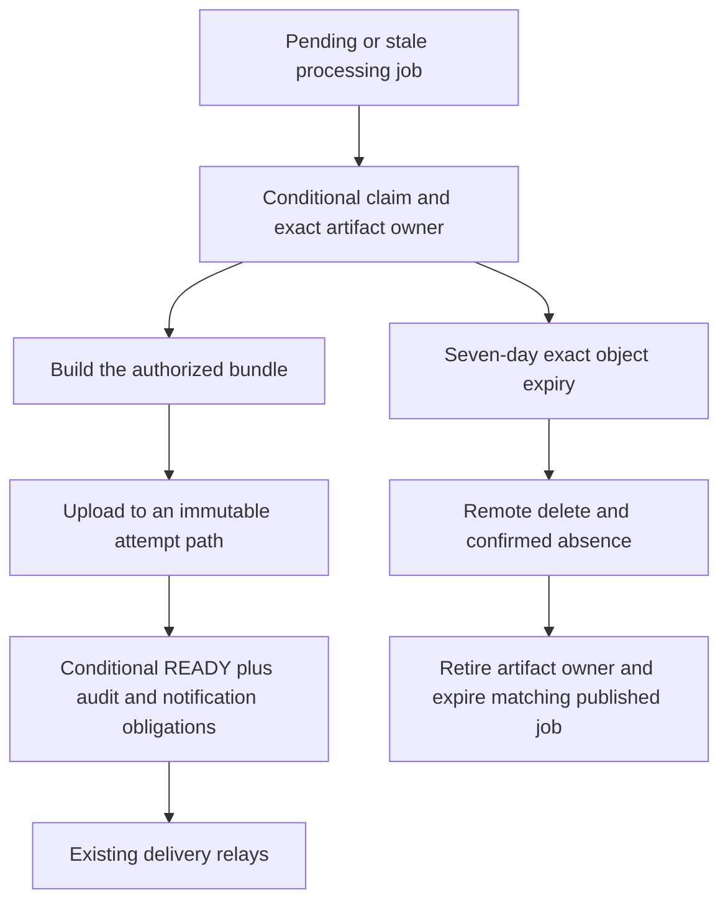

# Worker recovery and durable obligations

The scheduler supplies opportunities to work. Postgres owns the work and its
history. A successful HTTP request, an acquired lease and a completed business
obligation are three different observations. This guide explains the contracts
used by the export, booking-expiry and invoice-capture workers; see the
[generated inventory](04-cron-jobs-reference.md) for the complete configured
roster and the [scheduler reference](10-cron-and-reconciliation-reference.md)
for dispatch, maintenance admission and lease behavior.

## Responsibilities and execution lanes

| Component                           | Responsibility                                                                | Evidence it cannot establish alone                                |
| ----------------------------------- | ----------------------------------------------------------------------------- | ----------------------------------------------------------------- |
| Platform ticker                     | Dispatch due registry targets with the catalog's limits, offsets and windows  | Business completion or sufficient backlog capacity                |
| Cleanup registry and admin run door | Authenticate, validate request bounds and invoke the canonical implementation | Cancellation of a previously started invocation                   |
| Postgres job lease                  | Refuse concurrent admission of the same fail-closed core                      | Row ownership after reclaim; serialization across different jobs  |
| Domain transaction                  | Commit an eligible transition with the obligations it creates                 | Vendor acceptance or delivery                                     |
| Refund, email and bell relays       | Retry the existing durable markers/outboxes using stable identities           | An exactly-once vendor effect outside its idempotency contract    |
| Operational health                  | Check recent owned successful completions in this deployment environment      | Absence of overdue rows or proof that the human received an alert |

The five-minute Netlify ticker is the current operating clock for time-sensitive
recovery and the configured money jobs. Export processing runs every ten minutes;
stale-request expiry runs every fifteen. GitHub Actions retains CI and the
remaining configured non-money batch jobs. Do not create a second automatic
scheduler for a ticker-owned job. An Actions cron expression is configuration,
not evidence of current budget, execution or successful effects.

Netlify remains the standby build target. A new active host needs an equivalent
ticker and execution adapters, including background functions. The fleet key
selects dispatch ownership but fails open when absent or unreadable; it is not an
exactly-once lock. Changing hosting does not change these domain contracts.

## Export claim and publication

`process-data-exports` has one implementation in
`scripts/cleanup/process-data-exports.ts`. Its Postgres lease fails closed.
`OrgDataExportJob` retains the existing PENDING, PROCESSING, READY, FAILED and
EXPIRED lifecycle. A stale PROCESSING claim becomes eligible after the long-job
lease duration; an active claim stays ineligible. Reclaim updates `startedAt` to
a distinct millisecond value. That timestamp is the attempt identity, and every
terminal update requires both PROCESSING and that exact identity in its WHERE.

A competing invocation that loses the claim does no export work. A superseded
attempt cannot publish READY or FAILED and cannot overwrite a newer attempt's
bytes: uploads use separate paths without upsert. The publication transaction
stages the existing delivery obligations along with READY and its audit. Vendor
notification delivery happens outside that transaction. A process death after
commit leaves the existing relays responsible for notification delivery.

Organization-visible failure text is a fixed safe message. Engineering-only
system events carry diagnostics keyed by export ID. Neither public results nor
outbox payloads should expose a storage bearer URL or raw database exception.
Generation still has a whole-bundle memory footprint; one selected job is a row
bound, not a proof of acceptable size or execution time for a large organization.

## Exact storage ownership and access

`OrgDataExportArtifact` records the bucket, immutable storage path, attempt
identity and expiry before upload. It deliberately has no organization/job
foreign key: deleting a parent must not erase the remote deletion obligation.
It is a purpose-specific object owner, not another queue or job-state machine.

All attempts retain their owner until the seven-day expiry, including an upload
whose publication failed or lost ownership. Cleanup does not treat an immediate
absence response as permission to forget a still-live upload. This grace relies
on the supported invocation and vendor transport bounds being far shorter than
seven days; changing those runtimes requires reviewing that assumption.

The same core processes a bounded expiry slice and rotates deletion attempts so
an unavailable object cannot monopolize the eligible prefix. A remove helper's
boolean alone is insufficient: the export path also reads exact-path metadata
with `info()` and requires a `NoSuchKey` error validated at the boundary. A
missing bucket, generic HTTP 404, failed read or still-present object retains the
owner. `exists()` can return false alongside an error, so its boolean alone is
not deletion evidence. Only after confirmed removal does a transaction retire
that owner and expire the matching published job. Failed notification delivery
never reverses READY.

Mail and bell links open the authenticated export panel. Download checks current
organization access, export kind, READY and expiry, then signs the owner's exact
path for a short interval. A role change prevents a new download grant; an
already issued signed link remains usable under the storage provider's token
and caching contract. Expiry of a download token is not deletion of its bytes.
The requested signing lifetime is calculated after the owner lookup, using a
fresh clock reading and a sixty-second cap. The route refuses to return the URL
if the artifact expires during signing or the audit write. This is an issuance
check; provider-side token expiry and revocation remain the provider's contract.

## Expiry and refund responsibility

A pending consultation and an approved unallocated subscription can both have a
successful payment when they expire. Their winning transaction records EXPIRED,
history and the full remaining refund obligation using the existing payment
marker and arm-specific idempotency key. Failure to stage the complete marker
set rolls back that transition. Notification errors or process death after
commit cannot remove the owed refund.
A concurrent marker-count mismatch rolls back and skips only that request,
preserving the other writer's key and retry state while later requests proceed.
An existing partial marker also holds only its own request, including when its
retry attempts are exhausted. Preserve its amount, key, reason and attempts;
continue later requests and report one aggregate hold error per arm so an
unresolved obligation does not produce a successful completion.
Other staging failures still fail the arm. A skipped request is not proof that
its obligation has completed; the existing marker owner and later sweeps retain
responsibility.

After commit, `driveRefundOwed` invokes the canonical refund door. The existing
`retry-auto-refunds` sweep owns unfinished markers; stable keys preserve replay
identity after an uncertain gateway result. This does not change refund amounts,
rails, attempt ceilings or operator handoff. The already hardened 48-hour paid
unallocated arm keeps its existing contract. The unpaid pending-subscription
cohort continues to exclude successful payments in both selection and mutation.

Legacy approved-unallocated recovery requires the exact automated transition
reason and no actor, positive refundable balance, no existing owed marker and
no live or successful refund under the original key, all before the page limit.
Legacy consultation expiry history is shared with abandoned-payment cleanup;
those ambiguous rows require owner review instead of automatic new refunds.

## Invoice captures and uncertain checkout state

`reconcile-org-invoice-payments` reads the stored gateway order for ISSUED or
OVERDUE invoices and passes a captured INR payment through
`applyOrgInvoiceCapture`. The existing Serializable settlement transaction owns
the receipt, journal, PAID transition, audit and durable notification staging.
The existing email and bell relays deliver after commit. An amount/status
mismatch follows the canonical UNAPPLIED_RECEIPTS path for operator review;
it never starts another charge or invents an automatic refund policy.
The capture locks the payable invoice without clearing its current order
reference. A mismatched late capture preserves a newer checkout; the PAID
transition clears the reference only when settlement succeeds.

Durably parked captures raise an operator finding and HTTP 207 without labeling
a handled liability as a failed worker. Read/transaction failures still fail the
run. An eligible cohort with no admitted read because its budget elapsed also
fails, so repeated cold-start starvation cannot refresh completion health.

The job has one fail-closed Postgres lease. Its execution-result checkpoint
rotates keyset pages, including failures and open orders, then wraps. Each run
selects at most five invoices, stops admitting rows after ten seconds from HTTP
entry and waits at most five seconds for a provider read. These are admission
and await bounds; a timeout does not cancel an SDK request or a database effect.
There is no new polling column or independent queue.

The ticker supplies six opportunities a day, at 03:55, 07:55, 11:55, 15:55,
19:55 and 23:55 UTC, with a 24-second HTTP abort. Some existing hours already
occupy all 120 dispatch slots. The four-hour phase fits the ten-target calendar
bound without weakening existing cadences or moving Stream work. At five rows
per run, the upper bound is 30 candidate reads per day, less under slow/error
conditions. For N continuously eligible invoices, one rotation takes at least
`ceil(N / 5) * 4 hours`; this is not a four-hour per-invoice recovery SLO.
Measure the eligible cohort and recovery age before raising volume. A successful
run within twelve hours only establishes that this capability is executing.

The tenant pay route also checks an existing paid/stale-amount order before
returning another checkout. Gateway errors and inconclusive paid-order reads
fail closed. An empty payment list does not close an unpaid order: a still-open
order with a different amount returns a conflict. New orders are attached by
CAS to a still-payable invoice, with audit in the same transaction; a concurrent
winner is read back and validated. Gateway calls wait at most five seconds each
under a twenty-second request budget. Failed attachment never hands out an
unowned order. The final invoice/order/outstanding check fences local races;
it cannot prevent an external capture after that check.

When a booking refund issues a positive credit note, its transaction already
locks the invoice for the cumulative credit cap. It clears the checkout reference
only on ISSUED/OVERDUE invoices so the next Pay request uses the reduced balance.
Payment-attempt failure callbacks retain the current reference: the same order
can be retried, and a delayed failure must not erase a newer checkout.

This healer covers retained order pointers. Existing bank-receipt and credit
flows can clear a pointer while a previous checkout tab remains open. Finding
an unlogged later capture against such a lost pointer is still a separate
recovery gap; neither this job nor its healthy completion claims to close it.

## Failure boundaries and review evidence

| Interruption or race                          | Durable fact / recovery                                                       |
| --------------------------------------------- | ----------------------------------------------------------------------------- |
| Death after export claim                      | PROCESSING remains; the next eligible stale reclaim changes the attempt token |
| Death after upload, before READY              | Exact artifact owner survives and eventually deletes the unpublished object   |
| Old attempt finishes after reclaim            | Conditional finalization loses; separate upload path preserves the new bytes  |
| Publication transaction fails                 | READY and its audit/outbox do not partially commit                            |
| Notification provider fails after publication | READY remains; existing notification/email relays retry their rows            |
| Delete times out or presence read fails       | Owner stays eligible; no assertion that remote bytes were removed             |
| Organization/job is deleted                   | Artifact owner remains independently until confirmed deletion                 |
| Expiry commits and process dies before refund | Owed marker survives; refund relay continues with the same identity           |
| Another flow wins a booking transition        | Expiry CAS loses and creates no new refund obligation                         |

Mocked tests must exercise these interruptions through the actual core functions,
including losing ownership and error paths. They do not establish deployed
throughput, storage permissions, backlog drain or actual gateway behavior.

## Deployment and operating gates

1. The release owner reviews and applies only the additive artifact table/index
   DDL and exact legacy URL backfill supplied with the PR. Quiesce export work
   for the backfill. Unrecognized pointers are a stop condition; investigate
   their exact identity instead of guessing a bucket.
2. Read back the catalog, run the read-only schema-required check and verify the
   legacy rows have exact owners before deploying readers that require them.
   Prisma client generation does not apply the schema. Coding agents do not run
   this SQL, schema push, Redis writes or environment changes.
3. Deploy through the existing release flow. The old application must not resume
   writing legacy unowned artifacts during a rollback; reconcile that boundary
   before reverting code. Preserve artifact rows and bytes while investigating.
   Before enabling this version's legacy refund recovery, run the read-only
   [cohort preflight](refund-recovery-preflight.sql). It uses the worker's exact
   eligibility predicates without LIMIT and groups counts by gateway and
   `isMockPayment`, including missing gateway-payment IDs. Dev/prod share this
   database: a non-mock flag alone does not prove live origin. The owner must
   review seed/test exposure and approve the eligible cohort before deployment;
   this query stages no marker and drives no refund. Zero rows mean an empty
   current snapshot, not a future guarantee. Timeout or missing catalog data is
   unavailable evidence and must be resolved before rollout.
4. Verify actual worker completion and a bounded representative export on the
   deployed host, then inspect expiry retries, oldest eligible work and refund
   obligations. Whole-bundle size and outage catch-up need measured evidence.
5. `/api/health/jobs` requires `process-data-exports` and `expire-stale-requests`
   completion within 45 minutes, independently of other capabilities. The
   endpoint is environment scoped and read-only; a held or failed invocation
   does not refresh it. Independent monitoring must poll it and route an alert.

Monitor configuration and human alert receipt remain separate deployment gates.
The pending missed-run exercise is not completed by this code change. Existing
storage/retention safety PRs, reminder recovery, lost invoice-order references,
remaining Actions coverage, environment isolation and full-service restore proof
also retain their owners. This PR does not establish a readiness percentage.

## Primary references

Verified on 2026-10-26:

- [Supabase private asset downloads](https://supabase.com/docs/guides/storage/serving/downloads): signed URLs are temporary bearer access, distinct from application authorization.
- [Supabase standard uploads](https://supabase.com/docs/guides/storage/uploads/standard-uploads): enabling upsert permits overwrites; immutable attempt paths avoid shared-key replacement.
- [Razorpay order read-back](https://razorpay.com/docs/api/orders/fetch-with-id/) and [order payments](https://razorpay.com/docs/api/orders/fetch-payments/): server-side order and capture evidence are read separately; an empty payment list does not close an order.
- [Prisma v7 transactions](https://docs.prisma.io/docs/orm/v7/prisma-client/queries/transactions): atomic writes and optimistic concurrency checks; keep interactive transactions short and use their transaction client.

## Deprecated & Superseded Approaches

The export worker previously selected PENDING only. A killed PROCESSING attempt
could remain invisible forever. It uploaded with upsert to a shared job path and
stored a seven-day bearer URL on the job; that URL was also sent in notifications.
Expiry checks blocked dashboard access but did not establish remote deletion.
The attempt owner, immutable path and confirmed expiry now carry those duties.

Export notices previously ran inside the generation catch boundary after READY
committed. A notice failure could overwrite the successful export as FAILED and
store raw error text in an organization-visible field. Atomic notification
staging and safe public errors replace that coupling.

The two older money-capable expiry arms previously retained IDs only in process
memory and called refunds after the transition and notices. Recording the owed
refund in the winning transaction closes that process-death gap. Existing
refund policies and the unpaid cohort remain unchanged.
