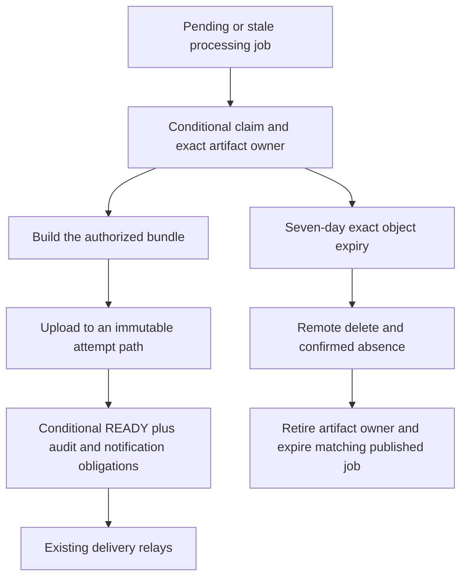

# Worker recovery and durable obligations

The scheduler supplies opportunities to work. Postgres owns the work and its
history. A successful HTTP request, an acquired lease and a completed business
obligation are three different observations. This guide explains the contracts
used by the export, booking-expiry and invoice-capture workers; see the
[generated inventory](04-cron-jobs-reference.md) for the complete configured
roster and the [scheduler reference](10-cron-and-reconciliation-reference.md)
for dispatch, maintenance admission and lease behavior.

## Responsibilities and execution lanes

| Component                           | Responsibility                                                                | Evidence it cannot establish alone                                |
| ----------------------------------- | ----------------------------------------------------------------------------- | ----------------------------------------------------------------- |
| Platform ticker                     | Dispatch due registry targets with the catalog's limits, offsets and windows  | Business completion or sufficient backlog capacity                |
| Cleanup registry and admin run door | Authenticate, validate request bounds and invoke the canonical implementation | Cancellation of a previously started invocation                   |
| Postgres job lease                  | Refuse concurrent admission of the same fail-closed core                      | Row ownership after reclaim; serialization across different jobs  |
| Domain transaction                  | Commit an eligible transition with the obligations it creates                 | Vendor acceptance or delivery                                     |
| Refund, email and bell relays       | Retry the existing durable markers/outboxes using stable identities           | An exactly-once vendor effect outside its idempotency contract    |
| Operational health                  | Check recent owned successful completions in this deployment environment      | Absence of overdue rows or proof that the human received an alert |

The five-minute Netlify ticker is the current operating clock for time-sensitive
recovery and the configured money jobs. Export processing runs every ten minutes;
stale-request expiry runs every fifteen. GitHub Actions retains CI and the
remaining configured non-money batch jobs. Do not create a second automatic
scheduler for a ticker-owned job. An Actions cron expression is configuration,
not evidence of current budget, execution or successful effects.

Netlify remains the standby build target. A new active host needs an equivalent
ticker and execution adapters, including background functions. The fleet key
selects dispatch ownership but fails open when absent or unreadable; it is not an
exactly-once lock. Changing hosting does not change these domain contracts.

## Export claim and publication

`process-data-exports` has one implementation in
`scripts/cleanup/process-data-exports.ts`. Its Postgres lease fails closed.
`OrgDataExportJob` retains the existing PENDING, PROCESSING, READY, FAILED and
EXPIRED lifecycle. A PROCESSING claim becomes eligible after the core
claim threshold of 35 minutes; younger claims stay ineligible. This is separate
from the job lease: Netlify caps it at 90 seconds with 30-second renewal, while
other hosts retain the requested TTL. Renewal loss does not cancel a running
core. Reclaim updates `startedAt` to
a distinct millisecond value. That timestamp is the attempt identity, and every
terminal update requires both PROCESSING and that exact identity in its WHERE.

A competing invocation that loses the claim does no export work. A superseded
attempt cannot publish READY or FAILED and cannot overwrite a newer attempt's
bytes: uploads use separate paths without upsert. The publication transaction
stages the existing delivery obligations along with READY and its audit. Vendor
notification delivery happens outside that transaction. A process death after
commit leaves the existing relays responsible for notification delivery.
Postcommit delivery logs retain the operation and export ID, never raw provider
exceptions or transport payloads. Notice failure still preserves READY.

Organization-visible failure text is a fixed safe message. Engineering-only
system events carry diagnostics keyed by export ID. Neither public results nor
outbox payloads should expose a storage bearer URL or raw database exception.
Generation still has a whole-bundle memory footprint; one selected job is a row
bound, not a proof of acceptable size or execution time for a large organization.

## Exact storage ownership and access

`OrgDataExportArtifact` records the bucket, immutable storage path, attempt
identity and expiry before upload. It deliberately has no organization/job
foreign key: deleting a parent must not erase the remote deletion obligation.
It is a purpose-specific object owner, not another queue or job-state machine.

All attempts retain their owner until the seven-day expiry, including an upload
whose publication failed or lost ownership. Cleanup does not treat an immediate
absence response as permission to forget a still-live upload. This grace relies
on the supported invocation and vendor transport bounds being far shorter than
seven days; changing those runtimes requires reviewing that assumption.

The same core processes a bounded expiry slice and rotates deletion attempts so
an unavailable object cannot monopolize the eligible prefix. A remove helper's
boolean alone is insufficient: the export path also reads exact-path metadata
with `info()` and requires a `NoSuchKey` error validated at the boundary. A
missing bucket, generic HTTP 404, failed read or still-present object retains the
owner. `exists()` can return false alongside an error, so its boolean alone is
not deletion evidence. Only after confirmed removal does a transaction retire
that owner and expire the matching published job. Failed notification delivery
never reverses READY.

Mail and bell links open the authenticated export panel. Download checks current
organization access, export kind, READY and expiry, then signs the owner's exact
path for a short interval. A role change prevents a new download grant; an
already issued signed link remains usable under the storage provider's token
and caching contract. Expiry of a download token is not deletion of its bytes.
The requested signing lifetime is calculated after the owner lookup, using a
fresh clock reading and a sixty-second cap. The route refuses to return the URL
if the artifact expires during signing or the audit write. This is an issuance
check; provider-side token expiry and revocation remain the provider's contract.

## Expiry and refund responsibility

A pending consultation and an approved unallocated subscription can both have a
successful payment when they expire. Their winning transaction records EXPIRED,
history and the full remaining refund obligation using the existing payment
marker and arm-specific idempotency key. Failure to stage the complete marker
set rolls back that transition. Notification errors or process death after
commit cannot remove the owed refund.
A concurrent marker-count mismatch rolls back and skips only that request,
preserving the other writer's key and retry state while later requests proceed.
An existing partial marker also holds only its own request, including when its
retry attempts are exhausted. Preserve its amount, key, reason and attempts;
continue later requests and report one aggregate hold error per arm so an
unresolved obligation does not produce a successful completion.
Exclude those holds before the page limit, with one bounded presence read after
selection per arm to retain their visibility. Preserve previously eligible requests without
an appointment, and recheck markers transactionally for post-selection races.
Other staging failures still fail the arm. A skipped request is not proof that
its obligation has completed; the existing marker owner and later sweeps retain
responsibility.

After commit, `driveRefundOwed` invokes the canonical refund door. The existing
`retry-auto-refunds` sweep owns unfinished markers; stable keys preserve replay
identity after an uncertain gateway result. This does not change refund amounts,
rails, attempt ceilings or operator handoff. The already hardened 48-hour paid
unallocated arm keeps its existing contract. The unpaid pending-subscription
cohort continues to exclude successful payments in both selection and mutation.

Already-expired rows without an owed marker are not selected for retrospective
staging. Neither the sweep nor the single-plan admin door reconstructs a refund
obligation from historical expiry rows. The cutover resets mock data; no cohort
approval, backfill or deployment-time stamping is part of this rollout.
The admin door can still retry a marker already committed by the normal expiry
transaction, without changing its key or resetting retired attempts.

## Invoice captures and uncertain checkout state

`reconcile-org-invoice-payments` reads the stored gateway order for ISSUED, OVERDUE or retained-pointer
PAID invoices and passes a captured INR payment through
`applyOrgInvoiceCapture`. The existing Serializable settlement transaction owns
the receipt, journal, PAID transition, audit and durable notification staging.
The existing email and bell relays deliver after commit. An amount/status
mismatch follows the canonical UNAPPLIED_RECEIPTS path for operator review;
it never starts another charge or invents an automatic refund policy.
The capture locks the payable invoice without clearing its current order
reference. A mismatched late capture preserves a newer checkout; gateway
settlement clears it only after capture accounting. Bank settlement retains it
for gateway inspection.

Durably parked captures raise an operator finding and HTTP 207 without labeling
a handled liability as a failed worker. Read/transaction failures still fail the
run. An eligible cohort with no admitted read because its budget elapsed also
fails, so repeated cold-start starvation cannot refresh completion health.

The job has one fail-closed Postgres lease. Its execution-result checkpoint
rotates keyset pages, including failures and open orders, then wraps. Each run
selects at most five invoices, stops admitting rows after ten seconds from HTTP
entry and waits at most five seconds for a provider read. These are admission
and await bounds; a timeout does not cancel an SDK request or a database effect.
There is no new polling column or independent queue.

The ticker supplies six opportunities a day, at 03:55, 07:55, 11:55, 15:55,
19:55 and 23:55 UTC, with a 24-second HTTP abort. An hour offers 144 dispatch slots
(12 ticks of at most 12 targets), and the busiest tick holds 11. The four-hour phase fits the twelve-target calendar
bound without weakening existing cadences or moving Stream work. At five rows
per run, the upper bound is 30 candidate inspections per day, less under slow/error
conditions. For N continuously eligible invoices, one rotation takes at least
`ceil(N / 5) * 4 hours`; this is not a four-hour per-invoice recovery SLO.
Measure the eligible cohort and recovery age before raising volume. A successful
run within twelve hours only establishes that this capability is executing.

The tenant pay route also checks an existing paid/stale-amount order before
returning another checkout. Gateway errors and inconclusive paid-order reads
fail closed. An empty payment list does not close an unpaid order: a still-open
order with a different amount is replaced only after a bounded payment read
confirms no live payment or capture. New orders are attached by
CAS to a still-payable invoice, with audit in the same transaction; a concurrent
winner is read back and validated. Gateway calls wait at most five seconds each
under a twenty-second request budget. Failed attachment never hands out an
unowned order. The final invoice/order/outstanding check fences local races;
it cannot prevent an external capture after that check.

Booking-refund credit notes and bank receipts preserve the old order reference,
including when bank receipts settle the invoice PAID. No gateway call runs inside
those transactions. The healer includes retained PAID references: an additional
capture goes through canonical settlement into UNAPPLIED_RECEIPTS, then the exact
PAID/order pointer is conditionally retired with its audit in that transaction.
Captured amounts must be positive safe integers in INR at the provider-read
boundary; invalid evidence throws and retains the recovery reference.
An empty payment read requires a second order read confirming identity, currency
and created/attempted status before retirement. A paid order with no visible
capture, a live payment or unreadable evidence retains the pointer.

Checkout inspects before replacing a stale-amount unpaid order. Attachment CASes
the inspected ID, recomputes debt and records the replaced ID in its initiation
audit. Concurrent credit changes cannot install an old-amount order.
Payment-attempt failure callbacks preserve the current reference.
A capture with an existing unreleased unapplied receipt stays parked even if
a later read matches the invoice balance. Automatic recovery must not settle
those same cash funds a second time; operator reconciliation owns release.
Before config-enabled suspension, dunning reads the retained gateway order with
a five-second wait cap inside a ten-second stage admission budget, starting
when the suspension stage begins. A discovered
capture uses the same canonical settlement and durable notices. Live, uncertain
or parked evidence holds suspension and records a failed check. The suspension
transaction rechecks positive net debt and CASes the inspected order reference.
This guard reduces dependence on healer throughput; lost references and the
status-based reminder cohorts remain explicit coverage limits.

These reads protect captures already visible at inspection, not later provider
effects. [Razorpay order states](https://razorpay.com/docs/api/orders/fetch-with-id/?preferred-country=IN)
keep created/attempted orders payable; changing the local pointer never revokes an
old checkout tab. A capture after inspection/replacement can still need a webhook
or operator recovery. Retirement/initiation audits retain the order ID for
forensics, not an automatically consumed history. Invoice VOID and overage-credit
paths still clear their references outside this adjustment flow. Healthy completion
does not prove those gaps closed. The [order-payments endpoint](https://razorpay.com/docs/api/orders/fetch-payments/?preferred-country=IN)
is the read boundary; no charge, capture or refund is initiated by inspection.

## Failure boundaries and review evidence

| Interruption or race                          | Durable fact / recovery                                                       |
| --------------------------------------------- | ----------------------------------------------------------------------------- |
| Death after export claim                      | PROCESSING remains; the next eligible stale reclaim changes the attempt token |
| Death after upload, before READY              | Exact artifact owner survives and eventually deletes the unpublished object   |
| Old attempt finishes after reclaim            | Conditional finalization loses; separate upload path preserves the new bytes  |
| Publication transaction fails                 | READY and its audit/outbox do not partially commit                            |
| Notification provider fails after publication | READY remains; existing notification/email relays retry their rows            |
| Delete times out or presence read fails       | Owner stays eligible; no assertion that remote bytes were removed             |
| Organization/job is deleted                   | Artifact owner remains independently until confirmed deletion                 |
| Expiry commits and process dies before refund | Owed marker survives; refund relay continues with the same identity           |
| Another flow wins a booking transition        | Expiry CAS loses and creates no new refund obligation                         |

Mocked tests must exercise these interruptions through the actual core functions,
including losing ownership and error paths. They do not establish deployed
throughput, storage permissions, backlog drain or actual gateway behavior.

## Deployment and operating gates

1. The release owner applies only the reviewed additive artifact table/index
   DDL in `prisma/sql/org-data-export-artifacts.sql` after code readiness.
   There is no data migration or retrospective marker creation. Existing mock
   rows are reset through the owner's cutover procedure, not repaired by this PR.
2. Read back the catalog and run the read-only required-schema check before
   deploying readers. Prisma client generation does not apply the schema.
   Coding agents do not apply SQL, push schema, or change Redis/environment state.
3. Deploy through the existing release flow. New export attempts create their
   own exact artifact owner. An old pointer without an owner is not adopted or
   served by fallback. Preserve owned artifacts and bytes on rollback; an
   incompatible old writer must not create new unowned artifacts.
4. Verify actual worker completion and a bounded representative export on the
   deployed host, then inspect expiry retries, oldest eligible work and refund
   obligations. Whole-bundle size and outage catch-up need measured evidence.
5. `/api/health/jobs` requires `process-data-exports` and `expire-stale-requests`
   completion within 45 minutes, independently of other capabilities. The
   endpoint is environment scoped and read-only; a held or failed invocation
   does not refresh it. Independent monitoring must poll it and route an alert.

Monitor configuration and human alert receipt remain separate deployment gates.
The ticker missed-run email path has a verified receipt in the
[operating guide](13-readiness-and-operating-gates.md#error-reporting-scheduler-absence-and-worker-completion);
that receipt does not establish per-worker alert coverage. Existing
storage/retention safety PRs, reminder recovery, lost invoice-order references,
remaining Actions coverage, environment isolation and full-service restore proof
also retain their owners. This PR does not establish a readiness percentage.

## Primary references

Verified on 2026-10-26:

- [Supabase private asset downloads](https://supabase.com/docs/guides/storage/serving/downloads): signed URLs are temporary bearer access, distinct from application authorization.
- [Supabase standard uploads](https://supabase.com/docs/guides/storage/uploads/standard-uploads): enabling upsert permits overwrites; immutable attempt paths avoid shared-key replacement.
- [Razorpay order read-back](https://razorpay.com/docs/api/orders/fetch-with-id/) and [order payments](https://razorpay.com/docs/api/orders/fetch-payments/): server-side order and capture evidence are read separately; an empty payment list does not close an order.
- [Prisma v7 transactions](https://docs.prisma.io/docs/orm/v7/prisma-client/queries/transactions): atomic writes and optimistic concurrency checks; keep interactive transactions short and use their transaction client.

## Deprecated & Superseded Approaches

The export worker previously selected PENDING only. A killed PROCESSING attempt
could remain invisible forever. It uploaded with upsert to a shared job path and
stored a seven-day bearer URL on the job; that URL was also sent in notifications.
Expiry checks blocked dashboard access but did not establish remote deletion.
The attempt owner, immutable path and confirmed expiry now carry those duties.

Export notices previously ran inside the generation catch boundary after READY
committed. A notice failure could overwrite the successful export as FAILED and
store raw error text in an organization-visible field. Atomic notification
staging and safe public errors replace that coupling.

The two older money-capable expiry arms previously retained IDs only in process
memory and called refunds after the transition and notices. Recording the owed
refund in the winning transaction closes that process-death gap. Existing
refund policies and the unpaid cohort remain unchanged.
