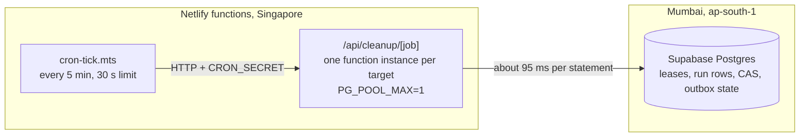
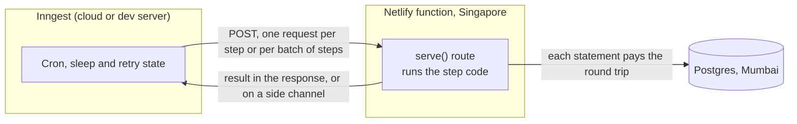
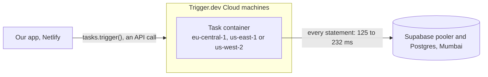
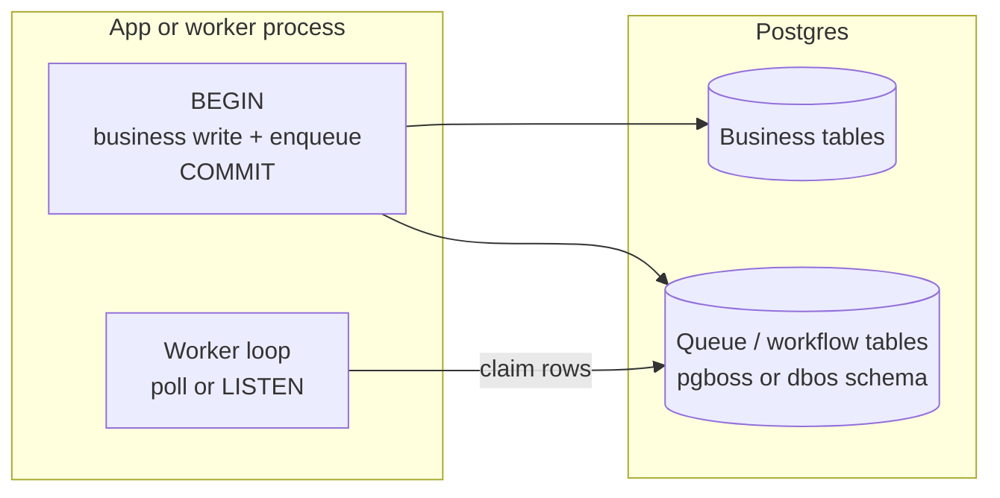

# Background-job runtime options and what the 2026-10-31 experiments showed

This page explains where background jobs can run, what each candidate runtime actually does with our code, and what four throwaway experiments measured on 2026-10-31. It is evidence for decisions the owner has already taken. It does not take a new one. The decisions are in [Ticker through launch, the scale path, the phase 2 queue and the database plan](../decisions/2026-10-31-ticker-scale-path-and-queue.md) and [Architecture at scale](../decisions/2026-10-30-architecture-at-scale-review.md). The evidence record, with the open questions for the owner, is [Job-runtime experiments](../decisions/2026-10-31-job-runtime-experiments.md). The raw reports are indexed in [the experiment folder](./experiments/2026-10-31-job-runtime/README.md).

The last two experiments, a lock-hold and interference measurement and a static-egress check, are in section 4. One detail is still open: which Trigger.dev paid plan includes static IPs.

## 1. Today: the Netlify ticker

All 76 registered jobs run from one Netlify scheduled function, `netlify/functions/cron-tick.mts`, every five minutes. Each tick calls the due jobs over HTTP at `/api/cleanup/[job]`, and the six long Stream and recording jobs through Netlify background functions. Every job has one implementation in `lib/cron/cleanup-registry.ts`. A run is a bounded slice: a `?limit=`, a deadline, a saved cursor and a Postgres lease taken by `withCronLock` (`lib/cron/with-cron-lock.ts`, backed by `SystemJobExecution`).

The scheduler and the compute are the same platform. The experiments below ask what changes when only the scheduler moves (Inngest), when both move to someone else's machines (Trigger.dev), or when the queue moves into the database and a long-lived worker reads it (pg-boss, DBOS).

## 2. What each runtime does with our code

### 2.1 Inngest replaces the scheduler, not the compute

Inngest never runs our code. It calls an HTTP endpoint that we host, built with the SDK's `serve()` adapter. On Netlify that endpoint is an ordinary Next.js route function, so it has the same Singapore location, the same one connection and the same time limits as every other route.

The experiment ran the SDK (`inngest` 4.26.2) against the local Inngest dev server behind a proxy that answers 504 after 26 seconds, which is the edge timeout measured on this site. Its results:

| Setup                                      | Result                                                                                                                                                                                                                 |
| ------------------------------------------ | ---------------------------------------------------------------------------------------------------------------------------------------------------------------------------------------------------------------------- |
| Three 1 s steps, default checkpointing     | One request for the three steps.                                                                                                                                                                                       |
| Same steps, `checkpointing: false`         | Four requests: one per step and one to finish.                                                                                                                                                                         |
| One 40 s step, checkpointing off           | The proxy answered 504 at 26 s on every attempt. Inngest retried after about 31 s and about 60 s, then marked the function failed. The step body ran to the end each time, so its side effect was written three times. |
| One 40 s step, checkpointing on            | The 504 still happened, but the result reached Inngest on a side channel, so the retry found the step already done and the side effect ran once.                                                                       |
| Ten 5 s steps, default (`maxRuntime` 10 s) | Seven requests, each at most 10 s, no 504.                                                                                                                                                                             |
| Ten 5 s steps, `maxRuntime: "20s"`         | Five requests, the longest 20.1 s, no 504.                                                                                                                                                                             |
| Ten 5 s steps, `maxRuntime: 0` (no cap)    | The proxy answered 504 at 26 s although the function kept running for 50 s. Inngest retried, and the last step ran twice at the same time.                                                                             |
| `step.sleep("10s")`                        | Two sub-millisecond requests 10 s apart. Nothing was held open on our side.                                                                                                                                            |
| Cron every minute                          | One request per minute, on the minute, sent by the dev server.                                                                                                                                                         |

Four conclusions follow, and each names its limit.

- **Inngest does not lift the host limit.** One step must fit inside one request. A single step longer than the 26 s edge cut returns a timeout to Inngest. With checkpointing off it failed on each of three attempts and ran its side effect three times. With checkpointing on, the result reached Inngest on a side channel in the one run measured, so the retry did not repeat the step, but that is not guaranteed. The SDK setting `checkpointing.maxRuntime` (default 10 s for `serve`) only splits a sequence of short steps into several requests, and it is checked between steps, never in the middle of one. Set it below the host limit minus the longest step.
- **At-least-once still applies.** The host keeps running after the edge answers 504, so a retry can repeat a side effect. Checkpointing can hide this, but it is not a guarantee.
- **Sleep and cron are Inngest's.** That is what Inngest sells: a durable timer outside our process. It would be a second scheduler beside the ticker, which `AGENTS.md` rule 4 forbids unless it replaces the ticker.
- **Inngest Connect** is the SDK mode where our process holds an outbound connection to Inngest and receives work over it. The SDK documents a five-minute default for it, but it needs a process that stays alive, which Netlify functions are not. The experiment did not exercise Connect.

The experiment used the local dev server only. Behaviour of Inngest Cloud, including its pricing and plan limits, was not measured.

### 2.2 Trigger.dev Cloud runs our code, but not near Mumbai

Trigger.dev runs the task on its own machines. A task that queries Postgres therefore runs in the region Trigger.dev offers, and the account used accepted only `us-east-1`, `us-west-2` and `eu-central-1`. Requests for `ap-south-1` and `ap-southeast-1` were rejected, so there is no Asian region to choose.

Each row below is the median of 50 `SELECT 1` round trips to the Mumbai pooler on the transaction port (6543). The session port (5432) differed by less than 5 ms.

| Where the code runs                                    | Median round trip | Connect (TCP, TLS, auth) | 20-query mix, total |
| ------------------------------------------------------ | ----------------: | -----------------------: | ------------------: |
| Laptop in India (not representative)                   |           39.4 ms |               251–277 ms |      1,050–1,078 ms |
| Trigger.dev `eu-central-1` (Frankfurt)                 |            125 ms |               742–777 ms |      2,605–3,679 ms |
| Trigger.dev `us-east-1`                                |            185 ms |                 1,123 ms |            3,986 ms |
| Trigger.dev `us-west-2`                                |            232 ms |                 1,408 ms |            4,811 ms |
| Trigger.dev, no region given                           |            185 ms |                 1,122 ms |            3,866 ms |
| Netlify Singapore, from the ADR (not re-measured here) |       about 95 ms |                      n/a |                 n/a |

Reading the table:

- **The best Trigger.dev region is slower than Netlify today.** Frankfurt at about 125 ms is roughly a third worse than Singapore at about 95 ms, and an unset region lands in `us-east-1`, nearly twice as slow. Moving a chatty job to Trigger.dev makes its database time worse.
- **Connect cost is six to six and a half round trips**, so a task must reuse its connection.
- **Cost per run** for the probe, which makes over a hundred serial round trips, was 0.035 to 0.124 US cents depending on region and machine size, on a base fee of 0.0025 cents. A `micro` machine ran the same speed at half the price.
- **Egress IPs are dynamic on the Free plan and static only on paid plans.** Trigger.dev's changelog says static IPs are "available for paid customers", per region (`us-east-1`, `us-west-2`, `eu-central-1`), and lists them on a dashboard Regions page. Whether Hobby ($10 a month) qualifies or only Pro ($50), how many addresses each region has and whether it costs extra are UNVERIFIED: no official page states them. RazorpayX would need the static address, see [section 4.4](#44-can-razorpayx-static-egress-be-solved-on-netlify).

The vendor facts here were read from Trigger.dev's changelog and pricing page on 2026-10-31. The documentation pages for regions and static IPs returned 404 on that date, so they could not be cross-checked.

### 2.3 pg-boss and DBOS keep the queue in Postgres

Both libraries store their jobs in the database and run workers in our own process. The enqueue happens inside the caller's transaction, so a rolled-back business change leaves no job behind. Neither is a hosted service, and neither supplies compute: a long-lived worker process must exist somewhere, ideally in Mumbai.

The experiment ran pg-boss 12.38.0 and DBOS Transact 5.4.0 on a local Postgres 16, through a local PgBouncer in transaction mode, and finally through the Supabase Mumbai poolers using throwaway `lab_` schemas that were dropped afterwards.

| Check                                             | pg-boss 12.38                                                                                                                                                            | DBOS 5.4                                                                                                                             |
| ------------------------------------------------- | ------------------------------------------------------------------------------------------------------------------------------------------------------------------------ | ------------------------------------------------------------------------------------------------------------------------------------ |
| Enqueue inside the caller's transaction           | Correct. Rollback left 0 jobs, commit left 1 (`db` option).                                                                                                              | Correct. Rollback left 0 workflows, commit left 1 (`enqueueInTransaction`, same database only).                                      |
| Through the Supabase 6543 and 5432 poolers        | Worked on both.                                                                                                                                                          | Worked on both, with the pool caveat below.                                                                                          |
| Cron, two workers, local                          | One job per minute for 7 minutes.                                                                                                                                        | One workflow per minute for 6 minutes; the id contains the minute, so a duplicate is refused.                                        |
| Cron on Supabase, first minute after `schedule()` | A second job fired 30 s after the first, in 2 of 2 runs, on both poolers. Steady state was once a minute. Cause not found; clock skew was 80 ms.                         | Fired once per minute on 6543; not run on 5432.                                                                                      |
| Concurrency limit of 2, two workers               | Up to 4 ran at once, because the limit is per process.                                                                                                                   | 2 at once, because the limit is global.                                                                                              |
| Kill -9 during step 2 of 3                        | The whole job reran after about 65 s (a 60 s monitor interval is the floor). Step 1's side effect ran twice. With default settings recovery would take about 15 minutes. | The workflow resumed about 3 s after restart. Step 1 did not rerun; its side effect ran once. Only the same executor id recovers it. |
| Connections per idle worker                       | 3 to 5.                                                                                                                                                                  | 3 to 4, one of them idle in transaction.                                                                                             |
| Enqueue-to-start latency, local                   | About 1 s polling; about 7 ms with LISTEN/NOTIFY on both the instance and each queue.                                                                                    | About 0.2 s polling.                                                                                                                 |
| LISTEN/NOTIFY through a transaction pooler        | Not used in the Supabase run.                                                                                                                                            | Failed on 6543 and fell back to polling; worked on 5432.                                                                             |
| Operator view                                     | Free `@pg-boss/dashboard` ran and listed the queues.                                                                                                                     | SQL on the `dbos` schema only. The UI and MCP server are part of the paid Conductor.                                                 |

Three results deserve plain statements.

- **DBOS has a pool floor.** It keeps an advisory-lock transaction open with a 5-second idle-in-transaction timeout. With `systemDatabasePoolSize: 2` that connection was starved, Postgres killed it, and the process crashed on both poolers. With the default pool of 10 it was stable. The true minimum between 2 and 10 was not measured. This rules DBOS out inside a Netlify function (`PG_POOL_MAX=1`, enforced in `lib/prisma.ts`) and means it needs its own pool on a long-lived host.
- **Both need idempotent handlers.** pg-boss reruns the whole job after a crash and can fire a duplicate cron job in its first minute. DBOS narrows the window by checkpointing each step, but a step that crashes between its side effect and its checkpoint still repeats.
- **Version pinning matters for DBOS.** A worker on a non-latest application version stopped dequeuing client-enqueued work until a stray version row was removed. Pin `DBOS__APPVERSION` in deploys.

## 3. The evidence in one table

The table lists the measured facts and the source report of each, so that a reader can find the log behind a claim.

| Fact                                                                                                                                                                                                                                                                                                                              | Measured by                                                        | Source report                                                                              |
| --------------------------------------------------------------------------------------------------------------------------------------------------------------------------------------------------------------------------------------------------------------------------------------------------------------------------------- | ------------------------------------------------------------------ | ------------------------------------------------------------------------------------------ |
| A 26 s edge 504 fails a 40 s Inngest step on every retry; the side effect runs 3 times                                                                                                                                                                                                                                            | Inngest dev server behind a 504 proxy                              | [inngest-on-serverless](./experiments/2026-10-31-job-runtime/inngest-on-serverless.md)     |
| `maxRuntime` splits step sequences (7 requests at 10 s, 5 at 20 s)                                                                                                                                                                                                                                                                | Same                                                               | Same                                                                                       |
| Trigger.dev round trip to the Mumbai pooler: 125, 185, 232 ms by region                                                                                                                                                                                                                                                           | Real Trigger.dev Cloud runs                                        | [trigger-dev-latency](./experiments/2026-10-31-job-runtime/trigger-dev-latency.md)         |
| No Asian Trigger.dev region accepted                                                                                                                                                                                                                                                                                              | Same                                                               | Same                                                                                       |
| pg-boss and DBOS enqueue transactionally and work through the Supabase poolers                                                                                                                                                                                                                                                    | Local plus Supabase Mumbai                                         | [pg-boss-vs-dbos](./experiments/2026-10-31-job-runtime/pg-boss-vs-dbos.md)                 |
| DBOS pool 2 crashes; pool 10 is stable                                                                                                                                                                                                                                                                                            | Supabase Mumbai                                                    | Same                                                                                       |
| pg-boss first-minute duplicate cron job, 2 of 2 runs                                                                                                                                                                                                                                                                              | Supabase Mumbai                                                    | Same                                                                                       |
| Crash recovery: DBOS about 3 s with one side effect; pg-boss about 65 s with two                                                                                                                                                                                                                                                  | Local                                                              | Same                                                                                       |
| A 10-round-trip lock hold is 1,258 ms from Frankfurt and 395 ms from a laptop; a blocked update waits about 1.1 s against 37.6 ms with no job                                                                                                                                                                                     | Real Trigger.dev run plus laptop, scratch table on Supabase        | [lock-hold-and-static-ip](./experiments/2026-10-31-job-runtime/lock-hold-and-static-ip.md) |
| Trigger.dev static IPs are paid-only; which paid plan and how many IPs are UNVERIFIED                                                                                                                                                                                                                                             | Official changelog and pricing page                                | [lock-hold-and-static-ip](./experiments/2026-10-31-job-runtime/lock-hold-and-static-ip.md) |
| Vercel Function in `bom1` to the Mumbai pooler: `SELECT 1` 1–2 ms, a 20-query mix 305–507 ms, the same lock hold 10.6–19.6 ms median                                                                                                                                                                                              | Real Vercel Hobby deployment in `bom1`, raw `pg`                   | [vercel-bom1-latency](./experiments/2026-10-31-job-runtime/vercel-bom1-latency.md)         |
| Vercel Hobby rejects a `*/5` cron (daily only, hour precision) and caps functions at 300 s; Pro allows per-minute cron and 800 s (1,800 s in beta), all with Fluid compute, which is on by default                                                                                                                                | Deploy attempts plus Vercel docs                                   | Same                                                                                       |
| Netlify function in Singapore (`ap-southeast-1`) to the Mumbai pooler: 62–64 ms per round trip with raw `pg`; the 10-round-trip lock hold is 676–707 ms median                                                                                                                                                                    | Real throwaway Netlify site, raw `pg`                              | [netlify-inngest-qstash](./experiments/2026-10-31-job-runtime/netlify-inngest-qstash.md)   |
| Inngest serve mode on real Netlify: a 30 s step got an edge 504 at about 29–31 s while the function kept running, Inngest retried and the side effect ran twice                                                                                                                                                                   | Inngest dev server calling the deployed Netlify function           | Same                                                                                       |
| QStash to a 30 s Netlify function: 504 at 31.3 s, retried, side effect twice. Delay was 1.1 s late; a per-minute schedule fired once per minute. Upstash Workflow `context.run` of 30 s failed at 31.4 s; `context.sleep` cost no function time; `context.call` offloaded the caller's wait but the slow callee still hit the 504 | Local QStash dev server tunnelled to the deployed Netlify function | Same                                                                                       |
| Publishing to QStash after a committed insert, with a failure injected between them, leaves the row without a message (the dual write the outbox guards against)                                                                                                                                                                  | Same                                                               | Same                                                                                       |

Latency numbers measured from a laptop in India are best-case and not representative of any production host. The Trigger.dev, Vercel and Netlify rows were measured from real cloud regions. The earlier figure of about 95 ms per statement from Netlify was measured through Prisma; raw `pg` from the same region measured 62–64 ms, so Prisma's share is the subject of a follow-up measurement.

## 4. Questions the owner asked

### 4.1 Does running jobs on an external machine make a Postgres transaction distributed?

No. A transaction opened by a worker in Frankfurt is still one ACID transaction on one database, and the database enforces it exactly as before: `ledger_txn_balanced`, `payment_legs_sum_to_amount` and `occurrence_no_confirmed_overlap` (all in `prisma/sql/`) are checked at commit regardless of where the client sits. A distributed transaction would need two databases or two resource managers, and none of these options adds one.

What changes is how long the transaction stays open. Every statement waits for a network round trip, so row locks and Serializable snapshots (`withSerializableRetry` in `lib/db/serializable-retry.ts`) are held for longer, and a user request that needs the same rows waits longer or hits a retry. The lock experiment measured this on a scratch table in the shared Supabase project: `SELECT … FOR UPDATE`, eight statements and `COMMIT`, ten round trips in all, at READ COMMITTED. The full report is [lock-hold-and-static-ip](./experiments/2026-10-31-job-runtime/lock-hold-and-static-ip.md). The table gives the time the row lock was held.

| Where the transaction runs                 | Per-statement round trip | Lock held for 10 round trips | Status                                  |
| ------------------------------------------ | -----------------------: | ---------------------------: | --------------------------------------- |
| Trigger.dev `eu-central-1`                 |                 125.8 ms |         1,258 ms (p95 1,259) | Measured, 10 runs                       |
| Laptop in India (not representative)       |                  39.5 ms |             395 ms (p95 406) | Measured, 10 runs                       |
| Netlify Singapore, today                   |              about 95 ms |                 about 950 ms | Extrapolated from a Prisma-level figure |
| Mumbai host, as the scale-path ADR expects |             about 1–2 ms |                  about 20 ms | ESTIMATE, not measured                  |

The hold equals the number of round trips times the round-trip time; database execution time was negligible. The cost to other people is the wait of a competing write. A user, simulated from the laptop, updated the locked row about five times a second:

| Scenario                                          | Updates | Median wait | 95th percentile |
| ------------------------------------------------- | ------: | ----------: | --------------: |
| No job running (20 s baseline)                    |      99 |     37.6 ms |         44.1 ms |
| Update issued while a laptop job held the lock    |      10 |    274.9 ms |        367.9 ms |
| Update issued while a Frankfurt job held the lock |       6 |  1,110.1 ms |      1,272.2 ms |
| Update issued outside any hold (Frankfurt runs)   |      72 |     47.5 ms |         53.6 ms |

Each of the ten Frankfurt holds blocked exactly one update for more than 150 ms. The updater was a closed loop with one request in flight, so this under-counts a real open-loop crowd: at five arrivals a second, a 1.26 s hold would queue about six waiting writes. A single arrival lands at a random point in the hold, so its expected wait is about half the hold, roughly 0.6 s from Frankfurt against roughly 0.2 s from the laptop.

**Serializable.** Two concurrent copies of the same transaction, 20 rounds each, ran at SERIALIZABLE isolation. In both locations exactly one of every pair failed with SQLSTATE 40001 (20 commits and 20 failures per location), because both read and update the same row. The failure rate did not depend on distance; what distance changes is how long the survivor's snapshot stays open. `withSerializableRetry` is the existing guard that retries those failures.

A first Trigger.dev interference run used the laptop's wall clock against the container's clock, was skewed, and was discarded. The numbers above come from the second run, which classified updates by the database clock.

### 4.2 Where does the dual-write risk come from?

It comes from the vendor and its trigger, not from the location. A dual write happens when we commit to the database and then tell a separate system to start the job, as two steps that can fail apart.

**Example.** Priya Anderson cancels Hannah Anderson's 1-hour consultation on Mon 2 Nov 2026 at 10:00 IST and is owed ₹590 (59,000 paise). The cancel route commits the cancellation and stamps a refund-owed marker on the payment (`Payment.refundOwedPaise`, `lib/payments/operations/refund-owed.ts`). Suppose the next line is a call such as `inngest.send()` or `tasks.trigger()` and the network drops. The booking is cancelled and committed, but no hosted engine knows a refund is owed. The vendor now holds half the truth.

There are two fixes, and the repo already has one of them.

- **State as the outbox.** The marker row is the outbox: the job reads database state, so a missed trigger costs nothing. `retry-auto-refunds` (registered in `lib/cron/cleanup-registry.ts`) finishes any marker the process died on. A hosted engine can be added behind this pattern by relaying marker rows afterwards, and the database remains the source of truth.
- **In-database enqueue.** pg-boss and DBOS write the job in the same transaction as the business change, which the experiment proved (rollback leaves no job).

A cron-triggered sweep that reads database state has no enqueue dual write at all, which is why the ticker is safe today.

### 4.3 Do vendor side effects become exactly-once on a better runtime?

No. Razorpay and Stream calls stay at-least-once on every runtime in this page: the Inngest experiment repeated a side effect on a retry, pg-boss reran a whole job after a crash, and even DBOS can repeat a step that crashed between its effect and its checkpoint. What makes them safe is unchanged: gateway idempotency keys, compare-and-swap status writes (`updateMany` with the expected prior status in `WHERE`), and the reconcilers that compare our state with the vendor's.

### 4.4 Can RazorpayX static egress be solved on Netlify?

Yes, and it already is. Live RazorpayX answers only allowlisted IP addresses and Netlify has no static egress address. The earlier finance decision (F1) routes the RazorpayX client alone through a static-IP HTTP proxy, set by `RAZORPAYX_EGRESS_PROXY_URL`. The client refuses live calls without it, with `RAZORPAYX_EGRESS_NOT_CONFIGURED` (`apiRequest` in `lib/payments/payouts/razorpay-payouts.ts`; see [RazorpayX](../finance/40-payouts/04-razorpayx.md)). So the question for any new runtime is cost and added latency, not possibility. The extra hop of that proxy was not measured, and QuotaGuard documents no latency figure. A runtime with its own static address (a Lightsail VM in Mumbai, or a paid Trigger.dev tier if confirmed) could replace the proxy, but only for the code that runs there.

RazorpayX allows up to 20 allowlisted IPs, set by an Owner or Admin, in Live Mode only. The allowlist covers the payout APIs (including contacts and fund accounts), payout links and fund account validation; vendor payments, payroll and dashboard payouts are exempt (razorpay.com/docs/x/dashboard/allowlist-ip, CONFIRMED). The table gives the verified prices of ways to get a fixed address, each with its verification status. The vendor pages were read on 2026-10-31; the full quotes are in [lock-hold-and-static-ip](./experiments/2026-10-31-job-runtime/lock-hold-and-static-ip.md).

| Way to get a static address                | Price                                                                                                         | Status                                                                                                                                                                        |
| ------------------------------------------ | ------------------------------------------------------------------------------------------------------------- | ----------------------------------------------------------------------------------------------------------------------------------------------------------------------------- |
| QuotaGuard Static proxy (the F1 class)     | $19 a month (10 GB), $49 (50 GB), $89 (200 GB), $219 (1 TB, dedicated IPs); a load-balanced pair of IPs       | Prices CONFIRMED. The pricing page lists a Mumbai location and also says data residency is "US or EU", so Mumbai is UNVERIFIED until sales confirm. Latency: none documented. |
| Fixie proxy                                | HTTP plans from free (500 requests) to $5, $19 and $49; SOCKS plans from $9                                   | Locations and IP count UNVERIFIED; no India or Singapore location documented.                                                                                                 |
| AWS Lightsail in Mumbai                    | Plans from $5 a month; a static IP is free while attached, $0.005 an hour if unattached over an hour          | CONFIRMED. Outbound use of the static IP is standard AWS behaviour but not quoted on the page.                                                                                |
| Vercel Static IPs                          | $100 a month per project on Pro, plus regional Private Data Transfer; one IP pair per region, up to 3 regions | Price and plan CONFIRMED. Whether `bom1` can be selected is UNVERIFIED.                                                                                                       |
| Vercel Secure Compute                      | Enterprise only, custom pricing                                                                               | CONFIRMED Enterprise-only.                                                                                                                                                    |
| Netlify Private Connectivity               | Enterprise add-on, no published price; regions Ohio, Frankfurt and London only                                | CONFIRMED. No Singapore or Mumbai region, so it is not on the Free or Pro plan and does not fit.                                                                              |
| GCP Cloud Run `asia-south1` with Cloud NAT | NAT gateway $0.0014 an hour per VM, $0.045 per GiB, external IP $0.005 an hour (about $3.65 a month)          | CONFIRMED prices. How Cloud Run instances count toward the per-VM row is UNVERIFIED.                                                                                          |
| Fly.io static egress                       | $3.60 a month per app-scoped IPv4 per region                                                                  | Price CONFIRMED. The regions table fetched had no Mumbai (`bom`) row.                                                                                                         |
| Trigger.dev paid plans                     | Not stated; Hobby $10 and Pro $50 are the plan prices                                                         | Paid-only CONFIRMED. Which plan, how many IPs and any extra price are UNVERIFIED.                                                                                             |
| Inngest                                    | Not applicable                                                                                                | In serve mode the function runs on our host and leaves from that host's address. That follows from the model; no page states it, so UNVERIFIED as a quotation.                |

## 5. How the experiments bear on the existing decisions

This section reads the evidence against the decisions without changing them.

| Decision                                                          | Effect of the evidence                                                                                                                                                                                                                                                                                                                                                                      |
| ----------------------------------------------------------------- | ------------------------------------------------------------------------------------------------------------------------------------------------------------------------------------------------------------------------------------------------------------------------------------------------------------------------------------------------------------------------------------------- |
| Decision 1: keep the ticker through launch                        | Strengthened. Every alternative either leaves the compute on the same host (Inngest) or moves it farther from the database (Trigger.dev).                                                                                                                                                                                                                                                   |
| Decision 2: trial Vercel `bom1` before about 300 users            | Strongly supported. A real `bom1` function measured 1–2 ms per statement against about 95 ms from Netlify Singapore, and held the 10-round-trip row lock for 10.6–19.6 ms instead of about 1 s. The trial needs Pro, because Hobby allows only a daily cron.                                                                                                                                |
| Decision 3: no hosted job service, because none fixes the latency | Strengthened, with one wording correction. The ADR says these services call back into our functions. That is true of Inngest and QStash, but Trigger.dev runs the code on its own machines. The conclusion holds: its nearest region is slower than Singapore.                                                                                                                              |
| Decision 4: a hand-written Prisma `Job` table with `SKIP LOCKED`  | Neither weakened nor replaced. pg-boss and DBOS work through the poolers, but pg-boss keeps its own schema outside Prisma and DBOS needs its own pool and system tables, which is the reason the ADR gave. The experiment lists what a hand-written queue must still provide: reclaiming a crashed claim quickly, a global concurrency limit, and handlers that tolerate a duplicate start. |
| Issue #2484: one always-on Lightsail VM in Mumbai at $24 a month  | Compatible. The libraries and Inngest Connect all need a long-lived process, which a VM gives. The ticker ADR rejected the $100 to $440 container plan on cost, not a $24 VM, so whether the VM is in scope is an open question for the owner (see the evidence record).                                                                                                                    |

## 6. Where in code

| Concern                                  | Location                                                                            |
| ---------------------------------------- | ----------------------------------------------------------------------------------- |
| The ticker and its target cap            | `netlify/functions/cron-tick.mts`, `MAX_TARGETS_PER_TICK` in `lib/cron/schedule.ts` |
| One implementation per job               | `lib/cron/cleanup-registry.ts`                                                      |
| Job lease in Postgres                    | `withCronLock` in `lib/cron/with-cron-lock.ts`                                      |
| Single-connection pool on Netlify        | `PG_POOL_MAX` handling in `lib/prisma.ts`                                           |
| Serializable retry                       | `withSerializableRetry` in `lib/db/serializable-retry.ts`                           |
| Refund-owed marker (state as the outbox) | `lib/payments/operations/refund-owed.ts`, the `retry-auto-refunds` job              |
| RazorpayX static egress                  | `apiRequest` in `lib/payments/payouts/razorpay-payouts.ts`                          |

## Related research

The longer research this page draws on is in [scale path research](../infrastructure/2026-10-31-scale-path-research.md), [system-design pictures](../infrastructure/2026-10-31-job-runtime-system-designs.md) and [runtime strategy review](../infrastructure/2026-10-31-runtime-strategy-review.md).

## Related issues

#2472 (scale-path research), #2484 (runtime review), #2485 (side-by-side runtime picture), #2466 (ticker and Sentry readiness).

## Deprecated & Superseded Approaches

- **Hosted-engine triggers as a second scheduler.** An earlier plan in the scaling roadmap listed QStash, Inngest and Trigger.dev as ways to queue webhook work. Adopting one beside the ticker would break the one-scheduler rule and, as the dual-write section shows, add a commit-then-call gap. The roadmap's queue section is superseded by the Prisma `Job` table decision.
- **Cron by GitHub Actions.** The Actions-based cron fleet that the roadmap describes was deleted when the minutes budget ran out. Jobs run on the ticker.
