# Background-job runtime options and what the 2026-10-31 experiments showed

This page explains where background jobs can run, who starts them, how far each runtime sits from the database and what happens when a request, a worker or a host fails halfway. It rests on throwaway experiments run on 2026-10-31 and 2026-11-01 against the real Supabase Mumbai database and, where the product allows it, the real vendor service. It is evidence for decisions the owner has already taken. It does not take a new one. The decisions are in [Ticker through launch, the scale path, the phase 2 queue and the database plan](../decisions/2026-10-31-ticker-scale-path-and-queue.md) and [Architecture at scale](../decisions/2026-10-30-architecture-at-scale-review.md). The evidence record, with the open questions for the owner, is [Job-runtime experiments](../decisions/2026-10-31-job-runtime-experiments.md). The raw reports are indexed in [the experiment folder](./experiments/2026-10-31-job-runtime/README.md).

## 1. How to read this page

Every number and vendor claim on this page carries one of these labels. NOT MEASURED marks a claim researched in documentation only. The table defines them.

| Label      | Meaning                                                                                                                                            |
| ---------- | -------------------------------------------------------------------------------------------------------------------------------------------------- |
| MEASURED   | We ran it between 2026-10-31 and 2026-11-01 and the report in the experiment folder holds the raw log. The cloud region is named where it matters. |
| DOCS       | An official vendor page says so. [Section 10](#10-official-sources) gives the page and the quote. We did not run it.                               |
| ESTIMATE   | Arithmetic or reasoning from stated assumptions, with no run behind it.                                                                            |
| UNVERIFIED | No primary source was read, or the page contradicts itself. Do not decide on it.                                                                   |

Laptop numbers are best-case. They come from an Indian residential line about 40 ms from Mumbai and say nothing about any production host. Every other latency below was measured from a real cloud region.

### 1.1 Today's system

The picture shows how the jobs run today: one scheduled function fans out HTTP calls to at most 12 job routes per tick, each route takes a lease, claims a few rows with a compare-and-swap, calls the vendor, and talks to Postgres in Mumbai. Long-running jobs are mostly not the problem. Measured p50 durations are 79–490 ms for typical jobs (for example 490 ms for `reconcile-payment-status` and 275 ms for `reconcile-orphaned-confirmations`), and the busiest tick measured 18.5 s. The real issues, in order, are database distance (about 62 ms per statement, so about 700 ms lock holds), one connection per function (`PG_POOL_MAX=1`), ticker capacity (`MAX_TARGETS_PER_TICK`, 12 per tick), and only then the time limits of a few jobs. Short sweep durations do not prove throughput, though. `transferRecordingsUnlocked` in `lib/stream/recording-transfer-service.ts` selects one recording per run (`take: 1`), and `transfer-recordings` runs every 15 minutes, so scheduled execution admits at most 96 recording attempts a day, with retries using the same slots. Faster SQL or a 900 s Background Function does not raise that bound, and 300 new recordings a day would outrun it with every tick green. Judge a worker pilot on arrival rate, copy duration and bytes, retry rate, the age of the oldest pending item against its source expiry, and recovery headroom, not on user count alone; the same holds for notification, email and export slices, where a fresh run and a successful admission do not prove that owed work is draining (#2492, "Job backlog starvation"). The enforcers are `withCronLock` in `lib/cron/with-cron-lock.ts` for the lease, CAS-in-WHERE status writes for ordering, and the constraints and triggers in `prisma/sql/` as the final referee.

```text
                      every 5 min
 ┌──────────────────────────────────────┐
 │ Netlify Scheduled Function           │  30 s hard limit for the ticker itself
 │ cron-tick.mts  (Singapore)           │
 │  1. which registered jobs are due?    │  ≤12 jobs per tick, spread by offsets
 │  2. POST each one in parallel ───────┼──────────┐
 └──────────────────────────────────────┘          │
                                                   ▼
        ┌────────────────────┐  ┌────────────────────┐  ┌────────────────────┐
        │ /api/cleanup/job-A │  │ /api/cleanup/job-B │  │ …up to 12 per tick │
        │ Netlify Function   │  │ Netlify Function   │  │                    │
        │ ~26–30 s limit     │  │ 1 DB connection    │  │                    │
        │ withCronLock ──────┼──┼─ lease row ────────┼──┼─► one lease holder │
        │  (lease per job)   │  │                    │  │   at a time (9.6)  │
        │ claim ≤N rows      │  │                    │  │                    │
        │ UPDATE … WHERE     │  │ ← compare-and-swap │  │                    │
        │  status = 'OLD'    │  │   (CAS)            │  │                    │
        │ call Razorpay/     │  │                    │  │                    │
        │  Stream/Resend     │  │                    │  │                    │
        └─────────┬──────────┘  └─────────┬──────────┘  └─────────┬──────────┘
                  │ ~62 ms per SQL statement (Singapore → Mumbai)  │
                  ▼                                                ▼
        ┌──────────────────────────────────────────────────────────────────┐
        │ Supabase Postgres (Mumbai)                                       │
        │  • business rows ARE the to-do list (state-as-outbox)            │
        │  • CHECK constraints, triggers, unique indexes = final referee   │
        │  • SystemJobExecution = lease + run history                      │
        └──────────────────────────────────────────────────────────────────┘
```

### 1.2 The three problems every engine keeps

If latency is acceptable, any engine can run the jobs. The three problems below come from background work itself, not from the tool. The repo mitigates them on the paths that persist the obligation in the same transaction as the state change, but not everywhere. The first is the dual write: starting a job is a second step beside the database commit. The second is retries and duplicates: every engine tested ran some side effect two or more times. The third is the time limit per call, which applies only to engines that call Netlify functions. The fixes are the outbox shape (state as the outbox), idempotency keys with CAS-in-WHERE, and small steps or slices.

One known gap sits outside that guarantee, and no engine choice closes it. In `jobs/billing/dunning.ts` the ISSUED to OVERDUE transition and its audit row commit before the overdue notices are sent, so a process death in between loses the first notice, and the next stage-1 sweep no longer selects that invoice (#2489, "Stage overdue notices atomically with dunning"). The admin Run door now applies the outbox shape itself: a `manualRun: "after"` run commits an `AdminRunRequest` row before its 202, and the hourly `drain-admin-run-requests` retries a lost dispatch ([job machinery catalog, section 2.7](11-job-machinery-catalog.md#27-admin-run-requests-dispatch-now-the-ticker-as-backstop)).

```text
                     ANY engine (Inngest, Trigger.dev, QStash, Upstash Workflow,
                     Background Functions, Vercel/Cloudflare Workflows, Restate, DBOS…)
                                            │
       ①  "start job X" ──────────────────►│  if the start is NOT in the same DB transaction
          (send / publish / start())        │  → DB row without a job, or job without a row
                                            │  FIX: outbox row in the same transaction
                                            │       (done where the obligation is persisted
                                            │        atomically; see the gaps above)
                                            ▼
                                    runs your code somewhere
                                            │
       ②  retries ◄─────────────────────────┤  every engine tested ran some side effect 2–3×
          (504, crash, timeout)             │  (QStash 3×, Inngest 2×, Queues 2×, legacy BG fn 3×,
                                            │   Async Workloads up to 29×)
                                            │  FIX: idempotency keys + CAS-in-WHERE
                                            ▼
                                    talks to Postgres
                                            │
       ③  time limit per call ──────────────┤  only for engines that call Netlify functions:
                                            │  Inngest / QStash / Upstash Workflow / Async WL ≈ 30 s
                                            │  per step. BG functions 15 min, Vercel 300–800 s,
                                            │  Trigger.dev / VM / DBOS: none
                                            │  FIX: small steps or slices
```

## 2. The headline comparison

The first matrix says where each runtime's code runs, who triggers it and how far it is from the database. The second says what it does on failure, what it costs and whether it helps with the RazorpayX address allowlist. Both use the same rows. "Round trip" means one statement to the Mumbai pooler. "Lock hold" means a row lock held across a ten-round-trip transaction (`SELECT … FOR UPDATE`, eight statements, `COMMIT`), which is the shape of a refund-owed settlement.

The first matrix covers placement and speed.

| Runtime                               | Where the code runs                                                                                                                           | Who schedules it                                                                         | Round trip to Mumbai pooler                                                                                                                                                                                                                                                                                                                                                                                                                                                                                                                                   | 10-round-trip lock hold                                                                                                                                                                | Duration cap                                                                                                                                 |
| ------------------------------------- | --------------------------------------------------------------------------------------------------------------------------------------------- | ---------------------------------------------------------------------------------------- | ------------------------------------------------------------------------------------------------------------------------------------------------------------------------------------------------------------------------------------------------------------------------------------------------------------------------------------------------------------------------------------------------------------------------------------------------------------------------------------------------------------------------------------------------------------- | -------------------------------------------------------------------------------------------------------------------------------------------------------------------------------------- | -------------------------------------------------------------------------------------------------------------------------------------------- |
| Netlify ticker (today)                | Netlify Functions, Singapore (`ap-southeast-1`)                                                                                               | `netlify/functions/cron-tick.mts`, every 5 min                                           | 62–64 ms raw `pg` (MEASURED); about 95 ms measured through the app earlier                                                                                                                                                                                                                                                                                                                                                                                                                                                                                    | 676–707 ms (MEASURED)                                                                                                                                                                  | Edge cut about 26 s on prod, about 30 s on a throwaway site (MEASURED); scheduled function 30 s, synchronous 60 s (DOCS)                     |
| Netlify Background Functions          | Netlify Background Function, Singapore                                                                                                        | Our ticker or any scheduler POSTs; the caller gets a 202 in 0.65–0.85 s                  | 63.9 ms raw `pg` (MEASURED)                                                                                                                                                                                                                                                                                                                                                                                                                                                                                                                                   | 704 ms (MEASURED)                                                                                                                                                                      | 900 s: 840 s completed, 960 s killed (MEASURED); 15 min (DOCS)                                                                               |
| Netlify Async Workloads               | Netlify Functions (standard: any step of 30 s or more fails) or Background Functions (60, 300 and 840 s steps ran); state in site Blobs       | `send()` from our code; the extension's scheduler polls every 60 s                       | 63 ms per statement (MEASURED)                                                                                                                                                                                                                                                                                                                                                                                                                                                                                                                                | about 700 ms (MEASURED)                                                                                                                                                                | 30 s per step in a standard workload; 840 s in a background workload (MEASURED)                                                              |
| Inngest `serve` on Netlify            | Same Netlify Singapore function                                                                                                               | Inngest cloud or dev server POSTs to our route                                           | Same as above (MEASURED)                                                                                                                                                                                                                                                                                                                                                                                                                                                                                                                                      | Same as above                                                                                                                                                                          | Same edge cut; a 30 s step got a 504 (MEASURED)                                                                                              |
| QStash on Netlify                     | Same Netlify Singapore function                                                                                                               | QStash (EU) POSTs to our route                                                           | Same as above                                                                                                                                                                                                                                                                                                                                                                                                                                                                                                                                                 | Same as above                                                                                                                                                                          | 504 at about 30.1 s on every attempt (MEASURED)                                                                                              |
| Upstash Workflow on Netlify           | Same Netlify Singapore function, one request per step                                                                                         | QStash drives each step                                                                  | Same as above                                                                                                                                                                                                                                                                                                                                                                                                                                                                                                                                                 | Same as above                                                                                                                                                                          | A 30 s `context.run` failed at 31.4 s (MEASURED)                                                                                             |
| Trigger.dev Cloud                     | Trigger.dev machines: `eu-central-1`, `us-east-1`, `us-west-2`                                                                                | Trigger.dev (our app calls `tasks.trigger()`)                                            | 125 ms Frankfurt, 185 ms `us-east-1`, 232 ms `us-west-2` (MEASURED)                                                                                                                                                                                                                                                                                                                                                                                                                                                                                           | 1,258 ms from Frankfurt (MEASURED)                                                                                                                                                     | No numeric cap stated (DOCS: "virtually limitless")                                                                                          |
| pg-boss                               | A long-lived worker, or short functions in drain mode (`supervise:false`, `schedule:false`, `registerInstance:false`); none exists yet        | A worker polls, or the ticker starts a drainer; pg-boss's own cron is lost in drain mode | 39.5 ms from the laptop (MEASURED); per-job drain overhead from `bom1` was 0.8–1.9 ms, which is amortised over a batch and not one round trip (MEASURED); a Mumbai VM at 1–2 ms is an ESTIMATE                                                                                                                                                                                                                                                                                                                                                                | 395 ms from the laptop (MEASURED)                                                                                                                                                      | None; the host sets it                                                                                                                       |
| DBOS Transact                         | A long-lived worker we host; none exists yet                                                                                                  | The worker polls the database; schedules in the database                                 | Same as pg-boss                                                                                                                                                                                                                                                                                                                                                                                                                                                                                                                                               | Same as pg-boss                                                                                                                                                                        | None; the host sets it                                                                                                                       |
| Vercel `bom1` functions               | Vercel Functions, Mumbai (`bom1`), Fluid compute                                                                                              | Vercel Cron (Pro for per-minute)                                                         | 1.0–2.1 ms raw `pg` (MEASURED)                                                                                                                                                                                                                                                                                                                                                                                                                                                                                                                                | 10.6–19.6 ms median (MEASURED)                                                                                                                                                         | 300 s on Hobby (MEASURED); Pro 800 s, 1,800 s beta (DOCS)                                                                                    |
| Vercel Workflows                      | Our own Vercel Functions in `bom1`; steps are dispatched by Vercel Queues (DOCS, steps reported `bom1`, MEASURED)                             | Vercel Workflows; our code calls `start()`                                               | 2.3–3.2 ms per query inside steps (MEASURED)                                                                                                                                                                                                                                                                                                                                                                                                                                                                                                                  | Not run; ten statements at that rate is about 23–32 ms (computed)                                                                                                                      | Per step follows the Functions limit, 300 s on Hobby; run and sleep length unlimited (DOCS)                                                  |
| Vercel Fluid compute on vs off        | Two Vercel `bom1` projects, `fw-lab-fluid-on` and `fw-lab-fluid-off`                                                                          | An HTTP burst, no scheduler                                                              | Same as the `bom1` row; warm latency about the same on and off (MEASURED)                                                                                                                                                                                                                                                                                                                                                                                                                                                                                     | Not run                                                                                                                                                                                | 300 s on Hobby either way                                                                                                                    |
| QStash on Vercel                      | Vercel Function in `bom1`                                                                                                                     | QStash EU POSTs to our route                                                             | 1–2.3 ms, bimodal (MEASURED)                                                                                                                                                                                                                                                                                                                                                                                                                                                                                                                                  | See the `bom1` row                                                                                                                                                                     | 310 s target: 504 `FUNCTION_INVOCATION_TIMEOUT` at about 300.2 s (MEASURED)                                                                  |
| Cloudflare Workers, Queues, Workflows | A `fetch` handler placed with `region = "aws:ap-south-1"` runs in `remote-BOM`; queue, cron and Workflow code runs in random colos (MEASURED) | Cron Triggers, Queues and Workflows; all worked on Free (MEASURED)                       | Certificate-verified through Hyperdrive with the region hint: 4 ms (2–3 ms with TLS off, not production-safe); about 98 ms from Marseille with default or Smart Placement; 125–266 ms from consumers, cron and Workflow steps; a Workflow step that calls the pinned Worker over `fetch` gets 4–6 ms per query plus a hop of about 180 ms per step, while the same Worker over an RPC service binding is not pinned and takes 167–264 ms per query (MEASURED, [report 16](./experiments/2026-10-31-job-runtime/16-cloudflare-workflows-pinned-hyperdrive.md)) | 60–89 ms through Hyperdrive with `verify-full` (production-safe); 65–75 ms direct with TLS off and 36–39 ms Hyperdrive in-region with TLS off; about 1,010–1,036 ms default (MEASURED) | Consumer, cron and alarm 15 min wall (DOCS); a 300 s consumer ran to the end (MEASURED); HTTP CPU 10 ms on Free, 30 s default on Paid (DOCS) |
| Restate Cloud                         | Restate Cloud EU invokes our handler on Vercel `bom1`; the handler replays from the top on each step                                          | Restate (our code calls it); no native cron, a self-rescheduling delayed send worked     | 2–3 ms per query in `bom1`; the EU hop adds 92 ms median (178 ms bare ingress) per invocation (MEASURED)                                                                                                                                                                                                                                                                                                                                                                                                                                                      | Not run; ten statements at 2–3 ms is about 20–30 ms (computed)                                                                                                                         | The host limit: 30 and 290 s steps finished; a 310 s step was killed at 300 s and retried about every 300 s without limit (MEASURED)         |

The second matrix covers failure behaviour, cost and reach.

| Runtime                               | Retry behaviour and side-effect count                                                                                                                                                                                                                                                                                                | Transactional enqueue                                                                                         | Static egress IP                                                                                                               | UI                                                              | Cost at about 91,000 runs a month                                                                                                                                                                                | India or Asia region                                                                                         |
| ------------------------------------- | ------------------------------------------------------------------------------------------------------------------------------------------------------------------------------------------------------------------------------------------------------------------------------------------------------------------------------------ | ------------------------------------------------------------------------------------------------------------- | ------------------------------------------------------------------------------------------------------------------------------ | --------------------------------------------------------------- | ---------------------------------------------------------------------------------------------------------------------------------------------------------------------------------------------------------------- | ------------------------------------------------------------------------------------------------------------ |
| Netlify ticker (today)                | A missed tick is repaired by the next one. Leases (`withCronLock`) stop overlap. Work is replay-safe by design.                                                                                                                                                                                                                      | Not needed: jobs read database state (state as outbox)                                                        | No. Netlify has none outside an Enterprise add-on in Ohio, Frankfurt, London (DOCS). Live RazorpayX goes through the F1 proxy. | `/api/health/jobs` and the operations console                   | About $0 extra (inside the current Netlify plan; UNVERIFIED as a bill)                                                                                                                                           | Singapore                                                                                                    |
| Netlify Background Functions          | A legacy handler that throws, exits or times out is retried at about +1 min and +2 min, 3 attempts, each repeating the side effect; a v2 default-export throw is never retried (MEASURED; the v2 reason is an inference)                                                                                                             | No; needs an outbox                                                                                           | As the ticker (none)                                                                                                           | Our own run rows only; logs lag by minutes                      | Netlify plan; no per-run figure (UNVERIFIED)                                                                                                                                                                     | Singapore                                                                                                    |
| Netlify Async Workloads               | Throw once: retry at +34 s (documented 5 s), side effect twice. Always failing: 5 attempts at gaps of 31, 58, 121 and 120 s, then a dead letter in Blobs. A crash across steps repeated steps many times (step 1 five times, step 3 twenty-nine times in one run), possible API misuse not ruled out (MEASURED)                      | No: `send` then `ROLLBACK` still delivered the event, and a crash before `send` left an orphan row (MEASURED) | As the ticker (none)                                                                                                           | No per-run dashboard found; Blobs and function logs (MEASURED)  | "Billed as any other provisioned resources", no figures (DOCS)                                                                                                                                                   | Singapore                                                                                                    |
| Inngest `serve` on Netlify            | A 504 is a failed request. With checkpointing off, 3 attempts wrote 3 side effects; with it on, 1 (MEASURED).                                                                                                                                                                                                                        | No; an `inngest.send()` after commit is a dual write                                                          | No egress of its own; calls leave from the Netlify host (UNVERIFIED as a quote)                                                | Inngest dashboard (cloud) or dev server                         | Free plan 50k executions then pauses; Pro from $99 a month; each step counts (DOCS). 91k runs exceed Free.                                                                                                       | No hosted compute; code stays in Singapore                                                                   |
| QStash on Netlify                     | Retries on any non-2xx at about 12 s, 160 s, 33 min; 3 side effects from one message (MEASURED).                                                                                                                                                                                                                                     | No; a publish after commit is a dual write (MEASURED)                                                         | No; QStash publishes its own caller addresses, the code leaves from Netlify                                                    | Upstash console Logs, Schedules, DLQ                            | $1 per 100k messages after the free 1,000 a day (DOCS), about $1 plus retries; Workflow multiplies requests (4 per 3-step run, MEASURED)                                                                         | EU endpoint measured; Asia region UNVERIFIED                                                                 |
| Upstash Workflow on Netlify           | Each step body ran once; the handler body re-ran on every request (the report counts 8 handler executions against 4 requests, unverified) (MEASURED).                                                                                                                                                                                | No                                                                                                            | As QStash                                                                                                                      | Upstash console, Workflow tab                                   | As QStash, multiplied by requests per run                                                                                                                                                                        | As QStash                                                                                                    |
| Trigger.dev Cloud                     | Not run for failure. Checkpoint-resume while waiting (DOCS).                                                                                                                                                                                                                                                                         | No; `tasks.trigger()` is an API call after commit                                                             | Dynamic on Free (MEASURED). Static on paid plans only (DOCS); which plan, UNVERIFIED                                           | Trigger.dev dashboard run list                                  | Invocation $0.25 per 10k runs, so about $2.28 (DOCS), plus compute: the 20 s probe cost 0.068 US cents on `small-1x`, so up to about $62 if every run took 20 s (computed). Hobby $10, Pro $50 (DOCS).           | None accepted: `ap-south-1` and `ap-southeast-1` rejected (MEASURED)                                         |
| pg-boss                               | Kill -9 mid-job: the whole job reran after about 65 s, step 1 side effect twice. First-minute duplicate cron in 2 of 2 runs. In drain mode 3 concurrent drainers processed 600 jobs with 0 duplicates, and abandoned jobs return only if a tick calls `supervise()` (18.7 s with a 5 s monitor, about 15 min by default) (MEASURED). | Yes: rollback left 0 jobs, commit left 1 (MEASURED)                                                           | Whatever the worker host has; a Mumbai VM includes one (DOCS for Lightsail)                                                    | Free `@pg-boss/dashboard` (MEASURED)                            | $0 software; the worker host is the cost, about $24 a month for the VM in the runtime review (UNVERIFIED as a bill)                                                                                              | Wherever the worker is; Mumbai possible                                                                      |
| DBOS Transact                         | Kill -9 mid-workflow: resumed about 3 s after restart, step 1 not rerun, 1 side effect (MEASURED).                                                                                                                                                                                                                                   | Yes: `enqueueInTransaction` (MEASURED), same database only                                                    | As pg-boss                                                                                                                     | SQL on the `dbos` schema; the UI is Conductor, plans UNVERIFIED | As pg-boss                                                                                                                                                                                                       | As pg-boss                                                                                                   |
| Vercel `bom1` functions               | Not run for failure. Cron on Hobby accepts daily only (MEASURED).                                                                                                                                                                                                                                                                    | Not needed with state as outbox                                                                               | Paid add-on: $100 a month per project on Pro (DOCS); `bom1` selectable, UNVERIFIED                                             | Vercel logs and observability                                   | Pro plan needed for a `*/5` cron (MEASURED rejection on Hobby); function price UNVERIFIED here                                                                                                                   | Yes: Mumbai                                                                                                  |
| Vercel Workflows                      | A crash on the first attempt was retried about 1.44 s later and completed steps did not re-run; 3 steps used 1 invocation (MEASURED)                                                                                                                                                                                                 | No: `start()` then `ROLLBACK` ran all 3 steps for an order that does not exist (MEASURED)                     | Vercel Static IPs as the `bom1` row (DOCS)                                                                                     | Vercel Observability, Workflows tab                             | Hobby includes 50k events a month; one step is 3 events; $0.02 per 1k events beyond it (DOCS). A one-step run is 3 events, so 91k runs are about 273k events, about $4.46 over the free 50k (computed)           | Pinned to the calling function's region; `bom1` observed (MEASURED)                                          |
| Vercel Fluid on vs off                | Not applicable. Fluid OFF used one instance per request: 50 requests, 50 instances, 50 database connections; ON packed a warm burst of 20 onto 7 instances and 50 onto 13, with 0 errors either way (MEASURED)                                                                                                                       | Not applicable                                                                                                | Not applicable                                                                                                                 | Vercel logs                                                     | Instance counts differ; billing was not captured (UNVERIFIED)                                                                                                                                                    | Mumbai                                                                                                       |
| QStash on Vercel                      | Retried after 11 s then about 141 s, then the dead letter queue after 3 attempts with 3 start rows and 0 end rows; a function that had returned 504 still wrote its end row at 400 s (MEASURED)                                                                                                                                      | No: a committed row with a failed publish left no message (MEASURED)                                          | Vercel Static IPs as the `bom1` row (DOCS)                                                                                     | Upstash console Logs, Schedules, DLQ                            | About $1 per 100k messages (DOCS); 107 messages cost 0.001 USD on the shared account (MEASURED)                                                                                                                  | Publish-ack to handler about 350 ms from QStash EU to `bom1` (MEASURED)                                      |
| Cloudflare Workers, Queues, Workflows | A throw wrote the side effect twice; `max_retries = 2` gave 3 runs then the DLQ at about 21 s; cron had 13 fires in 13 minutes with no duplicates; completed Workflow steps did not re-run, but a write inside a step that throws runs again, so step writes are at-least-once (MEASURED)                                            | No: a Queue send and Workflow `create()` are not transactional with Postgres (MEASURED)                       | Not measured (UNVERIFIED)                                                                                                      | Cloudflare dashboard: Workers Logs, Queues, Workflows           | Free worked for everything; Paid needed for real jobs (10 ms CPU on Free). Queues $0.40 per million operations, Workflow steps $0.80 per 100,000 beyond 500,000 a month (DOCS). 91k runs not priced (UNVERIFIED) | Placement hint puts `fetch` handlers in Mumbai (`remote-BOM`); no Mumbai-only region for the rest (MEASURED) |
| Restate Cloud                         | A failed step retried at 1.3 s and 3.3 s and completed steps never re-ran; a 310 s step started its side effect 3 times in 607 s; the same idempotency key executed once (MEASURED)                                                                                                                                                  | No: a call made inside a transaction that then rolled back still ran, so an outbox is needed (MEASURED)       | The handler's host: Vercel Static IPs as the `bom1` row (DOCS)                                                                 | Restate Cloud dashboard: invocations and journal                | Free 100K actions a month, 1 GiB, 1-day retention, best-effort SLA; Starter $75, Business $300, Premium $1,000 with a 99.9% SLA on the paid plans (DOCS, owner screenshot); 91k runs not priced (UNVERIFIED)     | US and EU only; EU used (MEASURED)                                                                           |

Three readings of the matrices matter most.

- **Only one place beats Singapore on distance.** The 1–2 ms round trip needs the code to run in Mumbai. Of the tested rows, only Vercel `bom1` did so, and a self-hosted worker would. Every hosted service that calls our route leaves the code where it was.
- **Nothing makes a vendor side effect exactly-once.** Every row that was failed on purpose repeated a side effect, except DBOS and Vercel Workflows for steps that had already completed.
- **The 95 ms figure needs a qualifier.** It is the figure in the ticker decision record, measured through the app's Prisma client at another time. Raw `pg` from Singapore measured 62–64 ms per statement. In `bom1`, a bare Prisma 7.10 client running raw queries through its `pg` adapter added 0.1 ms or less per statement, below noise, but that probe did not exercise the app's extended client, model operations or the Netlify cold path. The gap is unexplained, so quote 95 ms only as "measured through the app earlier" and do not assign it a cause.

## 3. Where everything sits

The picture shows the geography. Distance is what the lock-hold figures in [section 8](#8-worked-example-one-refund-owed-job-on-each-runtime) turn into waiting time.

```text
                         ASIA                                          EUROPE                   US
   ┌────────────────────────────────────────────────┐   ┌───────────────────────────┐   ┌──────────────┐
   │                                                │   │                           │   │              │
   │   MUMBAI (ap-south-1)                          │   │  FRANKFURT                │   │ us-east-1    │
   │   ┌──────────────────────────────┐             │   │  ┌─────────────────────┐  │   │ us-west-2    │
   │   │ Supabase Postgres + pooler   │◄────────────┼───┼──┤ Trigger.dev tasks   │  │   │ (Trigger.dev │
   │   │ ports 6543 and 5432          │  125 ms     │   │  │ eu-central-1        │  │   │  185/232 ms) │
   │   └───▲──────────▲────────▲──────┘  per stmt   │   │  └─────────────────────┘  │   └──────────────┘
   │       │          │        │                    │   │  ┌─────────────────────┐  │
   │  1-2 ms     62-64 ms   39.5 ms                 │   │  │ QStash EU           │  │
   │       │     (raw pg)   (laptop,                │   │  │ qstash-eu-central-1 │  │
   │  ┌────┴────┐ ┌─┴──────────────┐ not typical)   │   │  └──────────┬──────────┘  │
   │  │ Vercel  │ │ SINGAPORE      │                │   │             │ HTTPS POST  │
   │  │ bom1    │ │ Netlify        │◄───────────────┼───┼─────────────┘ 1.4 s median│
   │  │ (Mumbai)│ │ functions      │  delivery      │   │                           │
   │  │ lab     │ │ ticker + app   │                │   └───────────────────────────┘
   │  └─────────┘ └────────────────┘                │
   │                                                │
   └────────────────────────────────────────────────┘
   Inngest cloud (location not measured) POSTs to the same Singapore route.
   A worker VM for pg-boss or DBOS would sit in Mumbai beside the database.
```

## 4. Today: the Netlify ticker

Every registered job runs from one Netlify scheduled function, `netlify/functions/cron-tick.mts`, every five minutes. Each tick calls the due jobs over HTTP at `/api/cleanup/[job]`, and the six long Stream and recording jobs through Netlify background functions. Every job has one implementation in `lib/cron/cleanup-registry.ts`. A run is a bounded slice: a `?limit=`, a deadline, a saved cursor and a Postgres lease taken by `withCronLock` (`lib/cron/with-cron-lock.ts`). The tick dispatches at most `MAX_TARGETS_PER_TICK` (12, in `lib/cron/schedule.ts`) targets. Netlify documents a 30-second limit for scheduled functions, so the tick only fans out and returns.

The scheduler and the compute are the same platform. The experiments ask what changes when only the scheduler moves (Inngest, QStash), when both move to someone else's machines (Trigger.dev), when the queue moves into the database and a long-lived worker reads it (pg-boss, DBOS), and when the compute moves to Mumbai (Vercel `bom1`).

## 5. A request-flow picture per runtime

Each diagram below shows what was actually measured, with the timing from the report on the arrow.

### 5.1 The ticker fan-out

The tick takes a few hundred milliseconds. Each job runs in its own function instance with one Postgres connection (`PG_POOL_MAX=1`, enforced in `lib/prisma.ts`), so a job that issues N statements spends N times the round trip waiting. The lease is a `RUNNING` row in `SystemJobExecution`, and a partial unique index allows at most one such row per job.

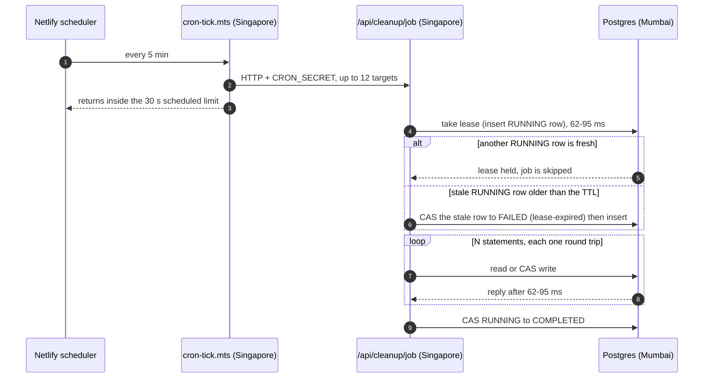

### 5.2 Inngest serve, with checkpointing and with standard orchestration

Inngest never runs our code. It sends an HTTP request to a route we host, built with `serve()`. With the default checkpointing the SDK runs several steps inside one request and reports results on a side channel, so three one-second steps took one request (3.1 s). With `checkpointing: false` each step gets its own request, so the same three steps took four. On real Netlify the dev server could not be reached from inside the function, so the side channel was unavailable and every step was one request of about 6.7 s for a 5 s step (about 1.7 s of extra duration after the step body, which the report attributes to the unreachable side channel).

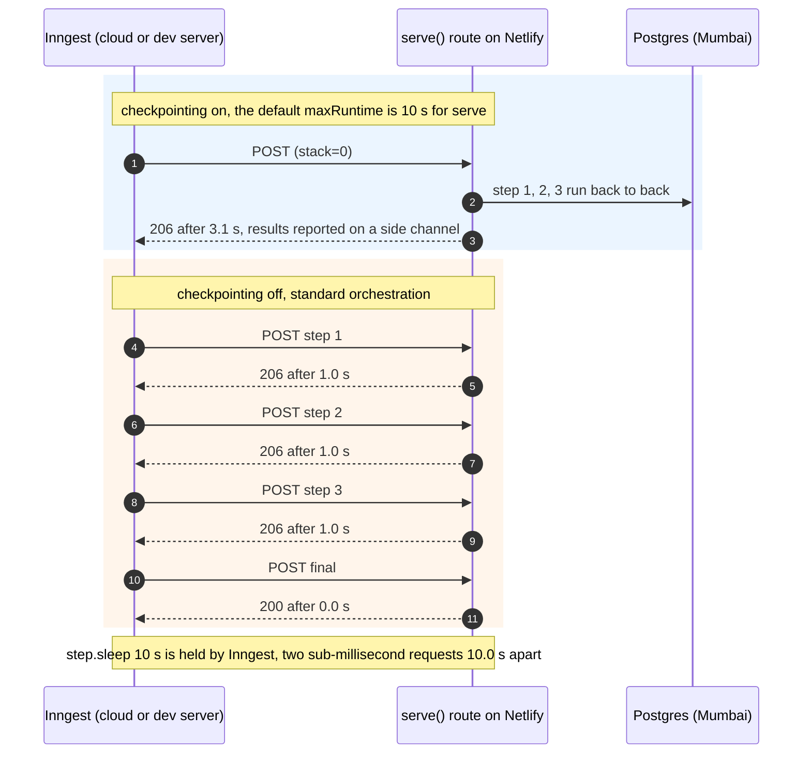

Ten 5-second steps with the default `maxRuntime` of 10 s took seven requests, each at most 10 s. With `maxRuntime: "20s"` they took five. With `maxRuntime: 0` the host cut the request at 26 s and the last step ran twice. The cap is checked between steps, never in the middle of one.

### 5.3 The 504-then-retry duplicate side effect

This is the failure that no scheduler fixes. The edge answers 504 to the caller while the function keeps running to the end, and the caller retries. The timeline is from the real Netlify site and the real QStash EU service.

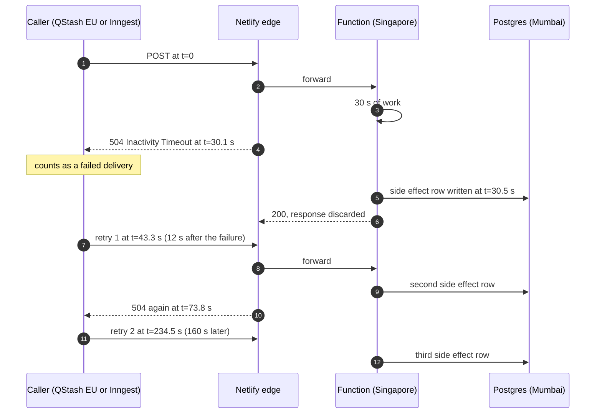

### 5.4 QStash publish, delivery and retry

The owner's real QStash EU account delivered 20 messages to the Singapore function with a median of 1,366 ms from publish to receipt (p95 2,115 ms, the first message 2,801 ms), 0 retries and all 200. The publish call itself took about 185 ms. Delays were late by 1.7 to 2.1 s, and a per-minute schedule fired once a minute, 0.9 to 1.4 s after the boundary. QStash retries any non-2xx response, three times by default, with a delay of `min(86400, e^(2.5n))` seconds, which is about 12 s, 148 s and 30 min (DOCS). The measured gaps were 12 s, 160 s and about 33 min.

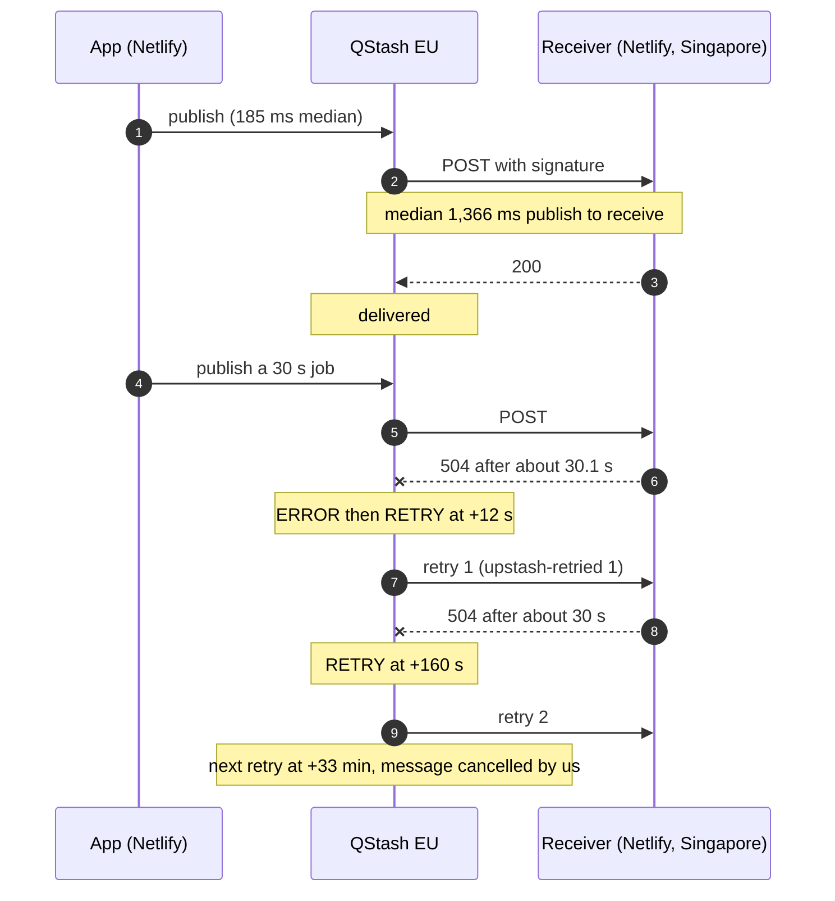

### 5.5 Upstash Workflow: the handler re-runs, each step runs once

A workflow route is called once to start the run and once per step. On each call the whole handler runs from the top, and completed steps are skipped from stored results (DOCS: "Workflow skips completed steps"). Two three-step runs measured four requests each and a handler re-run on every request (the report counts eight executions per run, which a reviewer read as double the four requests, so treat the count as UNVERIFIED), while every step body ran exactly once. Anything outside `context.run` therefore runs once per request. A three-step run took 9.6 s and 13.2 s end to end, about 2–3 s per hop.

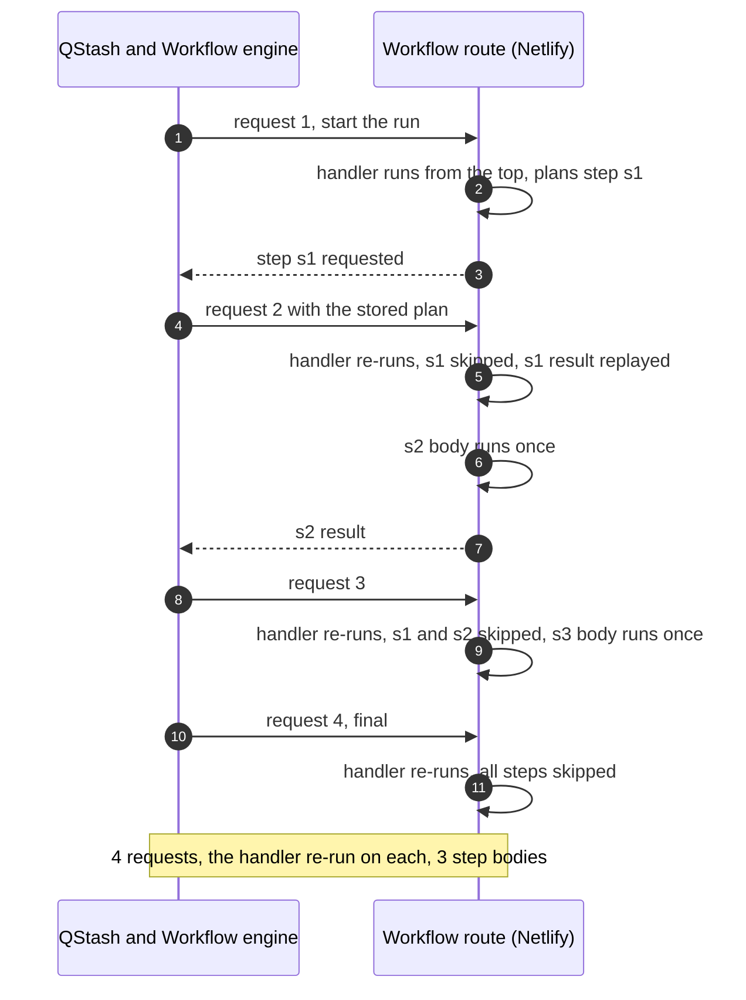

`context.sleep("10s")` cost no function time and resumed 10 s later (run took 16.7 s locally and 19.4–21.8 s on real QStash). `context.call` makes QStash call a URL for us and returns even on a non-2xx (DOCS), so it moves the caller's wait off the function. A 40 s callee still hit the Netlify edge limit and the call returned `504`. On Vercel the same happened: `context.call` to a 400 s endpoint returned `status: 504`, yet the step ended `STEP_SUCCESS` and the run `RUN_SUCCESS`. `context.call` never fails a run on a 4xx or 5xx, so the code must check `res.status`.

### 5.6 Trigger.dev: the code runs off-site against the remote database

Trigger.dev packs the task into a container and runs it on its own machines. Our app only makes an API call. The task then talks to Mumbai from Frankfurt, so the connect (TCP, TLS, auth) alone cost 742–777 ms, about six round trips, and the 20-query mix cost 2.6–3.7 s.

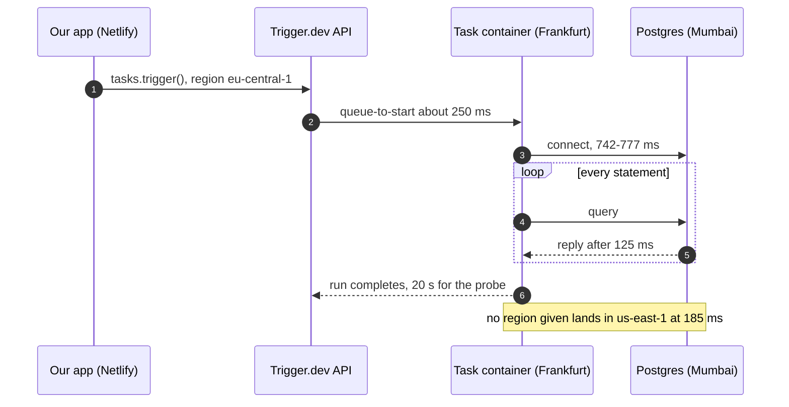

### 5.7 pg-boss and DBOS: in-database enqueue and crash recovery

Both libraries write the job in the caller's transaction, so a rollback leaves no job. A worker polls and claims rows. When a worker is killed, pg-boss expires the claim and reruns the whole job; DBOS restarts the workflow on the same executor and skips the steps already checkpointed.

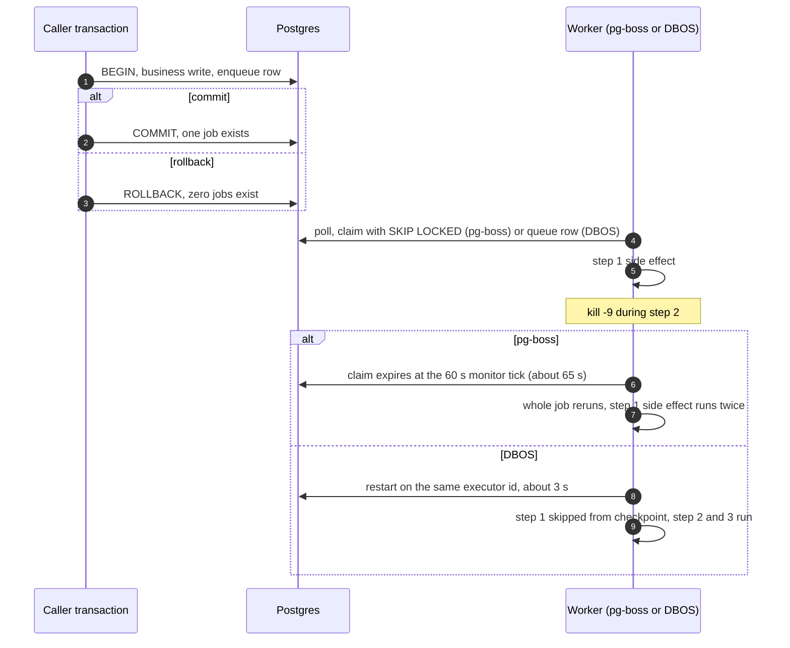

### 5.8 Vercel `bom1`: the compute moves next to the database

A function pinned to `bom1` connected in 12–18 ms warm (36 ms cold), ran `SELECT 1` in 1.0–2.1 ms and held the same ten-round-trip lock for 10.6–19.6 ms. The 20-query mix still took 305–507 ms because the three `LIMIT 50` reads and two counts cost 15–25 ms each. A request of 290 s succeeded on Hobby and one of 310 s returned `FUNCTION_INVOCATION_TIMEOUT` at 300.2 s. A `*/5 * * * *` cron was rejected at deploy on Hobby.

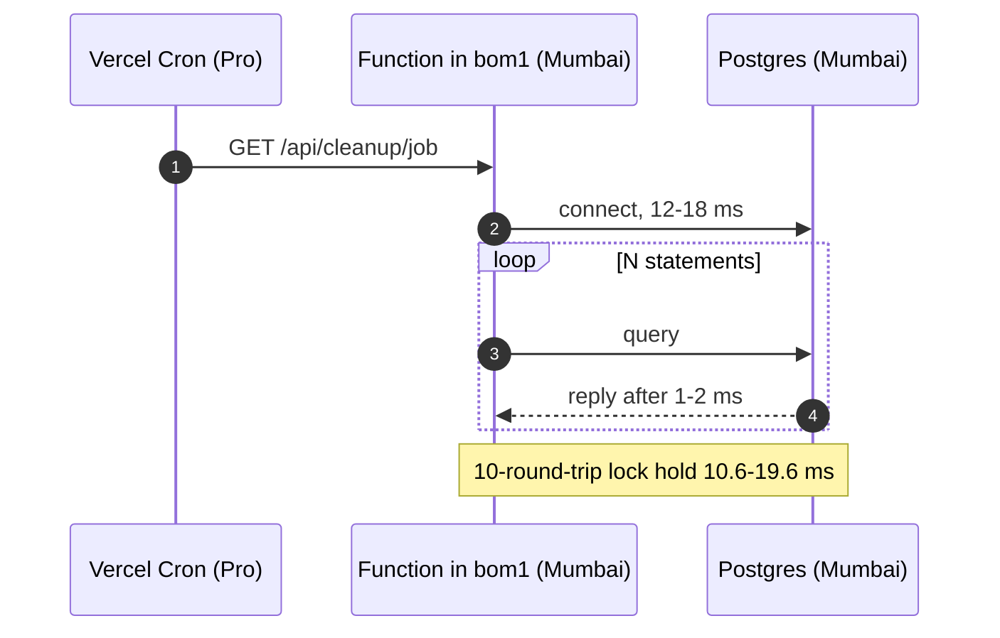

### 5.9 QStash EU to Vercel `bom1`: delivery, the 300 s cap and the zombie

Publish-ack to handler took about 350 ms (laptop send to handler median 537 ms, p95 1,137 ms, all 20 delivered first time). A 30 s target returned 200 with no retries. A 310 s target hit the Vercel cap, so each attempt got a 504 `FUNCTION_INVOCATION_TIMEOUT` at about 300.2 s. QStash retried after 11 s and then about 141 s, and the message went to the dead letter queue after three attempts: three start rows and no end rows. A separate 400 s call showed the zombie: the function that had already returned 504 still wrote its end row at 400 s.

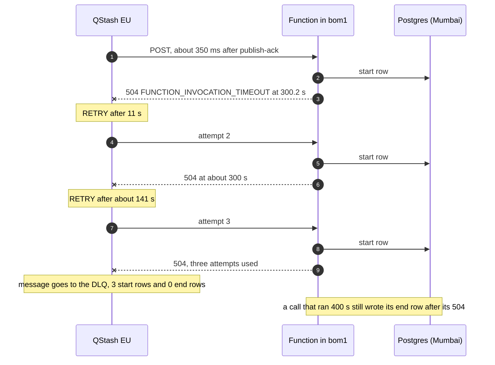

### 5.10 Vercel Workflows: steps in our `bom1` functions, and a `start()` that is not transactional

Vercel Workflows runs the steps in our own project's functions, dispatched by Vercel Queues, and pins each run to the region of the function that called `start()` (DOCS). A three-step run used one function invocation. A durable `sleep("10s")` woke after 10.69 s and cost one extra invocation. `start()` took about 60 ms warm and 599 ms cold, and the first step began 0.31–0.36 s later warm. The weak point is the boundary with our database: `start()` is not part of our Postgres transaction.

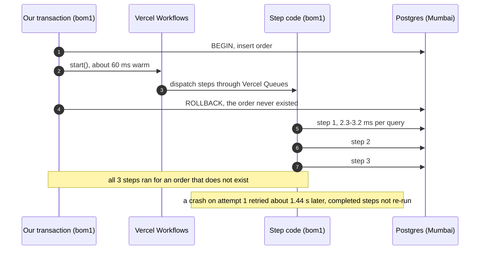

### 5.11 Cloudflare: a queue consumer reaches Mumbai through a region-pinned Worker

Placement applies only to `fetch` handlers (DOCS). A queue consumer, a cron handler and a Workflow step run in whichever colo Cloudflare picks (DFW, SEA, SJC, AMS, ORD, KIX, LAX, MAD, IAD, CDG, MRS were all seen), and from there the pooler is 125–266 ms per statement. The workaround is a service binding to a Worker whose placement is `region = "aws:ap-south-1"`. That Worker ran in `remote-BOM` and finished connect plus five queries in 22–31 ms, even when the calling consumer sat in SEA with 250 ms of its own latency.

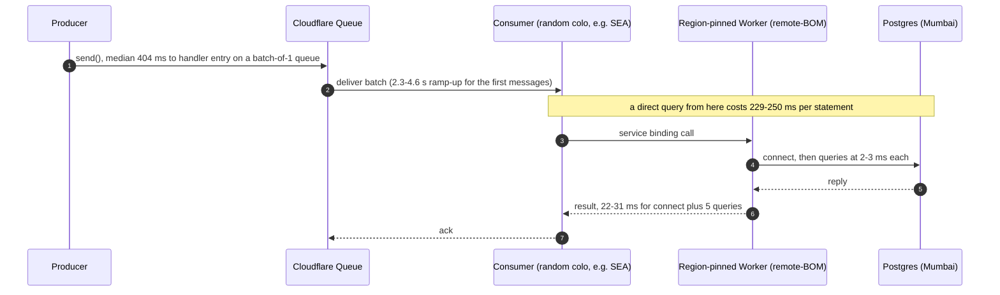

### 5.12 Netlify Background Function: a 202, up to 900 s, and retries only for legacy handlers

The caller gets an empty 202 in 0.65–0.85 s and learns nothing afterwards: there is no status API and the invocation id is not exposed. The function runs for up to 900 s (runs of 60, 300 and 840 s completed, and an 840 s run survived two production redeploys; a 960 s run was killed at exactly 900 s). Inside it, the database costs the same as in a synchronous function: 63.9 ms per statement and a 704 ms ten-round-trip lock hold. Our own run row in Postgres is the only visible status. When a legacy handler crashes, Netlify retries it about a minute later and about two minutes after that.

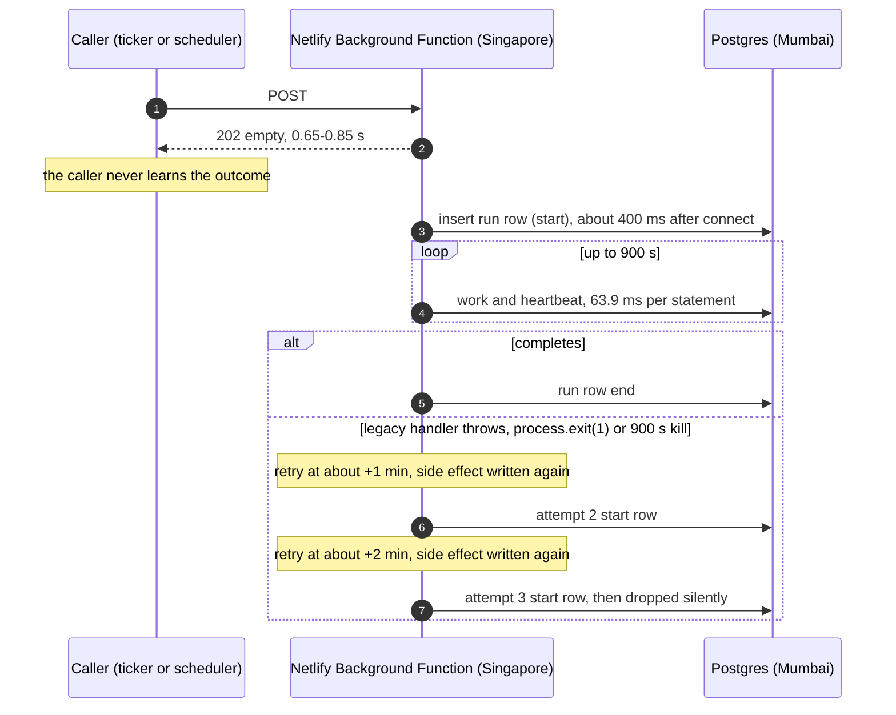

### 5.13 pg-boss drain mode: a short function drains the queue on each tick

pg-boss does not need a long-running worker if the function is a drainer. Started with `supervise: false`, `schedule: false` and `registerInstance: false` (the options its docs recommend for serverless functions), a tick starts the library, calls `supervise()` once, fetches and completes batches until its time budget ends, and stops. On Vercel `bom1`, `start()` took 17–115 ms and each job cost 0.8–1.9 ms; 2,000 jobs drained in one warm invocation in 3.8 s. Three concurrent drainers processed 600 jobs with no duplicates, because `fetch()` uses `FOR UPDATE SKIP LOCKED`. A plain `fetch()` never redelivers an abandoned job: only `supervise()` does.

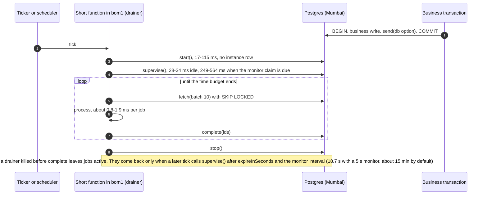

### 5.14 Netlify Async Workloads: every timed step waits for a one-minute scheduler

After the repository was linked, the extension added its router, scheduler and processor functions, and `send` returned in a median of 25 ms. A warm event reached the first line of the workload in a median of 1.21 s (p95 1.27 s); the first event after a quiet period took about 3.5 s. Anything that waits is quantised to the scheduler, which polls every 60 s by default: a 30 s `delayUntil` fired a median of about 70 s late, and a 10 s `step.sleep` woke 76–85 s late. Each new step costs another scheduler hop, so a three-step workload with sub-second work took 2–3 minutes.

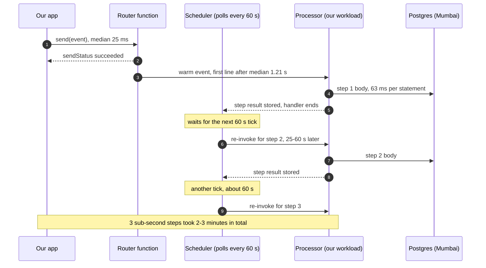

### 5.15 Restate Cloud (EU) calling a handler on Vercel `bom1`

Restate Cloud has US and EU regions only. The test used EU and registered a service on Vercel pinned to `bom1`. A call goes laptop to the Restate EU ingress to the Vercel handler, and the handler runs once per step: Restate invokes it, the handler replays from the top, and only the next unfinished `ctx.run` executes. The measured end-to-end median for a ping was 348 ms (p95 457 ms), of which the bare EU ingress is about 178 ms and the Restate to Vercel hop about 92 ms median. Database queries inside `bom1` cost 2–3 ms each. Three steps took four Vercel invocations with about 155 ms between steps. A 10 s `ctx.sleep` suspended the function and woke about 0.1 s late. A 310 s step was killed by Vercel at 300 s and retried about every 300 s without limit, so the side effect started three times in 607 s.

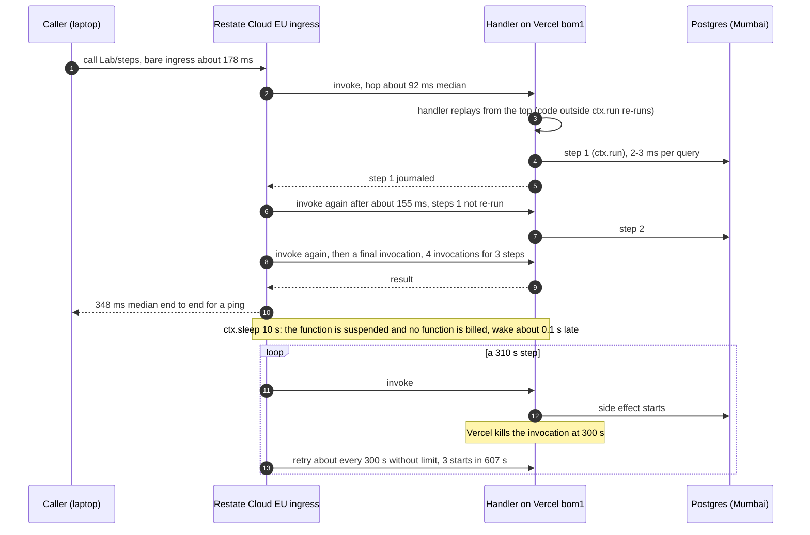

## 6. State diagrams

### 6.1 A job run, from lease to retry

A run is a row in `SystemJobExecution` whose status is `RUNNING`, `COMPLETED`, `FAILED` or `CANCELLED` (`SystemJobStatus` in `prisma/schema.prisma`). The lease is the `RUNNING` row. `withCronLock` sweeps a stale `RUNNING` row to `FAILED` with the message "Lease expired (stale RUNNING row swept)" when its TTL has passed, then creates a new row. A retry is therefore a later tick, not an in-process loop.

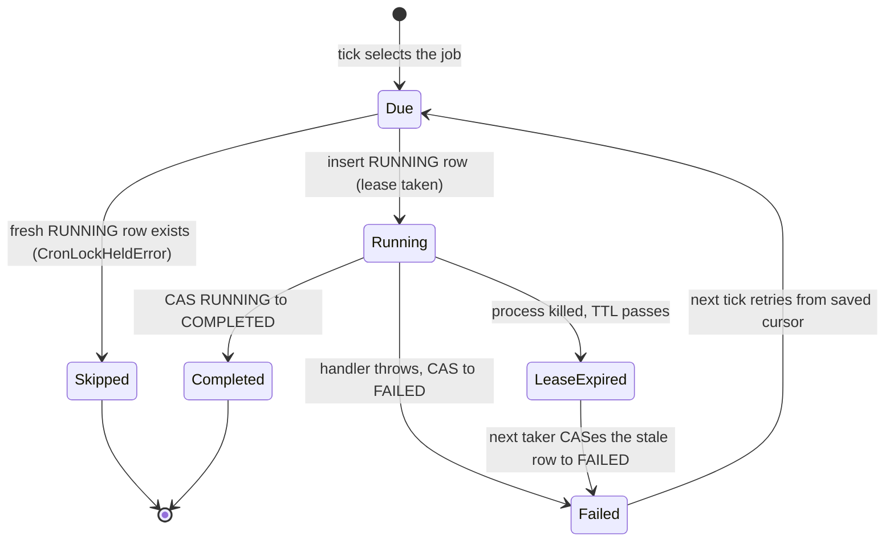

### 6.2 The dual write compared with the transactional outbox

A dual write commits to the database and then calls a separate system as two steps. If the process dies between them, the two stores disagree and nothing repairs it. The outbox writes the intent in the same transaction, so the two cannot diverge. The ticker and the refund-owed marker use a close relative of the second shape, state as the outbox: the intent is existing database state that a sweep reads (the refund-owed marker is written in the cancel transaction), not a separate intent row, so the same guarantee holds without an outbox table. The demo on real Netlify showed it: with a failure injected between an insert and a QStash publish, the row stayed and the message count did not move.

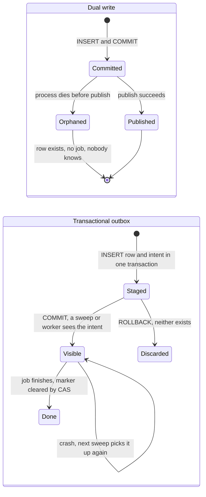

### 6.3 The 504 split brain

When the edge times out, the caller and the function disagree about whether the work happened. The function finishes the work while the caller already recorded a failure and plans a retry.

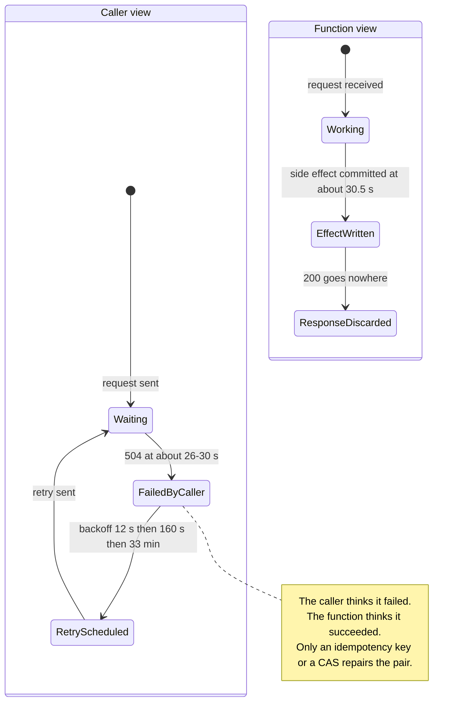

### 6.4 DBOS step recovery compared with a whole-job rerun in pg-boss

Both start in the same place: a worker is killed during step 2 of 3.

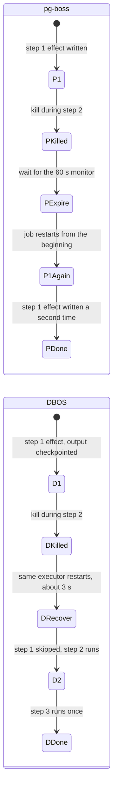

### 6.5 Vercel Workflows `start()` before and after the commit

Because `start()` is not atomic with our database, the order of the two calls decides which half-state is possible. Commit first and a crash before `start()` leaves a row with no run. Start first and a rollback leaves a run with no row. The outbox shape removes both: write the intent in the transaction and let a sweep start the run.

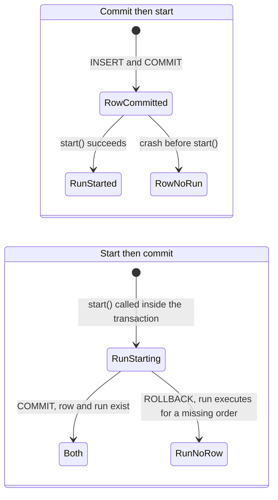

### 6.6 A Cloudflare Queue message: delivered, failed, retried, then the dead-letter queue

A consumer that throws gets the message again about 2.4 s later, and each attempt wrote its own side effect row. With `max_retries = 2` the handler ran three times and the message reached the dead-letter queue about 21 s after it was sent. A consumer that merely ran for 300 s was not redelivered while it ran.

```mermaid
stateDiagram-v2
  [*] --> Sent: producer send()
  Sent --> Delivered: consumer invoked (attempt 1)
  Delivered --> Acked: handler returns, 300 s runs are not redelivered
  Delivered --> Failed: handler throws or is killed
  Failed --> Retried: redelivery after about 2.4 s
  Retried --> Acked: attempt succeeds, side effect written twice
  Retried --> Failed: throws again
  Failed --> DeadLetter: max_retries = 2 exhausted, 3 runs, about 21 s
  Acked --> [*]
  DeadLetter --> [*]
```

### 6.7 Retries: a v2 handler and a legacy handler fail differently

A thrown error in a v2 default-export handler was never retried (checked for 20 minutes). A legacy `exports.handler` that throws, a `process.exit(1)` and a timeout kill were all retried, giving three attempts in total, each writing its own side effect. The explanation that the v2 wrapper turns the throw into a 500 response, which is not an invocation error, is our inference from the measurements. Netlify does not document the difference.

```mermaid
stateDiagram-v2
  [*] --> Accepted: caller gets 202
  Accepted --> Running: attempt 1
  state "v2 default-export handler" as V2 {
    Running --> V2Threw: handler throws
    V2Threw --> V2Dropped: 500 response, never retried
  }
  state "legacy handler, crash or timeout" as LG {
    Running --> Crashed: exports.handler throws, process.exit(1) or 900 s kill
    Crashed --> Retry1: about +1 min
    Retry1 --> Retry2: fails again, about +2 min
    Retry2 --> LegacyDropped: 3 attempts, dropped silently
    Retry1 --> Done: succeeds, side effect written twice
  }
  Running --> Done: handler returns
  V2Dropped --> [*]
  LegacyDropped --> [*]
  Done --> [*]
```

### 6.8 Netlify Async Workloads: retries and dead letters

A workload that throws once was retried 34 s later, not the documented 5 s, and the side effect it wrote before throwing ran twice. A workload that always throws made exactly five attempts, at gaps of 31, 58, 121 and 120 s, and was then written to Blobs as a dead letter about 5.5 minutes after it was sent. In a standard workload any step of 30 s or more never completes: the body ran to the end but the event still counted as failed and retried, so the side effect ran up to five times. Multi-step crash runs repeated steps many times (one run ran step 1 five times and step 3 twenty-nine times), so steps were not exactly once; possible misuse of the 0.0.106 step API is not ruled out.

```mermaid
stateDiagram-v2
  [*] --> Sent: send() accepted
  Sent --> Attempt0: first run, median 1.21 s warm
  Attempt0 --> Succeeded: handler returns
  Attempt0 --> Failed: throws, or a standard step of 30 s or more
  Failed --> Attempt1: about +34 s
  Attempt1 --> Succeeded: returns, side effect written twice
  Attempt1 --> Attempt2: throws, about +58 s
  Attempt2 --> Attempt3: throws, about +121 s
  Attempt3 --> Attempt4: throws, about +120 s
  Attempt4 --> DeadLettered: fifth failure, Blobs store async-workloads-state-dead-lettered
  Succeeded --> [*]
  DeadLettered --> [*]
```

## 7. What each runtime does with our code

### 7.1 Inngest replaces the scheduler, not the compute

Inngest never runs our code in `serve` mode. That is how its docs describe it: the app exposes an HTTP endpoint and Inngest connects to it (DOCS). On Netlify that endpoint is a normal Next.js route, so it keeps Singapore, one connection and the same time limits. Inngest `connect` is a different mode: the app opens an outbound persistent connection, and the docs say serverless runtimes are not supported and a long-running server is required (DOCS), which rules it out on Netlify functions. Four conclusions follow, and each names its limit.

- **Inngest does not lift the host limit.** One step must fit inside one request. A single step longer than the edge cut returned a timeout to Inngest. With checkpointing off it failed three times and wrote its side effect three times. With checkpointing on, the result reached Inngest on a side channel in the one run measured and the side effect ran once, but that is not guaranteed. On real Netlify a 30 s step got a 504 and ran twice.
- **At-least-once still applies.** The host keeps running after the edge answers 504, so a retry can repeat a side effect. Checkpointing can hide this. It is not a guarantee.
- **Sleep and cron are Inngest's.** That is what Inngest sells: a durable timer outside our process. It would be a second scheduler beside the ticker, which `AGENTS.md` rule 4 forbids unless it replaces the ticker.
- **The remote sync is manual.** A deployed function cannot register itself with a dev server on a laptop. We had to PUT the site with the header `x-inngest-sync-kind: in_band` and post the function list to the dev server by hand. The dev server also polls the site every five seconds, and each poll is a billable function invocation.

Inngest Cloud's behaviour was not measured, only the SDK against the dev server.

### 7.2 Trigger.dev Cloud runs our code, but not near Mumbai

The account accepted only `us-east-1`, `us-west-2` and `eu-central-1`. Requests for `ap-south-1` and `ap-southeast-1` were rejected. The table gives the median of 50 `SELECT 1` round trips to the Mumbai transaction pooler (port 6543). The session port (5432) differed by less than 5 ms.

| Where the code runs                    | Median round trip | Connect (TCP, TLS, auth) | 20-query mix, total |
| -------------------------------------- | ----------------: | -----------------------: | ------------------: |
| Laptop in India (not representative)   |           39.4 ms |               251–277 ms |      1,050–1,078 ms |
| Netlify Singapore, raw `pg`            |          62–64 ms |               371–405 ms |      1,450–3,686 ms |
| Trigger.dev `eu-central-1` (Frankfurt) |            125 ms |               742–777 ms |      2,605–3,679 ms |
| Trigger.dev `us-east-1`                |            185 ms |                 1,123 ms |            3,986 ms |
| Trigger.dev `us-west-2`                |            232 ms |                 1,408 ms |            4,811 ms |
| Trigger.dev, no region given           |            185 ms |                 1,122 ms |            3,866 ms |
| Vercel `bom1`, raw `pg`                |        1.0–2.1 ms |                 12–36 ms |          305–507 ms |

Frankfurt at 125 ms is about twice Singapore's raw 62–64 ms, so moving a chatty job to Trigger.dev makes its database time worse. An unset region lands in `us-east-1`. Connect costs six to six and a half round trips, so a task must reuse its connection. The probe cost 0.035 to 0.124 US cents a run, on a base fee of 0.0025 cents, and a `micro` machine ran at the same speed for half the price. Egress IPs on the Free plan are dynamic (the same two addresses repeated in `eu-central-1`, but not guaranteed). Static IPs are a paid feature (DOCS); which paid plan is UNVERIFIED because the pricing page does not mention them.

### 7.3 pg-boss and DBOS keep the queue in Postgres

Both store jobs in the database and run workers in our own process. Neither is hosted, and neither supplies compute: a long-lived worker must exist somewhere, ideally in Mumbai. The table compares what was measured on local Postgres 16, through a local PgBouncer in transaction mode, and through the Supabase Mumbai poolers in throwaway `lab_` schemas that were dropped afterwards.

| Check                                             | pg-boss 12.38                                                                                                                                                                          | DBOS 5.4                                                                                                   |
| ------------------------------------------------- | -------------------------------------------------------------------------------------------------------------------------------------------------------------------------------------- | ---------------------------------------------------------------------------------------------------------- |
| Enqueue inside the caller's transaction           | Correct. Rollback left 0 jobs, commit left 1 (`db` option).                                                                                                                            | Correct. Rollback left 0 workflows, commit left 1 (`enqueueInTransaction`, same database only).            |
| Through the Supabase 6543 and 5432 poolers        | Worked on both.                                                                                                                                                                        | Worked on both, with the pool caveat below.                                                                |
| Cron, two workers, local                          | One job per minute for 7 minutes.                                                                                                                                                      | One workflow per minute for 6 minutes; the id contains the minute, so a duplicate is refused.              |
| Cron on Supabase, first minute after `schedule()` | A second job fired 30 s after the first, in 2 of 2 runs, on both poolers. Steady state was once a minute. Cause not found; clock skew was 80 ms.                                       | Fired once per minute on 6543; not run on 5432.                                                            |
| Concurrency limit of 2, two workers               | Up to 4 ran at once, because the limit is per process.                                                                                                                                 | 2 at once, because the limit is global.                                                                    |
| Kill -9 during step 2 of 3                        | The whole job reran after about 65 s (60 s monitor floor). Step 1's side effect ran twice. With default settings recovery would take about 15 minutes (from source defaults, not run). | The workflow resumed about 3 s after restart. Step 1 did not rerun. Only the same executor id recovers it. |
| Connections per idle worker                       | 3 to 5.                                                                                                                                                                                | 3 to 4, one of them idle in transaction.                                                                   |
| Enqueue-to-start latency, local                   | About 1 s polling; about 7 ms with LISTEN/NOTIFY on both the instance and each queue.                                                                                                  | About 0.2 s polling.                                                                                       |
| Enqueue-to-start on Supabase from the laptop      | 472 ms median on 6543, 307 ms on 5432.                                                                                                                                                 | 845 ms on 6543, 725 ms on 5432.                                                                            |
| LISTEN/NOTIFY through a transaction pooler        | Not used in the Supabase run.                                                                                                                                                          | Failed on 6543 and fell back to polling; worked on 5432.                                                   |
| Operator view                                     | Free `@pg-boss/dashboard` ran and listed the queues.                                                                                                                                   | SQL on the `dbos` schema only. The UI is part of the Conductor product.                                    |

**Drain mode works from short functions.** Started with `supervise:false`, `schedule:false` and `registerInstance:false`, pg-boss can be driven by a periodic tick instead of a worker (section 5.13). Measured: 3 concurrent drainers processed 600 jobs with 0 duplicates; on Vercel `bom1` `start()` took 17–115 ms and a job 0.8–1.9 ms, and 2,000 jobs took 3.8 s; `send` with the `db` option inside the business transaction was transactional (rollback left no job) on both poolers. What drain mode loses: pg-boss's own cron (the ticker is the scheduler), automatic expiry and retry of abandoned jobs, archiving and deletion of completed jobs, and queue monitoring, all of which return only if the tick calls `boss.supervise()`. An abandoned job was redelivered 18.7 s after the failure with `monitorIntervalSeconds=5` and 59.4 s with the default 60; `expireInSeconds` defaults to 15 minutes, so set it just above the handler budget. A tick costs 28–34 ms for `supervise()` when nothing is due and 249–564 ms when the monitor claim is due. The report is [pg-boss-drain-and-cloudflare-tls](./experiments/2026-10-31-job-runtime/14-pg-boss-drain-and-cloudflare-tls.md). This supports decision 4, a queue drained by the ticker. The "capacity of about 10,000 jobs per 20 s tick" is extrapolated from the 2,000-job run and is an ESTIMATE.

Three results deserve plain statements.

- **DBOS has a pool floor.** It keeps an advisory-lock transaction open with a 5-second idle-in-transaction timeout. With `systemDatabasePoolSize: 2` that connection was starved, Postgres killed it and the process crashed on both poolers. With the default pool of 10 it was stable. The true minimum between 2 and 10 was not measured. This rules DBOS out inside a Netlify function (`PG_POOL_MAX=1`) and means it needs its own pool on a long-lived host.
- **Both need idempotent handlers.** pg-boss reruns the whole job after a crash and can fire a duplicate cron job in its first minute. DBOS narrows the window by checkpointing each step, but a step that crashes between its side effect and its checkpoint still repeats (DOCS: "it should be safe to retry them multiple times").
- **Version pinning matters for DBOS.** A worker on a non-latest application version stopped dequeuing client-enqueued work until a stray version row was removed. Pin `DBOS__APPVERSION` in deploys.

### 7.4 Vercel `bom1`: Fluid compute, Prisma and the hosted services

The second Vercel round used four throwaway projects in `bom1`. The full report is [vercel-fluid-prisma-qstash-workflows](./experiments/2026-10-31-job-runtime/08-vercel-fluid-prisma-qstash-workflows.md).

The table gives the Fluid compute comparison. The workload was a module-level `pg.Pool` of 5 and ten small queries plus a 0.3 s `pg_sleep` per request.

| Case                  | Fluid ON: instances used | Fluid OFF: instances used | p50 ON / OFF     |
| --------------------- | -----------------------: | ------------------------: | ---------------- |
| Burst of 20, 1st run  |                       17 |                        20 | 1,193 / 1,214 ms |
| Burst of 20, warm run |                        7 |                        20 | 538 / 516 ms     |
| Burst of 50, 1st run  |                       43 |                        50 | 850 / 944 ms     |
| Burst of 50, warm run |                       13 |                        50 | 889 / 938 ms     |

With Fluid OFF each instance served one request, so every request held its own database connection. With Fluid ON, warm bursts packed onto fewer instances while latency stayed about the same. Supavisor absorbed all 50 client connections: pooled backends stayed flat at 15–16. A first burst on a cold project barely benefits. The `"fluid": false` setting in `vercel.json` did not take effect; only the project API (`resourceConfig.fluid`) flipped it, and the off project never ran two requests on one instance.

**The raw-query Prisma bridge adds no measurable cost.** A bare Prisma 7.10 client with `@prisma/adapter-pg`, running `$queryRawUnsafe` and `$executeRawUnsafe`, against raw `pg` in the same project, alternated six times: same-mode `SELECT 1` median 2.26 ms against 2.35 ms, and a 10-round-trip lock hold of 22.2 ms against 22.1 ms. Pooler latency is bimodal, about 1 ms or about 2.3 ms, and the mode changes between invocations, so only same-mode runs compare. One-time costs: client construction 1.9 ms and the first query on a cold instance 180–221 ms. The probe did not exercise the app's extended client in `lib/prisma.ts`, model operations and result transformations, the app's query mix or the Netlify pool and cold-request path, so it cannot rule the app's client path out as a contributor to the older Netlify figure. The gap between the old 95 ms and the raw 62–64 ms from Singapore stays unexplained; isolating it needs a paired Netlify run of the same statements through raw `pg` and the app client.

**QStash and Upstash Workflow.** Section 5.9 covers QStash. A schedule fired exactly once a minute. A Workflow run makes N+1 requests (4 for 3 steps, a whole run in 1.9 s). A 30 s step ran inside one invocation. `context.call` to a 290 s endpoint succeeded with Upstash holding the wait, so the function was not running. Above 300 s a successful call is not proven because Hobby cannot host a 400 s endpoint.

**Vercel Workflows** is covered by section 5.10. Its limits are 25,000 events and 10,000 steps per run, 50 MB payloads and 240 s of replay, with unlimited run and sleep length (DOCS).

### 7.5 Cloudflare Workers, Queues, Cron Triggers and Workflows

The full report is [cloudflare-workers-queues-workflows](./experiments/2026-10-31-job-runtime/09-cloudflare-workers-queues-workflows.md). All of it ran on the Workers Free plan.

The table gives the Worker-to-Postgres variants. Each ran five times from a laptop that enters Cloudflare at Marseille, against the Mumbai transaction pooler.

| Variant                                  | Ran in       | `SELECT 1` median | 10-round-trip lock hold |
| ---------------------------------------- | ------------ | ----------------: | ----------------------: |
| Default placement, direct                | MRS          |         97–100 ms |          1,009–1,036 ms |
| Default placement + Hyperdrive           | MRS          |        134–136 ms |          1,206–1,223 ms |
| Smart Placement, direct                  | `local-MRS`  |          97–99 ms |          1,009–1,032 ms |
| `region = "aws:ap-south-1"`, direct      | `remote-BOM` |            2–3 ms |                65–75 ms |
| `region = "aws:ap-south-1"` + Hyperdrive | `remote-BOM` |              4 ms |                36–39 ms |

- **Only the explicit region hint helps.** Smart Placement never relocated the Worker: it stayed at about 98 ms after about 600 requests per Worker over 45 minutes, and its status stayed `INSUFFICIENT_INVOCATIONS`. The docs say it needs traffic from multiple locations.
- **Hyperdrive wins on connect and lock hold, not on per-statement latency.** In the same region the hold was 37 ms against 67 ms direct. Without the hint it was worse than direct. Query caching was off for every number. Hyperdrive pointed at the 5432 session pooler, where Cloudflare's Supabase guidance recommends a true direct connection.
- **TLS: only Hyperdrive gives a certificate-verified connection.** Supabase's certificate chains to a private CA (Supabase Root 2021), and a Worker's own TLS stack trusts public CAs only, takes no custom CA and has no skip-verify mode, so `pg` and `postgres.js` both fail the handshake (the earlier hang and error 1101). The direct variants in the table above therefore ran with TLS off, which is acceptable for mock data and not for production. Hyperdrive with the Supabase CA uploaded and `verify-full` worked against both the direct host and the session pooler: **4 ms per statement and a 60–89 ms lock hold** with the Worker in `aws:ap-south-1` and caching off. A wrong CA was rejected (`CERTIFICATE_VERIFY_FAILED`), which proves the verification. These are the production-safe Cloudflare figures and replace the TLS-off numbers. Details are in [pg-boss-drain-and-cloudflare-tls](./experiments/2026-10-31-job-runtime/14-pg-boss-drain-and-cloudflare-tls.md).
- **Queues.** A throw wrote the side effect twice. A 30 s consumer made one attempt. A CPU spin of 3e9 iterations was killed on every attempt and went to the dead-letter queue. A queue send is not transactional with Postgres: a committed row with a failed send left no message.
- **Cron Triggers.** 13 fires in 13 consecutive minutes, no misses and no duplicates, started about 2.3 s late (1.6–2.8 s). Every fire ran in a different colo at 147–266 ms per statement. After removal the API showed no schedules at once, but fires continued for about 4 minutes (about 9 in the later Workflows round).
- **Workflows.** A step that threw was retried after about 2.3 s and completed steps did not re-run. `step.sleep("10 seconds")` took 10.01 s. A 30 s step took 30.7 s in one attempt. `create()` inside a transaction followed by a rollback still queued and completed the workflow, so an outbox row is needed. Steps ran in CDG and MRS, near the request that created the instance, not near the database.
- **Workflows calling a pinned Worker (second round, 2026-11-01).** [Report 16](./experiments/2026-10-31-job-runtime/16-cloudflare-workflows-pinned-hyperdrive.md) put the database code in a second Worker pinned to `aws:ap-south-1` behind Hyperdrive and called it from each step. Over `fetch` it ran in `remote-BOM` at 4–6 ms per query, with a flat hop of 144–289 ms (median about 180 ms) per step, so the design pays off from two statements per step (180 + 5n ms versus 170n ms: about 190 ms versus 340 ms at n = 2). Over an RPC service binding the same code ran beside the step, not in Mumbai, at 167–264 ms per query: placement applies to `fetch` handlers only. A 13-statement lock transaction took 67–70 ms median through `fetch` and about 1.9 s through RPC. Completed steps did not re-run, a failed step retried after 2.23 s, and a write inside the failing step ran twice, so step writes need an idempotency key. `create()` is not transactional, so the outbox stays.
- **Plan.** Everything worked on Free, but the CPU limit is 10 ms per request, and a `limits.cpu_ms` setting was rejected (`CPU limits are not supported for the Free plan`). Real jobs need Paid, where HTTP CPU is 30 s by default and Cron Triggers per account rise from 5 to 250 (DOCS).

### 7.6 Netlify Background Functions and Async Workloads

The full report is [netlify-background-and-async-workloads](./experiments/2026-10-31-job-runtime/10-netlify-background-and-async-workloads.md).

**Background Functions are measured.** The table gives the admission and runtime results. The caller used `curl` against a throwaway site in Singapore.

| Requested run | HTTP | Caller wait | Result                                                                  |
| ------------: | ---- | ----------: | ----------------------------------------------------------------------- |
|          60 s | 202  |      0.85 s | Completed in 60.001 s                                                   |
|         300 s | 202  |      0.68 s | Completed                                                               |
|         840 s | 202  |      0.65 s | Completed, and survived two production redeploys mid-run                |
|         960 s | 202  |      0.68 s | Killed at exactly 900 s (log `Duration: 900324 ms`), then retried twice |

- **Concurrency.** Ten simultaneous requests all ran in parallel, with starts spread over 0.51 s.
- **Retries depend on the handler style.** See section 6.7. A timeout is three attempts of 15 minutes each, with no end row ever.
- **Visibility.** The only signal is our own run rows (`SystemJobExecution` is the pattern). The CLI log shows one `Duration` line per invocation, lagging by minutes.
- **Previews.** The runs were on a draft deploy and completed. A PR Deploy Preview was not tested. Environment variables scoped only to `production` produced a run with no database address, so a lab site needs its own scratch values in the context it deploys to. Do not copy production secrets into every deploy context.

**Async Workloads is MEASURED end to end.** The report is [netlify-async-workloads-measured](./experiments/2026-10-31-job-runtime/12-netlify-async-workloads-measured.md), and the earlier documentation-only attempt is [netlify-async-workloads](./experiments/2026-10-31-job-runtime/11-netlify-async-workloads.md). The extension was already installed team-wide, but a CLI deploy ships without its functions: only a build on Netlify's own servers from a linked repository adds them. Linking worked only through a deploy key with `provider: manual`, because the Netlify GitHub App is not installed on the owner's GitHub account, and every build had to be started with `createSiteBuild` because a deploy key creates no webhook. The table gives the measured results.

| Test                    | Result (all MEASURED)                                                                                                                                 |
| ----------------------- | ----------------------------------------------------------------------------------------------------------------------------------------------------- |
| Event latency, warm     | Median 1.21 s, p95 1.27 s from the start of `send` to the first workload line; the first cold event took about 3.5 s                                  |
| Retry after one throw   | +34 s, not the documented 5 s; the side effect ran twice                                                                                              |
| Always failing          | 5 attempts at gaps of 31, 58, 121 and 120 s, then a dead letter in Blobs about 5.5 minutes after sending                                              |
| `delayUntil` of 30 s    | Fired 50–94 s late (median about 70 s); `step.sleep("10s")` woke 76–85 s late. All timing waits for the one-minute scheduler                          |
| Multi-step with a crash | Not exactly once: one run ran step 1 five times and step 3 twenty-nine times. Misuse of the 0.0.106 API is not ruled out, and the cause was not found |
| Step transitions        | Each costs a scheduler hop, so 3 steps took 2–3 minutes                                                                                               |
| Duration                | A standard workload fails any step of 30 s or more (the body re-runs up to 5 times); the background type ran 60, 300 and 840 s steps                  |
| Database                | 63.4 ms per statement, lock hold 698 ms                                                                                                               |
| Dual write              | `send` is not transactional: a `send` followed by a rollback still delivered the event, and a crash before `send` left an orphan                      |
| Concurrency             | 10 concurrent events started within 1.65 s                                                                                                            |
| Visibility              | No per-run dashboard found; state is in Blobs, function logs and the extension API                                                                    |

Verdict: usable for warm fire-and-forget work once backlog alerting and a recovery drill for the pending-limit stop exist (below); weak for anything timed, retried or multi-step. A money flow should not rely on its step memoisation. The owner may still uninstall the extension (Team settings, Extensions, Async Workloads, Uninstall) and watch the next `familiarise` deploy.

The table sets what the docs promise beside what was measured, so a reader can see where they differ.

| Topic              | Documented (DOCS)                                                        | Measured                                                            |
| ------------------ | ------------------------------------------------------------------------ | ------------------------------------------------------------------- |
| Retry backoff      | 5 attempts, backoff 5 s, 20 s, 1 m 20 s, 8 m, dead letters kept 30 days  | Gaps of 31, 58, 121 and 120 s; first retry at +34 s                 |
| Scheduler          | Polls every 60 s by default, 10 s minimum                                | Delays and sleeps landed 50–94 s late                               |
| Steps              | `step.run` steps are not repeated on a retry; code outside steps re-runs | Steps were repeated many times in a crash run; misuse not ruled out |
| State              | Stored exclusively as Blobs on the site                                  | Dead letters found in the Blobs store as documented                 |
| Limits             | Events under 500 KB; chain limit 20; pending limit 2,000                 | Not tested live; the pending-limit stop is read from source below   |
| Pricing            | "Billed as any other provisioned resources", no figures                  | Not measured                                                        |
| Transactional send | Not documented                                                           | Not transactional                                                   |

The pending limit is a refusal guard, not a drain rate. In the published `@netlify/async-workloads` 0.0.106 package used in these experiments, `PendingProcessor.plan()` in `_internal/chunk-SIDTE6TG.js` lists the due pending keys and throws before building any dispatch plan when their count exceeds `AWL_PENDING_UPPER_LIMIT` (default 2,000, from `DEFAULT_PENDING_UPPER_LIMIT`). This is read from source and was not tested live. The failure mode is that a legitimate backlog that builds up during an outage can stop the pending processor from draining at all until an operator raises the limit or works the events through the event-management APIs; later scheduler ticks do not clear it on their own, and deleting legitimate obligations to get under the threshold is not a recovery. Independent in-flight work may still progress. Backlog and guard alerting plus a recovery drill are prerequisites before relying on Async Workloads even for fire-and-forget work (#2488).

## 8. Worked example: one refund-owed job on each runtime

Priya Anderson cancels Hannah Anderson's 1-hour consultation on Mon 2 Nov 2026 at 10:00 IST (04:30 UTC) and is owed ₹590 (59,000 paise). The cancel route commits the cancellation and stamps `Payment.refundOwedPaise = 59000`. The settlement job then runs a ten-statement transaction: `SELECT … FOR UPDATE` on Priya's payment row, eight statements (re-read the marker, write the refund row, post the ledger legs, CAS the marker) and `COMMIT`. Suppose Priya's other action, say adding a review, tries to update the same payment row while the job holds the lock. The table gives, for each runtime, how long the job holds the lock and how long her update waits if it arrives at a random moment. The hold is ten times the per-statement round trip (MEASURED, database execution is negligible), and the expected wait is half the hold.

| Where the job runs                    | Per-statement round trip | Lock held for 10 round trips | Priya's update waits (expected, worst) | Status                                     |
| ------------------------------------- | -----------------------: | ---------------------------: | -------------------------------------: | ------------------------------------------ |
| Netlify Singapore, raw `pg`           |                 62–64 ms |                 about 690 ms |                   about 345 ms, 707 ms | MEASURED, 676–707 ms medians               |
| Netlify Singapore, earlier app figure |              about 95 ms |                 about 950 ms |                   about 475 ms, 950 ms | Extrapolated from the earlier 95 ms figure |
| Trigger.dev Frankfurt                 |                 125.8 ms |                     1,258 ms |                    about 630 ms, 1.3 s | MEASURED, 10 runs                          |
| Laptop in India (not representative)  |                  39.5 ms |                       395 ms |                   about 200 ms, 0.37 s | MEASURED, 10 runs                          |
| Vercel `bom1`                         |               1.0–2.1 ms |                 10.6–19.6 ms |                          about 5–10 ms | MEASURED                                   |

The interference run confirms the Frankfurt and laptop rows. A simulated user updated the locked account row about five times a second. With no job running the median update took 37.6 ms. An update issued during a laptop-run hold took 274.9 ms at the median (p95 367.9 ms), and one issued during a Frankfurt-run hold took 1,110.1 ms (p95 1,272.2 ms). All ten Frankfurt holds blocked exactly one update for more than 150 ms. The updater was a closed loop, so it under-counts a real crowd: at five arrivals a second, a 1.26 s hold would queue about six waiting writes.

Two concurrent copies of the same transaction at SERIALIZABLE lost exactly one of every pair with SQLSTATE 40001 (20 commits and 20 failures per location, both places). Distance does not change the failure rate. It changes how long the surviving snapshot stays open. `withSerializableRetry` (`lib/db/serializable-retry.ts`) retries those failures.

The money itself is protected the same way everywhere. The database refuses an unbalanced ledger (`ledger_txn_balanced`) and a leg set that does not sum to the payment (`payment_legs_sum_to_amount`), both in `prisma/sql/`, at commit and wherever the client sits.

## 9. Questions the owner asked

### 9.1 Does running jobs on an external machine make a Postgres transaction distributed?

No. A transaction opened by a worker in Frankfurt is still one ACID transaction on one database, and the database enforces it exactly as before. The constraints named in section 8 and `occurrence_no_confirmed_overlap` are checked at commit regardless of where the client sits. A distributed transaction would need two databases or two resource managers, and none of these options adds one. What changes is how long the transaction stays open: every statement waits for a round trip, so row locks and Serializable snapshots are held longer, as the section 8 table shows. A competing writer waits longer or hits a retry. Barring remote workers from holding locks on booking rows is an open question for the owner in the evidence record.

### 9.2 Where does the dual-write risk come from?

It comes from the vendor and its trigger, not from the location. A dual write happens when we commit to the database and then tell a separate system to start the job, as two steps that can fail apart. If the cancel route in section 8 called `inngest.send()`, `tasks.trigger()` or a QStash `publish()` after its commit and the network dropped, the booking would be cancelled with no engine aware that ₹590 is owed. The Netlify experiment reproduced this: the row committed and the publish count did not change.

There are two fixes, and the repo already has one.

- **State as the outbox.** The marker row is the outbox: the job reads database state, so a missed trigger costs nothing. `retry-auto-refunds` (registered in `lib/cron/cleanup-registry.ts`) finishes any marker the process died on, using `lib/payments/operations/refund-owed.ts`. A hosted engine can be added behind this pattern by relaying marker rows afterwards, and the database stays the source of truth.
- **In-database enqueue.** pg-boss and DBOS write the job in the same transaction as the business change, which the experiment proved (rollback leaves no job).

Vercel Workflows has the same gap in the other direction: `start()` is not part of our transaction, so a `start()` followed by a `ROLLBACK` ran a whole workflow for an order that does not exist (section 6.5). A cron-triggered sweep that reads database state has no enqueue dual write at all, which is why the ticker is safe today.

### 9.3 Do vendor side effects become exactly-once on a better runtime?

No. Razorpay and Stream calls stay at-least-once on every runtime on this page. The Inngest experiment repeated a side effect on a retry, QStash wrote three effects for one message, pg-boss reran a whole job after a crash, and even DBOS can repeat a step that crashed between its effect and its checkpoint. What makes them safe is unchanged: gateway idempotency keys, compare-and-swap status writes (`updateMany` with the expected prior status in `WHERE`) and the reconcilers that compare our state with the vendor's.

### 9.4 Can RazorpayX static egress be solved on Netlify?

Yes, and it already is. Live RazorpayX answers only allowlisted IP addresses, up to 20, in Live Mode only (DOCS), and Netlify has no static egress address outside an Enterprise add-on with no Singapore or Mumbai region (DOCS). The earlier finance decision (F1) routes the RazorpayX client alone through a static-IP HTTP proxy set by `RAZORPAYX_EGRESS_PROXY_URL`. The client refuses live calls without it, with `RAZORPAYX_EGRESS_NOT_CONFIGURED` (`apiRequest` in `lib/payments/payouts/razorpay-payouts.ts`; see [RazorpayX](../finance/40-payouts/04-razorpayx.md)). So the question for any new runtime is cost and added latency, not possibility. The extra hop of the proxy was not measured. A runtime with its own static address (a Lightsail VM in Mumbai, Vercel Static IPs, or a paid Trigger.dev tier if confirmed) could replace the proxy, but only for the code that runs there. The table gives the verified price of each way to get a fixed address. The quotes are in [lock-hold-and-static-ip](./experiments/2026-10-31-job-runtime/04-lock-hold-and-static-ip.md).

| Way to get a static address                | Price                                                                                                         | Status                                                                                                                                                                   |
| ------------------------------------------ | ------------------------------------------------------------------------------------------------------------- | ------------------------------------------------------------------------------------------------------------------------------------------------------------------------ |
| QuotaGuard Static proxy (the F1 class)     | $19 a month (10 GB), $49 (50 GB), $89 (200 GB), $219 (1 TB, dedicated IPs); a load-balanced pair of IPs       | Prices DOCS. The pricing page lists a Mumbai location and also says data residency is "US or EU", so Mumbai is UNVERIFIED until sales confirm. Latency: none documented. |
| Fixie proxy                                | HTTP plans from free (500 requests) to $5, $19 and $49; SOCKS plans from $9                                   | Locations and IP count UNVERIFIED; no India or Singapore location documented.                                                                                            |
| AWS Lightsail in Mumbai                    | Plans from $5 a month; a static IP is free while attached, $0.005 an hour if unattached over an hour          | DOCS. Outbound use of the static IP is standard AWS behaviour but not quoted on the page.                                                                                |
| Vercel Static IPs                          | $100 a month per project on Pro, plus regional Private Data Transfer; one IP pair per region, up to 3 regions | Price and plan DOCS against the Vercel page re-read on 2026-10-31. Whether `bom1` can be selected is UNVERIFIED.                                                         |
| Vercel Secure Compute                      | Enterprise only, custom pricing                                                                               | DOCS Enterprise-only.                                                                                                                                                    |
| Netlify Private Connectivity               | Enterprise add-on, no published price; regions Ohio, Frankfurt and London only                                | DOCS against the Netlify page re-read on 2026-10-31. No Singapore or Mumbai region.                                                                                      |
| GCP Cloud Run `asia-south1` with Cloud NAT | NAT gateway $0.0014 an hour per VM, $0.045 per GiB, external IP $0.005 an hour (about $3.65 a month)          | DOCS prices. How Cloud Run instances count toward the per-VM row is UNVERIFIED.                                                                                          |
| Fly.io static egress                       | $3.60 a month per app-scoped IPv4 per region                                                                  | Price DOCS. The regions table fetched had no Mumbai (`bom`) row.                                                                                                         |
| Trigger.dev paid plans                     | Not stated; Hobby $10 and Pro $50 are the plan prices                                                         | Paid-only DOCS. Which plan, how many IPs and any extra price are UNVERIFIED.                                                                                             |
| Inngest                                    | Not applicable                                                                                                | In serve mode the function runs on our host and leaves from that host's address. That follows from the model; no page states it, so UNVERIFIED as a quotation.           |

### 9.5 Why does Inngest on Netlify not lift the limit?

Because the function that runs the step is a Netlify function, and Netlify's edge cuts a request that has sent no data after about 26 s on production (about 30 s on a throwaway site, and Netlify support has confirmed a second ceiling near 37–38 s; see `.claude/skills/deployment/netlify/platform-limits.md`). Inngest can split a sequence of short steps across many requests, and a durable `step.sleep` costs no compute, but it cannot make one request outlive the edge. The 504 it sees is also the same 504 QStash sees (section 5.3). Inngest `connect` would avoid the HTTP timeout (DOCS: "Step execution is not bound by platform http timeouts"), but it requires a long-running server and does not support serverless runtimes, so it needs the same long-lived host that pg-boss and DBOS need.

### 9.6 Can the registered jobs conflict with each other?

They can contend, but a conflict costs wasted work and waiting, not corruption. A lost compare-and-swap is a no-op: the loser updates zero rows and moves on. A lock wait lasts about as long as the other writer holds the lock, so it scales with lock-hold time (about 700 ms from Singapore, about 20 ms from Mumbai as an ESTIMATE, 10.6–19.6 ms measured on `bom1`). Serializable retries happen occasionally (`withSerializableRetry` in `lib/db/serializable-retry.ts`), and a deadlock is detected by Postgres, which aborts one side so the job retries next tick. Engine concurrency controls (Inngest concurrency keys, QStash flow control, DBOS global limits) are a convenience that reduces wasted work. Layers 2 to 4 below, all in Postgres and in the status writes, are the guarantee. The enforcers are CAS-in-WHERE status transitions and per-entity claims, provider idempotency keys with reconciliation for the vendor side, and the constraints and triggers in the `prisma/sql/` sidecars (`ledger_txn_balanced`, `payment_legs_sum_to_amount`, `occurrence_no_confirmed_overlap`).

`withCronLock` in `lib/cron/with-cron-lock.ts` is admission control, not a fence against an old worker. It admits one lease holder per job at a time, but it cannot stop a run that has lost its lease:

1. On Netlify the lease is capped at 90 s (`NETLIFY_MAX_LEASE_MS`) and renewed every third of that.
2. If renewals stop reaching the database, the lease expires, and the next caller sweeps the expired RUNNING row and takes a new lease.
3. When the old run's next renewal matches zero rows, `startLeaseRenewal` only sets `lost`, logs and stops renewing. The old `fn()` keeps executing.
4. The old run's final CAS on its execution row fails, which protects run history and freshness. It does not undo the business writes or vendor calls the old run made after takeover.
5. Some non-money jobs deliberately run unlocked when the lock table is unreachable (fail-open, with a warning).

So two copies of a job can overlap during a takeover. Correctness during that overlap comes from the per-row CAS and claims, the database constraints and provider idempotency, which is why every job must already be safe to run twice. The mocked lease test proves the history protection only, not worker cancellation or exactly-once effects. None of this calls for a new reconciler over invariants Postgres already enforces.

```text
 job A (refunds)          job B (payouts)          a user request
      │                         │                        │
      │ ① lease admits one holder of job A (withCronLock) │
      ▼                         ▼                        ▼
  UPDATE payment         UPDATE payment            UPDATE payment
  SET status='REFUNDED'  SET status='SETTLED'      SET …
  WHERE id=7             WHERE id=7
    AND status='PAID'      AND status='PAID'   ← ② CAS: only ONE of these matches;
                                                     the loser updates 0 rows and moves on
      │                         │
      ▼                         ▼
  ③ Postgres row lock: the second writer WAITS (≈ lock-hold time: ~700 ms from Singapore,
     ~20 ms from Mumbai)
  ④ CHECK constraints / triggers / unique indexes: an invalid state can't COMMIT
     (deadlock? Postgres detects it and aborts one; the job retries next tick)
```

### 9.7 Why did you first say external schedulers were not viable? Clock versus engine

Those vendors were first framed as job engines that run the jobs, and on that framing they lost on latency and complexity. Used as a clock, which pokes an existing endpoint every five minutes, they are viable and low-risk. `AGENTS.md` rule 4 bans adding a second scheduler beside the ticker, not replacing the ticker with another. The table compares the replacements.

| Replacement                                                                                            | What changes                                          | Simplicity                                                                                | Verdict                                                                                               |
| ------------------------------------------------------------------------------------------------------ | ----------------------------------------------------- | ----------------------------------------------------------------------------------------- | ----------------------------------------------------------------------------------------------------- |
| An external clock (QStash schedule, Cloudflare Cron, Trigger.dev schedule) calling one `_due` endpoint | Only the trigger                                      | About as simple as today and more portable; removes the `ops:active_cron_platform` switch | Good later, as the trigger adapter of issue #2491. The `_due` route is planned, not in the repository |
| A full engine (Inngest functions, Trigger.dev tasks, Upstash Workflow, Vercel Workflows)               | Jobs rewritten as steps, and an outbox is needed      | More complex: a second programming model and a vendor in the money path                   | Only for the few genuinely multi-step jobs, ideally in Mumbai                                         |
| Netlify Background Functions as executors                                                              | Long jobs run up to 15 minutes; the caller gets a 202 | Simple, and already used for six jobs                                                     | Fine; completion is known through run rows                                                            |

The diagram contrasts the two roles.

```mermaid
flowchart LR
  subgraph CLOCK["Clock: the vendor only pokes"]
    C1["External clock every 5 min"] --> C2["/api/cleanup/_due (planned)"]
    C2 --> C3["existing /api/cleanup/job routes"]
    C3 --> C4[("Postgres: lease, CAS, outbox")]
  end
  subgraph ENGINE["Engine: the vendor runs the job"]
    E1["Engine schedules and retries"] --> E2["steps as functions"]
    E2 --> E3[("Postgres")]
    E1 -. "state lives in the vendor too" .-> E4["vendor journal"]
  end
```

Correctness holds with a clock if two conditions hold: the database guards stay (leases, CAS, constraints and the outbox), and exactly one scheduler runs. The measured caveats:

- QStash fired once a minute, about 1 s late (MEASURED, [page 14 section 5.4](#54-qstash-publish-delivery-and-retry)). At 8,640 ticks a month the Pay-as-you-go price of $1 per 100,000 messages comes to about $0.09 a month (computed from the DOCS price). It retries any non-2xx response, so the tick endpoint must always return 200.
- Cloudflare Cron fired 13 of 13 times with no duplicates, about 2.3 s late, free within 5 crons on the Free plan (MEASURED, DOCS). After the trigger was removed it kept firing for about 4 minutes in the first round and about 9 minutes in the Workflows round ([report 16](./experiments/2026-10-31-job-runtime/16-cloudflare-workflows-pinned-hyperdrive.md)); deleting the Worker is the sure stop.
- On Netlify there is no billing win, because every call is still a Netlify invocation. The saving comes from the skip-idle pull request.
- An independent heartbeat (Better Stack) is mandatory with any clock.

The recommendation is to keep the Netlify ticker through launch and switch the trigger to an external clock plus a single `_due` endpoint when the host moves or when issue #2491 lands.

### 9.7a What is each engine actually for?

The table lists the real use case of each engine and where it could apply to Familiarise.

| Engine                                | What it is for                                                                                                              | Familiarise use                                                                              |
| ------------------------------------- | --------------------------------------------------------------------------------------------------------------------------- | -------------------------------------------------------------------------------------------- |
| Inngest                               | Event-driven flows that wait for events: "wait up to 3 days for verification, else remind", fan-out, per-tenant concurrency | Maybe onboarding or lifecycle email                                                          |
| Trigger.dev                           | Long, heavy compute with no timeout: transcoding, big PDFs, AI pipelines                                                    | Possibly recordings or AI later; its regions are too far from the database for DB-heavy work |
| QStash                                | Reliable HTTP delivery: a cron clock for serverless, delayed messages, webhook fan-out                                      | As the clock if the Netlify ticker is replaced; outbound webhooks                            |
| Upstash Workflow                      | Cheap step workflows on serverless; `context.call` holds slow external waits for hours                                      | Slow vendor calls                                                                            |
| Cloudflare Workers, Queues, Workflows | Apps that already live on Cloudflare                                                                                        | Only if the app moves to Cloudflare                                                          |
| Vercel Workflows                      | Multi-step durable flows on Vercel                                                                                          | If the app moves to Vercel `bom1`                                                            |
| DBOS and pg-boss                      | Jobs and workflows on your own Postgres with a long-running worker                                                          | The target design on [page 17](./17-target-architecture-and-roadmap.md)                      |

### 9.7b Why do pg-boss and DBOS have their own names if they are "just tables"?

They are libraries (npm packages) that own their tables and the hard code around them, in the same way Prisma is not just tables. What they add:

- Claiming with `FOR UPDATE SKIP LOCKED` (MEASURED: 600 jobs across 3 drainers, 0 duplicates).
- Visibility timeouts and expiry.
- Retries with backoff, dead-letter handling, deduplicated cron, delays, concurrency limits (global in DBOS) and archiving.
- DBOS only: a step journal, so a run resumes at the failed step.

Their tables live in their own schemas (`pgboss` and `dbos`), not in the Prisma schema. The earlier owner decision chose a hand-written Prisma `Job` table, which gives the same table but means writing all of the above ourselves.

### 9.7c How do I monitor runs and trace a failure to a user?

Use the four layers on [page 18](./18-monitoring-and-tracing-failures.md): the ticker log line and heartbeat, the `SystemJobExecution` row per run, the Entity trace, and escalation-only Sentry with a `job_run_id` tag.

### 9.8 What does Better Stack do here?

Better Stack answers "is anything alive, and who gets paged". Sentry answers "what broke". The table lists each role with the code that does it. The code was checked on the current tree.

| Role                   | How                                                                                                                                                                                                                                                                                            | Code                                                                                                                  |
| ---------------------- | ---------------------------------------------------------------------------------------------------------------------------------------------------------------------------------------------------------------------------------------------------------------------------------------------- | --------------------------------------------------------------------------------------------------------------------- |
| Uptime monitors        | `familiarisenow.com` and `/api/health` checked every 3 minutes from several regions, with email alerts and a status page                                                                                                                                                                       | [Better Stack setup](./00-betterstack-setup.md)                                                                       |
| Ticker heartbeat       | Each completed tick pings `BETTERSTACK_HEARTBEAT_URL` (2 s timeout; unset skips it; a failure never fails the tick). An alert fires if ticks stop                                                                                                                                              | `pingHeartbeat()` in `netlify/functions/cron-tick.mts`                                                                |
| Operational log events | `recordSystemEvent` ships each event to Better Stack Telemetry, so a failed reconcile, stuck payout, webhook backlog or HMAC failure can page; the ticker adds a per-tick summary line. Both are inert unless `ENABLE_BETTERSTACK_TELEMETRY` is on and the source token and ingest URL are set | `lib/observability/betterstack-telemetry.ts`, `lib/enterprise/system-events.ts`, `emitTickSummary` in `cron-tick.mts` |
| Maintenance incidents  | The admin maintenance route creates a Better Stack incident when the phase becomes OFFLINE, stores its id, and resolves it when the phase leaves OFFLINE                                                                                                                                       | `createIncident` and `resolveIncident` in `lib/betterstack.ts`, called from `app/api/admin/maintenance/route.ts`      |
| Health and canary      | `/api/health` reads Better Stack monitor status only when called with `?includeBetterStack=1` (cached 60 s per warm instance). The Sentry-ingest canary pages through an email via `deliver()` plus an error-level Better Stack log line, plus an ops chat mirror                              | `app/api/health/route.ts`, `lib/observability/ingest-alert.ts`                                                        |

The billing note is that the homepage monitor costs no function invocation, because `app/page.tsx` is ISR (`revalidate = 3600`) and is served from the CDN. Only `/api/health` costs invocations: about 14,400 a month per checking region at 3-minute checks (computed). The owner decided on 2026-11-01 to keep both monitors unchanged. The picture shows who watches what.

```text
   WHAT DIED?                    WHAT BROKE?                  WHAT IS HAPPENING?
   Better Stack                  Sentry                       Operations console
   - uptime monitors (3 min)     - exceptions and traces      - SystemJobExecution run rows
   - ticker heartbeat            - cron check-in per tick     - job metrics and streaks
   - telemetry log events        - escalations only           - /api/health/jobs
   - maintenance incidents       - ingest canary (also pages  - entity trace
   - status page                   by email and Better Stack)
        |                              |                            |
        +--------- who gets paged -----+---- where you look next ---+
```

### 9.9 Can jobs starve each other, and what does the cron lock do?

`withCronLock` is a per-job lease, not a global lock. A partial unique index allows one RUNNING row per job name. The lease renews every ttl/3, expires after its TTL (capped at 90 seconds on Netlify), and then the next tick takes over; meanwhile a second caller gets a 409. Different jobs run in parallel and meet only at the row level, through CAS, row locks and constraints. The ticker calls the six Background Functions directly, so `cron-tick.mts` fans out to `/api/cleanup/*` and to `/.netlify/functions/*-background`. The table lists the kinds of starvation.

| Kind                      | Possible? | Mitigation                                                                                             |
| ------------------------- | --------- | ------------------------------------------------------------------------------------------------------ |
| Never getting a tick slot | Unlikely  | Offsets; the calendar test pins at most 12 per tick; `reconcile-ledgers` yields its slot with a cursor |
| A dead lease              | Bounded   | The TTL                                                                                                |
| Cross-job blocking        | No        | Row-level waits only                                                                                   |
| A backlog inside a job    | Yes       | Issue #2492                                                                                            |
| Poison rows               | Possible  | Dead-letter and attempt caps, audited in issue #2492                                                   |

### 9.10 What about the three Postgres background-work patterns in issue #2493?

Issue #2493 proposes three patterns. The first, long exports timing out, is answered by the request-row, 202 and poll pattern, the same shape as the durable request table chosen for issue #2490 ([triage decision](../decisions/2026-10-31-gpt-issue-triage.md)). The second, one job per update, is already handled by state as the outbox and `SKIP LOCKED` (MEASURED: zero duplicates in drain mode), and cadence is audited in issue #2492. The third, row-level summary triggers, does not apply: every trigger in `prisma/sql/` (11 `CREATE TRIGGER` and `CREATE CONSTRAINT TRIGGER` statements, checked on the current tree) is a guard, an immutability check or a constraint check. The proposed rule is that any summary-rebuilding trigger must be statement-level, or a dirty-mark plus a sweep.

### 9.11 What is the status of the Netlify plan and seat questions?

The skip-idle pull request writes the billing details into `docs/deployment/netlify.md` and the billing-guardrails skill, so they are not duplicated here. The status is this: moving to the credit-based Pro plan is PENDING Netlify support's confirmation of region pinning and Background Functions on that plan, and removing the Developer seat is pending the owner's yes. See [section 4 of page 17](./17-target-architecture-and-roadmap.md#4-netlify-billing-status-only).

### 9.12 Does load on pg-boss or DBOS risk corrupting data, and where does throughput run out?

No, load cannot corrupt the queue. Both libraries claim a job with `FOR UPDATE SKIP LOCKED` inside a transaction, so overload shows up as slowness and a growing backlog, never as two workers claiming the same job at once (MEASURED: 0 duplicates across 600 jobs and 3 drainers). The lock holds only while the claim transaction is open. A job whose worker crashes or runs past its visibility or expiry timeout (`supervise()`, `expireInSeconds`) is handed out again, so redelivery is possible and every handler stays idempotent.

Throughput is a database-capacity question: write rate, write-ahead log volume, vacuum and table bloat, connections and the Supabase compute size. One Vercel `bom1` drainer processed 2,000 jobs in 3.8 s, about 500 jobs per second (MEASURED, [report 14](./experiments/2026-10-31-job-runtime/14-pg-boss-drain-and-cloudflare-tls.md)). That is one 3.8 s burst, not sustained capacity. Our need is about 0.035 jobs per second (about 91,000 runs a month, ESTIMATE), so 1,000 times that load (about 35 jobs per second) is ESTIMATE-comfortable, assuming the same database compute and short jobs. Kafka or SQS pay off only at sustained thousands of jobs per second or when events must be replayed as a stream; that threshold is a rule of thumb (ESTIMATE), not a measurement. The rule of thumb is to archive and prune the job tables so they do not bloat; the retention audit for log-like tables is issue #2496 (post-launch).

### 9.13 Would moving the whole app to Cloudflare beat Netlify?

On raw HTTP latency, yes: a pinned Worker reaches Mumbai in 2–4 ms. On price it looks cheaper, but that is owner judgment: the Paid plan costs a few dollars a month at our step volume (ESTIMATE, report 16), and no Netlify cost was estimated beside it. Overall, no, for three reasons.

- **The migration is the largest of any option.** Next.js would run on the OpenNext Workers runtime, which brings Node API gaps, bundle limits, Prisma driver adapters, and TLS to Supabase only through Hyperdrive. The earlier evaluation scored it 60 out of 100 and eliminated it.
- **Jobs pay a hop on every step.** Workflow steps ignore placement, so each step calls the pinned Worker over `fetch` at a flat cost of about 180 ms ([report 16](./experiments/2026-10-31-job-runtime/16-cloudflare-workflows-pinned-hyperdrive.md)).
- **The operational edges are rougher.** A removed cron kept firing for about 9 minutes, and Free-plan CPU is 10 ms per request.

The ranking is Vercel `bom1` with Workflows, or a Mumbai DBOS worker, first; then Netlify; then Cloudflare.

## 10. Official sources

Every vendor claim above is backed by one of these pages. All were fetched on 2026-10-31 unless a row says otherwise. Where a page was not reachable or did not state a claim, the claim is UNVERIFIED.

| Vendor           | Claim used                                                                                           | Page and exact words                                                                                                                                                                                                                                                  | Result             |
| ---------------- | ---------------------------------------------------------------------------------------------------- | --------------------------------------------------------------------------------------------------------------------------------------------------------------------------------------------------------------------------------------------------------------------- | ------------------ |
| Inngest          | `serve` exposes an HTTP endpoint that Inngest uses; longer timeouts via streaming on Vercel Fluid    | https://www.inngest.com/docs/learn/serving-inngest-functions: "You expose your functions to Inngest through this HTTP endpoint." The page does not say "Inngest calls your endpoint"; that wording is our reading.                                                    | DOCS               |
| Inngest          | `connect` needs a long-running server and does not support serverless                                | https://www.inngest.com/docs/setup/connect: "You must use a long running server (Render, Fly.io, Kubernetes, etc.)." and "Serverless runtimes (AWS Lambda, Vercel, etc.) are not supported."                                                                          | DOCS               |
| Inngest          | Step execution under `connect` is not bound by platform HTTP timeouts                                | Same page: "Step execution is not bound by platform http timeouts".                                                                                                                                                                                                   | DOCS               |
| Inngest          | Limits on checkpointing                                                                              | The fetched serve page does not mention checkpointing. The 10 s default `maxRuntime` comes from the SDK type definitions (`CheckpointingOptions`) in the inngest 4.26.2 package.                                                                                      | UNVERIFIED as docs |
| Inngest          | Pricing                                                                                              | https://www.inngest.com/pricing: Free $0 with 50k executions a month that pauses at quota; Pro from $99 with 1M. "A function with 5 `step.run()` calls uses 6 executions."                                                                                            | DOCS               |
| Trigger.dev      | Runs tasks on its own infrastructure, checkpoint-resume, no numeric run cap                          | https://trigger.dev/docs/how-it-works: "serverless architecture (without timeouts!)"; "virtually limitless execution time"; waits under 60 s are not checkpointed.                                                                                                    | DOCS               |
| Trigger.dev      | Pricing                                                                                              | https://trigger.dev/pricing: Free $0 with $5 credits, Hobby $10, Pro $50; "$0.000025" per run ("$0.25 per 10,000 runs"). Static IPs are not mentioned on the page.                                                                                                    | DOCS               |
| Trigger.dev      | Static IPs are paid only                                                                             | https://trigger.dev/changelog/static-ips: "Available for paid customers (free customers use dynamic IPs)". The page lists no regions.                                                                                                                                 | DOCS               |
| Trigger.dev      | The regions available                                                                                | https://trigger.dev/changelog/regions returned 404 and the docs regions page returned 404 earlier. The three regions come from our own runs, not from a page.                                                                                                         | UNVERIFIED as docs |
| Upstash QStash   | Pricing                                                                                              | https://upstash.com/pricing/qstash: Free "$0/month" with "1,000" messages a day; "$1 per 100K messages".                                                                                                                                                              | DOCS               |
| Upstash QStash   | Retry count and backoff                                                                              | https://upstash.com/docs/qstash/features/retry: "By default, we retry a failed delivery 3 times." and `delay = min(86400, e ** (2.5*n))`. A 489 with `Upstash-NonRetryable-Error: true` stops retries.                                                                | DOCS               |
| Upstash Workflow | Each step is its own HTTP call and completed steps are skipped                                       | https://upstash.com/docs/workflow/basics/how: "Each step is executed in its own HTTP call to your application." and "On the next execution, Workflow skips completed steps."                                                                                          | DOCS               |
| Upstash Workflow | `context.call` runs an HTTP request for us                                                           | https://upstash.com/docs/workflow/basics/context/call: "supports longer response times up to 12 hours"; a non-2xx "still returns the response and the workflow continues".                                                                                            | DOCS               |
| pg-boss          | Postgres queue with `SKIP LOCKED`, jobs in an existing transaction, cron                             | https://pgboss.io/ (the old GitHub Pages address redirects there): "relies on Postgres's SKIP LOCKED"; jobs created "in an existing db transaction"; "Cron and RRULE scheduling". The `db` option name is from the library's own API, not that page.                  | DOCS (partly)      |
| DBOS             | Steps and workflow inputs are checkpointed in Postgres; recovery skips completed steps               | https://docs.dbos.dev/architecture: "Every workflow input and step output is durably stored in the system database."; "If there is a checkpoint, the step returns the checkpointed output instead of executing."                                                      | DOCS               |
| DBOS             | Conductor is a paid product with a UI                                                                | The architecture page describes Conductor as "the control plane for your durable workflows" but does not state price.                                                                                                                                                 | UNVERIFIED         |
| Vercel           | Function duration: Hobby 300 s, Pro 800 s, 1,800 s beta                                              | https://vercel.com/docs/fluid-compute (Default settings by plan) and https://vercel.com/docs/functions/limitations. Measured: 290 s passed and 310 s returned 504 at 300.2 s on Hobby.                                                                                | DOCS and MEASURED  |
| Vercel           | Cron limits                                                                                          | https://vercel.com/docs/cron-jobs/usage-and-pricing: Hobby "once per day", precision "Per-hour (±59 min)"; Pro "Once per minute"; "Vercel cannot assure a timely cron job invocation."                                                                                | DOCS and MEASURED  |
| Vercel           | Fluid compute is default for new projects and shares instances across invocations                    | https://vercel.com/docs/fluid-compute: "As of April 23, 2025, fluid compute is enabled by default for new projects." and "multiple invocations to share a single function instance".                                                                                  | DOCS               |
| Vercel           | Workflows: durable code with no duration limit                                                       | https://vercel.com/docs/workflows: "Pause for minutes or months, then resume from the exact point." Fluid page: "Vercel Workflows, which allow your code to pause, resume, and maintain state for minutes to months without duration limits." Not yet measured by us. | DOCS               |
| Vercel           | Static IPs                                                                                           | https://vercel.com/docs/networking/static-ips: "$100/month per project for Pro plus Private Data Transfer" and "Each configured region has its own static IP pair".                                                                                                   | DOCS               |
| Vercel           | Workflows pricing and limits: 50k events a month on Hobby, $0.02 per 1k events, one step is 3 events | https://vercel.com/docs/workflows/pricing and https://vercel.com/docs/workflows/retention (read by the experiment, see its report). Steps run in our own functions: https://vercel.com/docs/workflows.                                                                | DOCS               |
| Upstash QStash   | Maximum HTTP response duration 2 h on pay-as-you-go                                                  | https://upstash.com/pricing/qstash (cited in the Vercel report).                                                                                                                                                                                                      | DOCS               |
| Netlify          | Function time limits                                                                                 | https://docs.netlify.com/build/functions/configuration/: synchronous execution limit "60 seconds", not configurable; scheduled 30 s and background 15 min on the same table. Edge cut measured at about 26 s (prod) and about 30 s (throwaway).                       | DOCS and MEASURED  |
| Netlify          | Scheduled functions have a 30 s limit                                                                | https://docs.netlify.com/build/functions/scheduled-functions/: "Scheduled functions have a 30 second execution limit."                                                                                                                                                | DOCS               |
| Netlify          | Static egress is an Enterprise add-on                                                                | https://docs.netlify.com/manage/security/private-connectivity: "available as an add-on to Enterprise plans" with regions `cmh`, `fra`, `lhr`.                                                                                                                         | DOCS               |
| RazorpayX        | Payout API IP allowlist                                                                              | https://razorpay.com/docs/x/dashboard/allowlist-ip/: "IP Allowlisting is applicable only in Live Mode."; "Enter up to 20 IPs"; for dynamic IPs "contact support".                                                                                                     | DOCS               |
| Supabase         | Transaction pooler on 6543, session pooler on 5432, no prepared statements in transaction mode       | https://supabase.com/docs/guides/database/connecting-to-postgres: transaction mode is for "serverless and edge functions"; "The shared pooler doesn't support prepared statements in transaction mode."                                                               | DOCS               |

Cloudflare's limits (Cron Triggers per account, CPU per invocation, Queues and Workflow pricing, and the rule that placement applies only to `fetch` handlers) are taken from the Cloudflare documentation as cited in the Cloudflare report and were not re-fetched here, so they are DOCS by that report only.

## 11. How to reproduce

[source-code.md](./experiments/2026-10-31-job-runtime/source-code.md) keeps the scripts for every experiment as text, so lint, typecheck and the build ignore them: the Inngest app, 504 proxy and event sender (`lab-inngest/`), the pg-boss, DBOS and Supabase probes (`lab-pg/`), the Trigger.dev latency probe (`lab-trigger/`), the lock-hold probe (`lab-lock/`), the Netlify probes (`lab-netlify/`, `lab-netlify-qstash/`) and the Vercel projects (`lab-vercel/`, `lab-vercel2/`). Credentials and local paths are redacted to placeholders. The second Vercel round (Fluid on and off, Prisma against raw `pg`, QStash and Upstash Workflow on `bom1`, Vercel Workflows) is in [vercel-fluid-prisma-qstash-workflows](./experiments/2026-10-31-job-runtime/08-vercel-fluid-prisma-qstash-workflows.md) and its code is in the same file under `lab-vercel2/`. The first Vercel `bom1` probe is described in [vercel-bom1-latency](./experiments/2026-10-31-job-runtime/07-vercel-bom1-latency.md) and its code is under `lab-vercel/`. Each probe takes its database address from an environment variable, never from the repository. Run them from a scratch directory outside the repository, against a local disposable Postgres or a separate disposable project with scoped credentials, and drop it afterwards. The probes run DDL (table creation, pg-boss and DBOS schema bootstrap, `DROP SCHEMA ... CASCADE`), which `AGENTS.md` §2.3 forbids an agent to run on the shared dev and production database. The 2026-10-31 measurements used owner-authorised `lab_` schemas on the shared project and are labelled as such; any repeat there is an exception the owner must authorise separately. The Netlify and Vercel probes need a throwaway site or project with the function region pinned (`ap-southeast-1` or `bom1`), and the QStash probes need your own QStash token.

## 12. How the experiments bear on the existing decisions

This section reads the evidence against the decisions without changing them.

| Decision                                                          | Effect of the evidence                                                                                                                                                                                                                                                                                       |
| ----------------------------------------------------------------- | ------------------------------------------------------------------------------------------------------------------------------------------------------------------------------------------------------------------------------------------------------------------------------------------------------------ |
| Decision 1: keep the ticker through launch                        | Strengthened. Every alternative either leaves the compute on the same host (Inngest, QStash, Upstash Workflow) or moves it farther from the database (Trigger.dev).                                                                                                                                          |
| Decision 2: trial Vercel `bom1` before about 300 users            | Strongly supported. A real `bom1` function measured 1–2 ms per statement against 62–64 ms raw (about 95 ms measured through the app earlier) from Netlify Singapore, and held the 10-round-trip lock for 10.6–19.6 ms instead of about 690 ms. The trial needs Pro, because Hobby allows only a daily cron.  |
| Decision 3: no hosted job service, because none fixes the latency | Strengthened, with one wording correction. The ADR says these services call back into our functions. That is true of Inngest and QStash, but Trigger.dev runs the code on its own machines. The conclusion holds: its nearest region is slower than Singapore.                                               |
| Decision 4: a hand-written Prisma `Job` table with `SKIP LOCKED`  | Neither weakened nor replaced. pg-boss and DBOS work through the poolers, but pg-boss keeps its own schema outside Prisma and DBOS needs its own pool and system tables. A hand-written queue must still reclaim a crashed claim quickly, enforce a global concurrency limit and tolerate a duplicate start. |
| Issue #2484: one always-on Lightsail VM in Mumbai at $24 a month  | Compatible. pg-boss, DBOS and Inngest Connect all need a long-lived process, which a VM gives. Whether the VM is in scope is an open question for the owner (see the evidence record).                                                                                                                       |

### 12.1 The owner decision of 2026-10-31

The owner chose, in this session: launch on option 4 (the Netlify ticker plus Background Functions for jobs that need more than 30 s), and decide between option 1 (Vercel Pro `bom1` plus Vercel Workflows) and option 3 (a Mumbai VM with DBOS) after the real-app Vercel `bom1` test and the Mumbai VM test report cost and latency. The record, the trade-off table and the cost-by-scale table are in [the evidence and decision record](../decisions/2026-10-31-job-runtime-experiments.md). The stacks behind the three options are S1 plus S3, S7 and S10 on [page 15](./15-job-runtime-layer-matrix.md). The real `dev` app did not run on Vercel without code and build changes, so option 1's migration is larger than a config switch ([real-app attempt](./experiments/2026-10-31-job-runtime/15-real-app-vercel-bom1-attempt.md)).

### 12.2 Rankings with and without latency

This section ranks the runtimes twice. The rankings are our reading of the evidence on this page, not an owner decision, and the owner decision in section 12.1 stands. The first table gives the measured latency of every runtime, so the reader can see what the "with latency" ranking rests on.

| Runtime                                                    | Per statement                 | 10-round-trip lock hold | Trigger or delivery delay                                                                | Label    |
| ---------------------------------------------------------- | ----------------------------- | ----------------------- | ---------------------------------------------------------------------------------------- | -------- |
| Vercel `bom1` functions                                    | 1–2 ms                        | 10.6–19.6 ms            | Cron on Pro, per minute                                                                  | MEASURED |
| Vercel Workflows in `bom1`                                 | 2.3–3.2 ms                    | not run                 | `start()` 57–63 ms warm                                                                  | MEASURED |
| pg-boss drained from `bom1`                                | 0.8–1.9 ms per job            | not run                 | one tick                                                                                 | MEASURED |
| Cloudflare pinned to `aws:ap-south-1`, Hyperdrive with TLS | 4 ms                          | 60–89 ms                | cron about 2.3 s late                                                                    | MEASURED |
| Mumbai VM                                                  | about 1–3 ms                  | about 10–30 ms          | none (in-process)                                                                        | ESTIMATE |
| QStash to `bom1`                                           | 1–2 ms in the function        | as `bom1`               | about 350 ms delivery                                                                    | MEASURED |
| Netlify Singapore                                          | 62–64 ms                      | 676–707 ms              | ticker every 5 min                                                                       | MEASURED |
| QStash to Netlify                                          | 62–64 ms in the function      | 676–707 ms              | 1.37 s delivery                                                                          | MEASURED |
| Netlify Async Workloads                                    | 63 ms                         | about 700 ms            | delays about 70 s late                                                                   | MEASURED |
| Trigger.dev                                                | 125, 185 and 232 ms by region | 1,258 ms (Frankfurt)    | about 250 ms queue to start                                                              | MEASURED |
| Cloudflare unpinned (queues, cron, steps)                  | 125–266 ms                    | not run                 | cron about 2.3 s late                                                                    | MEASURED |
| Restate Cloud (EU) calling `bom1`                          | 2–3 ms per query in `bom1`    | not run                 | 348 ms median end to end (178 ms bare ingress, 92 ms hop); delayed send about 0.5 s late | MEASURED |

The second table ranks the runtimes with latency as a factor. A runtime ranks lower the farther its code runs from the Mumbai database.

| Rank | Runtime                                  | Reason                                                                                                                                |
| ---: | ---------------------------------------- | ------------------------------------------------------------------------------------------------------------------------------------- |
|    1 | Vercel Workflows in `bom1`               | Durable steps at 2.3–3.2 ms per query, but `start()` needs an outbox.                                                                 |
|    2 | Vercel Cron plus Functions in `bom1`     | The same 1–2 ms path with state as the outbox and no new engine.                                                                      |
|    3 | DBOS on a Mumbai VM (estimate)           | Likely 1–3 ms with in-database durable steps, but unmeasured on a VM.                                                                 |
|    4 | pg-boss drained from `bom1`              | 0.8–1.9 ms per job and transactional enqueue, but you must call `supervise()` each tick.                                              |
|    5 | Cloudflare pinned plus Hyperdrive        | 4 ms certificate-verified, but only `fetch` handlers pin, so consumers need a service binding.                                        |
|    6 | Restate Cloud (EU) calling `bom1`        | Steps cost 2–3 ms in `bom1`, but the EU hop adds 92–178 ms per invocation and step, so it ranks below the options that run in Mumbai. |
|    7 | Netlify ticker plus Background Functions | 62–64 ms and 700 ms lock holds, but the outbox paths and CAS writes already exist and 900 s jobs fit.                                 |
|    8 | QStash or Upstash Workflow on Netlify    | Same 62–64 ms plus 1.37 s delivery, a 30 s cut and a handler that re-runs per request.                                                |
|    9 | Inngest on Netlify                       | Same 62–64 ms plus the 30 s cut and a manual sync, with the vendor owning the timers.                                                 |
|   10 | Async Workloads                          | 63 ms, but a 60 s scheduler makes timed work about 70 s late and steps repeated in a crash run.                                       |
|   11 | Trigger.dev                              | 125–232 ms with no Asian region, so every lock is held about twice as long as on Netlify.                                             |

The third table ranks the runtimes without latency, judged on correctness, limits, operations, cost and migration effort.

| Rank | Runtime                                  | Reason                                                                                                                                                                                                                                          |
| ---: | ---------------------------------------- | ----------------------------------------------------------------------------------------------------------------------------------------------------------------------------------------------------------------------------------------------- |
|    1 | DBOS                                     | Transactional enqueue and step recovery in about 3 s, with no vendor, but we run the server.                                                                                                                                                    |
|    2 | Vercel Workflows                         | Managed durable steps with no duration limit, but `start()` is not transactional.                                                                                                                                                               |
|    3 | Restate Cloud                            | Completed, durably journaled step results are replayed rather than re-run, idempotency keys, accurate sleep and a self-hostable open-source engine, but no native cron, no transactional enqueue and a 300 s kill-and-retry loop on long steps. |
|    4 | Netlify ticker plus Background Functions | Nothing new to migrate, the outbox paths and CAS writes already exist, 900 s jobs fit, but it keeps the most code and the two persistence gaps in section 1.2.                                                                                  |
|    5 | pg-boss drain                            | Transactional enqueue and no duplicates, but its cron and expiry need `supervise()` each tick.                                                                                                                                                  |
|    6 | Upstash Workflow                         | Cheap steps and `context.sleep`, but a handler that re-runs and a 30 s cut on Netlify.                                                                                                                                                          |
|    7 | Trigger.dev                              | No time cap and checkpoint-resume, but a new vendor, no Asian region and paid-only static IPs.                                                                                                                                                  |
|    8 | Inngest                                  | Good timers and retries, but the host limit stands, a manual sync and a plan that pauses at 50k.                                                                                                                                                |
|    9 | Cloudflare Workflows and Queues          | Capable, but a second platform, a TLS detour through Hyperdrive, a hop on every step (about 180 ms) and no transactional enqueue.                                                                                                               |
|   10 | QStash alone                             | Reliable at-least-once delivery (one non-idempotent 504 probe wrote three side effects, as any engine can), but an outbox is always needed.                                                                                                     |
|   11 | Async Workloads                          | Steps repeated in a crash run, retries far from the documented timing and no run dashboard.                                                                                                                                                     |

Without latency, today's ticker and DBOS rank near the top because their outbox and idempotency machinery already exists or comes with the engine; the persistence gaps in section 1.2 apply to every option. With latency, every option that keeps code outside Mumbai drops below the Mumbai options.

Restate is now ranked: with latency below the Mumbai options because of its EU hop, and without latency just below Vercel Workflows because completed, durably journaled step results are replayed rather than re-run, it has idempotency keys and accurate sleep, and it is portable (self-hostable and open source). That is not exactly-once: failed `ctx.run` steps are retried (a long step here started its effect three times), and an external effect can succeed before its result reaches the journal, so provider idempotency and reconciliation stay for that gap. Invocation-key deduplication stops duplicate starts only within its retention window.

## 13. Where in code

The table lists the repository locations that this page's claims rest on.

| Concern                                  | Location                                                                                       |
| ---------------------------------------- | ---------------------------------------------------------------------------------------------- |
| The ticker and its target cap            | `netlify/functions/cron-tick.mts`, `MAX_TARGETS_PER_TICK` in `lib/cron/schedule.ts`            |
| One implementation per job               | `lib/cron/cleanup-registry.ts`                                                                 |
| Job lease in Postgres                    | `withCronLock` in `lib/cron/with-cron-lock.ts`, `SystemJobExecution` in `prisma/schema.prisma` |
| Single-connection pool on Netlify        | `PG_POOL_MAX` handling in `lib/prisma.ts`                                                      |
| Serializable retry                       | `withSerializableRetry` in `lib/db/serializable-retry.ts`                                      |
| Refund-owed marker (state as the outbox) | `lib/payments/operations/refund-owed.ts`, the `retry-auto-refunds` job                         |
| RazorpayX static egress                  | `apiRequest` in `lib/payments/payouts/razorpay-payouts.ts`                                     |
| Database-enforced invariants             | `prisma/sql/ledger-triggers.sql`, `prisma/sql/payment-legs-triggers.sql`                       |

## Related research

The layered view of the same evidence, with the compatibility rules and eleven coherent stacks, is [the layer matrix](./15-job-runtime-layer-matrix.md), the target architecture proposal is [page 17](./17-target-architecture-and-roadmap.md), and the job machinery and portability analysis is [page 16](./16-job-machinery-and-portability.md).

The longer research this page draws on is in [scale path research](../infrastructure/01-scale-path-research.md), [system-design pictures](../infrastructure/07-job-runtime-system-designs.md) and [runtime strategy review](../infrastructure/02-runtime-strategy-review.md). Agents read the short versions in `.claude/skills/jobs/references/job-runtime-options.md` and `.claude/skills/deployment/netlify/job-runtime-options.md`.

## Related issues

#2472 (scale-path research), #2484 (runtime review), #2485 (side-by-side runtime picture), #2466 (ticker and Sentry readiness).

## Deprecated & Superseded Approaches

- **A hosted engine as a second owner of the same cron.** An earlier plan in the scaling roadmap listed QStash, Inngest and Trigger.dev as ways to queue webhook work, and it was not adopted; the roadmap's queue section is superseded by the Prisma `Job` table decision. What the one-scheduler rule forbids is a second clock scheduling the same sweep. Event-driven delivery is a different choice: the ticker can stay the sole owner of periodic reconciliation while a transactional outbox relays per-record work to a queue or workflow engine, which keeps the atomic outbox requirement (section 6.2). Transport, compute and orchestration are separate choices (see [page 15](./15-job-runtime-layer-matrix.md)), so a ticker plus outbox plus suitable worker remains open for a selective pilot (#2488).
- **Cron by GitHub Actions.** The Actions-based cron fleet that the roadmap describes was deleted when the minutes budget ran out. Jobs run on the ticker.
- **The 95 ms figure as a settled number.** Older pages quote 95 ms per statement for Netlify. Raw `pg` measured 62–64 ms. A bare Prisma client running raw queries measured below noise in `bom1`, which does not cover the app's client path on Netlify, so the gap is unexplained.
