# Background-job runtime options and what the 2026-10-31 experiments showed

This page explains where background jobs can run, who starts them, how far each runtime sits from the database and what happens when a request, a worker or a host fails halfway. It rests on throwaway experiments run on 2026-10-31 against the real Supabase Mumbai database and, where the product allows it, the real vendor service. It is evidence for decisions the owner has already taken. It does not take a new one. The decisions are in [Ticker through launch, the scale path, the phase 2 queue and the database plan](../decisions/2026-10-31-ticker-scale-path-and-queue.md) and [Architecture at scale](../decisions/2026-10-30-architecture-at-scale-review.md). The evidence record, with the open questions for the owner, is [Job-runtime experiments](../decisions/2026-10-31-job-runtime-experiments.md). The raw reports are indexed in [the experiment folder](./experiments/2026-10-31-job-runtime/README.md).

## 1. How to read the labels

Every number and vendor claim on this page carries one of four labels. The table defines them.

| Label       | Meaning                                                                                                                              |
| ----------- | ------------------------------------------------------------------------------------------------------------------------------------ |
| MEASURED    | We ran it on 2026-10-31 and the report in the experiment folder holds the raw log. The cloud region is named where it matters.       |
| DOCS        | An official vendor page says so. [Section 10](#10-official-sources) gives the page and the quote. We did not run it.                 |
| UNVERIFIED  | No primary source was read, or the page contradicts itself. Do not decide on it.                                                     |
| PLACEHOLDER | The experiment is still running. The row exists so the matrix is complete once the numbers land. No claim is made about the runtime. |

Laptop numbers are best-case. They come from an Indian residential line about 40 ms from Mumbai and say nothing about any production host. Every other latency below was measured from a real cloud region.

## 2. The headline comparison

The first matrix says where each runtime's code runs, who triggers it and how far it is from the database. The second says what it does on failure, what it costs and whether it helps with the RazorpayX address allowlist. Both use the same rows. "Round trip" means one statement to the Mumbai pooler. "Lock hold" means a row lock held across a ten-round-trip transaction (`SELECT … FOR UPDATE`, eight statements, `COMMIT`), which is the shape of a refund-owed settlement.

The first matrix covers placement and speed.

| Runtime                               | Where the code runs                                            | Who schedules it                                         | Round trip to Mumbai pooler                                                  | 10-round-trip lock hold            | Duration cap                                                                                                             |
| ------------------------------------- | -------------------------------------------------------------- | -------------------------------------------------------- | ---------------------------------------------------------------------------- | ---------------------------------- | ------------------------------------------------------------------------------------------------------------------------ |
| Netlify ticker (today)                | Netlify Functions, Singapore (`ap-southeast-1`)                | `netlify/functions/cron-tick.mts`, every 5 min           | 62–64 ms raw `pg` (MEASURED); about 95 ms through Prisma (earlier)           | 676–707 ms (MEASURED)              | Edge cut about 26 s on prod, about 30 s on a throwaway site (MEASURED); scheduled function 30 s, synchronous 60 s (DOCS) |
| Inngest `serve` on Netlify            | Same Netlify Singapore function                                | Inngest cloud or dev server POSTs to our route           | Same as above (MEASURED)                                                     | Same as above                      | Same edge cut; a 30 s step got a 504 (MEASURED)                                                                          |
| QStash on Netlify                     | Same Netlify Singapore function                                | QStash (EU) POSTs to our route                           | Same as above                                                                | Same as above                      | 504 at about 30.1 s on every attempt (MEASURED)                                                                          |
| Upstash Workflow on Netlify           | Same Netlify Singapore function, one request per step          | QStash drives each step                                  | Same as above                                                                | Same as above                      | A 30 s `context.run` failed at 31.4 s (MEASURED)                                                                         |
| Trigger.dev Cloud                     | Trigger.dev machines: `eu-central-1`, `us-east-1`, `us-west-2` | Trigger.dev (our app calls `tasks.trigger()`)            | 125 ms Frankfurt, 185 ms `us-east-1`, 232 ms `us-west-2` (MEASURED)          | 1,258 ms from Frankfurt (MEASURED) | No numeric cap stated (DOCS: "virtually limitless")                                                                      |
| pg-boss                               | A long-lived worker we host; none exists yet                   | The worker polls the database; cron kept in the database | 39.5 ms from the laptop only (MEASURED); in Mumbai about 1–2 ms (UNVERIFIED) | 395 ms from the laptop (MEASURED)  | None; the host sets it                                                                                                   |
| DBOS Transact                         | A long-lived worker we host; none exists yet                   | The worker polls the database; schedules in the database | Same as pg-boss                                                              | Same as pg-boss                    | None; the host sets it                                                                                                   |
| Vercel `bom1` functions               | Vercel Functions, Mumbai (`bom1`), Fluid compute               | Vercel Cron (Pro for per-minute)                         | 1.0–2.1 ms raw `pg` (MEASURED)                                               | 10.6–19.6 ms median (MEASURED)     | 300 s on Hobby (MEASURED); Pro 800 s, 1,800 s beta (DOCS)                                                                |
| Vercel Workflows                      | PLACEHOLDER                                                    | PLACEHOLDER                                              | PLACEHOLDER                                                                  | PLACEHOLDER                        | PLACEHOLDER (DOCS: no duration limit by design)                                                                          |
| Vercel Fluid compute on vs off        | PLACEHOLDER (projects `fw-lab-fluid-on`, `fw-lab-fluid-off`)   | PLACEHOLDER                                              | PLACEHOLDER                                                                  | PLACEHOLDER                        | PLACEHOLDER                                                                                                              |
| QStash on Vercel                      | PLACEHOLDER                                                    | PLACEHOLDER                                              | PLACEHOLDER                                                                  | PLACEHOLDER                        | PLACEHOLDER                                                                                                              |
| Cloudflare Workers, Queues, Workflows | PLACEHOLDER                                                    | PLACEHOLDER                                              | PLACEHOLDER                                                                  | PLACEHOLDER                        | PLACEHOLDER                                                                                                              |

The second matrix covers failure behaviour, cost and reach.

| Runtime                               | Retry behaviour and side-effect count                                                                                                   | Transactional enqueue                                      | Static egress IP                                                                                                               | UI                                                              | Cost at about 91,000 runs a month                                                                                                                                                                      | India or Asia region                                                 |
| ------------------------------------- | --------------------------------------------------------------------------------------------------------------------------------------- | ---------------------------------------------------------- | ------------------------------------------------------------------------------------------------------------------------------ | --------------------------------------------------------------- | ------------------------------------------------------------------------------------------------------------------------------------------------------------------------------------------------------ | -------------------------------------------------------------------- |
| Netlify ticker (today)                | A missed tick is repaired by the next one. Leases (`withCronLock`) stop overlap. Work is replay-safe by design.                         | Not needed: jobs read database state (state as outbox)     | No. Netlify has none outside an Enterprise add-on in Ohio, Frankfurt, London (DOCS). Live RazorpayX goes through the F1 proxy. | `/api/health/jobs` and the operations console                   | About $0 extra (inside the current Netlify plan; UNVERIFIED as a bill)                                                                                                                                 | Singapore                                                            |
| Inngest `serve` on Netlify            | A 504 is a failed request. With checkpointing off, 3 attempts wrote 3 side effects; with it on, 1 (MEASURED).                           | No; an `inngest.send()` after commit is a dual write       | No egress of its own; calls leave from the Netlify host (UNVERIFIED as a quote)                                                | Inngest dashboard (cloud) or dev server                         | Free plan 50k executions then pauses; Pro from $99 a month; each step counts (DOCS). 91k runs exceed Free.                                                                                             | No hosted compute; code stays in Singapore                           |
| QStash on Netlify                     | Retries on any non-2xx at about 12 s, 160 s, 33 min; 3 side effects from one message (MEASURED).                                        | No; a publish after commit is a dual write (MEASURED)      | No; QStash publishes its own caller addresses, the code leaves from Netlify                                                    | Upstash console Logs, Schedules, DLQ                            | $1 per 100k messages after the free 1,000 a day (DOCS), about $1 plus retries; Workflow multiplies requests (4 per 3-step run, MEASURED)                                                               | EU endpoint measured; Asia region UNVERIFIED                         |
| Upstash Workflow on Netlify           | Each step body ran once; the handler body re-ran on every request (8 executions for 4 requests) (MEASURED).                             | No                                                         | As QStash                                                                                                                      | Upstash console, Workflow tab                                   | As QStash, multiplied by requests per run                                                                                                                                                              | As QStash                                                            |
| Trigger.dev Cloud                     | Not run for failure. Checkpoint-resume while waiting (DOCS).                                                                            | No; `tasks.trigger()` is an API call after commit          | Dynamic on Free (MEASURED). Static on paid plans only (DOCS); which plan, UNVERIFIED                                           | Trigger.dev dashboard run list                                  | Invocation $0.25 per 10k runs, so about $2.28 (DOCS), plus compute: the 20 s probe cost 0.068 US cents on `small-1x`, so up to about $62 if every run took 20 s (computed). Hobby $10, Pro $50 (DOCS). | None accepted: `ap-south-1` and `ap-southeast-1` rejected (MEASURED) |
| pg-boss                               | Kill -9 mid-job: the whole job reran after about 65 s, step 1 side effect twice. First-minute duplicate cron in 2 of 2 runs (MEASURED). | Yes: rollback left 0 jobs, commit left 1 (MEASURED)        | Whatever the worker host has; a Mumbai VM includes one (DOCS for Lightsail)                                                    | Free `@pg-boss/dashboard` (MEASURED)                            | $0 software; the worker host is the cost, about $24 a month for the VM in the runtime review (UNVERIFIED as a bill)                                                                                    | Wherever the worker is; Mumbai possible                              |
| DBOS Transact                         | Kill -9 mid-workflow: resumed about 3 s after restart, step 1 not rerun, 1 side effect (MEASURED).                                      | Yes: `enqueueInTransaction` (MEASURED), same database only | As pg-boss                                                                                                                     | SQL on the `dbos` schema; the UI is Conductor, plans UNVERIFIED | As pg-boss                                                                                                                                                                                             | As pg-boss                                                           |
| Vercel `bom1` functions               | Not run for failure. Cron on Hobby accepts daily only (MEASURED).                                                                       | Not needed with state as outbox                            | Paid add-on: $100 a month per project on Pro (DOCS); `bom1` selectable, UNVERIFIED                                             | Vercel logs and observability                                   | Pro plan needed for a `*/5` cron (MEASURED rejection on Hobby); function price UNVERIFIED here                                                                                                         | Yes: Mumbai                                                          |
| Vercel Workflows                      | PLACEHOLDER                                                                                                                             | PLACEHOLDER                                                | PLACEHOLDER                                                                                                                    | PLACEHOLDER                                                     | PLACEHOLDER                                                                                                                                                                                            | PLACEHOLDER                                                          |
| Vercel Fluid on vs off                | PLACEHOLDER                                                                                                                             | PLACEHOLDER                                                | PLACEHOLDER                                                                                                                    | PLACEHOLDER                                                     | PLACEHOLDER                                                                                                                                                                                            | PLACEHOLDER                                                          |
| QStash on Vercel                      | PLACEHOLDER                                                                                                                             | PLACEHOLDER                                                | PLACEHOLDER                                                                                                                    | PLACEHOLDER                                                     | PLACEHOLDER                                                                                                                                                                                            | PLACEHOLDER                                                          |
| Cloudflare Workers, Queues, Workflows | PLACEHOLDER                                                                                                                             | PLACEHOLDER                                                | PLACEHOLDER                                                                                                                    | PLACEHOLDER                                                     | PLACEHOLDER                                                                                                                                                                                            | PLACEHOLDER                                                          |

Three readings of the matrices matter most.

- **Only one place beats Singapore on distance.** The 1–2 ms round trip needs the code to run in Mumbai. Of the tested rows, only Vercel `bom1` did so, and a self-hosted worker would. Every hosted service that calls our route leaves the code where it was.
- **Nothing makes a vendor side effect exactly-once.** Every row that was failed on purpose repeated a side effect, except DBOS for steps that had already checkpointed.
- **The 95 ms figure needs a qualifier.** It is a Prisma-level figure from the ticker decision record. Raw `pg` from the same Singapore region measured 62–64 ms per statement. Prisma's share of the difference is still to be measured, so quote 95 ms only with "through Prisma".

## 3. Where everything sits

The picture shows the geography. Distance is what the lock-hold figures in [section 8](#8-worked-example-one-refund-owed-job-on-each-runtime) turn into waiting time.

```text
                         ASIA                                          EUROPE                   US
   ┌────────────────────────────────────────────────┐   ┌───────────────────────────┐   ┌──────────────┐
   │                                                │   │                           │   │              │
   │   MUMBAI (ap-south-1)                          │   │  FRANKFURT                │   │ us-east-1    │
   │   ┌──────────────────────────────┐             │   │  ┌─────────────────────┐  │   │ us-west-2    │
   │   │ Supabase Postgres + pooler   │◄────────────┼───┼──┤ Trigger.dev tasks   │  │   │ (Trigger.dev │
   │   │ ports 6543 and 5432          │  125 ms     │   │  │ eu-central-1        │  │   │  185/232 ms) │
   │   └───▲──────────▲────────▲──────┘  per stmt   │   │  └─────────────────────┘  │   └──────────────┘
   │       │          │        │                    │   │  ┌─────────────────────┐  │
   │  1-2 ms     62-64 ms   39.5 ms                 │   │  │ QStash EU           │  │
   │       │     (raw pg)   (laptop,                │   │  │ qstash-eu-central-1 │  │
   │  ┌────┴────┐ ┌─┴──────────────┐ not typical)   │   │  └──────────┬──────────┘  │
   │  │ Vercel  │ │ SINGAPORE      │                │   │             │ HTTPS POST  │
   │  │ bom1    │ │ Netlify        │◄───────────────┼───┼─────────────┘ 1.4 s median│
   │  │ (Mumbai)│ │ functions      │  delivery      │   │                           │
   │  │ lab     │ │ ticker + app   │                │   └───────────────────────────┘
   │  └─────────┘ └────────────────┘                │
   │                                                │
   └────────────────────────────────────────────────┘
   Inngest cloud (location not measured) POSTs to the same Singapore route.
   A worker VM for pg-boss or DBOS would sit in Mumbai beside the database.
```

## 4. Today: the Netlify ticker

Every registered job runs from one Netlify scheduled function, `netlify/functions/cron-tick.mts`, every five minutes. Each tick calls the due jobs over HTTP at `/api/cleanup/[job]`, and the six long Stream and recording jobs through Netlify background functions. Every job has one implementation in `lib/cron/cleanup-registry.ts`. A run is a bounded slice: a `?limit=`, a deadline, a saved cursor and a Postgres lease taken by `withCronLock` (`lib/cron/with-cron-lock.ts`). The tick dispatches at most `MAX_TARGETS_PER_TICK` (12, in `lib/cron/schedule.ts`) targets. Netlify documents a 30-second limit for scheduled functions, so the tick only fans out and returns.

The scheduler and the compute are the same platform. The experiments ask what changes when only the scheduler moves (Inngest, QStash), when both move to someone else's machines (Trigger.dev), when the queue moves into the database and a long-lived worker reads it (pg-boss, DBOS), and when the compute moves to Mumbai (Vercel `bom1`).

## 5. A request-flow picture per runtime

Each diagram below shows what was actually measured, with the timing from the report on the arrow.

### 5.1 The ticker fan-out

The tick takes a few hundred milliseconds. Each job runs in its own function instance with one Postgres connection (`PG_POOL_MAX=1`, enforced in `lib/prisma.ts`), so a job that issues N statements spends N times the round trip waiting. The lease is a `RUNNING` row in `SystemJobExecution`, and a partial unique index allows at most one such row per job.

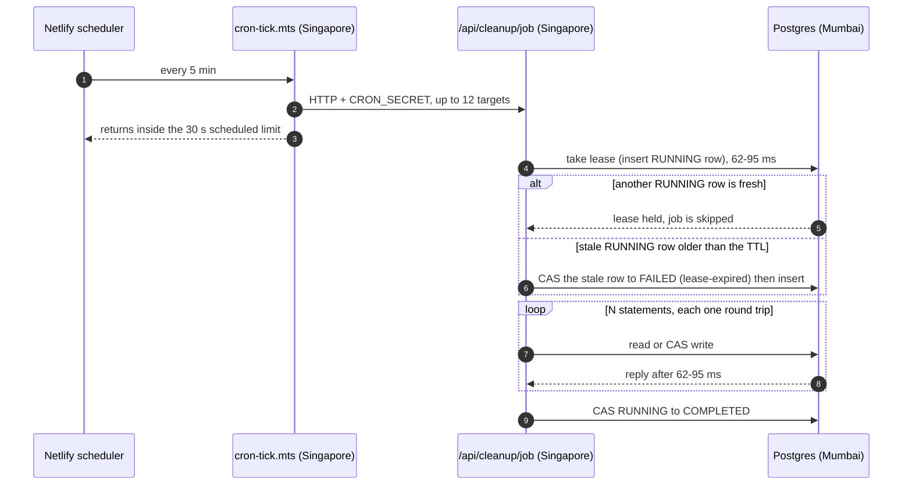

### 5.2 Inngest serve, with checkpointing and with standard orchestration

Inngest never runs our code. It sends an HTTP request to a route we host, built with `serve()`. With the default checkpointing the SDK runs several steps inside one request and reports results on a side channel, so three one-second steps took one request (3.1 s). With `checkpointing: false` each step gets its own request, so the same three steps took four. On real Netlify the dev server could not be reached from inside the function, so the side channel was unavailable and every step was one request of about 6.7 s for a 5 s step (about 1.7 s of extra duration after the step body, which the report attributes to the unreachable side channel).

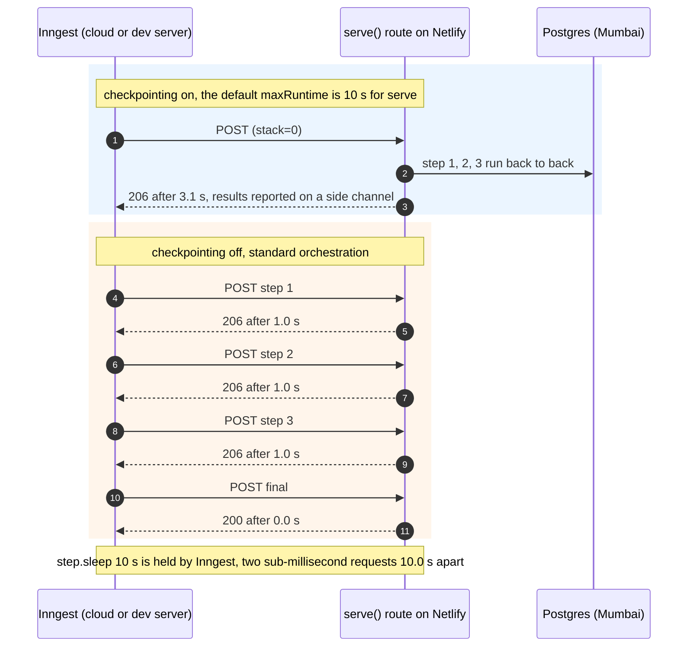

Ten 5-second steps with the default `maxRuntime` of 10 s took seven requests, each at most 10 s. With `maxRuntime: "20s"` they took five. With `maxRuntime: 0` the host cut the request at 26 s and the last step ran twice. The cap is checked between steps, never in the middle of one.

### 5.3 The 504-then-retry duplicate side effect

This is the failure that no scheduler fixes. The edge answers 504 to the caller while the function keeps running to the end, and the caller retries. The timeline is from the real Netlify site and the real QStash EU service.

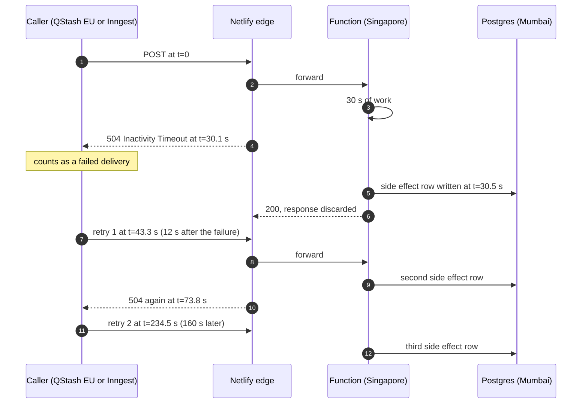

### 5.4 QStash publish, delivery and retry

The owner's real QStash EU account delivered 20 messages to the Singapore function with a median of 1,366 ms from publish to receipt (p95 2,115 ms, the first message 2,801 ms), 0 retries and all 200. The publish call itself took about 185 ms. Delays were late by 1.7 to 2.1 s, and a per-minute schedule fired once a minute, 0.9 to 1.4 s after the boundary. QStash retries any non-2xx response, three times by default, with a delay of `min(86400, e^(2.5n))` seconds, which is about 12 s, 148 s and 30 min (DOCS). The measured gaps were 12 s, 160 s and about 33 min.

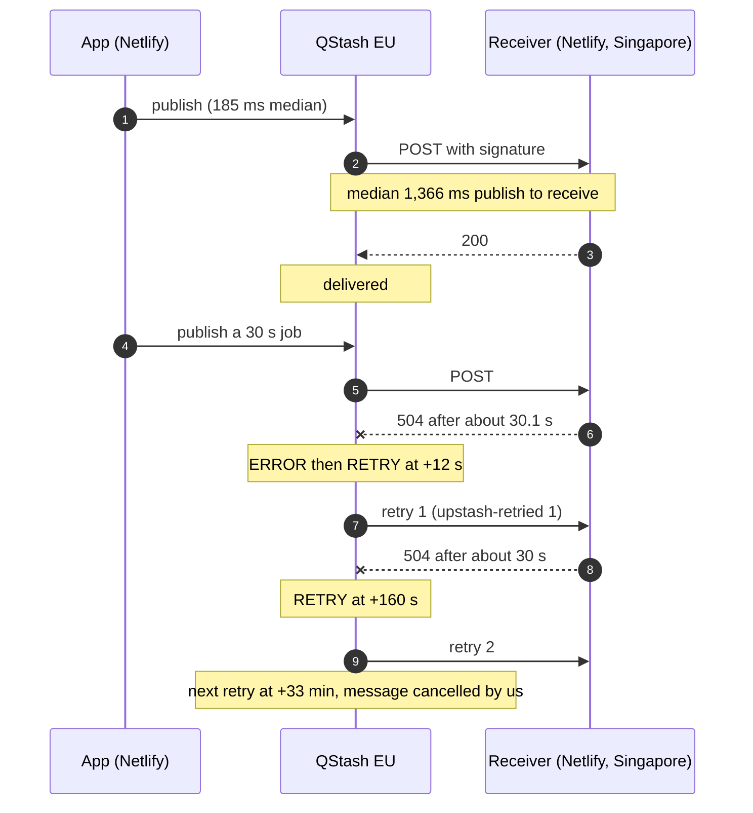

### 5.5 Upstash Workflow: the handler re-runs, each step runs once

A workflow route is called once to start the run and once per step. On each call the whole handler runs from the top, and completed steps are skipped from stored results (DOCS: "Workflow skips completed steps"). Two three-step runs measured four requests each and eight handler executions per run, while every step body ran exactly once. Anything outside `context.run` therefore runs once per request. A three-step run took 9.6 s and 13.2 s end to end, about 2–3 s per hop.

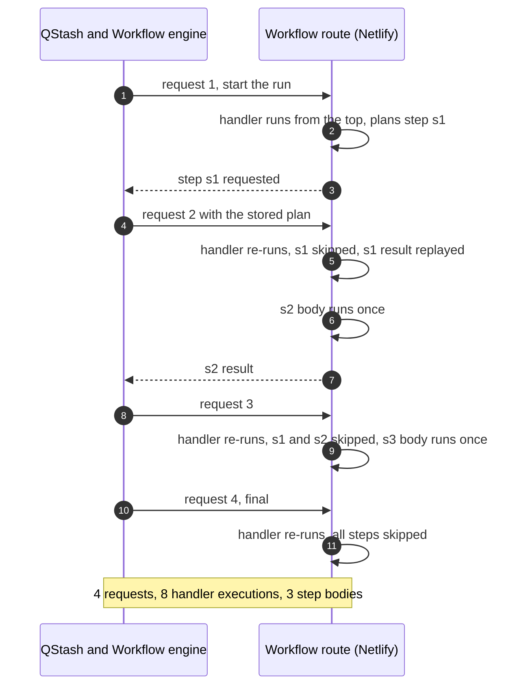

`context.sleep("10s")` cost no function time and resumed 10 s later (run took 16.7 s locally and 19.4–21.8 s on real QStash). `context.call` makes QStash call a URL for us and returns even on a non-2xx (DOCS), so it moves the caller's wait off the function. A 40 s callee still hit the Netlify edge limit and the call returned `504`.

### 5.6 Trigger.dev: the code runs off-site against the remote database

Trigger.dev packs the task into a container and runs it on its own machines. Our app only makes an API call. The task then talks to Mumbai from Frankfurt, so the connect (TCP, TLS, auth) alone cost 742–777 ms, about six round trips, and the 20-query mix cost 2.6–3.7 s.

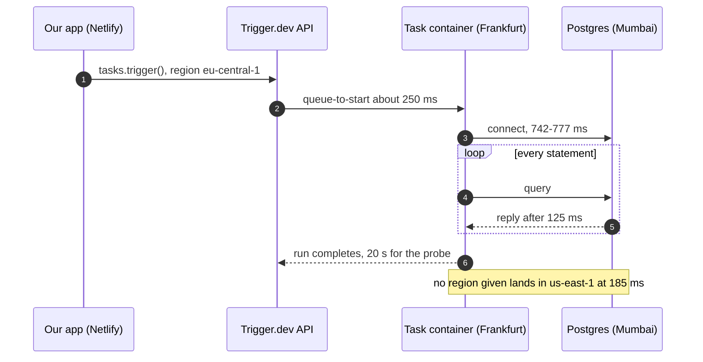

### 5.7 pg-boss and DBOS: in-database enqueue and crash recovery

Both libraries write the job in the caller's transaction, so a rollback leaves no job. A worker polls and claims rows. When a worker is killed, pg-boss expires the claim and reruns the whole job; DBOS restarts the workflow on the same executor and skips the steps already checkpointed.

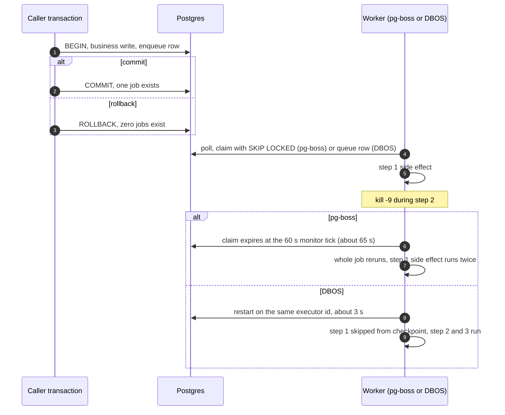

### 5.8 Vercel `bom1`: the compute moves next to the database

A function pinned to `bom1` connected in 12–18 ms warm (36 ms cold), ran `SELECT 1` in 1.0–2.1 ms and held the same ten-round-trip lock for 10.6–19.6 ms. The 20-query mix still took 305–507 ms because the three `LIMIT 50` reads and two counts cost 15–25 ms each. A request of 290 s succeeded on Hobby and one of 310 s returned `FUNCTION_INVOCATION_TIMEOUT` at 300.2 s. A `*/5 * * * *` cron was rejected at deploy on Hobby.

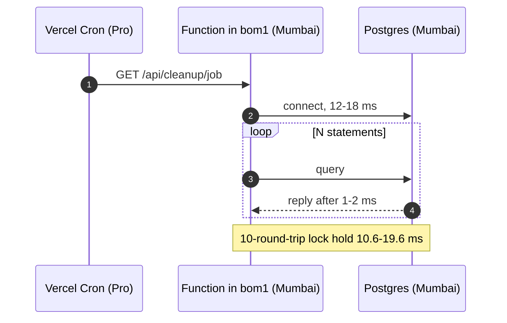

## 6. State diagrams

### 6.1 A job run, from lease to retry

A run is a row in `SystemJobExecution` whose status is `RUNNING`, `COMPLETED`, `FAILED` or `CANCELLED` (`SystemJobStatus` in `prisma/schema.prisma`). The lease is the `RUNNING` row. `withCronLock` sweeps a stale `RUNNING` row to `FAILED` with the message "Lease expired (stale RUNNING row swept)" when its TTL has passed, then creates a new row. A retry is therefore a later tick, not an in-process loop.

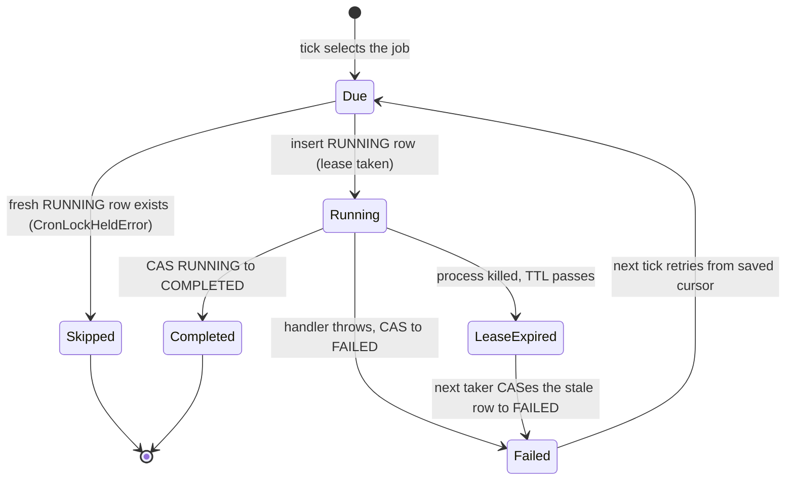

### 6.2 The dual write compared with the transactional outbox

A dual write commits to the database and then calls a separate system as two steps. If the process dies between them, the two stores disagree and nothing repairs it. The outbox writes the intent in the same transaction, so the two cannot diverge. The ticker and the refund-owed marker use the second shape. The demo on real Netlify showed it: with a failure injected between an insert and a QStash publish, the row stayed and the message count did not move.

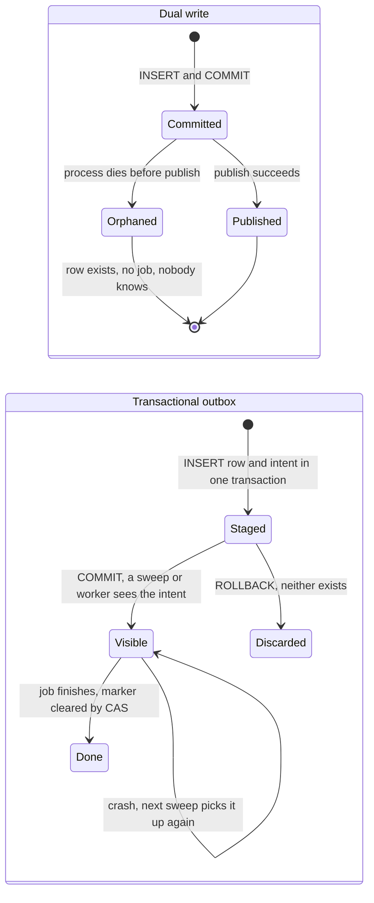

### 6.3 The 504 split brain

When the edge times out, the caller and the function disagree about whether the work happened. The function finishes the work while the caller already recorded a failure and plans a retry.

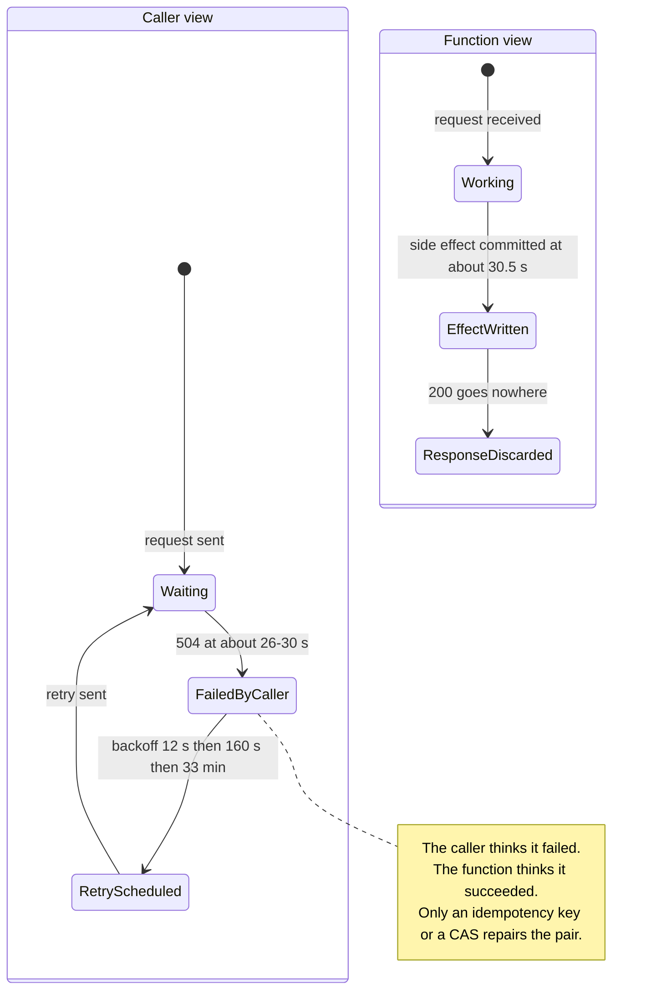

### 6.4 DBOS step recovery compared with a whole-job rerun in pg-boss

Both start in the same place: a worker is killed during step 2 of 3.

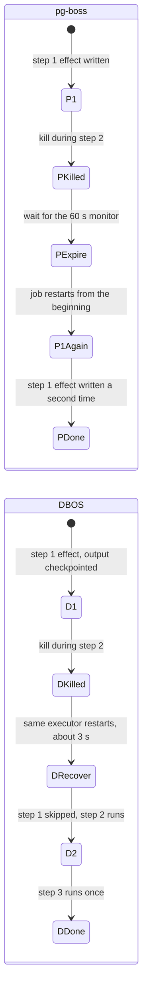

## 7. What each runtime does with our code

### 7.1 Inngest replaces the scheduler, not the compute

Inngest never runs our code in `serve` mode. That is how its docs describe it: the app exposes an HTTP endpoint and Inngest connects to it (DOCS). On Netlify that endpoint is a normal Next.js route, so it keeps Singapore, one connection and the same time limits. Inngest `connect` is a different mode: the app opens an outbound persistent connection, and the docs say serverless runtimes are not supported and a long-running server is required (DOCS), which rules it out on Netlify functions. Four conclusions follow, and each names its limit.

- **Inngest does not lift the host limit.** One step must fit inside one request. A single step longer than the edge cut returned a timeout to Inngest. With checkpointing off it failed three times and wrote its side effect three times. With checkpointing on, the result reached Inngest on a side channel in the one run measured and the side effect ran once, but that is not guaranteed. On real Netlify a 30 s step got a 504 and ran twice.
- **At-least-once still applies.** The host keeps running after the edge answers 504, so a retry can repeat a side effect. Checkpointing can hide this. It is not a guarantee.
- **Sleep and cron are Inngest's.** That is what Inngest sells: a durable timer outside our process. It would be a second scheduler beside the ticker, which `AGENTS.md` rule 4 forbids unless it replaces the ticker.
- **The remote sync is manual.** A deployed function cannot register itself with a dev server on a laptop. We had to PUT the site with the header `x-inngest-sync-kind: in_band` and post the function list to the dev server by hand. The dev server also polls the site every five seconds, and each poll is a billable function invocation.

Inngest Cloud's behaviour was not measured, only the SDK against the dev server.

### 7.2 Trigger.dev Cloud runs our code, but not near Mumbai

The account accepted only `us-east-1`, `us-west-2` and `eu-central-1`. Requests for `ap-south-1` and `ap-southeast-1` were rejected. The table gives the median of 50 `SELECT 1` round trips to the Mumbai transaction pooler (port 6543). The session port (5432) differed by less than 5 ms.

| Where the code runs                    | Median round trip | Connect (TCP, TLS, auth) | 20-query mix, total |
| -------------------------------------- | ----------------: | -----------------------: | ------------------: |
| Laptop in India (not representative)   |           39.4 ms |               251–277 ms |      1,050–1,078 ms |
| Netlify Singapore, raw `pg`            |          62–64 ms |               371–405 ms |      1,450–3,686 ms |
| Trigger.dev `eu-central-1` (Frankfurt) |            125 ms |               742–777 ms |      2,605–3,679 ms |
| Trigger.dev `us-east-1`                |            185 ms |                 1,123 ms |            3,986 ms |
| Trigger.dev `us-west-2`                |            232 ms |                 1,408 ms |            4,811 ms |
| Trigger.dev, no region given           |            185 ms |                 1,122 ms |            3,866 ms |
| Vercel `bom1`, raw `pg`                |        1.0–2.1 ms |                 12–36 ms |          305–507 ms |

Frankfurt at 125 ms is about twice Singapore's raw 62–64 ms, so moving a chatty job to Trigger.dev makes its database time worse. An unset region lands in `us-east-1`. Connect costs six to six and a half round trips, so a task must reuse its connection. The probe cost 0.035 to 0.124 US cents a run, on a base fee of 0.0025 cents, and a `micro` machine ran at the same speed for half the price. Egress IPs on the Free plan are dynamic (the same two addresses repeated in `eu-central-1`, but not guaranteed). Static IPs are a paid feature (DOCS); which paid plan is UNVERIFIED because the pricing page does not mention them.

### 7.3 pg-boss and DBOS keep the queue in Postgres

Both store jobs in the database and run workers in our own process. Neither is hosted, and neither supplies compute: a long-lived worker must exist somewhere, ideally in Mumbai. The table compares what was measured on local Postgres 16, through a local PgBouncer in transaction mode, and through the Supabase Mumbai poolers in throwaway `lab_` schemas that were dropped afterwards.

| Check                                             | pg-boss 12.38                                                                                                                                                                          | DBOS 5.4                                                                                                   |
| ------------------------------------------------- | -------------------------------------------------------------------------------------------------------------------------------------------------------------------------------------- | ---------------------------------------------------------------------------------------------------------- |
| Enqueue inside the caller's transaction           | Correct. Rollback left 0 jobs, commit left 1 (`db` option).                                                                                                                            | Correct. Rollback left 0 workflows, commit left 1 (`enqueueInTransaction`, same database only).            |
| Through the Supabase 6543 and 5432 poolers        | Worked on both.                                                                                                                                                                        | Worked on both, with the pool caveat below.                                                                |
| Cron, two workers, local                          | One job per minute for 7 minutes.                                                                                                                                                      | One workflow per minute for 6 minutes; the id contains the minute, so a duplicate is refused.              |
| Cron on Supabase, first minute after `schedule()` | A second job fired 30 s after the first, in 2 of 2 runs, on both poolers. Steady state was once a minute. Cause not found; clock skew was 80 ms.                                       | Fired once per minute on 6543; not run on 5432.                                                            |
| Concurrency limit of 2, two workers               | Up to 4 ran at once, because the limit is per process.                                                                                                                                 | 2 at once, because the limit is global.                                                                    |
| Kill -9 during step 2 of 3                        | The whole job reran after about 65 s (60 s monitor floor). Step 1's side effect ran twice. With default settings recovery would take about 15 minutes (from source defaults, not run). | The workflow resumed about 3 s after restart. Step 1 did not rerun. Only the same executor id recovers it. |
| Connections per idle worker                       | 3 to 5.                                                                                                                                                                                | 3 to 4, one of them idle in transaction.                                                                   |
| Enqueue-to-start latency, local                   | About 1 s polling; about 7 ms with LISTEN/NOTIFY on both the instance and each queue.                                                                                                  | About 0.2 s polling.                                                                                       |
| Enqueue-to-start on Supabase from the laptop      | 472 ms median on 6543, 307 ms on 5432.                                                                                                                                                 | 845 ms on 6543, 725 ms on 5432.                                                                            |
| LISTEN/NOTIFY through a transaction pooler        | Not used in the Supabase run.                                                                                                                                                          | Failed on 6543 and fell back to polling; worked on 5432.                                                   |
| Operator view                                     | Free `@pg-boss/dashboard` ran and listed the queues.                                                                                                                                   | SQL on the `dbos` schema only. The UI is part of the Conductor product.                                    |

Three results deserve plain statements.

- **DBOS has a pool floor.** It keeps an advisory-lock transaction open with a 5-second idle-in-transaction timeout. With `systemDatabasePoolSize: 2` that connection was starved, Postgres killed it and the process crashed on both poolers. With the default pool of 10 it was stable. The true minimum between 2 and 10 was not measured. This rules DBOS out inside a Netlify function (`PG_POOL_MAX=1`) and means it needs its own pool on a long-lived host.
- **Both need idempotent handlers.** pg-boss reruns the whole job after a crash and can fire a duplicate cron job in its first minute. DBOS narrows the window by checkpointing each step, but a step that crashes between its side effect and its checkpoint still repeats (DOCS: "it should be safe to retry them multiple times").
- **Version pinning matters for DBOS.** A worker on a non-latest application version stopped dequeuing client-enqueued work until a stray version row was removed. Pin `DBOS__APPVERSION` in deploys.

## 8. Worked example: one refund-owed job on each runtime

Priya Anderson cancels Hannah Anderson's 1-hour consultation on Mon 2 Nov 2026 at 10:00 IST (04:30 UTC) and is owed ₹590 (59,000 paise). The cancel route commits the cancellation and stamps `Payment.refundOwedPaise = 59000`. The settlement job then runs a ten-statement transaction: `SELECT … FOR UPDATE` on Priya's payment row, eight statements (re-read the marker, write the refund row, post the ledger legs, CAS the marker) and `COMMIT`. Suppose Priya's other action, say adding a review, tries to update the same payment row while the job holds the lock. The table gives, for each runtime, how long the job holds the lock and how long her update waits if it arrives at a random moment. The hold is ten times the per-statement round trip (MEASURED, database execution is negligible), and the expected wait is half the hold.

| Where the job runs                   | Per-statement round trip | Lock held for 10 round trips | Priya's update waits (expected, worst) | Status                                        |
| ------------------------------------ | -----------------------: | ---------------------------: | -------------------------------------: | --------------------------------------------- |
| Netlify Singapore, raw `pg`          |                 62–64 ms |                 about 690 ms |                   about 345 ms, 707 ms | MEASURED, 676–707 ms medians                  |
| Netlify Singapore, through Prisma    |              about 95 ms |                 about 950 ms |                   about 475 ms, 950 ms | Extrapolated from the Prisma-level round trip |
| Trigger.dev Frankfurt                |                 125.8 ms |                     1,258 ms |                    about 630 ms, 1.3 s | MEASURED, 10 runs                             |
| Laptop in India (not representative) |                  39.5 ms |                       395 ms |                   about 200 ms, 0.37 s | MEASURED, 10 runs                             |
| Vercel `bom1`                        |               1.0–2.1 ms |                 10.6–19.6 ms |                          about 5–10 ms | MEASURED                                      |

The interference run confirms the Frankfurt and laptop rows. A simulated user updated the locked account row about five times a second. With no job running the median update took 37.6 ms. An update issued during a laptop-run hold took 274.9 ms at the median (p95 367.9 ms), and one issued during a Frankfurt-run hold took 1,110.1 ms (p95 1,272.2 ms). All ten Frankfurt holds blocked exactly one update for more than 150 ms. The updater was a closed loop, so it under-counts a real crowd: at five arrivals a second, a 1.26 s hold would queue about six waiting writes.

Two concurrent copies of the same transaction at SERIALIZABLE lost exactly one of every pair with SQLSTATE 40001 (20 commits and 20 failures per location, both places). Distance does not change the failure rate. It changes how long the surviving snapshot stays open. `withSerializableRetry` (`lib/db/serializable-retry.ts`) retries those failures.

The money itself is protected the same way everywhere. The database refuses an unbalanced ledger (`ledger_txn_balanced`) and a leg set that does not sum to the payment (`payment_legs_sum_to_amount`), both in `prisma/sql/`, at commit and wherever the client sits.

## 9. Questions the owner asked

### 9.1 Does running jobs on an external machine make a Postgres transaction distributed?

No. A transaction opened by a worker in Frankfurt is still one ACID transaction on one database, and the database enforces it exactly as before. The constraints named in section 8 and `occurrence_no_confirmed_overlap` are checked at commit regardless of where the client sits. A distributed transaction would need two databases or two resource managers, and none of these options adds one. What changes is how long the transaction stays open: every statement waits for a round trip, so row locks and Serializable snapshots are held longer, as the section 8 table shows. A competing writer waits longer or hits a retry. Barring remote workers from holding locks on booking rows is an open question for the owner in the evidence record.

### 9.2 Where does the dual-write risk come from?

It comes from the vendor and its trigger, not from the location. A dual write happens when we commit to the database and then tell a separate system to start the job, as two steps that can fail apart. If the cancel route in section 8 called `inngest.send()`, `tasks.trigger()` or a QStash `publish()` after its commit and the network dropped, the booking would be cancelled with no engine aware that ₹590 is owed. The Netlify experiment reproduced this: the row committed and the publish count did not change.

There are two fixes, and the repo already has one.

- **State as the outbox.** The marker row is the outbox: the job reads database state, so a missed trigger costs nothing. `retry-auto-refunds` (registered in `lib/cron/cleanup-registry.ts`) finishes any marker the process died on, using `lib/payments/operations/refund-owed.ts`. A hosted engine can be added behind this pattern by relaying marker rows afterwards, and the database stays the source of truth.
- **In-database enqueue.** pg-boss and DBOS write the job in the same transaction as the business change, which the experiment proved (rollback leaves no job).

A cron-triggered sweep that reads database state has no enqueue dual write at all, which is why the ticker is safe today.

### 9.3 Do vendor side effects become exactly-once on a better runtime?

No. Razorpay and Stream calls stay at-least-once on every runtime on this page. The Inngest experiment repeated a side effect on a retry, QStash wrote three effects for one message, pg-boss reran a whole job after a crash, and even DBOS can repeat a step that crashed between its effect and its checkpoint. What makes them safe is unchanged: gateway idempotency keys, compare-and-swap status writes (`updateMany` with the expected prior status in `WHERE`) and the reconcilers that compare our state with the vendor's.

### 9.4 Can RazorpayX static egress be solved on Netlify?

Yes, and it already is. Live RazorpayX answers only allowlisted IP addresses, up to 20, in Live Mode only (DOCS), and Netlify has no static egress address outside an Enterprise add-on with no Singapore or Mumbai region (DOCS). The earlier finance decision (F1) routes the RazorpayX client alone through a static-IP HTTP proxy set by `RAZORPAYX_EGRESS_PROXY_URL`. The client refuses live calls without it, with `RAZORPAYX_EGRESS_NOT_CONFIGURED` (`apiRequest` in `lib/payments/payouts/razorpay-payouts.ts`; see [RazorpayX](../finance/40-payouts/04-razorpayx.md)). So the question for any new runtime is cost and added latency, not possibility. The extra hop of the proxy was not measured. A runtime with its own static address (a Lightsail VM in Mumbai, Vercel Static IPs, or a paid Trigger.dev tier if confirmed) could replace the proxy, but only for the code that runs there. The table gives the verified price of each way to get a fixed address. The quotes are in [lock-hold-and-static-ip](./experiments/2026-10-31-job-runtime/lock-hold-and-static-ip.md).

| Way to get a static address                | Price                                                                                                         | Status                                                                                                                                                                   |
| ------------------------------------------ | ------------------------------------------------------------------------------------------------------------- | ------------------------------------------------------------------------------------------------------------------------------------------------------------------------ |
| QuotaGuard Static proxy (the F1 class)     | $19 a month (10 GB), $49 (50 GB), $89 (200 GB), $219 (1 TB, dedicated IPs); a load-balanced pair of IPs       | Prices DOCS. The pricing page lists a Mumbai location and also says data residency is "US or EU", so Mumbai is UNVERIFIED until sales confirm. Latency: none documented. |
| Fixie proxy                                | HTTP plans from free (500 requests) to $5, $19 and $49; SOCKS plans from $9                                   | Locations and IP count UNVERIFIED; no India or Singapore location documented.                                                                                            |
| AWS Lightsail in Mumbai                    | Plans from $5 a month; a static IP is free while attached, $0.005 an hour if unattached over an hour          | DOCS. Outbound use of the static IP is standard AWS behaviour but not quoted on the page.                                                                                |
| Vercel Static IPs                          | $100 a month per project on Pro, plus regional Private Data Transfer; one IP pair per region, up to 3 regions | Price and plan DOCS against the Vercel page re-read on 2026-10-31. Whether `bom1` can be selected is UNVERIFIED.                                                         |
| Vercel Secure Compute                      | Enterprise only, custom pricing                                                                               | DOCS Enterprise-only.                                                                                                                                                    |
| Netlify Private Connectivity               | Enterprise add-on, no published price; regions Ohio, Frankfurt and London only                                | DOCS against the Netlify page re-read on 2026-10-31. No Singapore or Mumbai region.                                                                                      |
| GCP Cloud Run `asia-south1` with Cloud NAT | NAT gateway $0.0014 an hour per VM, $0.045 per GiB, external IP $0.005 an hour (about $3.65 a month)          | DOCS prices. How Cloud Run instances count toward the per-VM row is UNVERIFIED.                                                                                          |
| Fly.io static egress                       | $3.60 a month per app-scoped IPv4 per region                                                                  | Price DOCS. The regions table fetched had no Mumbai (`bom`) row.                                                                                                         |
| Trigger.dev paid plans                     | Not stated; Hobby $10 and Pro $50 are the plan prices                                                         | Paid-only DOCS. Which plan, how many IPs and any extra price are UNVERIFIED.                                                                                             |
| Inngest                                    | Not applicable                                                                                                | In serve mode the function runs on our host and leaves from that host's address. That follows from the model; no page states it, so UNVERIFIED as a quotation.           |

### 9.5 Why does Inngest on Netlify not lift the limit?

Because the function that runs the step is a Netlify function, and Netlify's edge cuts a request that has sent no data after about 26 s on production (about 30 s on a throwaway site, and Netlify support has confirmed a second ceiling near 37–38 s; see `.claude/skills/deployment/netlify/platform-limits.md`). Inngest can split a sequence of short steps across many requests, and a durable `step.sleep` costs no compute, but it cannot make one request outlive the edge. The 504 it sees is also the same 504 QStash sees (section 5.3). Inngest `connect` would avoid the HTTP timeout (DOCS: "Step execution is not bound by platform http timeouts"), but it requires a long-running server and does not support serverless runtimes, so it needs the same long-lived host that pg-boss and DBOS need.

## 10. Official sources

Every vendor claim above is backed by one of these pages. All were fetched on 2026-10-31 unless a row says otherwise. Where a page was not reachable or did not state a claim, the claim is UNVERIFIED.

| Vendor           | Claim used                                                                                        | Page and exact words                                                                                                                                                                                                                                                  | Result             |
| ---------------- | ------------------------------------------------------------------------------------------------- | --------------------------------------------------------------------------------------------------------------------------------------------------------------------------------------------------------------------------------------------------------------------- | ------------------ |
| Inngest          | `serve` exposes an HTTP endpoint that Inngest uses; longer timeouts via streaming on Vercel Fluid | https://www.inngest.com/docs/learn/serving-inngest-functions: "You expose your functions to Inngest through this HTTP endpoint." The page does not say "Inngest calls your endpoint"; that wording is our reading.                                                    | DOCS               |
| Inngest          | `connect` needs a long-running server and does not support serverless                             | https://www.inngest.com/docs/setup/connect: "You must use a long running server (Render, Fly.io, Kubernetes, etc.)." and "Serverless runtimes (AWS Lambda, Vercel, etc.) are not supported."                                                                          | DOCS               |
| Inngest          | Step execution under `connect` is not bound by platform HTTP timeouts                             | Same page: "Step execution is not bound by platform http timeouts".                                                                                                                                                                                                   | DOCS               |
| Inngest          | Limits on checkpointing                                                                           | The fetched serve page does not mention checkpointing. The 10 s default `maxRuntime` comes from the SDK type definitions (`CheckpointingOptions`) in the inngest 4.26.2 package.                                                                                      | UNVERIFIED as docs |
| Inngest          | Pricing                                                                                           | https://www.inngest.com/pricing: Free $0 with 50k executions a month that pauses at quota; Pro from $99 with 1M. "A function with 5 `step.run()` calls uses 6 executions."                                                                                            | DOCS               |
| Trigger.dev      | Runs tasks on its own infrastructure, checkpoint-resume, no numeric run cap                       | https://trigger.dev/docs/how-it-works: "serverless architecture (without timeouts!)"; "virtually limitless execution time"; waits under 60 s are not checkpointed.                                                                                                    | DOCS               |
| Trigger.dev      | Pricing                                                                                           | https://trigger.dev/pricing: Free $0 with $5 credits, Hobby $10, Pro $50; "$0.000025" per run ("$0.25 per 10,000 runs"). Static IPs are not mentioned on the page.                                                                                                    | DOCS               |
| Trigger.dev      | Static IPs are paid only                                                                          | https://trigger.dev/changelog/static-ips: "Available for paid customers (free customers use dynamic IPs)". The page lists no regions.                                                                                                                                 | DOCS               |
| Trigger.dev      | The regions available                                                                             | https://trigger.dev/changelog/regions returned 404 and the docs regions page returned 404 earlier. The three regions come from our own runs, not from a page.                                                                                                         | UNVERIFIED as docs |
| Upstash QStash   | Pricing                                                                                           | https://upstash.com/pricing/qstash: Free "$0/month" with "1,000" messages a day; "$1 per 100K messages".                                                                                                                                                              | DOCS               |
| Upstash QStash   | Retry count and backoff                                                                           | https://upstash.com/docs/qstash/features/retry: "By default, we retry a failed delivery 3 times." and `delay = min(86400, e ** (2.5*n))`. A 489 with `Upstash-NonRetryable-Error: true` stops retries.                                                                | DOCS               |
| Upstash Workflow | Each step is its own HTTP call and completed steps are skipped                                    | https://upstash.com/docs/workflow/basics/how: "Each step is executed in its own HTTP call to your application." and "On the next execution, Workflow skips completed steps."                                                                                          | DOCS               |
| Upstash Workflow | `context.call` runs an HTTP request for us                                                        | https://upstash.com/docs/workflow/basics/context/call: "supports longer response times up to 12 hours"; a non-2xx "still returns the response and the workflow continues".                                                                                            | DOCS               |
| pg-boss          | Postgres queue with `SKIP LOCKED`, jobs in an existing transaction, cron                          | https://pgboss.io/ (the old GitHub Pages address redirects there): "relies on Postgres's SKIP LOCKED"; jobs created "in an existing db transaction"; "Cron and RRULE scheduling". The `db` option name is from the library's own API, not that page.                  | DOCS (partly)      |
| DBOS             | Steps and workflow inputs are checkpointed in Postgres; recovery skips completed steps            | https://docs.dbos.dev/architecture: "Every workflow input and step output is durably stored in the system database."; "If there is a checkpoint, the step returns the checkpointed output instead of executing."                                                      | DOCS               |
| DBOS             | Conductor is a paid product with a UI                                                             | The architecture page describes Conductor as "the control plane for your durable workflows" but does not state price.                                                                                                                                                 | UNVERIFIED         |
| Vercel           | Function duration: Hobby 300 s, Pro 800 s, 1,800 s beta                                           | https://vercel.com/docs/fluid-compute (Default settings by plan) and https://vercel.com/docs/functions/limitations. Measured: 290 s passed and 310 s returned 504 at 300.2 s on Hobby.                                                                                | DOCS and MEASURED  |
| Vercel           | Cron limits                                                                                       | https://vercel.com/docs/cron-jobs/usage-and-pricing: Hobby "once per day", precision "Per-hour (±59 min)"; Pro "Once per minute"; "Vercel cannot assure a timely cron job invocation."                                                                                | DOCS and MEASURED  |
| Vercel           | Fluid compute is default for new projects and shares instances across invocations                 | https://vercel.com/docs/fluid-compute: "As of April 23, 2025, fluid compute is enabled by default for new projects." and "multiple invocations to share a single function instance".                                                                                  | DOCS               |
| Vercel           | Workflows: durable code with no duration limit                                                    | https://vercel.com/docs/workflows: "Pause for minutes or months, then resume from the exact point." Fluid page: "Vercel Workflows, which allow your code to pause, resume, and maintain state for minutes to months without duration limits." Not yet measured by us. | DOCS               |
| Vercel           | Static IPs                                                                                        | https://vercel.com/docs/networking/static-ips: "$100/month per project for Pro plus Private Data Transfer" and "Each configured region has its own static IP pair".                                                                                                   | DOCS               |
| Netlify          | Function time limits                                                                              | https://docs.netlify.com/build/functions/configuration/: synchronous execution limit "60 seconds", not configurable; scheduled 30 s and background 15 min on the same table. Edge cut measured at about 26 s (prod) and about 30 s (throwaway).                       | DOCS and MEASURED  |
| Netlify          | Scheduled functions have a 30 s limit                                                             | https://docs.netlify.com/build/functions/scheduled-functions/: "Scheduled functions have a 30 second execution limit."                                                                                                                                                | DOCS               |
| Netlify          | Static egress is an Enterprise add-on                                                             | https://docs.netlify.com/manage/security/private-connectivity: "available as an add-on to Enterprise plans" with regions `cmh`, `fra`, `lhr`.                                                                                                                         | DOCS               |
| RazorpayX        | Payout API IP allowlist                                                                           | https://razorpay.com/docs/x/dashboard/allowlist-ip/: "IP Allowlisting is applicable only in Live Mode."; "Enter up to 20 IPs"; for dynamic IPs "contact support".                                                                                                     | DOCS               |
| Supabase         | Transaction pooler on 6543, session pooler on 5432, no prepared statements in transaction mode    | https://supabase.com/docs/guides/database/connecting-to-postgres: transaction mode is for "serverless and edge functions"; "The shared pooler doesn't support prepared statements in transaction mode."                                                               | DOCS               |

Cloudflare Workers, Queues and Workflows have no row because no experiment has reported yet.

## 11. How to reproduce

[source-code.md](./experiments/2026-10-31-job-runtime/source-code.md) keeps the scripts for three of the experiments as text, so lint, typecheck and the build ignore them: the Inngest app, 504 proxy and event sender (`lab-inngest/`), the pg-boss, DBOS and Supabase probes (`lab-pg/`) and the Trigger.dev latency probe (`lab-trigger/`). The Vercel `bom1` probe is described in [vercel-bom1-latency](./experiments/2026-10-31-job-runtime/vercel-bom1-latency.md) with its `vercel.json` and a condensed list of the queries, which is enough to rebuild it. The lock-hold, Netlify and real-QStash scripts were not kept in the repository, so those three are reproducible only from the method sections of their reports. Each probe takes its database address from an environment variable, never from the repository. Run them from a scratch directory outside the repository, against a throwaway schema whose name starts with `lab_`, and drop that schema afterwards. The Netlify and Vercel probes need a throwaway site or project with the function region pinned (`ap-southeast-1` or `bom1`), and the QStash probes need your own QStash token.

## 12. How the experiments bear on the existing decisions

This section reads the evidence against the decisions without changing them.

| Decision                                                          | Effect of the evidence                                                                                                                                                                                                                                                                                       |
| ----------------------------------------------------------------- | ------------------------------------------------------------------------------------------------------------------------------------------------------------------------------------------------------------------------------------------------------------------------------------------------------------ |
| Decision 1: keep the ticker through launch                        | Strengthened. Every alternative either leaves the compute on the same host (Inngest, QStash, Upstash Workflow) or moves it farther from the database (Trigger.dev).                                                                                                                                          |
| Decision 2: trial Vercel `bom1` before about 300 users            | Strongly supported. A real `bom1` function measured 1–2 ms per statement against 62–64 ms raw (about 95 ms through Prisma) from Netlify Singapore, and held the 10-round-trip lock for 10.6–19.6 ms instead of about 690 ms. The trial needs Pro, because Hobby allows only a daily cron.                    |
| Decision 3: no hosted job service, because none fixes the latency | Strengthened, with one wording correction. The ADR says these services call back into our functions. That is true of Inngest and QStash, but Trigger.dev runs the code on its own machines. The conclusion holds: its nearest region is slower than Singapore.                                               |
| Decision 4: a hand-written Prisma `Job` table with `SKIP LOCKED`  | Neither weakened nor replaced. pg-boss and DBOS work through the poolers, but pg-boss keeps its own schema outside Prisma and DBOS needs its own pool and system tables. A hand-written queue must still reclaim a crashed claim quickly, enforce a global concurrency limit and tolerate a duplicate start. |
| Issue #2484: one always-on Lightsail VM in Mumbai at $24 a month  | Compatible. pg-boss, DBOS and Inngest Connect all need a long-lived process, which a VM gives. Whether the VM is in scope is an open question for the owner (see the evidence record).                                                                                                                       |

## 13. Where in code

The table lists the repository locations that this page's claims rest on.

| Concern                                  | Location                                                                                       |
| ---------------------------------------- | ---------------------------------------------------------------------------------------------- |
| The ticker and its target cap            | `netlify/functions/cron-tick.mts`, `MAX_TARGETS_PER_TICK` in `lib/cron/schedule.ts`            |
| One implementation per job               | `lib/cron/cleanup-registry.ts`                                                                 |
| Job lease in Postgres                    | `withCronLock` in `lib/cron/with-cron-lock.ts`, `SystemJobExecution` in `prisma/schema.prisma` |
| Single-connection pool on Netlify        | `PG_POOL_MAX` handling in `lib/prisma.ts`                                                      |
| Serializable retry                       | `withSerializableRetry` in `lib/db/serializable-retry.ts`                                      |
| Refund-owed marker (state as the outbox) | `lib/payments/operations/refund-owed.ts`, the `retry-auto-refunds` job                         |
| RazorpayX static egress                  | `apiRequest` in `lib/payments/payouts/razorpay-payouts.ts`                                     |
| Database-enforced invariants             | `prisma/sql/ledger-triggers.sql`, `prisma/sql/payment-legs-triggers.sql`                       |

## Related research

The longer research this page draws on is in [scale path research](../infrastructure/2026-10-31-scale-path-research.md), [system-design pictures](../infrastructure/2026-10-31-job-runtime-system-designs.md) and [runtime strategy review](../infrastructure/2026-10-31-runtime-strategy-review.md). Agents read the short versions in `.claude/skills/maintenance/references/job-runtime-options.md` and `.claude/skills/deployment/netlify/job-runtime-options.md`.

## Related issues

#2472 (scale-path research), #2484 (runtime review), #2485 (side-by-side runtime picture), #2466 (ticker and Sentry readiness).

## Deprecated & Superseded Approaches

- **Hosted-engine triggers as a second scheduler.** An earlier plan in the scaling roadmap listed QStash, Inngest and Trigger.dev as ways to queue webhook work. Adopting one beside the ticker would break the one-scheduler rule and add a commit-then-call gap (section 6.2). The roadmap's queue section is superseded by the Prisma `Job` table decision.
- **Cron by GitHub Actions.** The Actions-based cron fleet that the roadmap describes was deleted when the minutes budget ran out. Jobs run on the ticker.
- **The 95 ms figure as a raw number.** Older pages quote 95 ms per statement for Netlify. That is the Prisma-level figure. Raw `pg` measured 62–64 ms.
