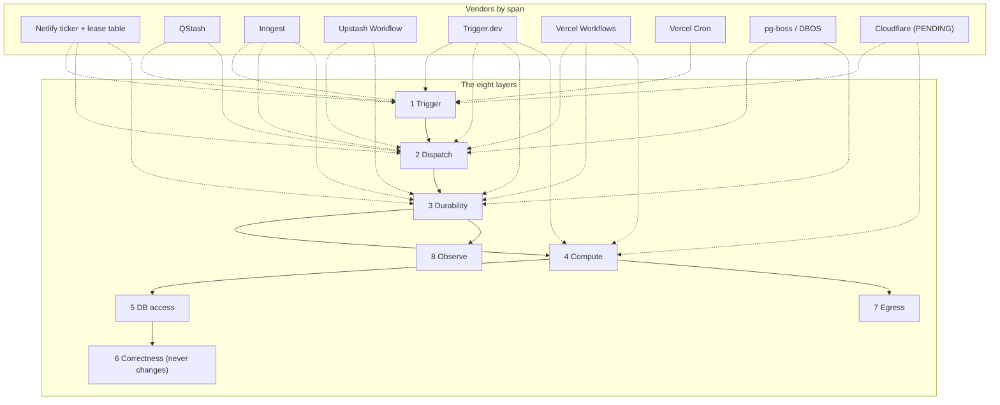
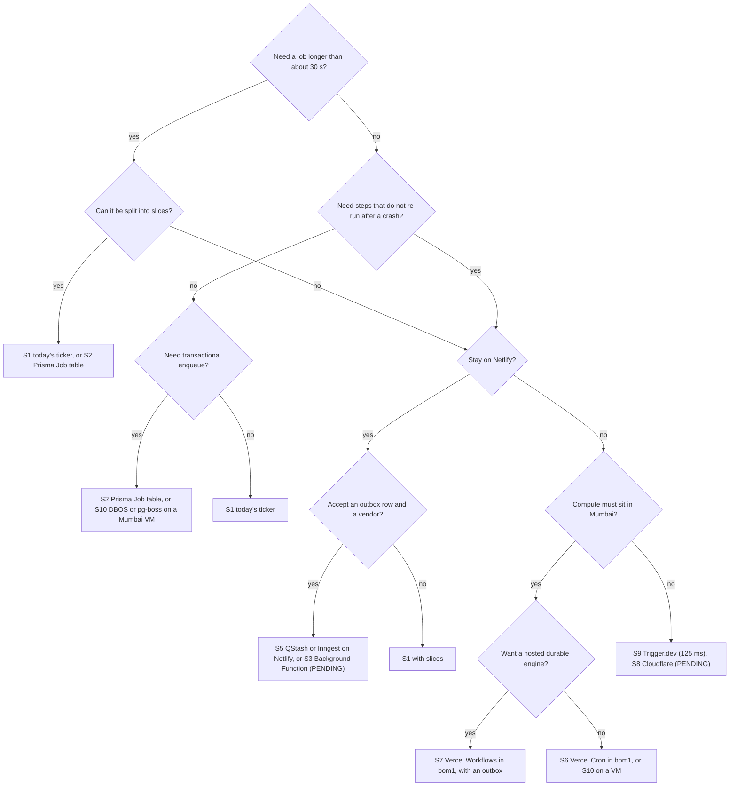

# The eight layers of the jobs subsystem and the stacks that fit together

[Background-job runtime options](./14-background-job-runtime-options.md) compares the runtimes one by one. This page answers a different question: which parts of a jobs system can be swapped independently, which cannot, and therefore which complete stacks are coherent. It is evidence for decisions the owner has already taken and does not take a new one. The decisions are in [Ticker through launch, the scale path, the phase 2 queue and the database plan](../decisions/2026-10-31-ticker-scale-path-and-queue.md). The labels MEASURED, DOCS, ESTIMATE, UNVERIFIED and PENDING are defined in section 1 of page 14, with ESTIMATE meaning arithmetic or reasoning with no run behind it and PENDING meaning an experiment has not reported.

## 1. The eight layers

A background job passes through eight layers. The picture lists them from the clock at the top to the telemetry at the bottom.

```text
  1 TRIGGER      what decides it is time        Netlify scheduled function, Vercel Cron, QStash schedule,
                                                Inngest cron, pg-boss or DBOS schedule, Cloudflare cron
  2 DISPATCH     how the work reaches compute   HTTP fan-out, vendor HTTP callback, queue poll or drain
  3 DURABILITY   retries, steps, sleeps, state  Postgres lease row, Inngest, Upstash Workflow,
                                                Vercel Workflows, DBOS, pg-boss, Trigger.dev
  4 COMPUTE      where our code runs            Netlify Singapore, Vercel bom1, Trigger.dev Frankfurt,
                                                a Mumbai VM, Cloudflare Workers
  5 DB ACCESS    pooler, connections, distance  Supabase pooler 6543 or 5432, PG_POOL_MAX, round trip
  6 CORRECTNESS  what makes a repeat harmless   CAS-in-WHERE, gateway idempotency keys, ledger triggers,
                                                reconcilers                               NEVER CHANGES
  7 EGRESS       the address the world sees     Netlify (none), F1 proxy for RazorpayX, Vercel Static IPs,
                                                a VM address
  8 OBSERVE      how we know it ran             Sentry check-in, /api/health/jobs, SystemJobExecution rows,
                                                vendor consoles
```

## 2. Layer by layer: today's choice and the measured facts

The table gives, for each layer, what the repository does today and what the experiments measured about the alternatives. Facts without a label are measured in the reports of the [experiment folder](./experiments/2026-10-31-job-runtime/README.md).

| Layer         | Today                                                                                                                                     | Options and measured facts                                                                                                                                                                                                                                                                                                               |
| ------------- | ----------------------------------------------------------------------------------------------------------------------------------------- | ---------------------------------------------------------------------------------------------------------------------------------------------------------------------------------------------------------------------------------------------------------------------------------------------------------------------------------------- |
| 1 Trigger     | `netlify/functions/cron-tick.mts` every 5 minutes (30 s scheduled limit, DOCS).                                                           | QStash schedule fired once a minute, 0.9–1.4 s late on Netlify and exactly once on `bom1` (MEASURED). Vercel Cron: Hobby daily only with hour precision, Pro per minute (MEASURED rejection, DOCS). Inngest cron fired on the minute (MEASURED, dev server). pg-boss cron duplicated once in the first minute in 2 of 2 runs (MEASURED). |
| 2 Dispatch    | HTTP to `/api/cleanup/[job]`, at most `MAX_TARGETS_PER_TICK` (12) per tick.                                                               | Vendor POST to our route: QStash median 1,366 ms to Netlify, about 350 ms publish-ack to `bom1` (MEASURED). Queue poll: pg-boss about 1 s, DBOS about 0.2 s local (MEASURED). A periodic trigger can drain any queue at the cost of tick latency (reasoning, ESTIMATE).                                                                  |
| 3 Durability  | A `RUNNING` `SystemJobExecution` row as lease, a saved cursor, state as the outbox (`withCronLock`).                                      | Inngest and Upstash Workflow: steps in our route, handler re-runs per request for Upstash (MEASURED). DBOS: checkpointed steps, resume in about 3 s (MEASURED). pg-boss: whole job reruns after about 65 s (MEASURED). Vercel Workflows: completed steps not re-run after a crash (MEASURED). Trigger.dev: checkpoint-resume (DOCS).     |
| 4 Compute     | Netlify Functions, Singapore, one connection per instance.                                                                                | Edge cut about 26 s on prod, about 30 s on a throwaway site (MEASURED). `bom1`: 300 s Hobby (MEASURED), 800 s Pro (DOCS). Trigger.dev: no stated cap (DOCS), regions Frankfurt and the US only (MEASURED). Netlify Background Functions: 15 min (DOCS), PENDING. A Mumbai VM: no cap, not measured.                                      |
| 5 DB access   | Supabase pooler, `PG_POOL_MAX=1` on Netlify (`lib/prisma.ts`).                                                                            | Per round trip: Netlify 62–64 ms raw, Trigger.dev Frankfurt 125 ms, laptop 39.5 ms, `bom1` 1.0–2.3 ms (MEASURED). Prisma adds 0.1 ms or less per statement in `bom1` (MEASURED). A Mumbai worker at 1–2 ms is an ESTIMATE; only `bom1` was measured. DBOS needs a pool of about 10 (MEASURED).                                           |
| 6 Correctness | CAS status writes, idempotency keys, `ledger_txn_balanced`, `payment_legs_sum_to_amount`, `occurrence_no_confirmed_overlap`, reconcilers. | Unchanged by any option. Every failed-on-purpose run repeated a side effect except DBOS and Vercel Workflows for steps already complete (MEASURED).                                                                                                                                                                                      |
| 7 Egress      | None on Netlify. RazorpayX live calls go through the F1 proxy (`RAZORPAYX_EGRESS_PROXY_URL`).                                             | Vercel Static IPs $100 a month per project on Pro (DOCS), Trigger.dev paid plans only (DOCS), a Lightsail VM includes one (DOCS), Netlify only as an Enterprise add-on in Ohio, Frankfurt and London (DOCS).                                                                                                                             |
| 8 Observe     | Sentry check-in from the ticker, `/api/health/jobs`, `SystemJobExecution` rows.                                                           | Vendor consoles: Upstash Logs, Schedules, DLQ and Workflow tabs; Inngest dashboard; Trigger.dev run list; Vercel Observability Workflows tab; `@pg-boss/dashboard`; DBOS has SQL only without Conductor (MEASURED, DOCS).                                                                                                                |

## 3. The five compatibility rules

These rules say which choices constrain each other. Each names what enforces it.

1. **A layer-3 engine is tied to its compute.** Vercel Workflows runs only on Vercel Functions, Cloudflare Workflows only on Workers (PENDING), and Trigger.dev only on its own machines. Inngest and Upstash Workflow work with any HTTP compute, because they call a route we host. The enforcer is each product's execution model (DOCS).
2. **Durable steps and in-process cron need long-lived compute.** Without it you only get drain mode: a periodic trigger starts a short function that drains whatever is due. Inngest `connect` is unsupported on serverless runtimes (DOCS), and DBOS needs a pool of about 10 that `PG_POOL_MAX=1` cannot give (MEASURED).
3. **Any queue can be drained by a periodic trigger**, at the cost of tick latency. This is what the Prisma `Job` table decision relies on.
4. **Only a Postgres-native queue avoids the enqueue dual write.** pg-boss and DBOS enqueue in the caller's transaction (MEASURED). Everything else (QStash, Inngest, Trigger.dev, Vercel Workflows `start()`) needs an outbox row written in the same transaction, because the publish is a second step that can fail apart (MEASURED on QStash and Vercel Workflows). The enforcer is the Postgres transaction itself.
5. **Layer 6 never changes.** No stack makes a vendor side effect exactly-once, so CAS-in-WHERE, idempotency keys and the reconcilers stay on every stack. The enforcers are the constraints in `prisma/sql/` and the CAS helpers.

### Corrections that follow

- **pg-boss and DBOS can be drained from short functions.** The report that supplied this names pg-boss `fetch()` for pulling jobs by hand. We did not run that mode and the pg-boss landing page does not document `fetch()`, so it is UNVERIFIED by us. Only their own cron, maintenance and fast crash recovery need a long-running process. Our kill-9 numbers (65 s and 3 s) were measured with a long-running worker.
- **"A Mumbai worker at 1–2 ms" is an ESTIMATE.** Only a Vercel `bom1` function was measured (1.0–2.3 ms). No Mumbai VM was run.
- **A Background Function avoids the roughly 30 s cap but the caller gets only a 202.** Pointing an external scheduler at one removes the edge cut for the work, but the scheduler learns nothing about success, so a retry decision needs the database state (PENDING measurement).

## 4. Where the vendors sit

The flowchart shows the layers and which vendors span which. An arrow from a vendor to a layer means the vendor supplies that layer.



## 5. The coherent stacks, S1 to S10

The table lists each stack that obeys the rules. "DB per round trip" and "time cap" are for the stack's compute. "Double-write safe" says whether starting a job can be lost or phantom relative to our transaction without an outbox. Rows marked PENDING await experiments that have not reported. Cloudflare and Netlify rows are placeholders and make no claim.

| Stack | Trigger                           | Dispatch                      | Durability                     | Compute                     | DB per round trip                       | Time cap                                   | Double-write safe                              | New vendor                            | Status                                      |
| ----- | --------------------------------- | ----------------------------- | ------------------------------ | --------------------------- | --------------------------------------- | ------------------------------------------ | ---------------------------------------------- | ------------------------------------- | ------------------------------------------- |
| S1    | Netlify scheduled function, 5 min | HTTP fan-out                  | Postgres lease row and cursor  | Netlify Singapore           | 62–64 ms raw (MEASURED)                 | about 26 s prod edge (MEASURED)            | Yes, state is the outbox                       | None                                  | Current                                     |
| S2    | The ticker                        | `SKIP LOCKED` claim by a tick | Prisma `Job` rows              | Netlify (drain)             | As S1                                   | As S1                                      | Yes, same transaction                          | None                                  | Decided for phase 2, not built              |
| S3    | External scheduler or ticker      | HTTP, caller gets a 202       | None of its own                | Netlify Background Function | PENDING                                 | 15 min (DOCS)                              | No, needs an outbox                            | None                                  | PENDING                                     |
| S4    | PENDING                           | PENDING                       | PENDING                        | Netlify Async Workloads     | PENDING                                 | PENDING                                    | PENDING                                        | PENDING                               | PENDING                                     |
| S5    | QStash schedule or Inngest cron   | Vendor HTTP POST              | Vendor retries and steps       | Netlify Singapore           | 62–64 ms (MEASURED)                     | about 30 s (MEASURED)                      | No, needs an outbox (MEASURED)                 | Upstash or Inngest                    | Measured, not adopted                       |
| S6    | Vercel Cron (Pro for per minute)  | HTTP fan-out                  | Postgres lease row and cursor  | Vercel `bom1`               | 1.0–2.3 ms (MEASURED)                   | 300 s Hobby (MEASURED), 800 s Pro (DOCS)   | Yes, state is the outbox                       | Vercel plan                           | Decided trial                               |
| S7    | `start()` from our code           | Vercel Queues                 | Vercel Workflows               | Vercel `bom1`               | 2.3–3.2 ms (MEASURED)                   | Per step 300 s Hobby, run unlimited (DOCS) | No, `start()` is not transactional (MEASURED)  | Vercel plan                           | Measured, not adopted                       |
| S8    | PENDING                           | PENDING                       | Cloudflare Workflows or Queues | Cloudflare Workers          | PENDING                                 | PENDING                                    | PENDING                                        | Cloudflare                            | PENDING                                     |
| S9    | `tasks.trigger()` from our code   | Trigger.dev queue             | Checkpoint-resume (DOCS)       | Trigger.dev Frankfurt       | 125 ms (MEASURED)                       | No stated cap (DOCS)                       | No, needs an outbox                            | Trigger.dev                           | Measured, not adopted                       |
| S10   | In-process schedule               | Queue poll                    | DBOS checkpointed steps        | A Mumbai VM                 | 1–2 ms (ESTIMATE, not measured on a VM) | None                                       | Yes, `enqueueInTransaction` (MEASURED locally) | None (VM about $24 a month, ESTIMATE) | Unmeasured on a VM; the VM question is open |

## 6. Choosing a stack

The flowchart walks the questions in the order they prune the options. Every leaf is a stack from section 5. It is a reading aid for the evidence, not a recommendation.



## 7. Where in code

| Concern                       | Location                                                                            |
| ----------------------------- | ----------------------------------------------------------------------------------- |
| The ticker and its target cap | `netlify/functions/cron-tick.mts`, `MAX_TARGETS_PER_TICK` in `lib/cron/schedule.ts` |
| Lease and cursor              | `withCronLock` in `lib/cron/with-cron-lock.ts`                                      |
| Single-connection pool        | `PG_POOL_MAX` handling in `lib/prisma.ts`                                           |
| Layer 6 invariants            | `prisma/sql/ledger-triggers.sql`, `prisma/sql/payment-legs-triggers.sql`            |
| RazorpayX egress              | `apiRequest` in `lib/payments/payouts/razorpay-payouts.ts`                          |

## Deprecated & Superseded Approaches

- **Judging a runtime by its scheduler alone.** Earlier pages compared Inngest, QStash and Trigger.dev as if each were a complete system. The layer view shows they differ in which layers they supply, which is why a hosted engine never removes layers 5 and 6.
