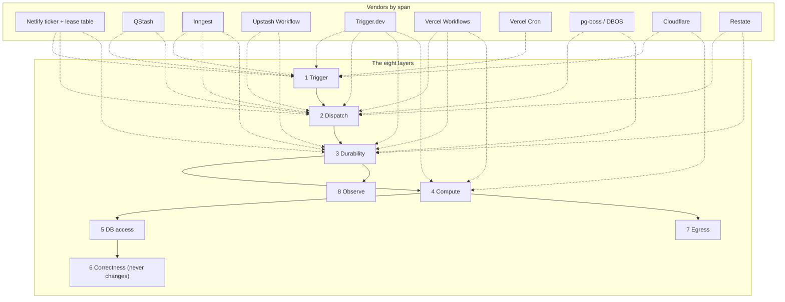
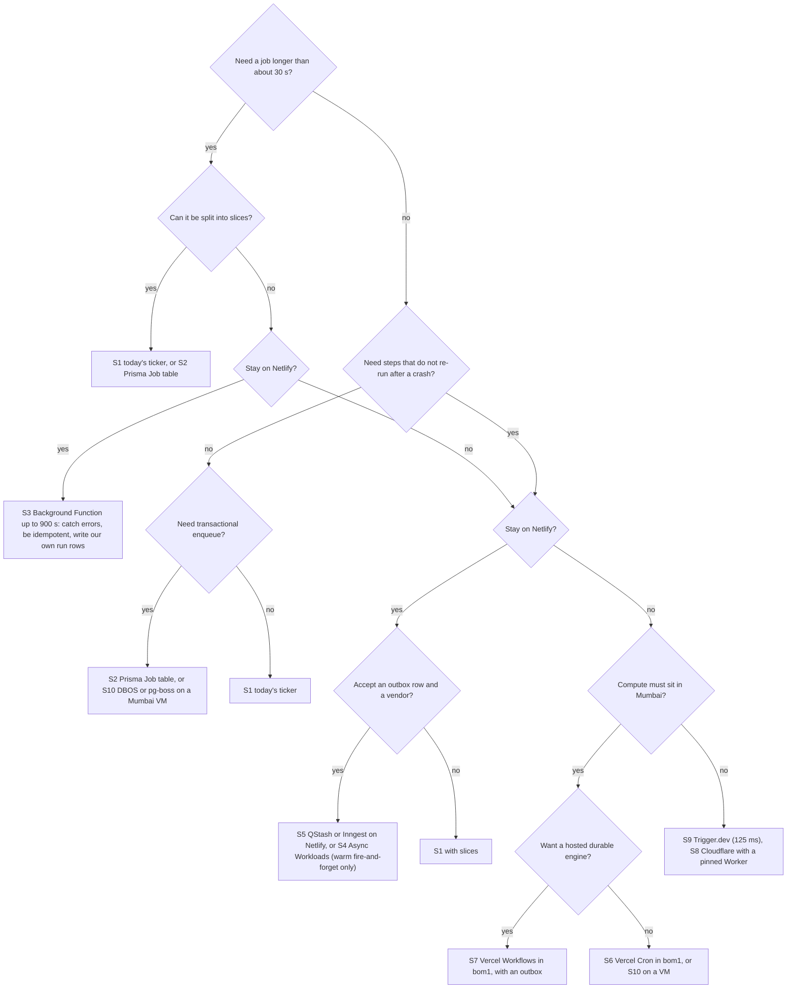
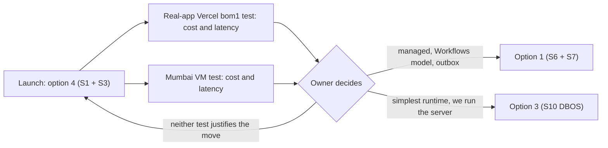

# The eight layers of the jobs subsystem and the stacks that fit together

[Background-job runtime options](./14-background-job-runtime-options.md) compares the runtimes one by one. This page answers a different question: which parts of a jobs system can be swapped independently, which cannot, and therefore which complete stacks are coherent. It is evidence for decisions the owner has already taken and does not take a new one. The decisions are in [Ticker through launch, the scale path, the phase 2 queue and the database plan](../decisions/2026-10-31-ticker-scale-path-and-queue.md). The labels MEASURED, DOCS, ESTIMATE and UNVERIFIED are defined in section 1 of page 14.

## 1. The eight layers

A background job passes through eight layers. The picture lists them from the clock at the top to the telemetry at the bottom.

```text
  1 TRIGGER      what decides it is time        Netlify scheduled function, Vercel Cron, QStash schedule,
                                                Inngest cron, pg-boss or DBOS schedule, Cloudflare cron
  2 DISPATCH     how the work reaches compute   HTTP fan-out, vendor HTTP callback, queue poll or drain
  3 DURABILITY   retries, steps, sleeps, state  Postgres lease row, Inngest, Upstash Workflow,
                                                Vercel Workflows, DBOS, pg-boss, Trigger.dev
  4 COMPUTE      where our code runs            Netlify Singapore, Vercel bom1, Trigger.dev Frankfurt,
                                                a Mumbai VM, Cloudflare Workers
  5 DB ACCESS    pooler, connections, distance  Supabase pooler 6543 or 5432, PG_POOL_MAX, round trip
  6 CORRECTNESS  what makes a repeat harmless   CAS-in-WHERE, gateway idempotency keys, ledger triggers,
                                                reconcilers                               NEVER CHANGES
  7 EGRESS       the address the world sees     Netlify (none), F1 proxy for RazorpayX, Vercel Static IPs,
                                                a VM address
  8 OBSERVE      how we know it ran             Sentry check-in, /api/health/jobs, SystemJobExecution rows,
                                                vendor consoles
```

## 2. Layer by layer: today's choice and the measured facts

The table gives, for each layer, what the repository does today and what the experiments measured about the alternatives. Facts without a label are measured in the reports of the [experiment folder](./experiments/2026-10-31-job-runtime/README.md).

| Layer         | Today                                                                                                                                     | Options and measured facts                                                                                                                                                                                                                                                                                                                                                                             |
| ------------- | ----------------------------------------------------------------------------------------------------------------------------------------- | ------------------------------------------------------------------------------------------------------------------------------------------------------------------------------------------------------------------------------------------------------------------------------------------------------------------------------------------------------------------------------------------------------ |
| 1 Trigger     | `netlify/functions/cron-tick.mts` every 5 minutes (30 s scheduled limit, DOCS).                                                           | QStash schedule fired once a minute, 0.9–1.4 s late on Netlify and exactly once on `bom1` (MEASURED). Vercel Cron: Hobby daily only with hour precision, Pro per minute (MEASURED rejection, DOCS). Inngest cron fired on the minute (MEASURED, dev server). pg-boss cron duplicated once in the first minute in 2 of 2 runs (MEASURED).                                                               |
| 2 Dispatch    | HTTP to `/api/cleanup/[job]`, at most `MAX_TARGETS_PER_TICK` (12) per tick.                                                               | Vendor POST to our route: QStash median 1,366 ms to Netlify, about 350 ms publish-ack to `bom1` (MEASURED). Queue poll: pg-boss about 1 s, DBOS about 0.2 s local (MEASURED). A periodic trigger can drain any queue at the cost of tick latency (reasoning, ESTIMATE).                                                                                                                                |
| 3 Durability  | A `RUNNING` `SystemJobExecution` row as lease, a saved cursor, state as the outbox (`withCronLock`).                                      | Inngest and Upstash Workflow: steps in our route, handler re-runs per request for Upstash (MEASURED). DBOS: checkpointed steps, resume in about 3 s (MEASURED). pg-boss: whole job reruns after about 65 s (MEASURED). Vercel Workflows: completed steps not re-run after a crash (MEASURED). Trigger.dev: checkpoint-resume (DOCS).                                                                   |
| 4 Compute     | Netlify Functions, Singapore, one connection per instance.                                                                                | Edge cut about 26 s on prod, about 30 s on a throwaway site (MEASURED). `bom1`: 300 s Hobby (MEASURED), 800 s Pro (DOCS). Trigger.dev: no stated cap (DOCS), regions Frankfurt and the US only (MEASURED). Cloudflare consumers and cron: 15 min wall, HTTP CPU 10 ms on Free (DOCS). Netlify Background Functions: 900 s measured (840 s completed, 960 s killed). A Mumbai VM: no cap, not measured. |
| 5 DB access   | Supabase pooler, `PG_POOL_MAX=1` on Netlify (`lib/prisma.ts`).                                                                            | Per round trip: Netlify 62–64 ms raw, Trigger.dev Frankfurt 125 ms, laptop 39.5 ms, `bom1` 1.0–2.3 ms (MEASURED). Prisma adds 0.1 ms or less per statement in `bom1` (MEASURED). A Mumbai worker at 1–2 ms is an ESTIMATE; only `bom1` and a Cloudflare Worker placed with `region = "aws:ap-south-1"` (2–3 ms) were measured. DBOS needs a pool of about 10 (MEASURED).                               |
| 6 Correctness | CAS status writes, idempotency keys, `ledger_txn_balanced`, `payment_legs_sum_to_amount`, `occurrence_no_confirmed_overlap`, reconcilers. | Unchanged by any option. Every failed-on-purpose run repeated a side effect except DBOS and Vercel Workflows for steps already complete (MEASURED).                                                                                                                                                                                                                                                    |
| 7 Egress      | None on Netlify. RazorpayX live calls go through the F1 proxy (`RAZORPAYX_EGRESS_PROXY_URL`).                                             | Vercel Static IPs $100 a month per project on Pro (DOCS), Trigger.dev paid plans only (DOCS), a Lightsail VM includes one (DOCS), Netlify only as an Enterprise add-on in Ohio, Frankfurt and London (DOCS).                                                                                                                                                                                           |
| 8 Observe     | Sentry check-in from the ticker, `/api/health/jobs`, `SystemJobExecution` rows.                                                           | Vendor consoles: Upstash Logs, Schedules, DLQ and Workflow tabs; Inngest dashboard; Trigger.dev run list; Vercel Observability Workflows tab; `@pg-boss/dashboard`; DBOS has SQL only without Conductor (MEASURED, DOCS).                                                                                                                                                                              |

## 3. The five compatibility rules

These rules say which choices constrain each other. Each names what enforces it.

1. **A layer-3 engine is tied to its compute.** The managed Vercel Workflows backend that was tested runs on Vercel Functions, Cloudflare Workflows only on Workers (MEASURED), and Trigger.dev only on its own machines. The Workflow SDK also has a self-hosted [Postgres World](https://workflow-sdk.dev/worlds/postgres) that runs on PostgreSQL and graphile-worker on a long-running server; Vercel calls it a reference implementation that needs production hardening (DOCS only, not tested here). Portable workflow code does not move existing run history, timers or queue state between backends, so a Netlify failback cannot resume managed runs by switching DNS or cron ownership, and the Postgres World needs a persistent worker rather than a Netlify invocation. Inngest, Upstash Workflow and Restate work with any HTTP compute, because they call a route we host (Restate ran on Vercel `bom1` and is also self-hostable). The enforcer is each product's execution model (DOCS).
2. **In-process engines and schedules need long-lived compute.** This applies to Inngest `connect` (unsupported on serverless runtimes, DOCS), DBOS (a pool of about 10 that `PG_POOL_MAX=1` cannot give, MEASURED) and pg-boss's own cron. Hosted durable steps do not need it: Vercel Workflows and Cloudflare Workflows run in serverless compute (S7 and S8). Without long-lived compute, an in-process engine gives only drain mode: a periodic trigger starts a short function that drains whatever is due.
3. **Any queue can be drained by a periodic trigger**, at the cost of tick latency. This is what the Prisma `Job` table decision relies on.
4. **Only a Postgres-native queue avoids the enqueue dual write.** pg-boss and DBOS enqueue in the caller's transaction (MEASURED). Everything else (QStash, Inngest, Trigger.dev, Vercel Workflows `start()`, Cloudflare Queues and Workflows) needs an outbox row written in the same transaction, because the publish is a second step that can fail apart (MEASURED on QStash, Vercel Workflows and Cloudflare). The enforcer is the Postgres transaction itself.
5. **Layer 6 never changes.** No stack makes a vendor side effect exactly-once, so CAS-in-WHERE, idempotency keys and the reconcilers stay on every stack. The enforcers are the constraints in `prisma/sql/` and the CAS helpers.

### Corrections that follow

- **pg-boss can be drained from short functions (MEASURED).** With `supervise:false`, `schedule:false` and `registerInstance:false`, three concurrent drainers processed 600 jobs with no duplicates, and on `bom1` a job cost 0.8–1.9 ms. A plain `fetch()` never redelivers an abandoned job; the tick must call `boss.supervise()` (redelivery took 18.7 s with a 5 s monitor interval, and `expireInSeconds` defaults to 15 minutes). Drain mode loses pg-boss's own cron, automatic expiry and archiving unless `supervise()` runs, and its monitoring. This supports decision 4, a queue drained by the ticker. DBOS was not run in drain mode; only its own cron, maintenance and fast crash recovery are known to need a long-running process.
- **"A Mumbai worker at 1–2 ms" is an ESTIMATE.** Only a Vercel `bom1` function (1.0–2.3 ms) and a region-pinned Cloudflare Worker were measured. No Mumbai VM was run.
- **A Background Function avoids the roughly 30 s cap but the caller gets only a 202.** Pointing an external scheduler at one removes the edge cut for the work, but the scheduler learns nothing about success, so a retry decision needs the database state (MEASURED: 202 in 0.65–0.85 s).

## 4. Where the vendors sit

The flowchart shows the layers and which vendors span which. An arrow from a vendor to a layer means the vendor supplies that layer.



## 5. The coherent stacks, S1 to S11

The table lists each stack that obeys the rules. "DB per round trip" and "time cap" are for the stack's compute. "Double-write safe" says whether starting a job can be lost or phantom relative to our transaction without an outbox. S4 (Async Workloads) is measured, but only after a repository was linked to the throwaway site, because the extension's functions are added only by a build on Netlify's own servers.

| Stack | Trigger                                                                                                     | Dispatch                                                                        | Durability                                                                                                                                                                | Compute                                                                            | DB per round trip                                                                                                                                                           | Time cap                                                                                                | Double-write safe                                                                                                   | New vendor                                               | Status                                                                              |
| ----- | ----------------------------------------------------------------------------------------------------------- | ------------------------------------------------------------------------------- | ------------------------------------------------------------------------------------------------------------------------------------------------------------------------- | ---------------------------------------------------------------------------------- | --------------------------------------------------------------------------------------------------------------------------------------------------------------------------- | ------------------------------------------------------------------------------------------------------- | ------------------------------------------------------------------------------------------------------------------- | -------------------------------------------------------- | ----------------------------------------------------------------------------------- |
| S1    | Netlify scheduled function, 5 min                                                                           | HTTP fan-out                                                                    | Postgres lease row and cursor                                                                                                                                             | Netlify Singapore                                                                  | 62–64 ms raw (MEASURED)                                                                                                                                                     | about 26 s prod edge (MEASURED)                                                                         | Yes, state is the outbox                                                                                            | None                                                     | Current                                                                             |
| S2    | The ticker                                                                                                  | `SKIP LOCKED` claim by a tick (pg-boss drain mode, measured, is the same shape) | Prisma `Job` rows                                                                                                                                                         | Netlify (drain)                                                                    | As S1                                                                                                                                                                       | As S1                                                                                                   | Yes, same transaction                                                                                               | None                                                     | Decided for phase 2, not built                                                      |
| S3    | External scheduler or ticker                                                                                | HTTP, caller gets a 202 in 0.65–0.85 s                                          | None of its own: our run rows are the only status                                                                                                                         | Netlify Background Function, Singapore                                             | 63.9 ms per statement, lock hold 704 ms (MEASURED)                                                                                                                          | 900 s: 840 s completed, 960 s killed (MEASURED)                                                         | No, needs an outbox; legacy handlers retry twice and repeat the side effect, v2 throws are never retried (MEASURED) | None                                                     | Measured, not adopted                                                               |
| S4    | `send()` from our code                                                                                      | Netlify router, then a 60 s scheduler                                           | At-least-once with concurrent duplicate invocations; steps not reliably memoised; 5 attempts then a Blobs dead letter (MEASURED)                                          | Netlify Functions (standard: steps of 30 s or more fail) or Background (840 s ran) | 63 ms per statement, lock hold 698 ms (MEASURED)                                                                                                                            | 30 s per step standard, 840 s background (MEASURED)                                                     | No, `send` then `ROLLBACK` still delivered (MEASURED)                                                               | None, but a team-wide extension (already installed)      | Measured: fine for warm fire-and-forget, weak for timed, retried or multi-step work |
| S5    | QStash schedule or Inngest cron                                                                             | Vendor HTTP POST                                                                | Vendor retries and steps                                                                                                                                                  | Netlify Singapore                                                                  | 62–64 ms (MEASURED)                                                                                                                                                         | about 30 s (MEASURED)                                                                                   | No, needs an outbox (MEASURED)                                                                                      | Upstash or Inngest                                       | Measured, not adopted                                                               |
| S6    | Vercel Cron (Pro for per minute)                                                                            | HTTP fan-out                                                                    | Postgres lease row and cursor                                                                                                                                             | Vercel `bom1`                                                                      | 1.0–2.3 ms (MEASURED)                                                                                                                                                       | 300 s Hobby (MEASURED), 800 s Pro (DOCS)                                                                | Yes, state is the outbox                                                                                            | Vercel plan                                              | Decided trial                                                                       |
| S7    | `start()` from our code                                                                                     | Vercel Queues                                                                   | Vercel Workflows                                                                                                                                                          | Vercel `bom1`                                                                      | 2.3–3.2 ms (MEASURED)                                                                                                                                                       | Per step 300 s Hobby, run unlimited (DOCS)                                                              | No, `start()` is not transactional (MEASURED)                                                                       | Vercel plan                                              | Measured, not adopted                                                               |
| S8    | Cron Triggers, or `send()` from our code                                                                    | Cloudflare Queues; a service binding to a region-pinned Worker                  | Queue retries and DLQ, or Cloudflare Workflows (completed steps not re-run)                                                                                               | Cloudflare Workers, `fetch` handler placed in `remote-BOM`                         | 4 ms certificate-verified through Hyperdrive (2–3 ms with TLS off, not production-safe); 125–266 ms from a consumer, cron or Workflow step that queries directly (MEASURED) | Consumer 15 min wall (DOCS); a 300 s consumer ran to the end (MEASURED)                                 | No, a Queue send and Workflow `create()` are not transactional (MEASURED)                                           | Cloudflare (Paid needed for real jobs)                   | Measured, not adopted                                                               |
| S9    | `tasks.trigger()` from our code                                                                             | Trigger.dev queue                                                               | Checkpoint-resume (DOCS)                                                                                                                                                  | Trigger.dev Frankfurt                                                              | 125 ms (MEASURED)                                                                                                                                                           | No stated cap (DOCS)                                                                                    | No, needs an outbox                                                                                                 | Trigger.dev                                              | Measured, not adopted                                                               |
| S10   | In-process schedule                                                                                         | Queue poll                                                                      | DBOS checkpointed steps                                                                                                                                                   | A Mumbai VM                                                                        | 1–2 ms (ESTIMATE, not measured on a VM)                                                                                                                                     | None                                                                                                    | Yes, `enqueueInTransaction` (MEASURED locally)                                                                      | None (VM about $24 a month, ESTIMATE)                    | Unmeasured on a VM; the VM question is open                                         |
| S11   | `ctx.sleep`, delayed send or a call from our code; no native cron (a self-rescheduling delayed send worked) | Restate Cloud (EU) invokes our handler                                          | Completed, durably journaled step results are replayed (a failed or unjournaled step re-runs, so provider idempotency stays), idempotency keys, accurate sleep (MEASURED) | Vercel `bom1` handler                                                              | 2–3 ms per query plus a 92 ms median EU hop per invocation (MEASURED)                                                                                                       | The host limit: a 310 s step was killed at 300 s and retried about every 300 s without limit (MEASURED) | No, a call made in a rolled-back transaction still ran (MEASURED)                                                   | Restate (Free 100K actions a month; paid from $75, DOCS) | Measured, not adopted                                                               |

## 6. Choosing a stack

The flowchart walks the questions in the order they prune the options. Every leaf is a stack from section 5. It is a reading aid for the evidence, not a recommendation.



## 7. The owner decision of 2026-10-31

The owner chose, in this session, to launch on option 4 and to decide between options 1 and 3 later. The table maps the three options to the stacks above. The full record, trade-offs and cost table are in [the evidence and decision record](../decisions/2026-10-31-job-runtime-experiments.md).

| Option                                                         | Stacks     | Status                                                                                                             |
| -------------------------------------------------------------- | ---------- | ------------------------------------------------------------------------------------------------------------------ |
| 4: Netlify ticker plus Background Functions for jobs over 30 s | S1 plus S3 | Launch choice                                                                                                      |
| 1: Vercel Pro `bom1` plus Vercel Workflows                     | S6 and S7  | Candidate; the first real-app attempt was blocked (code and build changes needed), so the test is still to be done |
| 3: A Mumbai VM with DBOS                                       | S10        | Candidate, awaiting the Mumbai VM test                                                                             |

The flowchart shows the path. The trigger to revisit is the report of cost and latency from the two tests, or the launch metrics reaching about 300 concurrent users, whichever comes first. A per-job throughput ceiling is a separate trigger, for example recording transfers admitting at most 96 attempts a day (section 1.1 of [page 14](./14-background-job-runtime-options.md)).



## 8. Where in code

| Concern                       | Location                                                                            |
| ----------------------------- | ----------------------------------------------------------------------------------- |
| The ticker and its target cap | `netlify/functions/cron-tick.mts`, `MAX_TARGETS_PER_TICK` in `lib/cron/schedule.ts` |
| Lease and cursor              | `withCronLock` in `lib/cron/with-cron-lock.ts`                                      |
| Single-connection pool        | `PG_POOL_MAX` handling in `lib/prisma.ts`                                           |
| Layer 6 invariants            | `prisma/sql/ledger-triggers.sql`, `prisma/sql/payment-legs-triggers.sql`            |
| RazorpayX egress              | `apiRequest` in `lib/payments/payouts/razorpay-payouts.ts`                          |

The machinery that a host move would remove, and the portability rules, are on [page 16](./16-job-machinery-and-portability.md).

## Deprecated & Superseded Approaches

- **Judging a runtime by its scheduler alone.** Earlier pages compared Inngest, QStash and Trigger.dev as if each were a complete system. The layer view shows they differ in which layers they supply, which is why a hosted engine never removes layers 5 and 6.
