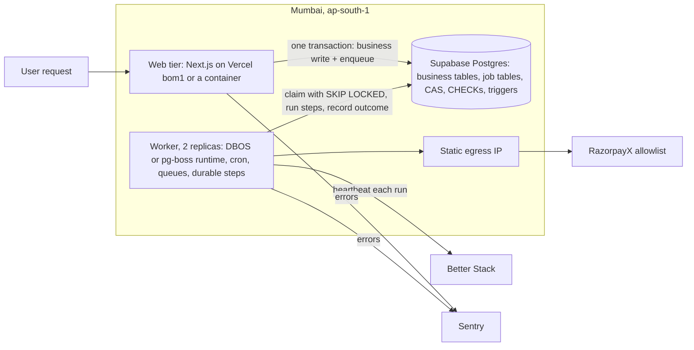
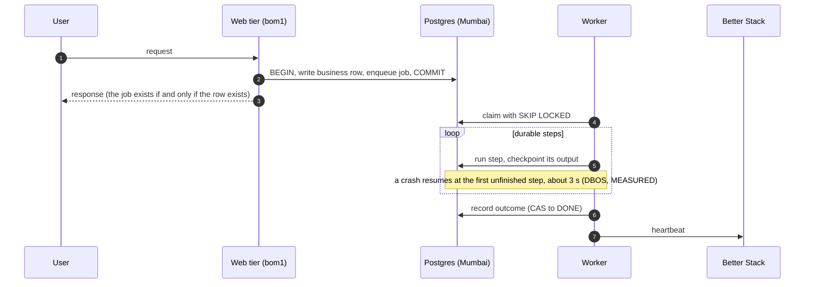
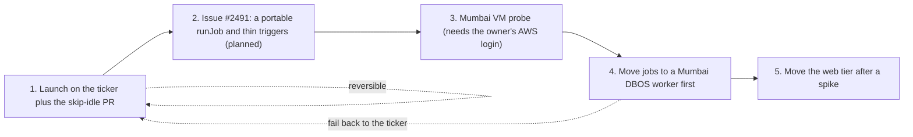
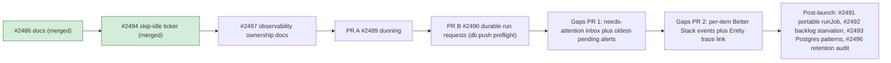

# Target architecture and roadmap for the jobs subsystem

This page opens with an executive summary of the problems, the experiments and the contenders, then describes a greenfield target design and the reversible path from today to it. The target design is a **proposal, not a decision**. The decision stays as the owner recorded it in [the evidence and decision record](../decisions/2026-10-31-job-runtime-experiments.md): launch on the Netlify ticker plus Background Functions, then choose between Vercel `bom1` with Workflows and a Mumbai VM with DBOS after two tests. Labels follow [page 14](./14-background-job-runtime-options.md): MEASURED, DOCS, ESTIMATE and UNVERIFIED. Anything described as planned does not exist in the repository yet.

## 1. Executive summary

### 1.1 Today

Every registered job (see the generated inventory `docs/maintenance/04-cron-jobs-reference.md`) runs from one Netlify Scheduled Function, `netlify/functions/cron-tick.mts`. Every five minutes it POSTs the due jobs, at most 12 per tick (`MAX_TARGETS_PER_TICK` in `lib/cron/schedule.ts`). Most land on Netlify functions in Singapore, and six land on Netlify Background Functions. Correctness comes from four things: state as the outbox, `withCronLock` leases (one run per job name, `lib/cron/with-cron-lock.ts`), compare-and-swap status writes, and the Postgres constraints and triggers in `prisma/sql/`.

### 1.2 The problems, in order of impact

1. **Distance to the database (MEASURED).** 62–64 ms per statement from Singapore to Mumbai, and about 700 ms of row-lock hold for a ten-statement transaction.
2. **One database connection per function.** The database path saturates at about 300–500 concurrent users (issue #2466).
3. **Ticker capacity.** At most 12 jobs per tick with hand-packed offsets, backed by about 2,000 lines of slicing and packing machinery ([page 16](./16-job-machinery-and-portability.md)).
4. **Time limits.** Roughly 26–30 s for synchronous functions. Few jobs are long: typical p50 durations are 79–490 ms and the worst tick took 18.5 s.
5. **RazorpayX needs a static IP**, which today means the F1 egress proxy (`RAZORPAYX_EGRESS_PROXY_URL`).

### 1.3 What the experiments found

Fourteen setups were deployed and measured against the Mumbai database ([experiment index](./experiments/2026-10-31-job-runtime/README.md)). The findings that hold for every candidate:

- No trigger is transactional with Postgres, so an outbox is always needed.
- Every engine ran some side effect more than once (2 to 29 times).
- A transaction never becomes distributed because the code runs elsewhere. It only holds locks longer.
- Engines that call back into Netlify change who decides when a job runs, not where it runs.

### 1.4 The contenders

The table lists each contender with its measured database cost and the reason for and against it.

| Option                                           | DB per statement                    | Why                                                                         | Why not                                                                                                                                                                                                                                                |
| ------------------------------------------------ | ----------------------------------- | --------------------------------------------------------------------------- | ------------------------------------------------------------------------------------------------------------------------------------------------------------------------------------------------------------------------------------------------------ |
| Netlify ticker plus Background Functions (today) | 62–64 ms (MEASURED)                 | Correct, no migration                                                       | Slow database path, a pool of one, heavy machinery                                                                                                                                                                                                     |
| Vercel `bom1` plus Workflows                     | 1–2 ms, Workflows 2–3 ms (MEASURED) | About 40 times faster database path, managed, completed steps do not re-run | The real app did not run on Vercel without code changes; a static IP costs $100 a month or needs the proxy; cost at about 1,000 users is highly uncertain; lock-in                                                                                     |
| Mumbai VM plus DBOS                              | about 1–3 ms (ESTIMATE)             | Cheapest, free static IP, transactional enqueue, step recovery              | We run the server; the Lightsail probe is blocked on the owner's AWS login                                                                                                                                                                             |
| Cloudflare pinned plus Hyperdrive                | 4 ms (MEASURED)                     | Fast `fetch` handlers                                                       | Queues, cron and Workflows ignore placement, so a step pays about 180 ms to reach the pinned Worker ([report 16](./experiments/2026-10-31-job-runtime/16-cloudflare-workflows-pinned-hyperdrive.md)); certificate-verified TLS only through Hyperdrive |
| Restate Cloud (EU)                               | 348 ms end to end (MEASURED)        | Good step semantics                                                         | US and EU regions only                                                                                                                                                                                                                                 |
| Inngest, QStash, Upstash Workflow, Trigger.dev   | 62–125 ms (MEASURED)                | UIs and retries                                                             | The same latency or worse                                                                                                                                                                                                                              |
| Async Workloads                                  | 63 ms (MEASURED)                    | Native to Netlify                                                           | Ruled out: steps ran up to 29 times and delays landed about 70 s late                                                                                                                                                                                  |

## 2. The target design (proposal)

### 2.1 Principles

The evidence points to four principles: put compute next to the database in Mumbai, keep correctness in Postgres, enqueue in the database in the same transaction as the business write, and run one long-lived worker with no 30-second slicing.

### 2.2 The picture

```text
                        ap-south-1 (Mumbai): everything next to the data
 ┌───────────────────────────────────────────────────────────────────────────┐
 │   Web tier (Next.js)                     Worker (1 long-lived process,    │
 │   Vercel bom1  -or-  container           2 replicas for failover)         │
 │   - Fluid compute, pooled conns          - DBOS (or pg-boss) runtime      │
 │   - 1-2 ms per SQL statement             - cron schedules (DB-deduped)    │
 │   - a user request writes the row        - queues with GLOBAL limits      │
 │     AND enqueues the job in the          - durable steps (no re-run)      │
 │     SAME transaction                     - no time limit, no slicing      │
 │                                   |                                       │
 │                                   v      claims with SKIP LOCKED          │
 │                        ┌──────────────────────────┐                       │
 │                        │  Supabase Postgres       │                       │
 │                        │  - business tables       │                       │
 │                        │  - job and workflow tables│  <- the queue IS the DB│
 │                        │  - CAS, CHECKs, ledger   │                       │
 │                        │    triggers, uniques     │  <- correctness lives │
 │                        └──────────────────────────┘     here, unchanged   │
 │   Static egress IP (VM IP or NAT) --> RazorpayX allowlist (no proxy)      │
 └───────────────────────────────────────────────────────────────────────────┘
        | heartbeat on every run             | errors (escalations only)
        v                                    v
   Better Stack (uptime, heartbeat,     Sentry (what broke)
   on-call, status page)
```

### 2.3 The same design as an HLD

The flowchart shows the components and what flows between them.



### 2.4 The request-to-heartbeat sequence

The diagram shows the flow in the proposal: a user request writes the row and enqueues the job in one transaction, a worker claims it, runs durable steps and sends a heartbeat. The measured basis is in [page 14](./14-background-job-runtime-options.md): transactional enqueue (rollback leaves no job), a crash recovery of about 3 s for DBOS, and no step re-run.



### 2.5 Components: today and from scratch

The table compares each concern today and in the proposal, with the reason.

| Concern                | Today                                                         | From scratch                                                                        | Why                                                                                                  |
| ---------------------- | ------------------------------------------------------------- | ----------------------------------------------------------------------------------- | ---------------------------------------------------------------------------------------------------- |
| Where code runs        | Netlify Singapore                                             | Mumbai, next to the database                                                        | 62 ms against 1–3 ms per statement; about 700 ms against about 20 ms lock hold (ESTIMATE for the VM) |
| Job runtime            | Serverless, sliced under 30 s                                 | One long-lived worker with 2 replicas                                               | Deletes about 1,500–2,000 lines of machinery (ESTIMATE)                                              |
| Queue                  | Business rows polled by sweeps                                | A Postgres-native queue (DBOS or pg-boss)                                           | Transactional enqueue (MEASURED)                                                                     |
| Time-based work        | 15-minute polls                                               | Delayed jobs created with the row, plus a slow backstop sweep                       | On time; 99.8 percent of runs today find nothing to do                                               |
| Vendor reconcilers     | Ticker targets                                                | Cron jobs in the worker                                                             | They must poll the vendor                                                                            |
| Scheduler              | Netlify Scheduled Function, HTTP fan-out and the fleet switch | The worker's own cron, deduplicated by the database                                 | One scheduler, no fan-out                                                                            |
| Multi-step money flows | Hand-written state and reconcilers                            | DBOS durable steps                                                                  | About 3 s resume with no step re-run (MEASURED)                                                      |
| Correctness            | CAS, leases, constraints, triggers                            | The same                                                                            | It works                                                                                             |
| Static IP              | F1 proxy                                                      | The worker's own IP                                                                 | Free on a VM (DOCS)                                                                                  |
| Observability          | Run rows, Sentry, Better Stack and the console                | The same, plus a per-item run log and oldest-pending-age alerts                     | Starvation (issue #2492)                                                                             |
| Environments           | One database for production, dev and previews                 | A separate database for preview and dev                                             | Safe experiments                                                                                     |
| Failover               | Netlify hot standby and a DNS flip                            | 2 worker replicas (a database lease elects the cron leader) plus a managed web tier | Simpler                                                                                              |

### 2.6 Deleted and kept

- **Deleted in the proposal:** the HTTP fan-out ticker, the packing in `lib/cron/schedule.ts`, the `run-deadline` slicing, the background adapters, the fleet switch (`ops:active_cron_platform`), the `PG_POOL_MAX=1` workarounds and the egress proxy.
- **Kept:** the registry (`lib/cron/cleanup-registry.ts`), leases (which become leader election), compare-and-swap writes, the ledger triggers and constraints in `prisma/sql/`, idempotency keys and run records.

### 2.7 Concrete choices, costs and trade-offs

- **Worker:** a Lightsail VM in Mumbai ($12–24 a month, static IP included, no SLA) or ECS/Fargate in `ap-south-1`. See [Mumbai VM provider research](../infrastructure/05-mumbai-vm-provider-research.md).
- **Engine:** DBOS, with pg-boss as the fallback. Both need the caveats on page 14 (a DBOS pool floor, pg-boss `supervise()` in drain mode).
- **Web:** Vercel `bom1` after a spike, or the same image on the worker host. The real-app attempt shows the Vercel move needs code and build changes.
- **Cost:** about $60–90 a month at launch (ESTIMATE).
- **Trade-offs:** you run a server (about 1–2 hours a month, ESTIMATE), DBOS brings mild lock-in (it is an open-source library), and the migration is about 5–7 days plus a web spike (ESTIMATE). It should not happen before launch.

## 3. The path from today

Every step is reversible, and correctness never leaves Postgres. The flowchart shows the order.



### 3.1 Merge order

The merge order agreed on 2026-11-01, with the status in section 3.4. First this documentation (#2486, merged). Second the skip-idle ticker change with the Netlify billing docs (#2494, merged). Third the observability ownership documentation (#2497). Fourth the dunning fix (PR A, issue #2489). Fifth the manual-run durable request table (PR B, issue #2490), which needs the human-run `db:push` preflight. Then the two observability gap PRs, and after launch issue #2491 (portable `runJob` and thin triggers), issue #2492 (job backlog starvation), issue #2493 (Postgres background-work patterns) and issue #2496 (retention audit for log-like tables).

### 3.2 Design options and their outcomes

The table lists every design option weighed in the 2026-10-31 and 2026-11-01 sessions and what happened to it. SELECTED means it is the choice for now, REJECTED means do not build or adopt it, and DEFERRED means it stays open until the named trigger. The `SystemJobRunItem` table was proposed first and later rejected, so it appears as REJECTED with that history. The evidence for each option is on [page 14](./14-background-job-runtime-options.md) and the reports it links.

| Option                                                                               | Outcome  | Reason and trigger                                                                                                                                                      |
| ------------------------------------------------------------------------------------ | -------- | ----------------------------------------------------------------------------------------------------------------------------------------------------------------------- |
| Netlify ticker plus Background Functions, with the skip-idle change                  | SELECTED | Correct today, no migration. Launches as is (#2494).                                                                                                                    |
| Per-item history as current state on the entity row plus Better Stack events         | SELECTED | Bounded retention, no DDL ([section 6 of page 18](./18-monitoring-and-tracing-failures.md#6-decision-no-systemjobrunitem-table-2026-11-01)).                            |
| Needs-attention inbox plus oldest-pending-age alerts (gaps PR 1)                     | SELECTED | Closes the starvation and poison-row gap with no DDL.                                                                                                                   |
| Vercel `bom1` plus Workflows                                                         | DEFERRED | Decide after the real-app test; about 40 times faster database path, but the real app did not run on Vercel without code changes.                                       |
| Mumbai VM plus a DBOS worker                                                         | DEFERRED | Decide after the Mumbai VM probe, which is blocked on the owner's AWS login.                                                                                            |
| An external clock calling one `_due` endpoint (QStash, Cloudflare Cron, Trigger.dev) | DEFERRED | Viable as a clock, not an engine. Lands as the trigger adapter of issue #2491, or when the host moves.                                                                  |
| Switching to the credit-based Netlify Pro plan                                       | DEFERRED | Pending Netlify support's answer on region pinning and Background Functions (section 4).                                                                                |
| A warehouse, or a read replica and nightly Parquet exports                           | DEFERRED | Not needed; add a read replica first if a trigger fires. Retention audit is issue #2496.                                                                                |
| A `SystemJobRunItem` Postgres table (issue #2424 Phase 3, #2453)                     | REJECTED | Proposed, then rejected on 2026-11-01: unbounded growth and a warehouse concern, plus 2–4k extra lines across about 40 job modules.                                     |
| OpenTelemetry spans per item                                                         | REJECTED | The messaging conventions are still at Development status, and Sentry span sampling can drop rare entities.                                                             |
| Highlight                                                                            | REJECTED | The product reportedly redirects to LaunchDarkly (UNVERIFIED).                                                                                                          |
| Cloudflare Workflows with a pinned Hyperdrive Worker, or the whole app on Cloudflare | REJECTED | Fast pinned `fetch` but a hop on every step and the largest migration ([report 16](./experiments/2026-10-31-job-runtime/16-cloudflare-workflows-pinned-hyperdrive.md)). |
| Netlify Async Workloads                                                              | REJECTED | Steps ran up to 29 times and delays landed about 70 s late.                                                                                                             |
| Restate Cloud (EU)                                                                   | REJECTED | US and EU regions only, 348 ms end to end.                                                                                                                              |
| Inngest, QStash, Upstash Workflow or Trigger.dev as the engine for all jobs          | REJECTED | The same latency or worse, and a second programming model in the money path. Possible for a few genuinely multi-step flows later.                                       |

### 3.3 Build order

The flowchart shows the order. The two green boxes are merged, and the rest are open or planned.



The table gives the same order with what each step changes. Nothing after #2494 is on `dev` yet (planned).

| Step | Change                                                             | Status on 2026-11-01                               |
| ---: | ------------------------------------------------------------------ | -------------------------------------------------- |
|    1 | #2486 job-runtime documentation                                    | Merged                                             |
|    2 | #2494 the ticker dispatches only targets that have work            | Merged                                             |
|    3 | #2497 observability ownership documentation                        | Open pull request                                  |
|    4 | PR A (issue #2489) stage overdue notices atomically with dunning   | Planned, issue open                                |
|    5 | PR B (issue #2490) durable acceptance of admin background runs     | Planned, issue open, needs the `db:push` preflight |
|    6 | Gaps PR 1: needs-attention inbox plus oldest-pending alerts        | Planned, built after steps 1–5 merge               |
|    7 | Gaps PR 2: per-item Better Stack events plus the Entity trace link | Planned, after gaps PR 1                           |
|    8 | Post-launch: #2491, #2492, #2493 and #2496                         | Planned, after launch                              |

### 3.4 Merge-train status and the post-release check

On 2026-11-01 the first two steps are merged: #2486 at 14:56 IST and #2494 at 15:06 IST. #2497 is open, and PR A and PR B are issues with no pull request yet. Two things to watch once #2494 is released to production:

- **`skippedIdle` in the tick logs.** The console line and the tick body carry `skippedIdle` (`netlify/functions/cron-tick.mts`), and the Better Stack summary carries `skippedIdleCount`. Idle ticks should list the probed jobs there. If it is always empty, the probe is failing open and dispatching everything.
- **Netlify usage after about a week (measured 2026-11-03/04).** The ticker makes about 57,000 invocations a month, not the estimated 22,450 ([the decision record](../decisions/2026-11-01-ticker-skip-idle-targets.md)): eight probes that almost never report idle and duplicate scheduled dispatches keep it up. Both are tracked in #2613; re-measure after that lands.

## 4. Netlify billing: status only

The skip-idle change (#2494, merged) wrote the billing details into `docs/deployment/netlify.md` and the billing-guardrails skill, so this page does not duplicate them. The decision status as of 2026-11-01 is this. Moving to the credit-based Pro plan is PENDING Netlify support's confirmation of region pinning and Background Functions on that plan; the email to Netlify support was drafted on 2026-11-01 and is not yet sent. Removing the second (Developer) seat is pending the owner's yes. The figures behind both are in `docs/deployment/netlify.md`, which owns them. Status of the Netlify ticket (#1159326) on 2026-11-01: the first reply was automated and answered none of the questions, the owner sent a follow-up asking for a human and that answer is pending, and the Developer member was changed to Reviewer through the API, so the team is now an Owner plus two Reviewers. Whether the Reviewer seat is free is still to be confirmed.

## 5. Where in code

| Concern                  | Location                                                                                                     |
| ------------------------ | ------------------------------------------------------------------------------------------------------------ |
| The ticker and its cap   | `netlify/functions/cron-tick.mts`, `MAX_TARGETS_PER_TICK` in `lib/cron/schedule.ts`                          |
| The registry             | `lib/cron/cleanup-registry.ts`                                                                               |
| Lease                    | `withCronLock` in `lib/cron/with-cron-lock.ts`                                                               |
| Constraints and triggers | `prisma/sql/ledger-triggers.sql`, `prisma/sql/payment-legs-triggers.sql`, `prisma/sql/check-constraints.sql` |

## Deprecated & Superseded Approaches

- **Framing hosted vendors as job engines only.** Early comparisons treated QStash, Inngest and Trigger.dev as engines that run the jobs. As a clock they are viable ([page 14, section 9.7](./14-background-job-runtime-options.md)); as engines they lose on latency and complexity.
