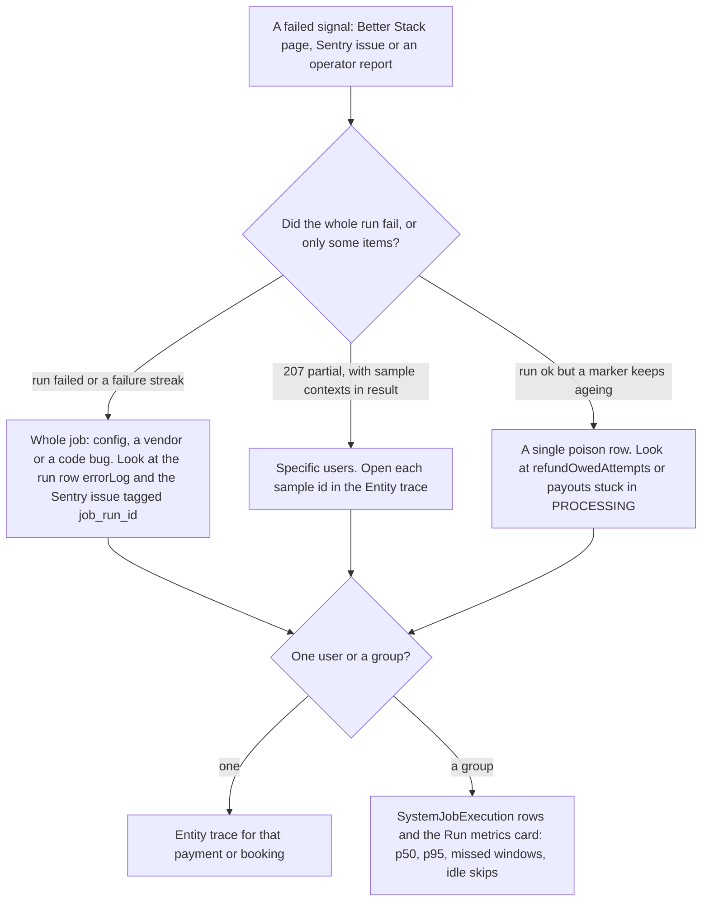

# Monitoring job runs and tracing a failure to a user

This page answers the owner's question of how to watch the ticker and the Background Function runs, and how to tell whether a failure hits one user or a whole group. There is no Prometheus or Grafana. Four existing layers each answer a different question, and every code path below was checked on the current tree. Labels follow [page 14](./14-background-job-runtime-options.md).

## 1. The four layers

The picture shows what each layer answers.

```text
 LAYER 1  Ticker log line + Better Stack      "Is the clock alive?"
          one summary per tick (ok / failed / lockHeld / skippedIdle) + a heartbeat
          ticks stop  ->  Better Stack pages
 LAYER 2  SystemJobExecution row per run       "What did each run do?"
          status, outcome (ok / partial 207 / failed / held / skipped),
          itemsProcessed, errorCount, result JSON, errorLog, durationMs, run id
          feeds the System Jobs page and the Run metrics card
 LAYER 3  Entity trace  /dashboard/<tree>/trace "What happened to THIS payment or booking?"
          one timeline across the money, booking, support and audit tables + a Sentry link
 LAYER 4  Sentry, escalation-only              "What class of failure is repeating?"
          one grouped issue per failure class, up to ten sample contexts,
          and a job_run_id tag that links back to the run row
```

The code behind each layer:

| Layer | Code                                                                                                                                                                                                                                                                                    |
| ----- | --------------------------------------------------------------------------------------------------------------------------------------------------------------------------------------------------------------------------------------------------------------------------------------- |
| 1     | `emitTickSummary` and `pingHeartbeat()` in `netlify/functions/cron-tick.mts`. The summary is sent only when `ENABLE_BETTERSTACK_TELEMETRY` is on and the source token and ingest URL are set; the heartbeat is skipped when `BETTERSTACK_HEARTBEAT_URL` is unset and never fails a tick |
| 2     | `SystemJobExecution` in `prisma/schema.prisma` (`status`, `startedAt`, `endedAt`, `result`, `errorLog`, `itemsProcessed`, `errorCount`, `durationMs`); written by `withCronLock` in `lib/cron/with-cron-lock.ts`; read by `readJobRunMetrics` in `lib/backoffice/job-run-metrics.ts`    |
| 3     | `app/dashboard/(backoffice)/[tree]/trace/page.tsx` and `lib/backoffice/entity-trace.ts` (`TRACE_ROW_CAP`, `mergeTimeline`)                                                                                                                                                              |
| 4     | `lib/observability/run-failures.ts` (grouped capture with `SAMPLE_SIZE` of 10 samples) and `Sentry.getIsolationScope().setTag("job_run_id", executionId)` in `withCronLock`                                                                                                             |

## 2. Is it failing for one user or for a group?

The flowchart walks from the failed signal to where to look.



The table reads the same signals.

| Signal                                                                                                      | What it means                                            |
| ----------------------------------------------------------------------------------------------------------- | -------------------------------------------------------- |
| A 207 partial run (`statusFor` in `lib/cron/cleanup-route.ts`), with sample ids                             | Specific users. Open each sample id in the Entity trace  |
| The run fails outright (500), or a failure streak appears (`lib/cron/failure-streak.ts`, `STREAK_CADENCES`) | The whole job is failing: config, a vendor or a code bug |
| Owed markers keep ageing (`refundOwedAttempts`, payouts stuck in PROCESSING)                                | A single poison row                                      |

`statusFor` tests failure first: a run that both failed and found a flagged row returns 500, not 207. A held run returns 503. Only a partial failure or a "needs attention" count returns 207.

## 3. How each failure mode is handled today

| Failure mode           | Mechanism                                                                                                                                                                                                              |
| ---------------------- | ---------------------------------------------------------------------------------------------------------------------------------------------------------------------------------------------------------------------- |
| Retries                | The next tick reruns the job. Per-item attempt counters and owed markers back off. A legacy Background Function retries twice; in our probe a v2 handler that threw was not retried, so it must record its own failure |
| Corruption             | Cannot commit: CAS-in-WHERE, CHECK constraints, ledger and leg triggers and unique indexes in `prisma/sql/`                                                                                                            |
| Exceptions             | Caught per run and per item. Sentry escalates only repeats                                                                                                                                                             |
| Out of time budget     | `startDeadline` in `lib/cron/run-deadline.ts` stops a slice at about 16 s (`SWEEP_START_DEADLINE_MS`) and the work continues next tick. The lease TTL recovers a crashed run. Background Functions get 15 minutes      |
| Duplicate side effects | Idempotency keys plus CAS                                                                                                                                                                                              |

## 4. Gaps (filed, not built)

- A per-item run log, `SystemJobRunItem` (issue #2424 Phase 3 and issue #2453). It does not exist yet.
- A "needs attention" inbox with Retry buttons (issue #2424 Phase 2).
- Oldest-pending-age alerts (issue #2492).
- Charts beyond the Run metrics card. Every run is already a row, so SQL views in the back office or Better Stack are cheaper than Grafana.

## Deprecated & Superseded Approaches

- Reading the `recordSystemEvent` table alone as monitoring was replaced by shipping its events to Better Stack Telemetry, because a table nobody watches pages nobody (`lib/observability/betterstack-telemetry.ts`).
