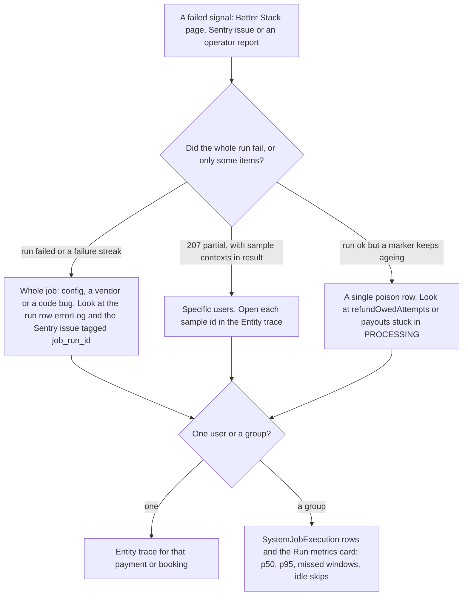

# Monitoring job runs and tracing a failure to a user

This page answers the owner's question of how to watch the ticker and the Background Function runs, and how to tell whether a failure hits one user or a whole group. There is no Prometheus or Grafana. Four existing layers each answer a different question, and every code path below was checked on the current tree. Labels follow [page 14](./14-background-job-runtime-options.md).

## 1. The four layers

The picture shows what each layer answers.

```text
 LAYER 1  Ticker log line + Better Stack      "Is the clock alive?"
          one summary per tick (ok / failed / lockHeld / skippedIdle) + a heartbeat
          ticks stop  ->  Better Stack pages
 LAYER 2  SystemJobExecution row per run       "What did each run do?"
          status, outcome (ok / partial 207 / failed / held / skipped),
          itemsProcessed, errorCount, result JSON, errorLog, durationMs, run id
          feeds the System Jobs page and the Run metrics card
 LAYER 3  Entity trace  /dashboard/<tree>/trace "What happened to THIS payment or booking?"
          one timeline across the money, booking, support and audit tables + a Sentry link
 LAYER 4  Sentry, escalation-only              "What class of failure is repeating?"
          one grouped issue per failure class, up to ten sample contexts,
          and a job_run_id tag that links back to the run row
```

The code behind each layer:

| Layer | Code                                                                                                                                                                                                                                                                                    |
| ----- | --------------------------------------------------------------------------------------------------------------------------------------------------------------------------------------------------------------------------------------------------------------------------------------- |
| 1     | `emitTickSummary` and `pingHeartbeat()` in `netlify/functions/cron-tick.mts`. The summary is sent only when `ENABLE_BETTERSTACK_TELEMETRY` is on and the source token and ingest URL are set; the heartbeat is skipped when `BETTERSTACK_HEARTBEAT_URL` is unset and never fails a tick |
| 2     | `SystemJobExecution` in `prisma/schema.prisma` (`status`, `startedAt`, `endedAt`, `result`, `errorLog`, `itemsProcessed`, `errorCount`, `durationMs`); written by `withCronLock` in `lib/cron/with-cron-lock.ts`; read by `readJobRunMetrics` in `lib/backoffice/job-run-metrics.ts`    |
| 3     | `app/dashboard/(backoffice)/[tree]/trace/page.tsx` and `lib/backoffice/entity-trace.ts` (`TRACE_ROW_CAP`, `mergeTimeline`)                                                                                                                                                              |
| 4     | `lib/observability/run-failures.ts` (grouped capture with `SAMPLE_SIZE` of 10 samples) and `Sentry.getIsolationScope().setTag("job_run_id", executionId)` in `withCronLock`                                                                                                             |

## 2. Is it failing for one user or for a group?

The flowchart walks from the failed signal to where to look.



The table reads the same signals.

| Signal                                                                                                      | What it means                                            |
| ----------------------------------------------------------------------------------------------------------- | -------------------------------------------------------- |
| A 207 partial run (`statusFor` in `lib/cron/cleanup-route.ts`), with sample ids                             | Specific users. Open each sample id in the Entity trace  |
| The run fails outright (500), or a failure streak appears (`lib/cron/failure-streak.ts`, `STREAK_CADENCES`) | The whole job is failing: config, a vendor or a code bug |
| Owed markers keep ageing (`refundOwedAttempts`, payouts stuck in PROCESSING)                                | A single poison row                                      |

`statusFor` tests failure first: a run that both failed and found a flagged row returns 500, not 207. A held run returns 503. Only a partial failure or a "needs attention" count returns 207.

## 3. How each failure mode is handled today

| Failure mode           | Mechanism                                                                                                                                                                                                              |
| ---------------------- | ---------------------------------------------------------------------------------------------------------------------------------------------------------------------------------------------------------------------- |
| Retries                | The next tick reruns the job. Per-item attempt counters and owed markers back off. A legacy Background Function retries twice; in our probe a v2 handler that threw was not retried, so it must record its own failure |
| Corruption             | Cannot commit: CAS-in-WHERE, CHECK constraints, ledger and leg triggers and unique indexes in `prisma/sql/`                                                                                                            |
| Exceptions             | Caught per run and per item. Sentry escalates only repeats                                                                                                                                                             |
| Out of time budget     | `startDeadline` in `lib/cron/run-deadline.ts` stops a slice at about 16 s (`SWEEP_START_DEADLINE_MS`) and the work continues next tick. The lease TTL recovers a crashed run. Background Functions get 15 minutes      |
| Duplicate side effects | Idempotency keys plus CAS                                                                                                                                                                                              |

## 4. Gaps: what is built and what is filed

- **Built:** a read-only Stuck work page (`/dashboard/admin/stuck-work`, issue #2424 Phase 2 without Retry buttons) and eight oldest-pending-age gauges on the tick summary (the eighth, `parkedCaptures`, is the seconds since the oldest parked, unreturned capture; 0 when none), alerted by Better Stack SQL thresholds that the owner configures. Ingest rejections (402/403/5xx) are counted on the run row, and a freshness alert fires when no tick summary arrives for 15 minutes. See the [2026-11-01 gaps decision](../decisions/2026-11-01-observability-gaps-and-launch-posture.md).
- **Built, as a free-tier bridge:** per-item history across runs is the run row's `result.failures` (at most 50 `{ entityId, reason, attempt }` per run, kept 180 days). There is **no** `SystemJobRunItem` table (section 6 explains why).
- **Deferred to traction:** batched per-item Better Stack events (issue #2424 Phase 3 and issue #2453), once known as gaps PR 2.
- **Filed:** Retry buttons on the inbox (payouts: #2433), and charts beyond the Run metrics card. Every run is already a row, so SQL views in the back office or Better Stack are cheaper than Grafana.

## 5. Worked example: where is the refund for `pay_456`?

The identifiers are illustrative. Today the item history is the run row's `result.failures`; the per-item Better Stack events shown in the first table are deferred to traction, and the second table is the same answer read from Postgres.

The `retry-auto-refunds` job (`lib/cron/cleanup-registry.ts`) runs every 15 minutes on the ticker, at an offset of 10 minutes (`lib/cron/schedule.ts`). Its run on 2026-11-01 at 15:40 IST is one `SystemJobExecution` row, `run_8f2`, with the outcome PARTIAL (HTTP 207, `statusFor` in `lib/cron/cleanup-route.ts`) and `itemsProcessed` of 3. In the planned design the same run also sends one batched Better Stack log event per item. The table lists the three item events of that run.

| Run     | Entity  | Outcome   | Reason          | Attempt |
| ------- | ------- | --------- | --------------- | ------- |
| run_8f2 | pay_123 | SUCCEEDED |                 |         |
| run_8f2 | pay_456 | FAILED    | GATEWAY_TIMEOUT | 3       |
| run_8f2 | pay_789 | SKIPPED   | LOST_CAS        |         |

`LOST_CAS` means another door settled the payment between the read and the write (the compare-and-swap in `WHERE` matched zero rows), so the skip is correct and needs no action. `GATEWAY_TIMEOUT` is the interesting row. The support question "where is the refund for `pay_456`?" is answered by the history of that one entity across runs. Today that is a read-only query over the run rows still kept (180 days) (later, a query on `entity_id = pay_456` in Better Stack):

```sql
SELECT s."startedAt", s.id AS run, f->>'reason' AS reason, f->>'attempt' AS attempt
FROM "SystemJobExecution" s
CROSS JOIN LATERAL jsonb_array_elements(COALESCE(s.result->'failures', '[]'::jsonb)) AS f
WHERE s."jobName" = 'retry-auto-refunds' AND f->>'entityId' = 'pay_456'
ORDER BY s."startedAt";
```

| When (IST)       | Run     | Outcome | Reason          | Attempt |
| ---------------- | ------- | ------- | --------------- | ------- |
| 2026-11-01 15:10 | run_7c1 | FAILED  | GATEWAY_TIMEOUT | 1       |
| 2026-11-01 15:25 | run_7d9 | FAILED  | GATEWAY_TIMEOUT | 2       |
| 2026-11-01 15:40 | run_8f2 | FAILED  | GATEWAY_TIMEOUT | 3       |

Three timeouts in a row on one entity while its neighbours succeed is the poison-row signal from section 2. The **current** state needs no log at all: it is on the payment row itself, in `refundOwedAttempts`, `refundOwedReason`, `refundOwedAt` and `refundOwedNextAt` (the `Payment` model in `prisma/schema.prisma`, written by `lib/payments/operations/refund-owed.ts`). The log answers only "what happened on each try", and it is not the source of truth.

### 5.1 How big is each piece

The estimates below are rough line counts (ESTIMATE, not measured).

| Piece                                                                                | Size                        | DDL  |
| ------------------------------------------------------------------------------------ | --------------------------- | ---- |
| Gaps PR 1: the needs-attention inbox plus oldest-pending-age alerts                  | about 1.5–2.5k lines        | none |
| Gaps PR 2: per-item Better Stack events plus the Entity trace link                   | smaller than a table design | none |
| The rejected alternative: a `SystemJobRunItem` table written by about 40 job modules | an extra 2–4k lines         | yes  |

## 6. Decision: no `SystemJobRunItem` table (2026-11-01)

The owner decided that per-item history does not go into a Postgres table, because such a table grows without bound (every item of every run, about 91,000 runs a month) and invites a data-warehouse project. The decision has three parts.

- **Current state stays on the entity row**, updated in place (attempts, last error, age), as in the `Payment` example above.
- **History goes to Better Stack as structured log events**, one batched POST per run with `{run_id, job, entity_id, outcome, reason, attempt}`. Logs have a retention limit by construction: 3 days on the free plan now and a 30-day EU bundle at launch (about $30 a month, ESTIMATE). Send entity ids only, never names, emails or amounts. An id such as a payment cuid can be resolved back to a customer, so these events are pseudonymous personal data under DPDP section 2(t): ids-only minimises disclosure but does not remove the duty, and the Better Stack rollout still needs a processor and privacy assessment (see [observability ownership](../observability/01-ownership-sentry-betterstack.md), which lands with #2497).
- **The Entity trace links out** to the history; the Better Stack Query API (read-only SQL over HTTP) can also be queried from the trace page.

Rejected on the way: OpenTelemetry spans per item (the messaging conventions are still at Development status and Sentry span sampling can drop exactly the rare entities we care about), and a data warehouse (Postgres with retention is enough; if a trigger fires, add a read replica first, or nightly Parquet exports queried with DuckDB, before BigQuery or ClickHouse; legal records stay in Postgres). The retention audit for every log-like table, including `SystemJobExecution`, is issue #2496 (post-launch). The ownership split (Sentry for grouped errors, the `cron-tick` check-in and sampled traces; Better Stack for per-item events, heartbeats, uptime, paging and SQL threshold alerts) is recorded in [observability ownership](../observability/01-ownership-sentry-betterstack.md), which lands with pull request #2497. The options table that shows this decision next to the others is [section 3.2 of page 17](./17-target-architecture-and-roadmap.md#32-design-options-and-their-outcomes).

## Deprecated & Superseded Approaches

- **A `SystemJobRunItem` Postgres table** (issue #2424 Phase 3, issue #2453) was proposed as the per-item run log and rejected on 2026-11-01. Do not create it, and delete any stub that appears; use the entity row for current state and Better Stack events for history (section 6).
- Reading the `recordSystemEvent` table alone as monitoring was replaced by shipping its events to Better Stack Telemetry, because a table nobody watches pages nobody (`lib/observability/betterstack-telemetry.ts`). Forwarding is best-effort and runs only when `ENABLE_BETTERSTACK_TELEMETRY` is on and `BETTERSTACK_SOURCE_TOKEN` and `BETTERSTACK_INGEST_URL` are set; the `SystemEvent` row stays the source of truth.
