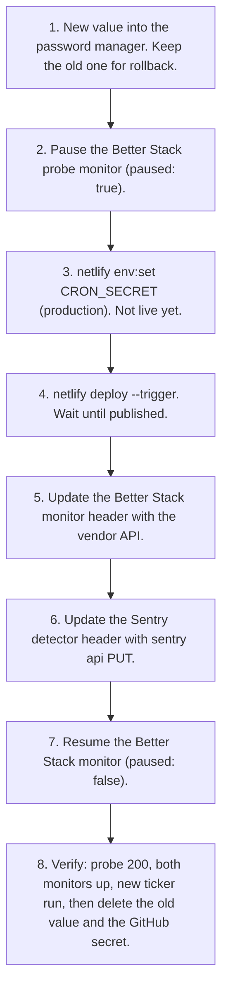

# Secret rotation runbook

This runbook tells the owner how to rotate every credential the production app depends on, in what order, and what to check afterwards. It exists because several credentials were exposed in chats or logs before launch, and because Netlify and GitHub secrets are write-only, so nobody can read a value back to compare it. The inventory in section 2 is a reference table; section 3 is the plan; sections 4 to 9 are the procedures; section 10 lists credentials to delete. Read sections 1 and 2 before doing anything.

Nothing in this document contains a secret value. Never paste a value into a document, ticket, chat, commit or a command line that lands in shell history. This runbook was written on 2026-11-05 from the Netlify production variable names, the code and each vendor's official documentation; the vendor URLs are listed at the end, and the places where a vendor's own documentation was silent are marked **(vendor docs silent)**.

## 1. Rules that apply to every rotation

1. **A Netlify environment change is not live until the next production deploy.** Netlify's documentation says "Environment variable changes require a build and deploy to take effect" ([Netlify environment variables](https://docs.netlify.com/environment-variables/get-started/)). Trigger the deploy from the Netlify dashboard, or with `netlify deploy --trigger` (verified against the installed CLI help, version 26.0.2; the CLI reference is at <https://cli.netlify.com/commands/deploy>).
2. **Secret values on Netlify are write-only.** After a value is set with `--secret`, no surface returns it again; the CLI, API and dashboard show it masked ([Netlify secrets controller](https://docs.netlify.com/build/environment-variables/secrets-controller/)). So keep the _old_ value in the password manager until the new one is verified, and use it only for rollback. Destroy it afterwards.
3. **Setting a Netlify secret from the CLI.** The command is `netlify env:set NAME VALUE --context production --secret` ([CLI reference](https://cli.netlify.com/commands/env/)). The value is an argument. The installed CLI's `env:set` does not read standard input, and neither the CLI reference nor `--help` documents a `-` placeholder, so `netlify env:set NAME - ...` would store the literal character `-` as the secret. Use a shell variable filled by a silent prompt instead, on your own machine:

   ```bash
   read -rs NEW_VALUE        # paste from the password manager; nothing is echoed or saved to history
   netlify env:set NAME "$NEW_VALUE" --context production --secret --force
   unset NEW_VALUE
   ```

   `--force` skips the overwrite prompt. A secret needs an explicit non-development `--context`; the CLI refuses `all` and `dev` for a secret value. Name several contexts after one `--context` (`production deploy-preview branch-deploy`) when a secret must change in each.

4. **Verify the name and the context, never the value.** `netlify env:list --context production --json | python3 -c "import sys,json;print('\n'.join(sorted(json.load(sys.stdin))))"` lists names only. Production, deploy-preview and branch-deploy are separate contexts; section 2 notes which secrets exist in which.
5. **Preview deploys and local checkouts share the production database.** Dev, preview and prod all use one Supabase project (see [the deployment guide](../deployment/README.md) and the [database split plan](../deployment/db-split-plan.md), which is not done). A rotation of anything that touches that database therefore changes every environment at once.
6. **Read back state, not shape.** After any monitor or token change, read the object back from the vendor and confirm it is active and `up`. A monitor that exists but is paused detects nothing; this is exactly what happened to the ticker heartbeat between 2026-10-30 and 2026-11-03 ([detector rollout decision](../decisions/2026-11-05-detector-rollout-and-redundancy.md)).
7. **Keep monitor responses filtered.** A Better Stack monitor's `request_headers` and a Sentry uptime detector's header both hold the bearer `CRON_SECRET` in plain text, and a Better Stack heartbeat's `url` is its ping secret. Never print an unfiltered response.

## 2. Inventory

The names below come from `netlify env:list --context production` on 2026-11-05 (61 names), from `.env.sample`, from the code, and from the required-secrets manifest ([07-required-secrets.md](../enterprise/50-operations/07-required-secrets.md)). "Grace slot" means the code accepts two live values at once, so the vendor change and the deploy need not be simultaneous. Variables that are not secrets (the `NEXT_PUBLIC_*` values, `SENTRY_ORG`, `SENTRY_PROJECT`, `SENTRY_ENVIRONMENT`, `BETTER_AUTH_URL`, `BETTER_AUTH_TRUSTED_ORIGINS`, `EMAIL_ALLOWLIST`, `PG_POOL_MAX`, `NODE_*`, `CI`, `NPM_FLAGS`, the R2 bucket and endpoint names, `ENABLE_BETTERSTACK_TELEMETRY`, `RAZORPAY_ALLOW_TEST_KEYS_IN_PRODUCTION`) are left out.

### 2.1 Database and Supabase

| Credential                                                                   | Lives in                                                                                                                                                 | Read by                                                                                                                                                                                     | Grace slot                                       | Blast radius if it leaks                                                                                                        |
| ---------------------------------------------------------------------------- | -------------------------------------------------------------------------------------------------------------------------------------------------------- | ------------------------------------------------------------------------------------------------------------------------------------------------------------------------------------------- | ------------------------------------------------ | ------------------------------------------------------------------------------------------------------------------------------- |
| Supabase `postgres` password inside `DATABASE_URL` (pooler) and `DIRECT_URL` | Netlify (production, deploy-preview, branch-deploy); GitHub Actions secrets `DATABASE_URL`, `DIRECT_URL`, and the bundled `ENV_FILE`; every local `.env` | `lib/prisma.ts` (pooled, runtime), `prisma.config.ts` and `scripts/ci/check-db-live-drift.ts` (direct), the `ci.yaml`, `db-live-drift`, `schema-required`, `race-condition-tests` workflows | None. Supabase has one `postgres` password.      | Total. Every user, payment, ledger row and encrypted PAN, in every environment, because one database serves all of them.        |
| `SUPABASE_SERVICE_ROLE_KEY`                                                  | Netlify (all three contexts); GitHub secret of the same name (no workflow reads it)                                                                      | `lib/supabase-storage-core.ts`, the storage cleanup scripts                                                                                                                                 | Yes, Supabase allows legacy and new keys at once | Read, write and delete on every Storage bucket, and on the project's REST data API if the key is a legacy `service_role` JWT.   |
| Supabase JWT signing keys (legacy HS256 secret, any asymmetric keys)         | Supabase dashboard only                                                                                                                                  | Supabase Auth and the legacy `anon` and `service_role` keys. The app itself does not verify Supabase JWTs (Better Auth owns sessions).                                                      | Yes (standby key, then rotate)                   | Anyone holding the legacy secret can mint `anon` or `service_role` tokens for the project's REST API.                           |
| Supabase access token (personal)                                             | Each developer's local MCP or CLI configuration (`.mcp.json.example` has the placeholder); not in Netlify or GitHub                                      | Supabase MCP and CLI tooling                                                                                                                                                                | Yes, tokens are independent                      | Management API access as the token owner: project settings, keys and database queries across every project the owner can reach. |

### 2.2 Auth, encryption and signing keys

| Credential                                     | Lives in                                                  | Read by                                                                   | Grace slot                                                                         | Blast radius if it leaks                                                                                                                        |
| ---------------------------------------------- | --------------------------------------------------------- | ------------------------------------------------------------------------- | ---------------------------------------------------------------------------------- | ----------------------------------------------------------------------------------------------------------------------------------------------- |
| `BETTER_AUTH_SECRET`                           | Netlify (all three)                                       | `lib/auth.ts`; `lib/auth/session-cookie.ts`; `lib/auth/link-signing.ts`   | Yes, `BETTER_AUTH_SECRETS` (`version:secret` list, first entry is current)         | Forge session cookies for any user, decrypt operators' TOTP secrets, backup codes and stored OAuth tokens, and forge every emailed signed link. |
| `AUTH_CONFIG_ENCRYPTION_KEY`                   | Netlify (all three)                                       | `lib/sso/secret-crypto.ts`                                                | Yes, `AUTH_CONFIG_ENCRYPTION_KEY_PREVIOUS` plus `scripts/rotate-sso-secret-key.ts` | Decrypt customer SSO client secrets.                                                                                                            |
| `PAN_ENCRYPTION_KEY`                           | Netlify (production only)                                 | `lib/payments/tax/pan-crypto.ts`                                          | **No.** No previous slot and no re-encrypt script exist.                           | Decrypt every stored consultant PAN (tax identity data).                                                                                        |
| `ERASURE_SALT`                                 | Netlify (production, deploy-preview)                      | `lib/compliance/erasure/scrub-user.ts` (`derivePseudonym`)                | Not needed. Old pseudonyms stay stored on the user row.                            | Lets someone re-derive the pseudonym of an erased user from a known user id.                                                                    |
| `GOOGLE_CLIENT_SECRET`, `GITHUB_CLIENT_SECRET` | Netlify (all three); Google also a GitHub secret (unused) | `lib/auth/social-providers.ts` (reads `<PROVIDER>_CLIENT_SECRET` by name) | Google: two client secrets at once. GitHub: new secret then delete old.            | Impersonate the app to Google or GitHub during sign-in.                                                                                         |
| `TURNSTILE_SECRET_KEY`                         | Netlify (production, deploy-preview)                      | `lib/auth/captcha.ts`                                                     | Yes, two-hour overlap                                                              | Bypass the sign-in captcha.                                                                                                                     |
| `MAINTENANCE_BYPASS_SECRET` (not set today)    | Netlify, or stored in Redis by the maintenance page       | `lib/maintenance-edge.ts`                                                 | No                                                                                 | Walk through the OFFLINE maintenance page.                                                                                                      |

### 2.3 Money, messaging and realtime vendors

| Credential                                                                                                         | Lives in                                                                       | Read by                                                                        | Grace slot                                                                                                              | Blast radius if it leaks                                                                                                                                                       |
| ------------------------------------------------------------------------------------------------------------------ | ------------------------------------------------------------------------------ | ------------------------------------------------------------------------------ | ----------------------------------------------------------------------------------------------------------------------- | ------------------------------------------------------------------------------------------------------------------------------------------------------------------------------ |
| `RAZORPAY_KEY_ID`, `RAZORPAY_SECRET`                                                                               | Netlify (all three); GitHub secrets of the same names (no workflow reads them) | `lib/payments/core/razorpay.ts`, reconcile jobs                                | Razorpay: deactivate the old key "immediately or within 24 hours" after regenerating                                    | Create orders, read payments and customers, issue refunds. Today the production context may still hold test keys (`RAZORPAY_ALLOW_TEST_KEYS_IN_PRODUCTION` is set).            |
| `RAZORPAY_WEBHOOK_SECRET`                                                                                          | Netlify (production, deploy-preview); the Razorpay webhook form                | `app/api/webhooks/razorpay/route.ts`, `app/api/webhooks/razorpay/signature.ts` | **Yes**, `RAZORPAY_WEBHOOK_SECRET_PREVIOUS` ([go-live checklist 1.4](../finance/70-operations/07-go-live-checklist.md)) | Forge `payment.captured` and refund events.                                                                                                                                    |
| `RAZORPAYX_KEY_ID`, `RAZORPAYX_KEY_SECRET`, `RAZORPAYX_ACCOUNT_NUMBER`, `RAZORPAYX_WEBHOOK_SECRET` (not set today) | Netlify production at launch                                                   | `lib/payments/payouts/razorpay-payouts.ts`, the webhook route                  | Webhook secret: yes (`RAZORPAYX_WEBHOOK_SECRET_PREVIOUS`). Keys: no.                                                    | Create payouts to arbitrary accounts. Needs an allowlisted static egress IP, so a leaked key alone is harder to use.                                                           |
| `STREAM_API_SECRET` (and `STREAM_API_KEY`, public)                                                                 | Netlify (all three); GitHub secrets (no workflow reads the secret)             | `lib/stream-client.ts`, `lib/stream/webhook-signature.ts`                      | Webhook only: `STREAM_WEBHOOK_SECRET_PREVIOUS`. The API secret itself: **(vendor docs silent)**.                        | Mint a chat or video token for any user, read any channel, and forge Stream webhooks (the webhook check falls back to this secret because `STREAM_WEBHOOK_SECRET` is not set). |
| `RESEND_API_KEY`                                                                                                   | Netlify (all three); GitHub secret (no workflow reads it)                      | `lib/email/deliver.ts`, `jobs/email/retry-failed-emails.ts`                    | Yes, several keys at once                                                                                               | Send mail as `familiarisenow.com`.                                                                                                                                             |
| `RESEND_WEBHOOK_SECRET`                                                                                            | Netlify (production only)                                                      | `app/api/webhooks/resend/route.ts`                                             | No                                                                                                                      | Forge bounce and complaint events, suppressing real recipients.                                                                                                                |
| `NOVU_PRODUCTION_KEY` (and `NOVU_DEVELOPMENT_KEY`)                                                                 | Netlify; GitHub secret `NOVU_PRODUCTION_KEY` (no workflow reads it)            | `lib/novu/secret-key.ts` picks the key by `NEXT_PUBLIC_SENTRY_ENVIRONMENT`     | Yes, two active keys per environment                                                                                    | Trigger notifications to any subscriber and read subscriber data.                                                                                                              |
| `DIRECTUS_WEBHOOK_SECRET`, `CLEARTAX_API_KEY`, `CLEARTAX_GSP_TOKEN` (not set today)                                | Netlify if enabled                                                             | their webhook routes and `lib/compliance/irp.ts`                               | No                                                                                                                      | Forge that vendor's events, or act on the e-invoicing account.                                                                                                                 |

### 2.4 Storage, cache, observability and jobs

| Credential                                                                                  | Lives in                                                                                                                                 | Read by                                                                                                            | Grace slot                                    | Blast radius if it leaks                                                                                      |
| ------------------------------------------------------------------------------------------- | ---------------------------------------------------------------------------------------------------------------------------------------- | ------------------------------------------------------------------------------------------------------------------ | --------------------------------------------- | ------------------------------------------------------------------------------------------------------------- |
| `R2_ACCESS_KEY_ID`, `R2_SECRET_ACCESS_KEY`                                                  | Netlify (all three); GitHub secrets (no workflow reads them)                                                                             | `lib/storage/r2-client.ts`, `lib/digital-products/storage.ts`                                                      | Yes, tokens are independent                   | Read, overwrite or delete recordings and digital products in the buckets the token is scoped to.              |
| `UPSTASH_REDIS_REST_TOKEN` (and `UPSTASH_REDIS_REST_URL`)                                   | Netlify (all three); GitHub secrets (used by the heartbeat workflow)                                                                     | `lib/redis.ts`, `lib/redis-edge.ts`, `lib/maintenance-edge.ts`, `netlify/functions/cron-tick.mts`                  | No. A reset replaces the credentials.         | Flip maintenance mode and `ops:active_cron_platform`, release checkout and payout mutexes, clear rate limits. |
| `CRON_SECRET`                                                                               | Netlify (production, deploy-preview, branch-deploy); Better Stack monitor header; Sentry detector header; GitHub secret (unused, delete) | `lib/cron/cleanup-route.ts`, `app/api/health/jobs/route.ts`, `netlify/functions/cron-tick.mts`                     | **No.** One value at a time.                  | Run any registered job by hand, including money jobs, from outside. See section 7.                            |
| `BETTERSTACK_API_KEY`                                                                       | Netlify (all three)                                                                                                                      | `lib/betterstack.ts`, `lib/observability/ops-digest.ts`, `app/api/health/route.ts`                                 | Yes, several tokens                           | Read, pause or edit every monitor, and read the bearer header stored on the job-fleet monitor.                |
| `BETTERSTACK_HEARTBEAT_URL`, `BETTERSTACK_DIGEST_HEARTBEAT_URL`, `BETTERSTACK_SOURCE_TOKEN` | Netlify (production only)                                                                                                                | `netlify/functions/cron-tick.mts`, `lib/observability/ops-digest.ts`, `lib/observability/betterstack-telemetry.ts` | New heartbeat, then delete old                | Anyone can ping a heartbeat and so hide a dead ticker; the source token lets someone write false telemetry.   |
| `SENTRY_STATS_TOKEN`                                                                        | Netlify (production only)                                                                                                                | `lib/cron/cleanup-registry.ts` (`sentry-ingest-canary`), `lib/observability/quota-alert.ts`                        | Yes, up to 20 tokens per internal integration | Read organisation-level Sentry stats (Organization: Read).                                                    |
| `SENTRY_AUTH_TOKEN`                                                                         | Netlify (production only); GitHub secret (no workflow reads it)                                                                          | `next.config.mjs` at build time (source-map upload)                                                                | Yes, several tokens                           | Upload or replace source maps and call the Sentry API within the token's scopes.                              |
| `SENTRY_API_TOKEN`, `GITHUB_RELEASE_LAG_TOKEN`, `SLACK_OPS_WEBHOOK_URL` (not set today)     | Netlify if enabled                                                                                                                       | `lib/observability/sentry-issues.ts`, the digest, `lib/observability/ops-chat.ts`                                  | Yes                                           | Read Sentry issues; read repository metadata; post to the ops Slack channel.                                  |
| `SEED_OPERATOR_PASSWORD`, `SEED_PASSWORD`                                                   | Each developer's local `.env` only. Not in Netlify, not in GitHub.                                                                       | `prisma/seedFiles/config.ts` (`requireSeedOperatorPassword`), `prisma/seedFiles/1a-create-users.ts`                | Not applicable                                | The password of the seven seeded operators in the shared database. See section 6.                             |
| Restate Cloud keys (two)                                                                    | Local `.env` files and the Restate Cloud account only                                                                                    | Nothing. No code, package or production variable references Restate.                                               | Not applicable                                | None on production. See section 5.                                                                            |

## 3. The prioritised plan

### 3.1 Must rotate before launch (exposed)

| Order | Credential                                                | Why                                                                                                                  | Procedure |
| ----- | --------------------------------------------------------- | -------------------------------------------------------------------------------------------------------------------- | --------- |
| 1     | `SEED_OPERATOR_PASSWORD` and the seeded operator accounts | The password of three admin and four staff accounts in the shared production database, and no real admin exists yet. | 6         |
| 2     | Supabase `postgres` password                              | Exposed in chat or logs. Total blast radius.                                                                         | 4         |
| 3     | Supabase signing keys and the service-role key            | Exposed. Lets someone mint database REST tokens.                                                                     | 4.2       |
| 4     | Supabase access token                                     | Exposed. Management API access.                                                                                      | 4.3       |
| 5     | The two Restate keys                                      | Exposed, but production does not use them. Revoke and delete, do not rotate.                                         | 5         |

Do the operator accounts (order 1) first, because they are the one exposed credential that needs no vendor and can sign in to production-data features today. Do the database password (order 2) in a maintenance window. Orders 3 to 5 are independent of each other.

### 3.2 Optional now

`SENTRY_STATS_TOKEN` was pasted in a chat on 2026-11-05. Rotation is optional because it grants read-only organisation statistics, but it is cheap and has no user impact (section 8).

### 3.3 Routine rotation, ranked by blast radius

| Rank | Credential                                                                                          | Suggested cadence                                                                            | How         |
| ---- | --------------------------------------------------------------------------------------------------- | -------------------------------------------------------------------------------------------- | ----------- |
| 1    | Supabase `postgres` password                                                                        | Every 6 months, and on any staff change                                                      | Section 4   |
| 2    | `CRON_SECRET`                                                                                       | Every 6 months; at once if a monitor vendor leaks it                                         | Section 7   |
| 3    | Razorpay and RazorpayX keys and webhook secrets                                                     | At the live-key flip (mint fresh live keys then), then yearly                                | Section 9.1 |
| 4    | `BETTER_AUTH_SECRET`, `AUTH_CONFIG_ENCRYPTION_KEY`                                                  | Yearly, using their grace slots                                                              | Section 9.2 |
| 5    | `STREAM_API_SECRET`, `RESEND_API_KEY`, `NOVU_PRODUCTION_KEY`, R2 token, `SUPABASE_SERVICE_ROLE_KEY` | Yearly                                                                                       | Section 9.3 |
| 6    | Observability tokens (`BETTERSTACK_API_KEY`, `SENTRY_STATS_TOKEN`, `SENTRY_AUTH_TOKEN`)             | Yearly                                                                                       | Section 9.4 |
| 7    | Google and GitHub OAuth secrets, Turnstile                                                          | Yearly                                                                                       | Section 9.5 |
| 8    | `PAN_ENCRYPTION_KEY`, `ERASURE_SALT`                                                                | Only after a leak. `PAN_ENCRYPTION_KEY` cannot be rotated safely today (no re-encrypt tool). | Section 9.6 |

Also rotate on offboarding: the Supabase access token, the Netlify team seat, the GitHub secrets the person could read, and the password manager vault.

## 4. Supabase: database password, API keys, signing keys, access token

### 4.1 The database password

**What is different here.** Supabase documents the change as a dashboard action: "go to the Database Settings page" and reset the `postgres` password; "Changing the password does not result in any downtime", Supabase's own services and the pooler update automatically, and "external services that use hardcoded username and password credentials" need a manual update ([Supabase: managing passwords](https://supabase.com/docs/guides/database/managing-passwords)). Our app is such an external service: the password is baked into `DATABASE_URL` and `DIRECT_URL` at deploy time. Supabase offers no second password, so there is an unavoidable gap between the password change and the new deploy going live.

**Why the gap hurts here.** `lib/prisma.ts` opens one connection per function instance because Netlify runs with `PG_POOL_MAX=1` (the module throws on Netlify if it is unset). Instances are short-lived, so new connections are opened constantly, and each one authenticates with the password in its own deploy's environment. After the change, every instance of the old deploy that opens a new connection fails to authenticate until the new deploy is live. Already-open connections should keep working because Postgres checks the password only at connect time; this is standard Postgres behaviour and is **not** stated in Supabase's documentation. The production build also prerenders pages against the live database, so the new deploy cannot be built before the password changes. The gap therefore equals one production build, a few minutes. Put the site in OFFLINE maintenance for it ([pre-maintenance checklist](06-pre-maintenance-checklist.md), [DEGRADED and OFFLINE](02-degraded-vs-offline.md)); webhooks and health stay reachable and Razorpay retries a failed delivery for 24 hours.

**Options considered.** A second database role used only by the app would remove the gap (the old password could then be rotated without touching the app), and Supabase recommends a separate role per service on the page above. It is not taken before launch: it needs grants on every table, sequence and sidecar-managed object, `prisma db push` still needs the owner role, and nothing in the repository documents the grants. Revisit it with the [database split plan](../deployment/db-split-plan.md).

**Everything that holds the password.** Netlify `DATABASE_URL` and `DIRECT_URL` in production, deploy-preview and branch-deploy; the GitHub secrets `DATABASE_URL`, `DIRECT_URL` and the bundled `ENV_FILE` (a base64 `.env` that `ci.yaml` decodes; it duplicates values, and since GitHub secrets are write-only the file must be rebuilt, not edited); every developer's local `.env` in every worktree; the password manager. The pooler string has the user `postgres.<project-ref>` and the direct string has the host `db.<project-ref>.supabase.co`; both carry the same password.

**Steps.**

1. In the password manager, generate the new password using letters and digits only, so no percent-encoding is needed (Supabase says to percent-encode special symbols in the connection string). Keep the old password until step 9.
2. Freeze deploys first, then stage the two new connection strings. Any build that starts after staging and before the password reset in step 4 would carry the new URLs while Supabase still accepts only the old password, so hold the release train (no merges to the production or dev branches) and, in the Netlify **Deploys** list, choose **Lock to stop auto publishing**. A locked site keeps building but publishes nothing until you publish a deploy yourself ([Netlify: locked deploys](https://docs.netlify.com/deploy/manage-deploys/manage-deploys-overview/)). Then stage the strings; they take effect only at the next deploy:

   ```bash
   read -rs NEW_DATABASE_URL; read -rs NEW_DIRECT_URL
   netlify env:set DATABASE_URL "$NEW_DATABASE_URL" --context production deploy-preview branch-deploy --secret --force
   netlify env:set DIRECT_URL   "$NEW_DIRECT_URL"   --context production deploy-preview branch-deploy --secret --force
   unset NEW_DATABASE_URL NEW_DIRECT_URL
   ```

3. Enter OFFLINE maintenance from the ADMIN Maintenance page (reason of at least five characters) and wait for running jobs to settle. Pause the Better Stack job-fleet monitor and the home-page and health monitors, because jobs are held and the probe would otherwise page: `PATCH https://uptime.betterstack.com/api/v2/monitors/<id>` with `{"paused": true}`.
4. In the Supabase dashboard, reset the `postgres` password to the new value.
5. Immediately trigger the production deploy: `netlify deploy --trigger`. Because auto publishing is locked, wait for the build to finish and publish it with **Publish deploy** on its detail page.
6. Verify (the verification paragraph below). Then choose **Unlock to start auto publishing**, release the train hold, end maintenance through the explicit recovery step ([post-maintenance recovery](07-post-maintenance-recovery.md)) and resume the monitors.
7. Update the GitHub secrets: `gh secret set DATABASE_URL`, `gh secret set DIRECT_URL` (the CLI reads the value from standard input when `--body` is omitted, <https://cli.github.com/manual/gh_secret_set>), and rebuild `ENV_FILE`.
8. Update every developer's local `.env`. A developer who forgets will see authentication errors, not data loss.
9. Re-deploy the dev branch deploy (`dev.familiarisenow.com`) and any open preview: they hold the old password until rebuilt. Destroy the old password.

**Verification.** `GET /api/health` answers 200 with the database connected. Run `npx prisma migrate diff --from-config-datasource --to-schema prisma/schema.prisma --script` with the new `DIRECT_URL`; it must connect and show only the known sidecar differences. Wait one ticker interval and confirm `/api/health/jobs` answers 200 and the ticker heartbeat is up. Optionally, a human can list live connections in the Supabase SQL editor and terminate any session opened with the old password; Postgres does not close existing sessions on a password change, and Supabase's documentation says nothing about it **(vendor docs silent)**.

**Rollback.** Reset the Supabase password back to the old value, restore the old strings on Netlify and redeploy. Because Netlify values cannot be read back, the old value must still be in the password manager; this is why step 9 comes last.

**Impact.** Sessions are not invalidated (Better Auth sessions live in the database and its cookies are signed with a different secret). The site is in maintenance for roughly the build time. Jobs resume on the next ticker tick; they are idempotent. Previews and the dev branch deploy fail until rebuilt.

### 4.2 Service-role key and JWT signing keys

**What the app uses.** Only `SUPABASE_SERVICE_ROLE_KEY`, through `supabase-js` in `lib/supabase-storage-core.ts`, for Storage. A repository search finds no use of Supabase Auth or `anon` keys, so rotating signing keys signs no user out. Whether the stored value is a legacy `service_role` JWT or a new secret key cannot be told from its name; look at **Settings, API Keys** in the dashboard.

**Facts from Supabase** ([API keys](https://supabase.com/docs/guides/api/api-keys), [signing keys](https://supabase.com/docs/guides/auth/signing-keys), [rotating the legacy secrets](https://supabase.com/docs/guides/troubleshooting/rotating-anon-service-and-jwt-secrets-1Jq6yd)):

- Creating a secret key "adds it alongside your existing anon and service_role keys without affecting them". Legacy keys stay valid until you disable them, as a separate step.
- The legacy `anon` and `service_role` keys are JWTs signed by the legacy secret. Revoking that secret distrusts every JWT signed with it, so disable `anon` and `service_role` first.
- Rotation of signing keys: **Migrate JWT secret** creates a standby key, **Rotate** makes it current, then revoke the legacy secret after waiting at least one hour and fifteen minutes when the access-token expiry is one hour. "Non-expired access tokens will remain to be accepted, so no users will be forcefully signed out." Storage signed URLs use a separate key.
- The legacy secret cannot be deleted, "so you can always roll back".
- Rotating the legacy secret directly is no longer possible for projects that have not moved to the new signing keys, and a direct rotation invalidates the current API secrets at once.

**Steps.**

1. Dashboard: **Settings, API Keys**, create a new secret key. Name it for the app.
2. Set it on Netlify in every context that holds the variable (`production deploy-preview branch-deploy`), deploy, and verify a Storage action: sign in as a seeded user and open an uploaded document, which creates a signed URL with the service client.
3. Disable the legacy `anon` and `service_role` keys in **Settings, API Keys**.
4. **JWT Signing Keys**: Migrate JWT secret, Rotate, wait the interval above, Revoke the legacy secret.
5. Delete the old GitHub secret `SUPABASE_SERVICE_ROLE_KEY` (no workflow reads it).

**Rollback.** Before the revoke in step 4, re-enable the legacy keys in the dashboard and put the old value back on Netlify. After the revoke, create another secret key. **Impact.** Storage calls fail between steps 3 and a completed deploy if step 2 was skipped; nothing else.

### 4.3 The Supabase access token

The token is a personal access token created at <https://supabase.com/dashboard/account/tokens> and used by the Supabase MCP server and CLI on a developer's machine; it is in neither Netlify nor GitHub. Supabase's access-control page only mentions where to get it and does not describe revoking or expiry **(vendor docs silent)**.

1. Create a new token on the account tokens page and put it in the local MCP configuration of each developer who needs it (the repository's `.mcp.json.example` holds only the placeholder; the MCP entry is read-only and project-scoped by policy).
2. Restart the MCP server and run any read-only tool to confirm it authenticates.
3. Delete the old token on the same page. Confirm the old one now fails.

**Rollback.** Create another token. **Impact.** Tooling only; no user is affected.

## 5. Restate: revoke, do not rotate

Restate was used only in a deleted lab experiment ([job-runtime experiments](../decisions/2026-10-31-job-runtime-experiments.md)). Evidence that production does not depend on it: no variable with `RESTATE` in its name exists in the Netlify production, deploy-preview or branch-deploy contexts on 2026-11-05; the GitHub secrets list has none; a repository search for `RESTATE`, the Restate SDK package and `restate.dev` or `restate.cloud` outside `docs/maintenance/experiments/` finds nothing in `app/`, `lib/`, `netlify/`, `scripts/`, `package.json` or `.env.sample`.

1. In Restate Cloud, open the **Developers** tab ([Restate Cloud getting started](https://docs.restate.dev/cloud/getting-started) says API keys are created there), delete both API keys, and delete the lab environment. The pages read describe creating a key but not deleting or revoking one **(vendor docs silent)**; use the Developers tab's own controls and confirm the keys no longer list.
2. Remove the two values from every local `.env` and from the password manager.
3. Confirm: `netlify env:list --context production --json` lists no `RESTATE` name, and `gh secret list` shows none.

**Rollback.** None needed. **Impact.** None on users or jobs.

## 6. `SEED_OPERATOR_PASSWORD` and the seeded operators

**What the variable is.** The password the seed script gives to every seeded `ADMIN` and `STAFF` account. It is read only by `prisma/seedFiles/config.ts` (`requireSeedOperatorPassword`) and `prisma/seedFiles/1a-create-users.ts`. The running app never reads it, and it is not in Netlify or GitHub. Changing the variable therefore changes nothing in the database. What the database holds is the hash of that password on each account row, so the only way to change what signs in is to change the account.

**What exists today (read-only query, 2026-11-05).** The shared database holds exactly three `ADMIN` and four `STAFF` users, and all seven are on `qa.familiarise.invalid`. Two of the admins and one staff member have enrolled TOTP; four accounts (`qa-admin-2`, `qa-staff-1`, `qa-staff-3`, `qa-staff-4`) have not. There is no real administrator.

**Does the go-live reset delete them? No documented step does.**

- The only reset step written down is [go-live checklist 1.5](../finance/70-operations/07-go-live-checklist.md), which clears stored Razorpay identities and touches no user rows.
- The observability decision records that the owner chose to unmute alerts "after the go-live data reset, without deleting rows on the shared database" ([launch posture](../decisions/2026-11-01-observability-gaps-and-launch-posture.md)).
- The migration plan states that the existing project stays production and keeps its real rows ([schema freeze and cutover](../prisma/02-schema-freeze-and-migration-cutover.md)), and the database split is gated on the Pro upgrade and real customers.
- `docs/authentication/staff-onboarding.md` and `docs/team/mock-credentials.md` describe the accounts as permanent seeded QA fixtures whose mail is undeliverable, so "a forgotten or rotated password is fixed by reseeding or by the owner, not through forgot-password".

So the rotation is **not moot** unless the owner defines a reset that deletes these rows; no document does. If the owner does decide to delete the seeded users, that decision supersedes this section.

**Why it matters.** `isQaOperatorExemptFrom2fa` (`lib/auth/qa-accounts.ts`) skips TOTP for the four unenrolled accounts whenever the build-inlined `NEXT_PUBLIC_SENTRY_ENVIRONMENT` is `preview` or `development`. Deploy previews are public URLs that run branch code against the production database, so on a preview, the password alone signs in as an `ADMIN` (`qa-admin-2`) or `STAFF`. On production, 2FA is enforced, but per the onboarding guide an unenrolled operator is sent to enrol, so whoever knows the password can enrol their own authenticator on `qa-admin-2` and then hold a working admin. The seeded non-operator users (consultants, consultees, organisation owners) share a password committed in `prisma/seedFiles/config.ts` (`DEFAULT_SEED_PASSWORD`), so they are known credentials too; deleting or disabling them belongs to the same owner decision.

**Sequencing trap.** `scripts/bootstrap-admin.ts` refuses once any `ADMIN` exists, so it cannot create the first real admin while the three QA admins exist. The real admin must be added from the Team page (`POST /api/admin/team/members`) by an existing admin, and the Team page does not let anyone suspend or reset themselves.

**Steps (owner decision required; not verified end to end).**

1. Rotate the variable first so nothing else reuses the exposed value: generate a new value in the password manager and replace it in local `.env` files. This has no effect on the database.
2. Do the handoff from an **enrolled** QA admin (`qa-admin-1` or `qa-admin-3`), never from `qa-admin-2`: the exposed password alone cannot pass their TOTP challenge, while anyone holding it can enrol their own authenticator on `qa-admin-2` first. The seed derives these accounts' authenticator codes from the `BETTER_AUTH_SECRET` it ran with (`computeSeedOperatorTotp` in `prisma/seedFiles/seed-two-factor.ts`), so this works only if that matches production; if neither enrolled admin can sign in, stop and decide another path (owner decision). Before acting, check read-only that `qa-admin-2` still has `twoFactorEnabled = false` and that no `OpsActionLog` row shows a Team action you did not take; either one means the password was already used, so treat it as an incident. Then, in this order: **Suspend** `qa-admin-2` from the Team page, and add the real administrator. The real admin receives a set-password email, enrols 2FA, and signs in.
3. As the real admin, **Suspend** each remaining QA operator from the Team page (`PATCH /api/admin/team/members/{userId}` with action `suspend`), so all seven are suspended. A suspension needs a length of 1 to 365 days and lifts itself at the next sign-in after it ends, so suspension alone is temporary; step 4 is what makes the old password useless.
4. As the real admin, run **Reset 2FA** (`DELETE /api/admin/team/members/{userId}/two-factor`, `app/api/admin/team/members/[userId]/two-factor/route.ts`) on **all seven** QA operators. In one transaction it removes the authenticator and passkeys, clears `twoFactorEnabled`, replaces the password with an unusable value (`!disabled:` followed by random bytes) and ends every session. The setup link it sends goes to the undeliverable `.invalid` domain, which is the intended outcome. The Team page shows the button only for enrolled operators, but the route itself accepts any `STAFF` or `ADMIN` account, so for the four unenrolled ones (`qa-admin-2`, `qa-staff-1`, `qa-staff-3`, `qa-staff-4`) call the same route from the signed-in Team page's browser session with a JSON body `{"reason": "..."}` of at least five characters, within 15 minutes of a fresh sign-in (it is a step-up action).
5. Decide separately what happens to the seeded non-operator users before real customers join (delete through the erasure path, or keep them out of production by the database split).

**Verification.** A read-only query over the seven QA operators shows seven with `banned = true`, seven with `twoFactorEnabled = false`, no `TwoFactor` rows, and seven credential accounts whose password value starts with `!disabled:` (counts only; never select the hash). Try the old password on a preview and confirm it is refused. **Rollback.** Reactivate from the Team page. **Impact.** QA loses its operator logins on previews; after step 3 they must use a real operator or a development database.

## 7. `CRON_SECRET`

### 7.1 Why this one is dangerous

`CRON_SECRET` was rotated once, on 2026-11-03, and took effect with the 2026-11-04 release. It is stored in three places that must change together, plus a stale fourth:

| Place                                                                                                   | Reads or sends it                                                                                                                         |
| ------------------------------------------------------------------------------------------------------- | ----------------------------------------------------------------------------------------------------------------------------------------- |
| Netlify production (and deploy-preview, branch-deploy)                                                  | The app (`app/api/health/jobs/route.ts`, `lib/cron/cleanup-route.ts`) checks it; the ticker (`netlify/functions/cron-tick.mts`) sends it. |
| Better Stack monitor `familiarise job fleet probe (prod)` (id 5189236)                                  | Sends it as `Authorization: Bearer ...` every 5 minutes.                                                                                  |
| Sentry uptime detector `familiarise job fleet probe (second watcher)` (id 7689936, org `practitionist`) | Sends it as the same header every 5 minutes.                                                                                              |
| GitHub Actions secret `CRON_SECRET`                                                                     | Nothing. No workflow reads it. Delete it.                                                                                                 |

The app holds exactly one value; there is no previous slot (the only `_PREVIOUS` settings in the code are for the Razorpay, RazorpayX, Stream and SSO secrets), and `AGENTS.md` section 1.2 forbids adding such a knob speculatively. So if the Netlify value changes and the monitors keep the old one, both vendors receive 401 from `/api/health/jobs` and page at once. The ticker and the app share one deploy, so they always agree with each other. Between `env:set` and the deploy being published, nothing changes: the running app and the monitors still agree.

The two monitors tolerate failure differently. The Sentry detector fires only after three consecutive failures (its `downtimeThreshold` is 3 at a 300-second interval, so about 15 minutes). The Better Stack monitor uses a one-minute confirmation, so a single failed check can page. Hence: pause the Better Stack monitor for the window, leave the Sentry detector running, and update both headers right after the deploy is published.

### 7.2 Safe order



### 7.3 Procedure

1. **Prepare.** Generate the new value in the password manager (at least 32 random bytes). Collect the Better Stack API token (`BETTERSTACK_API_KEY`, the same one the app uses) and confirm you are signed in to the Sentry CLI.
2. **Pause Better Stack.** The update endpoint takes only the parameters to change ([Better Stack: update a monitor](https://betterstack.com/docs/uptime/api/update-an-existing-monitor/)):

   ```bash
   curl -sS -X PATCH -H "Authorization: Bearer $BETTERSTACK_API_KEY" -H 'Content-Type: application/json' \
     --data '{"paused": true}' https://uptime.betterstack.com/api/v2/monitors/5189236 | jq '.data.attributes | {paused, status}'
   ```

3. **Netlify.** `read -rs NEW_VALUE`, then `netlify env:set CRON_SECRET "$NEW_VALUE" --context production --secret --force`. Do the same for `deploy-preview` and `branch-deploy` only if you want the previews on the new value too; previews refuse jobs (`JOB_RUN_PRODUCTION_ONLY`), so it matters little.
4. **Deploy.** `netlify deploy --trigger`, and wait until the production deploy is published. The scheduled ticker keeps working with the old value until this deploy is live, then works with the new one.
5. **Better Stack header.** The vendor docs say "Sending the array replaces all existing headers", so the PATCH must carry the monitor's complete header list: every existing header with its `id`, and only the `Authorization` value changed. Note the header names first, then build the body in Python from the read, so no value reaches the screen or a command line:

   ```bash
   M=https://uptime.betterstack.com/api/v2/monitors/5189236
   curl -sS -H "Authorization: Bearer $BETTERSTACK_API_KEY" "$M" | jq '[.data.attributes.request_headers[].name]'
   export NEW_VALUE          # already read with read -rs in step 3
   BODY=$(curl -sS -H "Authorization: Bearer $BETTERSTACK_API_KEY" "$M" \
     | python3 -I -c 'import os,sys,json;h=json.load(sys.stdin)["data"]["attributes"]["request_headers"];[x["name"] for x in h].count("Authorization")==1 or sys.exit("expected exactly one Authorization header");print(json.dumps({"request_headers":[{"id":x["id"],"name":x["name"],"value":"Bearer "+os.environ["NEW_VALUE"] if x["name"]=="Authorization" else x["value"]} for x in h]}))') \
     && printf '%s' "$BODY" | curl -sS -X PATCH -H "Authorization: Bearer $BETTERSTACK_API_KEY" -H 'Content-Type: application/json' --data @- "$M" \
       | jq '.data.attributes | {paused, status, names: [.request_headers[].name]}'
   unset BODY
   ```

   The names printed after the PATCH must equal the names printed before it.

6. **Sentry header.** A read of the detector shows the header as a name and value pair at `dataSources[0].queryObj.headers`, with the value in plain text, so always filter. Sentry's public documentation does not describe the detector write schema **(vendor docs silent)**, but this call was run against the live detector on 2026-11-05 (HTTP success; the response echoed the new url, interval, timeout and one redacted header) and is the verified form. It builds the whole body in Python from the environment, so the value never reaches the shell history or the screen ([detector rollout decision](../decisions/2026-11-05-detector-rollout-and-redundancy.md)):

   ```bash
   python3 -I -c 'import json,os;print(json.dumps({"dataSources":[{"url":"https://familiarisenow.com/api/health/jobs","method":"GET","intervalSeconds":300,"timeoutMs":60000,"headers":[["Authorization","Bearer "+os.environ["NEW_VALUE"]]],"traceSampling":False,"responseCaptureEnabled":False}]}))' \
     | sentry api /organizations/practitionist/detectors/7689936/ -X PUT --input -
   ```

   Read the detector back with a filter (`enabled`, `intervalSeconds`, header names only). If the PUT is rejected (for example after a Sentry API change), fall back to editing the header in the Sentry **Monitors** page; Sentry's docs advise against secrets in monitor headers, which is why this is an accepted risk (see the decision, R5).

7. **Resume Better Stack.** `PATCH ... {"paused": false}`, then read back and require `paused: false` and status `up` after the next check.
8. **Verify.** Call the probe with the new value, building the header without a literal secret:

   ```bash
   printf 'Authorization: Bearer %s\n' "$NEW_VALUE" | curl -sS -o /dev/null -w '%{http_code}\n' -H @- https://familiarisenow.com/api/health/jobs
   ```

   It must print `200`. Then wait one ticker interval (5 minutes) and confirm: the Better Stack heartbeat `familiarise cron-tick (prod)` is up, the Sentry cron monitor `cron-tick` is healthy, and both uptime monitors read `up`. A run by hand also works as proof: `curl -X POST -H "Authorization: Bearer ..." https://familiarisenow.com/api/cleanup/<registry-key>` ([detector rollout decision](../decisions/2026-11-05-detector-rollout-and-redundancy.md), R4).

9. **Clean up.** `unset NEW_VALUE M`; destroy the old value; `gh secret delete CRON_SECRET`.

**Rollback.** If the probe answers 401 after step 4, the monitors still hold the old value: finish steps 5 and 6. If the app or ticker misbehaves, put the old value back with step 3 and redeploy; the monitors then need the old value again. **Impact.** No user-visible effect and no session invalidated. A ticker run in flight at the moment the deploy flips may get one 401; jobs are idempotent and their leases expire.

## 8. `SENTRY_STATS_TOKEN` (optional)

The token is an Internal Integration token with Organization: Read, read at runtime by the `sentry-ingest-canary` job and the quota check. Sentry allows up to 20 tokens per internal integration and tokens "do not expire automatically, but you can manually revoke them" ([Sentry internal integrations](https://docs.sentry.io/organization/integrations/integration-platform/internal-integration/)). Whether a token value is shown only once was not stated on that page; the organisation-token page says it is shown once ([Sentry auth tokens](https://docs.sentry.io/account/auth-tokens/)). Copy it immediately.

1. Sentry: **Settings, Developer Settings**, open the existing internal integration, generate a new token.
2. Netlify: read the new token silently in a fresh prompt, never a value left from another rotation, then set it and clear it:

   ```bash
   read -rs NEW_VALUE
   [ -n "$NEW_VALUE" ] && netlify env:set SENTRY_STATS_TOKEN "$NEW_VALUE" --context production --secret --force
   unset NEW_VALUE
   ```

   Then deploy.

3. Verify: run the job by hand, `POST /api/cleanup/sentry-ingest-canary` with the cron bearer. The response must not report a config skip, and the digest's Sentry section stops reading "unknown".
4. Delete the old token in the same integration.

**Rollback.** Create another token. **Impact.** None; the canary runs daily. Note: the detector rollout decision lists this variable as unset on 2026-11-05; production now has the name, so that open gap is closed.

## 9. Routine rotation, by vendor

Each row names the vendor's documented method. Where the docs were silent, the row says so. In every case: set the new value on Netlify, deploy, verify, then retire the old one.

### 9.1 Razorpay and RazorpayX

- **API keys.** Dashboard, live mode, **Account and Settings, API Keys, Generate new key**; an OTP to the registered mobile is required. Razorpay "allows you to deactivate the old key immediately or within 24 hours", and shows the key secret only once ([Razorpay API keys](https://razorpay.com/docs/payments/dashboard/account-settings/api-keys/)). Replace `RAZORPAY_KEY_ID`, `RAZORPAY_SECRET` and the public `NEXT_PUBLIC_RAZORPAY_KEY_ID`, deploy (the public id is inlined at build), then deactivate the old key. Production may still hold test keys; mint fresh live keys at the flip instead of rotating test ones ([go-live checklist](../finance/70-operations/07-go-live-checklist.md) 1.2). Verify with the ₹1.00 live tests in checklist 1.6.
- **Webhook secrets.** Follow [go-live checklist 1.4](../finance/70-operations/07-go-live-checklist.md): set `RAZORPAY_WEBHOOK_SECRET_PREVIOUS` to the old value and `RAZORPAY_WEBHOOK_SECRET` to the new one, deploy, then edit the secret in the dashboard (**Accounts and Settings, Webhooks, Edit**; the edit form lets you change the secret, [Razorpay: edit a webhook](https://razorpay.com/docs/webhooks/setup-edit-payments/)). You need the old value: keep it in the password manager. Do the same for RazorpayX with `RAZORPAYX_WEBHOOK_SECRET_PREVIOUS` (payout webhooks have their own setup page, not read for this runbook **(vendor docs not read)**).

### 9.2 Better Auth and the encryption keys

- **`BETTER_AUTH_SECRET`.** Better Auth supports versioned secrets: `BETTER_AUTH_SECRETS=2:<new>,1:<old>`, where "the first entry is the current key used for all new encryption" and the rest are decryption-only ([options reference](https://www.better-auth.com/docs/reference/options), [security reference](https://www.better-auth.com/docs/reference/security)). The installed version (1.7.14) reads that variable. Rotation steps beyond that, and which values are signed rather than encrypted, are not given in the vendor's docs **(vendor docs silent)**. Our own `docs/authentication/failure-modes.md` warns that changing `BETTER_AUTH_SECRET` outright signs everyone out and stops operators' authenticator codes working; use the list form, and verify an operator's TOTP sign-in on a preview before dropping the old entry.
- **Signed links follow `BETTER_AUTH_SECRET` with no grace slot.** Newsletter confirm and unsubscribe, account email unsubscribe, calendar `.ics` and support requester links are signed with a key derived from `BETTER_AUTH_SECRET` under the label `familiarise/link-signing/v1` (`lib/auth/link-signing.ts`); the consent IP hash and the newsletter consent subject use their own labels. The derivation reads `BETTER_AUTH_SECRET` itself, not the `BETTER_AUTH_SECRETS` list, so changing that variable voids every such link already sent. An old unsubscribe link then answers 400 and points the reader to their account settings; expect a few support questions after a rotation.
- **`AUTH_CONFIG_ENCRYPTION_KEY`.** In-repo procedure (`lib/sso/secret-crypto.ts`): set the new key as `AUTH_CONFIG_ENCRYPTION_KEY`, the old one as `AUTH_CONFIG_ENCRYPTION_KEY_PREVIOUS`, deploy, run `scripts/rotate-sso-secret-key.ts`, then drop the previous key.

### 9.3 Stream, Resend, Novu, R2, Supabase service-role key

- **Stream.** Stream's documentation pages read do not describe regenerating the API secret or whether two secrets can coexist **(vendor docs silent)**. What the code does allow: webhook verification tries `STREAM_WEBHOOK_SECRET`, falling back to `STREAM_API_SECRET`, then `STREAM_WEBHOOK_SECRET_PREVIOUS` (`lib/stream/webhook-signature.ts`). Because `STREAM_WEBHOOK_SECRET` is unset in production, set `STREAM_WEBHOOK_SECRET_PREVIOUS` to the old API secret before the change. Plan on user tokens signed with the old secret being rejected and clients re-fetching a token. Do this in a quiet window and treat it as unverified until tried on a preview app.
- **Resend.** Keys can coexist and are deleted from the dashboard ([Resend API keys](https://resend.com/docs/dashboard/api-keys/introduction)): create a new key, deploy, confirm a send succeeds (the dashboard shows "last used"), then remove the old. The signing secret of a webhook is not described on the pages read, so rotate it by recreating the webhook endpoint with a new secret **(vendor docs silent)**; the route has no previous slot, so expect a few rejected events; whether Resend retries them was not checked.
- **Novu.** Each environment can have up to two secret keys: **Generate new key**, move the app, then **Delete** the old one; regenerating in place invalidates the old key at once ([Novu API keys](https://docs.novu.co/platform/developer/api-keys)). Rotate the Production environment's key for `NOVU_PRODUCTION_KEY`.
- **Cloudflare R2.** Create a second R2 API token, switch `R2_ACCESS_KEY_ID` and `R2_SECRET_ACCESS_KEY`, deploy, then revoke the old token. The R2 token page shows the secret only at creation and has no rotation section **(vendor docs silent)** ([R2 API tokens](https://developers.cloudflare.com/r2/api/tokens/)). Verify by opening a recording or digital product.
- **Supabase service-role key.** Section 4.2.

### 9.4 Observability

- **Better Stack API token.** Tokens are created at <https://betterstack.com/settings/global-api-tokens> or per team; revocation steps are not described **(vendor docs silent)** ([getting started](https://betterstack.com/docs/uptime/api/getting-started-with-uptime-api/)). Create a new one, set `BETTERSTACK_API_KEY`, deploy, run the digest by hand (`POST /api/cleanup/ops-digest`) and confirm the "Better Stack" section reads monitors, then delete the old token in the dashboard. The base URL in the docs example is `incidents.betterstack.com`; this repository and its working scripts use `uptime.betterstack.com/api/v2`.
- **Heartbeat URLs and source token.** Create a new heartbeat or source, set the variable, deploy, confirm a ping arrives, then delete the old one. Unpause the new heartbeat; a heartbeat created paused detects nothing.
- **`SENTRY_AUTH_TOKEN`.** Organisation tokens are created under **Settings, Developer Settings, Organization Tokens**, are shown once and cannot be regenerated, only replaced; only owners and managers can revoke ([Sentry auth tokens](https://docs.sentry.io/account/auth-tokens/)). Create, set, deploy (it is used at build time), confirm the build uploads source maps, then revoke the old one.
- **`SENTRY_STATS_TOKEN`.** Section 8.

### 9.5 OAuth sign-in and captcha

- **Google.** A client may have at most two secrets: add a second, update `GOOGLE_CLIENT_SECRET`, deploy, then disable and delete the old one ([Google Cloud: client secrets](https://support.google.com/cloud/answer/15549257)). A disabled secret can be re-enabled, so disable before deleting.
- **GitHub.** Generate a new client secret on the OAuth app settings page, update `GITHUB_CLIENT_SECRET`, deploy, delete the old one; GitHub's OAuth best-practices page gives that order ([GitHub: best practices](https://docs.github.com/en/apps/oauth-apps/building-oauth-apps/best-practices-for-creating-an-oauth-app)). Whether two client secrets can be live at once was not documented on the pages read **(vendor docs silent)**.
- **Turnstile.** Create a new widget, choose **Settings, Rotate Secret Key**; "both the old secret key and the new secret key are valid" for two hours ([Turnstile: rotate the secret key](https://developers.cloudflare.com/turnstile/troubleshooting/rotate-secret-key/)). The documented path creates a new widget, so `NEXT_PUBLIC_TURNSTILE_SITE_KEY` changes too and is inlined at build. Deploy within the two hours.

### 9.6 Keys with no safe rotation today

- **`PAN_ENCRYPTION_KEY`** has no previous slot and no re-encrypt script. Changing it would make every stored PAN undecryptable. If it leaks, the work is to build a re-encryption script modelled on `scripts/rotate-sso-secret-key.ts` first; do not change the variable alone.
- **`ERASURE_SALT`** can be changed in an emergency without code change; already-erased users keep their stored pseudonym (comment on `derivePseudonym`).
- **Upstash.** The console's **Settings, Reset Credentials** (or `POST /v2/redis/reset-password/{id}`, `upstash redis reset-password`) generates new credentials; the pages read do not say whether the old ones stop at once, so assume they do and use a maintenance window ([Upstash credential protection](https://upstash.com/docs/redis/features/credential-protection), [reset password](https://upstash.com/docs/devops/developer-api/redis/reset_password)). Set `UPSTASH_REDIS_REST_TOKEN` in all three contexts and the GitHub secrets used by the heartbeat workflow, deploy, and verify `/api/health` reports Redis.

## 10. Candidates for deletion

Names only. Confirm with a final search before deleting.

| Where              | Name                                                                                                                                                                                                                                                                                                                                                                                | Why                                                                                                                                                                                                                                                                                                                                                                                                                                         |
| ------------------ | ----------------------------------------------------------------------------------------------------------------------------------------------------------------------------------------------------------------------------------------------------------------------------------------------------------------------------------------------------------------------------------- | ------------------------------------------------------------------------------------------------------------------------------------------------------------------------------------------------------------------------------------------------------------------------------------------------------------------------------------------------------------------------------------------------------------------------------------------- |
| Netlify production | `AWL_API_KEY`                                                                                                                                                                                                                                                                                                                                                                       | No file outside `docs/` references it.                                                                                                                                                                                                                                                                                                                                                                                                      |
| Netlify production | `NOVU_DEVELOPMENT_KEY`                                                                                                                                                                                                                                                                                                                                                              | `lib/novu/secret-key.ts` reads it only when the environment is not production.                                                                                                                                                                                                                                                                                                                                                              |
| GitHub Actions     | `CRON_SECRET`, `SUPABASE_SERVICE_ROLE_KEY`, `STREAM_API_SECRET`, `STREAM_API_KEY`, `RAZORPAY_KEY_ID`, `RAZORPAY_SECRET`, `RESEND_API_KEY`, `NOVU_PRODUCTION_KEY`, `R2_ACCESS_KEY_ID`, `R2_SECRET_ACCESS_KEY`, `R2_BUCKET`, `R2_S3_ENDPOINT`, `SENTRY_AUTH_TOKEN`, `GOOGLE_CLIENT_ID`, `GOOGLE_CLIENT_SECRET`, `REDIS_URL`, `NETLIFY_SITE_ID`, `SONAR_TOKEN`, `NEXT_PUBLIC_*` copies | No file under `.github/workflows/` references them (the workflows use `DATABASE_URL`, `DIRECT_URL`, `ENV_FILE`, `SENTRY_DSN`, `SLACK_OPS_WEBHOOK_URL`, `UPSTASH_REDIS_REST_*`, `ANTHROPIC_API_KEY`, `CLAUDE_CODE_OAUTH_TOKEN` and the load-gate set). Every extra copy is one more place to leak and one more thing to rotate. Check `gh secret list` first and confirm no other repository workflow or Sonar analysis needs `SONAR_TOKEN`. |

## Where in code

| Concern                                               | File                                                                                                      |
| ----------------------------------------------------- | --------------------------------------------------------------------------------------------------------- |
| Pooled runtime connection and the `PG_POOL_MAX` guard | `lib/prisma.ts`                                                                                           |
| Prisma CLI connection                                 | `prisma.config.ts`                                                                                        |
| Storage client built from the service-role key        | `lib/supabase-storage-core.ts`                                                                            |
| Cron bearer check (jobs and the freshness probe)      | `lib/cron/cleanup-route.ts`, `app/api/health/jobs/route.ts`                                               |
| The ticker that sends `CRON_SECRET`                   | `netlify/functions/cron-tick.mts`                                                                         |
| Webhook secret grace slots                            | `app/api/webhooks/razorpay/signature.ts`, `lib/stream/webhook-signature.ts`                               |
| SSO key rotation                                      | `lib/sso/secret-crypto.ts`, `scripts/rotate-sso-secret-key.ts`                                            |
| QA operator exemption                                 | `lib/auth/qa-accounts.ts`                                                                                 |
| Operator suspend and 2FA reset                        | `app/api/admin/team/members/[userId]/route.ts`, `app/api/admin/team/members/[userId]/two-factor/route.ts` |
| First admin bootstrap (refuses once an admin exists)  | `scripts/bootstrap-admin.ts`                                                                              |
| Seed password gate                                    | `prisma/seedFiles/config.ts`                                                                              |

## Related

- [Go-live checklist, section 1.4](../finance/70-operations/07-go-live-checklist.md) for the Razorpay webhook grace slots.
- [Detector rollout and redundancy](../decisions/2026-11-05-detector-rollout-and-redundancy.md) for the `CRON_SECRET` handling rules (R4 to R6).
- [Required GitHub Actions secrets](../enterprise/50-operations/07-required-secrets.md) for the workflow-side manifest.
- [Staff onboarding and QA operators](../authentication/staff-onboarding.md) and [mock credentials](../team/mock-credentials.md) for the seeded accounts.
- [Deployment guide](../deployment/README.md) and [database split plan](../deployment/db-split-plan.md) for the shared database.

## Vendor sources

All read on 2026-11-05.

- Supabase: <https://supabase.com/docs/guides/database/managing-passwords>, <https://supabase.com/docs/guides/api/api-keys>, <https://supabase.com/docs/guides/auth/signing-keys>, <https://supabase.com/docs/guides/troubleshooting/rotating-anon-service-and-jwt-secrets-1Jq6yd>, <https://supabase.com/docs/guides/platform/access-control>
- Netlify: <https://docs.netlify.com/environment-variables/get-started/>, <https://docs.netlify.com/build/environment-variables/secrets-controller/>, <https://cli.netlify.com/commands/env/>, <https://cli.netlify.com/commands/deploy>, <https://docs.netlify.com/deploy/manage-deploys/manage-deploys-overview/>
- Restate: <https://docs.restate.dev/cloud/getting-started>
- Sentry: <https://docs.sentry.io/organization/integrations/integration-platform/internal-integration/>, <https://docs.sentry.io/account/auth-tokens/>, <https://docs.sentry.io/product/monitors-and-alerts/monitors/uptime-monitoring/>
- Better Stack: <https://betterstack.com/docs/uptime/api/update-an-existing-monitor/>, <https://betterstack.com/docs/uptime/api/getting-started-with-uptime-api/>
- Razorpay: <https://razorpay.com/docs/payments/dashboard/account-settings/api-keys/>, <https://razorpay.com/docs/webhooks/setup-edit-payments/>
- Better Auth: <https://www.better-auth.com/docs/reference/options>, <https://www.better-auth.com/docs/reference/security>
- Novu: <https://docs.novu.co/platform/developer/api-keys>
- Resend: <https://resend.com/docs/dashboard/api-keys/introduction>
- Cloudflare: <https://developers.cloudflare.com/r2/api/tokens/>, <https://developers.cloudflare.com/turnstile/troubleshooting/rotate-secret-key/>
- Upstash: <https://upstash.com/docs/redis/features/credential-protection>, <https://upstash.com/docs/devops/developer-api/redis/reset_password>
- Google Cloud: <https://support.google.com/cloud/answer/15549257>
- GitHub: <https://cli.github.com/manual/gh_secret_set>, <https://docs.github.com/en/apps/oauth-apps/building-oauth-apps/best-practices-for-creating-an-oauth-app>
- Stream: webhook signature verification is described at <https://getstream.io/chat/docs/javascript/webhooks-overview/>; no rotation page was found.

## Deprecated & Superseded Approaches

- **`netlify env:set NAME - ...` with the value on standard input.** The CLI does not read standard input for `env:set`; the `-` is stored literally. Use the silent-prompt pattern in section 1.
- **Recovering an old secret from Netlify or GitHub.** Both are write-only. Keep the previous value in the password manager until the new one is verified, then destroy it.
- **Editing `ENV_FILE` in place.** It is a write-only base64 blob that duplicates other secrets; rebuild it after a database rotation, and remove it when `ci.yaml` no longer needs it.
- **Treating the Sentry uptime monitor as a homepage check.** It watches `/api/health/jobs` now, so it carries `CRON_SECRET`.
- **`WAITLIST_HMAC_SECRET` (deleted 2026-11-08).** A standalone secret signed every emailed link, with no grace slot. The link key is now derived from `BETTER_AUTH_SECRET` (`lib/auth/link-signing.ts`); delete the variable from every Netlify context after the release that removes it.
