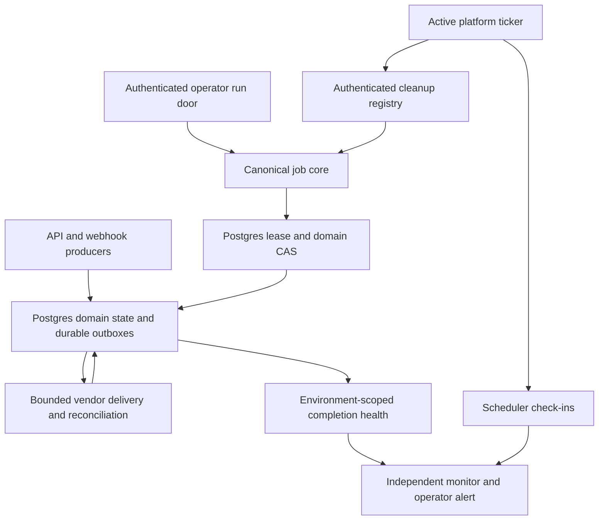

# Infrastructure and maintenance

The application keeps business obligations in Postgres and uses scheduled workers
to advance them. The ticker admits bounded work; leases, conditional updates,
transactional outboxes and vendor idempotency protect retries. Recent scheduler
activity alone does not establish successful recovery or human alert delivery.

Start with the [scheduler and reconciliation reference](10-cron-and-reconciliation-reference.md),
[worker recovery contracts](12-worker-recovery.md) and
[readiness and operating gates](13-readiness-and-operating-gates.md).
The [generated inventory](04-cron-jobs-reference.md) derives job ownership,
entrypoints, bounds and maintenance gates from source; regenerate it with
`npm run cron:reference` after catalog or registry changes.

## Runtime responsibilities

There is one active operational scheduler, selected by
`ops:active_cron_platform`. The fleet selection fails open when missing or
unreadable, so domain correctness cannot depend on that switch alone. Keep
Netlify's standby configuration and adapters buildable. Recording background
adapters require Netlify as the active cron host until an equivalent execution
target is supplied; Stream's domain documentation owns those details.

GitHub Actions owns repository CI, security and release checks, plus the
remaining configured non-money batch jobs. Those batch jobs need actual execution
and budget evidence. A configured workflow or a passing HTTP admission does not
prove that its business effect occurred. Migrate ownership in one reviewed
cutover; do not schedule the same core on both platforms by default.

## Maintenance admission

| State                        | User routes                                                         | Cron and background work                                        |
| ---------------------------- | ------------------------------------------------------------------- | --------------------------------------------------------------- |
| OFF                          | Normal authenticated and authorized behavior                        | Normal job admission                                            |
| DEGRADED                     | Reads continue; the middleware blocks its configured mutation paths | Financial jobs are held; permitted non-money jobs continue      |
| OFFLINE                      | Non-exempt requests receive a maintenance response                  | Guarded jobs are held; exemptions remain explicit               |
| Unreadable maintenance state | Sensitive paths fail closed according to the edge policy            | Maintenance guards refuse admission with an unavailable outcome |

Webhooks, health and control surfaces have deliberate exemptions; consult the
[phase rules](02-degraded-vs-offline.md) and [webhook behavior](05-webhook-behavior.md).
The edge policy and cron guard are separate gates. Starting maintenance does not
cancel an invocation or vendor request already in flight. Admin bypass cookies
are signed, short-lived grants, not a raw-secret cookie. Use the authenticated
maintenance controls and the checklist before any schema operation.

Cron mutual exclusion uses `SystemJobExecution` in Postgres, not Redis. A
fail-closed core never runs when lease acquisition is unavailable. Different
jobs can still touch the same domain row, so each winning transition must retain
its CAS predicate and commit the obligations it creates on the transaction
client. With `PG_POOL_MAX=1`, a global Prisma query inside that transaction can
deadlock. A timeout is not vendor cancellation; use durable obligations and
stable retry identities to recover uncertain effects.

## Signals and recovery

`GET /api/health` describes dependency and maintenance observations. Its shared
heartbeat is activity evidence and can be refreshed by other jobs; it is not a
per-capability completion guarantee. Authenticated `GET /api/health/jobs` checks
successful completions in the configured deployment environment, with a separate
budget for each required capability. Neither response proves backlog drain.

Sentry scheduler check-ins and independent absence checks must reach a human
when work stops. Follow the [monitor setup guide](00-betterstack-setup.md) and
[Sentry evidence guide](../observability/sentry/07-verifying-end-to-end.md)
for monitor configuration and the evidence needed from a controlled exercise. Retain evidence of actual alert receipt,
restoration, bounded backlog recovery and backup/failback exercises. Never stop
production recovery merely to manufacture an alert.

## Domain guides

0. [BetterStack setup](00-betterstack-setup.md)
1. [Maintenance architecture](01-architecture.md)
2. [DEGRADED and OFFLINE](02-degraded-vs-offline.md)
3. [Business risks](03-business-risks.md)
4. [Generated job inventory](04-cron-jobs-reference.md)
5. [Webhook behavior](05-webhook-behavior.md)
6. [Pre-maintenance checklist](06-pre-maintenance-checklist.md)
7. [Post-maintenance recovery](07-post-maintenance-recovery.md)
8. [SDK updates](08-sdk-update-guide.md)
9. [Future improvements](09-future-improvements.md)
10. [Scheduler, sidecars and reconciliation](10-cron-and-reconciliation-reference.md)
11. [Job machinery and dashboard design](11-job-machinery-catalog.md)
12. [Worker recovery and durable obligations](12-worker-recovery.md)
13. [Readiness and operating gates](13-readiness-and-operating-gates.md)

Additional bounded-worker guides:

- [Housekeeping admission and retention](housekeeping-bounds.md)
- [Job history and messaging retention](messaging-retention.md)
- [Compliance and event-retention workers](compliance-retention-workers.md)

## Deprecated & Superseded Approaches

Older guidance treated DEGRADED as a banner only and claimed cron work bypassed
all maintenance protection. Current middleware and job guards enforce distinct
admission policies; neither cancels work already admitted.

Historical diagrams also described a shared heartbeat as eliminating false
staleness, fixed-size scheduler groups as universal, and proposed delivery changes
as fully deployed. Use the source-derived roster, environment-scoped capability
checks and operating evidence instead. Redis cron locks, raw-secret bypass
cookies and a second scheduler as a correctness guarantee are superseded.
