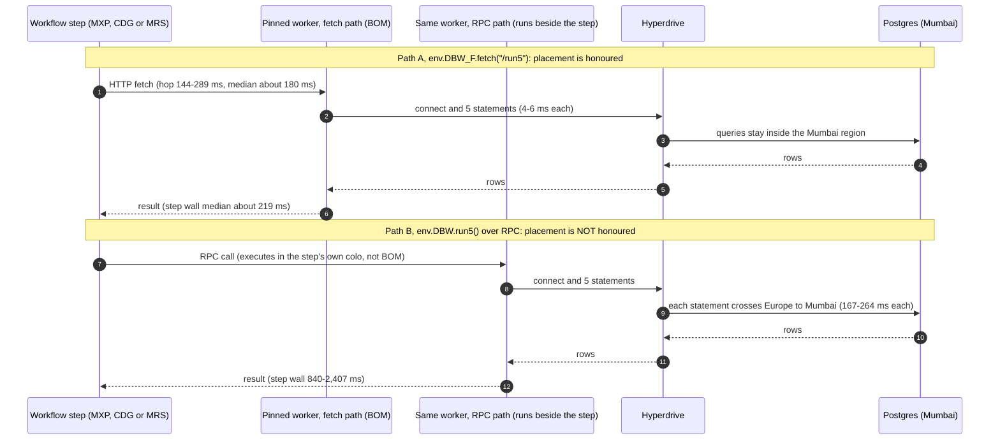

# Lab: Cloudflare Workflows calling a region-pinned Hyperdrive worker

Date 2026-11-01. Labels: MEASURED = observed in this lab. DOCS = from the cited page. ESTIMATE = arithmetic.
Plan: Workers Free (unchanged). Shared Supabase DB (mock data), schema `lab_cfwf`, dropped at the end. The scripts stayed in the scratch directory and are not stored in this repository.

## What this report shows, in plain words

A Cloudflare Workflow step runs in a Cloudflare data centre near whoever created the instance (Marseille, Paris or Milan from our laptop), never near Mumbai. A step that talks to Postgres directly therefore pays about 170 ms per statement. The fix measured here is to keep the database code in a second Worker that is pinned to Mumbai (`placement = { region = "aws:ap-south-1" }`) and have the step call it over `fetch`. That pinned Worker reaches Postgres through Hyperdrive in 4–6 ms per statement, but every step pays a flat hop of about 180 ms to get there. Calling the same Worker over an RPC service binding looks identical in code and silently loses the pinning.

The sequence diagram compares the two paths for one step that runs five statements. The figures are MEASURED in section 1.

## Versions and setup

wrangler 4.156.0, node 26.9.0, pg ^8.16.3 (Hyperdrive TLS needs >= 8.16.3), compatibility_date 2026-10-01, nodejs_compat.

- `fw-lab-dbw`: `placement = { region = "aws:ap-south-1" }`, Hyperdrive binding `HD`, exports a `WorkerEntrypoint` (`Db`: RPC methods `run5`, `lock10`, `lockMany`, `commitRow`, `rows`) AND a `fetch` handler (`/run5`, `/lock`, `/rows`).
- `fw-lab-hd2`: Hyperdrive config to the Mumbai **session pooler** on port 5432, uploaded Supabase Root 2021 CA, `--sslmode verify-full`, caching disabled. (The negative CA test that proves verification is in the drain-tls report; not repeated.)
- `fw-lab-wf2`: Workflow `Wf2` + trigger/cron handler in one Worker. Service bindings: `DBW` (RPC entrypoint `Db`) and `DBW_F` (default fetch entrypoint). Steps `retries: {limit 3, delay 2 s}`.

## KEY FINDING: RPC through a service binding does NOT honour placement; fetch does

MEASURED. Same `run5` code (connect + 4 `select count(*)` + 1 insert on one Hyperdrive connection), called two ways from a workflow step:

| Call path                                | dbw ran in (colo)                                    | per-query median                   | DB time for 5 queries | step wall                          |
| ---------------------------------------- | ---------------------------------------------------- | ---------------------------------- | --------------------- | ---------------------------------- |
| `env.DBW.run5()` (RPC, WorkerEntrypoint) | **same colo as the step: MXP or CDG**                | 167–172 ms (MXP), 238–264 ms (CDG) | 837–1317 ms           | 840–2407 ms                        |
| `env.DBW_F.fetch("/run5")` (HTTP fetch)  | **BOM** (`cf-placement: remote-BOM`, trace colo BOM) | 4–6 ms                             | 22–109 ms (median 29) | 173–512 ms (median ~219, p95 ~480) |

So the RPC variant is just "Hyperdrive from Europe" (170 ms/query, no better than direct). Only the `fetch` handler is placed. DOCS: placement applies to fetch handlers only (https://developers.cloudflare.com/workers/configuration/placement/). Steps ran in MXP, CDG or MRS (near the creating request), never near Mumbai. 18 fetch-path steps measured (6 workflows x 3 steps) plus 4 RPC workflows.

## 1. 3-step workflow, 5 queries per step (fetch path), MEASURED

| Metric                                                         | Result                                                                     |
| -------------------------------------------------------------- | -------------------------------------------------------------------------- |
| Step wall, whole call incl. hop                                | median ~219 ms; range 173–512 ms; p95 ~480 ms                              |
| DB time inside dbw (5 queries)                                 | 24–109 ms, median ~29 ms (per query 4–6 ms; connect 2–5 ms via Hyperdrive) |
| Service-binding hop overhead (step wall minus dbw's own total) | 144–289 ms, median ~178 ms                                                 |
| Step-to-step gap (next start minus previous end)               | 38–58 ms                                                                   |
| Step colo vs dbw colo                                          | MXP / MRS / CDG -> BOM                                                     |
| Same work, direct-from-step or RPC (unpinned)                  | 840–2400 ms for 5 queries (125–174 ms/query earlier lab; 167–264 here)     |

The hop is the Europe->Mumbai network RTT plus the placement proxy; it is paid once per step regardless of query count, so the design only pays off if each step bundles many statements. Break-even versus 170 ms/query direct: about 2 queries per step (hop 180 ms + n x 5 ms vs n x 170 ms). A step with 1 query is slower through dbw (~190 ms vs ~170 ms).
Caveat: the laptop/trigger enters at MRS, so steps ran in Europe. A trigger arriving in Mumbai would put steps (not guaranteed) closer; steps still ignore placement.

## 2. Lock-hold workload inside one dbw call (begin, select for update, 10 updates, commit; 13 statements), MEASURED

| Path                                                                                                                                                                                                     | n   | median   | p95      | min–max     |
| -------------------------------------------------------------------------------------------------------------------------------------------------------------------------------------------------------- | --- | -------- | -------- | ----------- |
| dbw `fetch` `/lock` (pinned BOM)                                                                                                                                                                         | 30  | 67 ms    | 89 ms    | 57–96       |
| dbw `fetch` `/lock`                                                                                                                                                                                      | 50  | 70 ms    | 83 ms    | 62–123      |
| dbw `fetch` `/lock`                                                                                                                                                                                      | 50  | 67 ms    | 78 ms    | 55–106      |
| dbw via RPC from wf2 (unpinned, Europe)                                                                                                                                                                  | 10  | 1,941 ms | 2,299 ms | 1,914–2,299 |
| Matches the earlier Hyperdrive-in-BOM lab (60–89 ms). A transaction must run entirely inside one dbw call (a Hyperdrive connection is held per transaction; you cannot span a transaction across steps). |

## 3. Throwing step, retry timing and re-run check, MEASURED

Workflow `fetch-flaky`: s3 throws on attempt 1 AFTER inserting its side-effect row.

- Side-effect rows (commit times relative to s1): s1 at 0 ms, s2 at 307 ms, s3 attempt 1 at 704 ms, s3 attempt 2 at 2,930 ms. Retry gap 2.23 s (configured 2 s).
- Rows per instance: 4 (s1 x1, s2 x1, s3 x2). Completed steps did not re-run; only the failed step re-ran. Non-flaky instances have exactly 3 rows. 96 rows over 28 keys in total before the drop.
- Consequence: side effects in a step run at-least-once; make the DB write idempotent (key = instance id + step).

## 4. Dual write, MEASURED

`/dual`: `dbw.commitRow(key)` committed, then the caller failed before `WF.create()`. Result: row exists (`step=commit_before_create`), no workflow instance. `create()` is not transactional with Postgres in either direction, so a state-as-outbox row (and a ticker that starts workflows from it, idempotent via a deterministic instance id such as `cron-<epoch>`, which dedupes) is still required.

## 5. CPU limits on Free, MEASURED + DOCS

- DOCS (https://developers.cloudflare.com/workflows/reference/limits/): compute time per step Free 10 ms, Paid 30 s default up to 5 min; wall time per step unlimited ("waiting on network I/O calls or querying a database"); steps per Workflow 1,024 Free / 10,000 Paid (up to 25,000); concurrent instances 100 Free / 50,000 Paid. DOCS (workflows/reference/pricing): CPU time is active processing only, I/O wait does not count; error text `Error: Worker exceeded CPU time limit.`
- MEASURED: all I/O-bound steps passed (4 RPC + 18 fetch steps, up to 2.4 s wall each, 0 CPU errors). A pure CPU spin step of 3e8 iterations completed; 3e9 iterations errored with status `errored`, message `Worker exceeded CPU time limit.` (no numeric code). `Date.now()` is frozen during sync CPU work, so the 3e8 step reported 0 ms. Enforcement is looser than the documented 10 ms, as in the earlier lab; do not rely on it. Setting `limits.cpu_ms` on Free is rejected (code 100328, earlier lab).
- The step itself only does a service-binding call, so its own CPU is negligible; pg runs in dbw (HTTP-style 10 ms CPU limit on Free applies there too, it passed).

## 6. Cron Trigger self-start, MEASURED

Cron `* * * * *` in the same Worker; `scheduled()` calls `env.WF.create({ id: "cron-" + epochSeconds })`.

- Deployed 07:14:03Z; first fire 07:22:45Z (about 8.7 min later, consistent with "up to 15 min" first-fire docs).
- Fires exactly 60 s apart (instance ids `cron-1793517762`, `...822`, `...882`, ...); 13 cron-started workflows over about 13 min, all `Completed` in 3–8 s, none missed or duplicated. Ran 07:22:45Z–07:26:44Z (about 4 min, 5 fires) before removal.
- Removal: redeployed with `crons = []` at 07:26:44Z (wrangler printed no schedule). **Fires continued until 07:35:45Z, about 9 minutes after removal** (earlier lab saw about 4 min), and none appeared by 07:38:03Z. Verified stopped. Deleting the Worker is the sure stop.
- Cron DOCS: 5 triggers per account Free. A deterministic instance id makes double fires idempotent.

## 7. Cost ESTIMATE (~91k job runs per month; N steps per run)

Billing for steps applies from 2026-08-10 (DOCS: https://developers.cloudflare.com/workflows/reference/pricing/ ). Free: 3,000 steps/day (~90k/month). Paid: 500k steps/month included, then $0.80 per 100k (retries not counted). Paid plan base fee ($5/month) not included. Each step in this design is also one dbw request (Workers requests: Free 100k/day; Paid 10M/month included) and Hyperdrive queries (Free 100k/day; Paid unlimited).

| N steps per run                                                                                                                                                                         | steps/month | steps/day | Free (3,000/day)         | Paid overage                  |
| --------------------------------------------------------------------------------------------------------------------------------------------------------------------------------------- | ----------- | --------- | ------------------------ | ----------------------------- |
| 1                                                                                                                                                                                       | 91k         | 3,033     | borderline (over by ~1%) | $0 (inside 500k)              |
| 3                                                                                                                                                                                       | 273k        | 9,100     | exceeded 3x              | $0                            |
| 5                                                                                                                                                                                       | 455k        | 15,200    | exceeded 5x              | $0                            |
| 6                                                                                                                                                                                       | 546k        | 18,200    | exceeded                 | (46k) x $0.80/100k = $0.37    |
| 10                                                                                                                                                                                      | 910k        | 30,300    | exceeded 10x             | (410k) x $0.80/100k = $3.28   |
| 20                                                                                                                                                                                      | 1.82M       | 60,700    | exceeded                 | (1.32M) x $0.80/100k = $10.56 |
| So Free covers at most about 1 step per run at this volume; Paid steps are cheap (single-digit dollars). The real cost is complexity and the hop latency, not the step meter. ESTIMATE. |

## Verdict

Technically viable, not attractive.

- Works: a Workflow step can reach Mumbai-speed DB access (4–6 ms per statement, TLS verify-full via Hyperdrive, ~30 ms DB time per 5-query step) ONLY by calling the pinned worker over `fetch` (HTTP) through a service binding. RPC does not get placement and silently gives 170 ms per statement. Durability survives: completed steps do not re-run, retries are timed as configured, the 4-step workflows and cron-started workflows all completed, and 3 s+ sleeps from the earlier lab were accurate.
- Cost per step: a flat 144–289 ms (median ~180 ms) cross-region hop, so a step with one or two queries gains nothing; it wins only when a step batches roughly 3+ statements or a whole transaction (a 13-statement lock transaction takes about 67 ms, versus about 2 s unpinned).
- Still needed: an outbox row plus a ticker/cron to start workflows (create() is not transactional), idempotent step writes (at-least-once), and a cron that keeps firing for up to about 9 minutes after removal.
- Complexity compared with Vercel Workflows in `bom1` (2–3 ms per statement, steps are your own functions in the same region as the DB, no extra hop): Cloudflare needs three moving parts (workflow Worker, pinned DB Worker with a fetch API that you must design as coarse-grained "transaction scripts", Hyperdrive config plus uploaded CA cert), an HTTP serialisation boundary for every DB interaction, no interactive transactions across steps, and a 10 ms CPU limit on Free. Vercel Workflows needs none of that: app code runs in `bom1` and queries Postgres directly. Recommendation: do not choose Cloudflare Workflows for a DB-heavy job engine here unless something else (price, an existing Cloudflare footprint) forces it; if used, keep every step a single coarse call to the pinned worker.

## Where this lands in the ranking

Cloudflare beats Netlify on raw HTTP latency (2–4 ms when pinned) and on price, but it loses overall, for three reasons. Running the Next.js app there needs the OpenNext Workers runtime (Node API gaps, bundle limits, Prisma driver adapters, TLS to Supabase only through Hyperdrive), which makes it the largest migration of any option; an earlier evaluation scored it 60 out of 100 and eliminated it. Jobs pay a `fetch` hop on every step. And a removed cron kept firing for about 9 minutes. The ranking is Vercel `bom1` with Workflows or a Mumbai DBOS worker first, then Netlify, then Cloudflare. Page 14 section 9.12 holds the owner-facing version of this answer.

## Cleanup proof (MEASURED, 2026-11-01 07:38–07:40Z)

- `wrangler delete --name fw-lab-wf2`: "Successfully deleted fw-lab-wf2"; `wrangler delete --name fw-lab-dbw`: "Successfully deleted fw-lab-dbw".
- `wrangler workflows delete fw-lab-wf2`: removed; `wrangler workflows list`: "There are no deployed Workflows in this account".
- `wrangler hyperdrive delete` on the config: Deleted; `wrangler hyperdrive list`: empty.
- `wrangler cert delete --name fw-lab-supa-ca`: the certificate deleted successfully; `wrangler cert list`: empty.
- Requests to the two former workers.dev addresses returned 404. No Queues were created in this lab.
- Postgres: `drop schema lab_cfwf cascade;` then `select nspname from pg_namespace where nspname like 'lab_cf%'` returned `[]` (0 rows).
- The database address file and the helper script were removed; the lab folder holds no credentials (the address was passed only to `hyperdrive create`). No repository changes. The account-wide workers.dev subdomain from the earlier lab is untouched.
