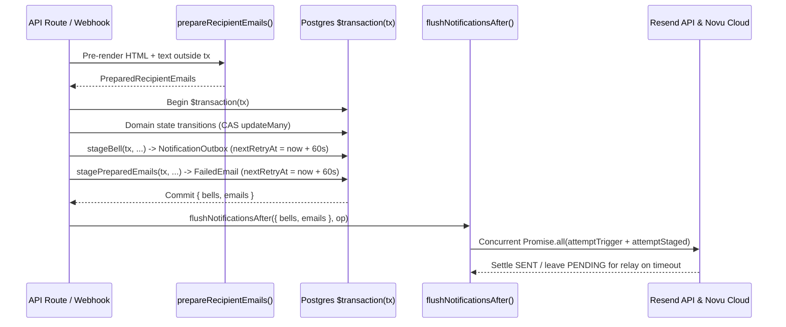
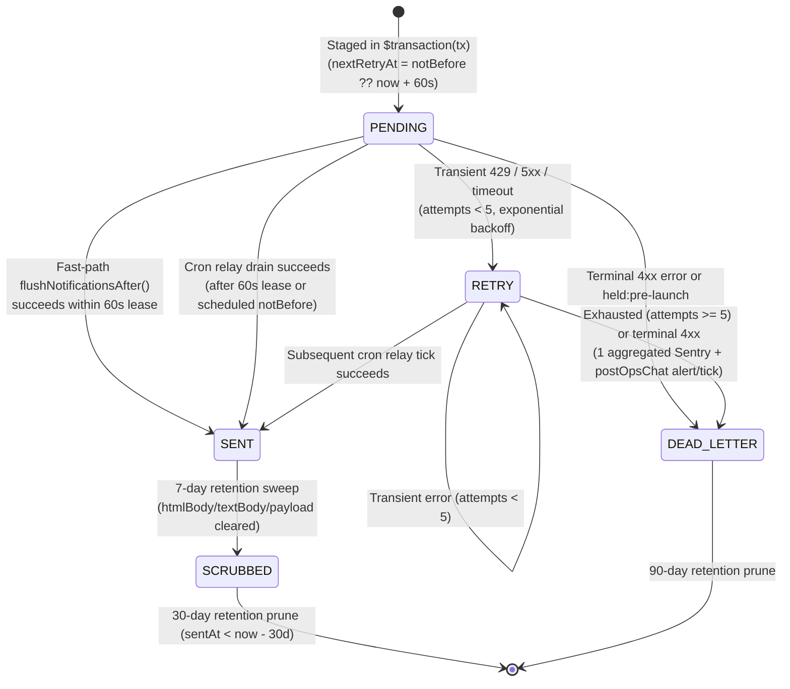
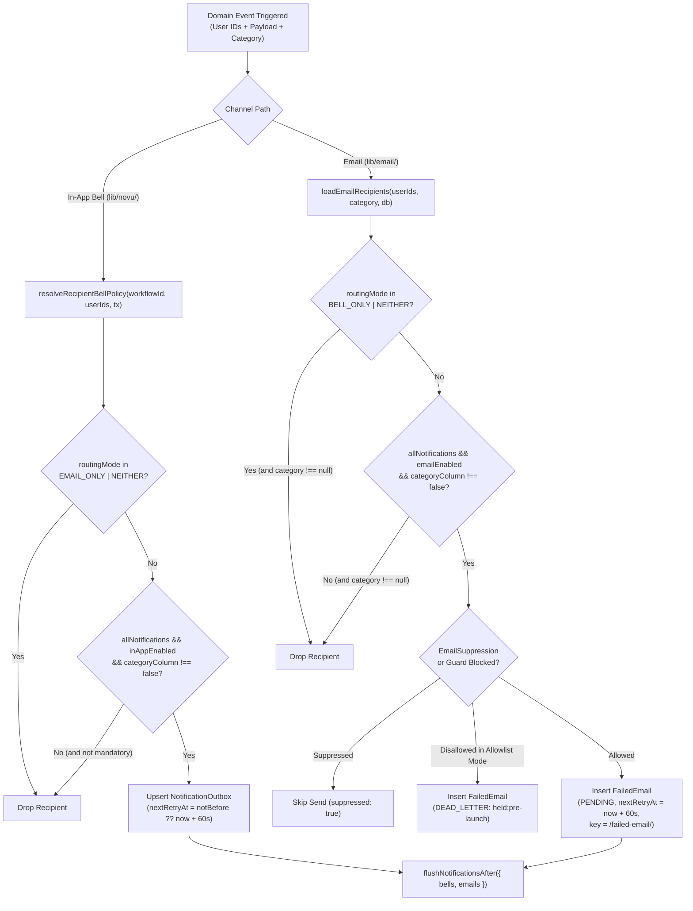
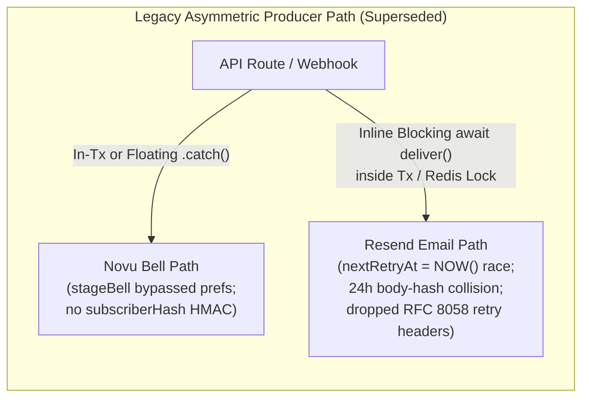

# Notification Architecture

> End-to-end architecture for outbound transactional/lifecycle email (`lib/email/`) and multi-tenant Novu in-app feed orchestration (`lib/novu/`), including transactional outbox staging, 60-second inline lease protection, concurrent post-response flushing, stateless RFC 8058 unsubscribes, subscriber security, and scheduled relays.

**Last Updated**: 2026-10-13

---

## 1. Dual-Provider Split & Channel Parity

Familiarise separates email delivery from in-app notification feed orchestration while sharing a single source of truth for user preferences, workspace routing modes, and transactional outbox durability:

| Service    | Role                                              | Active Channels         | Outbox Table(s)                   | Relay Target & Ticker Schedule                           |
| ---------- | ------------------------------------------------- | ----------------------- | --------------------------------- | -------------------------------------------------------- |
| **Resend** | Outbound transactional, ops & newsletter delivery | Email (`mail.`/`news.`) | `FailedEmail`, `FailedEmailBatch` | `retry-failed-emails` (every **15m** at **`:00`**)       |
| **Novu**   | Real-time in-app notification feed & inbox        | In-App Feed (WebSocket) | `NotificationOutbox`              | `drain-notification-outbox` (every **10m** at **`:05`**) |


### High-Level Design (ASCII Architecture)

```text
+=============================================================================================+
|                 PRODUCERS (API Routes, Webhooks, Server Actions, Cron Jobs)                 |
+=============================================================================================+
   |
   |  Phase 0 (High-Contention Serializable Tx Only: Payment Webhooks & Invoice Rollup):
   |  - Pre-render React Email HTML/Plaintext OUTSIDE tx (`prepare*Email` -> `renderEmail()`)
   v
+---------------------------------------------------------------------------------------------+
|                   PHASE 1: ATOMIC POSTGRES `$transaction(tx)` (`PG_POOL_MAX=1`)             |
|                                                                                             |
|  1. Domain State Mutation (CAS `updateMany` with expected prior status in `WHERE`)          |
|  2. `stageBell(tx, ...)` -> `resolveRecipientBellPolicy(tx)` filters opted-out users       |
|     and upserts one `NotificationOutbox` row per event (SINGLE, or MULTI <= 100):           |
|     - `status = 'PENDING'`, `nextRetryAt = notBefore ?? NOW() + 60s`                        |
|     - Deterministic `transactionId = <workflowId>:<sha256[:32]>` + `NotificationScope`      |
|  3. `stage*Email(tx, ...)` / `stagePreparedEmails(tx, ...)` writes `FailedEmail`:           |
|     - Enforces `EMAIL_DELIVERY_MODE` guard + `EmailSuppression` + `NotificationPreference`  |
|     - `status = 'PENDING'`, `nextRetryAt = NOW() + 60s` (`INLINE_ATTEMPT_LEASE_MS`)         |
|     - Row-scoped Resend key: `Idempotency-Key = <EMAIL_TYPE>/failed-email/<row.id>`         |
+---------------------------------------------------------------------------------------------+
   |
   +---------------------------------------------+--------------------------------------------+
   | FAST PATH (0ms HTTP Latency Overhead)       | DURABLE FALLBACK RELAY (`cron-tick.mts`)   |
   v                                             v
+------------------------------------------+  +-----------------------------------------------+
| PHASE 2: `flushNotificationsAfter()`     |  | PHASE 3: Scheduled Outbox Drains              |
| - Uses Next.js `after()` (`scheduleAfter`)|  | - `withCronLock` (`SystemJobExecution` lease) |
|   after HTTP response is sent (or inline |  | - `drain-notification-outbox` (10m @ `:05`)   |
|   in CLI/cron/Jest).                     |  | - `retry-failed-emails` (15m @ `:00`):        |
| - Concurrent `Promise.allSettled`:       |  |   reconstructs RFC 8058 `List-Unsubscribe`    |
|   `attemptTrigger` + `attemptStaged`     |  |   headers via `reconstructUnsubscribeHeaders` |
| - Marks `SENT` on 2xx; leaves `PENDING`  |  | - Per-tick aggregated Sentry + `postOpsChat`  |
|   or `RETRY` (backoff) on failure.       |  |   when rows enter `DEAD_LETTER`; `policy:`    |
|                                          |  |   skips never alert. Urgent workflows first.  |
+------------------------------------------+  +-----------------------------------------------+
                     \                                       /
                      v                                     v
        +----------------------------+       +-------------------------------+
        | Novu Cloud (16 Families)   |       | Resend API (`mail.` / `news.`)|
        | -> `<Inbox />` WebSocket   |       | -> Svix Webhook (`EmailEvent`)|
        |    (`subscriberHash` HMAC) |       |    + `EmailSuppression` sync  |
        +----------------------------+       +-------------------------------+
```

### Channel Parity Across Lifecycle Flows

Every multi-channel user lifecycle event maintains full channel parity across `lib/email/` and `lib/novu/`:

| Domain                 | Events                                                                                               | Email Path (`lib/email/`)                                                 | In-App Bell Path (`lib/novu/`)                                           |
| ---------------------- | ---------------------------------------------------------------------------------------------------- | ------------------------------------------------------------------------- | ------------------------------------------------------------------------ |
| **Auth & Security**    | Signup welcome, verification OTP, password reset/changed, 2FA/passkey/backup-code changes            | Direct via `deliver()` (`senders/security.ts`, `account-lifecycle.ts`)    | Novu (`account` family — `ACCOUNT_SECURITY_NOTICE`)                      |
| **Enterprise SSO**     | SSO provider submitted, approved, rejected, revoked, or deleted                                      | `senders/sso.ts` (staged `SsoProviderEmail`)                              | `notifyOrgSso*` (`org_security` / `org-membership` family)               |
| **Bookings & Trials**  | Booked, cancelled, rescheduled, partially scheduled, booking requests, trial scheduled, reminders    | `senders/booking.ts` (`stageAppointmentBookedEmail`, etc.)                | `notifyAppointment*`, `notifyTrial*`, `notifyBookingRequest*`            |
| **Payments & Payouts** | Payment link, payment success/failed, refund processed/failed, consultant payout status, disputes    | `lib/payments/webhooks/staged-emails.ts`, `senders/money.ts`              | `notifyPayment*`, `notifyRefund*`, `notifyPayout*`, `notifyDispute*`     |
| **Organizations**      | Created, invitations, welcome, role changed/removed, expert removed, billing, dunning, wallet, seats | `senders/onboarding.ts`, `senders/money.ts` (`ORG_BILLING_RECEIPT`, etc.) | `lib/novu/org-workflows.ts` (all 24 helpers stamp `NotificationScope`)   |
| **Support & Trust**    | Ticket received/replied/updated, review received, moderation outcomes, account suspension/ban        | `senders/people.ts` (`SUPPORT_TICKET_*`, `ACCOUNT_SUSPENDED`/`BANNED`)    | `notifySupportTicket*`, `notifyReview*`, `notifyAccountSuspended/Banned` |

---

## 2. Transactional Outbox Lifecycle & `flushNotificationsAfter` Fast-Path

To guarantee atomicity with domain writes while strictly respecting `PG_POOL_MAX=1` connection budgets, multi-channel producers execute in three phases:

1. **Phase 0 — Pre-Render Outside `Serializable` `$transaction`**:
   - High-contention `Serializable` money and billing transactions (`handlePaymentSuccess`, `handlePaymentFailure`, `invoice-rollup`) pre-render React Email payloads (`render(element)` + `toPlainText(html)` in `lib/email/render.ts`) via `prepare*` helpers (`prepareRecipientEmails` / `prepareSpecEmails` in `lib/email/send-to-recipients.ts`) before opening `prisma.$transaction`, then call `stagePreparedEmails(tx, ...)` inside `tx` so database locks are never held during CPU-bound rendering.
   - Standard low-contention interactive routes stage directly inside `tx` via `stage*Email(tx, ...)` + `flushNotificationsAfter`, while bulk loops (`assignments`, `session-outcome-sweep`) stage and render after commit so per-item transactions stay short.
2. **Phase 1 — Atomic Outbox Staging Inside `$transaction(tx)`**:
   - **Emails**: `stage()` / `stagePreparedEmails(tx, prepared)` (`lib/email/deliver.ts`) evaluates `EMAIL_DELIVERY_MODE` and `EmailSuppression` on `tx`, writes `FailedEmail` with `status: "PENDING"` and `nextRetryAt: new Date(Date.now() + 60_000)`, and generates a row-scoped `Idempotency-Key: <EMAIL_TYPE>/failed-email/<row.id>`.
   - **In-App Bells**: `stageBell(tx, args)` (`lib/novu/stage-bell.ts`) queries `tx.user.findMany` via `resolveRecipientBellPolicy`, filters out recipients who opted out (`EMAIL_ONLY`, `NEITHER`, `allNotifications: false`, `inAppEnabled: false`, or muted category column), and upserts `NotificationOutbox` with `status: "PENDING"` and `nextRetryAt: notBefore ?? NOW() + 60s` (`INLINE_ATTEMPT_LEASE_MS`); `notBefore` is set only by a producer that schedules the notification. If every recipient opted out, `stageBell` returns `null` without writing an outbox row.
   - **Bell attempt** (`attemptTrigger`, `lib/novu/outbox.ts`): the first attempt rechecks current policy (`currentBellRecipients`, including `erasedAt`) and freezes the allowed recipients into the row in the same conditional update that stamps `firstAttemptAt`. No recipient left dead-letters the row as `policy:audience_revoked` (expected, never alerted); a failed policy read leaves the row for a later attempt and never sends. Each attempt makes one `novu.triggerBulk` call for the first 100 frozen recipients, one event each under `<transactionId>:<sha256(recipient)[:16]>`, with `Idempotency-Key = <transactionId>:bulk:<sha256(firstAttemptAt, recipients, wire payload)[:16]>`.
     - **Unknown outcome** (timeout, network error, 5xx, `409` key in flight, `429`, an unreadable 2xx): the row retries with the same recipients and anchor, so the resend is byte-identical under the same key and Novu answers from its idempotency cache instead of ringing anyone twice. Later attempts never re-filter by policy.
     - **Definitive response**: accepted recipients leave the row. Retryable refusals (`error`, or a status the client does not know) stay, terminal refusals (`trigger_not_active`, `invalid_recipients`, workflow not found, ...) are dropped and named in `lastError`, and `firstAttemptAt` moves forward so the next attempt uses a new key. These writes also require the anchor the sent key was built on. The row is `SENT` when nothing is left and nothing was refused, and `DEAD_LETTER` only when nothing is left and something was refused terminally. A row over 100 recipients sends its next 100 on the following attempt without spending a retry.
     - `firstAttemptAt` older than 23 h dead-letters the row as `review:provider_acceptance_unknown` (Novu's idempotency cache lasts 24 h). Every status write is conditional on `PENDING`/`RETRY`, so nothing overwrites `SENT`.
3. **Phase 2 — Post-Commit Concurrent Dispatch via `flushNotificationsAfter`**:
   - After `$transaction` commits, `flushNotificationsAfter({ bells, emails }, op)` (`lib/novu/stage-then-attempt.ts`) schedules wire delivery through `scheduleAfter` (`lib/api/after-safe.ts`).
   - Inside a Next.js App Router request context, `scheduleAfter` registers the batch on Next.js `after()` (`waitUntil`) so the HTTP response returns immediately while `attemptTrigger(row)` and `attemptStaged(entry.rows, entry.emailType, budgetMs)` run concurrently in `Promise.all` with individual `.catch()` error isolation.
   - Outside a Next.js request scope (CLI jobs, cron workers, unit tests), `after()` throws and `scheduleAfter` seamlessly executes and settles the batch inline before resolving.



### Low-Level Design: 3-Phase Execution & Lease Timeline (ASCII)

```text
t = 0ms      [Phase 0: Outside Tx]  prepareRecipientEmails() renders React Email SSR HTML + text in memory
t = 15ms     [Phase 1: Inside Tx]   BEGIN $transaction(tx)
t = 20ms                            CAS domain write (e.g., Payment.updateMany WHERE status = PENDING)
t = 28ms                            stageBell(tx) -> upsert NotificationOutbox (nextRetryAt = t + 60,000ms)
t = 35ms                            stagePreparedEmails(tx) -> insert FailedEmail (nextRetryAt = t + 60,000ms)
t = 40ms                            COMMIT $transaction(tx)
t = 41ms     [HTTP Response Sent]   scheduleAfter() registers post-response callback; caller receives 200 OK
t = 42ms     [Phase 2: Fast-Path]   Promise.allSettled([attemptTrigger(), attemptStaged()])
t = 180ms                           2xx from Novu & Resend -> rows transition PENDING -> SENT (sentAt = now)
             ...
t > 60,000ms [Phase 3: Cron Relay]  If Phase 2 timed out or container froze before t = 180ms, inline lease
                                    expires (nextRetryAt <= now) and cron-tick.mts claims & retries the row.
```

### Outbox Row State Machine (`NotificationOutbox`, `FailedEmail` & `FailedEmailBatch`)



---

## 3. Email Layer Architecture (`lib/email/`)

### Module Structure

```text
lib/email/
├── config.ts             -- SENDERS getters, EMAIL_BUDGET_MS, domain/mailbox helpers
├── deliver.ts            -- deliver() = stage() (60s inline lease) + attempt(); getResendClient()
├── idempotency.ts        -- idempotencyKeyFor(msg, type, rowId) -> "<TYPE>/failed-email/<rowId>"
├── unsubscribe.ts        -- HMAC link tokens, RFC 8058 headers & stateless reconstructUnsubscribeHeaders()
├── preferences.ts        -- loadEmailRecipients() gating on NotificationPreference & routingMode
├── suppression.ts        -- EmailSuppression lookup & email normalisation
├── delivery-guard.ts     -- Pre-launch EMAIL_DELIVERY_MODE allowlist guard
├── classify.ts           -- Credential body redaction & terminal error classification
├── render.ts             -- Single-pass renderEmail() wrapped in OTel email.render span
├── send-to-recipients.ts -- prepareRecipientEmails(), stagePreparedEmails(), sendToRecipients(), attemptStaged()
└── senders/
    ├── shared.ts         -- Formatting helpers & declarative sender builders
    ├── booking.ts        -- Booking & trial lifecycle email senders
    ├── money.ts          -- Refunds, payouts, disputes & org billing email senders
    ├── onboarding.ts     -- Verification & organization onboarding senders
    ├── people.ts         -- Support tickets, reviews, moderation & mandatory account notices
    ├── security.ts       -- 2FA, passkey & backup code security notices
    └── sso.ts            -- Enterprise SSO provider lifecycle notices
```

### Inline Send Budgets (`EMAIL_BUDGET_MS`)

| Budget                 | Timeout (ms) | Callers                                                                 |
| ---------------------- | ------------ | ----------------------------------------------------------------------- |
| `AUTH`                 | `8,000`      | Auth hooks (welcome, verification code, password reset, account linked) |
| `CONTACT_AND_WAITLIST` | `5,000`      | Contact inquiry form and waitlist double opt-in / welcome               |
| `WEBHOOK`              | `3,000`      | Payment & capture webhook inline email sends                            |
| `JOB`                  | `10,000`     | Background cron jobs and `runEmailRetryTick` relay sends                |
| `REQUEST`              | `5,000`      | Interactive API routes dispatching lifecycle emails inline              |
| `LIFECYCLE`            | `5,000`      | Default budget for `flushNotificationsAfter` email bundles              |

### Stateless RFC 8058 Unsubscribe & Link-Scanner Protection

1. **Stateless Token Signing (`lib/email/unsubscribe.ts` & `lib/waitlist/tokens.ts`)**:
   - Lifecycle unsubscribe URLs (`/api/notifications/unsubscribe?u=<userId>&t=<token>`) and waitlist unsubscribe URLs (`/api/waitlist/unsubscribe?email=<email>&token=<token>`) use timeless HMAC signatures under `WAITLIST_HMAC_SECRET` with distinct domain-separated purposes so tokens never expire in older emails and cannot be replayed across subsystems.
2. **Stateless Retry Header Reconstruction (`reconstructUnsubscribeHeaders`)**:
   - Because `FailedEmail` stores rendered HTML/text without a separate JSON headers column, `reconstructUnsubscribeHeaders(row)` inspects the persisted message body during `runEmailRetryTick`.
   - If the body contains `/api/notifications/unsubscribe?u=...`, it rebuilds `List-Unsubscribe` + `List-Unsubscribe-Post: List-Unsubscribe=One-Click` for that user ID; if it contains `/api/waitlist/unsubscribe`, it rebuilds the waitlist one-click headers for `row.recipient`; if `category === null` (mandatory account notices such as suspension/ban), it returns `undefined`.
3. **Link-Scanner Safe `GET` vs. One-Click `POST`**:
   - **Lifecycle (`/api/notifications/unsubscribe`)**: `GET` performs zero DB writes and returns a `303` redirect to `/email/unsubscribe`; `POST` verifies the HMAC token, sets `emailEnabled: false` on `NotificationPreference` (leaving in-app notifications untouched), and syncs Novu via `updateSubscriberPreferences`.
   - **Waitlist (`/api/waitlist/unsubscribe`)**: `GET` performs zero DB writes and renders a self-contained HTML confirmation page with a `<form method="post">`; `POST` executes immediate one-click opt-out (`unsubscribe({ email, token })`), preventing corporate mail link scanners from silently unsubscribing users on prefetch.

### Sending Domains & DMARC Alignment

- **Sending Subdomains**: `mail.familiarisenow.com` (transactional/ops) and `news.familiarisenow.com` (newsletter) use verified Resend DKIM keys (`resend._domainkey.mail` / `.news`) and Return-Path SPF/MX alignment (`send.mail` / `send.news` -> `ap-northeast-1` SES).
- **DMARC**: The live `_dmarc` record is `v=DMARC1; p=none; rua=mailto:connect@practitionist.com; fo=1`. The policy tightens to `quarantine` and then `reject` after about two weeks of reports. The apex also publishes SPF `v=spf1 -all`. The full record list is in [Domains and DNS records](../deployment/README.md#domains-and-dns-records).
- **Send-only product domain**: `familiarisenow.com` is send-only (Resend): it publishes a null MX (`0 .`, RFC 7505), so nothing sent to an address on it arrives. Every inbound address is `connect@practitionist.com` through `SUPPORT_EMAIL` in `lib/company.ts`.

---

## 4. Novu Layer & Subscriber Security (`lib/novu/`)

### Tenant Isolation & Subscriber HMAC Authentication

- **Environment Resolution (`lib/novu/secret-key.ts`)**: Production traffic (`NEXT_PUBLIC_SENTRY_ENVIRONMENT=production`) uses `NOVU_PRODUCTION_KEY`; previews, branch deploys, and local development use `NOVU_DEVELOPMENT_KEY`.
- **HMAC Subscriber Authentication (`computeSubscriberHash`)**: `lib/novu/subscriber.ts` computes deterministic HMAC-SHA256 hex digests (`createHmac("sha256", key).update(subscriberId).digest("hex")`) returned by `POST /api/novu/subscriber` so `<Inbox />` authenticates real-time WebSocket inbox connections without exposing subscriber feeds to enumeration.
- **Inbox mounts after the sync settles (`resolveInboxAuth`)**: `NotificationInbox` waits for `POST /api/novu/subscriber` to finish before rendering `<Inbox />`, so the first connection already carries `subscriberHash`. Mounting earlier sent hash-less requests that Novu answers with 400 "valid HMAC hash" wherever the in-app integration enforces HMAC. `NotificationInbox` is the only component that opens a Novu session; there is no app-wide `NovuProvider`. Previews pair the Development application identifier with `NOVU_DEVELOPMENT_KEY`, and production pairs the Production identifier with `NOVU_PRODUCTION_KEY`; the hash is only valid with the secret of the environment that owns the identifier.
- **Fail-Closed Custom Data Merge (`buildSubscriberCustomData`)**: Merges caller overrides (`routingMode`, `preferences`) with persisted `OrgWorkspaceProfile` and `NotificationPreference` rows. Any database read error is **propagated** rather than caught and defaulted, ensuring transient DB faults never overwrite opted-out subscribers back to `masterEnabled: true` in Novu.
- **Idempotent Preference Sync (`updateSubscriberPreferences`)**: Calls `novu.subscribers.create({ subscriberId, data: customData })` (upsert semantics) rather than PATCHing an existing subscriber record, ensuring preference changes succeed even if a user has never mounted the client dashboard yet.

### Preference Categories & Workspace Routing Matrix

Both `resolveRecipientBellPolicy` (for in-app bells) and `loadEmailRecipients` (for emails) enforce the same workspace routing modes and category columns (`EMAIL_CATEGORY_COLUMN`):

- **Workspace Routing Mode (`OrgWorkspaceProfile.notificationRoutingMode`)**:
  - `BELL_AND_EMAIL` (default): Allows both in-app feed and email.
  - `BELL_ONLY`: Allows in-app feed; suppresses lifecycle emails.
  - `EMAIL_ONLY`: Allows email; suppresses in-app feed (`stageBell` drops recipient).
  - `NEITHER`: Suppresses both channels.
- **Category Columns (`NotificationPreference`)**: `appointmentReminders` (`appointments`), `paymentNotifications` (`payments`), `subscriptionAlerts` (`subscriptions`), `trialNotifications` (`trials`), `supportUpdates` (`support`), `feedbackAlerts` (`feedback`), `orgBillingAlerts` (`orgBilling`), `orgMembershipAlerts` (`orgMembership`), and `orgProgramAlerts` (`orgProgram`).

### Low-Level Policy, Routing & Delivery Guard Flowchart



---

## 5. Scheduled Relays, Sidecar Indexes & Observability

### Phase-Staggered Ticker Cadences (`netlify/functions/cron-tick.mts`)

| Relay Target                | Ticker Interval & Phase Offset    | Per-Tick Limit & Timeout | Pacing / Concurrency                                                                         |
| --------------------------- | --------------------------------- | ------------------------ | -------------------------------------------------------------------------------------------- |
| `drain-notification-outbox` | Every **10m** at offset **`:05`** | `limit=100`, `24_000 ms` | Urgent workflows first; first-row probe + `DRAIN_CONCURRENCY = 5`; no wave starts after 12 s |
| `retry-failed-emails`       | Every **15m** at offset **`:00`** | `limit=20`, `20_000 ms`  | Sequential `SEND_GAP_MS = 125 ms` pacing                                                     |

Both relays acquire fail-closed Postgres leases (`withCronLock(..., { failMode: "closed" })`) enforced by `SystemJobExecution_running_jobName_key` in `prisma/sql/check-constraints.sql`, and scan active rows using partial indexes in `prisma/sql/check-constraints.sql`:

- `FailedEmail_active_outbox_idx`: `ON "FailedEmail" ("nextRetryAt" ASC NULLS FIRST) WHERE "status" IN ('PENDING', 'RETRY')`
- `FailedEmailBatch_active_outbox_idx`: `ON "FailedEmailBatch" ("nextRetryAt" ASC NULLS FIRST) WHERE "status" IN ('PENDING', 'RETRY')`
- `NotificationOutbox_active_outbox_idx`: `ON "NotificationOutbox" ("nextRetryAt" ASC NULLS FIRST, "notBefore") WHERE "status" IN ('PENDING', 'RETRY')`
- `FailedEmail_sent_unscrubbed_updatedAt_idx`: `ON "FailedEmail" ("updatedAt") WHERE "status" = 'SENT' AND ("htmlBody" <> '' OR "textBody" IS NOT NULL)`

### Per-Tick Aggregated Telemetry & Sentry Quota Discipline

To protect the 5,000/month Sentry error quota:

- Neither `runEmailRetryTick` nor `runNotificationDrainTick` emits per-row `Sentry.captureMessage` or `Sentry.captureException` calls inside row processing loops.
- `runEmailRetryTick` collects terminal and exhausted row failures into a per-tick `alerts` map keyed by reason/type, emits deduplicated alerts after the loop with `tags: { subsystem: "email", outbox_dead_letter: "true" }`, records the `email.outbox.dead_letter` gauge, and posts a single summary alert via `postOpsChat`.
- `runNotificationDrainTick` suppresses per-row Sentry reports (`suppressSentry: true`), emits one summary `Sentry.captureException` per failing tick, records `notifications.outbox.pending` and `notifications.outbox.dead_letter` gauges, and posts a summary alert via `postOpsChat`. Expected skips (`policy:` dead letters) are excluded from the alert, the gauge, the ops digest and Needs attention (`DEAD_LETTER_BELL_WHERE` in `lib/backoffice/queue-predicates.ts`).

---

## Deprecated & Superseded Approaches

```text
+=======================================================================================+
|                LEGACY ASYMMETRIC DUAL-PATH HLD (Pre-Outbox Unification)               |
+=======================================================================================+
  [API Route / Webhook / Cron]
     |
     +---> PATH A: In-App Bell (`lib/novu/`)
     |       - Some routes staged `NotificationOutbox`; `handlePaymentSuccess` called
     |         `notify*` post-commit outside `tx` (lost on container freeze).
     |       - `stageBell(tx)` bypassed `NotificationPreference` & `notificationRoutingMode`.
     |       - `<Inbox />` connected without `subscriberHash` HMAC verification.
     |
     +---> PATH B: Email (`lib/email/` -> Resend)
             - React SSR ran inside `Serializable` `tx` or blocked routes for 5-23s
               while holding Redis `lockConsulteeBooking` / `lockSlotBooking` mutexes.
             - `FailedEmail` stamped immediate `nextRetryAt: NOW()` (cron race) + hashed
               `to+subject+html` (24h Resend idempotency cache dropped repeat notices).
             - `retry-failed-emails` dropped RFC 8058 `List-Unsubscribe` headers on retry,
               while `GET /api/waitlist/unsubscribe` mutated DB state on bot prefetch.
```



- **Removed Accidental Operational Asymmetries**:
  - **Post-Commit Fire-and-Forget vs. In-Tx SSR**: Replaced mixed staging with `prepareRecipientEmails` outside `tx`, atomic `stage()` + policy-aware `stageBell(tx, ...)` (`60s` inline lease) inside `tx`, and `flushNotificationsAfter` concurrent settlement.
  - **24h Body-Hash Key Collisions & Stripped Retry Headers**: Replaced payload hashes with `<EMAIL_TYPE>/failed-email/<row.id>` keys, stateless `reconstructUnsubscribeHeaders(row)`, and confirmation-only `GET /api/waitlist/unsubscribe`.
  - **Fail-Open Subscriber Sync**: Replaced catch-all defaults (`masterEnabled: true`) and 404-prone PATCH calls with fail-closed DB propagation and idempotent `novu.subscribers.create(...)`.
- **Intentionally Retained Vendor-Plane Split (Novu In-App vs. Direct Resend Email)**:
  - Outbound emails are **not** routed through Novu's email step so transactional notices never depend on a second vendor's multi-tenant queue availability, bypass Novu's 20-workflow plan cap across 45+ React Email templates, and preserve native `resend.batch.send` throughput and `EmailEvent` Svix telemetry.

- **In-app quiet hours (removed)**: bells were deferred to the end of a user's quiet window while the email for the same event went out at once, so the least intrusive channel was the one held back. The setting, its deferral and the urgent bypass are gone; the four `quietHours*` preference columns remain unused until a schema change drops them.

- **Inbound forwarding via ImprovMX (planned, never configured)**: root `@` MX records `mx1.improvmx.com` and `mx2.improvmx.com` were meant to deliver role addresses on `familiarisenow.com`. They were never created, and the apex now publishes a null MX. Delete any residual references.
