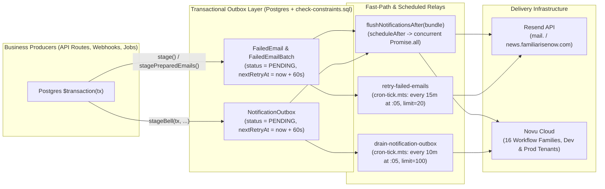
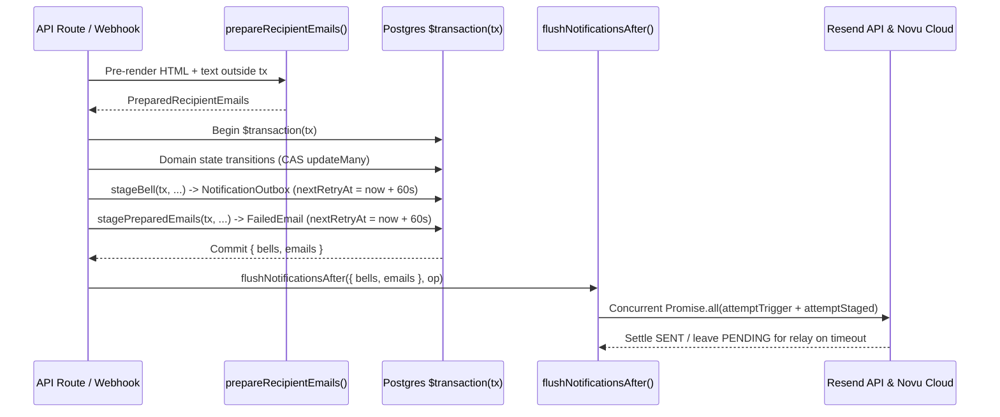
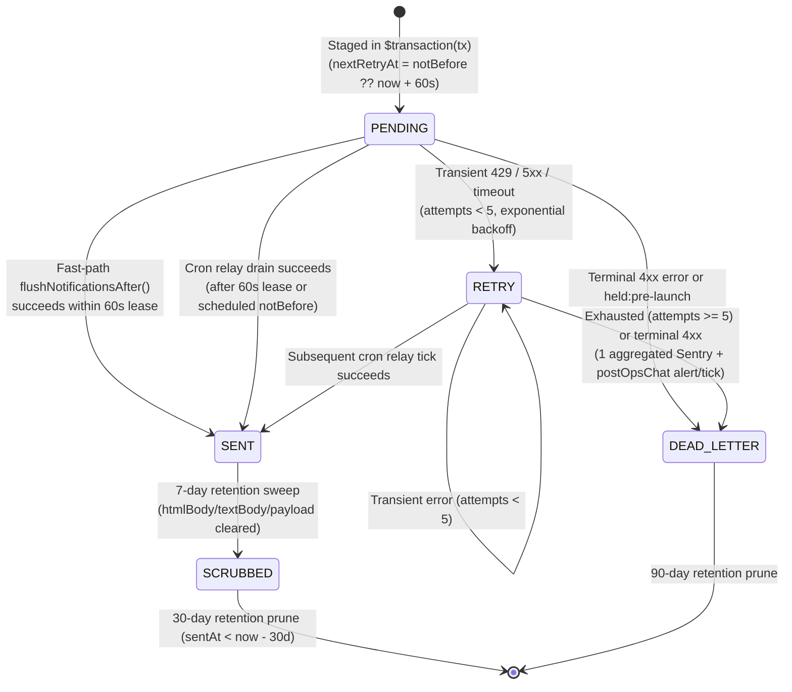
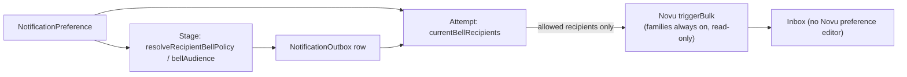
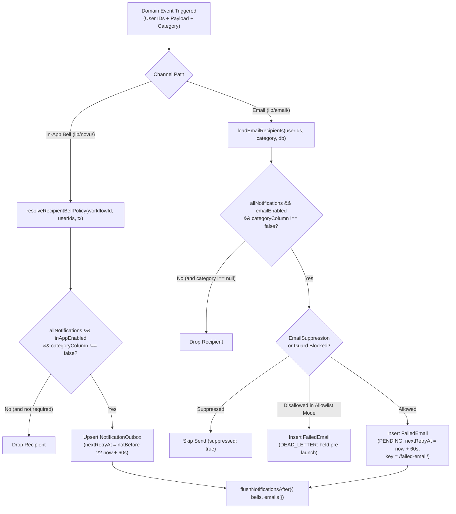
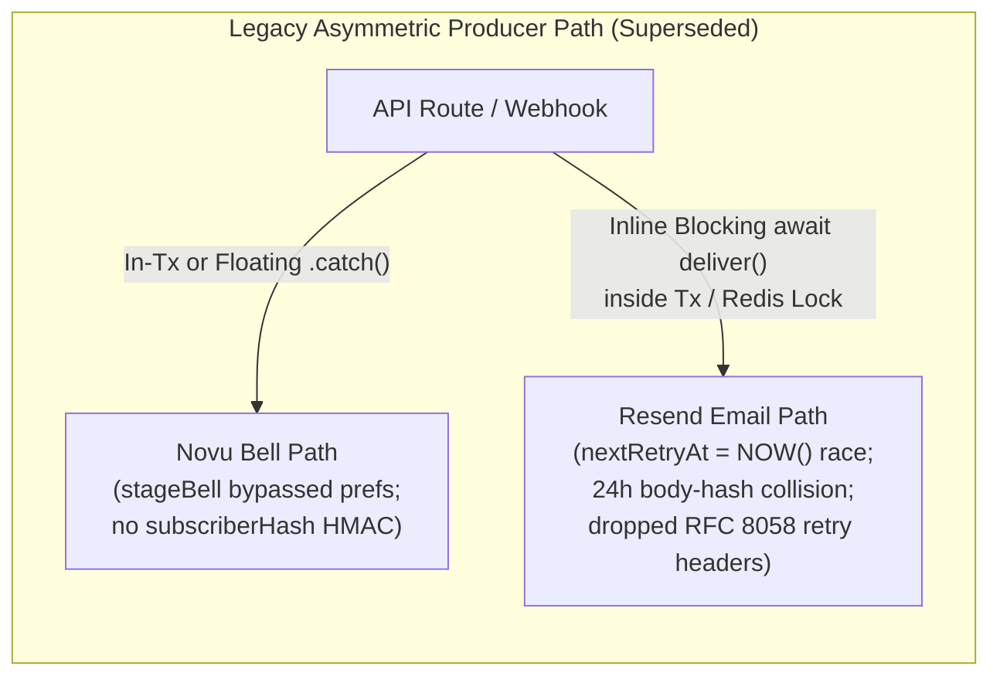

# Notification Architecture

> End-to-end architecture for outbound transactional/lifecycle email (`lib/email/`) and multi-tenant Novu in-app feed orchestration (`lib/novu/`), including transactional outbox staging, 60-second inline lease protection, concurrent post-response flushing, stateless RFC 8058 unsubscribes, subscriber security, and scheduled relays.

**Last Updated**: 2026-11-07

---

## 1. Dual-Provider Split & Channel Parity

Familiarise separates email delivery from in-app notification feed orchestration while sharing a single source of truth for user preferences and transactional outbox durability:

| Service    | Role                                              | Active Channels         | Outbox Table(s)                   | Relay Target & Ticker Schedule                           |
| ---------- | ------------------------------------------------- | ----------------------- | --------------------------------- | -------------------------------------------------------- |
| **Resend** | Outbound transactional, ops & newsletter delivery | Email (`mail.`/`news.`) | `FailedEmail`, `FailedEmailBatch` | `retry-failed-emails` (every **15m** at **`:05`**)       |
| **Novu**   | Real-time in-app notification feed & inbox        | In-App Feed (WebSocket) | `NotificationOutbox`              | `drain-notification-outbox` (every **10m** at **`:05`**) |



### High-Level Design (ASCII Architecture)

```text
+=============================================================================================+
|                 PRODUCERS (API Routes, Webhooks, Server Actions, Cron Jobs)                 |
+=============================================================================================+
   |
   |  Phase 0 (High-Contention Serializable Tx Only: Payment Webhooks & Invoice Rollup):
   |  - Pre-render React Email HTML/Plaintext OUTSIDE tx (`prepare*Email` -> `renderEmail()`)
   v
+---------------------------------------------------------------------------------------------+
|                   PHASE 1: ATOMIC POSTGRES `$transaction(tx)` (`PG_POOL_MAX=1`)             |
|                                                                                             |
|  1. Domain State Mutation (CAS `updateMany` with expected prior status in `WHERE`)          |
|  2. `stageBell(tx, ...)` -> `resolveRecipientBellPolicy(tx)` filters opted-out users       |
|     and upserts one `NotificationOutbox` row per event (SINGLE, or MULTI <= 100):           |
|     - `status = 'PENDING'`, `nextRetryAt = notBefore ?? NOW() + 60s`                        |
|     - Deterministic `transactionId = <workflowId>:<sha256[:32]>` + `NotificationScope`      |
|  3. `stage*Email(tx, ...)` / `stagePreparedEmails(tx, ...)` writes `FailedEmail`:           |
|     - Enforces `EMAIL_DELIVERY_MODE` guard + `EmailSuppression` + `NotificationPreference`  |
|     - `status = 'PENDING'`, `nextRetryAt = NOW() + 60s` (`INLINE_ATTEMPT_LEASE_MS`)         |
|     - Row-scoped Resend key: `Idempotency-Key = <EMAIL_TYPE>/failed-email/<row.id>`         |
+---------------------------------------------------------------------------------------------+
   |
   +---------------------------------------------+--------------------------------------------+
   | FAST PATH (0ms HTTP Latency Overhead)       | DURABLE FALLBACK RELAY (`cron-tick.mts`)   |
   v                                             v
+------------------------------------------+  +-----------------------------------------------+
| PHASE 2: `flushNotificationsAfter()`     |  | PHASE 3: Scheduled Outbox Drains              |
| - Uses Next.js `after()` (`scheduleAfter`)|  | - `withCronLock` (`SystemJobExecution` lease) |
|   after HTTP response is sent (or inline |  | - `drain-notification-outbox` (10m @ `:05`)   |
|   in CLI/cron/Jest).                     |  | - `retry-failed-emails` (15m @ `:05`):        |
| - Concurrent `Promise.allSettled`:       |  |   reconstructs RFC 8058 `List-Unsubscribe`    |
|   `attemptTrigger` + `attemptStaged`     |  |   headers via `reconstructUnsubscribeHeaders` |
| - Marks `SENT` on 2xx; leaves `PENDING`  |  | - Per-tick aggregated Sentry + `postOpsChat`  |
|   or `RETRY` (backoff) on failure.       |  |   when rows enter `DEAD_LETTER`; `policy:`    |
|                                          |  |   skips never alert. Urgent workflows first.  |
+------------------------------------------+  +-----------------------------------------------+
                     \                                       /
                      v                                     v
        +----------------------------+       +-------------------------------+
        | Novu Cloud (16 Families)   |       | Resend API (`mail.` / `news.`)|
        | -> `<Inbox />` WebSocket   |       | -> Svix Webhook (`EmailEvent`)|
        |    (`subscriberHash` HMAC) |       |    + `EmailSuppression` sync  |
        +----------------------------+       +-------------------------------+
```

### Channel Parity Across Lifecycle Flows

Every multi-channel user lifecycle event maintains full channel parity across `lib/email/` and `lib/novu/`:

| Domain                 | Events                                                                                               | Email Path (`lib/email/`)                                                 | In-App Bell Path (`lib/novu/`)                                           |
| ---------------------- | ---------------------------------------------------------------------------------------------------- | ------------------------------------------------------------------------- | ------------------------------------------------------------------------ |
| **Auth & Security**    | Signup welcome, verification OTP, password reset/changed, 2FA/passkey/backup-code changes            | Direct via `deliver()` (`senders/security.ts`, `account-lifecycle.ts`)    | Novu (`account` family — `ACCOUNT_SECURITY_NOTICE`)                      |
| **Enterprise SSO**     | SSO provider submitted, approved, rejected, revoked, or deleted                                      | `senders/sso.ts` (staged `SsoProviderEmail`)                              | `notifyOrgSso*` (`org_security` / `org-membership` family)               |
| **Bookings & Trials**  | Booked, cancelled, rescheduled, partially scheduled, booking requests, trial scheduled, reminders    | `senders/booking.ts` (`stageAppointmentBookedEmail`, etc.)                | `notifyAppointment*`, `notifyTrial*`, `notifyBookingRequest*`            |
| **Payments & Payouts** | Payment link, payment success/failed, refund processed/failed, consultant payout status, disputes    | `lib/payments/webhooks/staged-emails.ts`, `senders/money.ts`              | `notifyPayment*`, `notifyRefund*`, `notifyPayout*`, `notifyDispute*`     |
| **Organizations**      | Created, invitations, welcome, role changed/removed, expert removed, billing, dunning, wallet, seats | `senders/onboarding.ts`, `senders/money.ts` (`ORG_BILLING_RECEIPT`, etc.) | `lib/novu/org-workflows.ts` (all 24 helpers stamp `NotificationScope`)   |
| **Support & Trust**    | Ticket received/replied/updated, review received, moderation outcomes, account suspension/ban        | `senders/people.ts` (`SUPPORT_TICKET_*`, `ACCOUNT_SUSPENDED`/`BANNED`)    | `notifySupportTicket*`, `notifyReview*`, `notifyAccountSuspended/Banned` |

---

## 2. Transactional Outbox Lifecycle & `flushNotificationsAfter` Fast-Path

To guarantee atomicity with domain writes while strictly respecting `PG_POOL_MAX=1` connection budgets, multi-channel producers execute in three phases:

1. **Phase 0 — Pre-Render Outside `Serializable` `$transaction`**:
   - Money and moderation transactions render React Email (`renderEmail` in `lib/email/render.ts`) before opening `prisma.$transaction`, so no CPU-bound render holds the connection: `handlePaymentSuccess` (receipt and booked notices), `handlePaymentFailure`, the app refund (`refundPayment`), an explicit-amount internal refund, `reconcile-pending-refunds`, `dunning` and the staff moderation action (`prepareModerationNotices`). `invoice-rollup` stages its receipt after commit. Each calls the sender's `prepare*Email(args)` (built on `prepareBuiltSpec` in `lib/email/senders/shared.ts`) and passes the result to `stage*Email(tx, args, pre)`, which stages through `stagePreparedEmails` and renders nothing. A pre-render carries a key of the arguments that produced it; when the arguments built inside `tx` differ (a roster changed, an occurrence moved), the stager renders inside `tx` instead.
   - Producers whose inputs exist only inside the transaction (a restored credit amount, the payer a refund or dispute webhook reads, payout and invoice-settlement reads under their CAS) still render inside `tx`. A render failure there stages nothing and never throws, because `prepareRecipientEmails` catches it; it can never roll back the business write.
   - A required notice (`traceRenderFailure: true` on its spec: refund processed and failed, the payment receipt, organisation billing receipts, the dunning overdue email, the consultant and organisation payout status emails and the organisation payout-failed email) whose render fails stages a body-less `FailedEmail` `DEAD_LETTER` row with `lastError` `review:render_failed` (`stageRenderFailure`, `lib/email/deliver.ts`) instead of a Sentry event. Needs attention and the ops digest count it; replay refuses it (`render_failed`, `lib/email/replay-policy.ts`).
   - Standard low-contention interactive routes stage directly inside `tx` via `stage*Email(tx, ...)` + `flushNotificationsAfter`, while bulk loops (`assignments`, `session-outcome-sweep`) stage and render after commit so per-item transactions stay short.
2. **Phase 1 — Atomic Outbox Staging Inside `$transaction(tx)`**:
   - **Emails**: `stage()` / `stagePreparedEmails(tx, prepared)` (`lib/email/deliver.ts`) evaluates `EMAIL_DELIVERY_MODE` and `EmailSuppression` on `tx`, writes `FailedEmail` with `status: "PENDING"` and `nextRetryAt: new Date(Date.now() + 60_000)`, and generates a row-scoped `Idempotency-Key: <EMAIL_TYPE>/failed-email/<row.id>`.
   - **Reads before the transaction, one insert inside it**: the free trial request (`lib/trials/schedule-notices.ts`) reads its bell recipients, preferences and zones in one joined query (`bellRecipientZones` in `lib/novu/policy.ts`) and its suppressions in one query (`screenPreparedEmails`) before `$transaction`, then stages both bells with one `createManyAndReturn` (`stagePreparedBells`, `stageTriggerBatch`) and both emails with another (`stageScreenedEmails`). The rows still commit or roll back with the booking; `attempt()` rechecks the suppression before it sends. A bell row already staged under its `transactionId` is skipped and left to the relay.
   - **In-App Bells**: `stageBell(tx, args)` (`lib/novu/stage-bell.ts`) queries `tx.user.findMany` via `resolveRecipientBellPolicy`, filters out recipients who opted out (`allNotifications: false`, `inAppEnabled: false`, or muted category column) unless the template is marked `required: true` (security, account, verification, moderation and compliance notices, which only erasure stops) or the send passes `required` (a notice about a change someone else made to the booking, written to the row as `payload.requiredNotice` so the first attempt honours it too; see [02-workflows-and-api.md](./02-workflows-and-api.md#required-notices-about-changes-someone-else-makes)), and upserts `NotificationOutbox` with `status: "PENDING"` and `nextRetryAt: notBefore ?? NOW() + 60s` (`INLINE_ATTEMPT_LEASE_MS`); `notBefore` is set only by a producer that schedules the notification. If every recipient opted out, `stageBell` returns `null` without writing an outbox row.
   - **Bell attempt** (`attemptTrigger`, `lib/novu/outbox.ts`): a row is sent in generations. A generation's first attempt rechecks current policy (`currentBellRecipients`, including `erasedAt`) and freezes the allowed recipients into the row in the same conditional update that stamps `firstAttemptAt`. No recipient left dead-letters the row as `policy:audience_revoked` (expected, never alerted); a failed policy read leaves the row for a later attempt and never sends. Each attempt makes one Novu request for the first 100 frozen recipients, one event each under `<transactionId>:<sha256(recipient)[:16]>`: one recipient goes through `novu.trigger` (1 rate-limit token), more through `novu.triggerBulk` (100 tokens per request). The Idempotency-Key hashes `firstAttemptAt`, the recipients and the wire payload: `<recipient transactionId>:<digest>` or `<transactionId>:bulk:<digest>`.
     - **Unknown outcome** (timeout, network error, 5xx, `409` key in flight, `429`, an unreadable 2xx): the row retries with the same recipients and anchor, so the resend is byte-identical under the same key and Novu answers from its idempotency cache instead of ringing anyone twice. This was measured on 2026-11-07 in Novu Development: the relay, run locally against the disposable `localhost/ci` database with the Development key, triggered twice under one Idempotency-Key and Novu produced exactly one notification. Soft opt-outs are not re-read, but an erased or deleted user is always dropped even though that changes the body and key. A `429` waits at least its `Retry-After` (else `RateLimit-Reset`), and the relay starts no further wave that tick.
     - **Definitive response**: accepted recipients leave the row and the generation ends: `firstAttemptAt` and `lastError` return to null, so the next attempt rechecks policy and sends under a new key (Novu caches error responses for 24 h, so a reused key would replay the refusal). Retryable refusals (`error`, or a status the client does not know) stay. Terminal refusals (`trigger_not_active`, `invalid_recipients`, workflow not found, ...) move, in the same transaction, to their own `DEAD_LETTER` row (`<transactionId>:terminal:<digest>`, same workflow and payload; the digest is the first 16 hex characters of a sha256 over the sorted refused recipients, from `terminalSplitRow` in `lib/novu/outbox.ts`), so they stay in Needs attention after the rest succeed. These writes require the anchor the sent key was built on. A duplicate `transactionId` counts as delivered. The row is `SENT` when nothing is left and nothing was refused, and `DEAD_LETTER` when only terminal refusals are left. A row over 100 recipients sends its next 100 as a new generation on the following attempt without spending a retry.
     - `firstAttemptAt` older than 23 h dead-letters the row as `review:provider_acceptance_unknown` (Novu's idempotency cache lasts 24 h). Every status write is conditional on `PENDING`/`RETRY`, so nothing overwrites `SENT`.
   - **Step failures after acceptance.** A Novu in-app step can still fail _after_ Novu accepted the trigger; the empty-redirect failure was one, now prevented by `FALLBACK_HREF` (`lib/novu/templates/index.ts`). The parent row stays `SENT`, because the step already ran in Novu and Novu never re-runs a transactionId. The `novu-step-failure-probe` job (`jobs/notifications/novu-step-failure-probe.ts`) reads Novu's activity feed every 2 hours over a 4-hour window, inside the 24 hours that Free keeps it. For each failed in-app job whose per-recipient transactionId maps back to a row, it inserts one `SINGLE` `DEAD_LETTER` sibling (`<row>:stepfailed:<recipient hash>`) with `lastError` `review:novu_step_failed: <detail> (<code> at <paths>)`. Needs attention and the ops digest count it (decision 16 of `docs/decisions/2026-11-06-notification-single-preference-owner.md`). A failure older than 24 hours, for example one from a stretch when the ticker was down, is gone from Novu and cannot be recovered.
   - **Email settles are conditional too.** Every status write on `FailedEmail` and `FailedEmailBatch` is an `updateMany` filtered on `status: UNSETTLED` (`PENDING` or `RETRY`, from `lib/retry/provider-window.ts`): `settleRow` in `lib/email/deliver.ts`, the relay in `jobs/email/retry-failed-emails.ts` and `settleBatch` in `app/api/admin/newsletter/broadcast/route.ts`. A writer that lost a race to another attempt matches no row, is skipped and is not counted, so a late writer cannot overwrite `SENT`.
     - The `firstAttemptAt` anchor is claimed with a conditional update before any Novu request and is reset together with `lastError`, so a row with an error but no anchor was never sent and goes out normally.
3. **Phase 2 — Post-Commit Concurrent Dispatch via `flushNotificationsAfter`**:
   - After `$transaction` commits, `flushNotificationsAfter({ bells, emails }, op)` (`lib/novu/stage-then-attempt.ts`) schedules wire delivery through `scheduleAfter` (`lib/api/after-safe.ts`).
   - Inside a Next.js App Router request context, `scheduleAfter` registers the batch on Next.js `after()` (`waitUntil`) so the HTTP response returns immediately while `attemptTrigger(row)` and `attemptStaged(entry.rows, entry.emailType, budgetMs)` run concurrently in `Promise.all` with individual `.catch()` error isolation.
   - Outside a Next.js request scope (CLI jobs, cron workers, unit tests), `after()` throws and `scheduleAfter` seamlessly executes and settles the batch inline before resolving.



### Low-Level Design: 3-Phase Execution & Lease Timeline (ASCII)

```text
t = 0ms      [Phase 0: Outside Tx]  prepareRecipientEmails() renders React Email SSR HTML + text in memory
t = 15ms     [Phase 1: Inside Tx]   BEGIN $transaction(tx)
t = 20ms                            CAS domain write (e.g., Payment.updateMany WHERE status = PENDING)
t = 28ms                            stageBell(tx) -> upsert NotificationOutbox (nextRetryAt = t + 60,000ms)
t = 35ms                            stagePreparedEmails(tx) -> insert FailedEmail (nextRetryAt = t + 60,000ms)
t = 40ms                            COMMIT $transaction(tx)
t = 41ms     [HTTP Response Sent]   scheduleAfter() registers post-response callback; caller receives 200 OK
t = 42ms     [Phase 2: Fast-Path]   Promise.allSettled([attemptTrigger(), attemptStaged()])
t = 180ms                           2xx from Novu & Resend -> rows transition PENDING -> SENT (sentAt = now)
             ...
t > 60,000ms [Phase 3: Cron Relay]  If Phase 2 timed out or container froze before t = 180ms, inline lease
                                    expires (nextRetryAt <= now) and cron-tick.mts claims & retries the row.
```

### Outbox Row State Machine (`NotificationOutbox`, `FailedEmail` & `FailedEmailBatch`)



---

## 3. Email Layer Architecture (`lib/email/`)

### Module Structure

```text
lib/email/
├── config.ts             -- SENDERS getters, EMAIL_BUDGET_MS, domain/mailbox helpers
├── deliver.ts            -- deliver() = stage() (60s inline lease) + attempt(); getResendClient()
├── idempotency.ts        -- idempotencyKeyFor(msg, type, rowId) -> "<TYPE>/failed-email/<rowId>"
├── unsubscribe.ts        -- HMAC link tokens, RFC 8058 headers & stateless reconstructUnsubscribeHeaders()
├── preferences.ts        -- loadEmailRecipients() gating on NotificationPreference & routingMode
├── suppression.ts        -- EmailSuppression lookup & email normalisation
├── delivery-guard.ts     -- Pre-launch EMAIL_DELIVERY_MODE allowlist guard
├── classify.ts           -- Credential body redaction & terminal error classification
├── render.ts             -- Single-pass renderEmail() wrapped in OTel email.render span
├── send-to-recipients.ts -- prepareRecipientEmails(), stagePreparedEmails(), screenPreparedEmails() + stageScreenedEmails(), sendToRecipients(), attemptStaged()
└── senders/
    ├── shared.ts         -- Formatting helpers & declarative sender builders
    ├── booking.ts        -- Booking & trial lifecycle email senders
    ├── money.ts          -- Refunds, payouts, disputes & org billing email senders
    ├── onboarding.ts     -- Verification & organization onboarding senders
    ├── people.ts         -- Support tickets, reviews, moderation & mandatory account notices
    ├── security.ts       -- 2FA, passkey & backup code security notices
    └── sso.ts            -- Enterprise SSO provider lifecycle notices
```

### Inline Send Budgets (`EMAIL_BUDGET_MS`)

| Budget                   | Timeout (ms) | Callers                                                                 |
| ------------------------ | ------------ | ----------------------------------------------------------------------- |
| `AUTH`                   | `8,000`      | Auth hooks (welcome, verification code, password reset, account linked) |
| `CONTACT_AND_NEWSLETTER` | `5,000`      | Contact inquiry form and newsletter double opt-in / welcome             |
| `WEBHOOK`                | `3,000`      | Payment & capture webhook inline email sends                            |
| `JOB`                    | `10,000`     | Background cron jobs and `runEmailRetryTick` relay sends                |
| `REQUEST`                | `5,000`      | Interactive API routes dispatching lifecycle emails inline              |
| `LIFECYCLE`              | `5,000`      | Default budget for `flushNotificationsAfter` email bundles              |

### Stateless RFC 8058 Unsubscribe & Link-Scanner Protection

1. **Stateless Token Signing (`lib/auth/link-signing.ts`, used by `lib/email/unsubscribe.ts` and `lib/newsletter/tokens.ts`)**:
   - Lifecycle unsubscribe URLs (`/api/notifications/unsubscribe?u=<userId>&t=<token>`) and newsletter unsubscribe URLs (`/api/newsletter/unsubscribe?email=<email>&token=<token>`) use timeless HMAC signatures under one link key derived from `BETTER_AUTH_SECRET`, with distinct purposes so tokens never expire in older emails and cannot be replayed across subsystems. Rotating `BETTER_AUTH_SECRET` voids every link already sent.
2. **Stateless Retry Header Reconstruction (`reconstructUnsubscribeHeaders`)**:
   - Because `FailedEmail` stores rendered HTML/text without a separate JSON headers column, `reconstructUnsubscribeHeaders(row)` inspects the persisted message body during `runEmailRetryTick`.
   - If the body contains `/api/notifications/unsubscribe?u=...`, it rebuilds `List-Unsubscribe` + `List-Unsubscribe-Post: List-Unsubscribe=One-Click` for that user ID; if it contains `/api/newsletter/unsubscribe`, it rebuilds the newsletter one-click headers for `row.recipient`; if `category === null` (mandatory account notices such as suspension/ban), it returns `undefined`.
3. **Link-Scanner Safe `GET` vs. One-Click `POST`**:
   - **Lifecycle (`/api/notifications/unsubscribe`)**: `GET` performs zero DB writes and returns a `303` redirect to `/email/unsubscribe`; `POST` verifies the HMAC token, sets `emailEnabled: false` on `NotificationPreference` (leaving in-app notifications untouched), and makes no vendor call.
   - **Newsletter (`/api/newsletter/unsubscribe`)**: `GET` performs zero DB writes and renders a self-contained HTML confirmation page with a `<form method="post">`; `POST` executes immediate one-click opt-out (`unsubscribe({ email, token })`), preventing corporate mail link scanners from silently unsubscribing users on prefetch.

### Sending Domains & DMARC Alignment

- **Sending Subdomains**: `mail.familiarisenow.com` (transactional/ops) and `news.familiarisenow.com` (newsletter) use verified Resend DKIM keys (`resend._domainkey.mail` / `.news`) and Return-Path SPF/MX alignment (`send.mail` / `send.news` -> `ap-northeast-1` SES).
- **DMARC**: The live `_dmarc` record is `v=DMARC1; p=none; rua=mailto:connect@practitionist.com; fo=1`. The policy tightens to `quarantine` and then `reject` after about two weeks of reports. The apex also publishes SPF `v=spf1 -all`. The full record list is in [Domains and DNS records](../deployment/README.md#domains-and-dns-records).
- **Send-only product domain**: `familiarisenow.com` is send-only (Resend): it publishes a null MX (`0 .`, RFC 7505), so nothing sent to an address on it arrives. Every inbound address is `connect@practitionist.com` through `SUPPORT_EMAIL` in `lib/company.ts`.

---

## 4. Novu Layer & Subscriber Security (`lib/novu/`)

### Tenant Isolation & Subscriber HMAC Authentication

- **Environment Resolution (`lib/novu/secret-key.ts`)**: Production traffic (`NEXT_PUBLIC_SENTRY_ENVIRONMENT=production`) uses `NOVU_PRODUCTION_KEY`; previews, branch deploys, and local development use `NOVU_DEVELOPMENT_KEY`.
- **HMAC Subscriber Authentication (`computeSubscriberHash`)**: `lib/novu/subscriber.ts` computes deterministic HMAC-SHA256 hex digests (`createHmac("sha256", key).update(subscriberId).digest("hex")`) returned by `POST /api/novu/subscriber` so `<Inbox />` authenticates real-time WebSocket inbox connections without exposing subscriber feeds to enumeration.
- **Inbox mounts after the hash request settles (`resolveInboxAuth`)**: `POST /api/novu/subscriber` only signs the session user's id; it makes no Novu call and sends no profile data, because Novu creates the subscriber on the first Inbox session or trigger. `NotificationInbox` waits for it before rendering `<Inbox />`, so the first connection already carries `subscriberHash`. Mounting earlier sent hash-less requests that Novu answers with 400 "valid HMAC hash" wherever the in-app integration enforces HMAC. `NotificationInbox` is the only component that opens a Novu session; there is no app-wide `NovuProvider`. Previews pair the Development application identifier with `NOVU_DEVELOPMENT_KEY`, and production pairs the Production identifier with `NOVU_PRODUCTION_KEY`; the hash is only valid with the secret of the environment that owns the identifier.
- **The bell announces its unread count through the trigger's name.** Novu exposes the count only inside `renderBell`, so a small `UnreadReporter` effect in `NotificationInbox` lifts it into state, and the trigger button's `aria-label` reads "Notifications, 3 unread" (or "Notifications" at zero). The red count badge is `aria-hidden`, because a nested label inside a labelled button is never announced, and it uses `bg-red-600` so white text meets WCAG AA contrast (4.83:1).
- **Erasure**: `deleteSubscriber` removes the Novu subscriber and its feed; it never throws and reports whether Novu acknowledged the delete.

### Single Preference Owner: Postgres Decides, Novu Delivers



- **One copy of the flags.** `NotificationPreference` in Postgres is the only preference state, for every user, workspace operators included. `PUT /api/novu/preferences` and the one-click unsubscribe each make one database write and no Novu call; the change applies to the next notification because both gates read Postgres.
- **The server is the only gate.** A bell is filtered when it is staged and again at the first attempt of each generation (`currentBellRecipients`), which freezes the allowed set so a retry after an unknown outcome resends exactly that set, minus erased users, under the same Idempotency-Key.
- **Novu is a plain in-app transport.** `toFamilyDto` writes every family with no step condition and with `preferences.user` and `preferences.workflow` set to `{ all: { enabled: true, readOnly: true }, channels: { in_app: { enabled: true } } }` (`FAMILY_PREFERENCES`), so subscribers cannot mute a family in Novu. `npm run novu:check` reports live subscriber-editable preferences or a leftover `skip` control as drift. `NotificationInbox` renders `InboxContent` with `hideNav`, which removes Novu's preference page; preferences live only in Settings.
- **Native mutes are gone.** Novu holds no preference state: the families sync always-on and read-only. Mutes that users had saved on Novu's old preference page were reset once per environment, and on Production the dry run on 2026-11-08 found none across 86 subscribers. The reset script is deleted (see Deprecated & Superseded Approaches).
- **Announcements fan out through the same policy.** An inbox post is opt-in on create (`postToInbox`). The create transaction reads the audience with `bellAudience` and stages it with `stagePages` as `MULTI` rows of at most 100 recipients keyed `announcement:<id>:page:<n>`; a post over `MAX_BELL_AUDIENCE` (2,000) candidate users is refused. The create dialog first shows the eligible count (`GET /api/announcements/audience`, same `announcements.manage` permission) and asks the admin to confirm that each recipient uses one Novu workflow run. The staging takes no advisory lock: each post is keyed `announcement:<id>`, which is unique per create. The create transaction runs with `timeout: 15_000, maxWait: 5_000`. There are no maintenance bells: the `DEGRADED` banner and the `OFFLINE` maintenance page cover the live state, and advance notice goes out as an announcement.
- **Novu quota.** Every recipient of every bell is one Novu workflow run. The plan is assumed to be Free (10,000 runs a month, counted across Development and Production together, `.claude/skills/billing-guardrails/references/novu.md`), so `MAX_BELL_AUDIENCE` keeps one fan-out to a fifth of the month. The plan is to upgrade once monthly runs pass about 60 %.

### Preference Channels & Categories

Both `resolveRecipientBellPolicy` (for in-app bells) and `loadEmailRecipients` (for emails) read the same `NotificationPreference` row and category columns (`EMAIL_CATEGORY_COLUMN`):

- **Channels**: `allNotifications` (the master switch) and `inAppEnabled` gate bells; `allNotifications` and `emailEnabled` gate optional email. These are the only channel controls; a workspace operator has no separate setting.
- **Category Columns (`NotificationPreference`)**: `appointmentReminders` (`appointments`), `paymentNotifications` (`payments`), `subscriptionAlerts` (`subscriptions`), `trialNotifications` (`trials`), `supportUpdates` (`support`), `feedbackAlerts` (`feedback`), `orgBillingAlerts` (`orgBilling`), `orgMembershipAlerts` (`orgMembership`), and `orgProgramAlerts` (`orgProgram`).

### Low-Level Policy & Delivery Guard Flowchart



---

## 5. Scheduled Relays, Sidecar Indexes & Observability

### Phase-Staggered Ticker Cadences (`netlify/functions/cron-tick.mts`)

| Relay Target                | Ticker Interval & Phase Offset    | Per-Tick Limit & Timeout | Pacing / Concurrency                                                                         |
| --------------------------- | --------------------------------- | ------------------------ | -------------------------------------------------------------------------------------------- |
| `drain-notification-outbox` | Every **10m** at offset **`:05`** | `limit=100`, `24_000 ms` | Urgent workflows first; first-row probe + `DRAIN_CONCURRENCY = 5`; no wave starts after 12 s |
| `retry-failed-emails`       | Every **15m** at offset **`:05`** | `limit=20`, `20_000 ms`  | Sequential `SEND_GAP_MS = 125 ms` pacing                                                     |
| `novu-step-failure-probe`   | Every **2h** at offset **`:10`**  | no `limit`, `20_000 ms`  | 4 h window, 50 events a page, at most 10 pages; no page starts after 10 s; stops on a `429`  |

The probe is not a relay: it reads Novu's activity feed and takes a fail-open lease (`failMode: "open"`), because its only writes are idempotent dead-letter inserts.

The two relays acquire fail-closed Postgres leases (`withCronLock(..., { failMode: "closed" })`) enforced by `SystemJobExecution_running_jobName_key` in `prisma/sql/check-constraints.sql`, and scan active rows using partial indexes in `prisma/sql/check-constraints.sql`:

- `FailedEmail_active_outbox_idx`: `ON "FailedEmail" ("nextRetryAt" ASC NULLS FIRST) WHERE "status" IN ('PENDING', 'RETRY')`
- `FailedEmailBatch_active_outbox_idx`: `ON "FailedEmailBatch" ("nextRetryAt" ASC NULLS FIRST) WHERE "status" IN ('PENDING', 'RETRY')`
- `NotificationOutbox_active_outbox_idx`: `ON "NotificationOutbox" ("nextRetryAt" ASC NULLS FIRST, "notBefore") WHERE "status" IN ('PENDING', 'RETRY')`
- `FailedEmail_sent_unscrubbed_updatedAt_idx`: `ON "FailedEmail" ("updatedAt") WHERE "status" = 'SENT' AND ("htmlBody" <> '' OR "textBody" IS NOT NULL)`

### Per-Tick Aggregated Telemetry & Sentry Quota Discipline

To protect the 5,000/month Sentry error quota:

- Neither `runEmailRetryTick` nor `runNotificationDrainTick` emits per-row `Sentry.captureMessage` or `Sentry.captureException` calls inside row processing loops.
- `runEmailRetryTick` collects terminal and exhausted row failures into a per-tick `alerts` map keyed by reason/type, emits deduplicated alerts after the loop with `tags: { subsystem: "email", outbox_dead_letter: "true" }`, records the `email.outbox.dead_letter` gauge, and posts a single summary alert via `postOpsChat`.
- `runNotificationDrainTick` suppresses per-row Sentry reports (`suppressSentry: true`), emits one summary `Sentry.captureException` per failing tick, records `notifications.outbox.pending` and `notifications.outbox.dead_letter` gauges, and posts a summary alert via `postOpsChat`. Expected skips (`policy:` dead letters) are excluded from the alert, the gauge, the ops digest and Needs attention (`DEAD_LETTER_BELL_WHERE` in `lib/backoffice/queue-predicates.ts`).

---

## Deprecated & Superseded Approaches

```text
+=======================================================================================+
|                LEGACY ASYMMETRIC DUAL-PATH HLD (Pre-Outbox Unification)               |
+=======================================================================================+
  [API Route / Webhook / Cron]
     |
     +---> PATH A: In-App Bell (`lib/novu/`)
     |       - Some routes staged `NotificationOutbox`; `handlePaymentSuccess` called
     |         `notify*` post-commit outside `tx` (lost on container freeze).
     |       - `stageBell(tx)` bypassed `NotificationPreference` & `notificationRoutingMode`.
     |       - `<Inbox />` connected without `subscriberHash` HMAC verification.
     |
     +---> PATH B: Email (`lib/email/` -> Resend)
             - React SSR ran inside `Serializable` `tx` or blocked routes for 5-23s
               while holding Redis `lockConsulteeBooking` / `lockSlotBooking` mutexes.
             - `FailedEmail` stamped immediate `nextRetryAt: NOW()` (cron race) + hashed
               `to+subject+html` (24h Resend idempotency cache dropped repeat notices).
             - `retry-failed-emails` dropped RFC 8058 `List-Unsubscribe` headers on retry,
               while `GET /api/waitlist/unsubscribe` mutated DB state on bot prefetch.
```



- **Removed Accidental Operational Asymmetries**:
  - **Post-Commit Fire-and-Forget vs. In-Tx SSR**: Replaced mixed staging with `prepareRecipientEmails` outside `tx`, atomic `stage()` + policy-aware `stageBell(tx, ...)` (`60s` inline lease) inside `tx`, and `flushNotificationsAfter` concurrent settlement.
  - **Required notices that rolled back their claim**: `stageSpecRequired` rendered the dunning email inside the claim and threw on a render failure, so a broken template rolled the claim back on every run. It is replaced by the pre-render and the `review:render_failed` trace row (decision 15); `stageToRecipients`, the render-inside-`tx` stager, is deleted.
  - **24h Body-Hash Key Collisions & Stripped Retry Headers**: Replaced payload hashes with `<EMAIL_TYPE>/failed-email/<row.id>` keys, stateless `reconstructUnsubscribeHeaders(row)`, and a confirmation-only `GET` on the newsletter unsubscribe route (now `/api/newsletter/unsubscribe`).
- **Intentionally Retained Vendor-Plane Split (Novu In-App vs. Direct Resend Email)**:
  - Outbound emails are **not** routed through Novu's email step so transactional notices never depend on a second vendor's multi-tenant queue availability, bypass Novu's 20-workflow plan cap across 45+ React Email templates, and preserve native `resend.batch.send` throughput and `EmailEvent` Svix telemetry.

- **Novu preference mirror and step conditions (removed)**: preference changes and every dashboard session copied the flags (and email, phone and name) onto the Novu subscriber's `data`, and each family's in-app step carried a `skip` rule over those flags (`inAppSkipRule`). The server already rechecked Postgres before every trigger, so the mirror could only drop a bell the server had approved, while the outbox recorded it as `SENT`. Delete any residual `subscriber.data` reads, `syncSubscriber`/`updateSubscriberPreferences` calls or `skip` controls.
- **Announcement and maintenance broadcasts (removed)**: announcements and maintenance notices were Novu broadcasts to every subscriber, gated only by the mirror (and, once it was gone, by nothing). Announcements now fan out per audience page through bell policy, opt-in; the maintenance bells (`maintenance-scheduled`, `maintenance-started`, `maintenance-ended`, `stageMaintenanceBells`) are deleted because no window is scheduled ahead and the relay is blocked while maintenance is `OFFLINE`. The `BROADCAST` outbox kind is unused. See [the decision record](../decisions/2026-11-06-notification-single-preference-owner.md).

- **In-app quiet hours (removed)**: bells were deferred to the end of a user's quiet window while the email for the same event went out at once, so the least intrusive channel was the one held back. The bell deferral and its urgent bypass are gone. The `quietHours*` columns now feed only the consultant's planning reminder (`lib/booking/week-nudge.ts`), whose email and bell wait together, as before; the settings page labels the control "Email quiet hours".

- **Workspace notification routing (removed 2026-11-07)**: `OrgWorkspaceProfile.notificationRoutingMode` was an account-wide channel gate ANDed with the personal switches. The profile belongs to one user, so it duplicated that user's In-App and Email switches; neither gate reads it now, and the column waits for the next schema batch to drop it. See decision 12 of [the decision record](../decisions/2026-11-06-notification-single-preference-owner.md).

- **Inbound Novu webhook (removed 2026-11-07)**: `POST /api/webhooks/novu` verified Svix or HMAC signatures and touched `lastError` or settled single-recipient rows. It always answered `503`, because `NOVU_WEBHOOK_SECRET` was never set. Novu's outbound webhooks are Team and Enterprise only, and `message.failed` covers provider sends, not in-app steps. The `novu-step-failure-probe` replaces it (decision 16 of [the decision record](../decisions/2026-11-06-notification-single-preference-owner.md)).

- **Inbound forwarding via ImprovMX (planned, never configured)**: root `@` MX records `mx1.improvmx.com` and `mx2.improvmx.com` were meant to deliver role addresses on `familiarisenow.com`. They were never created, and the apex now publishes a null MX. Delete any residual references.

- **Legacy outbox guards and one-time Novu scripts.** The `review:legacy_delivery_format` and `review:legacy_broadcast` dead letters in `lib/novu/outbox.ts` covered rows attempted under the earlier row-wide Novu identity; they were deleted on 2026-11-08 after a recount found no `PENDING` or `RETRY` rows. the `clear-native-mutes` script and the `scrub-subscriber-pii` script ran on Production the same day and are deleted.
