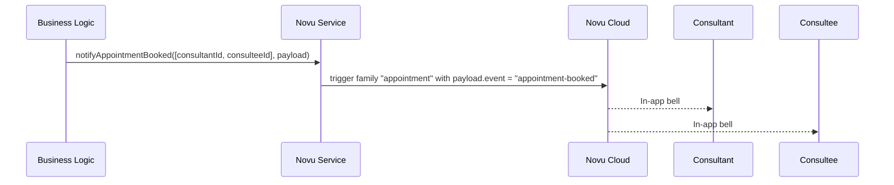
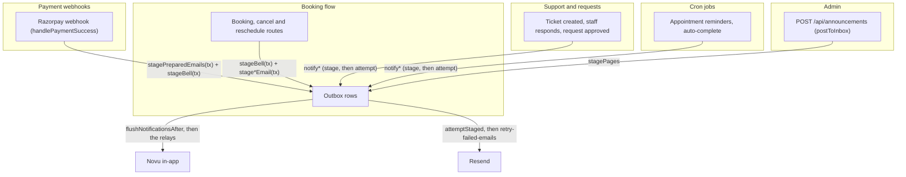

# Workflows and API Reference

## Novu Workflows Overview

All 98 event ids are defined in `lib/novu/workflows.ts` as the `NOVU_WORKFLOWS` constant, and every one is mapped to a family in `EVENT_FAMILY` (`lib/novu/templates/families.ts`). A unit test refuses an unmapped event. The event id is what application code triggers with; the Novu workflow that receives the trigger is the event's family, not a workflow with the event's name.

---

## Workflow families

The Novu plan in use caps an environment at 20 workflows, and the application has 98 events, so a Novu workflow is a family — one per audience-and-opt-out combination — rather than one per event. The event id the application triggers is unchanged; `toWire` in `lib/novu/templates/index.ts` maps it to its family and adds `payload.event`, and the family's body branches on that field with a Liquid `case`. There are 16 families. Every family is in-app only, is synced with read-only preferences and no step conditions, and is gated by the server: the "Opt-out category" column is the `NotificationPreference` switch that `lib/novu/policy.ts` checks before a bell is staged (`none` means a system notice with no switch).

| Family ID        | Opt-out category | Events | Event ids                                                                                                                                                                                                                                                                                                                                                                                |
| ---------------- | ---------------- | ------ | ---------------------------------------------------------------------------------------------------------------------------------------------------------------------------------------------------------------------------------------------------------------------------------------------------------------------------------------------------------------------------------------- |
| `appointment`    | appointments     | 17     | appointment-booked, appointment-partially-scheduled, appointment-cancelled, class-session-cancelled, class-makeup-scheduled, class-session-refunded, class-exit-available, session-no-show, session-missed-recording, window-opened, appointment-rescheduled, appointment-reminder, session-host-live, appointment-completed, new-booking-request, chat-unread-digest, event-seat-opened |
| `session-media`  | appointments     | 5      | recording-available, recording-failed, recording-removed, document-uploaded, document-reviewed                                                                                                                                                                                                                                                                                           |
| `payment`        | payments         | 4      | payment-link, payment-success, payment-failed, referral-credits-applied                                                                                                                                                                                                                                                                                                                  |
| `refund`         | payments         | 6      | refund-requested, refund-processed, refund-failed, dispute-created, dispute-updated, dispute-resolved                                                                                                                                                                                                                                                                                    |
| `payout`         | payments         | 3      | payout-processed, payout-failed, payout-clawback                                                                                                                                                                                                                                                                                                                                         |
| `referral`       | payments         | 2      | referral-bonus-earned, referee-welcome-bonus                                                                                                                                                                                                                                                                                                                                             |
| `subscription`   | subscriptions    | 4      | subscription-started, subscription-cancelled, subscription-renewed, subscription-unallocated-refunded                                                                                                                                                                                                                                                                                    |
| `trial`          | trials           | 5      | trial-session-requested, trial-session-scheduled, trial-session-completed, trial-session-cancelled, trial-refunded                                                                                                                                                                                                                                                                       |
| `support-ticket` | support          | 5      | support-ticket-created, support-ticket-received, support-ticket-activity, support-ticket-update, support-ticket-response                                                                                                                                                                                                                                                                 |
| `feedback`       | feedback         | 5      | feedback-received, moderation-report-outcome, platform-feedback-update, new-review-received, review-excluded-from-rating                                                                                                                                                                                                                                                                 |
| `account`        | none             | 7      | account-security-notice, verification-status-changed, new-consultant-application, moderation-warning, content-removed-notice, account-suspended, account-banned                                                                                                                                                                                                                          |
| `collaborator`   | appointments     | 6      | collaborator-invited, collaborator-accepted, collaborator-removed, collaborator-declined, collaborator-withdrawn, collaborator-invite-expired                                                                                                                                                                                                                                            |
| `platform`       | none             | 2      | general-announcement, compliance-deadline-alert                                                                                                                                                                                                                                                                                                                                          |
| `org-billing`    | orgBilling       | 12     | org-invoice-issued, org-invoice-paid, org-invoice-overdue, org-wallet-topup-confirmed, org-wallet-low, org-payout-completed, org-payout-failed, org-payout-reversed, org-payout-clawback, org-member-overage-timed-out, org-program-overage-due, org-contract-status-changed                                                                                                             |
| `org-membership` | orgMembership    | 9      | org-created, org-invite-sent, org-invite-accepted, org-role-changed, org-member-removed, org-expert-removed, org-sso-provider-submitted, org-sso-provider-decided, org-sso-provider-deleted                                                                                                                                                                                              |
| `org-program`    | orgProgram       | 6      | org-seat-assigned, org-seat-revoked, org-program-exhausted, org-program-cap-near, org-license-renewal-upcoming, org-data-export-ready                                                                                                                                                                                                                                                    |

The `platform` family holds only `general-announcement` and `compliance-deadline-alert`. There are no maintenance bells: a live maintenance state is shown by the `DEGRADED` banner (`components/banners/MaintenanceBanner.tsx`) and the `OFFLINE` maintenance page in the middleware, and advance notice goes out as an announcement with the opt-in inbox post.

---

## Payload conventions

The Novu templates live in this repository (`lib/novu/templates/b2c.ts` and `org.ts`) and every one of them interpolates payload fields verbatim: `{{payload.dateTime}}`, `{{payload.amountFormatted}}`, `{{payload.planTitle}}`. Whatever this codebase puts in a field is therefore the exact text a customer reads in their inbox, so raw ISO timestamps, integer counts of paise and shouted enum members must never reach a field a template prints.

The rule the whole payload layer now follows is that **a template interpolates the unit-free field name and receives a value written for a person, while the machine-readable original travels beside it under the same stem with a unit suffix**. So `dateTime` carries `Sat, 6 Sep 2026 · 7:53 AM IST` and `dateTimeIso` carries `2026-09-06T02:23:35.600Z`; `amount` carries `₹55,679.48` and `amountPaise` carries `5567948`; `appointmentType` carries `consultation` and `appointmentTypeCode` carries `CONSULTATION`. A consumer that needs to compute or branch reads the suffixed field, and a template author never has to know which of two fields is safe to print.

Call sites do not perform any of this conversion themselves. Each `notifyX` function accepts an _input_ type — `AppointmentPayloadInput`, `PaymentSuccessInput`, `RefundInput` and so on — whose fields hold the values exactly as they are stored: an ISO string, an integer number of paise, the raw Prisma enum member. The trigger boundary in `lib/novu/service.ts` (and `lib/novu/org-workflows.ts` for the organisation workflows) converts them using the helpers in `lib/novu/humanize.ts` and sends the customer-facing shape. This keeps every notification consistent, and it means a new call site cannot forget to format anything.

### Dates render in the recipient's timezone

A date is only meaningful once you know whose clock it is on, so `formatNotificationDateTime` renders in the recipient's `User.timezone`, falling back to `Asia/Kolkata` when that column is unset or holds a zone Intl cannot resolve. The rendered string always names the zone it used, so nobody has to guess.

This has a consequence for the multi-recipient helpers. `triggerForMultiple` sends one payload to a list of subscribers, which means a single rendered date can be correct for at most one of them. Any workflow whose payload carries a date is therefore dispatched through `triggerForMultipleZoned` instead: it loads every recipient's zone in one query, groups the recipients by zone, and sends one payload per distinct zone. Both parties to a booking usually share a zone, so this is a single trigger in the common case and two in the cross-border one. The zone lookup is bounded by a short timeout and never throws — if it fails, every recipient is rendered in the platform default rather than the notification being lost.

Some payloads have no recipient whose zone could be used. An announcement is one payload for its whole audience, and an organisation invite is emailed to someone who does not have an account yet; both render in the platform default zone.

### Money is printed as money

Every amount reaching a notification is stored in integer minor units, and `formatNotificationMoney` renders it through `formatCurrencyAmount`, the platform's single paise-taking formatter. That formatter already knows the ISO 4217 decimal rules, so a zero-decimal or three-decimal currency is handled without the notification layer having an opinion. A payload never carries a bare integer in a field a template prints.

Money nevertheless arrives in two shapes. `PaymentSuccessPayload`, `PaymentFailedPayload` and `RefundPayload` send `amount` as the localised figure with the symbol stripped (`55,679.48`), leave `currency` as the ISO code, and carry the symbol-bearing string as `amountFormatted`. The current templates print `amountFormatted`; the bare `amount` is a leftover from templates that once printed the currency code beside it and can be retired when those payloads are next touched. Every other money payload — `PayoutPayload`, `DisputePayload`, the referral payloads and the organisation ones — keeps the symbol in `amount`, because nothing prints a currency code beside it.

The stripping is done by `formatCurrencyAmountBare`, which removes the currency part from the currency formatter's own output rather than configuring a second formatter, so the grouping, locale and subunit rules cannot drift between the two shapes.

### Enums become labels, and a plan is named by its title

`cancelledByLabel` does the same job for the cancellation payload. The live `appointment-cancelled` template reads "{{cancelledBy}} cancelled the {{appointmentType}} session for {{planTitle}}. Reason: {{reason}}", so this field opens the sentence and every branch of it is capitalised. One payload reaches both parties at once, which is why the field names the person rather than describing them — "Your consultant" would be false for the consultant reading their own copy. It therefore renders "Sarah Chen", or "The platform" for a system-driven cancellation, and the raw discriminator moves to `cancelledByRole` for any template that wants to branch on who acted.

That template also ends on "Reason: ", which an absent value left dangling on a colon, and the moderation paths were passing the raw enum member `MODERATION` to a person it had just been used against. `cancellationReasonLabel` makes `reason` a required field on the wire payload: an exact `CancellationReason` member becomes a clause ("a moderation decision on this account"), free text a user typed passes through verbatim, and nothing at all becomes "No reason given". The enum table is exhaustive, so a reason added to the schema without copy fails the build rather than reaching an inbox as its own identifier.

`appointmentTypeLabel` maps `AppointmentsType` to the noun phrase a sentence needs — `consultation`, `subscription session`, `webinar`, `class`, `trial session` — and accepts both the Prisma enum member and the lower-case literals some booking paths already used, so the two sources cannot drift apart. `planTitle` is always the plan's own title. Where a plan row genuinely cannot be read, `planTitleOrSessionLabel` substitutes the capitalised session label rather than a developer placeholder; the three call sites that used to send `"N/A"` and the one that sent `"Unknown"` were naming, to the customer, the very thing that had just been cancelled or moved.

### A reschedule sentence always completes

The `appointment-rescheduled` template renders a "from X to Y" sentence, and four of the six reschedule outcomes have no destination time — a plain release hands the slots back to the consultant's queue precisely so that no new time exists yet. `AppointmentRescheduledInput` keeps a discriminated union, so a caller still cannot construct a `MOVED` or `PROPOSED` outcome without both timestamps. The wire payload, however, declares `newDateTime` as required and the trigger boundary fills it with a phrase when there is no instant to render: "a new time your consultant will confirm" for a release, and "the time it was already booked for" for a declined, withdrawn or expired proposal. The blank-blank sentence is therefore unrepresentable from either direction. The in-app template in `lib/novu/templates/b2c.ts` now branches on `outcome`, so each of the six outcomes (`MOVED`, `PROPOSED`, `RELEASED`, `DECLINED`, `WITHDRAWN` and `EXPIRED`) reads as its own sentence rather than reusing the "from … to …" shape.

### An expired proposal tells both parties the original time stands

The reschedule expiry sweep restores the booking when nobody answered a proposal, and it tells both parties through a sixth outcome, `EXPIRED`, on the existing `appointment-rescheduled` event rather than through a new Novu workflow. The in-app body reads "The proposed new time for your {{appointmentType}} for {{planTitle}} expired, so your original time stands", followed by the restored time when `oldDateTime` is present, and the trigger boundary fills `newDateTime` with "the time it was already booked for", as it does for a declined or withdrawn proposal. The email twin, `APPOINTMENT_RESCHEDULED`, uses the subject "Your {type} keeps its original time", where `{type}` is the human session label. Both the bell and the email are sent by `notifyRescheduleRestored` in `lib/booking/reschedule-outcome-notice.ts`, which the withdraw notice also uses; it awaits both triggers, never throws, and sends nothing when no slot actually came back.

Because the family template gained the `EXPIRED` branch, each Novu environment must be re-synced before the notice renders correctly, and until then an `EXPIRED` event falls through to the old else branch and reads as "withdrawn". The Development environment was synced with `npm run novu:sync` on 2026-09-28. The Production sync is owed at release, and it should run `npm run novu:sync -- --dry-run` first and then `npm run novu:sync`.

## Workflows by Category

The family table above is the complete list of events. The sections below give the trigger function, recipients and payload for the most-used ones.

### Appointment Lifecycle

| Workflow ID                       | Trigger Function                                          | Recipients     | Payload Type                           |
| --------------------------------- | --------------------------------------------------------- | -------------- | -------------------------------------- |
| `appointment-booked`              | `notifyAppointmentBooked(userIds[], payload)`             | Both parties   | `AppointmentPayload`                   |
| `appointment-cancelled`           | `notifyAppointmentCancelled(userIds[], payload)`          | Both parties   | `AppointmentCancelledPayload`          |
| `appointment-rescheduled`         | `notifyAppointmentRescheduled(userIds[], payload)`        | Both parties   | `AppointmentRescheduledPayload`        |
| `appointment-reminder`            | _(cron job)_                                              | Both parties   | `AppointmentPayload`                   |
| `session-host-live`               | `stageHostLiveBell(occurrenceId)`                         | Paid seats     | `SessionHostLivePayload`               |
| `appointment-completed`           | `notifyAppointmentCompleted(userIds[], payload)`          | Both parties   | `AppointmentPayload`                   |
| `appointment-partially-scheduled` | `notifyAppointmentPartiallyScheduled(userIds[], payload)` | Consultee only | `AppointmentPartiallyScheduledPayload` |

The last of these is the only appointment workflow addressed to one party. It fires alongside `appointment-booked` when a consultant accepts a partial allocation, because the sessions that were placed are a real booking and already read as one; what the consultee would otherwise never learn is that the rest of the plan has no times yet. Its payload extends `AppointmentPayload` with `placedSessions`, `requiredSessions` and `unplacedSessions`, all whole sessions, all derived at the moment of allocation and none of them stored. Like every other event here, it is an application-side id: the Novu workflow that carries it is its family (`appointment`), and `npm run novu:sync` provisions the family from `lib/novu/templates/`. A family missing from the environment dead-letters the outbox row with Novu's terminal refusal instead of failing the allocation, and `npm run novu:check` exists to catch that drift before it happens.

`appointment-reminder` rings in three windows from the reminder job (sessions 23 to 25 hours, 45 to 75 minutes and 5 to 21 minutes ahead), each deduped per session and window, and for a webinar or class it reaches only paid seats. `session-host-live` is staged by `stageHostLiveBell` (`lib/meetings/host-live.ts`) when the host's lobby reports a successful call join through `POST /api/meetings/[meetingId]/host-live` (plan host only; a co-presenter or an attendee gets 403); an `IdempotencyRecord` claim on the occurrence (scope `meeting.host-live`) makes it ring once per session, to the paid seats only. Each paid seat's bell carries that seat's own organisation scope (`AppointmentParticipant.organizationId`, null for a personal seat), so a sponsored attendee of a public webinar sees it under the sponsor and a self-paying attendee of an organisation's webinar sees it as personal; a 1:1 booking keeps the appointment's scope. It stages one outbox set per scope (`stageScopedPages`), one row per 100 recipients, because one attempt sends at most 100, and attempts every row after the response. Both are optional `appointments` notices. See [the attendee comms decision](../decisions/2026-11-07-attendee-comms.md).

`event-seat-opened` is the notify-me notice for a sold-out webinar or class. `stageSeatOpenedNotices` (`lib/booking/event-waitlist.ts`) stages its bells inside the transaction that freed the seat, one outbox set per notification scope (`stageScopedPages` in `lib/novu/scoped-pages.ts`), and `finishSeatOpenedNotices` attempts them after the commit. A waiter holds no seat yet, so an organisation-only plan's bell carries that organisation's scope and every other plan's bell is personal. The payload is `planTitle`, `eventLabel` and `checkoutUrl`, and the bell links straight to checkout. It is an optional `appointments` notice, and it ignores quiet hours: bells are in-app only, and holding back some waiters' notices would hand the seat to the others in a first-to-pay race. Its email twin is `EVENT_SEAT_OPENED`. See [the event seat waitlist decision](../decisions/2026-11-07-event-seat-waitlist.md).



**AppointmentPayload fields**: `appointmentId?`, `appointmentType` (label), `appointmentTypeCode?` (raw enum), `consultantName`, `consulteeName`, `planTitle`, `dateTime?` (recipient-zone), `dateTimeIso?`, `dashboardUrl`. Callers pass `AppointmentPayloadInput`, which holds the raw enum and an ISO instant.

**AppointmentCancelledPayload** extends AppointmentPayload with: `reason` (required — a clause, or "No reason given"), `cancelledBy` (a capitalised name, or "The platform"), `cancelledByRole?` (the raw discriminator). Callers pass `AppointmentCancelledInput`, whose `cancelledBy` is still `"consultant" | "consultee" | "system"`.

**AppointmentRescheduledPayload** extends AppointmentPayload with: `outcome` (`MOVED`, `PROPOSED`, `RELEASED`, `DECLINED`, `WITHDRAWN` or `EXPIRED`), `oldDateTime?`, `oldDateTimeIso?`, `newDateTime` (required — a phrase when the outcome has no destination time), `newDateTimeIso?`. Callers pass `AppointmentRescheduledInput`, whose `RescheduleOutcomeFields` union still forbids a destination time on the outcomes that have none.

---

### Payment Events

| Workflow ID        | Trigger Function                                 | Recipients            | Payload Type            |
| ------------------ | ------------------------------------------------ | --------------------- | ----------------------- |
| `payment-success`  | `notifyPaymentSuccess(userId, payload)`          | Payer (consultee)     | `PaymentSuccessPayload` |
| `payment-failed`   | `notifyPaymentFailed(userId, payload)`           | Payer (consultee)     | `PaymentFailedPayload`  |
| `refund-processed` | `notifyRefundProcessed(userId, payload)`         | Recipient (consultee) | `RefundPayload`         |
| `refund-requested` | `notifyRefundRequested(adminUserIds[], payload)` | Admin team            | `RefundPayload`         |

**PaymentSuccessPayload**: `amount` (symbol-free figure), `amountFormatted` (with symbol), `amountPaise`, `currency`, `consultantName`, `appointmentType` (label), `appointmentTypeCode?`, `planTitle`, `receiptUrl?`, `dashboardUrl`. Callers pass `PaymentSuccessInput`, whose `amount` is an integer number of paise.

**PaymentFailedPayload**: `amount` (symbol-free figure), `amountFormatted` (with symbol), `amountPaise`, `currency`, `consultantName`, `appointmentType` (label), `appointmentTypeCode?`, `planTitle?`, `failureReason`, `retryUrl?`. Callers pass `PaymentFailedInput`.

**RefundPayload**: `amount` (symbol-free figure), `amountFormatted` (with symbol), `amountPaise`, `currency`, `reason?`, `appointmentType?` (label), `appointmentTypeCode?`, `consultantName?`, `dashboardUrl`. Callers pass `RefundInput`.

---

### Support Tickets

| Workflow ID               | Trigger Function                                                   | Recipients                     | Payload Type           |
| ------------------------- | ------------------------------------------------------------------ | ------------------------------ | ---------------------- |
| `support-ticket-created`  | `notifySupportTicketCreated(staffUserIds[], payload)`              | Staff team                     | `SupportTicketPayload` |
| `support-ticket-activity` | `notifySupportTicketActivity(staffUserIds[], payload, dedupeKey?)` | Assignee, else all STAFF/ADMIN | `SupportTicketPayload` |
| `support-ticket-update`   | `notifySupportTicketUpdate(userId, payload)`                       | Ticket author                  | `SupportTicketPayload` |
| `support-ticket-response` | `notifySupportTicketResponse(userId, payload)`                     | Ticket author                  | `SupportTicketPayload` |

`support-ticket-activity` is the ops side of a ticket — the customer replied or reopened — and is its own event rather than reusing `support-ticket-update`, so staff can later digest or throttle it without touching the ticket owner's bell.

**SupportTicketPayload**: `ticketId`, `reference?` (e.g. `FAM-2026-000007`), `ticketTitle`, `status?` (a sentence fragment, e.g. "in progress"), `statusCode?` (the raw enum), `userName?` (the customer, on the ops-facing workflows), `activity?` (`"replied" | "reopened"`, on `support-ticket-activity`), `message?`, `respondedBy?`, `dashboardUrl`

---

### Feedback and Reviews

| Workflow ID           | Trigger Function                                  | Recipients | Payload Type      |
| --------------------- | ------------------------------------------------- | ---------- | ----------------- |
| `feedback-received`   | `notifyFeedbackReceived(adminUserIds[], payload)` | Admin team | `FeedbackPayload` |
| `new-review-received` | `notifyNewReview(consultantUserId, payload)`      | Consultant | `ReviewPayload`   |

**FeedbackPayload**: `feedbackId`, `userName`, `category?`, `message`, `dashboardUrl`

**ReviewPayload**: `reviewerName`, `rating`, `comment?`, `planTitle?`, `dashboardUrl`

---

### Trial Sessions

| Workflow ID               | Trigger Function                                  | Recipients   | Payload Type   |
| ------------------------- | ------------------------------------------------- | ------------ | -------------- |
| `trial-session-requested` | `notifyTrialRequested(consultantUserId, payload)` | Consultant   | `TrialPayload` |
| `trial-session-scheduled` | `notifyTrialScheduled(consulteeUserId, payload)`  | Consultee    | `TrialPayload` |
| `trial-session-completed` | `notifyTrialCompleted(userIds[], payload)`        | Both parties | `TrialPayload` |
| `trial-session-cancelled` | `notifyTrialCancelled(userIds[], payload)`        | Both parties | `TrialPayload` |

**TrialPayload**: `consultantName`, `consulteeName`, `planTitle`, `dateTime?` (recipient-zone), `dateTimeIso?`, `status` (label), `statusCode?`, `dashboardUrl`. Callers pass `TrialInput`.

---

### Subscriptions

| Workflow ID              | Trigger Function                                                | Recipients   | Payload Type          |
| ------------------------ | --------------------------------------------------------------- | ------------ | --------------------- |
| `subscription-started`   | `notifySubscriptionStarted(userId, payload)`                    | Consultee    | `SubscriptionPayload` |
| `subscription-cancelled` | `notifySubscriptionCancelled(userIds[], payload)`               | Both parties | `SubscriptionPayload` |
| `subscription-renewed`   | `notifySubscriptionRenewed(userId, payload, dedupeKey?, opts?)` | Consultee    | `SubscriptionPayload` |

**SubscriptionPayload**: `subscriptionId?`, `planTitle`, `consultantName`, `consulteeName?`, `dashboardUrl`, and `cycleOrdinal?`, `remainingSessions?`, `nextBatch?`. The `subscription-renewed` event reads "Cycle N of <plan> is done — <consultant> will schedule your next M sessions (R left)"; it is staged inside the completing transaction by `settleSubscriptionCycle` with the dedupe key `sub:<subscriptionId>:cycle:<n>` and attempted after commit, so a second completion pass over the same state adds no row. `npm run novu:sync` must run after the step body ships.

---

### Consultant-Specific

| Workflow ID                   | Trigger Function                                                       | Recipients | Payload Type            |
| ----------------------------- | ---------------------------------------------------------------------- | ---------- | ----------------------- |
| `new-booking-request`         | `notifyNewBookingRequest(consultantUserId, payload)`                   | Consultant | `BookingRequestPayload` |
| `verification-status-changed` | `notifyVerificationStatusChanged(consultantUserId, payload)`           | Consultant | `VerificationPayload`   |
| `payout-processed`            | `notifyPayoutProcessed(consultantUserId, payload)`                     | Consultant | `PayoutPayload`         |
| `payout-failed`               | `notifyPayoutFailed(consultantUserId, payload)`                        | Consultant | `PayoutPayload`         |
| `payout-clawback`             | `stageClawbackNotice(tx, …)` inside the clawback journal's transaction | Consultant | `PayoutClawbackPayload` |

**BookingRequestPayload**: `consulteeName`, `planTitle`, `appointmentType` (label), `appointmentTypeCode?`, `requestedDateTime?` (recipient-zone), `requestedDateTimeIso?`, `dashboardUrl`. Callers pass `BookingRequestInput`.

**VerificationPayload**: `status`, `reason?`, `dashboardUrl`

**PayoutPayload**: `amount` (formatted), `amountPaise`, `currency`, `payoutId?`, `dashboardUrl`. Callers pass `PayoutInput`.

**PayoutClawbackPayload**: `eventKind` (`RAISED`, `OFFSET_RESERVED`, `OFFSET_RELEASED` or `VOIDED`), `amount` (formatted), `payoutId`, `dashboardUrl`. `org-payout-clawback` carries the same payload to the organisation's billing roster. Only `RAISED` also emails (`ClawbackNoticeEmail`).

---

### Admin / System

| Workflow ID                  | Trigger Function                                          | Recipients          | Payload Type                   |
| ---------------------------- | --------------------------------------------------------- | ------------------- | ------------------------------ |
| `general-announcement`       | `POST /api/announcements` with `postToInbox: true`        | Every eligible user | `AnnouncementPayload`          |
| `new-consultant-application` | `notifyNewConsultantApplication(adminUserIds[], payload)` | Admin team          | `ConsultantApplicationPayload` |

**AnnouncementPayload**: `title`, `content`, `linkUrl?`, `linkText?`

An announcement reaches inboxes only when the admin ticks "Also post to every user's notification inbox" on create (`postToInbox`, default off, not stored). The create transaction reads the audience through `bellAudience` (`lib/novu/policy.ts`: verified, not banned, not erased, and allowed by the master switch and the In-App switch; the family has no category) and stages it with `stagePages` (`lib/novu/outbox.ts`) as `MULTI` rows of at most 100 recipients, keyed `announcement:<id>:page:<n>` with `entityRef` `announcement:<id>`. The first five pages are attempted after the response and the relay sends the rest; every attempt rechecks policy. A post is refused for an inactive or not-yet-live announcement, and for more than `MAX_BELL_AUDIENCE` (2,000) candidate users. Before posting, the dialog reads `GET /api/announcements/audience` (`announcements.manage`; returns `{ eligible, cap }`, with `eligible: null` over the cap). The staging takes no advisory lock: each post is keyed `announcement:<id>`, which is unique per create, so a repeated request cannot stage a second set of rows and the admin must confirm the count, since each recipient uses one Novu workflow run. Edits and deletes never re-post or recall a sent bell; they change only the banner. A link must be `http(s)`: create and edit both validate `linkUrl` (`schemas/announcements.ts`), and `PATCH /api/announcements/[id]` parses its body with a strict `UpdateAnnouncementSchema`. Admins list every announcement, including inactive ones, through the uncached `GET /api/announcements/manage` (admin-only), which `components/dashboard/shared/AnnouncementsPage.tsx` uses.

**ConsultantApplicationPayload**: `applicantName`, `applicantEmail`, `dashboardUrl`

---

### Disputes, Recordings

| Workflow ID           | Trigger Function                               | Recipients   | Payload Type       |
| --------------------- | ---------------------------------------------- | ------------ | ------------------ |
| `dispute-created`     | `notifyDisputeCreated(userIds[], payload)`     | Both parties | `DisputePayload`   |
| `dispute-resolved`    | `notifyDisputeResolved(userIds[], payload)`    | Both parties | `DisputePayload`   |
| `recording-available` | `notifyRecordingAvailable(userIds[], payload)` | Both parties | `RecordingPayload` |

**DisputePayload**: `disputeId?`, `amount` (formatted), `amountPaise`, `currency`, `reason?`, `status?`, `consultantName?`, `consulteeName?`, `dashboardUrl`. Callers pass `DisputeInput`.

**RecordingPayload**: `appointmentType` (label), `appointmentTypeCode?`, `consultantName`, `consulteeName?`, `recordingUrl`, `dashboardUrl`.

---

## Resend Direct Emails

Email does not go through Novu. Every send is rendered to HTML and plain text by `renderEmail()` and goes through `deliver()` in `lib/email/deliver.ts` (or is staged inside a transaction with `stagePreparedEmails(tx)` and attempted after commit), as described in [01-architecture.md](./01-architecture.md). The sender functions live in `lib/email/index.ts` and `lib/email/senders/*.ts`. The `From` addresses are built on the `EMAIL_TRANSACTIONAL_DOMAIN` (`mail.familiarisenow.com`) and `EMAIL_NEWSLETTER_DOMAIN` (`news.familiarisenow.com`) constants in `lib/company.ts`. The full catalogue of email types, senders, recipients and templates is in [../email/README.md](../email/README.md), so it is not repeated here.

---

### POST /api/novu/subscriber

Returns the Inbox HMAC for the session user. Called by the `useNovuSubscriberSync` hook on dashboard mount. It makes no Novu call and reads no profile: Novu creates the subscriber on the first Inbox session or trigger, and the app sends it nothing but the subscriber id.

**Auth**: Required (BetterAuth session)

**Request**: No body required (uses session user ID)

**Response**:

```json
{ "success": true, "subscriberHash": "<64 hex chars>" }
```

Without a configured Novu secret key the route returns `503` instead; it never returns `200` without `subscriberHash`.

**Errors**:

| Status | Error                         | Cause                            |
| ------ | ----------------------------- | -------------------------------- |
| 401    | `"Unauthorized"`              | No valid session                 |
| 503    | `"Notifications unavailable"` | No Novu secret key is configured |
| 500    | `"Inbox auth failed"`         | Session lookup failed            |

---

### GET /api/novu/preferences

Returns the current user's notification preferences. The row is parsed through `NotificationPreferenceSchema` (`schemas/user.ts`) before it is sent, so the response never carries `id` or `userId`, and a user with no row receives the schema defaults.

**Auth**: Required (BetterAuth session)

**Response** (defaults shown):

```json
{
  "allNotifications": true,
  "inAppEnabled": true,
  "emailEnabled": true,
  "pushEnabled": false,
  "mentions": false,
  "directMessages": false,
  "updates": false,
  "appointmentReminders": true,
  "paymentNotifications": true,
  "supportUpdates": true,
  "feedbackAlerts": true,
  "trialNotifications": true,
  "subscriptionAlerts": true,
  "orgBillingAlerts": true,
  "orgMembershipAlerts": true,
  "orgProgramAlerts": true,
  "quietHoursEnabled": false,
  "quietHoursStart": null,
  "quietHoursEnd": null,
  "quietHoursTimezone": null
}
```

---

### PUT /api/novu/preferences

Updates any subset of the preferences. The settings panel sends one key per change (two when quiet hours are first enabled, because the browser's zone is saved with them).

**Auth**: Required (BetterAuth session)

**Request body** (all fields optional):

```json
{
  "emailEnabled": false,
  "appointmentReminders": false,
  "quietHoursEnabled": true,
  "quietHoursStart": "22:00",
  "quietHoursEnd": "08:00",
  "quietHoursTimezone": "Asia/Kolkata"
}
```

**Validation**: `NotificationPreferenceUpdateSchema` in `schemas/user.ts`, which is strict:

- A key that is not a preference column, for example `{"digest": true}`, is a `400`; nothing is silently dropped.
- `quietHoursStart` and `quietHoursEnd` must be 24-hour `HH:MM` (`WallClockTimeSchema`), so `"25:00"` and `"8:0"` are refused. `null` resets a side to its default (22:00 start, 08:00 end).
- `quietHoursTimezone` must be a zone the runtime's `Intl` knows (`isValidTimeZone` in `lib/time/viewer-zone.ts`); `"Mars/Olympus_Mons"` is refused.
- The quiet window may not start and end at the same minute. When both sides are sent the schema checks them; when only one is sent the route compares it with the stored other side, or that side's default. So with nothing stored, `{"quietHoursStart": "08:00"}` is refused, because the default end is 08:00.

**Quiet hours**: the `quietHours*` fields hold only the consultant's planning reminder (email and its bell, `lib/booking/week-nudge.ts`); no other notification waits for them.

**Side effect**: None. The row is the only copy of the preferences; the bell and email gates read it at stage and send time, so the change applies to the next notification. Nothing is written to Novu.

**Response**: the full updated preferences, parsed through `NotificationPreferenceSchema`.

**Errors**:

| Status | Error                            | Cause                                                   |
| ------ | -------------------------------- | ------------------------------------------------------- |
| 400    | `"Validation failed"`            | Unknown key, bad time or zone, or an empty quiet window |
| 401    | `"Unauthorized"`                 | No valid session                                        |
| 500    | `"Failed to update preferences"` | Database error                                          |

---

## The settings panel

`components/notifications/NotificationPreferencesPanel.tsx` is the one preference editor. It is mounted on the consultee and consultant Settings › Notifications pages, the staff and admin settings page, and the workspace operator's Workspace settings › Notifications page, where it is the only control. A gear button in the bell popover's title row, left of Novu's ⋯ menu, links to it through `accountSettingsHref(user, "notifications")` (`lib/dashboard/account-href.ts`), because Novu's own preference nav is hidden. Novu's header has no slot, so the gear is overlaid at offsets measured on `@novu/react` 3.19.2 (the ⋯ row starts 10 px below the popover top; the gear sits 8 px left of ⋯); recheck both when the SDK is upgraded. On the Free plan the "Inbox by Novu" branding stays at the bottom in production too.

How a save behaves:

- Every switch has an `id` and a `<Label htmlFor>`, so a screen reader announces its name, and its description is linked with `aria-describedby`.
- A change is optimistic. `onMutate` cancels the preferences query, snapshots it and writes the new value; `onError` restores only the keys that save changed and shows a toast; `onSettled` refetches once the last queued save has finished. All saves share one TanStack Query mutation scope, so they run one at a time and a slow response cannot overwrite a newer choice.
- A control is disabled while its own save is in flight; the other controls stay usable.
- The quiet-hour time fields save on blur, never per keystroke, and refuse an incomplete time or a start equal to the end before sending anything.
- With **Optional notifications** (`allNotifications`) off, the channel, category, organisation and quiet-hour cards stay visible but disabled, and the saved choices apply again when it is turned back on.
- Required notices ignore every switch: a template marked `required: true` in `lib/novu/templates/b2c.ts` (security, account, verification, moderation and compliance notices, all `category: null`) always rings, as a null-category email always sends. `general-announcement` has no category but is optional, so it follows the master and In-App switches.

What the switches actually gate:

- **Optional notifications** off stops every bell (the bell gate checks it before the category) and every optional email. Required emails, which have a `null` category, still arrive: account and security notices, payment receipts and invitations or decisions the user must act on (see `docs/email/README.md`, section 3).
- **In-app notifications** off stops optional bells only; a `required: true` notice still rings. **Email notifications** off stops optional email only.
- A workspace operator's bells and emails follow these same personal switches and nothing else; there is no workspace-level channel setting.

### Who receives which category

The panel shows only the category switches whose notifications can reach the viewer, from `receivableSwitches` and `showsQuietHours` in `lib/notifications/receivable.ts`. The map is derived from the template audiences (the `description` of every entry in `lib/novu/templates/b2c.ts` and `lib/novu/templates/org.ts`) and from the email senders in `lib/email/senders/*.ts`; `__tests__/notifications/receivable.test.ts` pins it.

| Viewer                                   | Category switches shown                                                                    | Quiet hours                    |
| ---------------------------------------- | ------------------------------------------------------------------------------------------ | ------------------------------ |
| Consultee                                | Bookings & sessions, Payments & earnings, Subscriptions, Trial sessions, Support, Feedback | No                             |
| Consultant                               | The same six                                                                               | Yes                            |
| Workspace operator (`ORG_WORKSPACE`)     | Support, Feedback, and the three organisation switches                                     | No                             |
| Any user with an organisation membership | Their role's switches plus Billing & payouts, Membership, Programs                         | As their role                  |
| Staff and admins                         | All nine                                                                                   | Only with a consultant profile |

The evidence for each row:

- **Consultees and consultants share the six personal categories.** Both parties receive the appointment, subscription and trial families ("Both parties" in the template descriptions). Consultees are payers (`payment-success`, `refund-processed`, `payment-link`) and consultants are payees (`payout-processed`, `refund-requested`, `dispute-created`); both can earn referral credit. Both file support cases (`support-ticket-response`) and receive feedback-family bells (`moderation-report-outcome` and `platform-feedback-update` for a reporter or submitter, `new-review-received` for an expert).
- **Workspace operators book and consult nothing**, so no appointment, payment, subscription or trial producer names them. They do file support cases and product feedback from their workspace (`lib/dashboard/nav/workspace.ts` links both), so Support and Feedback stay.
- **Organisation categories** go to members by their membership role: billing admins and owners (`org-invoice-*`, `org-payout-*`), members (`org-seat-assigned`, `org-program-overage-due`) and invitees (`org-invite-sent`). Apart from a first invitation, each goes to someone who already holds a membership, so the three switches show for anyone with one, and always for an operator.
- **Quiet hours** are read only by `lib/booking/week-nudge.ts`, which walks consultant profiles, so the card shows only for a viewer with a consultant profile.
- **Staff and admins** receive the operations bells in every family (`support-ticket-created`, `feedback-received`, `refund-requested`, `dispute-updated`), so they see everything.

There is no marketing switch. Marketing email and the newsletter follow the account's DPDP `MARKETING_COMMS` consent, so the Categories card ends with a line linking to Settings › Account › Data consent & privacy rights (`accountSettingsHref(user, "account")` plus `#data-consent`). The strict PUT rejects `marketingEmails` with a 400. How the consent drives the `NewsletterSubscriber` row is in `docs/email/README.md`, "The newsletter follows marketing consent".

### Erased users

Erasure stops every channel without a preference write. The bell relay drops an erased recipient at send time (`unerasedRecipients` for required bells and `currentBellRecipients` for the rest, both in `lib/novu/policy.ts`), so a `NotificationOutbox` row staged before the erasure never rings them. Queued email is dead-lettered and redacted inside the erasure transaction (`scrubMailFootprintTx`, `lib/compliance/erasure/mail-footprint.ts`).

---

## Integration Points

### Where Notifications Are Triggered in the Codebase



### Adding a New Notification

1. **Add the event id** to `NOVU_WORKFLOWS` in `lib/novu/workflows.ts`.
2. **Add the payload type** in the same file.
3. **Add the trigger function** in `lib/novu/service.ts` with the matching `define*Notifier` helper. It stages the outbox row (policy-filtered) and attempts it. A caller that already holds a transaction stages with `stageBell(tx, ...)` (`lib/novu/stage-bell.ts`) and passes the returned row to `flushNotificationsAfter` after commit.
4. **Add the template** to `lib/novu/templates/b2c.ts` or `org.ts` (subject, Liquid body, the payload field the tap should open) and **map the event to a family** in `EVENT_FAMILY` (`lib/novu/templates/families.ts`); the unit test refuses an unmapped event or a bare Liquid variable.
5. **Sync**: `npm run novu:sync -- --dry-run`, then `npm run novu:sync` (a production operation — see the checklist), then `npm run novu:check`. Never create a per-event workflow in the dashboard: the event is not a Novu workflow, its family is, and the plan caps the environment at 20 workflows.
6. **Call the trigger function** from the route, webhook handler or job, awaited, and inside the business transaction when the change commits one (`tx` only, never the global client under `PG_POOL_MAX=1`).

## Deprecated & Superseded Approaches

- **Novu preference mirror (removed)**: preference writes (`PUT /api/novu/preferences`, the one-click unsubscribe, the since-removed workspace routing) and every dashboard session pushed the flags, plus email, phone and name, onto the Novu subscriber (`updateSubscriberPreferences`, `syncSubscriber`). Postgres is now the only copy and none of these routes calls Novu.
- **Announcement broadcast (removed)**: every new announcement fired `notifyGeneralAnnouncement`, a Novu broadcast to every subscriber with no server-side preference check. Inbox posts are now opt-in and fan out through bell policy as described under Admin / System.
- **Maintenance bells (removed)**: `maintenance-scheduled`, `maintenance-started` and `maintenance-ended` were first Novu broadcasts with no preference check, then per-audience fan-outs staged by `stageMaintenanceBells`. They are deleted: no window is ever scheduled ahead, the relay is blocked while maintenance is `OFFLINE`, and users cannot open the app then. The banner and the maintenance page cover the live state. Delete any residual reference.
- **Unfiltered settings panel (replaced)**: the panel once showed every category to every viewer, a disabled "Push Notifications (Soon)" row, cards hidden when the master switch was off, and saved only after the server answered, one request per keystroke in the time fields. The role map, the optimistic serialized save and the blur-saved time fields above replace it; push has no delivery path, so its column is unused.
- **Marketing & Promotions switch (removed 2026-11-07)**: the panel showed a `marketingEmails` switch to every viewer and the consent route copied `MARKETING_COMMS` into it, but no sender ever read the column. It is replaced by the consent link above; the column is unread until the schema batch drops it.
- **Workspace routing (removed 2026-11-07)**: `OrgWorkspaceProfile.notificationRoutingMode` gated both channels for an operator on top of their personal switches, and the panel explained when it blocked one (`routingBlocks`). It duplicated the same person's switches, so both gates and the panel stopped reading it; the column is dropped with the next schema batch.
