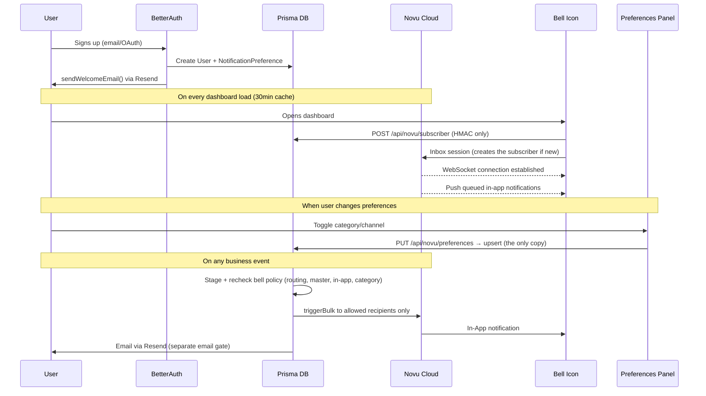
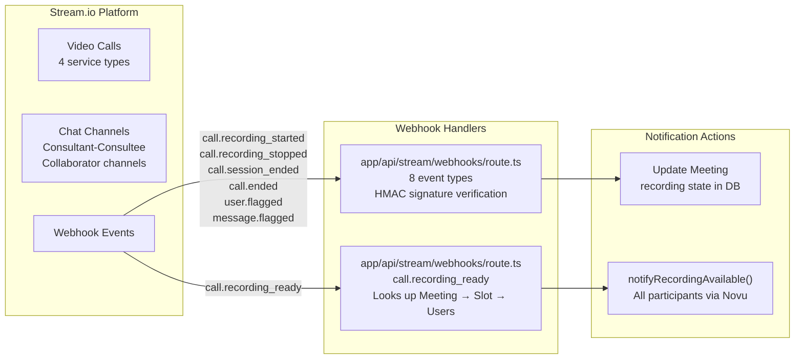
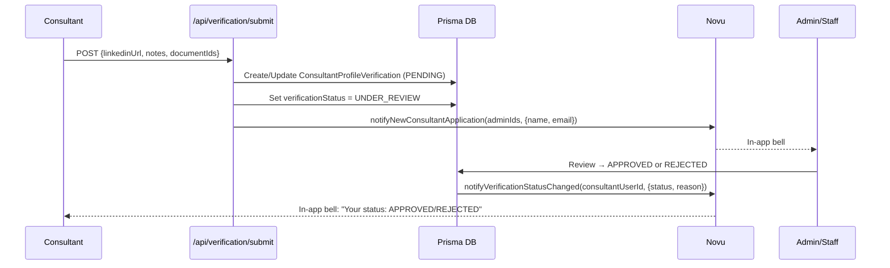
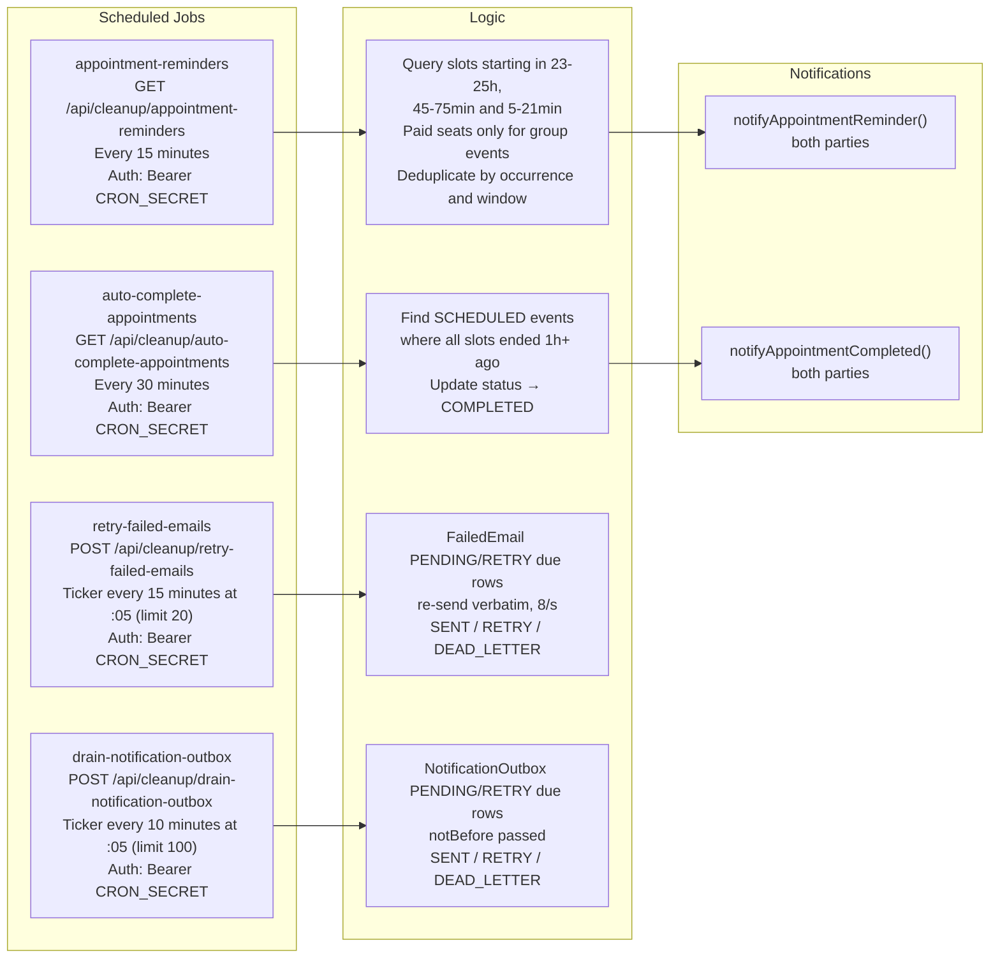

# Email, Notification & Newsletter — Full Ecosystem Architecture

> Complete map of every service, pipeline, component, and data flow in the Familiarise notification system.

**Last Updated**: 2026-11-06

---

## Status Legend

| Symbol      | Meaning                                                                               |
| ----------- | ------------------------------------------------------------------------------------- |
| **LIVE**    | Fully implemented and wired into business logic                                       |
| **SYNCED**  | Code is the source; an operator command writes it to the vendor (`npm run novu:sync`) |
| **STUB**    | Placeholder code, logs only, no real functionality                                    |
| **MISSING** | Not implemented, not stubbed                                                          |

---

## Master Architecture Diagram

```mermaid
flowchart TB
    subgraph TRIGGERS["User & System Triggers"]
        direction LR
        T_AUTH["Sign Up\nPassword Reset\nOAuth Link"]
        T_BOOK["Book / Pay\nCancel / Reschedule"]
        T_SUPPORT["Support Ticket\nReview / Feedback"]
        T_TRIAL["Trial Request\nVerification Submit"]
        T_ADMIN["Admin Broadcast\nNewsletter Send"]
        T_CRON["Cron: Reminders\nCron: Auto-Complete"]
        T_STREAM["Stream.io:\nRecording Ready"]
        T_NL["Newsletter Subscribe\non website"]
    end

    subgraph PIPE1["PIPELINE 1: Resend Direct — LIVE"]
        direction TB
        P1_LIB["lib/email/index.ts\nlib/email/senders/*.ts"]
        subgraph P1_TEMPLATES["React Email templates (emails/, 52 + 3 shared)"]
            P1_T1["emails/auth/\nWelcomeEmail\nPasswordResetEmail\nVerificationEmail\nAccountLinkedEmail"]
            P1_T2["emails/payments/\nPaymentLinkEmail\nPaymentSuccessEmail\nPaymentFailedEmail"]
            P1_T3["emails/newsletter/\nConfirm | Welcome"]
            P1_T4["emails/organizations/\nOrgInvitationEmail"]
        end
        P1_RENDER["renderEmail()\nreact-email → {html, text}"]
        P1_STAGE["stage()\nPENDING FailedEmail row\nbefore any send"]
        P1_ATTEMPT["attempt()\ninline send under a budget\nidempotency key + AbortSignal"]
        P1_RELAY["retry-failed-emails\nticker every 15 min at :05\nbackoff ladder"]
        P1_RENDER --> P1_STAGE --> P1_ATTEMPT
        P1_STAGE -. "timed out / transient" .-> P1_RELAY
    end

    subgraph PIPE2["PIPELINE 2: Novu in-app transport — LIVE"]
        direction TB
        P2_SVC["lib/novu/service.ts\nnotify* functions\nawaited, outbox-first"]
        P2_OUTBOX["lib/novu/outbox.ts\nstageTrigger() → NotificationOutbox row\nattemptTrigger() → 5 s inline"]
        P2_DRAIN["drain-notification-outbox\nticker every 10 min\nbackoff ladder, 5 attempts"]
        P2_SVC --> P2_OUTBOX
        P2_OUTBOX -. "timed out / transient" .-> P2_DRAIN
        P2_WF["lib/novu/workflows.ts\n96 event ids\ntyped payload interfaces"]
        P2_CLIENT["lib/novu/client.ts\nSingleton, lazy init\nGraceful degradation"]
        P2_SUB["lib/novu/subscriber.ts\ncomputeSubscriberHash()\ndeleteSubscriber()"]
        subgraph NOVU_CLOUD["Novu Cloud (written by npm run novu:sync)"]
            NC_WF["16 workflow families\nSource: lib/novu/templates/"]
            NC_EMAIL["Email Channel\nnot used: in-app only"]
            NC_INAPP["In-App Channel\nWebSocket → bell icon"]
            NC_PUSH["Push/FCM Channel\nnot implemented"]
            NC_PREFS["Workflow preferences\nalways on, read-only\n(no step conditions)"]
        end
    end

    subgraph PIPE3["PIPELINE 3: Newsletter — LIVE (interim)"]
        direction TB
        P3_SUB["POST /api/newsletter\nUpserts a PENDING row, sends the confirm email"]
        P3_CONFIRM["GET /api/newsletter/confirm\nHMAC-signed, 48h link\nPENDING → SUBSCRIBED + consent artifact, sends welcome"]
        P3_UNSUB["GET|POST /api/newsletter/unsubscribe\nHMAC-signed, timeless token\nRFC 8058 one-click, withdraws consent"]
        P3_SEND["POST /api/admin/newsletter/broadcast\nAdmin-only, audience filter, preview,\ntest and warm-up modes, 2,000 cap\n100/call, auto-appends\nunsubscribe footer + headers"]
        P3_DB[("NewsletterSubscriber table\nemail, name, status, source, tags\nconfirmedAt, unsubscribedAt")]
    end

    subgraph STUBS["DEFERRED — STUBS"]
        direction TB
        STUB_CK["ConvertKit / Kit\nNo code yet — deferred until\nthe list outgrows the Resend batch API"]
        STUB_PUSH["Push Notifications\nSchema: pushEnabled field\nNo FCM integration"]
    end

    subgraph PROMO["PROMOTIONAL — NOT CONNECTED"]
        PROMO_MD["emails/promotional/\n14 markdown templates\n7 consultant + 7 consultee\ninitial / followup /\nspecialized / reengagement\nFor: Lemlist, Apollo, Instantly"]
    end

    subgraph CLIENT["CLIENT-SIDE — LIVE"]
        direction TB
        CL_INBOX["components/notifications/\nNotificationInbox.tsx\nBell icon + unread badge\nClick → redirect URL"]
        CL_HOOK["hooks/useNovuSubscriberSync.ts\nReact Query, 30min staleTime\nPOST /api/novu/subscriber"]
        CL_PREFS["components/notifications/\nNotificationPreferencesPanel.tsx\nchannel and category switches\n+ email quiet hours"]
    end

    subgraph DASHBOARDS["DASHBOARD INTEGRATION"]
        direction TB
        D_ADMIN["Admin Settings\nHas NotificationPreferencesPanel"]
        D_STAFF["Staff Settings\nHas NotificationPreferencesPanel"]
        D_CONSULTANT["Consultant Settings\nHas NotificationPreferencesPanel"]
        D_CONSULTEE["Consultee Settings\nHas NotificationPreferencesPanel"]
        D_ANNOUNCE["Admin: POST /api/announcements\nCreates announcement record\n+ opt-in postToInbox:\nstagePages() per 100 eligible users"]
        D_NL_SEND["Admin: Newsletter Send UI\nPOST /api/admin/newsletter/broadcast"]
    end

    subgraph DELIVERY["DELIVERY"]
        DEL_RESEND["Resend API\nresend.emails.send()\nresend.batch.send()"]
        DEL_WS["Novu WebSocket\nReal-time in-app"]
        DEL_EMAIL["User Email Inbox"]
        DEL_HOOK["POST /api/webhooks/resend\nsvix-signed delivery events"]
        DEL_EVENTS[("EmailEvent\nEmailSuppression")]
    end

    %% Trigger → Pipeline 1 (Resend Direct)
    T_AUTH -->|"sendWelcomeEmail\nsendPasswordResetEmail\nsendAccountLinkedEmail"| P1_LIB
    T_BOOK -->|"sendPaymentLinkEmail\nsendPaymentSuccessEmail\nsendPaymentFailedEmail"| P1_LIB

    %% Trigger → Pipeline 2 (Novu)
    T_BOOK -->|"notifyAppointmentBooked\nnotifyPaymentSuccess/Failed\nnotifyAppointmentCancelled"| P2_SVC
    T_SUPPORT -->|"notifySupportTicketCreated\nnotifyNewReview"| P2_SVC
    T_TRIAL -->|"notifyTrialRequested\nnotifyVerificationStatusChanged\nnotifyNewConsultantApplication"| P2_SVC
    T_ADMIN -->|"announcement postToInbox → stagePages"| P2_OUTBOX
    T_CRON -->|"notifyAppointmentReminder\nnotifyAppointmentCompleted"| P2_SVC
    T_STREAM -->|"notifyRecordingAvailable"| P2_SVC

    %% Trigger → Pipeline 3 (Newsletter)
    T_NL --> P3_SUB
    T_ADMIN --> P3_SEND

    %% Pipeline 1 internal
    P1_LIB --> P1_RENDER
    P1_RENDER --> P1_DELIVER
    P1_DELIVER --> DEL_RESEND

    %% Pipeline 2 internal
    P2_SVC --> P2_CLIENT --> NOVU_CLOUD
    NC_INAPP --> DEL_WS

    %% Pipeline 3 internal
    P3_SUB --> P3_DB
    P3_SUB --> DEL_RESEND
    P3_CONFIRM --> P3_DB
    P3_CONFIRM --> DEL_RESEND
    P3_UNSUB --> P3_DB
    P3_SEND --> P3_DB
    P3_SEND --> DEL_RESEND

    %% Stubs

    %% Delivery
    DEL_RESEND --> DEL_EMAIL
    DEL_WS --> CL_INBOX

    %% Delivery events back into the outbox
    DEL_RESEND -->|"email.delivered / bounced /\ncomplained / failed"| DEL_HOOK
    DEL_HOOK --> DEL_EVENTS
    DEL_EVENTS -.->|"stage() and the relay\nrefuse a suppressed address"| P1_STAGE

    %% Client → Backend
    CL_PREFS -->|"PUT /api/novu/preferences\n(Postgres only)"| DB_PREFS[("NotificationPreference")]
    DB_PREFS -.->|"read at stage and send"| P2_OUTBOX
    CL_HOOK -->|"POST /api/novu/subscriber\n(HMAC only)"| P2_SUB

    %% Dashboard → Components
    CL_PREFS --> D_ADMIN
    CL_PREFS --> D_STAFF
    CL_PREFS --> D_CONSULTANT
    CL_PREFS --> D_CONSULTEE
    D_ANNOUNCE --> P2_OUTBOX
    D_NL_SEND --> P3_SEND
```



---

## Pipeline Breakdown

### Pipeline 1: Resend Direct — LIVE

**Purpose:** Transactional emails that are tightly coupled to auth, payment, and newsletter flows. These bypass Novu because they don't need multi-channel delivery (no in-app, no push).

**How it works:**

1. Business logic calls a send function (e.g., `sendWelcomeEmail()`) in `lib/email/index.ts` or `lib/email/senders/*.ts`
2. The function renders its React Email element via `renderEmail()` (`lib/email/render.ts`) into `{html, text}`
3. The function calls `deliver()` (`lib/email/deliver.ts`), the single send core, with the entity anchor it knows and its budget from `EMAIL_BUDGET_MS`
4. `deliver()` first stages the rendered message as a `PENDING` `FailedEmail` row (`stage()`), then attempts one send via `resend.emails.send()` under a row-scoped Idempotency-Key (`<EMAIL_TYPE>/failed-email/<row.id>`) and an `AbortSignal` for the budget (`attempt()`); success marks the row `SENT` with the Resend id, a terminal failure dead-letters it, a transient failure or a timeout leaves it `PENDING` for the relay
5. A caller inside a database transaction (the payment webhook) calls `stage()` inside the transaction and `attempt()` after the commit, so a rollback takes the row with it
6. `jobs/email/retry-failed-emails.ts` is the relay: the Netlify ticker runs it every fifteen minutes through `/api/cleanup/retry-failed-emails`, paced under Resend's rate limit; no GitHub Actions workflow schedules it
7. Resend reports what happened after acceptance to `POST /api/webhooks/resend`, which stores every signed event as an `EmailEvent` row and, for a permanent bounce or a complaint, writes the address to `EmailSuppression`; `stage()` and the relay dead-letter a message to a suppressed address with `suppressed:<REASON>` instead of sending it

The delivery events close the loop that the outbox opened. A `FailedEmail` row records that a message was handed to Resend and under which id; the `EmailEvent` rows for that id record whether it was delivered, delayed, bounced or complained about, and the suppression list built from those events is consulted before the next message to the same address is staged. The receiver is idempotent on the svix id, answers 200 for a duplicate, and only reaches production because Resend's event hook is registered against the production URL; the wiring steps are in [05-pre-production-checklist.md](05-pre-production-checklist.md).

**Templates and senders:** `emails/` holds 52 React Email templates and 3 shared components (`EmailLogo`, `EmailFooter`, `EmailLayout`). Each email type, its `From` address, its template and its trigger are listed in [../email/README.md](../email/README.md), which is the single catalogue.

Every sending address is built on the `EMAIL_TRANSACTIONAL_DOMAIN` and `EMAIL_NEWSLETTER_DOMAIN` constants in `lib/company.ts`. They are not environment variables, so changing a sending domain is a code change.

**Design system:** White card on `#f5f5f5` background, black CTA button, `-apple-system` font stack, `16px` body, `28px` heading.

---

### Pipeline 2: Novu in-app transport — LIVE

**Purpose:** The bell and inbox feed. Novu is a plain in-app transport: it delivers to the recipients the server already approved and has no preference logic, no step conditions and no profile data of its own. All sixteen workflow families are in-app only (ADR 30), so Novu never sends an email.

**How it works:**

1. Business logic awaits a trigger function (e.g., `notifyAppointmentBooked(userIds, payload)`). A caller inside a transaction stages with `stageBell(tx, ...)` and passes the returned row to `flushNotificationsAfter` after commit.
2. `stageTrigger()` (`lib/novu/outbox.ts`) upserts a `NotificationOutbox` row keyed on a `transactionId` derived from the event, the sorted recipients and the payload. Bell policy (`lib/novu/policy.ts`) has already dropped opted-out recipients.
3. If `isNovuConfigured()` is false the row waits for the drain and the function returns `{success: false}`. Otherwise `attemptTrigger()` makes one `novu.triggerBulk()` call (one event per recipient, at most 100) under the client's five-second timeout and settles the row with a conditional update on `PENDING`/`RETRY`.
4. Novu Cloud deduplicates a resend on the `Idempotency-Key` header (derived from the row's `transactionId`, `firstAttemptAt`, recipients and payload) and runs the family's single in-app step, which pushes to the subscriber's WebSocket and appears in the bell.
5. The app filters recipients by bell policy in Postgres when it stages the row and once more before the first attempt of each generation.

**Events and families:** all 98 events and the 16 families that carry them are listed in [02-workflows-and-api.md](./02-workflows-and-api.md#workflow-families). They are not repeated here.

**Delivery audit trail:** the `NotificationOutbox` row is the record of what was staged, sent, retried or dead-lettered, with its `lastError` reason. The Novu activity feed keeps only 24 hours on the Free plan, so it is not the audit trail.

**Trigger wiring (which business logic calls which notification):**

| Business Logic File                                         | Notifications Fired                                            |
| ----------------------------------------------------------- | -------------------------------------------------------------- |
| `lib/payments/webhooks/handlers.ts`                         | appointmentBooked, paymentSuccess, paymentFailed               |
| `app/api/appointments/[id]/cancel/route.ts`                 | appointmentCancelled                                           |
| `app/api/appointments/[id]/reschedule/route.ts`             | appointmentRescheduled                                         |
| `app/api/cleanup/appointment-reminders/route.ts`            | appointmentReminder (cron)                                     |
| `scripts/appointments/auto-complete-appointments.ts`        | appointmentCompleted (cron)                                    |
| `app/api/scheduling/request-for-approval/route.ts`          | newBookingRequest                                              |
| `app/api/bookings/subscriptions/`                           | subscriptionStarted, subscriptionCancelled                     |
| `app/api/trials/route.ts` + `[trialId]/route.ts`            | trial\* (4)                                                    |
| `app/api/user/support-tickets/route.ts`                     | supportTicketCreated                                           |
| `app/api/staff/support-tickets/[id]/responses/route.ts`     | supportTicketResponse                                          |
| `app/api/user/reviews/route.ts`                             | newReview                                                      |
| `app/api/admin/verification/` + `app/api/staff/moderation/` | verificationStatusChanged                                      |
| `app/api/verification/submit/route.ts`                      | newConsultantApplication                                       |
| `lib/payments/payouts/payout-service.ts`                    | payoutProcessed, payoutFailed                                  |
| `lib/collaborators/service.ts`                              | collaboratorInvited, collaboratorAccepted, collaboratorRemoved |
| `app/api/stream/webhooks/route.ts`                          | recordingAvailable                                             |
| `app/api/announcements/route.ts`                            | generalAnnouncement (opt-in, per-page fan-out)                 |
| `app/api/webhooks/utils.ts`                                 | refundProcessed, disputeCreated, disputeResolved               |
| `app/api/user/feedbacks/route.ts`                           | feedbackReceived                                               |

---

### Pipeline 3: Newsletter Interim — LIVE

**Purpose:** Collect newsletter subscribers with a double opt-in and send occasional broadcasts via the Resend batch API. Interim solution until a list tool such as ConvertKit is integrated at 500+ subscribers.

**How it works:**

```
Subscribe (double opt-in, see lib/newsletter/service.ts):
  User enters email on site → POST /api/newsletter
    → upserts a NewsletterSubscriber row with status PENDING (re-subscribe resets it)
    → sendNewsletterConfirmEmail() with an HMAC-signed, 48-hour confirm link
    → returns {success: true}

Confirm:
  User clicks link → GET /api/newsletter/confirm?email=...&token=...&issued=...
    → verifyConfirmToken() (signature + TTL)
    → one transaction: status PENDING → SUBSCRIBED, confirmedAt = now(), the
      matching account linked, and a MARKETING_COMMS ConsentArtifact written
      (on the account, or on a pseudonymous subject) unless one is live
    → sendNewsletterWelcomeEmail() with the unsubscribe link

Send:
  Admin calls POST /api/admin/newsletter/broadcast
      {mode: preview | test | warmup | all, audience?, limit?, subject, htmlBody, textBody?}
    → Auth check (ADMIN role only, requireAdminAuth())
    → test: the admin's own address; otherwise listSendableSubscribers(audience)
      from lib/newsletter/service.ts, most recently confirmed first
    → findSuppressed() drops every address on EmailSuppression and
      heldRecipientDomain() drops every address the pre-launch guard holds
    → preview returns the counts; warmup keeps the first `limit`; more than
      2,000 sendable recipients answers 422 AUDIENCE_TOO_LARGE
    → For each batch of 100: a FailedEmailBatch row is upserted under the
      batch's idempotency key, then resend.batch.send() via getResendClient()
      from lib/email; a failed send leaves the row PENDING for the relay
    → Each email gets: unsubscribe footer + List-Unsubscribe header
    → Returns {sent, failed, total, skippedSuppressed, skippedHeld}

Unsubscribe:
  User clicks link → GET /api/newsletter/unsubscribe?email=...&token=...
  Mail client one-click → POST /api/newsletter/unsubscribe (RFC 8058)
    → verifyUnsubscribeToken() (HMAC-SHA256, never expires)
    → one transaction: status → UNSUBSCRIBED, unsubscribedAt = now(), and the
      address's MARKETING_COMMS consent withdrawn
    → Show HTML confirmation page
```

**Database model:** the `NewsletterSubscriber` model in `prisma/schema.prisma`, stored in the `NewsletterSubscriber` table (`email`, `name`, `status`, `source`, `tags`, `userId`, `confirmedAt`, `unsubscribedAt`, consent proof). There are no token columns because both links are stateless HMACs; the model comments in `prisma/schema.prisma` describe each field.

---

## Subscriber Lifecycle



---

## Stream.io Integration



**Data path for recording notification:**
`Stream.io call.recording_ready` → `route.ts` → `prisma.meeting.findFirst({where: {streamCallId}})` → `include: appointmentOccurrence → appointment → consultation/subscription/webinar/class` → extract consultant name + participant user IDs from slot's M2M `user` relation → `notifyRecordingAvailable(userIds, {dashboardUrl, ...})` (no media URL; the link opens the in-app recordings page)

---

## Verification Flow



---

## Cron Jobs



The two relays are the outbox halves of the design: every email and every Novu trigger is a row before it is a network call, and these two jobs finish whatever the inline attempt could not settle within its budget. Both are also runnable as standalone jobs (`jobs/email/retry-failed-emails.ts`, `jobs/notifications/drain-notification-outbox.ts`) under the same fail-closed cron locks.

---

## Dashboard & Admin Features

| Feature                      | Route                                | Who                                 | What It Does                                                         |
| ---------------------------- | ------------------------------------ | ----------------------------------- | -------------------------------------------------------------------- |
| **Notification Preferences** | Settings page                        | Admin, Staff, Consultant, Consultee | Channel and category switches + email quiet hours                    |
| **Bell Icon / Inbox**        | All dashboards                       | All roles                           | Novu in-app notifications, unread count, click-to-redirect           |
| **Announcements**            | POST /api/announcements              | Admin                               | Create announcement; optional confirmed inbox fan-out                |
| **Newsletter Send**          | POST /api/admin/newsletter/broadcast | Admin only                          | Send HTML email to a filtered audience of SUBSCRIBED rows via Resend |
| **Newsletter Stats**         | (not built)                          | —                                   | Would show subscriber count, open rates                              |
| **Verification Review**      | /dashboard/admin/verification        | Admin, Staff                        | Review applications → triggers verificationStatusChanged             |

---

## What's STUB vs LIVE vs MISSING

### LIVE (fully working)

| Component                                      | Files                                                                                                  |
| ---------------------------------------------- | ------------------------------------------------------------------------------------------------------ |
| Resend email client and send core              | `lib/email/index.ts`, `lib/email/deliver.ts`, `lib/email/config.ts`, `lib/email/senders/`              |
| React Email templates                          | `emails/` (52 templates, 3 shared components)                                                          |
| Novu client + service + workflows + subscriber | `lib/novu/*.ts`                                                                                        |
| Novu templates as code and sync                | `lib/novu/templates/`, `scripts/novu/sync-workflows.ts` (`npm run novu:sync`, `npm run novu:check`)    |
| Outbox relays on the ticker                    | `retry-failed-emails` (every 15 min at `:05`), `drain-notification-outbox` (every 10 min at `:05`)     |
| Novu step-failure probe                        | `jobs/notifications/novu-step-failure-probe.ts` (every 2 h at `:10`, reads the last 4 h)               |
| Novu inbox + bell icon + HMAC hook             | `components/notifications/NotificationInbox.tsx`, `hooks/useNovuSubscriberSync.ts`                     |
| Notification Preferences Panel                 | `components/notifications/NotificationPreferencesPanel.tsx` (every role, operators included)           |
| Preferences API                                | `app/api/novu/preferences/route.ts` (GET/PUT)                                                          |
| Inbox HMAC API                                 | `app/api/novu/subscriber/route.ts` (POST)                                                              |
| Newsletter double opt-in confirm/unsubscribe   | `lib/newsletter/tokens.ts`, `lib/newsletter/service.ts`, `lib/auth/link-signing.ts`                    |
| Admin newsletter broadcast                     | `app/api/admin/newsletter/broadcast/route.ts`                                                          |
| Appointment reminders and auto-complete        | `app/api/cleanup/appointment-reminders/route.ts`, `scripts/appointments/auto-complete-appointments.ts` |
| Stream webhook                                 | `app/api/stream/webhooks/route.ts`                                                                     |
| Announcements + opt-in inbox fan-out           | `app/api/announcements/route.ts`                                                                       |
| Resend delivery events and suppression         | `app/api/webhooks/resend/route.ts`                                                                     |

### STUB (placeholder code, no functionality)

| Component | File | What It Does Now | When to Implement |
| --------- | ---- | ---------------- | ----------------- |

### NEEDS AN OPERATOR STEP (code complete)

| Component      | What's Needed                                                                                                                                                                                                                           |
| -------------- | --------------------------------------------------------------------------------------------------------------------------------------------------------------------------------------------------------------------------------------- |
| Novu workflows | Not a dashboard task: `lib/novu/templates/` is the source of truth. Run `npm run novu:sync` then `npm run novu:check` per environment. Production runs at the release promotion (see [the checklist](./05-pre-production-checklist.md)) |
| Resend domains | Add `mail.familiarisenow.com` and `news.familiarisenow.com` in the Resend dashboard, then add the DKIM/return-path/SPF/DMARC records the dashboard returns in Netlify DNS (region: Tokyo, `ap-northeast-1`)                             |
| Job fleet      | The relays run on the Netlify ticker (`netlify/functions/cron-tick.mts`). Production is paused pre-launch through `ops:active_cron_platform`; resume from the go-live checklist                                                         |

### MISSING (no code, no stub)

| Component                         | Impact                                       | Recommendation                                              |
| --------------------------------- | -------------------------------------------- | ----------------------------------------------------------- |
| Newsletter subscribe UI component | No way for users to subscribe on the website | Build footer/sidebar email input form                       |
| Push notifications (FCM)          | No browser push                              | Defer until significant user base                           |
| Email analytics (opens/clicks)    | No open or click tracking                    | Widen the Resend webhook subscription once tracking is on   |
| Novu usage guard                  | No in-app view of monthly bell runs          | Planned: an ops-digest line counting `SENT` bell recipients |
| Promotional email automation      | 16 templates sit unused                      | Use external tool (Lemlist) for cold outreach               |

---

## Environment Variables

| Variable                  | Required | Used By                                                                             |
| ------------------------- | -------- | ----------------------------------------------------------------------------------- |
| `RESEND_API_KEY`          | Yes      | Resend direct emails, newsletter broadcast                                          |
| `RESEND_WEBHOOK_SECRET`   | Yes      | Signature verification in `/api/webhooks/resend`; production context only           |
| `NOVU_DEVELOPMENT_KEY`    | Yes      | Novu server-side SDK, Development environment (local, previews)                     |
| `NOVU_PRODUCTION_KEY`     | Yes      | Novu server-side SDK, Production environment (production only)                      |
| `NEXT_PUBLIC_NOVU_APP_ID` | Yes      | Novu React SDK (client-side)                                                        |
| `NEXT_PUBLIC_APP_URL`     | Yes      | Email link URLs, unsubscribe URLs                                                   |
| `CRON_SECRET`             | Yes      | Auth for cron job endpoints                                                         |
| `BETTER_AUTH_SECRET`      | Yes      | Also derives the key that signs newsletter, unsubscribe, calendar and support links |
| `STREAM_WEBHOOK_SECRET`   | Yes      | Stream webhook signature verification                                               |

---

## NPM Packages

| Package        | Version | Pipeline                                                                                 |
| -------------- | ------- | ---------------------------------------------------------------------------------------- |
| `resend`       | ^6.28.0 | Pipeline 1 + 3                                                                           |
| `react-email`  | 6.9.5   | Pipeline 1 (replaces the deprecated `@react-email/components` and `@react-email/render`) |
| `@novu/api`    | 3.13.0  | Pipeline 2 (server)                                                                      |
| `@novu/nextjs` | 3.13.0  | Pipeline 2 (client)                                                                      |
| `@novu/react`  | 3.13.0  | Pipeline 2 (client)                                                                      |

## Deprecated & Superseded Approaches

- **Novu as a multi-channel orchestrator.** Earlier versions of this map showed a Novu email step, push channel and digest steps, a hand-built dashboard workflow per event, and a "Tier 1/2/3" list of 40 workflow ids. Novu is now in-app only, workflows are 16 families written from `lib/novu/templates/`, and there are 98 events. Delete any residual reference to a Novu email step or a per-event workflow.
- **Maintenance notifications.** The `maintenance-*` events were removed; see [the decision record](../decisions/2026-11-06-notification-single-preference-owner.md).
- **Novu as the delivery audit trail.** The Novu activity feed (24 hours on Free) was once treated as the delivery log. `NotificationOutbox` is the audit trail now.
- **Cron by GitHub Actions.** Earlier notes scheduled reminders, auto-complete and the relays from GitHub Actions or as an unbounded backstop. They run on the ticker, and no Actions workflow schedules a registry job.
- **Preferences panel gaps.** The consultant and consultee settings pages once lacked the panel; both have it now.
- **Workspace routing section.** `NotificationRoutingSection.tsx` set `OrgWorkspaceProfile.notificationRoutingMode`, which duplicated the operator's own channel switches. It was deleted on 2026-11-07; the operator's page shows only the personal panel.
