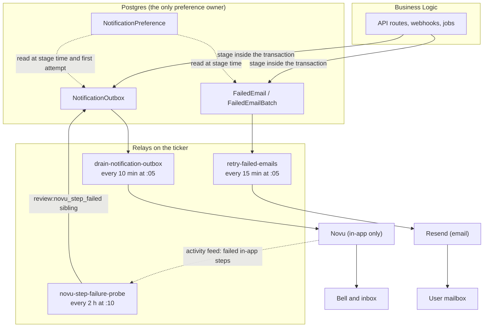

# Notification System

Notifications use two delivery layers that share one owner of user preferences. **Resend** sends email directly from the app (`lib/email/`). **Novu** is a plain in-app transport: it delivers the bell and inbox feed and nothing else (`lib/novu/`). **Postgres** is the transactional outbox for both layers (`FailedEmail`, `FailedEmailBatch` and `NotificationOutbox`) and the only owner of notification preferences (`NotificationPreference`, the same personal switches for every user, workspace operators included). Novu holds no preference copy and no profile data; see [the decision record](../decisions/2026-11-06-notification-single-preference-owner.md).

A notification call never rolls back the business change. Each message is first written as a `PENDING` outbox row where the change commits (inside its transaction when the caller has one). It is then attempted once after the response, under a time budget, and a relay on the Netlify ticker finishes it if that attempt times out or fails transiently. A timeout is not a failure and never pages. A late duplicate is harmless because Resend gets a row-scoped idempotency key and Novu gets a generation-scoped `Idempotency-Key` that is reused verbatim after an unknown outcome. A missing or invalid `RESEND_API_KEY` leaves the row `PENDING` for the relay rather than dropping the message. All sixteen Novu workflow families are in-app only, so Novu never sends an email.

The full pipeline, with the lease timeline, the outbox state machine and the policy flowchart, is in [01-architecture.md](./01-architecture.md).

---

## Core Principles

- **Non-fatal, and durable** -- a notification failure never rolls back the persisted business work, because the only thing inside the transaction is the outbox row; the send happens after the commit, under a budget, and the relay finishes it. Every call site is awaited (an un-awaited call is dropped when the Netlify instance freezes after the response), so "non-fatal" does not mean "fire-and-forget". `app/api/contact/route.ts` answers success once the inquiry row exists and keeps its 502 only for the case where even the row could not be written
- **A missing key is captured, not dropped** -- a missing Novu secret key for the current environment (`NOVU_DEVELOPMENT_KEY` or `NOVU_PRODUCTION_KEY`) leaves the `NotificationOutbox` row `PENDING` for the drain to deliver once the key exists. On the Resend side a missing `RESEND_API_KEY` (`EmailNotConfiguredError`) leaves the `FailedEmail` row `PENDING` and pages once at level "error"; a terminal cause (dead key, unverified domain, `validation_error`) dead-letters the row on the spot. The relays skip every row while the key is absent, replay it once the key exists, and move a transient failure to `RETRY` on the shared backoff ladder
- **Singleton clients** -- both Resend and Novu use lazy-initialized singleton instances
- **Subscriber = User** -- Novu `subscriberId` is the Prisma `User.id`
- **97 notification events in 16 Novu workflow families** -- each event has a typed payload; the family is the Novu workflow and carries the event as `payload.event`; every family is in-app only, so Novu never carries an email
- **Email senders and templates** -- sender functions live in `lib/email/index.ts` and `lib/email/senders/*.ts`; `emails/` holds 55 React Email `.tsx` files, of which 3 are shared building blocks in `emails/components/` and 52 are templates. Every message is rendered server-side by `renderEmail()` (`lib/email/render.ts`, `react-email`'s `render()`) into both an HTML and a plain-text part. The per-type catalogue is in [../email/README.md](../email/README.md)
- **User preferences** -- channel toggles for in-app and email (the schema also carries a `pushEnabled` flag, but no push channel exists), nine category switches (`PreferenceCategory` in `lib/novu/templates/types.ts`), and quiet hours that only the consultant planning reminder reads (email and bell)
- **Single preference owner** -- Postgres decides who receives a notification; Novu only delivers to the recipients the server already approved
- **Required notices** -- account, security, verification, moderation and compliance notices skip the switches by template; a notice the other party causes (a host's cancel and its refund, a proposal, a lapsed proposal's restored time, a class series move, a removed seat) skips them per send, through `REQUIRED_NOTICE_KINDS` in `lib/notifications/required-notices.ts`. Only erasure stops either ([02-workflows-and-api.md](./02-workflows-and-api.md#required-notices-the-other-party-causes))

## Source Code Map

### Backend Services

| File                                | Purpose                                                                                                                                                                                    |
| ----------------------------------- | ------------------------------------------------------------------------------------------------------------------------------------------------------------------------------------------ |
| `lib/novu/client.ts`                | Singleton Novu client, `isNovuConfigured()` guard                                                                                                                                          |
| `lib/novu/service.ts`               | The `notify*` functions (`notifyAppointmentBooked`, `notifyPaymentSuccess`, ...): each stages a `NotificationOutbox` row and attempts it after the response                                |
| `lib/novu/workflows.ts`             | 97 event id constants and their typed payloads; `lib/novu/templates/` maps them onto 16 workflow families                                                                                  |
| `lib/novu/subscriber.ts`            | `computeSubscriberHash` (Inbox HMAC) and `deleteSubscriber`; Novu holds no profile or preference data                                                                                      |
| `lib/email/index.ts`                | The auth, payment, organisation-invite, newsletter and contact sender functions; the lifecycle senders live in `lib/email/senders/*.ts`                                                    |
| `lib/email/config.ts`               | `SENDERS` getters and `supportEmail()`/`contactInboxAddress()`/`billingEmail()`/`companyPostalAddress()`, all returning the constants in `lib/company.ts`                                  |
| `lib/email/deliver.ts`              | `deliver()`, the single send core: stages the row, attempts it, and settles it with a conditional `updateMany` (`settleRow`); `EmailNotConfiguredError`, `recordFailedEmail`               |
| `lib/email/preferences.ts`          | `loadEmailRecipients()` and `isEmailAllowed()`, the send-time preference gate; `EMAIL_CATEGORY_COLUMN`, the one category → column map                                                      |
| `lib/email/unsubscribe.ts`          | Timeless HMAC unsubscribe tokens, `buildEmailUnsubscribeUrl()` and the RFC 8058 `listUnsubscribeHeaders()`                                                                                 |
| `lib/email/send-to-recipients.ts`   | `sendToRecipients()` fan-out over gated recipients, plus `prepareRecipientEmails()`/`stagePreparedEmails(tx)`/`attemptStaged()` for a transaction owner                                    |
| `lib/email/idempotency.ts`          | Derives the row-scoped `<EMAIL_TYPE>/failed-email/<row.id>` idempotency key (content hash only when no row exists)                                                                         |
| `lib/email/classify.ts`             | Classifies a Resend failure as terminal (dead key, unverified domain, missing key) or transient                                                                                            |
| `lib/email/render.ts`               | `renderEmail()` — renders a React Email element to `{ html, text }`                                                                                                                        |
| `lib/novu/stage-bell.ts`            | `stageBell(tx, ...)`: applies bell policy and writes the `NotificationOutbox` row inside the caller's transaction                                                                          |
| `lib/novu/stage-then-attempt.ts`    | `flushNotificationsAfter()`: attempts staged bells and emails after the response                                                                                                           |
| `lib/novu/outbox.ts`                | `stageTrigger`, `stagePages`, `attemptTrigger` and the conditional settle of every bell row                                                                                                |
| `lib/novu/policy.ts`                | `resolveRecipientBellPolicy`, `currentBellRecipients`, `bellAudience` and `MAX_BELL_AUDIENCE`: the server-side bell gate                                                                   |
| `jobs/email/retry-failed-emails.ts` | Email relay: dead-letters a row past the 23 h provider window, replays under the same idempotency key otherwise, and settles each row with a conditional `updateMany` on `PENDING`/`RETRY` |

### Frontend

| File                             | Purpose                                                      |
| -------------------------------- | ------------------------------------------------------------ |
| `hooks/useNovuSubscriberSync.ts` | Fetches the Inbox HMAC on dashboard mount (30-min staleTime) |

### API Routes

| Route                            | Method | Purpose                                                                                |
| -------------------------------- | ------ | -------------------------------------------------------------------------------------- |
| `/api/novu/subscriber`           | POST   | Returns the session user's Inbox HMAC; no Novu call                                    |
| `/api/novu/preferences`          | GET    | Returns user's notification preferences (with defaults)                                |
| `/api/novu/preferences`          | PUT    | Updates notification preferences in Postgres (the only copy)                           |
| `/api/notifications/unsubscribe` | GET    | Verifies the footer link's token and redirects to `/email/unsubscribe`; writes nothing |
| `/api/notifications/unsubscribe` | POST   | RFC 8058 one-click: sets `emailEnabled = false` in Postgres; no Novu call              |

### Email Templates (`emails/`)

`emails/` holds 55 React Email `.tsx` files grouped by domain (`auth`, `booking`, `payments`, `organizations`, `orgs`, `support`, and so on). Three of them are shared building blocks in `emails/components/` (`EmailLogo.tsx`, `EmailFooter.tsx`, `EmailLayout.tsx`, next to the `styles.ts` style objects); the other 52 are templates. The contact inquiry now renders `emails/contact/ContactInquiryEmail.tsx` like every other message. The catalogue that maps each email type to its template, sender and trigger is in [../email/README.md](../email/README.md).

### Schemas

| File                                               | Purpose                                                                                                                                   |
| -------------------------------------------------- | ----------------------------------------------------------------------------------------------------------------------------------------- |
| `schemas/user.ts`                                  | `NotificationPreferenceSchema`, `NotificationPreferenceUpdateSchema`                                                                      |
| [06-schema-reference.md](./06-schema-reference.md) | The Prisma tables behind outbox-first delivery: `FailedEmail`, `FailedEmailBatch`, `EmailEvent`, `EmailSuppression`, `NotificationOutbox` |

## Source of truth for Novu templates

`lib/novu/templates/` is the source of truth for every Novu workflow's in-app copy, redirect and opt-out category; `scripts/novu/sync-workflows.ts` writes it to the Novu environment as one workflow per family. Run `npm run novu:sync -- --dry-run` to preview a change, `npm run novu:sync` to apply it, and `npm run novu:check` to check for drift (the CI-side guard). See [ADR 30](../enterprise/70-design-decisions/30-novu-templates-as-code-and-workflow-families.md) for why the templates moved into the repository and why they are grouped into families.

## Quick Navigation

| I want to...                                                        | Go to                                                                                                                               |
| ------------------------------------------------------------------- | ----------------------------------------------------------------------------------------------------------------------------------- |
| Understand the dual-layer architecture                              | [01-architecture.md](./01-architecture.md)                                                                                          |
| See all 97 events, the 16 families and API endpoints                | [02-workflows-and-api.md](./02-workflows-and-api.md)                                                                                |
| Understand the outbox and Resend-event tables                       | [06-schema-reference.md](./06-schema-reference.md)                                                                                  |
| Gate a lifecycle email on preferences, or add one-click unsubscribe | [01-architecture.md § Stateless RFC 8058 Unsubscribe](./01-architecture.md#stateless-rfc-8058-unsubscribe--link-scanner-protection) |
| Add a Novu event or change a template                               | [03-novu-template-specs.md](./03-novu-template-specs.md)                                                                            |
| Understand why Postgres is the only preference owner                | [../decisions/2026-11-06-notification-single-preference-owner.md](../decisions/2026-11-06-notification-single-preference-owner.md)  |
| Understand the reminder windows, calendar links and "host is live"  | [../decisions/2026-11-07-attendee-comms.md](../decisions/2026-11-07-attendee-comms.md)                                              |
| See the whole email map, the pre-launch guard and ops routing       | [../email/README.md](../email/README.md)                                                                                            |
| Understand the payment system                                       | [../start-here/02-money-system-hld.md](../start-here/02-money-system-hld.md)                                                        |
| Check the database schema                                           | [../../prisma/schema.prisma](../../prisma/schema.prisma)                                                                            |

## Deprecated & Superseded Approaches

These are the shapes the subsystem used to have. Delete any residual code or doc that still assumes them.

- **Pre-hardening producers.** About 90 % of lifecycle, booking and organisation paths sent after commit with no outbox row, so a frozen Netlify instance lost the email or bell. Money paths rendered React Email inside a `Serializable` transaction. Outbox rows started with `nextRetryAt = now`, which raced the inline attempt, and the email idempotency key hashed `to + subject + html`, so Resend's 24 h cache dropped a legitimate repeat. Today every producer stages inside its transaction with a 60-second inline lease and a row-scoped key.
- **Two copies of preferences.** A second copy lived in the Novu subscriber `data`, was rewritten on every dashboard load, and drove step `skip` rules. It is deleted (see the decision record).
- **Broadcasts and in-app quiet hours.** Announcements and maintenance notices were Novu broadcasts with no preference check, and in-app quiet hours deferred bells while the email went out at once. Both are removed.
- **Ticker with no stagger and a daily heartbeat workflow.** All targets fired on the same minutes, and a GitHub Actions workflow was the only writer of the cron heartbeat. The ticker is now phase-staggered and `withCronLock` writes the heartbeat.
- **Message brokers.** Kafka, RabbitMQ or BullMQ, SQS and QStash were all considered and rejected because publishing to any of them from inside a Postgres transaction is a dual write that still needs a database outbox. The Postgres outbox plus the ticker is atomic with the business change, needs no extra compute, and handles the platform's volume. Upstash QStash remains a possible later step only if customer outbound webhooks (`OutboundWebhookDelivery`) outgrow the ticker.
- **Engineering logs.** The September 2026 outage diagnosis and the outbox-first build log were folded into [01-architecture.md](./01-architecture.md) and are no longer separate files.
- **Workspace notification routing.** `OrgWorkspaceProfile.notificationRoutingMode` duplicated the operator's own In-App and Email switches and was removed on 2026-11-07. Nothing reads it; the column is dropped with the next schema batch.
