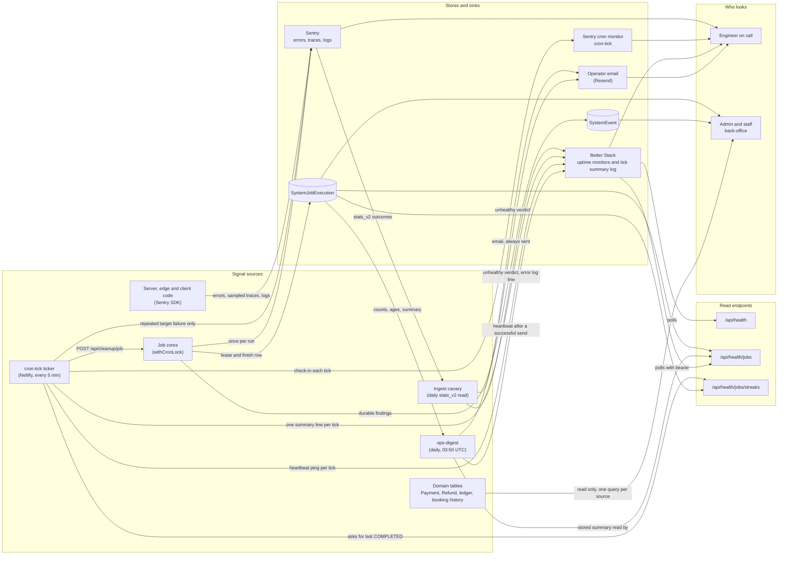

# Observability system design

This page explains how the platform finds out that something went wrong, what it keeps so that a person can work out why, and which tool answers which question. It is the high-level design for the whole subsystem. The detail lives in the Sentry set (`sentry/01` to `sentry/08`), in the [job machinery catalog](../maintenance/11-job-machinery-catalog.md) and in the [2026-10-26 decisions record](../decisions/2026-10-26-launch-sweep-observability-and-money-holds.md). Behaviour that is not on `dev` yet is labelled **(arrives with #N)**, **(pending)** or **(planned)**. The run record, run id, tick id, outcome vocabulary, counters and freshness tiers below are Phase 1 of the operations console.

## 1. Three questions, three layers

An operator asks one of three questions, and each is answered by a different tool. Using the wrong tool is the usual mistake, because each tool is blind to the other two questions.

| Question                                      | Layer                                                  | Why the other layers cannot answer it                                                                       |
| --------------------------------------------- | ------------------------------------------------------ | ----------------------------------------------------------------------------------------------------------- |
| What failed, in which code, for which user?   | Sentry                                                 | Needs an exception or a deliberate report. A refund sitting in `PENDING` for a day throws nothing.          |
| What did not run?                             | Better Stack, plus the Sentry cron monitor `cron-tick` | A job that never starts produces no error, so Sentry stays silent.                                          |
| What happened to this payment or this booking | The back-office Entity trace and job run metrics       | Sentry holds at most a capped sample per run, and Better Stack only knows the ticker and the health probes. |

Four systems share these questions, and each has a fixed job:

| Layer        | Answers                                | What it holds or watches                                                                                                                                                                                                                  | Enforcer                                                                                                                                   |
| ------------ | -------------------------------------- | ----------------------------------------------------------------------------------------------------------------------------------------------------------------------------------------------------------------------------------------- | ------------------------------------------------------------------------------------------------------------------------------------------ |
| Sentry       | Code faults                            | Exceptions and deliberate reports, the `cron-tick` cron monitor, and the free uptime monitor 7689936 on `/api/health/jobs` (live since 2026-11-05; it used to watch the homepage), which makes a second company the watcher of the fleet. | `reportSentryError` and `reportSentryMessage` (`lib/observability/report.ts`); the check-in in `netlify/functions/cron-tick.mts`.          |
| Better Stack | Absence: something that did not happen | The tick heartbeat, the HTTP monitor on `/api/health/jobs`, the daily digest heartbeat, and the SQL threshold alerts on the per-tick backlog gauges.                                                                                      | `pingHeartbeat()` in the ticker, `app/api/health/jobs/route.ts`, and `runOpsDigest` (`lib/observability/ops-digest.ts`) for its heartbeat. |
| Postgres     | The facts                              | Run rows (`SystemJobExecution`) and the queues and entity rows themselves. Every alert is a pointer to these rows; when an alert and a row disagree, believe the row.                                                                     | `withCronLock` (`lib/cron/with-cron-lock.ts`) writes every run; `checkJobCoverage` (`lib/cron/job-coverage.ts`) proves every target does.  |
| The console  | What to do about it                    | System Jobs and Stuck work (`app/dashboard/(backoffice)/[tree]/stuck-work`) are where an operator goes after the digest names a problem. The digest email itself carries no console links.                                                | `systemJobs.manage` for System Jobs; the digest never repairs anything.                                                                    |

The daily ops digest ties the layers together. It is one email, always sent, whose arrival is itself checked by a Better Stack heartbeat (section 3.2).

A worked example shows the split. On Monday 26 October 2026 at 10:00 IST (04:30 UTC) Hannah Anderson cancels Priya Anderson's one-hour consultation. Priya paid ₹1,180 (118,000 paise: ₹1,000 plus 18 % GST), and her refund does not arrive. If the refund sweep threw, Sentry holds the error. If the refund sweep stopped being scheduled, Better Stack's probe of `/api/health/jobs` turns red within the sweep's 45-minute completion budget. If neither happened and the gateway simply never confirmed the refund, only the payment's own rows can say so, and the Entity trace is the page that reads them together.

## 2. The picture

The Entity trace and the Run metrics card are the only readers of the domain tables in this picture. Everything drawn here is on `dev`.

### Live monitor inventory (2026-11-05)

Dated evidence, re-checkable with the read-only steps in [How we know a job did not run](../start-here/08-how-we-know-a-job-did-not-run.md#7-how-to-reproduce-the-verification-yourself). The question-by-question matrix, including what each detector does not cover, is in that explainer, and the decisions with their alternatives are in [the detector rollout record](../decisions/2026-11-05-detector-rollout-and-redundancy.md).

| Vendor       | Monitor                                                                 | Watches                                    |
| ------------ | ----------------------------------------------------------------------- | ------------------------------------------ |
| Better Stack | HTTP `familiarisenow.com` (4093821)                                     | The homepage                               |
| Better Stack | HTTP `familiarisenow.com/api/health` (4093822)                          | Database, Redis and Stream reachability    |
| Better Stack | HTTP `familiarise job fleet probe (prod)` (5189236)                     | `/api/health/jobs`                         |
| Better Stack | Heartbeat `familiarise cron-tick (prod)` (521597)                       | The ticker (period 300 s, grace 600 s)     |
| Better Stack | Heartbeat `familiarise ops digest (prod)` (523773)                      | The daily digest (period 24 h, grace 3 h)  |
| Sentry       | Cron monitor `cron-tick`                                                | The ticker (every 5 minutes, margin 3 min) |
| Sentry       | Uptime monitor `familiarise job fleet probe (second watcher)` (7689936) | `/api/health/jobs`                         |

The probe and the ticker are each watched by two vendors on purpose; the digest by one. Known open gap: `SENTRY_STATS_TOKEN` is unset, so the ingest canary is skipped daily.

## 3. Signal sources and sinks

| Signal                    | Produced by                                                                                                                               | Lands in                                                                                                                   | Notes                                                                                                                                                                                                                                                                                                                                                                                                                                                                                                                                                                                                                                                                                                |
| ------------------------- | ----------------------------------------------------------------------------------------------------------------------------------------- | -------------------------------------------------------------------------------------------------------------------------- | ---------------------------------------------------------------------------------------------------------------------------------------------------------------------------------------------------------------------------------------------------------------------------------------------------------------------------------------------------------------------------------------------------------------------------------------------------------------------------------------------------------------------------------------------------------------------------------------------------------------------------------------------------------------------------------------------------- |
| Errors and warnings       | `initSentry()` in `sentry.shared.config.ts`, called by `sentry.server.config.ts`, `sentry.edge.config.ts` and `instrumentation-client.ts` | Sentry issues                                                                                                              | Application code reports through `reportSentryError` and `reportSentryMessage` in `lib/observability/report.ts`, which apply the `subsystem`, `op` and `expected` tags.                                                                                                                                                                                                                                                                                                                                                                                                                                                                                                                              |
| Traces                    | The same SDK, through `tracesSampler`                                                                                                     | Sentry performance                                                                                                         | Production keeps about 10 % of ordinary requests, 50 % of `/api/webhooks/`, `/api/payments/` and `/api/checkout`, 2 % of `/api/cleanup/`, and none of `/api/health`.                                                                                                                                                                                                                                                                                                                                                                                                                                                                                                                                 |
| Sentry Logs               | `Sentry.logger.*`, enabled by `enableLogs: true`                                                                                          | Sentry Logs                                                                                                                | `beforeSendLog` drops `debug` and `trace` in production and scrubs the rest (`scrubSentryLog` in `lib/observability/sentry-scrubber.ts`). Logs do not draw on the error quota.                                                                                                                                                                                                                                                                                                                                                                                                                                                                                                                       |
| Ingest canary             | `sentry-ingest-canary` target, `lib/observability/ingest-canary.ts`                                                                       | Nothing in Sentry. When unhealthy, an email through Resend and an error-level Better Stack log line                        | Runs once a day at 00:50 UTC. It reads the last day's error outcomes from Sentry's `stats_v2` API with `SENTRY_STATS_TOKEN` and alerts on quota or rate-limit rejections, or when the read fails. Without the token the run is a config skip. Otherwise it takes a fail-open `withCronLock` lease, so each run writes a row, and an unhealthy verdict answers 207 and records an `attention` run, so the probe pages only if the canary stops running. See `sentry/06-ingest-canary.md`.                                                                                                                                                                                                             |
| Ticker check-in           | `sendCheckIn()` in `netlify/functions/cron-tick.mts`                                                                                      | The Sentry cron monitor `cron-tick`                                                                                        | Five-minute schedule, three-minute margin, failure threshold 3, recovery threshold 1. A missed check-in raises an issue even though no code ran.                                                                                                                                                                                                                                                                                                                                                                                                                                                                                                                                                     |
| Tick heartbeat            | `pingHeartbeat()` in the same file                                                                                                        | A Better Stack heartbeat monitor                                                                                           | One GET per completed tick when `BETTERSTACK_HEARTBEAT_URL` is set (two-second timeout, never fails the tick). A missing ping is the "did not run" signal that no row can give.                                                                                                                                                                                                                                                                                                                                                                                                                                                                                                                      |
| Per-tick summary          | `emitTickSummary()` in the same file                                                                                                      | Better Stack Telemetry, one JSON line per tick                                                                             | Only when `ENABLE_BETTERSTACK_TELEMETRY` is `true` and the source token and ingest URL are set. Carries the tick id, the ok, accepted, lock-held and failed target lists, and the targets whose fail-closed lease the database could not grant (`lockUnavailable`, `lockUnavailableCount`), the due targets skipped as idle (`skippedIdle`, `skippedIdleCount`), and the eight oldest-pending-age gauges the slot claim read (`oldestPendingAgeS`; `parkedCaptures` is the seconds since the oldest parked, unreturned capture, 0 when none). A Better Stack alert fires when no summary arrives for 15 minutes. The same tick id is sent to every target as `x-tick-id` and stored on each run row. |
| Uptime and absence probes | Better Stack HTTP monitors                                                                                                                | Better Stack incidents and email                                                                                           | `/api/health` is the public liveness and dependency check. `/api/health/jobs` is the bearer-protected completion-freshness check. Whether each monitor exists is a deployment gate (`docs/maintenance/00-betterstack-setup.md`).                                                                                                                                                                                                                                                                                                                                                                                                                                                                     |
| Daily ops digest          | `ops-digest` target, `runOpsDigest` in `lib/observability/ops-digest.ts`                                                                  | An email to `OBSERVABILITY_ALERT_EMAIL` through `deliver()`, a Better Stack heartbeat, and `result.summary` on its run row | Daily at 03:50 UTC (09:20 IST), always sent. It never reports to Sentry and never repairs. Section 3.2.                                                                                                                                                                                                                                                                                                                                                                                                                                                                                                                                                                                              |
| Fleet heartbeat           | `touchRedisHeartbeat()` in `lib/cron/with-cron-lock.ts`                                                                                   | The Redis key `cron:heartbeat:last`                                                                                        | A liveness hint shown by `/api/health` (`cron.stale` after 45 minutes). It is written only on production (`mayWriteProductionState` in `lib/production-state.ts`), so a preview cannot hide a dead production ticker. It is not a lock and never proves a particular job ran.                                                                                                                                                                                                                                                                                                                                                                                                                        |
| Job run record            | `withCronLock()`                                                                                                                          | `SystemJobExecution`                                                                                                       | One row per lease or stand-down: status, acquisition time (`createdAt`), last heartbeat (`startedAt`), error text, `triggeredBy`, and a `result` with the outcome (section 7), `environment`, `summary`, `counters`, `tickId`, `httpStatus` and optional `checkpoint`, `holderRunId`, `opsActionLogId`. Written by `withCronLock()` and finished by `cleanupRoute()` (`recordRouteRun`). Kept 14 days when it is a no-op and 180 days otherwise, by `prune-system-job-executions`, a ticker target.                                                                                                                                                                                                  |
| Durable findings          | `recordSystemEvent` and `recordSystemError` in `lib/enterprise/system-events.ts`                                                          | `SystemEvent`                                                                                                              | The row is the truth and Sentry is the pager. `context.jobRunId` names the job run row when the event was raised inside a run; `correlationId` stays the caller's own entity key. Kept 400 days (`lib/observability/system-event-retention.ts`), pruned by the ticker target `prune-system-events`. Each insert is also mirrored to Better Stack Telemetry when the flag is on.                                                                                                                                                                                                                                                                                                                      |
| Entity history            | Money, booking, support and audit tables written by the domain code                                                                       | The Entity trace                                                                                                           | Read only. One bounded query per source, in sequence, because `PG_POOL_MAX=1` on Netlify.                                                                                                                                                                                                                                                                                                                                                                                                                                                                                                                                                                                                            |

### 3.1 The health endpoints

Three routes expose job health, and they have different callers.

- `/api/health` (`app/api/health/route.ts`) is public. It reports `status` as `healthy` or `degraded`, together with the database, Redis, maintenance phase, Stream status and the cron heartbeat age.
- `/api/health/jobs` (`app/api/health/jobs/route.ts`) requires `Authorization: Bearer <CRON_SECRET>`. For each `paging` job in `OPERATIONAL_COMPLETION_REQUIREMENTS` (`lib/cron/operational-health.ts`) it reads, only as far back as that job's budget, the newest evidence that the job ran: a `COMPLETED` row, a `FAILED` row with outcome `partial`, an idle skip, or a config skip. It answers 503 when any paging job has none, when the newest digest found a page-worthy verdict (`RELEASE_LAG_OVERDUE`, or `STANDING_CONFIG_SKIP` once Razorpay keys are live; section 3.2), when the environment label is unset, or when history cannot be read, so an external uptime monitor alerts on the status code alone. Only rows whose `result.environment` matches the serving deployment count, so a preview run cannot mask a stopped production job. Each job row carries `lastCompletedAt` and `lastConfigSkipAt`, and `configSkips` lists the last day's skip reasons. A Better Stack monitor (5189236) and a Sentry uptime monitor (7689936) poll it every five minutes (live since 2026-11-05; the runbook is in [the Better Stack setup guide](../maintenance/00-betterstack-setup.md#runbook-create-the-better-stack-monitor-owner-step-done-2026-11-05)).
- `/api/health/jobs/streaks` (`app/api/health/jobs/streaks/route.ts`) is bearer-protected and read-only. The ticker calls it once per tick, for failing targets only, and it returns each target's last `COMPLETED` start within seven days. It exists for the escalation rule in section 6. It still reads `COMPLETED` starts only, so a `partial` run counts as a failure there.

The requirements are derived from `lib/cron/schedule.ts`, never listed by hand: every ticker target gets one (every core writes a run row, including `sentry-ingest-canary` and `stream-control-plane-drift`, so `jobNameFor` never returns `null`), with `maxAge = gap + min(gap, 6 h) + 30 min`, where `gap` is the target's longest gap between two consecutive due slots (`maxSlotGapMinutes`). A 15-minute sweep gets 60 minutes, a daily job 30.5 hours, a weekly job its seven days plus the slack, and the quarterly TDS draft about 92 days. There are two tiers. A small explicit set of housekeeping targets (`WATCHED_TARGETS`: job-history, event and audit pruning, webhook archiving, draft and invite expiry, unverified-user purge, verification sweep, storage reconciles, the admin run-request backstop) is `watched`: the console shows it red, but it cannot make the probe answer 503. Every other target is money, compliance or user-facing and is `paging`. The reasoning is in [the decision of 2026-11-02](../decisions/2026-11-02-job-freshness-from-schedule.md). `checkJobCoverage` (`lib/cron/job-coverage.ts`) runs at the start of `npm run build` (`npm run cron:coverage`) and fails the build when a registry job has neither a ticker target nor a `MANUAL_ONLY` reason, or a target lacks exactly one requirement under its live run-row name, so the guard still holds when GitHub Actions is refused.

### 3.2 The daily ops digest and release lag

`ops-digest` sends one email a day, even on a quiet day ("All clear"), so a missing email is the alarm. It lists new and standing items: overdue housekeeping jobs, standing config skips with their age, held email, dead letters, queue ages, the last webhook per provider, rejected telemetry, the last canary verdict, paused or muted Better Stack monitors, Upstash usage against `UPSTASH_MONTHLY_COMMAND_CAP` (a standing item from 70 %), launch-critical settings, and release lag. A section whose read fails shows as unavailable and the email still goes. Only after `deliver()` accepts the email does it ping `BETTERSTACK_DIGEST_HEARTBEAT_URL`; a failed or held send pings its `/fail` URL instead.

Release lag answers "is merged work live?". `next.config.mjs` inlines Netlify's `COMMIT_REF` as `BUILD_SHA`, and `lib/observability/release-lag.ts` asks the GitHub compare API how far `BUILD_SHA` is behind `dev`, using `GITHUB_RELEASE_LAG_TOKEN`. It is overdue when a change to `lib/cron/schedule.ts` or `lib/cron/cleanup-registry.ts` has waited more than 3 days, when any unreleased commit is more than 7 days old, or when GitHub cut the comparison short. An unknown lag (no SHA, no token, a failed read) is only a digest line.

The digest stores its summary on its run row, and the probe reads that row, so a probe poll never calls GitHub. The same summary carries the standing config skips. A job that skips because `PLATFORM_GSTIN` is unset counts as having run, so the freshness check stays green. That skip is also expected: `runOpsDigest` (`lib/observability/ops-digest.ts`) lists it in the email as a note ("Expected while unregistered for GST: …", decided by `isExpectedConfigSkip` in `lib/cron/config-skip.ts`) and leaves it out of the stored `standingSkips`, so it never produces `STANDING_CONFIG_SKIP`. Only `heal-consumer-invoices`, `gst-outward-register-export`, `irp-uploader` and `settle-invoice-accruals` write a config-skip run row; `generate-subscription-invoices` logs the skip but records a completed run. Once `PLATFORM_GSTIN` is set, every config skip counts again, and once `collectionsAreLive()` (`lib/payments/core/razorpay-key-mode.ts`) is true, a paging-tier skip older than 7 days makes the probe answer 503. After fixing the cause, run `ops-digest` once from System Jobs to clear it. The decision and the owner steps are in [the 2026-11-02 record](../decisions/2026-11-02-reliable-jobs-digest-and-release-lag.md).

### 3.3 The Actions heartbeat

`.github/workflows/cron-heartbeat.yml` watches only the workflows GitHub Actions itself schedules (`db-live-drift` and `security-audit`), through `scripts/ci/check-cron-heartbeat.ts`. It watches no runtime job: a watcher that runs on Actions stops when Actions is refused, which is what happened to the fleet it used to watch.

## 4. The layers compared

| Layer                               | What it stores                                                                    | Retention                                                                                            | Quota or cost today                                                                                             | Who sees it                                                                                                                          | How it alerts                                                                                            |
| ----------------------------------- | --------------------------------------------------------------------------------- | ---------------------------------------------------------------------------------------------------- | --------------------------------------------------------------------------------------------------------------- | ------------------------------------------------------------------------------------------------------------------------------------ | -------------------------------------------------------------------------------------------------------- |
| Sentry                              | Error and warning events, sampled traces, Sentry Logs, the cron monitor           | 30-day lookback on the free Developer plan (checked on sentry.io/pricing on 2026-10-27)              | Developer plan: 5,000 errors, 5M spans, 5 GB of logs and one cron monitor a month. Errors are the scarce one.   | Engineers in the Sentry project. Admin and staff see recent issues for one user on User 360, which needs identity stamping to be on. | A high-priority alert workflow filtered to `production`, and the `cron-tick` missed-check-in.            |
| Better Stack                        | Uptime checks of `/api/health` and `/api/health/jobs`, the per-tick summary lines | Set by the vendor's plan; not recorded in this repository                                            | Free plan: three-minute checks, email alerts only (`docs/maintenance/00-betterstack-setup.md`).                 | Engineers and the owner; the public status page shows incidents it creates for OFFLINE maintenance.                                  | Email on a failed probe. It creates and resolves an incident when maintenance enters and leaves OFFLINE. |
| `SystemJobExecution`, `SystemEvent` | Job runs, and durable findings with a `context` JSON                              | 14 days for no-op runs, 180 days for other runs, 400 days for events (state-bearing events are kept) | Postgres storage only. Both pruning jobs are ticker targets in the 20:00 to 23:30 UTC band, 500 rows per slice. | Admin only: the System Jobs page and executions API (`systemJobs.manage`) and the system events API.                                 | None by itself. The health probes read it, and a finding row is paired with a Sentry report.             |
| Entity trace and Run metrics        | Nothing. It reads the domain and audit tables and `SystemJobExecution`            | Whatever those tables keep                                                                           | No vendor cost. A trace costs 10 to 17 statements, about one second at 95 ms a round trip.                      | Admin and staff (`payments.read`). Run metrics are admin only. Organisation members see nothing today.                               | None. It is pull, not push.                                                                              |

Organisation members have no view of any of these layers. An organisation money timeline is a later phase of the operations console (section 9).

## 5. Quota rules

The free Sentry plan allows 5,000 errors a month, and an exhausted allowance once blinded the platform for six days (`sentry/06-ingest-canary.md`). These rules keep real errors inside it. Each names what enforces it.

| Rule                                                       | Enforcer                                                                                                                                                                                                                                                                                                                                                                                                                                                                                                                                                                                                                                                                                                                         |
| ---------------------------------------------------------- | -------------------------------------------------------------------------------------------------------------------------------------------------------------------------------------------------------------------------------------------------------------------------------------------------------------------------------------------------------------------------------------------------------------------------------------------------------------------------------------------------------------------------------------------------------------------------------------------------------------------------------------------------------------------------------------------------------------------------------- |
| One report per run, never one per row                      | `createRunFailureReporter` in `lib/observability/run-failures.ts` collects failures and flushes one event per failing operation, with the count and ten sample ids in `extra`. A jest test pins the jobs that use it.                                                                                                                                                                                                                                                                                                                                                                                                                                                                                                            |
| Fixed fingerprints                                         | Reports pass `fingerprint: [subsystem, op]`. `applyErrorBudget` in `sentry.shared.config.ts` also forces a fixed family for Upstash quota, cron lock, Prisma pool and `SystemEvent` write failures, so one outage is one issue.                                                                                                                                                                                                                                                                                                                                                                                                                                                                                                  |
| A repetition is throttled; a set is aggregated             | `beforeSend` in `sentry.shared.config.ts` lets the first event for a key through and then one an hour per process (`INFRA_THROTTLE_MS`), and caps a process at 10 non-fatal events an hour. `fatal` events skip the cap.                                                                                                                                                                                                                                                                                                                                                                                                                                                                                                         |
| Expected failures go to logs, not issues                   | `markExpected` and `expected: true` re-level a modelled refusal to a warning in `beforeSend`, and `applyErrorBudget` drops an expected event at `info`. The console and Sentry Logs keep the line.                                                                                                                                                                                                                                                                                                                                                                                                                                                                                                                               |
| Previews report errors as `preview`                        | `beforeSend` no longer drops previews (2026-11-05); events carry environment `preview` and the branch tag, and error-paging alert rules filter to `environment: production`. Traces and Sentry Logs flow as before.                                                                                                                                                                                                                                                                                                                                                                                                                                                                                                              |
| Config skips never reach Sentry                            | `reportConfigSkip` in `lib/cron/config-skip.ts` only logs. The run row stores outcome `skipped` with the reason (for example `PLATFORM_GSTIN not configured`), and `/api/health/jobs` lists the last day's skips under `configSkips` without changing `healthy`.                                                                                                                                                                                                                                                                                                                                                                                                                                                                 |
| Business findings go to the console, money integrity pages | The standing findings for orphaned-confirmation channel skips, Stream membership removals and brakes, the 72-hour needs-human queue, stalled webhook events, and consultant no-shows refused on Stream evidence are `SystemEvent` rows only, through `reportStandingFinding` with no Sentry callback. The money exceptions keep their own levels, once per new id set: wallet drift is `fatal`, ledger drift is `error`, and disputes due within 12 hours or past due are a `warning` (a seven-day window, so each dispute pages once). Refund-reconcile money findings (ambiguous placeholder refunds) also stay a `warning`. A run that throws or fails, including a re-driven webhook that still fails, still goes to Sentry. |
| Boot-time configuration warnings go to Sentry Logs         | A missing key at boot is logged and sent as a `Sentry.logger.warn`, never as an issue, and only in production. The first user is `AUTH_CAPTCHA_DISABLED` in `lib/auth/captcha.ts` **(arrives with #2423)**.                                                                                                                                                                                                                                                                                                                                                                                                                                                                                                                      |
| Browsers' CSP reports are not sent until enforcement       | `next.config.mjs` builds the `report-uri` directive only when `ENABLE_CSP_ENFORCE` is `true`, because a report bypasses every SDK hook and is a billable event. `__tests__/lib/csp-report-gate.test.ts` pins it.                                                                                                                                                                                                                                                                                                                                                                                                                                                                                                                 |
| The canary costs no error quota                            | The canary reads `stats_v2` once a day and sends no event. `reportableToSentry` in `netlify/functions/cron-tick.mts` keeps its own failing run out of Sentry.                                                                                                                                                                                                                                                                                                                                                                                                                                                                                                                                                                    |

## 6. Ticker failure escalation

The ticker answers 200 to Netlify whatever happens, because Netlify re-invokes a scheduled function that returns 5xx. It therefore reports target failures itself, in `alertFailedTargets` (`netlify/functions/cron-tick.mts`).

A failing target is judged only on its own first due tick of an hour (`isFirstDueTickOfHour` in `lib/cron/schedule.ts`), so one target is judged at most once an hour. `isRepeatedFailure` in `lib/cron/failure-streak.ts` then decides where it goes:

- **A one-off goes to the logs only.** The ticker writes one `cron-tick.target-failed-once` JSON line with the target, the status and `class: platform` when the body is Netlify's own error page. The tick's summary line and its Better Stack copy carry it too, as does the run row when the target ran. No Sentry event is sent.
- **A repeat is a per-target error.** It is raised only when the target has had no `COMPLETED` run for three times its own cadence (`STREAK_CADENCES`). Its fingerprint is `cron-tick` / `<target>`, so each broken target is its own issue.

For example, `reconcile-refunds` runs every 15 minutes at offset 5, so its slots are :05, :20, :35 and :50 UTC and its first slot of an hour is :05. Three cadences are 45 minutes. At 05:05 UTC (10:35 IST) on Monday 26 October 2026 the target answers 500.

| Last `COMPLETED` start of `reconcile-pending-refunds` | Gap at 05:05 UTC | Result                                                    |
| ----------------------------------------------------- | ---------------- | --------------------------------------------------------- |
| 04:50 UTC                                             | 15 minutes       | Log line only.                                            |
| 04:05 UTC                                             | 60 minutes       | Error issue for `reconcile-refunds`.                      |
| No row in the last 7 days                             | not known        | Log line only, because unknown history is never a repeat. |

The ticker reads that history from `/api/health/jobs/streaks` with a two-second bound. An unreachable endpoint also counts as unknown. Two limits follow from the design. A platform 5xx leaves no `SystemJobExecution` row, so the test is the absence of a recent `COMPLETED` row and not a run of `FAILED` rows. And because the test reads `COMPLETED` rows, a job that keeps answering 207 is stored `partial` (`FAILED`) and is escalated after three cadences, which the old `COMPLETED` row would have hidden (section 7).

The `cron-tick` monitor is separate and unchanged. It catches the ticker going silent, and it needs three bad check-ins in a row to open an issue, because the first tick after every deploy aborts most targets.

## 7. The run record and its outcome vocabulary

A run's HTTP status, not the job's own boolean, decides what is stored. `cleanupRoute()` derives the outcome from the status it answers (`routeOutcome` in `lib/cron/run-outcome.ts`) and `recordRouteRun()` (`lib/cron/run-record.ts`) rewrites the row once, so the row and the response agree. The outcome is stored in `result.outcome` and maps to a status:

| Outcome     | Status      | Meaning                                                                                                                                                                      |
| ----------- | ----------- | ---------------------------------------------------------------------------------------------------------------------------------------------------------------------------- |
| `completed` | `COMPLETED` | Answered 2xx other than 207.                                                                                                                                                 |
| `attention` | `COMPLETED` | Answered 207 through the route's `needsAttention` with no item failing: findings for a person. It counts as a success for streaks and paging and shows amber in the console. |
| `partial`   | `FAILED`    | Any other 207: items failed, or work remained that the job reports as partial. It counts as a failure for the streak rule.                                                   |
| `failed`    | `FAILED`    | Answered 400 or above, threw, or was taken over after its lease expired.                                                                                                     |
| `held`      | `CANCELLED` | Another run held the lease (409). The row stores `holderRunId`.                                                                                                              |
| `skipped`   | `CANCELLED` | A configuration skip, or a core that declined.                                                                                                                               |
| `refused`   | `CANCELLED` | The maintenance phase refused the run.                                                                                                                                       |
| `paused`    | `CANCELLED` | Reserved for the pause control of Phase 2; nothing writes it yet.                                                                                                            |

Three identifiers link the layers. The **run id** is the `SystemJobExecution` row id: it is set as the Sentry tag `job_run_id`, written into `SystemEvent.context.jobRunId`, and named by a later run as `takenOverBy` or `holderRunId`. The **tick id** is a UUID derived from the tick's five-minute slot (so a duplicate dispatch of one slot carries the same id) that the ticker sends as `x-tick-id`; it is on every run row it dispatched, in the ticker's console line and in the Better Stack summary. The **ops-log id** (`result.opsActionLogId`) joins an admin-started run to its audit entry, and `triggeredBy` is `admin:<userId>` for such a run. Each run also stores six counters, `casMiss`, `serializationRetry`, `deadlockOrLockTimeout`, `poolTimeout`, `leaseLost` and `leaseTakeover`, as evidence for the Integrity panel. Postgres still prevents the bad states; the counters only show how contended a run was.

For example, on Monday 26 October 2026 at 10:55 IST (05:25 UTC) `retry-auto-refunds` spends the third attempt on Priya Anderson's ₹1,180 (118,000 paise) refund. The attempt failed in this run, so the route answers 207 and the row is `FAILED` with outcome `partial`, `httpStatus` 207 and the tick's id; the "refund by hand" `SystemEvent` carries that row's id in `context.jobRunId`. A later run whose only finding is the retired marker is `COMPLETED` with outcome `attention`. The per-job list is in section 4 of the machinery catalog.

The row also carries what the run sent to Better Stack and which items failed, inside the same `result` Json and with no new column: `result.telemetry` is `{ sent, rejected: { "402", "403", "5xx", "network", "other" } }`, and `result.failures` lists up to 50 `{ entityId, reason, attempt }` entries from `createRunFailureReporter`, with `result.failuresOverflow` counting the rest. Both carry ids and failure classes only and are validated with Zod before the write (`lib/cron/run-telemetry.ts`). Until there is traction this is the per-item history; see [the gaps decision](../decisions/2026-11-01-observability-gaps-and-launch-posture.md).

An idle skip is also not a run row: when the ticker's idle probe finds a due target has no work, the target is listed under `result.idle` on that tick's `cron-tick` claim row (with `idleCount`), and the health readers count it as a finished run that found nothing (`readIdleCompletions` in `lib/cron/idle-skips.ts`).

Still not stored: a bad bearer, a bad `?limit=` and a fail-closed lease the database could not grant leave no row (the ticker counts the last in `lockUnavailable`), and refund, payout and invoice rows carry no run id.

## 8. Identity and privacy

An error is useful only if it can be attributed to a person and an organisation, and attaching a person to an event is personal-data processing. Request-scoped stamping is opt-in (`SENTRY_IDENTITY_ENABLED` must be exactly `on`), is currently off, and is gated on a data-protection determination. The ingest canary sends no event, so it carries no person. The design, the lawful-basis reasoning and the cross-border transfer question live in [sentry/05-identity-and-triage.md](./sentry/05-identity-and-triage.md) and [sentry/08-error-telemetry-privacy-reference.md](./sentry/08-error-telemetry-privacy-reference.md). This page does not repeat them.

## 9. The operations console: Phase 1 and the read-only inbox implemented, the rest planned

Phase 1 ("record the truth": real outcomes, the stored summary, held and skipped rows, the counters, the run and tick ids, the SLO tiers and the registry-driven admin Run door) is implemented and described in section 7. The bullets below record the rest of the design accepted as ADR-13 and tracked in issue #2424; The read-only Stuck work page is built; the sub-tabs, Pause and Retry and the Run detail page do not exist yet, and the per-item table was rejected.

- **Principle (owner decision, 2026-10-28):** Sentry and Better Stack fix the system, with one grouped issue per failure class and a sample of ids. The console fixes the customer: for one user's stuck refund, payout or dispute, an operator sees the specific item, why it failed and what was tried, then remediates through the audited money doors and the linked support case. The console is a failed-items list plus a run log, not a metrics dashboard.
- **Sub-tabs, in the support inbox pattern:** Overview, Jobs, Runs, Integrity and Performance, as a `Tabs` strip whose value lives in a URL query parameter (`SupportInboxShell` with `useListParams`). Nothing of this exists yet.
- **Phase 2, no DDL (read-only part built):** `/dashboard/admin/stuck-work`, behind `systemJobs.manage`, lists the stuck items of the eight gauge queues (refunds owed, payouts approved, in flight or failed, overdue invoice notices, disputes inside 48 hours of their deadline, unprocessed webhooks, overdue or dead-lettered emails and bell notifications, and captures parked for manual recovery and not returned), plus one queue with no gauge, bookings still live after a refund made outside the app covered their payment, with age past due, attempts and the scrubbed last error, linked to the Entity trace and the existing money, invoice, compliance and System Jobs pages. Each queue shows its total and, when it holds more than 25 items, the oldest 25 and the newest 25 with a count of those in between, so a failure from today shows beside a backlog of 131 dead letters. Disputes are measured from `Dispute.dueBy` itself ("due in 5 h", "overdue by 42 d"); only their listing opens 48 hours early, matching the `disputesDue` gauge. Parked captures share one `where` (`PARKED_CAPTURE_WHERE` in `lib/backoffice/queue-predicates.ts`) with their gauge; `parkedCaptures` is the seconds since the oldest parked, unreturned capture, 0 when none. A registry of sources in `lib/backoffice/needs-attention.ts` drives it with the same limits as the gauges (`PENDING_AGE_LIMITS_MS`), in ten bounded reads, plus a newest-rows read and a count for each table that overflows and a payment read for each window of refunded live bookings that lists any. It adds no mutation path; Retry buttons, unpaid invoice captures and recording copies are not in it yet.
- **Admin-only, audited controls:** Run now (one bounded slice, implemented), Pause and Resume (a database flag the ticker checks before dispatching, with a reason and an optional auto-resume time), and Retry failed items (requeues specific owed items, not a blind re-run). There is no hard Stop, because a running serverless invocation cannot be killed from outside.
- **Integrity panel:** the reconcilers' latest findings, plus the per-run counters for lost compare-and-swap claims, serialization retries, deadlock and lock timeouts, pool timeouts and lease takeovers (the counters are recorded; the panel is not built). Postgres constraints and compare-and-swap transitions keep preventing bad states; the panel only shows evidence.
- **Per-item history (no DDL):** until traction it is the run row's `result.failures`; batched per-item Better Stack events (`run_id`, `job`, `entity_id`, `outcome`, `reason`, `attempt`) with an Entity trace link are deferred by the [gaps decision](../decisions/2026-11-01-observability-gaps-and-launch-posture.md). The `SystemJobRunItem` table once planned here was rejected by the [2026-11-01 observability ownership decision](../decisions/2026-11-01-observability-ownership.md). An entity is **STUCK**, a computed state that is not stored, after it fails in consecutive runs or after its owed marker ages out.

Why Sentry alone cannot do this: a cron failure is one grouped issue per failing step with at most ten sample ids in `extra`, it carries no user identity (identity is stamped only on request-scoped events), and Better Stack gets one aggregate line per tick, carrying the eight oldest-pending-age gauges. The run id (`job_run_id` tag, `SystemEvent.context.jobRunId`) links the three layers to the run row in Postgres and, once built, to the per-item Better Stack events.

The console is pull, not push. Alerting stays in Sentry and Better Stack.

## Where in code

| Concern                                  | File                                                                                                                                                                                             |
| ---------------------------------------- | ------------------------------------------------------------------------------------------------------------------------------------------------------------------------------------------------ |
| SDK initialisation, budget and scrubbing | `sentry.shared.config.ts`, `lib/observability/sentry-scrubber.ts`                                                                                                                                |
| Reporting helpers                        | `lib/observability/report.ts`, `lib/observability/run-failures.ts`, `lib/observability/standing-finding.ts`                                                                                      |
| Ingest canary                            | `lib/observability/ingest-canary.ts`, `lib/observability/ingest-alert.ts`                                                                                                                        |
| Daily digest and release lag             | `lib/observability/ops-digest.ts`, `lib/observability/ops-digest-summary.ts`, `lib/observability/release-lag.ts`                                                                                 |
| Build-time job coverage                  | `lib/cron/job-coverage.ts`, `scripts/maintenance/check-job-coverage.ts`                                                                                                                          |
| Ticker, check-in, summary and escalation | `netlify/functions/cron-tick.mts`, `lib/cron/failure-streak.ts`, `lib/cron/schedule.ts`                                                                                                          |
| Run record and lease                     | `lib/cron/with-cron-lock.ts`, `lib/cron/job-outcome.ts`, `lib/cron/cleanup-route.ts`, `lib/cron/run-context.ts`, `lib/cron/run-counters.ts`, `lib/cron/run-outcome.ts`, `lib/cron/run-record.ts` |
| Health endpoints and completion budgets  | `app/api/health/route.ts`, `app/api/health/jobs/route.ts`, `app/api/health/jobs/streaks/route.ts`, `lib/cron/operational-health.ts`                                                              |
| Durable findings                         | `lib/enterprise/system-events.ts`, `lib/observability/system-event-retention.ts`                                                                                                                 |
| Better Stack telemetry                   | `lib/observability/betterstack-telemetry.ts`                                                                                                                                                     |

## Related

The Sentry set is indexed in [README.md](./README.md). The ticker drill is in [the Better Stack guide](../maintenance/00-betterstack-setup.md#ticker-missed-run-alerts). Issues: #2424 (operations console), #2165 and #2402 (ticker and job visibility).

## Sentry noise policy: escalations only

The free Sentry plan stores 5,000 errors a month, shared by every environment. A Sentry event means "a person must act now". Before this policy, 193 errors were accepted in the 7 days to 2026-10-31, about 28 a day. The rules, each with its enforcer:

- **A single failed ticker target is logged, not sent.** Only `isRepeatedFailure` (no `COMPLETED` run for three cadences) sends an error (section 6).
- **Config skips stay out of Sentry.** They are `skipped` run rows with the reason, shown on the console and in `/api/health/jobs` (section 5). A boot-time missing key such as `AUTH_CAPTCHA_DISABLED` is a Sentry Logs line, which draws on no error quota.
- **Standing business findings are `SystemEvent` rows for the console:** orphaned-confirmation channel skips, Stream membership removals and brakes, the 72-hour needs-human queue, stalled webhook events, and consultant no-shows refused on Stream evidence. Sentry fixes the system; the console fixes the customer.
- **Money is the explicit exception.** The money exceptions are wallet drift (`fatal`), ledger drift (`error`) and the dispute deadline (`warning`, each dispute once); they still page Sentry once per new id set through `reportStandingFinding`, and keep their `SystemEvent` row. Refund-reconcile money findings (ambiguous placeholder refunds) stay a `warning` too. Real failures, meaning thrown errors and failed runs, always go to Sentry.
- **The canary reads usage stats instead of sending an event**, and pages by email and Better Stack (`sentry/06-ingest-canary.md`).
- **Preview deploys send error events** to the shared project as environment `preview`; only production-scoped alert rules page.
- **Spike Protection is on** for the project, so a burst is cut off by Sentry before it spends the month.

**Documented alternative, not adopted:** a second Sentry project for previews, so preview issues stay out of the production issue list. It does not protect the quota: the 5,000 errors are per organisation, so a second project in the same organisation draws on the same allowance. Only Spike Protection or a separate organisation on its own plan limits what previews can spend. The decision record is `docs/decisions/2026-10-31-sentry-escalations-only.md`.

## Deprecated & Superseded Approaches

| Superseded approach                                                                                    | Why it was superseded                                                                                                                                   | What to do with residue                                                                                       |
| ------------------------------------------------------------------------------------------------------ | ------------------------------------------------------------------------------------------------------------------------------------------------------- | ------------------------------------------------------------------------------------------------------------- |
| `cron-heartbeat.yml` as the fleet's runtime watchdog, with a Redis write and an Upstash alarm          | It ran on Actions, so it stopped with the jobs it watched. It now watches only the Actions-scheduled workflows; the Upstash line moved into the digest. | Any text that calls it a runtime watchdog, or any job that leaves no run row (`jobNameFor` returning `null`). |
| An ingest canary every 30 minutes                                                                      | It cost about 1,440 events a month on a 5,000 quota. It moved to 6 hours, and on 2026-10-31 to a daily `stats_v2` read that sends no event.             | Delete any text or config that says 30 minutes.                                                               |
| CSP reports sent while the policy is report-only                                                       | Reports bypass every SDK hook and each is a billable event.                                                                                             | Keep the report directive gated on `ENABLE_CSP_ENFORCE`.                                                      |
| Redis locks for cron jobs                                                                              | Redis is often the outage, and a lock there fails open or closed wrongly. The lease is a `SystemJobExecution` row.                                      | Delete any Redis lock in a job. Redis keeps only the heartbeat timestamp.                                     |
| Capturing to Sentry once per failing row                                                               | A systemic fault spent the quota in a day.                                                                                                              | Use `createRunFailureReporter`, with `skipSentry: true` on the per-row `recordSystemError` call.              |
| A Sentry error for every failing ticker target, then a grouped warning for a one-off                   | Noise, and every one-off still spent quota.                                                                                                             | Log one-offs; send only on the streak test.                                                                   |
| An ingest canary that posted a stored error event, and preview errors sampled at 10 %                  | About 120 and 46 stored events a month for no action.                                                                                                   | Delete any `isThinnedOnPreview`, `isBelowErrorOnPreview` or envelope-probe residue.                           |
| Config skips and business findings filed as Sentry warnings                                            | A configuration state or a queue for a person is not a fault.                                                                                           | Record a `skipped` run or a `SystemEvent` instead.                                                            |
| A run row that said only `outcome`, `environment` and `checkpoint`, with `COMPLETED` for a partial run | The row could not say what a run did, and it disagreed with the HTTP answer.                                                                            | Any reader or alert that treats `COMPLETED` as clean without the outcome; read `result.outcome`.              |
| Pruning the run trail and `SystemEvent` from Actions                                                   | No Actions workflow schedules a registry job. Both prunes are ticker targets.                                                                           | Any note that says the prunes are Actions-scheduled.                                                          |
| A Drain control and a percentile-first Overview                                                        | The console answers which item failed, not how fast the job ran (ADR-13 amendment)                                                                      | Do not build Drain; keep p50 and p95 on the Performance tab.                                                  |
| A hand-kept completion-SLO list with money SLOs parked as `watched` until seven clean days             | It covered about 40 jobs and none of the daily housekeeping or compliance jobs, so fourteen jobs stopped for weeks unseen.                              | Budgets are derived from `lib/cron/schedule.ts`; never add a literal `maxAgeMinutes`.                         |
