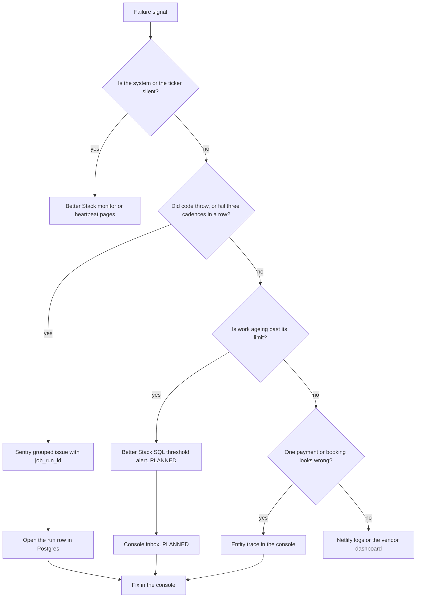
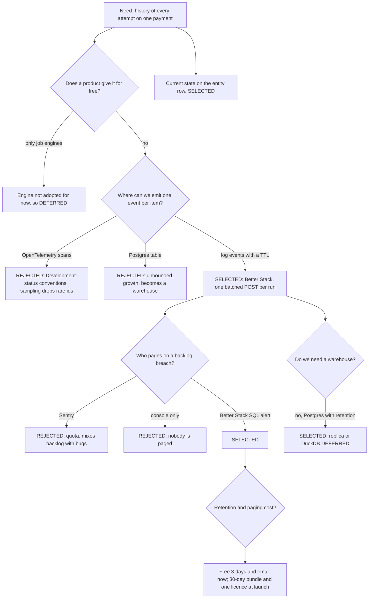

# Who watches what: Sentry, Better Stack, Postgres and the console

This page answers one question: when something goes wrong, which tool tells you, which tool explains it, and which place do you act in? It records the owner decisions of 2026-11-01 and separates what is built today from what is planned. The whole-subsystem design is in [00-system-design.md](./00-system-design.md), the job-level facts are in the [job machinery catalog](../maintenance/11-job-machinery-catalog.md), and the evidence behind the choices is in [the research page](./02-research-per-item-history-and-vendors.md). The decision record is [2026-11-01 observability ownership](../decisions/2026-11-01-observability-ownership.md).

## 1. The layers

Each question an operator asks has exactly one owner. The table below gives the owner for each question and what it covers.

| Question                         | Owner                 | What it covers                                                                                                                 |
| -------------------------------- | --------------------- | ------------------------------------------------------------------------------------------------------------------------------ |
| Is it alive? Who gets paged?     | Better Stack          | Uptime monitors, the ticker heartbeat, the status page, maintenance incidents, the tick summary and log events, backlog pages. |
| Which code broke?                | Sentry                | Exceptions, grouped issues, escalations, the `job_run_id` tag, the `cron-tick` check-in, sampled traces.                       |
| What happened (the truth)?       | Postgres              | Run rows (`SystemJobExecution`), owed markers, and the current state on each entity row.                                       |
| What do I do about it?           | Back-office console   | System Jobs, the Run metrics card, the Entity trace, and the planned Needs-attention inbox with Retry.                         |
| What did the function print?     | Netlify function logs | Raw stdout and stderr of each invocation.                                                                                      |
| What does the outside world say? | Vendor dashboards     | Razorpay, Stream, Resend and Supabase own their side of any reconciliation.                                                    |

A backlog breach is not a bug. A payment that has waited three hours is a symptom of capacity or a stuck vendor, not a thrown exception, so it pages through Better Stack and never spends Sentry quota. Sentry has a hard monthly cap, and what is over the cap is dropped, so only things that need a developer's eyes belong there.

### 1.1 The diagram

```
   failure signal                      who sees it first                 where you act
   --------------                      -----------------                 -------------
   site or /api/health down      ----> Better Stack uptime monitor ----> page or email, status page
   ticks stopped arriving        ----> Better Stack heartbeat      ----> page or email
   a job threw, or failed 3x     ----> Sentry (one grouped issue,  ----> read the stack trace, then
                                       up to ten sample contexts,         open the run row via the
                                       tag job_run_id)                    job_run_id tag
   work is ageing in a queue     ----> Better Stack event + SQL    ----> console inbox (planned),
   (PLANNED gauge)                     threshold alert                    Entity trace
   one payment looks wrong       ----> nobody pages; an operator   ----> Entity trace in the console,
                                       or customer reports it             rows in Postgres
   Postgres rows = the truth.  Netlify logs = raw prints.  Vendor dashboards = outside truth.
```

The same routing as a flowchart:



## 2. What each tool does today

Everything in this section is implemented and was checked against the code on 2026-11-01.

### 2.1 Better Stack

| Role                   | How it works                                                                                                                                                                                                                           | Where in code                                                                                                     |
| ---------------------- | -------------------------------------------------------------------------------------------------------------------------------------------------------------------------------------------------------------------------------------- | ----------------------------------------------------------------------------------------------------------------- |
| Uptime monitors        | `familiarisenow.com` and `/api/health` are polled every 3 minutes from several regions, with email alerts and a status page.                                                                                                           | Configured in the Better Stack UI; see [setup](../maintenance/00-betterstack-setup.md).                           |
| Ticker heartbeat       | Each completed tick calls `BETTERSTACK_HEARTBEAT_URL` with a 2-second timeout. If ticks stop, the heartbeat goes quiet and Better Stack alerts.                                                                                        | `pingHeartbeat()` in `netlify/functions/cron-tick.mts`.                                                           |
| Tick summary line      | One structured line per tick: `tickId`, `durationMs`, ok and accepted counts, `lockHeld`, `lockUnavailable`, and `failed`. Sent only when `ENABLE_BETTERSTACK_TELEMETRY` is `true` and the source token and ingest URL are set.        | `emitTickSummary()` in `netlify/functions/cron-tick.mts`.                                                         |
| Operational log events | `emitTelemetryLog` posts one JSON event with a 3-second timeout and never throws. Every `SystemEvent` insert is mirrored through it, so a failed reconcile or stuck payout can page.                                                   | `lib/observability/betterstack-telemetry.ts`, `lib/enterprise/system-events.ts`.                                  |
| Maintenance incidents  | Taking the site OFFLINE through the maintenance route creates a Better Stack incident, and returning it resolves the incident.                                                                                                         | `createIncident` and `resolveIncident` in `lib/betterstack.ts`, called from `app/api/admin/maintenance/route.ts`. |
| Health and canary      | `/api/health` reads Better Stack monitor status, cached for 60 seconds, when called with `?includeBetterStack=1`. The Sentry ingest canary emails and also sends an error-level Better Stack event when Sentry stops accepting errors. | `app/api/health/route.ts`, `lib/observability/ingest-alert.ts`.                                                   |

One cost fact matters for the monitors. The homepage (`app/page.tsx`) is incrementally regenerated with `revalidate = 3600`, so the CDN serves it and a poll costs no function invocation. `/api/health` is a real function call: a 3-minute interval is 14,400 invocations a month for each monitoring region, which is why the number of regions on that monitor is a billing decision (see the [billing guardrails skill](../../.claude/skills/billing-guardrails/SKILL.md)).

### 2.2 Sentry

Sentry is escalation-only, as decided in [Sentry escalations only](../decisions/2026-10-31-sentry-escalations-only.md).

- A repeated failure class becomes one grouped issue. `createRunFailureReporter` (`lib/observability/run-failures.ts`) keeps up to ten sample contexts (`SAMPLE_SIZE = 10`) and flushes once per run, never once per row.
- Every run that holds a lease tags the event with `job_run_id`, the id of the `SystemJobExecution` row. `withCronLock` (`lib/cron/with-cron-lock.ts`) sets the tag, so a Sentry issue links straight back to the run row in Postgres.
- The ticker sends a Sentry cron check-in with the monitor slug `cron-tick` on each tick (`netlify/functions/cron-tick.mts`). A missed check-in is a second opinion alongside the Better Stack heartbeat.
- Sentry Logs are enabled in `sentry.shared.config.ts` (`enableLogs: true`), but per-item events are not sent there; see the rejected options below.

### 2.3 Postgres and the console

`SystemJobExecution` holds one row per run with status, outcome, `itemsProcessed`, `errorCount`, a `result` JSON, `errorLog` and `durationMs`. The Entity trace (`lib/backoffice/entity-trace.ts`) joins money, booking, support and audit tables for one payment or booking, and the Run metrics card (`lib/backoffice/job-run-metrics.ts`) derives p50, p95 and missed windows from the same rows. Both are read-only. See [three-layers.md](./three-layers.md) for a worked missing-refund trace.

## 3. The decided target (PLANNED)

Nothing in this section is built yet. It is labelled PLANNED everywhere it appears.

1. **Current state lives on the entity row.** Attempts, last error and age stay on the refund, payout, invoice or outbox row, updated in place. Enforcer: the row itself, written with the usual CAS-in-WHERE transitions.
2. **History goes to Better Stack, one batched event per item per run.** The run collects one event per item and posts them in a single request at the end, reusing the tick-summary approach, so there is no network call per row. The schema is `{run_id, job, entity_id, outcome, reason, attempt}`. It carries identifiers only, never names or email addresses, and the log source is in the EU region. Ids only minimises what leaves the app but does not anonymise it: a payment id leads back to a customer (`Payment.userId` references `User`, and `readRootPayments()` in `lib/backoffice/entity-trace.ts` reads the customer's name), so the events are pseudonymous personal data under [DPDP §2(t)](https://www.meity.gov.in/static/uploads/2024/06/2bf1f0e9f04e6fb4f8fef35e82c42aa5.pdf), as [Sentry identity and triage](./sentry/05-identity-and-triage.md) already says of the Sentry cuid. The full schema is in the [skill reference](../../.claude/skills/observability/references/ownership-and-telemetry.md).
3. **The Entity trace links out.** The trace shows a "Better Stack events" link built from `entity_id`, or queries history through the Better Stack Query API, which is read-only SQL over HTTP.
4. **The oldest-pending-age gauge is computed once per tick in Postgres.** One cheap aggregate per capability produces `{metric: "oldest_pending_age_s", capability, value}` as a log line, and a Better Stack SQL threshold alert pages when a limit is breached.
5. **No `SystemJobRunItem` table and no warehouse.**

Worked example, in the planned design. Priya cancels a booking and is owed ₹1,180 (118,000 paise) back. The refund is stamped on her `Payment` row as an owed marker (`refundOwedPaise`, `refundOwedAttempts`), and a sweep drives it. At 10:05 IST the Razorpay call times out for the third time. The row now says `refundOwedAttempts = 3`, and the run posts one event to Better Stack: `{run_id: run_8f2, job: <sweep name>, entity_id: <payment id>, outcome: failed, reason: GATEWAY_TIMEOUT, attempt: 3}`. When someone asks "where is Priya's refund?", the Entity trace shows the row's current state, and the Better Stack link shows all three attempts across the last runs. If the oldest pending refund is older than its limit, Better Stack has already paged. The event names the payment by id only, never by Priya's name or email, but anyone with the back office can turn that id into Priya, so the event is still about her.

## 4. Options considered

The owner asked that every option be recorded with what was chosen and why. In the tables below, evidence is MEASURED (we ran it), DOCS (an official page says so) or ESTIMATE (our arithmetic). The sources are in the [research page](./02-research-per-item-history-and-vendors.md).

### 4.1 Per-item history

| Option                                                                       | What it is                                                                        | Evidence                                                                                                                             | Verdict                     | Why                                                                                                                                                    |
| ---------------------------------------------------------------------------- | --------------------------------------------------------------------------------- | ------------------------------------------------------------------------------------------------------------------------------------ | --------------------------- | ------------------------------------------------------------------------------------------------------------------------------------------------------ |
| (a) Structured Better Stack log events                                       | One batched POST per run with one event per item, in a store with a time-to-live. | DOCS: SQL Query API and alerts. ESTIMATE: 500,000 items a month is under 0.5 GB.                                                     | SELECTED                    | The pipe already exists in `lib/observability/betterstack-telemetry.ts`, it is queryable and alertable, and expiry is the vendor's job.                |
| (b) OpenTelemetry spans per item                                             | A span per item sent to a trace store.                                            | DOCS: the messaging semantic conventions are at Development status and define no job conventions; Sentry extrapolates sampled spans. | REJECTED                    | The conventions are unstable, and sampling can drop the span of a rare entity, which is the one you are searching for.                                 |
| (c) A Postgres `SystemJobRunItem` table, with or without a TTL               | One row per item per run in our database.                                         | ESTIMATE: 2 to 4 thousand lines across about 40 job modules, plus DDL.                                                               | REJECTED                    | Unbounded growth, nobody owns cleanup, and it turns the transactional database into a warehouse. It was first recommended, then rejected by the owner. |
| (d) Current state on the entity row                                          | Attempts, last error and age updated in place.                                    | MEASURED: refunds, payouts and outbox rows already work this way.                                                                    | SELECTED, together with (a) | The row answers "what is stuck now" with zero new storage, and (a) answers "what happened each time".                                                  |
| (e) A job engine's built-in history (Inngest, Trigger.dev, Vercel Workflows) | Per-run history comes free with the engine.                                       | DOCS: Inngest Free keeps 24 hours; Trigger.dev Free keeps 1 day.                                                                     | DEFERRED                    | It exists only if we adopt that engine, which the owner has ruled out for now.                                                                         |

### 4.2 Tool ownership

| Option                                            | What it is                                                                                                                             | Evidence                                                                                                   | Verdict  | Why                                                                     |
| ------------------------------------------------- | -------------------------------------------------------------------------------------------------------------------------------------- | ---------------------------------------------------------------------------------------------------------- | -------- | ----------------------------------------------------------------------- |
| Split: Sentry for errors, Better Stack for events | Sentry keeps grouped errors, the `cron-tick` check-in and sampled traces; Better Stack keeps events, heartbeat, paging and SQL alerts. | DOCS: Sentry Developer logs window is 7 days with email-only alerts; Better Stack has escalation policies. | SELECTED | Each tool does the job it is best at, and neither's quota is stretched. |
| Better Stack owns everything                      | Move errors to Better Stack too.                                                                                                       | DOCS: 100,000 exceptions free, but a newer product.                                                        | REJECTED | We would lose Sentry's grouping, stack traces and release health.       |
| Sentry owns everything                            | Per-item events and paging in Sentry.                                                                                                  | DOCS: 5,000 errors a month, hard cap; free alerts are email only.                                          | REJECTED | Quota and span sampling make it the wrong store for per-item volume.    |

### 4.3 Alert channel for a backlog breach

| Option                          | What it is                                     | Evidence                                                                                     | Verdict  | Why                                                           |
| ------------------------------- | ---------------------------------------------- | -------------------------------------------------------------------------------------------- | -------- | ------------------------------------------------------------- |
| A Better Stack event that pages | The gauge log line plus a SQL threshold alert. | DOCS: alerts on SQL charts support thresholds and can open an incident when data is missing. | SELECTED | It reaches a person, and it keeps backlog separate from bugs. |
| A Sentry escalation             | Report the breach as a Sentry event.           | DOCS: errors count against the 5,000 quota.                                                  | REJECTED | It spends quota and mixes backlog with bugs.                  |
| Console only                    | Show it in the inbox and page nobody.          | n/a                                                                                          | REJECTED | Nobody is paged, so nobody looks.                             |

### 4.4 Paging

| Option                                     | What it is                                                            | Evidence                                | Verdict  | Why                                       |
| ------------------------------------------ | --------------------------------------------------------------------- | --------------------------------------- | -------- | ----------------------------------------- |
| Email now, one responder licence at launch | Email alerts until launch, then one licence for phone and SMS paging. | DOCS: responder licence is $34 a month. | SELECTED | Spend only when real money flows.         |
| Email only                                 | Never add phone paging.                                               | n/a                                     | REJECTED | A money backlog at night needs a phone.   |
| Phone paging now                           | Buy the licence before launch.                                        | DOCS: $34 a month.                      | REJECTED | Cost before there is anything to protect. |

### 4.5 Retention

| Option                                          | What it is                                       | Evidence                                                                     | Verdict     | Why                                                                                                        |
| ----------------------------------------------- | ------------------------------------------------ | ---------------------------------------------------------------------------- | ----------- | ---------------------------------------------------------------------------------------------------------- |
| Free 3-day logs now, 30-day EU bundle at launch | Stay on the free tier, then buy the Nano bundle. | DOCS: free keeps 3 days; bundles from about $30 a month and include 30 days. | SELECTED    | Three days is enough pre-launch, and "every attempt on payment X" needs 30 days once real traffic arrives. |
| Pay-as-you-go                                   | Pay per GB for ingest and retention.             | ESTIMATE: about $0.75 a month for 5 GB in the EU.                            | ALTERNATIVE | Cheaper at low volume; the bundle is chosen for predictability.                                            |
| Free forever                                    | Never pay for retention.                         | DOCS: 3 days.                                                                | REJECTED    | History older than three days would be gone when a customer asks.                                          |

### 4.6 Data warehouse or lake

| Option                                            | What it is                                | Evidence                                                                         | Verdict          | Why                                                                                                                                                |
| ------------------------------------------------- | ----------------------------------------- | -------------------------------------------------------------------------------- | ---------------- | -------------------------------------------------------------------------------------------------------------------------------------------------- |
| Postgres plus retention                           | No new store.                             | ESTIMATE: a pre-launch marketplace has no analytical load Postgres cannot serve. | SELECTED         | Legal records stay in Postgres in any case.                                                                                                        |
| Read replica, or Parquet exports read with DuckDB | A second reader, or nightly files.        | DOCS: a small replica is about $15 a month.                                      | DEFERRED         | Trigger: the largest analytical table passes 50 to 100 GB, reports measurably hurt checkout latency, or a non-engineer needs self-serve reporting. |
| BigQuery or ClickHouse                            | A hosted warehouse fed by change capture. | DOCS: ClickHouse is usage-based with a Mumbai region.                            | REJECTED for now | Far beyond the need; revisit only after the read replica is outgrown.                                                                              |

### 4.7 Vendors evaluated

| Vendor                   | Verdict                | One line why                                                                                      |
| ------------------------ | ---------------------- | ------------------------------------------------------------------------------------------------- |
| Better Stack Telemetry   | SELECTED               | Already integrated, SQL-queryable, alertable, EU region, cheap at our volume.                     |
| Sentry                   | SELECTED (errors only) | Best-in-class Next.js errors, already wired.                                                      |
| Axiom                    | REJECTED               | Free tier is generous, but it adds a third vendor for no new capability.                          |
| Grafana Cloud            | REJECTED               | Capable, and lists India (AWS `ap-south-1`), but a new vendor and query language for now.         |
| Honeycomb                | REJECTED               | Strong for wide events, but paid plans start at $150 a month.                                     |
| SigNoz Cloud             | DEFERRED               | Lists an India region, from $49 a month; not justified yet.                                       |
| OpenObserve Cloud        | REJECTED               | Trial only, with no stated free allowance.                                                        |
| Highlight (LaunchDarkly) | REJECTED               | Its pricing page redirects to LaunchDarkly and the product is reportedly shut down; do not adopt. |
| Datadog                  | REJECTED               | Host-based pricing fits serverless badly, and the free tier lists no logs.                        |
| New Relic                | REJECTED               | The 100 GB free tier hard-stops at the limit, and it adds a vendor we do not need.                |
| PostHog                  | REJECTED               | The right tool for product analytics, the wrong one for job attempts.                             |
| Supabase logs and drains | REJECTED               | They cover Postgres, API and auth logs only, not our job events; drains need Pro.                 |

### 4.8 How the choices were reached



## 5. Costs and plans

| Layer                                  | Today                                | At launch                                                          | Basis |
| -------------------------------------- | ------------------------------------ | ------------------------------------------------------------------ | ----- |
| Sentry Developer                       | $0                                   | $0 (Team at $29 only if 5,000 errors or alert routing is outgrown) | DOCS  |
| Better Stack uptime and heartbeats     | $0 (10 monitors and heartbeats free) | $0                                                                 | DOCS  |
| Better Stack logs                      | $0, 3-day retention                  | 30-day EU bundle, about $30 a month                                | DOCS  |
| One responder licence for phone paging | not bought; email alerts             | about $34 a month                                                  | DOCS  |

The total is about $0 today and about $5 to $65 a month at launch (ESTIMATE). Neither vendor has an India region: Better Stack offers EU, US and Singapore, and Sentry offers US and EU. Grafana Cloud (AWS `ap-south-1` direct, GCP `asia-south1` through Marketplace) and SigNoz Cloud both list India; the research page compares them. Events carry identifiers only and the source is created in the EU region, but the events remain pseudonymous personal data and the EU placement does not change that. The Better Stack rollout therefore needs a processor, disclosure, access and erasure, and retention assessment, recorded in the processor inventory of [DPDP and privacy](../compliance/02-dpdp-and-privacy.md) (it has no sub-processor register yet, Gap #11). This is an engineering position, not legal advice. Highlight redirects to LaunchDarkly and is reportedly shut down, so do not adopt it.

## 6. Gaps and the order they will be built

**Prerequisite for both gaps PRs: observable ingest.** Better Stack's ingest API answers 402 once the free quota or spending limit is reached (403 for a bad source token). A cutoff stops the per-item history and the backlog gauge events together, while the ticker heartbeat and the uptime monitors, which are separate requests, stay green. Today `emitTelemetryLog` awaits `fetch` and never reads the status, so a rejection is invisible. Before either gaps PR relies on ingest:

- record and surface 402, 403 and 5xx answers (a counted rejection in the run result, not a Sentry call per event);
- add a freshness check that fires through a channel independent of ingest, for example a heartbeat or health assertion that fails when no gauge event has arrived for N minutes;
- write a per-capability missing-data policy saying what an absent gauge means for each money and compliance backlog.

Business work stays best-effort with respect to telemetry: a rejected or timed-out POST never fails the job.

1. **Gaps PR 1:** a Needs-attention inbox in the console, plus the oldest-pending-age alerts. No schema change.
2. **Gaps PR 2:** per-item Better Stack events plus the Entity trace link.
3. **Retention audit:** issue #2496, post-launch, covering the log-like tables that have no prune today.

Both gaps PRs are built after the open docs and ticker PRs (#2486 and #2494) and the two booking PRs have merged. Related issues: #2424 (operations console), #2453 (per-item run log specification, superseded in part by this decision), #2492 (starvation and oldest-pending alerts), #2496 (retention audit).

## 7. Where in code

- `lib/observability/betterstack-telemetry.ts`: `emitTelemetryLog`.
- `netlify/functions/cron-tick.mts`: `pingHeartbeat`, `emitTickSummary`, the `cron-tick` check-in.
- `lib/betterstack.ts`: `createIncident`, `resolveIncident`.
- `lib/observability/ingest-alert.ts`: the canary's email and Better Stack event.
- `lib/observability/run-failures.ts`: `createRunFailureReporter`.
- `lib/cron/with-cron-lock.ts`: the `job_run_id` tag.
- `app/api/health/route.ts`: the health endpoint and the cached Better Stack status.

The Netlify billing facts and the system-design page are owned by other in-flight changes; see [00-system-design.md](./00-system-design.md) and [deployment on Netlify](../deployment/netlify.md).

## Deprecated & Superseded Approaches

- **A Postgres per-item table (`SystemJobRunItem`).** Proposed in #2424 Phase 3 and #2453, then rejected on 2026-11-01. Do not create it; delete any residue that references it.
- **Per-item events in Sentry or as OpenTelemetry spans.** Never built; rejected for quota and sampling reasons.
- **Reporting backlog breaches to Sentry.** Superseded by the Better Stack SQL alert; Sentry stays for bugs.
