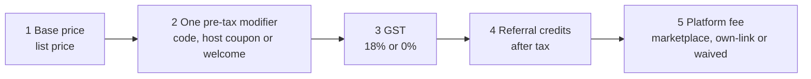

# One order, one pipeline

Every order passes through the same five slots in the same order. Each slot has exactly one funder and one cap, so levers do not multiply when a buyer holds several of them. This page is the rulebook; the files that implement each slot are in the [overview](./00-overview.md).

Two parts of the rulebook are **(planned)** and land with the tax-regime pull request: the profitability floor (one shared cap over all platform-funded spend) and the zero GST rate while the platform is unregistered. The pipeline order, the "one modifier" rule and the credit cap by take rate already exist on `dev`. Where a rule is planned, the table says so.

## The five slots

| Step | Lever (slot)                                                                                                 | Who funds                                                                          | Cap                                                                             | GST effect                                                              | TDS 194-O effect                                                                                  | Shown where                                                             |
| ---- | ------------------------------------------------------------------------------------------------------------ | ---------------------------------------------------------------------------------- | ------------------------------------------------------------------------------- | ----------------------------------------------------------------------- | ------------------------------------------------------------------------------------------------- | ----------------------------------------------------------------------- |
| 1    | Base price: the list price, or the early-bird price inside its window **(planned)**                          | none                                                                               | none                                                                            | the start of the taxable value                                          | gross base is the expert's sale price                                                             | plan card, all-in incl. GST once registered                             |
| 2    | At most one pre-tax modifier: a platform code, an expert (host) coupon **(planned)** or the welcome discount | platform for platform codes and the welcome discount; the expert for a host coupon | platform-funded total at most the platform fee minus gateway cost **(planned)** | reduces the taxable value; the invoice shows a "Discount" row           | platform-funded: none, the base stays the list price; host-funded: the base becomes the net price | invoice Discount row; the buyer's payment detail shows the rupee amount |
| 3    | GST at 18%, or 0% while unregistered **(planned)**                                                           | the buyer                                                                          | none                                                                            | computed here and only here, by `determineTax()`                        | excluded from the base                                                                            | invoice tax heads; a receipt while unregistered **(planned)**           |
| 4    | Referral credits, after tax                                                                                  | the platform                                                                       | shares the step 2 platform-funded cap                                           | none: the credit is consideration, so GST stays on the pre-credit value | none                                                                                              | a `REFERRAL_CREDIT` payment leg                                         |
| 5    | Platform fee: marketplace rate, own-link rate, or 0 under a waiver                                           | taken from the expert's side                                                       | a waiver order gets no platform promo                                           | none                                                                    | none                                                                                              | the expert's earnings                                                   |

## What is enforced today

- **One modifier.** `deriveCheckoutAmount()` drops the welcome discount when a code is present, so a code and a welcome discount never stack.
- **Order of operations.** Discount, then GST on the discounted base, then credits against the tax-inclusive total. A fixed code never drives the price below zero (`computeDiscountPaise()`).
- **Credits and the welcome discount stay inside the take rate.** The welcome percentage is `min(discountBps, fee bps)` and `creditCapPaise()` leaves `creditCapBps - welcome discount` for credits, where `creditCapBps` is at most the fee bps (`resolveCheckoutAttribution()`).
- **No promo on a waiver or host-organisation order.** `takeCannotFundPromo()` sets the welcome discount to none and the credit cap to 0, and `consumeFeeWaiver()` refuses a waiver on an order that already carries promo.
- **Money legs add up.** The funding legs sum to `Payment.amount` (the `payment_legs_sum_to_amount` trigger), with the credit leg excluded because the amount is already net of it.

## The "never" rules

1. A platform code and the welcome discount together. (Enforced.)
2. A promo on a fee-waiver or host-organisation order. (Enforced for the welcome discount and credits; **planned** for platform codes.)
3. A negative platform margin on an order. **(planned: the profitability floor.)**
4. A fake countdown timer or fake scarcity. Never built; see [coupons and early-bird](./02-coupons-and-early-bird.md).
5. A struck-through "was" price without a price actually charged in the preceding 30 days. No strike-through exists today.

Rules 3 and 5 become tests. A table-driven invariant test over every lever combination asserts that the platform margin is at least zero, that a platform lever never reduces the expert's share, that the legs sum to the amount, and that GST is computed on the step 2 value **(planned)**.

## Worked example

The cast: a learner buys a ₹1,000 consultation with an expert on the marketplace. The platform fee is 20%, so the fee is ₹200. The estimated gateway cost is 2% plus 18% GST on that, which is 2.36%, applied to the all-in ₹1,180 and rounded to ₹28. The platform-funded cap is therefore ₹200 - ₹28 = ₹172. Rates are the fallback 20% for both rails; the owner's approved rates and their reasoning are kept in Notion (Familiarise / Finance).

### Variant A: registered, marketplace, referral friend

1. The welcome discount would be 20% of ₹1,000 = ₹200, but the cap limits it to ₹172. The taxable value is ₹1,000 - ₹172 = ₹828.
2. GST is 18% of ₹828 = ₹149.04. The buyer pays ₹828 + ₹149.04 = **₹977.04** (97,704 paise).
3. Credits: ₹0, because the cap is used up.
4. The expert earns 80% of the list price, **₹800**. TDS under section 194-O is computed on ₹1,000, not on ₹828.
5. The platform keeps ₹977.04 - ₹149.04 (GST owed) - ₹800 (expert) - about ₹23 (gateway on the amount charged) = about **₹5**, which is not negative.

### Variant B: unregistered, same order (planned)

Today checkout still charges 18% whatever `PLATFORM_GSTIN` says; this is the behaviour the tax-regime pull request introduces. GST is 0%, so the buyer pays **₹828** and receives a receipt rather than a tax invoice. The platform nets about ₹8 after the expert's ₹800 and the gateway cost. While unregistered the list price is also the all-in price, so the plan card shows ₹1,000 with no GST text.

### Variant C: own-link buyer (10% fee)

The expert brought this learner through their own link, so the fee is ₹100 and the cap is ₹100 - ₹28 = ₹72. A welcome discount cannot apply to an own-link buyer (it is for a referral on a marketplace purchase), so the cap matters for a platform code or for credits. The expert earns ₹900.

### Variant D: host-funded 10% coupon (planned)

The expert funds a 10% coupon. The sale price becomes ₹900, so the platform fee is 20% of ₹900 = ₹180, the expert earns ₹720, GST is 18% of ₹900 = ₹162 (buyer pays ₹1,062), and TDS is on ₹900. No welcome discount applies, because there is already one pre-tax modifier. The expert, not the platform, carries the ₹100 reduction, and the platform still keeps its 20% of the sale price.

## Why the cap uses the fee

The platform fee is the only money the platform keeps from an order, so it is the only money that can fund a promo without taking from the expert. A promo larger than the fee, plus the cost of moving the money, would make the platform lose on the order. The profitability floor **(planned)** is one function, `platformFundedCapPaise()` in `lib/payments/pricing/`, that replaces the three separate caps in `computeDiscountPaise()`, the welcome path and `creditCapPaise()`. Platform-funded spend on an order (code plus welcome discount plus credits) may not exceed the fee minus the estimated gateway cost, with `GATEWAY_COST_BPS` as the constant (2% plus 18% GST, 236 basis points).

The GST rules behind steps 3 and 4 are in `docs/finance/60-tax/05-gst-registration-and-tax-regime.md`, created by the tax-regime pull request.

## Deprecated & Superseded Approaches

- **Capping each promo separately.** The code cap, the welcome cap and the credit cap were three unrelated functions. The planned `platformFundedCapPaise()` replaces them; do not add a fourth cap beside it.
- **Treating a code as expert-funded.** A discount code has always reduced the buyer's price while the expert's earnings stayed on the undiscounted list price, so a code is platform-funded. Do not describe it, or implement it, as coming out of the expert's share. An expert-funded reduction is the separate host coupon in [coupons and early-bird](./02-coupons-and-early-bird.md).
