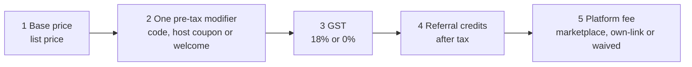

# One order, one pipeline

Every order passes through the same five slots in the same order. Each slot has exactly one funder and one cap, so levers do not multiply when a buyer holds several of them. This page is the rulebook; the files that implement each slot are in the [overview](./00-overview.md).

The whole rulebook is enforced on `dev` except the two expert-funded items that are marked **(planned)**: the host coupon and the early-bird price. The owner's decisions behind it are in the decision record [Tax compliance and pricing levers](../decisions/2026-11-09-tax-compliance-and-pricing-levers.md), and the GST rules behind steps 3 and 4 are in [GST registration and the tax regime](../finance/60-tax/05-gst-registration-and-tax-regime.md).

## The five slots

| Step | Lever (slot)                                                                                                 | Who funds                                                                          | Cap                                                                                                  | GST effect                                                                               | TDS 194-O effect                                                                                  | Shown where                                                             |
| ---- | ------------------------------------------------------------------------------------------------------------ | ---------------------------------------------------------------------------------- | ---------------------------------------------------------------------------------------------------- | ---------------------------------------------------------------------------------------- | ------------------------------------------------------------------------------------------------- | ----------------------------------------------------------------------- |
| 1    | Base price: the list price, or the early-bird price inside its window **(planned)**                          | none                                                                               | none                                                                                                 | the start of the taxable value                                                           | gross base is the expert's sale price                                                             | plan card, all-in incl. GST once registered                             |
| 2    | At most one pre-tax modifier: a platform code, an expert (host) coupon **(planned)** or the welcome discount | platform for platform codes and the welcome discount; the expert for a host coupon | platform-funded total at most the platform fee minus the gateway estimate (`platformFundedCapPaise`) | reduces the taxable value; the invoice shows a "Discount" row                            | platform-funded: none, the base stays the list price; host-funded: the base becomes the net price | invoice Discount row; the buyer's payment detail shows the rupee amount |
| 3    | GST at 18%, or 0% while unregistered                                                                         | the buyer                                                                          | none                                                                                                 | computed here and only here, by `determineTax()` from the regime in `currentGstRegime()` | excluded from the base                                                                            | invoice tax heads; a receipt while unregistered                         |
| 4    | Referral credits, after tax                                                                                  | the platform                                                                       | shares the step 2 platform-funded cap                                                                | none: the credit is consideration, so GST stays on the pre-credit value                  | none                                                                                              | a `REFERRAL_CREDIT` payment leg                                         |
| 5    | Platform fee: marketplace rate, own-link rate, or 0 under a waiver                                           | taken from the expert's side                                                       | a waiver order gets no platform promo                                                                | none                                                                                     | none                                                                                              | the expert's earnings                                                   |

## What is enforced today

- **One modifier.** `deriveCheckoutAmount()` drops the welcome discount when a code is present, so a code and a welcome discount never stack.
- **Order of operations.** Discount, then GST on the discounted base, then credits against the tax-inclusive total. A fixed code never drives the price below zero (`computeDiscountPaise()`).
- **One shared cap.** `platformFundedCapPaise()` (`lib/payments/pricing/platform-funded-cap.ts`) is `max(0, platform fee - gateway estimate)`. The code discount, the welcome discount and the credits together stay inside it, in the server derivation, the checkout preview (`calculatePricing()` in `app/checkout/plans/math.ts`) and the discount preview route. The gateway estimate is `GATEWAY_COST_BPS` (354 bps: Razorpay's worst-case rate of 3%, on international cards, Amex, Diners and EMI, plus 18% GST on that fee) on the largest amount the order can charge, rounded up.
- **No promo on a waiver or host-organisation order.** `takeCannotFundPromo()` removes the welcome discount and the credit cap, a platform code is refused there with `DISCOUNT_NOT_APPLICABLE` before any redemption is spent, and `consumeFeeWaiver()` is never spent on an order that carries promo.
- **GST follows the registration.** `determineTax()` charges 18% only when `currentGstRegime()` says registered; unregistered it charges 0% and the payment is stamped `Payment.gstRegime = UNREGISTERED`. A `PLATFORM_GSTIN` that is set but unusable refuses checkout with `GST_CONFIG_INVALID` rather than charging 0%, and `GET /api/checkout/context` answers the same typed refusal (503) without a Sentry event. Only a payment stamped `REGISTERED` is ever tax-invoiced; a payment with no stamp predates the column and counts as unregistered.
- **Money legs add up.** The funding legs sum to `Payment.amount` (the `payment_legs_sum_to_amount` trigger), with the credit leg excluded because the amount is already net of it.
- **The table is a test.** `__tests__/payments/pricing-levers-invariants.test.ts` runs every combination of regime, rail, modifier and credits and asserts the platform margin is at least zero and the expert's share is untouched.

## The "never" rules

1. A platform code and the welcome discount together. (Enforced.)
2. A promo on a fee-waiver or host-organisation order. (Enforced.)
3. A negative platform margin on an order. (Enforced by the shared cap and the invariant test.)
4. A fake countdown timer or fake scarcity. Never built; see [coupons and early-bird](./02-coupons-and-early-bird.md).
5. A struck-through "was" price without the prior price the law requires. No strike-through exists today.

## Worked example

The cast: a learner buys a ₹1,000 (100,000 paise) consultation from an expert on the marketplace. The platform fee is 20%, so the fee is ₹200.00. The gateway estimate is 3.54% of the largest amount the order can charge, rounded up: registered that is ₹1,180, so ₹41.78, and the cap is ₹200.00 - ₹41.78 = ₹158.22. Both rails use the fallback 20% until the owner approves a schedule; the approved rates and the reasoning behind them are kept in Notion (Familiarise / Finance and Pricing / Pricing Strategy). The numbers below are what `deriveCheckoutAmount()` returns.

### Variant A: registered, marketplace, referral friend

| Step                                                        |  Paise |  Rupees |
| ----------------------------------------------------------- | -----: | ------: |
| Welcome discount: 20% would be ₹200.00, the cap holds it to | 15,822 | ₹158.22 |
| Taxable value                                               | 84,178 | ₹841.78 |
| GST at 18%                                                  | 15,152 | ₹151.52 |
| The buyer pays                                              | 99,330 | ₹993.30 |
| Referral credits (the cap is used up)                       |      0 |   ₹0.00 |
| The expert's share, 80% of the list price                   | 80,000 | ₹800.00 |
| Actual gateway cost, worst case 3.54% of ₹993.30 rounded up |  3,517 |  ₹35.17 |
| Platform margin: 99,330 - 15,152 - 80,000 - 3,517           |    661 |   ₹6.61 |

TDS under section 194-O is computed on the ₹1,000 list price, not on the taxable value, because a platform-funded modifier leaves the expert's sale price alone. The margin is the worst case: at the domestic rate of 2.36% the gateway would cost 2,345 (₹23.45) and the margin would be 1,833 (₹18.33). The estimate is sized for the costliest payment method so the floor never goes negative.

### Variant B: unregistered, same order

With no valid `PLATFORM_GSTIN` the gateway estimate is taken on ₹1,000, so it is ₹35.40 and the cap is ₹164.60. The welcome discount is ₹164.60, there is no GST, and the buyer pays **₹835.40** and receives a receipt rather than a tax invoice. The expert still earns ₹800.00 and the platform keeps 83,540 - 80,000 - 2,958 = 582 paise (₹5.82) after the gateway's worst case. While unregistered the list price is also the all-in price, so the plan card shows ₹1,000 with no GST text.

### Variant C: own-link buyer (10% fee)

The expert brought this learner through their own link, so the fee is ₹100.00 and the cap is ₹100.00 - ₹41.78 = ₹58.22 registered (₹100.00 - ₹35.40 = ₹64.60 unregistered). A welcome discount cannot apply to an own-link buyer (it is for a referral on a marketplace purchase), so the cap matters for a platform code or for credits. The expert earns ₹900.00.

### Variant D: host-funded 10% coupon (planned)

The expert funds a 10% coupon. The sale price becomes ₹900, so the platform fee is 20% of ₹900 = ₹180, the expert earns ₹720, GST is 18% of ₹900 = ₹162 (the buyer pays ₹1,062), and TDS is on ₹900. No welcome discount applies, because there is already one pre-tax modifier. The expert, not the platform, carries the ₹100 reduction, and the platform still keeps its 20% of the sale price.

## Why the cap uses the fee

The platform fee is the only money the platform keeps from an order, so it is the only money that can fund a promo without taking from the expert. A promo larger than the fee, plus the cost of moving the money, would make the platform lose on the order. `platformFundedCapPaise()` therefore subtracts the gateway estimate from the fee, and every platform-funded lever (code, welcome discount, credits) draws from that one amount.

## Deprecated & Superseded Approaches

- **Capping each promo separately.** The code cap, the welcome cap and the credit cap were three unrelated rules, and a code had no cap at all. `platformFundedCapPaise()` replaced them; do not add a fourth cap beside it.
- **GST charged whatever `PLATFORM_GSTIN` said.** `determineTax()` used to charge 18% on every domestic order. It now takes the regime as an argument; never call it with a hard-coded `true`.
- **Treating a code as expert-funded.** A discount code has always reduced the buyer's price while the expert's earnings stayed on the undiscounted list price, so a code is platform-funded. Do not describe it, or implement it, as coming out of the expert's share. An expert-funded reduction is the separate host coupon in [coupons and early-bird](./02-coupons-and-early-bird.md).
