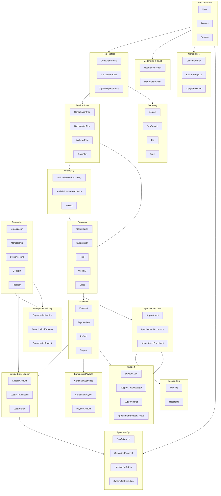

# Familiarise — Prisma Schema Map

Every model in the database, how they relate, which state machine each enum
encodes, and which rule the database itself refuses to let you break.

**Scale.** 165 models, 151 enums, across
31 domains.

**The map is split.** The domain diagrams live in
[`domains/`](./domains/) — one file per topic — because a single file
carrying every diagram renders to roughly 16 MB of inline SVG, which is past
what GitHub's markdown renderer will lay out on one page. The index below
holds the master diagram, the enforcer inventory and the enum reference.

**The Prisma schema is not the whole truth.** The rules that matter most are
often not expressible in Prisma and live in `prisma/sql/*.sql` as CHECK
constraints, partial unique indexes, exclusion constraints and triggers.
[Section 2](#2-enforcers--the-prismasql-sidecars) lists all of them by name
and table. Where this document says "the database refuses it", that section
names the object that does the refusing.

**Money.** Every monetary column is `BigInt` **paise** in Postgres, mapped to
`number` at the Prisma client boundary in `lib/prisma.ts`. Settlement is INR
only, and the database enforces that.

**The schema is additive-only** under the launch freeze: new nullable columns
and new models are allowed; renames, drops of live columns and type changes are
not, until launch cutover.

**This file is generated.** `npm run docs:schema-map` re-parses
`prisma/schema.prisma` and rewrites it and its parts;
`scripts/ci/check-schema-map.ts` fails the build when the committed map has
drifted from the schema. The domain grouping and the prose live in
`scripts/prisma/schema-domains.ts`.

## Contents

| #   | Domain                                                                                                                                    |                                                                                                 |
| --- | ----------------------------------------------------------------------------------------------------------------------------------------- | ----------------------------------------------------------------------------------------------- |
| 1.  | [Identity & Profiles](./domains/01-identity-and-profiles.md)                                                                              | Who a person is, what role they hold, and the background they bring.                            |
| 2.  | [Identity & Authentication](./domains/01-identity-and-profiles.md#1-identity--authentication)                                             |                                                                                                 |
| 3.  | [Role Profiles](./domains/01-identity-and-profiles.md#2-role-profiles)                                                                    |                                                                                                 |
| 4.  | [Professional Background & Verification](./domains/01-identity-and-profiles.md#3-professional-background--verification)                   |                                                                                                 |
| 5.  | [Consultant Taxonomy](./domains/01-identity-and-profiles.md#4-consultant-taxonomy)                                                        |                                                                                                 |
| 6.  | [Plans & Availability](./domains/02-plans-and-availability.md)                                                                            | What is sold, who else sells it with you, and when you are open.                                |
| 7.  | [Service Plans & Curriculum](./domains/02-plans-and-availability.md#1-service-plans--curriculum)                                          |                                                                                                 |
| 8.  | [Collaborators & Revenue Splits](./domains/02-plans-and-availability.md#2-collaborators--revenue-splits)                                  |                                                                                                 |
| 9.  | [Availability, Waitlist & Backup Windows](./domains/02-plans-and-availability.md#3-availability-waitlist--backup-windows)                 |                                                                                                 |
| 10. | [Bookings & Appointments](./domains/03-bookings-and-appointments.md)                                                                      | The request-to-payment chain, and the appointment every booking resolves to.                    |
| 11. | [One-to-One Bookings](./domains/03-bookings-and-appointments.md#1-one-to-one-bookings)                                                    |                                                                                                 |
| 12. | [Group Bookings — Webinar & Class](./domains/03-bookings-and-appointments.md#2-group-bookings--webinar--class)                            |                                                                                                 |
| 13. | [Appointment — The Pivot Model](./domains/03-bookings-and-appointments.md#3-appointment--the-pivot-model)                                 |                                                                                                 |
| 14. | [Lifecycle & Sessions](./domains/04-lifecycle-and-sessions.md)                                                                            | Ending a booking early, moving it, and running the session it becomes.                          |
| 15. | [Cancellation Policy & Reschedule](./domains/04-lifecycle-and-sessions.md#1-cancellation-policy--reschedule)                              |                                                                                                 |
| 16. | [Session Infrastructure, Attendance & Recordings](./domains/04-lifecycle-and-sessions.md#2-session-infrastructure-attendance--recordings) |                                                                                                 |
| 17. | [Session Documents](./domains/04-lifecycle-and-sessions.md#3-session-documents)                                                           |                                                                                                 |
| 18. | [Payments & Pricing](./domains/05-payments-and-pricing.md)                                                                                | Money in, money back, and the platform's own fee policy.                                        |
| 19. | [Payments, Refunds & Disputes](./domains/05-payments-and-pricing.md#1-payments-refunds--disputes)                                         |                                                                                                 |
| 20. | [Platform Pricing & Fee Policy](./domains/05-payments-and-pricing.md#2-platform-pricing--fee-policy)                                      |                                                                                                 |
| 21. | [Earnings & Tax](./domains/06-earnings-and-tax.md)                                                                                        | From a captured payment to money in a bank account, and the tax withheld on the way.            |
| 22. | [Consultant Earnings & Payouts](./domains/06-earnings-and-tax.md#1-consultant-earnings--payouts)                                          |                                                                                                 |
| 23. | [Tax — TDS, GST & Adjustments](./domains/06-earnings-and-tax.md#2-tax--tds-gst--adjustments)                                              |                                                                                                 |
| 24. | [Invoicing & Referrals](./domains/07-invoicing-and-referrals.md)                                                                          | The tax documents a buyer receives, and the credits that bring them back.                       |
| 25. | [Consumer Invoicing & Credit Notes](./domains/07-invoicing-and-referrals.md#1-consumer-invoicing--credit-notes)                           |                                                                                                 |
| 26. | [Referrals & Credit Pools](./domains/07-invoicing-and-referrals.md#2-referrals--credit-pools)                                             |                                                                                                 |
| 27. | [Expert–Customer Relationships](./domains/07-invoicing-and-referrals.md#3-expertcustomer-relationships)                                   |                                                                                                 |
| 28. | [Enterprise](./domains/08-enterprise.md)                                                                                                  | The organisation, what it buys, what it is billed, and the ledger underneath.                   |
| 29. | [Enterprise Core — Organisation & Membership](./domains/08-enterprise.md#1-enterprise-core--organisation--membership)                     |                                                                                                 |
| 30. | [Enterprise Billing, Programs & Wallets](./domains/08-enterprise.md#2-enterprise-billing-programs--wallets)                               |                                                                                                 |
| 31. | [Enterprise Invoicing, Receipts & Organisation Payouts](./domains/08-enterprise.md#3-enterprise-invoicing-receipts--organisation-payouts) |                                                                                                 |
| 32. | [Double-Entry Ledger & Gateway Settlement](./domains/08-enterprise.md#4-double-entry-ledger--gateway-settlement)                          |                                                                                                 |
| 33. | [Support & Moderation](./domains/09-support-and-moderation.md)                                                                            | The case a support conversation becomes, the rating that follows, and the moderation over both. |
| 34. | [Support — Legacy Queues & Self-Serve Threads](./domains/09-support-and-moderation.md#1-support--legacy-queues--self-serve-threads)       |                                                                                                 |
| 35. | [Support — The Canonical Case](./domains/09-support-and-moderation.md#2-support--the-canonical-case)                                      |                                                                                                 |
| 36. | [Feedback & Ratings](./domains/09-support-and-moderation.md#3-feedback--ratings)                                                          |                                                                                                 |
| 37. | [Moderation, Trust & Incidents](./domains/09-support-and-moderation.md#4-moderation-trust--incidents)                                     |                                                                                                 |
| 38. | [Compliance & System](./domains/10-compliance-and-system.md)                                                                              | Consent, erasure and the operational substrate everything else runs on.                         |
| 39. | [Leads](./domains/10-compliance-and-system.md#1-leads)                                                                                    |                                                                                                 |
| 40. | [Compliance — DPDP Consent, Erasure & Data Rights](./domains/10-compliance-and-system.md#2-compliance--dpdp-consent-erasure--data-rights) |                                                                                                 |
| 41. | [System, Operations & Notification Delivery](./domains/10-compliance-and-system.md#3-system-operations--notification-delivery)            |                                                                                                 |

## 1. Master domain map

The 31 domains below, and how the identity and money layers cut
across them.

**The three rules that shape everything else.**

1. **Identity is the only root.** Every row that belongs to a person resolves to
   `User.id`. Money resolves to `Payment`; a booking resolves to
   `Appointment`, never directly to a booking-type row.
2. **Money has one writer per transition.** A status change on `Payment`,
   `Refund`, `Appointment` or `ConsultantPayout` is a conditional update
   that names the expected prior status in its `WHERE` clause. The ledger
   behind it is append-only, and a reversal is a counter-transaction rather
   than an edited row.
3. **The database enforces the invariants, not the application.** The
   application may check first, but the object that actually refuses the bad
   write is named in the enforcers section.

## 2. Enforcers — the `prisma/sql` sidecars

The schema is managed with `prisma db push`, which cannot express a CHECK
that spans columns, a partial unique index, a GiST exclusion constraint or a
constraint trigger. Those live in three sidecar files and are applied and
asserted separately:

| File                                   | What it holds                                                                                         |
| -------------------------------------- | ----------------------------------------------------------------------------------------------------- |
| `prisma/sql/check-constraints.sql`     | CHECK constraints, partial unique indexes, GiST exclusion constraints, and the immutability triggers. |
| `prisma/sql/ledger-triggers.sql`       | The double-entry ledger's immutability and balance triggers.                                          |
| `prisma/sql/payment-legs-triggers.sql` | The payment-leg sum identity, the header-versus-legs identity, and the refund ceiling.                |

`scripts/db/sidecar-objects.ts` is the one parser that derives the expected
object list from those files, and `scripts/ci/check-db-sidecars.ts` asserts
that the live database actually has every one of them. The inventory below is
generated from that same parser, so it is exactly the list CI asserts.

| Object                                             | Kind       | Table                   |
| -------------------------------------------------- | ---------- | ----------------------- |
| `appointment_parent_matches_type`                  | constraint | `Appointment`           |
| `AppointmentDocument_fileSize_positive_check`      | constraint | `AppointmentDocument`   |
| `billing_account_wallet_nonnegative`               | constraint | `BillingAccount`        |
| `class_max_participants_min`                       | constraint | `Class`                 |
| `class_plan_max_participants_min`                  | constraint | `ClassPlan`             |
| `class_plan_price_nonnegative`                     | constraint | `ClassPlan`             |
| `class_plan_total_sessions_min`                    | constraint | `ClassPlan`             |
| `collaborator_plan_xor`                            | constraint | `Collaborator`          |
| `collaborator_role_matches_plan_type`              | constraint | `Collaborator`          |
| `collaborator_share_bps_in_range`                  | constraint | `Collaborator`          |
| `collaborator_tier_matches_role`                   | constraint | `Collaborator`          |
| `consultant_earnings_amounts_nonnegative`          | constraint | `ConsultantEarnings`    |
| `consultant_earnings_batched_has_payout`           | constraint | `ConsultantEarnings`    |
| `consultant_earnings_currency_inr`                 | constraint | `ConsultantEarnings`    |
| `consultant_earnings_share_bps_range`              | constraint | `ConsultantEarnings`    |
| `consultant_fee_waiver_sessions_nonnegative`       | constraint | `ConsultantFeeWaiver`   |
| `consultant_payout_amounts_nonnegative`            | constraint | `ConsultantPayout`      |
| `consultant_payout_currency_inr`                   | constraint | `ConsultantPayout`      |
| `consultant_payout_tds_fy_format`                  | constraint | `ConsultantPayout`      |
| `consultant_payout_tds_threshold_sane`             | constraint | `ConsultantPayout`      |
| `consultant_review_group_has_event`                | constraint | `ConsultantReview`      |
| `consultant_review_removed_pair`                   | constraint | `ConsultantReview`      |
| `consultant_review_reply_removed_pair`             | constraint | `ConsultantReview`      |
| `consultation_plan_price_nonnegative`              | constraint | `ConsultationPlan`      |
| `consumer_credit_note_amounts_nonnegative`         | constraint | `ConsumerCreditNote`    |
| `consumer_credit_note_tax_head_xor`                | constraint | `ConsumerCreditNote`    |
| `consumer_invoice_amounts_nonnegative`             | constraint | `ConsumerInvoice`       |
| `consumer_invoice_tax_head_xor`                    | constraint | `ConsumerInvoice`       |
| `contract_payment_terms_nonnegative`               | constraint | `Contract`              |
| `credit_note_amounts_nonnegative`                  | constraint | `CreditNote`            |
| `credit_note_trigger_xor`                          | constraint | `CreditNote`            |
| `credit_pool_config_pricing_sane`                  | constraint | `CreditPoolConfig`      |
| `discount_code_uses_within_cap`                    | constraint | `DiscountCode`          |
| `dispute_amount_nonnegative`                       | constraint | `Dispute`               |
| `dispute_currency_inr`                             | constraint | `Dispute`               |
| `earnings_hold_one_earning`                        | constraint | `EarningsHold`          |
| `invoice_line_item_amounts_nonnegative`            | constraint | `InvoiceLineItem`       |
| `ledger_account_currency_inr`                      | constraint | `LedgerAccount`         |
| `ledger_entry_amount_positive`                     | constraint | `LedgerEntry`           |
| `licensed_seat_config_pricing_sane`                | constraint | `LicensedSeatConfig`    |
| `moderation_action_has_target`                     | constraint | `ModerationAction`      |
| `moderation_action_target_matches_type`            | constraint | `ModerationAction`      |
| `moderation_report_review_has_review`              | constraint | `ModerationReport`      |
| `occurrence_no_confirmed_overlap`                  | constraint | `AppointmentOccurrence` |
| `occurrence_time_order`                            | constraint | `AppointmentOccurrence` |
| `onboarding_draft_payload_size`                    | constraint | `onboarding_drafts`     |
| `org_earnings_amounts_nonnegative`                 | constraint | `OrganizationEarnings`  |
| `org_earnings_batched_has_payout`                  | constraint | `OrganizationEarnings`  |
| `org_earnings_split_within_gross`                  | constraint | `OrganizationEarnings`  |
| `org_invoice_amounts_nonnegative`                  | constraint | `OrganizationInvoice`   |
| `org_payout_amounts_nonnegative`                   | constraint | `OrganizationPayout`    |
| `org_payout_tds_fy_format`                         | constraint | `OrganizationPayout`    |
| `org_stream_recording_retention_days_range`        | constraint | `organizations`         |
| `overage_marginal_is_base_plus_surcharge`          | constraint | `OverageEvent`          |
| `payment_amounts_nonnegative`                      | constraint | `Payment`               |
| `payment_currency_inr`                             | constraint | `Payment`               |
| `payment_leg_nonreversal_nonnegative`              | constraint | `PaymentLeg`            |
| `payment_platform_fee_bps_range`                   | constraint | `Payment`               |
| `payment_refund_owed_paise_positive`               | constraint | `Payment`               |
| `payment_welcome_discount_positive`                | constraint | `Payment`               |
| `PlanMaterial_single_plan_fk_check`                | constraint | `PlanMaterial`          |
| `platform_fee_schedule_valid`                      | constraint | `PlatformFeeSchedule`   |
| `platform_incident_time_order`                     | constraint | `PlatformIncident`      |
| `program_assignment_no_active_overlap`             | constraint | `ProgramAssignment`     |
| `purchase_order_amounts_coherent`                  | constraint | `PurchaseOrder`         |
| `rate_card_bps_sum_is_whole`                       | constraint | `RateCard`              |
| `Recording_storage_and_publish_check`              | constraint | `Recording`             |
| `referral_credit_balance_consistent`               | constraint | `ReferralCredit`        |
| `referral_credit_usage_nonnegative`                | constraint | `ReferralCreditUsage`   |
| `referral_program_config_ranges`                   | constraint | `ReferralProgramConfig` |
| `refund_amount_nonnegative`                        | constraint | `Refund`                |
| `refund_currency_inr`                              | constraint | `Refund`                |
| `sso_provider_id_not_reserved`                     | constraint | `ssoProvider`           |
| `subscription_plan_price_nonnegative`              | constraint | `SubscriptionPlan`      |
| `subscription_plan_total_sessions_min`             | constraint | `SubscriptionPlan`      |
| `subscription_sessions_returned_range`             | constraint | `Subscription`          |
| `support_case_event_target_xor`                    | constraint | `SupportCaseEvent`      |
| `support_case_scope_and_shape_chk`                 | constraint | `SupportCase`           |
| `tds_adjustment_deductee_xor`                      | constraint | `TdsAdjustment`         |
| `tds_rate_bps_and_window_sane`                     | constraint | `TdsRate`               |
| `tds_rate_bps_bounds`                              | constraint | `TdsRate`               |
| `tds_record_deductee_xor`                          | constraint | `TDSRecord`             |
| `tds_record_financial_year_format`                 | constraint | `TDSRecord`             |
| `tds_record_payout_rail_matches`                   | constraint | `TDSRecord`             |
| `wallet_topup_amount_positive`                     | constraint | `WalletTopUp`           |
| `webhook_event_processed_error_exclusive`          | constraint | `WebhookEvent`          |
| `webhook_event_processed_timestamp_consistent`     | constraint | `WebhookEvent`          |
| `webinar_max_participants_min`                     | constraint | `Webinar`               |
| `webinar_plan_max_participants_min`                | constraint | `WebinarPlan`           |
| `webinar_plan_price_nonnegative`                   | constraint | `WebinarPlan`           |
| `appointment_doc_thread_version_unique`            | index      | —                       |
| `appointment_feedback_level_key`                   | index      | —                       |
| `appointment_occurrence_live_ordinal_key`          | index      | —                       |
| `AppointmentDocument_active_storagePath_key`       | index      | —                       |
| `cancellation_policy_one_active_per_scope`         | index      | —                       |
| `cancellation_policy_scope_version`                | index      | —                       |
| `collaborator_one_presenter_class`                 | index      | —                       |
| `collaborator_one_presenter_webinar`               | index      | —                       |
| `consultant_earnings_occurrence_key`               | index      | —                       |
| `consultant_payout_one_tds_catch_up_per_fy`        | index      | —                       |
| `consultant_review_pair_track_event_key`           | index      | —                       |
| `contract_one_active_per_billing_account_idx`      | index      | —                       |
| `earnings_hold_active_consultant_key`              | index      | —                       |
| `earnings_hold_active_org_key`                     | index      | —                       |
| `erasure_request_active_user_key`                  | index      | —                       |
| `FailedEmail_active_outbox_idx`                    | index      | —                       |
| `FailedEmail_sent_unscrubbed_updatedAt_idx`        | index      | —                       |
| `FailedEmailBatch_active_outbox_idx`               | index      | —                       |
| `invitations_org_email_pending_key`                | index      | —                       |
| `NotificationOutbox_active_outbox_idx`             | index      | —                       |
| `ops_action_proposal_one_open_key`                 | index      | —                       |
| `org_domain_claims_verified_domain_key`            | index      | —                       |
| `organization_earnings_split_key`                  | index      | —                       |
| `OverageEvent_bookingUtilizationId_batchKey_key`   | index      | —                       |
| `Payment_live_welcome_discount_user_key`           | index      | —                       |
| `rate_card_one_open_window`                        | index      | —                       |
| `Recording_streamRecordingId_unique_idx`           | index      | —                       |
| `support_case_event_legacy_csat_key`               | index      | —                       |
| `support_case_open_scope_key`                      | index      | —                       |
| `support_case_subject_primary_key`                 | index      | —                       |
| `SystemJobExecution_running_jobName_key`           | index      | —                       |
| `WebhookEvent_unprocessed_provider_receivedAt_idx` | index      | —                       |
| `booking_status_history_immutable`                 | trigger    | —                       |
| `ledger_entry_immutable`                           | trigger    | —                       |
| `ledger_transaction_immutable`                     | trigger    | —                       |
| `ledger_txn_balanced`                              | trigger    | —                       |
| `payment_amount_vs_legs`                           | trigger    | —                       |
| `payment_legs_sum_to_amount`                       | trigger    | —                       |
| `payment_refunds_within_amount`                    | trigger    | —                       |
| `review_revision_immutable`                        | trigger    | —                       |
| `usage_ledger_entry_immutable`                     | trigger    | —                       |

### The ones worth knowing by heart

| Object                                    | What it refuses                                                                                                                                                                     |
| ----------------------------------------- | ----------------------------------------------------------------------------------------------------------------------------------------------------------------------------------- |
| `occurrence_no_confirmed_overlap`         | Two confirmed sessions for one consultant at the same time. A GiST exclusion constraint, so it is race-proof at commit. It deliberately ignores tentative holds and cancelled rows. |
| `payment_legs_sum_to_amount`              | A payment whose funding legs do not add up to its amount.                                                                                                                           |
| `payment_amount_vs_legs`                  | A payment whose header amount disagrees with its legs.                                                                                                                              |
| `payment_refunds_within_amount`           | Refunds totalling more than the captured amount.                                                                                                                                    |
| `ledger_txn_balanced`                     | A ledger transaction whose debits do not equal its credits.                                                                                                                         |
| `ledger_entry_immutable`                  | An update or delete of a ledger posting.                                                                                                                                            |
| `ledger_transaction_immutable`            | An update or delete of a ledger transaction.                                                                                                                                        |
| `usage_ledger_entry_immutable`            | An update or delete of a usage counter.                                                                                                                                             |
| `booking_status_history_immutable`        | An update or delete of a booking status transition.                                                                                                                                 |
| `review_revision_immutable`               | An update or delete of a review revision.                                                                                                                                           |
| `support_case_open_scope_key`             | Two open support cases in the same ownership scope.                                                                                                                                 |
| `support_case_scope_and_shape_chk`        | A case whose scope and its columns disagree.                                                                                                                                        |
| `support_case_event_target_xor`           | A case event that points at two targets or none.                                                                                                                                    |
| `consultant_earnings_occurrence_key`      | The same occurrence being paid out twice.                                                                                                                                           |
| `organization_earnings_split_key`         | The same organisation split being recorded twice.                                                                                                                                   |
| `appointment_feedback_level_key`          | Two ratings by the same person for the same call, with nulls treated as distinct.                                                                                                   |
| `program_assignment_no_active_overlap`    | Two active program assignments for one member.                                                                                                                                      |
| `org_earnings_split_within_gross`         | An organisation split whose parts exceed the gross.                                                                                                                                 |
| `overage_marginal_is_base_plus_surcharge` | An overage charge whose marginal amount is not base plus surcharge.                                                                                                                 |
| `rate_card_bps_sum_is_whole`              | A three-way fee split that is not exactly 10,000 basis points.                                                                                                                      |
| `onboarding_draft_payload_size`           | An onboarding draft blob above the byte cap.                                                                                                                                        |
| `webhook_event_processed_error_exclusive` | A gateway webhook claiming both processed and failed.                                                                                                                               |

## 3. Enum reference

Every enum in the schema, with its full value list. Enums are declared below the
model that uses them, and a new value is normally a schema change rather than a
free-text string.

| Enum                           | Values                                                                                                                                                                                                                                                                                                                                                                                           |
| ------------------------------ | ------------------------------------------------------------------------------------------------------------------------------------------------------------------------------------------------------------------------------------------------------------------------------------------------------------------------------------------------------------------------------------------------ |
| `SupportFlowOutcomeKind`       | `RESOLVED`, `ESCALATED`                                                                                                                                                                                                                                                                                                                                                                          |
| `SupportCaseStatus`            | `OPEN`, `IN_PROGRESS`, `ESCALATED`, `ON_HOLD`, `RESOLVED`, `CLOSED`                                                                                                                                                                                                                                                                                                                              |
| `SupportCaseKind`              | `INCIDENT`, `PROBLEM`                                                                                                                                                                                                                                                                                                                                                                            |
| `SupportSubjectType`           | `APPOINTMENT`, `OCCURRENCE`, `PAYMENT`, `REFUND`, `INVOICE`, `ORGANIZATION`, `ACCOUNT`                                                                                                                                                                                                                                                                                                           |
| `SupportCaseEventKind`         | `CREATED`, `STATUS_CHANGED`, `PRIORITY_CHANGED`, `ASSIGNED`, `UNASSIGNED`, `VISIBILITY_CHANGED`, `LINKED_PROBLEM`, `DUPLICATE_CLOSED`, `REOPENED`, `AUTO_CLOSED`, `CSAT_RATED`                                                                                                                                                                                                                   |
| `AppointmentFeedbackRole`      | `CONSULTEE`, `PROVIDER`                                                                                                                                                                                                                                                                                                                                                                          |
| `RatingCause`                  | `CONSULTANT`, `PLATFORM_TECHNICAL`, `PAYMENT`, `SCHEDULING`, `CONTENT`, `OTHER`                                                                                                                                                                                                                                                                                                                  |
| `SupportThreadStatus`          | `OPEN`, `IN_PROGRESS`, `ESCALATED`, `RESOLVED`, `CLOSED`                                                                                                                                                                                                                                                                                                                                         |
| `SupportChannel`               | `SELF_SERVE`, `AI`, `HUMAN`                                                                                                                                                                                                                                                                                                                                                                      |
| `SupportMessageSender`         | `USER`, `BOT`, `AGENT`, `SYSTEM`                                                                                                                                                                                                                                                                                                                                                                 |
| `SupportThreadCategory`        | `CANCEL_REFUND`, `RESCHEDULE`, `NO_SHOW`, `TECHNICAL`, `DOCUMENTS`, `PAYMENT_STATUS`, `RECORDING_ACCESS`, `QUALITY_COMPLAINT`, `SPONSORSHIP_BILLING`, `ORG_ADMIN_DISPUTE`, `OTHER`                                                                                                                                                                                                               |
| `PlatformFeedbackStatus`       | `PENDING`, `ACKNOWLEDGED`, `IN_PROGRESS`, `RESOLVED`, `CLOSED`                                                                                                                                                                                                                                                                                                                                   |
| `SupportTicketStatus`          | `OPEN`, `IN_PROGRESS`, `ON_HOLD`, `RESOLVED`, `CLOSED`                                                                                                                                                                                                                                                                                                                                           |
| `SupportPriority`              | `LOW`, `MEDIUM`, `HIGH`, `URGENT`                                                                                                                                                                                                                                                                                                                                                                |
| `CancellationReason`           | `SCHEDULE_CONFLICT`, `FOUND_ALTERNATIVE`, `FINANCIAL_REASONS`, `PERSONAL_EMERGENCY`, `NO_LONGER_NEEDED`, `CONSULTANT_UNAVAILABLE`, `CONSULTANT_EMERGENCY`, `PAYMENT_FAILED`, `EXPIRED`, `CONSULTANT_ISSUE`, `TECHNICAL_ISSUE`, `MODERATION`, `OTHER`                                                                                                                                             |
| `SupportIssueType`             | `CONSULTANT_NO_SHOW`, `CONSULTANT_LATE`, `SESSION_ENDED_EARLY`, `SESSION_QUALITY_POOR`, `COMMUNICATION_ISSUE`, `TECHNICAL_ISSUES`, `WRONG_CONSULTANT`, `ACCESS_ISSUE`, `TIMEZONE_CONFUSION`, `RESCHEDULING_HELP`, `PAYMENT_FAILED`, `CHARGED_TWICE`, `REFUND_REQUEST`, `BILLING_QUESTION`, `DOCUMENT_ISSUE`, `WANT_TO_CANCEL`, `CANCELLATION_ISSUE`, `ACCOUNT_ISSUE`, `GENERAL_INQUIRY`, `OTHER` |
| `InvitationStatus`             | `PENDING`, `ACCEPTED`, `CANCELED`, `EXPIRED`                                                                                                                                                                                                                                                                                                                                                     |
| `MemberRole`                   | `OWNER`, `MAINTAINER`, `BILLING_ADMIN`, `MANAGER`, `EXPERT`, `LEARNER`, `SUPPORT`                                                                                                                                                                                                                                                                                                                |
| `MemberStatus`                 | `PENDING`, `ACTIVE`, `SUSPENDED`, `REMOVED`, `ERASED`                                                                                                                                                                                                                                                                                                                                            |
| `OrgStatus`                    | `PENDING_VERIFICATION`, `ACTIVE`, `SUSPENDED`, `DEACTIVATED`                                                                                                                                                                                                                                                                                                                                     |
| `OrgKind`                      | `AGENCY`, `ENTERPRISE`, `SOLO_PRACTICE`                                                                                                                                                                                                                                                                                                                                                          |
| `OrgSizeBucket`                | `SMALL_1_50`, `MEDIUM_51_200`, `LARGE_201_1000`, `ENTERPRISE_1000_PLUS`                                                                                                                                                                                                                                                                                                                          |
| `DataRegion`                   | `IN`, `US`, `EU`                                                                                                                                                                                                                                                                                                                                                                                 |
| `Currency`                     | `INR`, `USD`, `EUR`, `GBP`                                                                                                                                                                                                                                                                                                                                                                       |
| `ParentEntityType`             | `LISTED_US`, `PRIVATE_US`, `EU`, `OTHER`                                                                                                                                                                                                                                                                                                                                                         |
| `GstRegStatus`                 | `REGULAR`, `COMPOSITION`, `UNREGISTERED`                                                                                                                                                                                                                                                                                                                                                         |
| `PayoutRecipient`              | `SELF`, `ORGANIZATION`                                                                                                                                                                                                                                                                                                                                                                           |
| `FundingSource`                | `PERSONAL`, `LICENSE`, `WALLET`, `INVOICE`                                                                                                                                                                                                                                                                                                                                                       |
| `ContractStatus`               | `DRAFT`, `ACTIVE`, `EXPIRED`, `TERMINATED`                                                                                                                                                                                                                                                                                                                                                       |
| `ContractSupersessionReason`   | `AMENDMENT`, `RENEWAL`, `TERMINATION_REPLACEMENT`                                                                                                                                                                                                                                                                                                                                                |
| `SubscriptionModel`            | `PER_SEAT`, `FLAT_FEE`                                                                                                                                                                                                                                                                                                                                                                           |
| `BillingCycle`                 | `MONTHLY`, `QUARTERLY`, `ANNUAL`                                                                                                                                                                                                                                                                                                                                                                 |
| `WalletReason`                 | `TOPUP`, `BOOKING`, `REFUND`, `ADJUSTMENT`                                                                                                                                                                                                                                                                                                                                                       |
| `WalletTopUpStatus`            | `PENDING`, `CONFIRMED`, `FAILED`                                                                                                                                                                                                                                                                                                                                                                 |
| `ProgramType`                  | `LICENSED_SEAT`, `CREDIT_POOL`                                                                                                                                                                                                                                                                                                                                                                   |
| `ProgramStatus`                | `ACTIVE`, `PAUSED`, `EXPIRED`, `CANCELLED`                                                                                                                                                                                                                                                                                                                                                       |
| `AssignmentStatus`             | `ACTIVE`, `ROLLED`, `PAUSED`, `CLOSED`, `CANCELLED`                                                                                                                                                                                                                                                                                                                                              |
| `OverageBehavior`              | `BLOCK`, `CHARGE_MEMBER`, `CHARGE_ORG`                                                                                                                                                                                                                                                                                                                                                           |
| `OverageChargeStatus`          | `PENDING`, `ACCRUED`, `CHARGED`, `BLOCKED`, `REVERSED`, `FAILED`                                                                                                                                                                                                                                                                                                                                 |
| `OrgPlanVisibility`            | `PUBLIC`, `ORG_ONLY`, `ORG_AND_PUBLIC`                                                                                                                                                                                                                                                                                                                                                           |
| `CoveredPlanType`              | `CONSULTATION`, `CLASS`, `WEBINAR`, `SUBSCRIPTION`                                                                                                                                                                                                                                                                                                                                               |
| `OrgPayoutAccountStatus`       | `PENDING_VERIFICATION`, `VERIFIED`, `FAILED_VERIFICATION`, `SUSPENDED`                                                                                                                                                                                                                                                                                                                           |
| `PayoutRailProvider`           | `RAZORPAYX`, `CASHFREE_PAYOUTS`                                                                                                                                                                                                                                                                                                                                                                  |
| `ResidencyStatus`              | `RESIDENT`, `NON_RESIDENT`                                                                                                                                                                                                                                                                                                                                                                       |
| `MsmeStatus`                   | `NONE`, `MICRO`, `SMALL`, `MEDIUM`                                                                                                                                                                                                                                                                                                                                                               |
| `InvoiceReceiptMethod`         | `BANK_TRANSFER`, `GATEWAY`                                                                                                                                                                                                                                                                                                                                                                       |
| `PlaceOfSupplySource`          | `DECLARED_AT_CHECKOUT`, `PROFILE_ON_RECORD`, `SUPPLIER_DEFAULT_12_2_B`                                                                                                                                                                                                                                                                                                                           |
| `OrgInvoiceStatus`             | `DRAFT`, `ISSUED`, `PAID`, `OVERDUE`, `VOID`, `CANCELLED`, `REFUNDED`                                                                                                                                                                                                                                                                                                                            |
| `IrpStatus`                    | `PENDING`, `GENERATED`, `CANCELLED`, `FAILED`                                                                                                                                                                                                                                                                                                                                                    |
| `PoStatus`                     | `ACTIVE`, `CLOSED`, `CANCELLED`                                                                                                                                                                                                                                                                                                                                                                  |
| `OrgAuditCategory`             | `MEMBER`, `CONTRACT`, `PROGRAM`, `WALLET`, `INVOICE`, `PAYOUT`, `SETTINGS`, `CONSENT`, `CATALOG`, `SYSTEM`, `WEBHOOK`                                                                                                                                                                                                                                                                            |
| `LedgerAccountKind`            | `CASH`, `WALLET`, `PLATFORM_FEE`, `PLATFORM_PROMO`, `REFERRAL_CREDIT_LIABILITY`, `DISCOUNT`, `CONSULTANT_PAYABLE`, `ORG_PAYABLE`, `ORG_RECEIVABLE`, `CONSULTANT_RECEIVABLE`, `TDS_PAYABLE`, `GST_PAYABLE`, `UNAPPLIED_RECEIPTS`, `GATEWAY_CLEARING`, `GATEWAY_FEE`, `GST_INPUT_CREDIT`                                                                                                           |
| `LedgerDirection`              | `DEBIT`, `CREDIT`                                                                                                                                                                                                                                                                                                                                                                                |
| `LedgerTransactionKind`        | `BOOKING`, `TOPUP`, `TOPUP_REFUND`, `INVOICE_ISSUED`, `INVOICE_PAID`, `INVOICE_REFUND`, `PAYOUT`, `ORG_PAYOUT`, `REFUND`, `OVERAGE_MEMBER`, `GRANT`, `REFERRAL_CREDIT`, `UNAPPLIED_RECEIPT`, `GATEWAY_FEE`, `GATEWAY_SETTLEMENT`, `WALLET_ADJUSTMENT`                                                                                                                                            |
| `GatewaySettlementMatchKind`   | `PAYMENT`, `REFUND`, `DISPUTE`, `TOPUP`, `INVOICE`, `NONE`                                                                                                                                                                                                                                                                                                                                       |
| `GatewaySettlementLineStatus`  | `MATCHED`, `AMOUNT_MISMATCH`, `FEE_MISMATCH`, `UNMATCHED`                                                                                                                                                                                                                                                                                                                                        |
| `GrievanceStatus`              | `OPEN`, `RESOLVED`                                                                                                                                                                                                                                                                                                                                                                               |
| `BookingMode`                  | `INSTANT`, `REQUEST`                                                                                                                                                                                                                                                                                                                                                                             |
| `ReviewTrack`                  | `ONE_TO_ONE`, `GROUP`                                                                                                                                                                                                                                                                                                                                                                            |
| `ReviewActor`                  | `AUTHOR`, `MODERATION`                                                                                                                                                                                                                                                                                                                                                                           |
| `NotificationRoutingMode`      | `BELL_AND_EMAIL`, `BELL_ONLY`, `EMAIL_ONLY`, `NEITHER`                                                                                                                                                                                                                                                                                                                                           |
| `SystemEventSeverity`          | `INFO`, `WARN`, `ERROR`                                                                                                                                                                                                                                                                                                                                                                          |
| `OpsActionProposalStatus`      | `PROPOSED`, `APPROVED`, `EXECUTED`, `REJECTED`, `EXPIRED`                                                                                                                                                                                                                                                                                                                                        |
| `AchievementType`              | `AWARD`, `PUBLICATION`, `PROJECT`, `TALK`, `OPEN_SOURCE`, `OTHER`                                                                                                                                                                                                                                                                                                                                |
| `OfferingPlanStatus`           | `DRAFT`, `PUBLISHED`                                                                                                                                                                                                                                                                                                                                                                             |
| `AppointmentStatus`            | `PENDING`, `APPROVED`, `APPROVED_PENDING_PAYMENT`, `SCHEDULED`, `COMPLETED`, `REJECTED`, `CANCELLED`, `EXPIRED`                                                                                                                                                                                                                                                                                  |
| `TrialStatus`                  | `PENDING`, `AWAITING_PAYMENT`, `SCHEDULED`, `COMPLETED`, `CONVERTED`, `CANCELLED`, `REJECTED`                                                                                                                                                                                                                                                                                                    |
| `ActivityType`                 | `CONSULTATION_BOOKED`, `APPOINTMENT_RESCHEDULED`, `CONSULTATION_COMPLETED`, `CONSULTATION_CANCELLED`, `SUBSCRIPTION_REQUESTED`, `SUBSCRIPTION_APPROVED`, `SUBSCRIPTION_CANCELLED`, `WEBINAR_REGISTERED`, `CLASS_ENROLLED`, `TRIAL_REQUESTED`, `TRIAL_SCHEDULED`, `TRIAL_COMPLETED`, `TRIAL_CONVERTED`, `REVIEW_SUBMITTED`, `MESSAGE_RECEIVED`                                                    |
| `BookingSource`                | `DIRECT_CHECKOUT`, `REQUEST_SUBMITTED`                                                                                                                                                                                                                                                                                                                                                           |
| `WebinarStatus`                | `DRAFT`, `SCHEDULED`, `IN_PROGRESS`, `COMPLETED`, `CANCELLED`                                                                                                                                                                                                                                                                                                                                    |
| `ClassStatus`                  | `DRAFT`, `SCHEDULED`, `IN_PROGRESS`, `COMPLETED`, `CANCELLED`                                                                                                                                                                                                                                                                                                                                    |
| `WaitlistStatus`               | `PENDING`, `SUBSCRIBED`, `UNSUBSCRIBED`, `BOUNCED`                                                                                                                                                                                                                                                                                                                                               |
| `WaitlistSource`               | `LANDING_PAGE`, `FOOTER`, `BLOG`, `USE_CASE_PAGE`, `EVENT_SOLD_OUT`, `IMPORT`                                                                                                                                                                                                                                                                                                                    |
| `BackupInterestStatus`         | `WAITING`, `NOTIFIED`, `BOOKED`, `EXPIRED`                                                                                                                                                                                                                                                                                                                                                       |
| `ParticipantRole`              | `CONSULTANT`, `CONSULTEE`, `COLLABORATOR`                                                                                                                                                                                                                                                                                                                                                        |
| `ParticipantStatus`            | `HELD`, `CONFIRMED`, `CANCELLED`, `REFUNDED`, `ATTENDED`                                                                                                                                                                                                                                                                                                                                         |
| `BookingHistoryEntity`         | `CONSULTATION`, `SUBSCRIPTION`, `WEBINAR`, `CLASS`, `TRIAL`, `RESCHEDULE_REQUEST`, `OCCURRENCE`                                                                                                                                                                                                                                                                                                  |
| `AppointmentsType`             | `CONSULTATION`, `SUBSCRIPTION`, `WEBINAR`, `CLASS`, `TRIAL`                                                                                                                                                                                                                                                                                                                                      |
| `CancellationPolicyStatus`     | `ACTIVE`, `ARCHIVED`                                                                                                                                                                                                                                                                                                                                                                             |
| `RescheduleInitiatorRole`      | `CONSULTEE`, `CONSULTANT`                                                                                                                                                                                                                                                                                                                                                                        |
| `ReschedulePreferredTimeOfDay` | `MORNING`, `AFTERNOON`, `EVENING`                                                                                                                                                                                                                                                                                                                                                                |
| `ReschedulePreferredDays`      | `WEEKDAYS`, `WEEKENDS`                                                                                                                                                                                                                                                                                                                                                                           |
| `RescheduleRequestStatus`      | `AUTO_ACCEPTED`, `PENDING_REVIEW`, `ACCEPTED`, `DECLINED`, `WITHDRAWN`, `EXPIRED`                                                                                                                                                                                                                                                                                                                |
| `DocumentReviewStatus`         | `PENDING`, `IN_REVIEW`, `APPROVED`, `REJECTED`, `NEEDS_REVISION`                                                                                                                                                                                                                                                                                                                                 |
| `DocumentUploadRole`           | `CONSULTEE`, `CONSULTANT`                                                                                                                                                                                                                                                                                                                                                                        |
| `DocumentRemovalReason`        | `USER_REQUEST`, `RETENTION_EXPIRY`, `SUPPORT_ACTION`, `ACCOUNT_ERASURE`                                                                                                                                                                                                                                                                                                                          |
| `OccurrenceCompletionStatus`   | `SCHEDULED`, `COMPLETED`, `UNVERIFIED`, `CANCELLED`, `RESCHEDULED`, `VOIDED`                                                                                                                                                                                                                                                                                                                     |
| `OccurrenceOutcome`            | `HELD`, `CUT_SHORT`, `PLATFORM_OUTAGE`, `HOST_ABSENT`, `LEARNER_ABSENT`, `NOBODY_JOINED`, `INCONCLUSIVE`, `OFFLINE`                                                                                                                                                                                                                                                                              |
| `RecordingConsentDecision`     | `GRANTED`, `DECLINED`                                                                                                                                                                                                                                                                                                                                                                            |
| `RecordingStorageType`         | `STREAM_S3`, `PLATFORM`                                                                                                                                                                                                                                                                                                                                                                          |
| `RecordingStatus`              | `RECORDING`, `PROCESSING`, `READY`, `TRANSFERRING`, `AVAILABLE`, `FAILED`, `EXPIRED`                                                                                                                                                                                                                                                                                                             |
| `RecordingListingStatus`       | `DRAFT`, `PUBLISHED`, `UNPUBLISHED`                                                                                                                                                                                                                                                                                                                                                              |
| `RecordingPurchaseStatus`      | `PENDING`, `SUCCEEDED`, `FAILED`, `REFUNDED`                                                                                                                                                                                                                                                                                                                                                     |
| `RecordingRemovalReason`       | `EXPERT_DELETED`, `RETENTION`, `DECLINED`, `COPY_LAPSED`, `SUPPORT_ACTION`, `ORG_ACTION`                                                                                                                                                                                                                                                                                                         |
| `Platform`                     | `ZOOM`, `GOOGLE_MEET`, `MICROSOFT_TEAMS`, `STREAM`, `CUSTOM`                                                                                                                                                                                                                                                                                                                                     |
| `PaymentAttributionSource`     | `MARKETPLACE`, `OWN_LINK`, `CONSUMER_REFERRAL`                                                                                                                                                                                                                                                                                                                                                   |
| `PaymentLegSource`             | `CARD`, `WALLET`, `REFERRAL_CREDIT`, `INVOICE_ACCRUAL`, `OVERAGE_INVOICE_ACCRUAL`, `LICENSE`, `INVOICE_ACCRUAL_REVERSAL`, `OVERAGE_INVOICE_ACCRUAL_REVERSAL`                                                                                                                                                                                                                                     |
| `PaymentGateway`               | `STRIPE`, `RAZORPAY`, `DODO_PAYMENTS`, `CARD`                                                                                                                                                                                                                                                                                                                                                    |
| `PaymentStatus`                | `PENDING`, `SUCCEEDED`, `FAILED`, `EXPIRED`                                                                                                                                                                                                                                                                                                                                                      |
| `RefundStatus`                 | `PENDING`, `SUCCEEDED`, `FAILED`, `CANCELLED`                                                                                                                                                                                                                                                                                                                                                    |
| `DisputeStatus`                | `WARNING_NEEDS_RESPONSE`, `WARNING_UNDER_REVIEW`, `WARNING_CLOSED`, `NEEDS_RESPONSE`, `UNDER_REVIEW`, `CHARGE_REFUNDED`, `WON`, `LOST`, `CLOSED`                                                                                                                                                                                                                                                 |
| `EarningStatus`                | `PENDING`, `HELD`, `READY`, `BATCHED`, `PAID`, `REFUNDED`, `PENDING_TRUST`                                                                                                                                                                                                                                                                                                                       |
| `PayoutStatus`                 | `PENDING`, `APPROVED`, `PROCESSING`, `COMPLETED`, `FAILED`, `CANCELLED`, `REVERSED`                                                                                                                                                                                                                                                                                                              |
| `PayoutMethod`                 | `BANK_TRANSFER`, `UPI`, `STRIPE_TRANSFER`                                                                                                                                                                                                                                                                                                                                                        |
| `PayoutAccountType`            | `BANK_ACCOUNT`, `UPI`, `STRIPE_CONNECT`                                                                                                                                                                                                                                                                                                                                                          |
| `EarningsHoldReason`           | `DISPUTE`, `MODERATION`, `OPERATOR`, `OVERAGE`                                                                                                                                                                                                                                                                                                                                                   |
| `TdsLawCode`                   | `IT1961`, `IT2025`                                                                                                                                                                                                                                                                                                                                                                               |
| `TaxEntityType`                | `INDIVIDUAL`, `HUF`, `PARTNERSHIP`, `LLP`, `COMPANY`                                                                                                                                                                                                                                                                                                                                             |
| `CreditNoteStatus`             | `DRAFT`, `ISSUED`, `CANCELLED`                                                                                                                                                                                                                                                                                                                                                                   |
| `CreditNoteDocType`            | `CRN`, `DBN`                                                                                                                                                                                                                                                                                                                                                                                     |
| `DiscountType`                 | `PERCENTAGE`, `FIXED_AMOUNT`                                                                                                                                                                                                                                                                                                                                                                     |
| `ReferralCreditState`          | `PENDING`, `VESTED`, `EXPIRED`, `VOID`                                                                                                                                                                                                                                                                                                                                                           |
| `ConsultantFeeWaiverReason`    | `REFERRED_EXPERT`, `REFERRING_EXPERT`                                                                                                                                                                                                                                                                                                                                                            |
| `ReferralStatus`               | `SIGNED_UP`, `QUALIFIED`, `REWARDED`, `EXPIRED`, `FRAUDULENT`, `QUALIFYING`, `VESTED`, `VOID`                                                                                                                                                                                                                                                                                                    |
| `CreditSource`                 | `REFERRAL_BONUS`, `REFEREE_BONUS`, `PROMOTION`, `COMPENSATION`, `MANUAL`                                                                                                                                                                                                                                                                                                                         |
| `CollaboratorTier`             | `PRESENTER`, `CREW`                                                                                                                                                                                                                                                                                                                                                                              |
| `CollaboratorType`             | `WEBINAR`, `CLASS`                                                                                                                                                                                                                                                                                                                                                                               |
| `CollaboratorStatus`           | `PENDING`, `ACCEPTED`, `DECLINED`, `REMOVED`, `WITHDRAWN`                                                                                                                                                                                                                                                                                                                                        |
| `CollaboratorRole`             | `CO_HOST`, `MODERATOR`, `GUEST_SPEAKER`, `TECHNICAL_SUPPORT`, `CO_INSTRUCTOR`, `TEACHING_ASSISTANT`, `GUEST_LECTURER`, `CONTENT_CREATOR`                                                                                                                                                                                                                                                         |
| `EarningRole`                  | `OWNER`, `COLLABORATOR`                                                                                                                                                                                                                                                                                                                                                                          |
| `PlanLevel`                    | `BEGINNER`, `INTERMEDIATE`, `ADVANCED`, `ALL_LEVELS`                                                                                                                                                                                                                                                                                                                                             |
| `PlanEmailSupport`             | `GENERAL`, `PRIORITY`, `DEDICATED`                                                                                                                                                                                                                                                                                                                                                               |
| `UserRole`                     | `CONSULTANT`, `CONSULTEE`, `ADMIN`, `STAFF`, `ORG_WORKSPACE`                                                                                                                                                                                                                                                                                                                                     |
| `DayOfWeek`                    | `MONDAY`, `TUESDAY`, `WEDNESDAY`, `THURSDAY`, `FRIDAY`, `SATURDAY`, `SUNDAY`                                                                                                                                                                                                                                                                                                                     |
| `ScheduleType`                 | `WEEKLY`, `CUSTOM`                                                                                                                                                                                                                                                                                                                                                                               |
| `Gender`                       | `MALE`, `FEMALE`, `NON_BINARY`, `PREFER_NOT_TO_SAY`                                                                                                                                                                                                                                                                                                                                              |
| `CareerStage`                  | `SCHOOL_STUDENT`, `STUDENT`, `EARLY_CAREER`, `MID_CAREER`, `SENIOR`, `EXECUTIVE`                                                                                                                                                                                                                                                                                                                 |
| `BudgetPreference`             | `BUDGET`, `MODERATE`, `PREMIUM`, `FLEXIBLE`                                                                                                                                                                                                                                                                                                                                                      |
| `OfferingFormat`               | `ONE_ON_ONE`, `GROUP`, `ASYNC_REVIEW`                                                                                                                                                                                                                                                                                                                                                            |
| `ModerationReportType`         | `REVIEW`, `PROFILE`, `MESSAGE`, `DOCUMENT`, `OTHER`                                                                                                                                                                                                                                                                                                                                              |
| `ModerationReportStatus`       | `PENDING`, `UNDER_REVIEW`, `DISMISSED`, `ACTION_TAKEN`, `ESCALATED`                                                                                                                                                                                                                                                                                                                              |
| `ModerationActionType`         | `WARNING_ISSUED`, `CONTENT_REMOVED`, `USER_SUSPENDED`, `USER_BANNED`, `PROFILE_UNVERIFIED`, `NO_ACTION`, `USER_REINSTATED`, `REVIEW_REMOVED`, `REVIEW_REPLY_REMOVED`, `REVIEW_EXCLUDED_FROM_AGGREGATE`, `FEEDBACK_EXCLUDED_FROM_AGGREGATE`                                                                                                                                                       |
| `ProfileVerificationStatus`    | `PENDING`, `APPROVED`, `REJECTED`, `NEEDS_INFO`, `SUPERSEDED`                                                                                                                                                                                                                                                                                                                                    |
| `SystemJobStatus`              | `RUNNING`, `COMPLETED`, `FAILED`, `CANCELLED`                                                                                                                                                                                                                                                                                                                                                    |
| `VerificationDocumentIssue`    | `UNCLEAR_SCAN`, `EXPIRED`, `NAME_MISMATCH`, `MISSING_PAGE`, `WRONG_TYPE`, `OTHER`                                                                                                                                                                                                                                                                                                                |
| `ConsultantVerificationStatus` | `PENDING_VERIFICATION`, `UNDER_REVIEW`, `VERIFIED`, `REJECTED`                                                                                                                                                                                                                                                                                                                                   |
| `MaintenancePhase`             | `OFF`, `DEGRADED`, `OFFLINE`                                                                                                                                                                                                                                                                                                                                                                     |
| `IncidentRemedyKind`           | `REFUND_AT_DUE`, `REFUND_NOW`, `TRIAL_REOFFER`, `SUBSCRIPTION_EXTEND`, `CLASS_EXISTING`                                                                                                                                                                                                                                                                                                          |
| `WebhookEndpointStatus`        | `ACTIVE`, `PAUSED`, `DISABLED`                                                                                                                                                                                                                                                                                                                                                                   |
| `DeliveryStatus`               | `PENDING`, `IN_FLIGHT`, `SUCCESS`, `RETRY`, `FAILED`, `DEAD_LETTER`                                                                                                                                                                                                                                                                                                                              |
| `NotificationOutboxKind`       | `SINGLE`, `MULTI`, `BROADCAST`                                                                                                                                                                                                                                                                                                                                                                   |
| `EmailDeliveryStatus`          | `PENDING`, `RETRY`, `SENT`, `DEAD_LETTER`                                                                                                                                                                                                                                                                                                                                                        |
| `EmailSuppressionReason`       | `HARD_BOUNCE`, `COMPLAINT`, `MANUAL`                                                                                                                                                                                                                                                                                                                                                             |
| `ErasureVendor`                | `STREAM`, `NOVU`, `RAZORPAY`                                                                                                                                                                                                                                                                                                                                                                     |
| `RetryStatus`                  | `PENDING`, `SUCCEEDED`, `FAILED`                                                                                                                                                                                                                                                                                                                                                                 |
| `ErasureStatus`                | `PENDING`, `IN_PROGRESS`, `COMPLETED`, `REJECTED`                                                                                                                                                                                                                                                                                                                                                |
| `OrgDataExportStatus`          | `PENDING`, `PROCESSING`, `READY`, `FAILED`, `EXPIRED`                                                                                                                                                                                                                                                                                                                                            |
| `OrgDataExportKind`            | `FULL`, `PEOPLE`, `FINANCE`                                                                                                                                                                                                                                                                                                                                                                      |
| `OrgDirectoryType`             | `EXPERT_NETWORK`, `CONSULTING_AGENCY`, `LEARNING_INSTITUTION`, `CORPORATE_ACADEMY`, `OTHER`                                                                                                                                                                                                                                                                                                      |
| `TaxJurisdiction`              | `IN`, `US`, `JP`, `GB`, `EU`                                                                                                                                                                                                                                                                                                                                                                     |
| `LeadStatus`                   | `NEW`, `CONTACTED`, `QUALIFIED`, `CLOSED_WON`, `CLOSED_LOST`                                                                                                                                                                                                                                                                                                                                     |

## 4. Deprecated & superseded approaches

Kept so that an engineer or agent reading the current schema recognises these
names and deletes the leftovers rather than re-introducing them.

| Superseded name                                              | What replaced it                                                                  | Why                                                                                                                                                   |
| ------------------------------------------------------------ | --------------------------------------------------------------------------------- | ----------------------------------------------------------------------------------------------------------------------------------------------------- |
| `Feedback`                                                   | `PlatformFeedback` (platform-level) and `AppointmentFeedback` (per-call rating)   | One table was doing two unrelated jobs. Feedback about the platform is not a rating of a call.                                                        |
| `Invoice`                                                    | `ConsumerInvoice` (B2C), `OrganizationInvoice` (B2B) and `PlatformInvoiceCounter` | The three audiences have different numbering rules and different tax heads.                                                                           |
| `Payout`                                                     | `ConsultantPayout` and `OrganizationPayout`                                       | A consultant payout and a host-organisation payout have different approval rails and different TDS treatment.                                         |
| `WalletEntry`, `FundingLedgerEntry`, `SettlementLedgerEntry` | `LedgerTransaction` + `LedgerEntry`                                               | Three single-entry logs could not be reconciled against a gateway. They collapsed into one balanced double-entry journal.                             |
| `LedgerAccountBalance`                                       | _(removed)_ — the balance is derived from the journal                             | A stored balance is a cache that can disagree with the postings. The reconcile job computes it.                                                       |
| `WebinarCollaborator`, `ClassCollaborator`                   | `Collaborator`                                                                    | One polymorphic table with database-enforced plan XOR, role and tier matching.                                                                        |
| `HrisConfig`, `ScoringSnapshot`                              | _(removed)_                                                                       | Neither survived the design that replaced them.                                                                                                       |
| `SupportTicket` as the case of record                        | `SupportCase`                                                                     | The ticket queue could not hold evidence, decisions, appeals or a statutory deadline. The legacy rows stay readable through `SupportCaseLegacyAlias`. |

**The one rule that outranks all of these.** `AGENTS.md` §1.3 — do not write
an application-level reconciler for an invariant the database already enforces
at `COMMIT`. Only reconcile across external vendor boundaries (Razorpay,
Stream, Supabase Storage, email). `GatewaySettlementLine` and the two
vendor-retry tables in the compliance section exist precisely because those
boundaries cannot be transactional.
