# Familiarise — Prisma Schema Map

Every model in the database, how they relate, which state machine each enum
encodes, and which rule the database itself refuses to let you break.

**Scale.** 165 models, 151 enums.

**The Prisma schema is not the whole truth.** The rules that matter most are
often not expressible in Prisma and live in `prisma/sql/*.sql` as CHECK
constraints, partial unique indexes, exclusion constraints and triggers.
[Section 33](#33-enforcers-the-prismasql-sidecars)
lists all of them by name and table. Where this document says "the database
refuses it", that section names the object that does the refusing.

**Money.** Every monetary column is `BigInt` **paise** in Postgres, mapped to
`number` at the Prisma client boundary in `lib/prisma.ts`. Settlement is INR
only, and the database enforces that.

**The schema is additive-only** under the launch freeze: new nullable columns
and new models are allowed; renames, drops of live columns and type changes are
not, until launch cutover.

**This file is generated.** `npm run docs:schema-map` re-parses
`prisma/schema.prisma` and rewrites it; `scripts/ci/check-schema-map.ts`
fails the build when the committed map has drifted from the schema. The domain
grouping and the prose live in `scripts/prisma/schema-domains.ts`.

---

## Contents

1. [Master domain map](#1-master-domain-map)
2. [Identity & Authentication](#2-identity-authentication)
3. [Role Profiles](#3-role-profiles)
4. [Professional Background & Verification](#4-professional-background-verification)
5. [Consultant Taxonomy](#5-consultant-taxonomy)
6. [Service Plans & Curriculum](#6-service-plans-curriculum)
7. [Collaborators & Revenue Splits](#7-collaborators-revenue-splits)
8. [Availability, Waitlist & Backup Windows](#8-availability-waitlist-backup-windows)
9. [One-to-One Bookings](#9-one-to-one-bookings)
10. [Group Bookings — Webinar & Class](#10-group-bookings-webinar-class)
11. [Appointment — The Pivot Model](#11-appointment-the-pivot-model)
12. [Cancellation Policy & Reschedule](#12-cancellation-policy-reschedule)
13. [Session Infrastructure, Attendance & Recordings](#13-session-infrastructure-attendance-recordings)
14. [Session Documents](#14-session-documents)
15. [Payments, Refunds & Disputes](#15-payments-refunds-disputes)
16. [Platform Pricing & Fee Policy](#16-platform-pricing-fee-policy)
17. [Consultant Earnings & Payouts](#17-consultant-earnings-payouts)
18. [Tax — TDS, GST & Adjustments](#18-tax-tds-gst-adjustments)
19. [Consumer Invoicing & Credit Notes](#19-consumer-invoicing-credit-notes)
20. [Referrals & Credit Pools](#20-referrals-credit-pools)
21. [Expert–Customer Relationships](#21-expertcustomer-relationships)
22. [Enterprise Core — Organisation & Membership](#22-enterprise-core-organisation-membership)
23. [Enterprise Billing, Programs & Wallets](#23-enterprise-billing-programs-wallets)
24. [Enterprise Invoicing, Receipts & Organisation Payouts](#24-enterprise-invoicing-receipts-organisation-payouts)
25. [Double-Entry Ledger & Gateway Settlement](#25-double-entry-ledger-gateway-settlement)
26. [Support — Legacy Queues & Self-Serve Threads](#26-support-legacy-queues-self-serve-threads)
27. [Support — The Canonical Case](#27-support-the-canonical-case)
28. [Feedback & Ratings](#28-feedback-ratings)
29. [Moderation, Trust & Incidents](#29-moderation-trust-incidents)
30. [Leads](#30-leads)
31. [Compliance — DPDP Consent, Erasure & Data Rights](#31-compliance-dpdp-consent-erasure-data-rights)
32. [System, Operations & Notification Delivery](#32-system-operations-notification-delivery)
33. [Enforcers — the `prisma/sql` sidecars](#33-enforcers-the-prismasql-sidecars)
34. [Enum reference](#34-enum-reference)
35. [Deprecated & superseded approaches](#35-deprecated-superseded-approaches)

---

## 1. Master domain map

The 31 domains below, and how the identity and money layers cut across them.

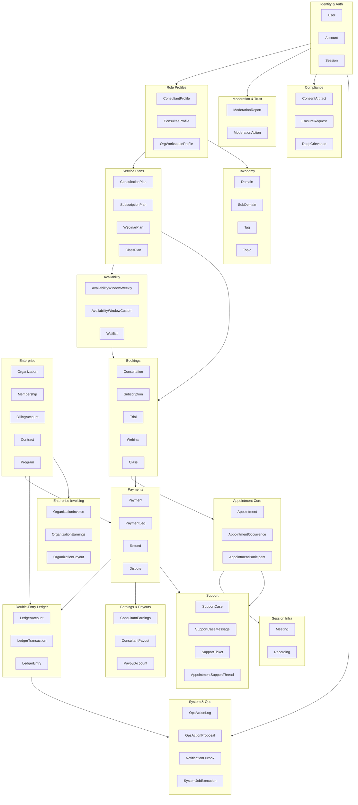

**The three rules that shape everything else.**

1. **Identity is the only root.** Every row that belongs to a person resolves to
   `User.id`. Money resolves to `Payment`; a booking resolves to
   `Appointment`, never directly to a booking-type row.
2. **Money has one writer per transition.** A status change on `Payment`,
   `Refund`, `Appointment` or `ConsultantPayout` is a conditional update
   that names the expected prior status in its `WHERE` clause. The ledger
   behind it is append-only, and a reversal is a counter-transaction rather
   than an edited row.
3. **The database enforces the invariants, not the application.** The
   application may check first, but the object that actually refuses the bad
   write is named in the enforcers section.

---

## 2. Identity & Authentication

`User` is the single identity root. Every profile in the app hangs off it, and every money, booking and support row resolves to a person through it. The BetterAuth tables (`Account`, `Session`, `Verification`, `TwoFactor`, `Passkey`) own credentials; `SsoProvider` binds an external OIDC issuer to one organisation so an enterprise can assert its own domain. `OnboardingDraft` is a resumable server-side draft of the onboarding wizard, one row per user, deleted the moment onboarding completes.

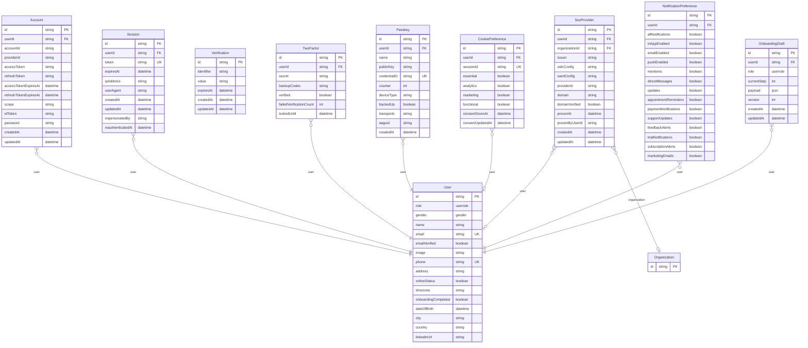

- **Erasure is selective, not destructive.** When `User.erasedAt` is set, the PII fields are scrubbed to pseudonymous values and every active `Membership` is flipped to `MemberStatus.ERASED`. Financial rows — invoices, payouts, ledger entries — are intentionally retained, because IT Act record-keeping obligations outrank the erasure request. A `pseudonymousId` (SHA-256 of the user id plus a salt) lets historical audit rows still point at a deterministic actor without exposing the person.
- **`twoFactorEnabled` is mandatory for staff.** `lib/auth.ts` limits a `STAFF` or `ADMIN` session to credential plus TOTP sign-in; until the flag is set, the API and page guards only let that user reach `/auth/two-factor/setup`.
- **`OnboardingDraft.payload` is a JSONB blob, and the database enforces nothing about it.** A structural Zod schema at the write boundary (`utils/onboarding-draft.ts`) strips unknown keys, a `__v` generation marker quarantines a payload written by an older wizard, and `onboarding_draft_payload_size` in `prisma/sql/check-constraints.sql` caps the byte size. The trade is deliberate: the payload shape mirrors the wizard UI, so normalising it would couple database migrations to form tweaks.

---

## 3. Role Profiles

One `User` can hold several profile types at once, and the pairs are not exclusive: a consultant can also buy as a consultee, and a staff member can still be a consultee. `User.role` is the coarse label the guards read; the profile tables carry the domain state. `OrgWorkspaceProfile` is the operator-side seat inside an organisation, and `OrgKybVerification` is the organisation's know-your-business file.

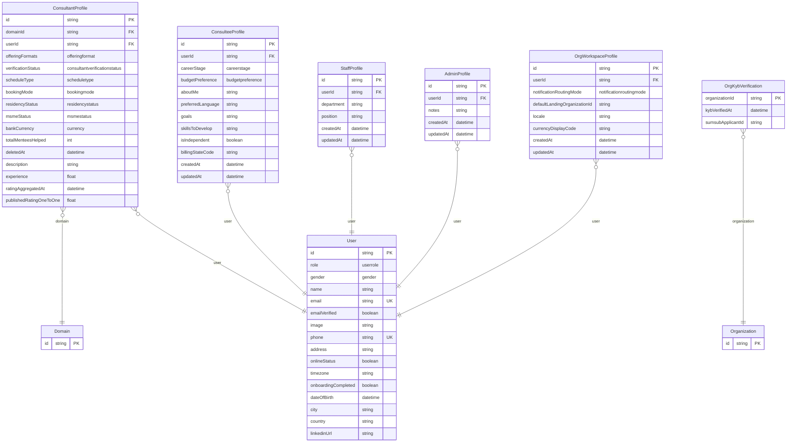

- **`ConsultantProfile` is the revenue root.** Earnings, payouts, tax records, plan authorship and availability all key off `consultantProfileId`, never off `User.id` directly. That is why the earnings ledger and the org side can be joined on one identifier without a profile lookup.
- **`OrgKybVerification` is a gate, not a record of intent.** The organisation's status moves to `OrgStatus` values that the funding-rail permutation engine reads before it will accept a `LICENSE` or `INVOICE` rail.

---

## 4. Professional Background & Verification

Work history, certifications and education are consolidated at `User` level rather than per profile, so one person does not carry the same CV twice when they hold both a consultant and a consultee profile. `Achievement` is consultant-only because it hangs off `ConsultantProfile`. Verification is a two-level structure: a `ConsultantProfileVerification` submission and the `ProfileVerificationDocument` files that support it.

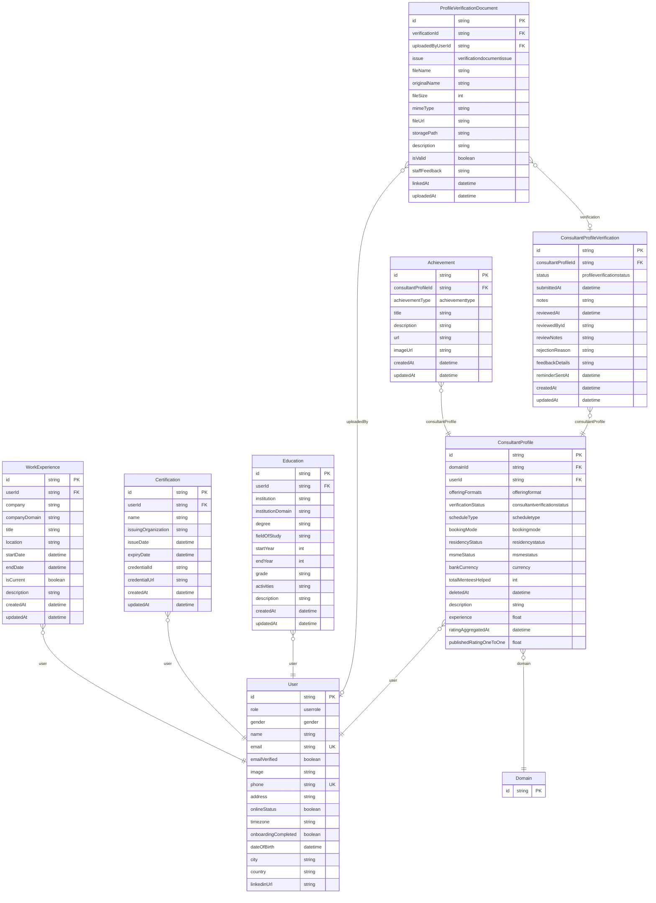

- **Verification is a reviewed state machine, not a boolean.** `ProfileVerificationStatus` moves through submission, staff review, and either approval or rejection with a reason; the documents are the evidence. `verificationDocumentsUploaded` is the owner column, and a rejection must be re-submitted rather than edited in place.

---

## 5. Consultant Taxonomy

How expertise is classified. `Domain` is the top level, `SubDomain` and `Tag` hang off it, and `Topic` is a separate flat vocabulary used to tag plans. `ConsultantProfile` carries one primary `Domain` plus a set of `SubDomain` and `Tag` memberships.

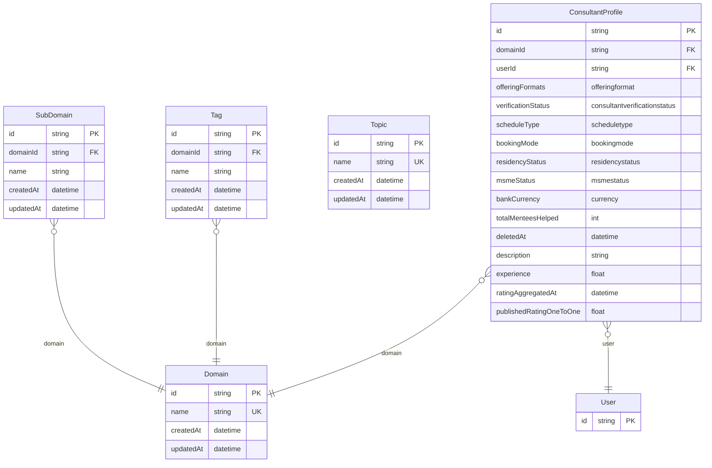

- **A plan's `Topic` set and a consultant's `Domain` set are separate vocabularies on purpose.** The marketplace filter needs a flat topic, while a consultant's expertise is hierarchical. Collapsing them would force a taxonomy change to become a data migration.

---

## 6. Service Plans & Curriculum

Four product shapes — a one-to-one consultation, a recurring subscription, a webinar, and a cohort class. All four carry the same buyer-facing content shape (`subtitle`, `targetAudience`, `whatsIncluded`, `imageUrl`, `slug`, a `PlanLevel`, and a polymorphic `PlanFaq` child list) and all four may be owned by a `ConsultantProfile` alone or co-owned by an `Organization`. `PlanMaterial` is the shared attachment list; it is polymorphic across the four plan types with exactly one foreign key set.

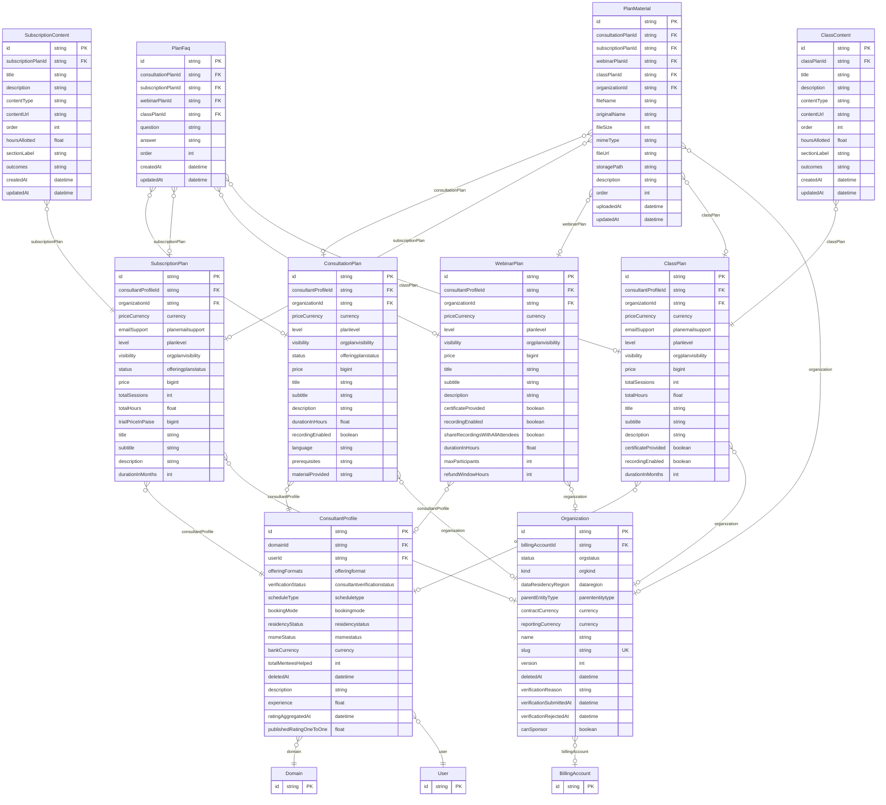

- **`archivedAt` withdraws a plan from sale without deleting the terms past bookings still resolve against.** A booking references the plan row; deleting the plan would orphan the booking's price, policy and cancellation tier.
- **`PlanMaterial` and `PlanFaq` are polymorphic, and the database enforces the XOR.** `PlanMaterial_single_plan_fk_check` in `prisma/sql/check-constraints.sql` refuses a row that points at zero plan types or more than one.
- **`SubscriptionContent` and `ClassContent` are deliberately not one table.** A class module is a unit of syllabus delivered to a cohort; a subscription session is one appointment in a one-to-one engagement, and the two products are free to diverge. See ADR 24 in `docs/enterprise/70-design-decisions/`.

---

## 7. Collaborators & Revenue Splits

One `Collaborator` row per co-host, teaching assistant or guest speaker on a plan, with a revenue share in basis points. The row is polymorphic across the plan types and the collaborator tiers are role-specific.

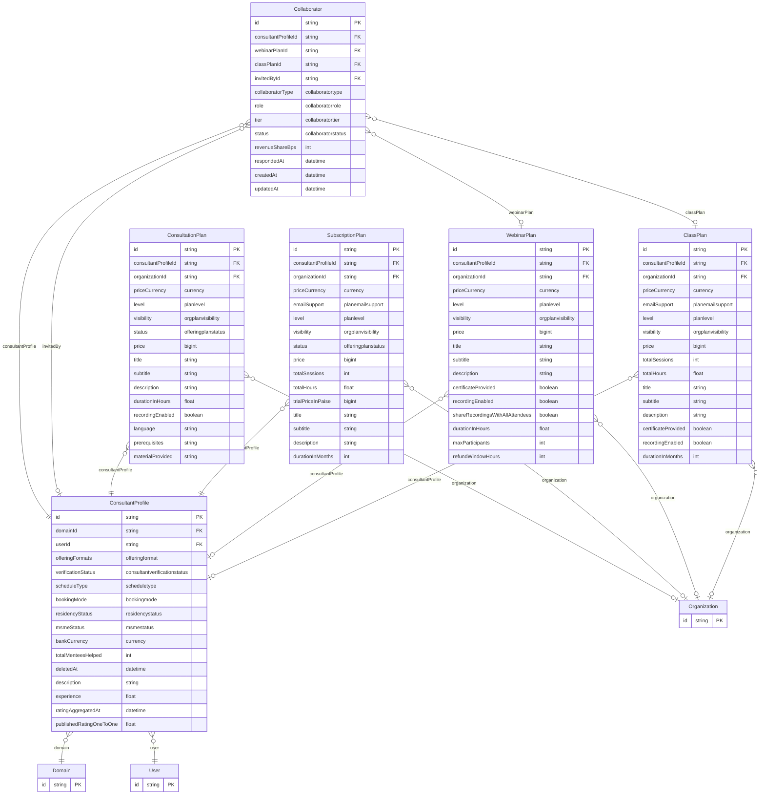

- **Four database constraints police this one table.** `collaborator_plan_xor` refuses zero or multiple plan foreign keys; `collaborator_role_matches_plan_type` refuses a webinar-only role on a class plan; `collaborator_tier_matches_role` refuses a role that outranks its tier; `collaborator_share_bps_in_range` keeps the split inside 0–10,000 bps. Two partial uniques — `collaborator_one_presenter_webinar` and `collaborator_one_presenter_class` — guarantee exactly one presenter per event type.

---

## 8. Availability, Waitlist & Backup Windows

Published availability is what makes a slot bookable. `AvailabilityWindowWeekly` is a recurring window stored in integer minutes since midnight UTC; `AvailabilityWindowCustom` is a one-off window. `Waitlist` queues a user for a plan that is full, and `WindowBackupInterest` records the user who asked to be told when a busy window frees up.

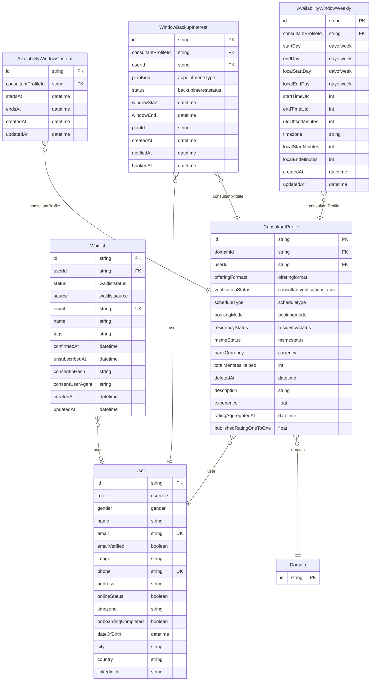

- **The 30-minute atom is the fundamental booking unit.** `startTimeUtc` and `endTimeUtc` are integers 0–1439, never timestamps, so a weekly window composes into identical 30-minute slots regardless of the consultant's timezone offset — the offset is a separate column.
- **A published window is a set of candidate slots, not a booking.** Slot reservation and the tentative-hold lifecycle live in the booking subsystem; the booking skill's doctrine on weekly versus custom rows and the union coverage rule is the authority there.

---

## 9. One-to-One Bookings

The request-to-approval-to-payment chain for one-to-one services. `Consultation` and `Subscription` are the bookings; `Trial` is a time-boxed free or discounted first session that can convert into a `Subscription`. `ActivityLog` is the generic per-user activity feed.

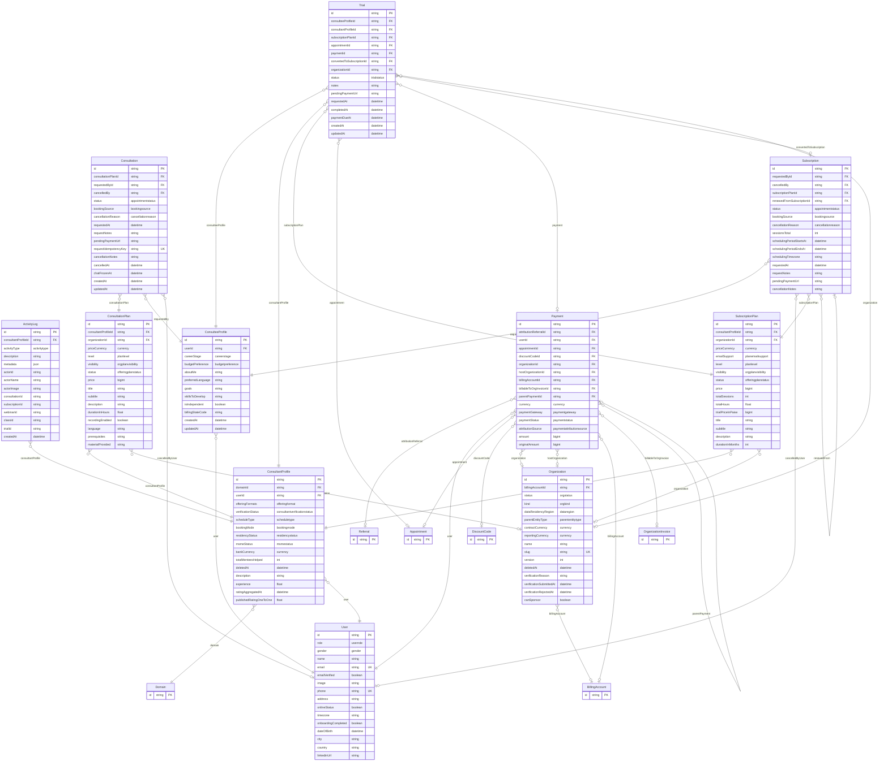

- **Every booking row is a request first and a payment second.** `pendingPaymentUrl` is written before money moves, and the booking only becomes confirmed when the payment confirmation pipeline says so.
- **A trial that converts leaves a pointer, it does not mutate.** `Trial.convertedToSubscriptionId` is the one-way link, so the trial's own history stays intact for the refund and tax trail.

---

## 10. Group Bookings — Webinar & Class

A webinar is one session with many registrants; a class is a cohort that runs over many sessions. In both cases the registrants share a single `Appointment` row, which is what makes a group event cheap to fan out and hard to over-book: capacity is checked against the appointment's participants, not against a per-registrant row.

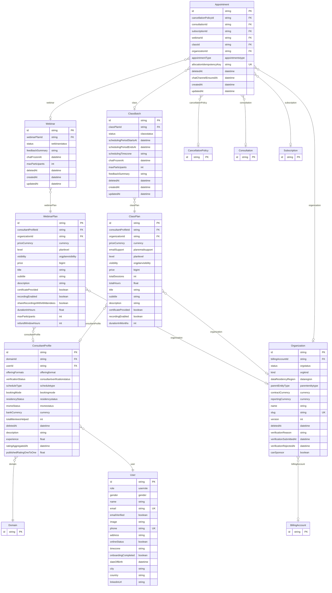

- **`maxParticipants` is a per-instance override.** A null on `Webinar` or `Class` inherits the plan's value; the per-instance value is what the capacity check reads.

---

## 11. Appointment — The Pivot Model

`Appointment` is the pivot that every booking type resolves to. A one-to-one consultation has exactly one; a subscription has one per session; a webinar has one shared by all registrants; a class has one per session; a trial has one. `AppointmentOccurrence` is a concrete time slot inside it, `AppointmentParticipant` is the per-person seat row, and `BookingStatusHistory` is the append-only record of every status transition.

```mermaid
erDiagram
    Appointment {
        id string PK
        cancellationPolicyId string FK
        consultationId string FK
        subscriptionId string FK
        webinarId string FK
        classId string FK
        organizationId string FK
        appointmentType appointmentstype
        allocationIdempotencyKey string UK
        deletedAt datetime
        chatChannelEnsuredAt datetime
        createdAt datetime
        updatedAt datetime
    }
    AppointmentParticipant {
        id string PK
        appointmentId string FK
        userId string FK
        paymentId string FK
        organizationId string FK
        role participantrole
        status participantstatus
        refundWindowHours int
        sessionsPurchased int
        createdAt datetime
        updatedAt datetime
    }
    AppointmentOccurrence {
        id string PK
        appointmentId string FK
        completionStatus occurrencecompletionstatus
        outcome occurrenceoutcome
        ordinal int
        startsAt datetime
        endsAt datetime
        isTentative boolean
        completedAt datetime
        consultantProfileId string
        deletedAt datetime
        movedAt datetime
        hostCancelledAt datetime
        seatsSettledAt datetime
        voidedAt datetime
        outcomeAt datetime
    }
    BookingStatusHistory {
        id string PK
        appointmentId string FK
        actorUserId string FK
        organizationId string FK
        entity bookinghistoryentity
        entityId string
        fromStatus string
        toStatus string
        reason string
        createdAt datetime
    }
    User {
        id string PK
        role userrole
        gender gender
        name string
        email string UK
        emailVerified boolean
        image string
        phone string UK
        address string
        onlineStatus boolean
        timezone string
        onboardingCompleted boolean
        dateOfBirth datetime
        city string
        country string
        linkedinUrl string
    }
    ConsultantProfile {
        id string PK
        domainId string FK
        userId string FK
        offeringFormats offeringformat
        verificationStatus consultantverificationstatus
        scheduleType scheduletype
        bookingMode bookingmode
        residencyStatus residencystatus
        msmeStatus msmestatus
        bankCurrency currency
        totalMenteesHelped int
        deletedAt datetime
        description string
        experience float
        ratingAggregatedAt datetime
        publishedRatingOneToOne float
    }
    Consultation {
        id string PK
        consultationPlanId string FK
        requestedById string FK
        cancelledBy string FK
        status appointmentstatus
        bookingSource bookingsource
        cancellationReason cancellationreason
        requestedAt datetime
        requestNotes string
        pendingPaymentUrl string
        requestIdempotencyKey string UK
        cancellationNotes string
        cancelledAt datetime
        chatFrozenAt datetime
        createdAt datetime
        updatedAt datetime
    }
    Subscription {
        id string PK
        requestedById string FK
        cancelledBy string FK
        subscriptionPlanId string FK
        renewedFromSubscriptionId string FK
        status appointmentstatus
        bookingSource bookingsource
        cancellationReason cancellationreason
        sessionsTotal int
        schedulingPeriodStartsAt datetime
        schedulingPeriodEndsAt datetime
        schedulingTimezone string
        requestedAt datetime
        requestNotes string
        pendingPaymentUrl string
        cancellationNotes string
    }
    Webinar {
        id string PK
        webinarPlanId string FK
        status webinarstatus
        feedbackSummary string
        chatFrozenAt datetime
        maxParticipants int
        deletedAt datetime
        createdAt datetime
        updatedAt datetime
    }
    ClassBatch {
        id string PK
        classPlanId string FK
        status classstatus
        schedulingPeriodStartsAt datetime
        schedulingPeriodEndsAt datetime
        schedulingTimezone string
        chatFrozenAt datetime
        maxParticipants int
        feedbackSummary string
        deletedAt datetime
        createdAt datetime
        updatedAt datetime
    }
    Trial {
        id string PK
        consulteeProfileId string FK
        consultantProfileId string FK
        subscriptionPlanId string FK
        appointmentId string FK
        paymentId string FK
        convertedToSubscriptionId string FK
        organizationId string FK
        status trialstatus
        notes string
        pendingPaymentUrl string
        requestedAt datetime
        completedAt datetime
        paymentDueAt datetime
        createdAt datetime
        updatedAt datetime
    }
    Organization {
        id string PK
        billingAccountId string FK
        status orgstatus
        kind orgkind
        dataResidencyRegion dataregion
        parentEntityType parententitytype
        contractCurrency currency
        reportingCurrency currency
        name string
        slug string UK
        version int
        deletedAt datetime
        verificationReason string
        verificationSubmittedAt datetime
        verificationRejectedAt datetime
        canSponsor boolean
    }
    CancellationPolicy {
        id string PK
    }
    Payment {
        id string PK
    }
    Domain {
        id string PK
    }
    ConsultationPlan {
        id string PK
    }
    ConsulteeProfile {
        id string PK
    }
    SubscriptionPlan {
        id string PK
    }
    WebinarPlan {
        id string PK
    }
    ClassPlan {
        id string PK
    }
    BillingAccount {
        id string PK
    }
    Appointment }o--o| CancellationPolicy : "cancellationPolicy"
    Appointment }o--o| Consultation : "consultation"
    Appointment }o--o| Subscription : "subscription"
    Appointment }o--o| Webinar : "webinar"
    Appointment }o--o| ClassBatch : "class"
    Appointment }o--o| Organization : "organization"
    AppointmentParticipant }o--|| Appointment : "appointment"
    AppointmentParticipant }o--|| User : "user"
    AppointmentParticipant }o--o| Payment : "payment"
    AppointmentParticipant }o--o| Organization : "organization"
    AppointmentOccurrence }o--|| Appointment : "appointment"
    BookingStatusHistory }o--o| Appointment : "appointment"
    BookingStatusHistory }o--o| User : "actorUser"
    BookingStatusHistory }o--o| Organization : "organization"
    ConsultantProfile }o--|| Domain : "domain"
    ConsultantProfile }o--|| User : "user"
    Consultation }o--|| ConsultationPlan : "consultationPlan"
    Consultation }o--|| ConsulteeProfile : "requestedBy"
    Consultation }o--o| User : "cancelledByUser"
    Subscription }o--|| ConsulteeProfile : "requestedBy"
    Subscription }o--o| User : "cancelledByUser"
    Subscription }o--|| SubscriptionPlan : "subscriptionPlan"
    Subscription }o--o| Subscription : "renewedFrom"
    Webinar }o--|| WebinarPlan : "webinarPlan"
    ClassBatch }o--|| ClassPlan : "classPlan"
    Trial }o--|| ConsulteeProfile : "consulteeProfile"
    Trial }o--|| ConsultantProfile : "consultantProfile"
    Trial }o--|| SubscriptionPlan : "subscriptionPlan"
    Trial }o--o| Appointment : "appointment"
    Trial }o--o| Payment : "payment"
    Trial }o--o| Subscription : "convertedToSubscription"
    Trial }o--o| Organization : "organization"
    Organization }o--o| BillingAccount : "billingAccount"
```

- **`BookingStatusHistory` is immutable and enforced as such.** `booking_status_history_immutable` in `prisma/sql/check-constraints.sql` refuses an update or delete, so the transition history is a ledger rather than a log.
- **An occurrence may be tentative.** A tentative occurrence holds its time but is not a confirmed booking, which is why `occurrence_no_confirmed_overlap` deliberately ignores tentative rows — the app-enforced slot lock covers that window instead.

---

## 12. Cancellation Policy & Reschedule

The refund-shape side of a booking. `CancellationPolicy` is a published, versioned document owned by the consultant; `CancellationPolicyTier` is the percentage ladder inside it. `RescheduleRequest` is the ask, and `RescheduleProposedTime` holds the candidate windows the consultant offers back.

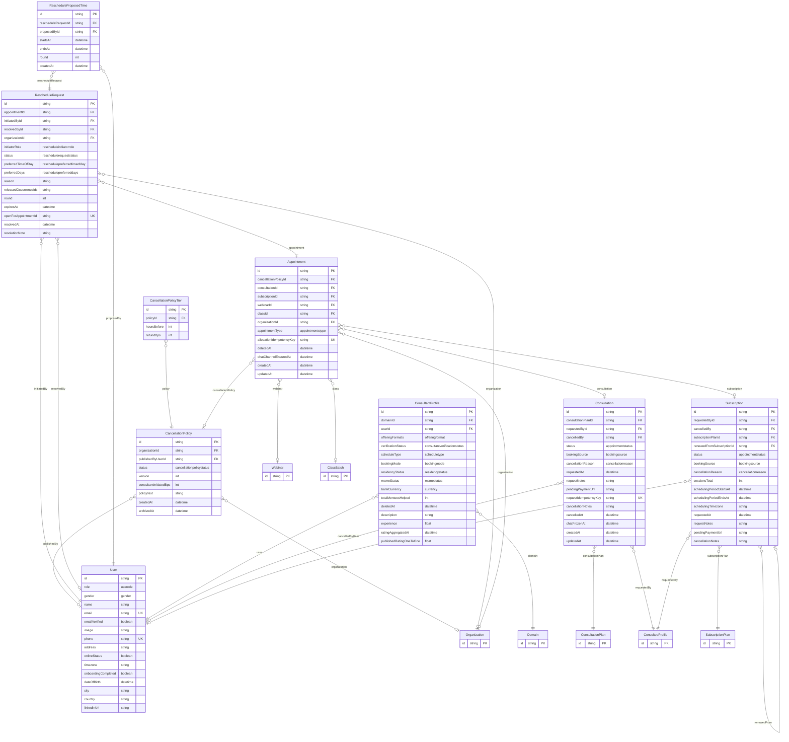

- **A booking snapshots the policy version it was sold under.** The policy is versioned rather than edited, so a policy change never retroactively re-dates an existing booking's refund tier.
- **`cancellation_policy_one_active_per_scope` is a partial unique.** Exactly one active policy may exist per scope, enforced by the database rather than by a read-then-write in application code.

---

## 13. Session Infrastructure, Attendance & Recordings

The Stream.io video layer and the recording store. `Meeting` is the live call for one occurrence. `MeetingAttendance` and `MeetingPresence` are two different attendance records — one is the settled record, one is the live signal. `Recording` is the media asset; `RecordingConsent` is the publish-time redistribution attestation; `RecordingPurchase` is a replay purchase.

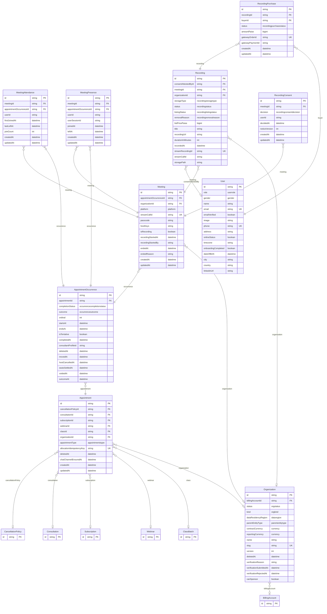

- **Dual storage.** `STREAM_S3` is temporary (the free tier's two-week window); `SUPABASE` is permanent on the premium path. The `RecordingStatus` lifecycle runs `RECORDING` → `PROCESSING` → `READY` → `TRANSFERRING` → `AVAILABLE`, and `Recording_storage_and_publish_check` refuses a row that claims a permanent path without having transferred to it.
- **Recording retention is bounded by the organisation.** `org_stream_recording_retention_days_range` on `organizations` keeps the per-organisation retention window inside the range the platform can honour.

---

## 14. Session Documents

Files exchanged inside a booking — briefs, follow-ups, receipts. `AppointmentDocument` is versioned within a thread: `rootDocumentId` anchors the thread and `responseToDocumentId` chains the replies.

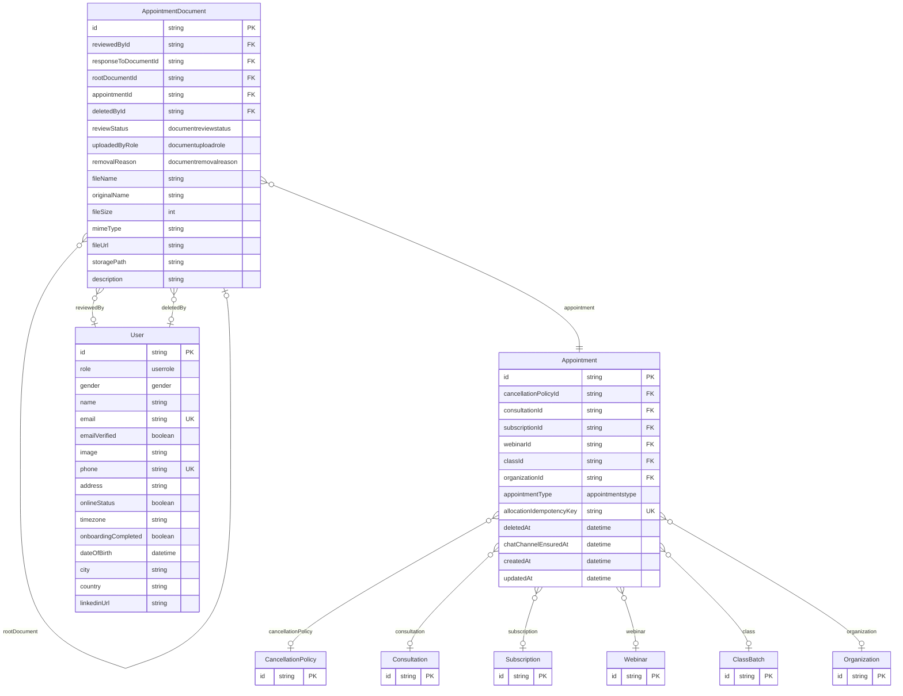

- **Deletion is a soft-delete with a named deleter.** `deletedAt` plus `documentsDeleted` on `User` keep the audit trail; `appointment_doc_thread_version_unique` keeps a version number unique inside one thread.

---

## 15. Payments, Refunds & Disputes

Money enters through `Payment` and is funded by one or more `PaymentLeg` rows. A `Refund` reverses it, a `Dispute` is the gateway's chargeback, `IdempotencyRecord` makes a write replay-safe, `WebhookEvent` deduplicates gateway callbacks, and `DiscountCode` carries the promotional reduction.

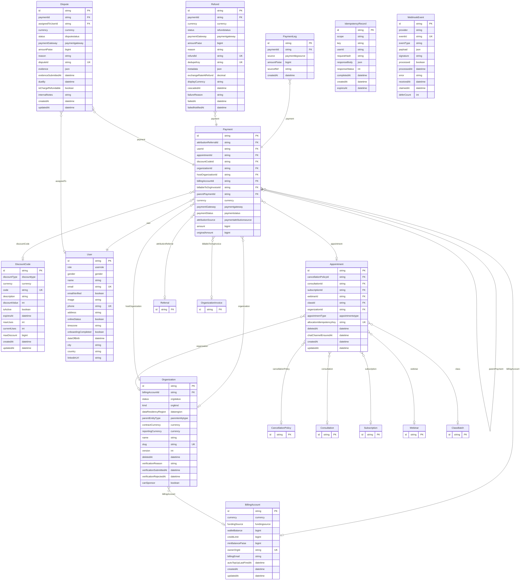

- **All money columns are `BigInt` paise.** Settlement is INR only, and `payment_currency_inr`, `refund_currency_inr` and `dispute_currency_inr` refuse any other currency at the database level.
- **The legs must sum to the payment.** `payment_legs_sum_to_amount` is a constraint trigger that refuses a `Payment` whose legs do not add up, and `payment_amount_vs_legs` keeps the header amount consistent with them. `payment_refunds_within_amount` refuses refunds beyond the captured amount.
- **`Payment.paymentStatus = SUCCEEDED` is written by exactly one pipeline** — the payment confirmation handler. Every other status transition is a conditional update that names the expected prior status in its `WHERE` clause.

---

## 16. Platform Pricing & Fee Policy

The platform's own pricing knobs. `PlatformPricingConfig` holds global floors such as the minimum trial price; `PlatformFeeSchedule` is the effective fee table with a validity window; `ConsultantFeeWaiver` is a per-consultant concession.

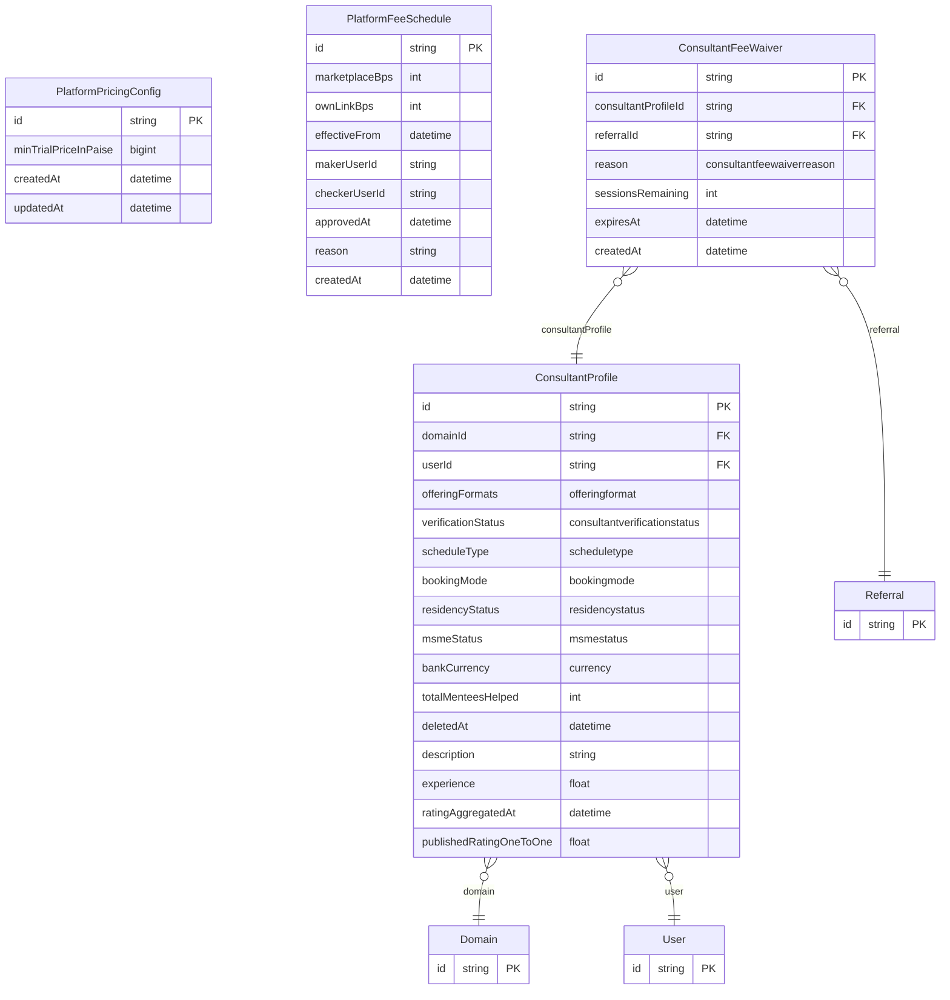

- **Fee policy is versioned by validity window, not edited.** `platform_fee_schedule_valid` refuses a schedule whose window or basis points are nonsense, and the pricing code reads the schedule effective on the booking date, not the newest one.

---

## 17. Consultant Earnings & Payouts

The lifecycle from a captured payment to money in a bank account. `ConsultantEarnings` is the per-occurrence earning row; `EarningsHold` is a reason-scoped block on it; `ConsultantPayout` is a batch that settles a set of earnings; `PayoutAccount` is a verified destination.

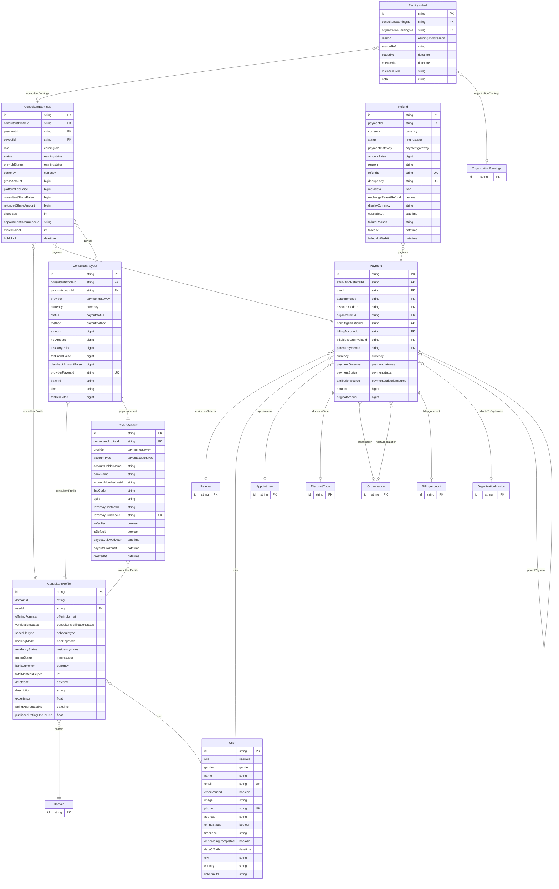

- **A hold is scoped by reason and by owner.** `earnings_hold_one_earning` keeps at most one active hold per earning, and the two partial uniques — `earnings_hold_active_consultant_key` and `earnings_hold_active_org_key` — stop a second consultant-side or organisation-side hold from stacking on the same earning. A service complaint alone does not freeze earnings; a gateway chargeback does, and it keeps its own lifecycle.
- **`consultant_earnings_occurrence_key` is a partial unique** that stops the same occurrence being paid out twice, and `consultant_earnings_batched_has_payout` refuses a row in a batched state with no payout attached.
- **The payout destination is snapshotted at mint.** A bank-change cooling-off window (`payoutsAllowedAfter`) and a payee-initiated freeze (`payoutsFrozenAt`) both live on the account, and a payout records the account it was minted against, so processing sends to exactly the destination that was approved.

---

## 18. Tax — TDS, GST & Adjustments

Withholding tax at the source. `ConsultantTaxInfo` is the consultant's PAN, GSTIN, residency and MSME standing. `TdsRate` is the rate table with its validity window. `TDSRecord` is the per-payout withholding, and `TdsAdjustment` reverses previously withheld tax when a refund lands.

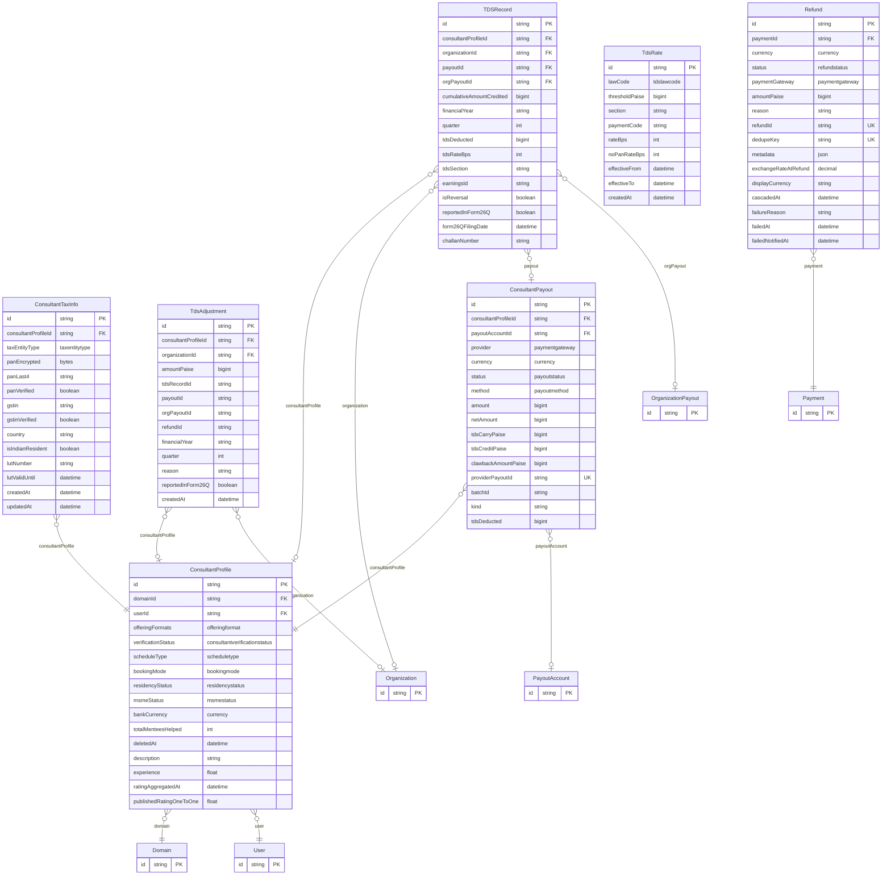

- **The rate is looked up by date, not stored on the consultant.** `tds_rate_bps_and_window_sane` and `tds_rate_bps_bounds` keep the rate table honest, and `tds_record_financial_year_format` keeps the FY stamp in the `2026-27` shape the Form 26Q filing expects.
- **A TDS row points at exactly one of a consultant or an organisation** (`tds_record_deductee_xor`), because the deductee is the entity the withholding is reported against, and the two are not interchangeable.

---

## 19. Consumer Invoicing & Credit Notes

The B2C side of tax invoicing. `ConsumerInvoice` is the tax invoice issued to a buyer; `ConsumerCreditNote` cancels or reduces it. `PlatformInvoiceCounter` and `PlatformCreditNoteCounter` are the per-year sequence allocators behind the document numbers.

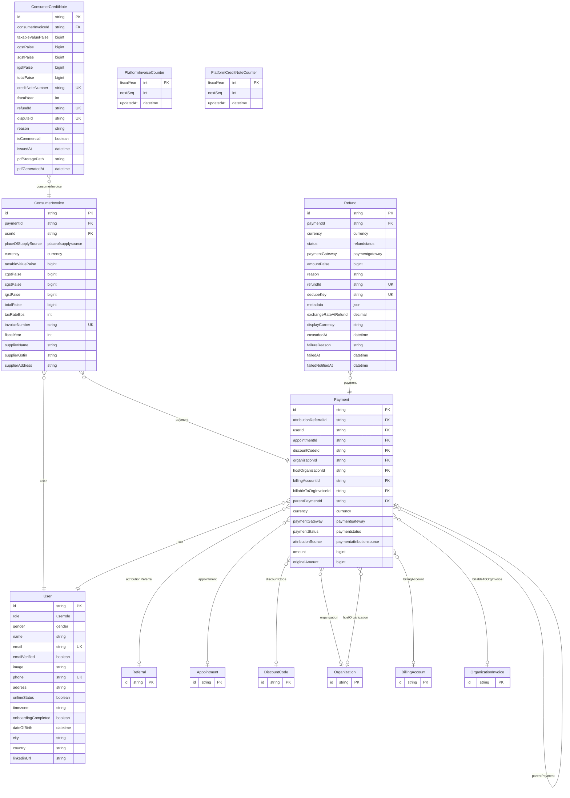

- **A tax invoice carries exactly one tax head.** `consumer_invoice_tax_head_xor` refuses a row with both IGST and CGST/SGST, and `consumer_credit_note_tax_head_xor` does the same for the note — a partially-populated GST split is not a legal document.
- **The counters are the serialisation point.** Each is allocated with an insert-on-conflict update, so two concurrent invoices cannot read the same next sequence.

---

## 20. Referrals & Credit Pools

Acquisition by referral. `ReferralCode` is a user's code, `Referral` is one tracked referral, `ReferralCredit` is a credit balance that can be spent, `ReferralCreditUsage` is the spend against a payment, and `ReferralProgramConfig` is the rules the programme runs on.

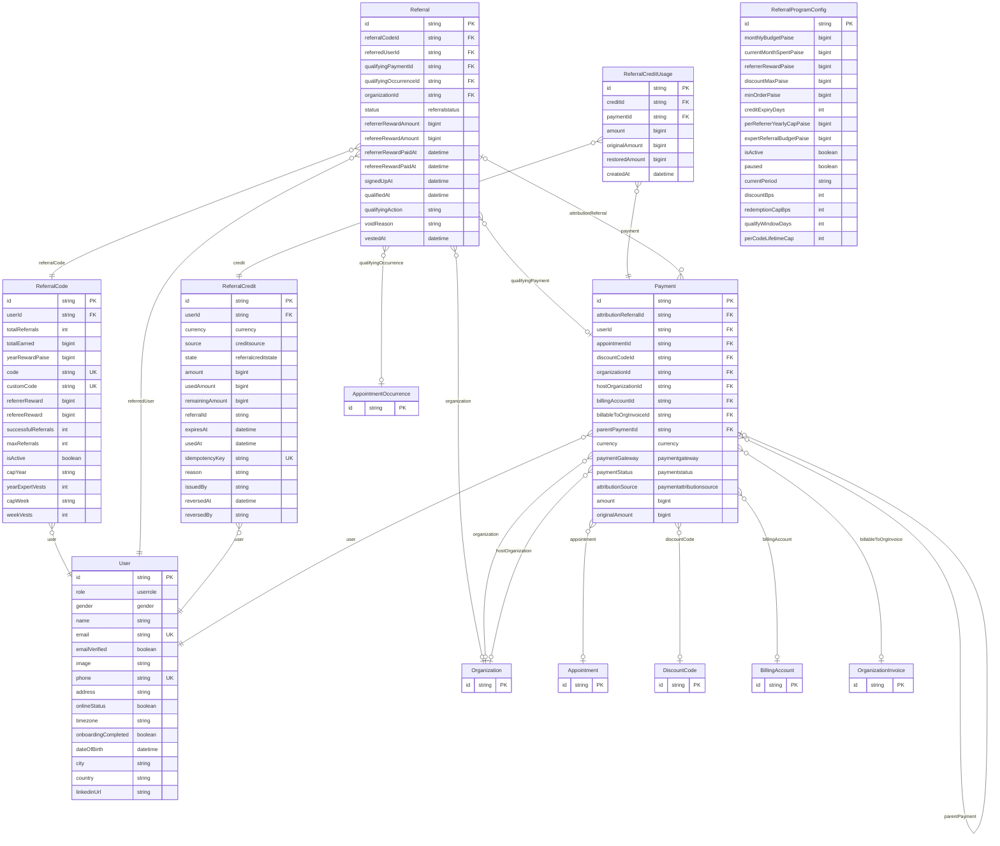

- **Credit is a balance with a ledger behind it.** `referral_credit_balance_consistent` keeps the remaining amount equal to the issued amount minus the uses, and `referral_credit_usage_nonnegative` refuses a negative spend.
- **A referral credit is applied as a payment leg, not as a discount.** That is why the funding-leg sum identity still holds when a credit is spent.

---

## 21. Expert–Customer Relationships

The durable record that a user has bought from an expert, with the source that owns the relationship. It is what a consultant's client list and an organisation's spend history are both read from, without re-deriving either from payments.

```mermaid
erDiagram
    ExpertCustomerRelationship {
        id string PK
        consultantProfileId string FK
        buyerUserId string FK
        firstPaymentId string FK
        source paymentattributionsource
        createdAt datetime
    }
    User {
        id string PK
        role userrole
        gender gender
        name string
        email string UK
        emailVerified boolean
        image string
        phone string UK
        address string
        onlineStatus boolean
        timezone string
        onboardingCompleted boolean
        dateOfBirth datetime
        city string
        country string
        linkedinUrl string
    }
    ConsultantProfile {
        id string PK
        domainId string FK
        userId string FK
        offeringFormats offeringformat
        verificationStatus consultantverificationstatus
        scheduleType scheduletype
        bookingMode bookingmode
        residencyStatus residencystatus
        msmeStatus msmestatus
        bankCurrency currency
        totalMenteesHelped int
        deletedAt datetime
        description string
        experience float
        ratingAggregatedAt datetime
        publishedRatingOneToOne float
    }
    Organization {
        id string PK
        billingAccountId string FK
        status orgstatus
        kind orgkind
        dataResidencyRegion dataregion
        parentEntityType parententitytype
        contractCurrency currency
        reportingCurrency currency
        name string
        slug string UK
        version int
        deletedAt datetime
        verificationReason string
        verificationSubmittedAt datetime
        verificationRejectedAt datetime
        canSponsor boolean
    }
    Payment {
        id string PK
    }
    Domain {
        id string PK
    }
    BillingAccount {
        id string PK
    }
    ExpertCustomerRelationship }o--|| ConsultantProfile : "consultantProfile"
    ExpertCustomerRelationship }o--|| User : "buyer"
    ExpertCustomerRelationship }o--|| Payment : "firstPayment"
    ConsultantProfile }o--|| Domain : "domain"
    ConsultantProfile }o--|| User : "user"
    Organization }o--o| BillingAccount : "billingAccount"
```

- **The relationship is a projection, not the money record.** `Payment` remains the source of truth for what was paid; this table answers "who has bought from whom" without a join across the payment tables.

---

## 22. Enterprise Core — Organisation & Membership

An `Organization` can sponsor employees (`canSponsor`), host consultants (`canHost`), or both. `Membership` is the only membership table in the system: it joins a `User` to an `Organization` with a role, a status and a payout recipient. `Invitation` covers both the organisation-scoped and the platform-scoped operator door. `OrganizationTaxInfo` and `OrganizationMsmeInfo` carry the statutory profile; `OrgSSOSettings` and `OrgDomainClaim` carry the identity perimeter; `OrgAuditLog` is the trail; `OrgBrandingProfile` is the white-label surface.

```mermaid
erDiagram
    Organization {
        id string PK
        billingAccountId string FK
        status orgstatus
        kind orgkind
        dataResidencyRegion dataregion
        parentEntityType parententitytype
        contractCurrency currency
        reportingCurrency currency
        name string
        slug string UK
        version int
        deletedAt datetime
        verificationReason string
        verificationSubmittedAt datetime
        verificationRejectedAt datetime
        canSponsor boolean
    }
    Membership {
        id string PK
        userId string FK
        organizationId string FK
        consulteeProfileId string FK
        consultantProfileId string FK
        rateCardOverrideId string FK
        status memberstatus
        role memberrole
        payoutRecipient payoutrecipient
        departmentLabel string
        exclusiveEngagement boolean
        createdAt datetime
        updatedAt datetime
    }
    Invitation {
        id string PK
        organizationId string FK
        inviterId string FK
        userId string FK
        role memberrole
        status invitationstatus
        email string
        expiresAt datetime
        createdAt datetime
    }
    OrganizationTaxInfo {
        organizationId string PK
        gstRegStatus gstregstatus
        taxJurisdiction taxjurisdiction
        legalName string
        gstin string
        gstStateCode string
        panEncrypted bytes
        panLast4 string
        hsnDefault string
    }
    OrganizationMsmeInfo {
        organizationId string PK
        msmeStatus msmestatus
        msmeWrittenAgreementOnFile boolean
    }
    OrganizationSSOSettings {
        id string PK
        organizationId string FK
        defaultRoleForAutoJoin memberrole
        enforceSSO boolean
        version int
        createdAt datetime
        updatedAt datetime
    }
    OrgDomainClaim {
        id string PK
        organizationId string FK
        domain string
        claimedAt datetime
        verificationToken string
        verifiedAt datetime
    }
    OrgAuditLog {
        id string PK
        organizationId string FK
        category orgauditcategory
        actorMembershipId string
        targetMembershipId string
        action string
        description string
        details json
        createdAt datetime
    }
    OrgBrandingProfile {
        organizationId string PK
        sizeBucket orgsizebucket
        directoryType orgdirectorytype
        logo string
        bannerImage string
        primaryColor string
        secondaryColor string
        description string
        industry string
        website string
        createdAt datetime
        updatedAt datetime
    }
    User {
        id string PK
        role userrole
        gender gender
        name string
        email string UK
        emailVerified boolean
        image string
        phone string UK
        address string
        onlineStatus boolean
        timezone string
        onboardingCompleted boolean
        dateOfBirth datetime
        city string
        country string
        linkedinUrl string
    }
    ConsultantProfile {
        id string PK
        domainId string FK
        userId string FK
        offeringFormats offeringformat
        verificationStatus consultantverificationstatus
        scheduleType scheduletype
        bookingMode bookingmode
        residencyStatus residencystatus
        msmeStatus msmestatus
        bankCurrency currency
        totalMenteesHelped int
        deletedAt datetime
        description string
        experience float
        ratingAggregatedAt datetime
        publishedRatingOneToOne float
    }
    ConsulteeProfile {
        id string PK
        userId string FK
        careerStage careerstage
        budgetPreference budgetpreference
        aboutMe string
        preferredLanguage string
        goals string
        skillsToDevelop string
        isIndependent boolean
        billingStateCode string
        createdAt datetime
        updatedAt datetime
    }
    BillingAccount {
        id string PK
    }
    RateCard {
        id string PK
    }
    Domain {
        id string PK
    }
    Organization }o--o| BillingAccount : "billingAccount"
    Membership }o--|| User : "user"
    Membership }o--|| Organization : "organization"
    Membership }o--o| ConsulteeProfile : "consulteeProfile"
    Membership }o--o| ConsultantProfile : "consultantProfile"
    Membership }o--o| RateCard : "rateCardOverride"
    Invitation }o--|| Organization : "organization"
    Invitation }o--|| User : "inviter"
    Invitation }o--o| User : "user"
    OrganizationTaxInfo }o--|| Organization : "organization"
    OrganizationMsmeInfo }o--|| Organization : "organization"
    OrganizationSSOSettings }o--|| Organization : "organization"
    OrgDomainClaim }o--|| Organization : "organization"
    OrgAuditLog }o--|| Organization : "organization"
    OrgBrandingProfile }o--|| Organization : "organization"
    ConsultantProfile }o--|| Domain : "domain"
    ConsultantProfile }o--|| User : "user"
    ConsulteeProfile }o--|| User : "user"
```

- **`Membership` is typed, not a join table.** `MemberRole` and `MemberStatus` decide what the member may do and whether the seat is live; `Membership.status = ERASED` is what an erasure request flips every active row to.
- **A verified domain claim is unique per domain.** `org_domain_claims_verified_domain_key` means a domain can be claimed by exactly one organisation, so an SSO assertion can be trusted to identify one tenant.
- **The organisation's own tax and MSME data is separate from the consultant's.** An organisation is a `principal supplier` to the platform and files its own GST, so its registration and MSME standing live on `OrganizationTaxInfo` and `OrganizationMsmeInfo`, not on `ConsultantTaxInfo`.

---

## 23. Enterprise Billing, Programs & Wallets

The commercial spine: `BillingAccount` → `Contract` → `Program` → `ProgramAssignment` → `BookingUtilization`. Each link adds a layer of budget control. `BillingSubscription` is the billing cycle, `WalletTopUp` is the top-up lifecycle, `RateCard` is the three-way basis-point split, `LicensedSeatConfig` and `CreditPoolConfig` are the two overage shapes, `OverageEvent` is the append-only over-cap charge ledger, and `PurchaseOrder` is the org's pre-authorisation.

```mermaid
erDiagram
    BillingAccount {
        id string PK
        currency currency
        fundingSource fundingsource
        walletBalance bigint
        creditLimit bigint
        minBalancePaise bigint
        ownerOrgId string UK
        billingEmail string
        autoTopUpLastFiredAt datetime
        createdAt datetime
        updatedAt datetime
    }
    Contract {
        id string PK
        organizationId string FK
        billingAccountId string FK
        purchaseOrderId string FK
        rateCardId string FK
        supersededByContractId string FK
        status contractstatus
        supersessionReason contractsupersessionreason
        signedAt datetime
        effectiveFrom datetime
        effectiveTo datetime
        paymentTermsDays int
        autoRenew boolean
        supersededAt datetime
        autoRenewedAt datetime
        createdAt datetime
    }
    BillingSubscription {
        id string PK
        contractId string FK
        billingAccountId string FK
        model subscriptionmodel
        cycle billingcycle
        ratePerSeatPaise bigint
        flatFeePaise bigint
        activeSeatCount int
        currentCycleStart datetime
        currentCycleEnd datetime
        nextInvoiceDate datetime
        startsAt datetime
        endsAt datetime
        renewalReminderSentAt datetime
        createdAt datetime
        updatedAt datetime
    }
    WalletTopUp {
        id string PK
        billingAccountId string FK
        currency currency
        status wallettopupstatus
        amountPaise bigint
        providerOrderId string UK
        providerPaymentId string
        notes string
        createdAt datetime
        updatedAt datetime
        confirmedAt datetime
        capturedAt datetime
    }
    RateCard {
        id string PK
        ownerOrgId string FK
        ownerContractId string FK
        planType coveredplantype
        minGrossPaise bigint
        maxGrossPaise bigint
        planId string
        platformBps int
        orgBps int
        consultantBps int
        effectiveFrom datetime
        effectiveTo datetime
        createdAt datetime
        updatedAt datetime
    }
    Program {
        id string PK
        contractId string FK
        type programtype
        status programstatus
        coveredPlanTypes coveredplantype
        name string
        allowedCategories string
        configLockedAt datetime
        archivedAt datetime
        createdAt datetime
        updatedAt datetime
    }
    ProgramAssignment {
        id string PK
        programId string FK
        membershipId string FK
        rolledToAssignmentId string FK
        status assignmentstatus
        consumedPaise bigint
        periodStart datetime
        periodEnd datetime
        engagementsUsed int
        overageCount int
        rolledAt datetime
        createdAt datetime
        updatedAt datetime
    }
    ProgramConsultantAllowlist {
        id string PK
        programId string FK
        consultantProfileId string FK
        createdAt datetime
    }
    LicensedSeatConfig {
        programId string PK
        cycle billingcycle
        overageBehavior overagebehavior
        ratePerSeatPaise bigint
        priceCapPerEngagementPaise bigint
        maxOveragePerCyclePaise bigint
        coveredEngagementsPerCycle int
        activeSeatCount int
        overageSurchargeBps int
    }
    CreditPoolConfig {
        programId string PK
        cycle billingcycle
        overageBehavior overagebehavior
        creditBudgetPerCycle int
        priceCapPerEngagementPaise bigint
        maxOveragePerCyclePaise bigint
        overageSurchargeBps int
    }
    BookingUtilization {
        id string PK
        programAssignmentId string FK
        paymentId string FK
        priceAtBookingPaise bigint
        engagementsConsumed int
        wasOverage boolean
        platformBpsAtBooking int
        orgBpsAtBooking int
        consultantBpsAtBooking int
        reversedAt datetime
        reversalReason string
        appointmentIds string
        deletedAt datetime
        createdAt datetime
    }
    OverageEvent {
        id string PK
        programAssignmentId string FK
        bookingUtilizationId string FK
        paymentId string FK
        invoiceLineItemId string FK
        overageBehavior overagebehavior
        currency currency
        chargeStatus overagechargestatus
        basePaise bigint
        surchargePaise bigint
        marginalPaise bigint
        batchKey string
        settledAt datetime
        reversedAt datetime
        chargeAttemptCount int
        lastChargeAttemptAt datetime
    }
    PurchaseOrder {
        id string PK
        organizationId string FK
        currency currency
        status postatus
        totalAmountPaise bigint
        remainingAmountPaise bigint
        poNumber string
        poDate datetime
        validUntil datetime
        uploadedDocUrl string
        createdAt datetime
        updatedAt datetime
    }
    OrgInvoiceCounter {
        organizationId string FK
        fiscalYear int
        nextSeq int
        updatedAt datetime
    }
    Organization {
        id string PK
        billingAccountId string FK
        status orgstatus
        kind orgkind
        dataResidencyRegion dataregion
        parentEntityType parententitytype
        contractCurrency currency
        reportingCurrency currency
        name string
        slug string UK
        version int
        deletedAt datetime
        verificationReason string
        verificationSubmittedAt datetime
        verificationRejectedAt datetime
        canSponsor boolean
    }
    Membership {
        id string PK
        userId string FK
        organizationId string FK
        consulteeProfileId string FK
        consultantProfileId string FK
        rateCardOverrideId string FK
        status memberstatus
        role memberrole
        payoutRecipient payoutrecipient
        departmentLabel string
        exclusiveEngagement boolean
        createdAt datetime
        updatedAt datetime
    }
    Payment {
        id string PK
        attributionReferralId string FK
        userId string FK
        appointmentId string FK
        discountCodeId string FK
        organizationId string FK
        hostOrganizationId string FK
        billingAccountId string FK
        billableToOrgInvoiceId string FK
        parentPaymentId string FK
        currency currency
        paymentGateway paymentgateway
        paymentStatus paymentstatus
        attributionSource paymentattributionsource
        amount bigint
        originalAmount bigint
    }
    ConsultantProfile {
        id string PK
    }
    InvoiceLineItem {
        id string PK
    }
    User {
        id string PK
    }
    ConsulteeProfile {
        id string PK
    }
    Referral {
        id string PK
    }
    Appointment {
        id string PK
    }
    DiscountCode {
        id string PK
    }
    OrganizationInvoice {
        id string PK
    }
    Contract }o--|| Organization : "organization"
    Contract }o--|| BillingAccount : "billingAccount"
    Contract }o--o| PurchaseOrder : "purchaseOrder"
    Contract }o--o| RateCard : "rateCard"
    Contract }o--o| Contract : "supersededByContract"
    BillingSubscription }o--|| Contract : "contract"
    BillingSubscription }o--|| BillingAccount : "billingAccount"
    WalletTopUp }o--|| BillingAccount : "billingAccount"
    RateCard }o--o| Organization : "ownerOrg"
    RateCard }o--o| Contract : "ownerContract"
    Program }o--|| Contract : "contract"
    ProgramAssignment }o--|| Program : "program"
    ProgramAssignment }o--|| Membership : "membership"
    ProgramAssignment }o--o| ProgramAssignment : "rolledToAssignment"
    ProgramConsultantAllowlist }o--|| Program : "program"
    ProgramConsultantAllowlist }o--|| ConsultantProfile : "consultantProfile"
    LicensedSeatConfig }o--|| Program : "program"
    CreditPoolConfig }o--|| Program : "program"
    BookingUtilization }o--|| ProgramAssignment : "programAssignment"
    BookingUtilization }o--|| Payment : "payment"
    OverageEvent }o--|| ProgramAssignment : "programAssignment"
    OverageEvent }o--|| BookingUtilization : "bookingUtilization"
    OverageEvent }o--o| Payment : "payment"
    OverageEvent }o--o| InvoiceLineItem : "invoiceLineItem"
    PurchaseOrder }o--|| Organization : "organization"
    OrgInvoiceCounter }o--|| Organization : "organization"
    Organization }o--o| BillingAccount : "billingAccount"
    Membership }o--|| User : "user"
    Membership }o--|| Organization : "organization"
    Membership }o--o| ConsulteeProfile : "consulteeProfile"
    Membership }o--o| ConsultantProfile : "consultantProfile"
    Membership }o--o| RateCard : "rateCardOverride"
    Payment }o--o| Referral : "attributionReferral"
    Payment }o--|| User : "user"
    Payment }o--o| Appointment : "appointment"
    Payment }o--o| DiscountCode : "discountCode"
    Payment }o--o| Organization : "organization"
    Payment }o--o| Organization : "hostOrganization"
    Payment }o--o| BillingAccount : "billingAccount"
    Payment }o--o| OrganizationInvoice : "billableToOrgInvoice"
    Payment }o--o| Payment : "parentPayment"
```

- **The wallet balance is a liability account in the double-entry ledger, not a standalone table.** `BillingAccount.walletBalance` is retained only as a denormalised cache for the atomic-debit guard, and the nightly reconciliation asserts it equals the `WALLET` account balance. `billing_account_wallet_nonnegative` refuses a negative balance.
- **A contract is superseded, never edited.** `Contract.supersededByContractId` is a self-relation with a `ContractSupersessionReason`, and `contract_one_active_per_billing_account_idx` keeps exactly one active contract per billing account.
- **A program assignment cannot overlap itself.** `program_assignment_no_active_overlap` refuses two active assignments for the same member and program, and `ProgramAssignment.rolledToAssignmentId` is the one-way link when a cycle rolls over.
- **The rate card must divide the whole.** `rate_card_bps_sum_is_whole` refuses a split that is not exactly 10,000 bps across platform, organisation and consultant, and `rate_card_one_open_window` keeps one open validity window at a time.
- **Overage is a formula, not a number.** `overage_marginal_is_base_plus_surcharge` refuses a marginal charge that is not the base plus its surcharge, so the two can never drift apart.

---

## 24. Enterprise Invoicing, Receipts & Organisation Payouts

Month-end invoicing for the organisation side. `OrganizationInvoice` is the tax invoice, `InvoiceLineItem` its lines, `OrganizationInvoiceReceipt` the money received against it, `OrganizationEarnings` the organisation's share of a host booking, `OrganizationPayout` the batch that disburses it, `OrganizationPayoutAccount` the destination, and `CreditNote` the Section 34 / CGST Rule 53 document that cancels or reduces an invoice.

```mermaid
erDiagram
    OrganizationInvoice {
        id string PK
        billingAccountId string FK
        organizationId string FK
        purchaseOrderId string FK
        contractId string FK
        paymentId string FK
        status orginvoicestatus
        displayCurrency currency
        irpStatus irpstatus
        inrEquivalentPaise bigint
        subtotalPaise bigint
        igstPaise bigint
        cgstPaise bigint
        sgstPaise bigint
        totalPaise bigint
        invoiceNumber string
    }
    OrganizationInvoiceReceipt {
        id string PK
        organizationId string FK
        invoiceId string FK
        method invoicereceiptmethod
        amountPaise bigint
        reference string
        receivedOn datetime
        recordedById string
        createdAt datetime
    }
    InvoiceLineItem {
        id string PK
        invoiceId string FK
        paymentId string FK
        unitPricePaise bigint
        taxPaise bigint
        position int
        description string
        quantity int
        hsnCode string
        createdAt datetime
    }
    OrganizationEarnings {
        id string PK
        organizationId string FK
        paymentId string FK
        consultantProfileId string FK
        orgPayoutId string FK
        role earningrole
        currency currency
        status earningstatus
        preHoldStatus earningstatus
        grossAmountPaise bigint
        platformFeePaise bigint
        orgSharePaise bigint
        consultantSharePaise bigint
        refundedAmountPaise bigint
        cycleOrdinal int
        rateCardIdApplied string
    }
    OrganizationPayout {
        id string PK
        organizationId string FK
        orgPayoutAccountId string FK
        currency currency
        status payoutstatus
        paymentGateway paymentgateway
        paRouteProvider payoutrailprovider
        amountPaise bigint
        grossRevenuePaise bigint
        platformFeePaise bigint
        refundsPaise bigint
        netPayoutPaise bigint
        tdsAmountPaise bigint
        clawbackAmountPaise bigint
        periodStart datetime
        periodEnd datetime
    }
    OrganizationPayoutAccount {
        id string PK
        organizationId string FK
        status orgpayoutaccountstatus
        accountHolderName string
        accountNumberEncrypted string
        accountNumberLast4 string
        bankName string
        ifscCode string
        routingNumber string
        swiftCode string
        razorpayContactId string UK
        razorpayFundAccountId string
        verifiedAt datetime
        version int
        payoutsAllowedAfter datetime
        payoutsFrozenAt datetime
    }
    CreditNote {
        id string PK
        organizationId string FK
        invoiceId string FK
        docType creditnotedoctype
        status creditnotestatus
        irpStatus irpstatus
        subtotalPaise bigint
        igstPaise bigint
        cgstPaise bigint
        sgstPaise bigint
        totalPaise bigint
        creditNoteNumber string
        fiscalYear int
        refundId string UK
        disputeId string UK
        overageEventId string UK
    }
    OrgCreditNoteCounter {
        organizationId string FK
        fiscalYear int
        nextSeq int
        updatedAt datetime
    }
    Organization {
        id string PK
        billingAccountId string FK
        status orgstatus
        kind orgkind
        dataResidencyRegion dataregion
        parentEntityType parententitytype
        contractCurrency currency
        reportingCurrency currency
        name string
        slug string UK
        version int
        deletedAt datetime
        verificationReason string
        verificationSubmittedAt datetime
        verificationRejectedAt datetime
        canSponsor boolean
    }
    Payment {
        id string PK
        attributionReferralId string FK
        userId string FK
        appointmentId string FK
        discountCodeId string FK
        organizationId string FK
        hostOrganizationId string FK
        billingAccountId string FK
        billableToOrgInvoiceId string FK
        parentPaymentId string FK
        currency currency
        paymentGateway paymentgateway
        paymentStatus paymentstatus
        attributionSource paymentattributionsource
        amount bigint
        originalAmount bigint
    }
    Refund {
        id string PK
        paymentId string FK
        currency currency
        status refundstatus
        paymentGateway paymentgateway
        amountPaise bigint
        reason string
        refundId string UK
        dedupeKey string UK
        metadata json
        exchangeRateAtRefund decimal
        displayCurrency string
        cascadedAt datetime
        failureReason string
        failedAt datetime
        failedNotifiedAt datetime
    }
    Dispute {
        id string PK
        paymentId string FK
        assignedToUserId string FK
        currency currency
        status disputestatus
        paymentGateway paymentgateway
        amountPaise bigint
        reason string
        disputeId string UK
        evidence json
        evidenceSubmittedAt datetime
        dueBy datetime
        isChargeRefundable boolean
        internalNotes string
        createdAt datetime
        updatedAt datetime
    }
    BillingAccount {
        id string PK
        currency currency
        fundingSource fundingsource
        walletBalance bigint
        creditLimit bigint
        minBalancePaise bigint
        ownerOrgId string UK
        billingEmail string
        autoTopUpLastFiredAt datetime
        createdAt datetime
        updatedAt datetime
    }
    PurchaseOrder {
        id string PK
    }
    Contract {
        id string PK
    }
    ConsultantProfile {
        id string PK
    }
    Referral {
        id string PK
    }
    User {
        id string PK
    }
    Appointment {
        id string PK
    }
    DiscountCode {
        id string PK
    }
    OrganizationInvoice }o--|| BillingAccount : "billingAccount"
    OrganizationInvoice }o--|| Organization : "organization"
    OrganizationInvoice }o--o| PurchaseOrder : "purchaseOrder"
    OrganizationInvoice }o--o| Contract : "contract"
    OrganizationInvoice }o--o| Payment : "payment"
    OrganizationInvoiceReceipt }o--|| Organization : "organization"
    OrganizationInvoiceReceipt }o--|| OrganizationInvoice : "invoice"
    InvoiceLineItem }o--|| OrganizationInvoice : "invoice"
    InvoiceLineItem }o--o| Payment : "payment"
    OrganizationEarnings }o--|| Organization : "organization"
    OrganizationEarnings }o--|| Payment : "payment"
    OrganizationEarnings }o--o| ConsultantProfile : "consultantProfile"
    OrganizationEarnings }o--o| OrganizationPayout : "orgPayout"
    OrganizationPayout }o--|| Organization : "organization"
    OrganizationPayout }o--o| OrganizationPayoutAccount : "orgPayoutAccount"
    OrganizationPayoutAccount }o--|| Organization : "organization"
    CreditNote }o--|| Organization : "organization"
    CreditNote }o--o| OrganizationInvoice : "invoice"
    OrgCreditNoteCounter }o--|| Organization : "organization"
    Organization }o--o| BillingAccount : "billingAccount"
    Payment }o--o| Referral : "attributionReferral"
    Payment }o--|| User : "user"
    Payment }o--o| Appointment : "appointment"
    Payment }o--o| DiscountCode : "discountCode"
    Payment }o--o| Organization : "organization"
    Payment }o--o| Organization : "hostOrganization"
    Payment }o--o| BillingAccount : "billingAccount"
    Payment }o--o| OrganizationInvoice : "billableToOrgInvoice"
    Payment }o--o| Payment : "parentPayment"
    Refund }o--|| Payment : "payment"
    Dispute }o--|| Payment : "payment"
    Dispute }o--o| User : "assignedTo"
```

- **An invoice is paid when its receipts and credit notes cover its total.** A bank transfer is recorded as a `BANK_TRANSFER` receipt with a UTR; a gateway capture is a `GATEWAY` receipt with the gateway payment id. `organizationId` plus `reference` is unique, so the same UTR cannot be recorded twice.
- **A voided invoice is not a deleted invoice.** `CreditNote.voidedInvoiceId` is unique, so a platform void produces exactly one credit note against that invoice, and the audit trail survives.
- **The invoice number is per-organisation and per fiscal year.** `OrgInvoiceCounter` allocates it with an insert-on-conflict update, and the format is `<PREFIX>-<FY>-<SEQ>` under CGST Rule 46.
- **The organisation's split must fit inside the gross.** `org_earnings_split_within_gross` refuses a split whose platform fee plus consultant share exceeds the gross, and `organization_earnings_split_key` stops the same split being recorded twice.

---

## 25. Double-Entry Ledger & Gateway Settlement

The single source of truth for cash. Every cash event is one `LedgerTransaction` whose `LedgerEntry` rows satisfy the sum-of-debits-equals-sum-of-credits identity, and each `LedgerAccount` balance is derived from those postings. `UsageLedgerEntry` counts non-cash engagement consumption and is deliberately outside the cash journal. `GatewaySettlementLine` holds the gateway's own settlement report for matching, and `LedgerReconciliationReport` is the nightly audit output.

```mermaid
erDiagram
    LedgerAccount {
        id string PK
        kind ledgeraccountkind
        currency currency
        organizationId string
        consultantProfileId string
        createdAt datetime
    }
    LedgerTransaction {
        id string PK
        kind ledgertransactionkind
        idempotencyKey string UK
        description string
        paymentId string
        invoiceId string
        payoutId string
        postedAt datetime
    }
    LedgerEntry {
        id string PK
        transactionId string FK
        accountId string FK
        direction ledgerdirection
        amountPaise bigint
        createdAt datetime
    }
    UsageLedgerEntry {
        id string PK
        priceAtBookingPaise bigint
        programAssignmentId string
        membershipId string
        paymentId string
        engagementsConsumed int
        minutesConsumed int
        wasOverage boolean
        notes string
        createdAt datetime
    }
    LedgerReconciliationReport {
        id string PK
        runAt datetime
        scope string
        summary json
        findings json
        ok boolean
        durationMs int
        triggeredById string
    }
    GatewaySettlementLine {
        id string PK
        provider paymentgateway
        matchedKind gatewaysettlementmatchkind
        status gatewaysettlementlinestatus
        amountPaise bigint
        feePaise bigint
        taxPaise bigint
        debitPaise bigint
        creditPaise bigint
        entityId string
        type string
        settlementId string
        settlementUtr string
        settledAt datetime
        orderId string
        paymentId string
    }
    Payment {
        id string PK
        attributionReferralId string FK
        userId string FK
        appointmentId string FK
        discountCodeId string FK
        organizationId string FK
        hostOrganizationId string FK
        billingAccountId string FK
        billableToOrgInvoiceId string FK
        parentPaymentId string FK
        currency currency
        paymentGateway paymentgateway
        paymentStatus paymentstatus
        attributionSource paymentattributionsource
        amount bigint
        originalAmount bigint
    }
    Refund {
        id string PK
        paymentId string FK
        currency currency
        status refundstatus
        paymentGateway paymentgateway
        amountPaise bigint
        reason string
        refundId string UK
        dedupeKey string UK
        metadata json
        exchangeRateAtRefund decimal
        displayCurrency string
        cascadedAt datetime
        failureReason string
        failedAt datetime
        failedNotifiedAt datetime
    }
    Organization {
        id string PK
        billingAccountId string FK
        status orgstatus
        kind orgkind
        dataResidencyRegion dataregion
        parentEntityType parententitytype
        contractCurrency currency
        reportingCurrency currency
        name string
        slug string UK
        version int
        deletedAt datetime
        verificationReason string
        verificationSubmittedAt datetime
        verificationRejectedAt datetime
        canSponsor boolean
    }
    ConsultantProfile {
        id string PK
        domainId string FK
        userId string FK
        offeringFormats offeringformat
        verificationStatus consultantverificationstatus
        scheduleType scheduletype
        bookingMode bookingmode
        residencyStatus residencystatus
        msmeStatus msmestatus
        bankCurrency currency
        totalMenteesHelped int
        deletedAt datetime
        description string
        experience float
        ratingAggregatedAt datetime
        publishedRatingOneToOne float
    }
    Referral {
        id string PK
    }
    User {
        id string PK
    }
    Appointment {
        id string PK
    }
    DiscountCode {
        id string PK
    }
    BillingAccount {
        id string PK
    }
    OrganizationInvoice {
        id string PK
    }
    Domain {
        id string PK
    }
    LedgerEntry }o--|| LedgerTransaction : "transaction"
    LedgerEntry }o--|| LedgerAccount : "account"
    Payment }o--o| Referral : "attributionReferral"
    Payment }o--|| User : "user"
    Payment }o--o| Appointment : "appointment"
    Payment }o--o| DiscountCode : "discountCode"
    Payment }o--o| Organization : "organization"
    Payment }o--o| Organization : "hostOrganization"
    Payment }o--o| BillingAccount : "billingAccount"
    Payment }o--o| OrganizationInvoice : "billableToOrgInvoice"
    Payment }o--o| Payment : "parentPayment"
    Refund }o--|| Payment : "payment"
    Organization }o--o| BillingAccount : "billingAccount"
    ConsultantProfile }o--|| Domain : "domain"
    ConsultantProfile }o--|| User : "user"
```

- **Balances are derived, not stored.** There is no balance table on `dev`: the balance is the sum of the postings, and the reconciliation job recomputes it. The earlier `LedgerAccountBalance` cache was removed in #2251 in favour of computing the balance from the journal.
- **The journal is immutable.** `ledger_entry_immutable` and `ledger_transaction_immutable` refuse updates and deletes, and `ledger_txn_balanced` is the constraint trigger that enforces the debit-equals-credit identity at commit.
- **A reversal is a counter-transaction, never an edited row.** That is why the ledger can be re-derived at any time and compared against the gateway.
- **The usage ledger is a different thing.** `usage_ledger_entry_immutable` keeps the engagement counter append-only, but it is not part of the cash balance identity and does not carry money.

---

## 26. Support — Legacy Queues & Self-Serve Threads

The older support surfaces, kept alive while the canonical case record takes over. `SupportTicket` is the general queue with its SLA clocks and speakable reference number. `AppointmentSupportThread` is the per-appointment conversation that a deterministic flowchart drives, with `SupportMessage` as its transcript and `SupportFlowOutcome` as the counter that says whether the tree resolved the turn without a human.

```mermaid
erDiagram
    SupportTicket {
        id string PK
        organizationId string FK
        userId string FK
        assignedToId string FK
        priority supportpriority
        status supportticketstatus
        issueType supportissuetype
        title string
        description string
        category string
        referenceNumber string UK
        lastMessageAt datetime
        consultationId string
        subscriptionId string
        paymentId string
        refundId string
    }
    SupportTicketCounter {
        year int PK
        nextSeq int
        updatedAt datetime
    }
    SupportResponse {
        id string PK
        supportTicketId string FK
        userId string FK
        message string
        isInternal boolean
        createdAt datetime
        updatedAt datetime
    }
    SupportTicketAttachment {
        id string PK
        ticketId string FK
        fileName string
        originalName string
        fileSize int
        mimeType string
        fileUrl string
        storagePath string
        uploadedAt datetime
    }
    AppointmentSupportThread {
        id string PK
        appointmentId string FK
        userId string FK
        organizationId string FK
        supportTicketId string FK
        category supportthreadcategory
        status supportthreadstatus
        activeChannel supportchannel
        currentNodeId string
        createdAt datetime
        updatedAt datetime
        resolvedAt datetime
        lastMessageAt datetime
        messageSeq int
    }
    SupportMessage {
        id string PK
        threadId string FK
        authorUserId string FK
        sender supportmessagesender
        body string
        metadata json
        seq int
        createdAt datetime
    }
    SupportFlowOutcome {
        id string PK
        userId string FK
        organizationId string FK
        outcome supportflowoutcomekind
        scope string
        flowKey string
        terminalNodeId string
        reason string
        helpfulRating int
        createdAt datetime
    }
    User {
        id string PK
        role userrole
        gender gender
        name string
        email string UK
        emailVerified boolean
        image string
        phone string UK
        address string
        onlineStatus boolean
        timezone string
        onboardingCompleted boolean
        dateOfBirth datetime
        city string
        country string
        linkedinUrl string
    }
    Appointment {
        id string PK
        cancellationPolicyId string FK
        consultationId string FK
        subscriptionId string FK
        webinarId string FK
        classId string FK
        organizationId string FK
        appointmentType appointmentstype
        allocationIdempotencyKey string UK
        deletedAt datetime
        chatChannelEnsuredAt datetime
        createdAt datetime
        updatedAt datetime
    }
    Organization {
        id string PK
        billingAccountId string FK
        status orgstatus
        kind orgkind
        dataResidencyRegion dataregion
        parentEntityType parententitytype
        contractCurrency currency
        reportingCurrency currency
        name string
        slug string UK
        version int
        deletedAt datetime
        verificationReason string
        verificationSubmittedAt datetime
        verificationRejectedAt datetime
        canSponsor boolean
    }
    CancellationPolicy {
        id string PK
    }
    Consultation {
        id string PK
    }
    Subscription {
        id string PK
    }
    Webinar {
        id string PK
    }
    ClassBatch {
        id string PK
    }
    BillingAccount {
        id string PK
    }
    SupportTicket }o--o| Organization : "organization"
    SupportTicket }o--|| User : "user"
    SupportTicket }o--o| User : "assignedTo"
    SupportResponse }o--|| SupportTicket : "supportTicket"
    SupportResponse }o--|| User : "user"
    SupportTicketAttachment }o--|| SupportTicket : "ticket"
    AppointmentSupportThread }o--|| Appointment : "appointment"
    AppointmentSupportThread }o--|| User : "user"
    AppointmentSupportThread }o--o| Organization : "organization"
    AppointmentSupportThread }o--o| SupportTicket : "supportTicket"
    SupportMessage }o--|| AppointmentSupportThread : "thread"
    SupportMessage }o--o| User : "authorUser"
    SupportFlowOutcome }o--|| User : "user"
    SupportFlowOutcome }o--o| Organization : "organization"
    Appointment }o--o| CancellationPolicy : "cancellationPolicy"
    Appointment }o--o| Consultation : "consultation"
    Appointment }o--o| Subscription : "subscription"
    Appointment }o--o| Webinar : "webinar"
    Appointment }o--o| ClassBatch : "class"
    Appointment }o--o| Organization : "organization"
    Organization }o--o| BillingAccount : "billingAccount"
```

- **The reference number is year-scoped and forward-only.** `SupportTicketCounter` allocates it with an insert-on-conflict update. A unique index permits unlimited nulls, so tickets that predate the column keep their uuid and no backfill is owed.
- **A thread's transcript is ordered by `seq`, not by `createdAt`.** The user's turn and the bot's reply are written in one transaction, and Postgres `CURRENT_TIMESTAMP` is transaction start time, so the two can carry a byte-identical timestamp. `seq` is a strict per-thread total order allocated from the thread's own counter, and the row lock that counter takes is the serialisation point between a user typing on a phone and an agent replying on a desktop.
- **Deflection is measured, not assumed.** `SupportFlowOutcome` records one row per terminal turn, so the rate of conversations the tree resolves without a human is answerable. It carries counts and timings, never a transcript.

---

## 27. Support — The Canonical Case

`SupportCase` is the canonical record from intake through private evidence, decisions, appeals and resolution. It owns the transcript (`SupportCaseMessage`), the event trail (`SupportCaseEvent`), and the links to whatever the case is about (`SupportCaseSubject`, which names the subject type and id rather than a foreign key per type).

```mermaid
erDiagram
    SupportCase {
        id string PK
        problemCaseId string FK
        requesterUserId string FK
        submitterUserId string FK
        organizationId string FK
        appointmentId string FK
        appointmentOccurrenceId string FK
        assignedToId string FK
        activeChannel supportchannel
        issueType supportissuetype
        priority supportpriority
        status supportcasestatus
        caseKind supportcasekind
        referenceNumber string UK
        clientIntakeId string UK
        title string
    }
    SupportCaseSubject {
        id string PK
        caseId string FK
        subjectType supportsubjecttype
        subjectId string
        isPrimary boolean
        createdAt datetime
    }
    SupportCaseMessage {
        id string PK
        caseId string FK
        authorUserId string FK
        sender supportmessagesender
        seq int
        body string
        isInternal boolean
        clientTurnId string
        metadata json
        createdAt datetime
    }
    SupportCaseEvent {
        id string PK
        caseId string FK
        legacyTicketId string FK
        actorId string FK
        kind supportcaseeventkind
        fromValue string
        toValue string
        note string
        createdAt datetime
    }
    User {
        id string PK
        role userrole
        gender gender
        name string
        email string UK
        emailVerified boolean
        image string
        phone string UK
        address string
        onlineStatus boolean
        timezone string
        onboardingCompleted boolean
        dateOfBirth datetime
        city string
        country string
        linkedinUrl string
    }
    Appointment {
        id string PK
        cancellationPolicyId string FK
        consultationId string FK
        subscriptionId string FK
        webinarId string FK
        classId string FK
        organizationId string FK
        appointmentType appointmentstype
        allocationIdempotencyKey string UK
        deletedAt datetime
        chatChannelEnsuredAt datetime
        createdAt datetime
        updatedAt datetime
    }
    AppointmentOccurrence {
        id string PK
        appointmentId string FK
        completionStatus occurrencecompletionstatus
        outcome occurrenceoutcome
        ordinal int
        startsAt datetime
        endsAt datetime
        isTentative boolean
        completedAt datetime
        consultantProfileId string
        deletedAt datetime
        movedAt datetime
        hostCancelledAt datetime
        seatsSettledAt datetime
        voidedAt datetime
        outcomeAt datetime
    }
    Organization {
        id string PK
        billingAccountId string FK
        status orgstatus
        kind orgkind
        dataResidencyRegion dataregion
        parentEntityType parententitytype
        contractCurrency currency
        reportingCurrency currency
        name string
        slug string UK
        version int
        deletedAt datetime
        verificationReason string
        verificationSubmittedAt datetime
        verificationRejectedAt datetime
        canSponsor boolean
    }
    Payment {
        id string PK
        attributionReferralId string FK
        userId string FK
        appointmentId string FK
        discountCodeId string FK
        organizationId string FK
        hostOrganizationId string FK
        billingAccountId string FK
        billableToOrgInvoiceId string FK
        parentPaymentId string FK
        currency currency
        paymentGateway paymentgateway
        paymentStatus paymentstatus
        attributionSource paymentattributionsource
        amount bigint
        originalAmount bigint
    }
    Refund {
        id string PK
        paymentId string FK
        currency currency
        status refundstatus
        paymentGateway paymentgateway
        amountPaise bigint
        reason string
        refundId string UK
        dedupeKey string UK
        metadata json
        exchangeRateAtRefund decimal
        displayCurrency string
        cascadedAt datetime
        failureReason string
        failedAt datetime
        failedNotifiedAt datetime
    }
    SupportTicket {
        id string PK
    }
    CancellationPolicy {
        id string PK
    }
    Consultation {
        id string PK
    }
    Subscription {
        id string PK
    }
    Webinar {
        id string PK
    }
    ClassBatch {
        id string PK
    }
    BillingAccount {
        id string PK
    }
    Referral {
        id string PK
    }
    DiscountCode {
        id string PK
    }
    OrganizationInvoice {
        id string PK
    }
    SupportCase }o--o| SupportCase : "problemCase"
    SupportCase }o--|| User : "requester"
    SupportCase }o--|| User : "submitter"
    SupportCase }o--o| Organization : "organization"
    SupportCase }o--o| Appointment : "appointment"
    SupportCase }o--o| AppointmentOccurrence : "occurrence"
    SupportCase }o--o| User : "assignedTo"
    SupportCaseSubject }o--|| SupportCase : "supportCase"
    SupportCaseMessage }o--|| SupportCase : "supportCase"
    SupportCaseMessage }o--o| User : "authorUser"
    SupportCaseEvent }o--o| SupportCase : "supportCase"
    SupportCaseEvent }o--o| SupportTicket : "legacyTicket"
    SupportCaseEvent }o--o| User : "actor"
    Appointment }o--o| CancellationPolicy : "cancellationPolicy"
    Appointment }o--o| Consultation : "consultation"
    Appointment }o--o| Subscription : "subscription"
    Appointment }o--o| Webinar : "webinar"
    Appointment }o--o| ClassBatch : "class"
    Appointment }o--o| Organization : "organization"
    AppointmentOccurrence }o--|| Appointment : "appointment"
    Organization }o--o| BillingAccount : "billingAccount"
    Payment }o--o| Referral : "attributionReferral"
    Payment }o--|| User : "user"
    Payment }o--o| Appointment : "appointment"
    Payment }o--o| DiscountCode : "discountCode"
    Payment }o--o| Organization : "organization"
    Payment }o--o| Organization : "hostOrganization"
    Payment }o--o| BillingAccount : "billingAccount"
    Payment }o--o| OrganizationInvoice : "billableToOrgInvoice"
    Payment }o--o| Payment : "parentPayment"
    Refund }o--|| Payment : "payment"
```

- **The case is addressed by scope, not by a free-text key.** `ownershipScope` and `scopeKey` say whose conversation this is — a personal account, organisation operations, or organisation billing — and `support_case_open_scope_key` keeps exactly one open case per scope tuple. `support_case_scope_and_shape_chk` refuses a case whose scope and its columns disagree.
- **A subject is polymorphic by design.** `SupportCaseSubject.subjectType` plus `subjectId` names the appointment, occurrence, payment, refund, invoice, organisation or account a case concerns, and `support_case_subject_primary_key` allows exactly one primary subject per case.
- **The message stream is retry-safe.** `clientTurnId` is unique per case, so a client that retries a turn does not create a second message.

---

## 28. Feedback & Ratings

The private per-call rating, distinct from the public `ConsultantReview`. It covers calls that a public review does not, such as a webinar or a class, and it feeds the organisation-level quality aggregate. The rater's role is recorded so a consultant's rating of their own session can be excluded.

```mermaid
erDiagram
    AppointmentFeedback {
        id string PK
        appointmentOccurrenceId string FK
        appointmentId string FK
        userId string FK
        organizationId string FK
        raterRole appointmentfeedbackrole
        ratingCause ratingcause
        consultantProfileId string
        coPresenterProfileId string
        rating int
        comment string
        createdAt datetime
        updatedAt datetime
        excludedFromAggregateAt datetime
    }
    Appointment {
        id string PK
        cancellationPolicyId string FK
        consultationId string FK
        subscriptionId string FK
        webinarId string FK
        classId string FK
        organizationId string FK
        appointmentType appointmentstype
        allocationIdempotencyKey string UK
        deletedAt datetime
        chatChannelEnsuredAt datetime
        createdAt datetime
        updatedAt datetime
    }
    AppointmentOccurrence {
        id string PK
        appointmentId string FK
        completionStatus occurrencecompletionstatus
        outcome occurrenceoutcome
        ordinal int
        startsAt datetime
        endsAt datetime
        isTentative boolean
        completedAt datetime
        consultantProfileId string
        deletedAt datetime
        movedAt datetime
        hostCancelledAt datetime
        seatsSettledAt datetime
        voidedAt datetime
        outcomeAt datetime
    }
    User {
        id string PK
        role userrole
        gender gender
        name string
        email string UK
        emailVerified boolean
        image string
        phone string UK
        address string
        onlineStatus boolean
        timezone string
        onboardingCompleted boolean
        dateOfBirth datetime
        city string
        country string
        linkedinUrl string
    }
    ConsultantProfile {
        id string PK
        domainId string FK
        userId string FK
        offeringFormats offeringformat
        verificationStatus consultantverificationstatus
        scheduleType scheduletype
        bookingMode bookingmode
        residencyStatus residencystatus
        msmeStatus msmestatus
        bankCurrency currency
        totalMenteesHelped int
        deletedAt datetime
        description string
        experience float
        ratingAggregatedAt datetime
        publishedRatingOneToOne float
    }
    Organization {
        id string PK
        billingAccountId string FK
        status orgstatus
        kind orgkind
        dataResidencyRegion dataregion
        parentEntityType parententitytype
        contractCurrency currency
        reportingCurrency currency
        name string
        slug string UK
        version int
        deletedAt datetime
        verificationReason string
        verificationSubmittedAt datetime
        verificationRejectedAt datetime
        canSponsor boolean
    }
    CancellationPolicy {
        id string PK
    }
    Consultation {
        id string PK
    }
    Subscription {
        id string PK
    }
    Webinar {
        id string PK
    }
    ClassBatch {
        id string PK
    }
    Domain {
        id string PK
    }
    BillingAccount {
        id string PK
    }
    AppointmentFeedback }o--o| AppointmentOccurrence : "occurrence"
    AppointmentFeedback }o--|| Appointment : "appointment"
    AppointmentFeedback }o--|| User : "user"
    AppointmentFeedback }o--o| Organization : "organization"
    Appointment }o--o| CancellationPolicy : "cancellationPolicy"
    Appointment }o--o| Consultation : "consultation"
    Appointment }o--o| Subscription : "subscription"
    Appointment }o--o| Webinar : "webinar"
    Appointment }o--o| ClassBatch : "class"
    Appointment }o--o| Organization : "organization"
    AppointmentOccurrence }o--|| Appointment : "appointment"
    ConsultantProfile }o--|| Domain : "domain"
    ConsultantProfile }o--|| User : "user"
    Organization }o--o| BillingAccount : "billingAccount"
```

- **One rating per person per call, and one per person per whole appointment.** That is a unique index on `(appointmentId, appointmentOccurrenceId, userId)` where nulls are distinct, which Prisma cannot express — so it lives in `prisma/sql/check-constraints.sql` as `appointment_feedback_level_key`.
- **An aggregate that can be adjudicated needs a rater role.** `raterRole` is nullable and never backfilled: rows written before the column cannot be attributed, and asserting `CONSULTEE` over them would re-admit the self-ratings being excluded. The aggregate filters on `CONSULTEE`, so unknown provenance fails closed.

---

## 29. Moderation, Trust & Incidents

The public reputation rail and the machinery around it. `ConsultantReview` is a public review of a consultant; `ConsultantReviewRevision` is the append-only chain of superseded versions of its text. `ModerationReport` is a report against content or a person; `ModerationAction` is every enforcement step and it can exist without a report behind it since #1562. `PlatformFeedback` is feedback about the platform rather than a rating of a call. `PlatformIncident` and `IncidentRemedy` are the declared-incident record.

```mermaid
erDiagram
    ConsultantReview {
        id string PK
        consultantProfileId string FK
        consulteeProfileId string FK
        appointmentId string FK
        track reviewtrack
        ratingCause ratingcause
        replyRemovedBy reviewactor
        removedBy reviewactor
        rating int
        reviewDescription string
        ratingUnitId string
        revisionNo int
        editedAt datetime
        excludedFromAggregateAt datetime
        ratedOccurrenceAt datetime
        replyBody string
    }
    ConsultantReviewRevision {
        id string PK
        reviewId string FK
        revisionNo int
        rating int
        reviewDescription string
        supersededAt datetime
        afterPublicReply boolean
    }
    ModerationReport {
        id string PK
        reportedById string FK
        targetUserId string FK
        organizationId string FK
        reviewId string FK
        type moderationreporttype
        status moderationreportstatus
        reason string
        description string
        reportCount int
        contentText string
        contentUrl string
        streamMessageId string
        streamChannelCid string
        assignedToId string
        resolvedAt datetime
    }
    ModerationAction {
        id string PK
        reportId string FK
        reviewId string FK
        feedbackId string FK
        takenById string FK
        actionType moderationactiontype
        notes string
        sideEffects json
        createdAt datetime
    }
    PlatformFeedback {
        id string PK
        userId string FK
        status platformfeedbackstatus
        title string
        description string
        rating int
        category string
        createdAt datetime
        updatedAt datetime
    }
    PlatformIncident {
        id string PK
        declaredByUserId string FK
        startsAt datetime
        endsAt datetime
        reason string
        enumeratedAt datetime
        reportedAt datetime
        settledAt datetime
        createdAt datetime
    }
    IncidentRemedy {
        id string PK
        incidentId string FK
        occurrenceId string FK
        userId string FK
        paymentId string FK
        rebookedOccurrenceId string FK
        kind incidentremedykind
        dueAt datetime
        doneAt datetime
        notifiedAt datetime
        attempts int
        lastError string
        createdAt datetime
        updatedAt datetime
    }
    User {
        id string PK
        role userrole
        gender gender
        name string
        email string UK
        emailVerified boolean
        image string
        phone string UK
        address string
        onlineStatus boolean
        timezone string
        onboardingCompleted boolean
        dateOfBirth datetime
        city string
        country string
        linkedinUrl string
    }
    ConsultantProfile {
        id string PK
        domainId string FK
        userId string FK
        offeringFormats offeringformat
        verificationStatus consultantverificationstatus
        scheduleType scheduletype
        bookingMode bookingmode
        residencyStatus residencystatus
        msmeStatus msmestatus
        bankCurrency currency
        totalMenteesHelped int
        deletedAt datetime
        description string
        experience float
        ratingAggregatedAt datetime
        publishedRatingOneToOne float
    }
    ConsulteeProfile {
        id string PK
        userId string FK
        careerStage careerstage
        budgetPreference budgetpreference
        aboutMe string
        preferredLanguage string
        goals string
        skillsToDevelop string
        isIndependent boolean
        billingStateCode string
        createdAt datetime
        updatedAt datetime
    }
    Appointment {
        id string PK
        cancellationPolicyId string FK
        consultationId string FK
        subscriptionId string FK
        webinarId string FK
        classId string FK
        organizationId string FK
        appointmentType appointmentstype
        allocationIdempotencyKey string UK
        deletedAt datetime
        chatChannelEnsuredAt datetime
        createdAt datetime
        updatedAt datetime
    }
    Organization {
        id string PK
    }
    AppointmentFeedback {
        id string PK
    }
    AppointmentOccurrence {
        id string PK
    }
    Payment {
        id string PK
    }
    Domain {
        id string PK
    }
    CancellationPolicy {
        id string PK
    }
    Consultation {
        id string PK
    }
    Subscription {
        id string PK
    }
    Webinar {
        id string PK
    }
    ClassBatch {
        id string PK
    }
    ConsultantReview }o--|| ConsultantProfile : "consultantProfile"
    ConsultantReview }o--|| ConsulteeProfile : "consulteeProfile"
    ConsultantReview }o--o| Appointment : "appointment"
    ConsultantReviewRevision }o--|| ConsultantReview : "review"
    ModerationReport }o--|| User : "reportedBy"
    ModerationReport }o--|| User : "targetUser"
    ModerationReport }o--o| Organization : "organization"
    ModerationReport }o--o| ConsultantReview : "review"
    ModerationAction }o--o| ModerationReport : "report"
    ModerationAction }o--o| ConsultantReview : "review"
    ModerationAction }o--o| AppointmentFeedback : "feedback"
    ModerationAction }o--o| User : "takenBy"
    PlatformFeedback }o--|| User : "user"
    PlatformIncident }o--o| User : "declaredByUser"
    IncidentRemedy }o--|| PlatformIncident : "incident"
    IncidentRemedy }o--|| AppointmentOccurrence : "occurrence"
    IncidentRemedy }o--|| User : "user"
    IncidentRemedy }o--o| Payment : "payment"
    IncidentRemedy }o--o| AppointmentOccurrence : "rebookedOccurrence"
    ConsultantProfile }o--|| Domain : "domain"
    ConsultantProfile }o--|| User : "user"
    ConsulteeProfile }o--|| User : "user"
    Appointment }o--o| CancellationPolicy : "cancellationPolicy"
    Appointment }o--o| Consultation : "consultation"
    Appointment }o--o| Subscription : "subscription"
    Appointment }o--o| Webinar : "webinar"
    Appointment }o--o| ClassBatch : "class"
    Appointment }o--o| Organization : "organization"
```

- **An action must name its target, and the target must match the action type.** `moderation_action_has_target` and `moderation_action_target_matches_type` refuse a row that points at nothing, or at the wrong kind of thing for the action it claims to be.
- **A report that names a review must name a real one.** `moderation_report_review_has_review` refuses the reverse edge.
- **Public and private reputation are separate surfaces.** Removing a public review and excluding a private rating are different actions with different restoration paths, which is why the two have separate removed-pair constraints.
- **A review's text is versioned, never edited.** `review_revision_immutable` refuses an update or delete of a revision, and `consultant_review_pair_track_event_key` keeps a reviewer's one review per track. `consultant_review_group_has_event` requires a group review to have the event it was written for.
- **A removed review keeps its shape.** `consultant_review_removed_pair` and `consultant_review_reply_removed_pair` enforce that removal is expressed as a pair of flags rather than by deleting the row, so the moderation audit stays complete.

---

## 30. Leads

The pre-account funnel. A `Lead` captures an organisation that has not yet signed up, and the state it is in.

```mermaid
erDiagram
    Lead {
        id string PK
        status leadstatus
        submissionKey string UK
        sourceCategory string
        companyName string
        contactName string
        contactEmail string
        phone string
        subject string
        message string
        createdAt datetime
        updatedAt datetime
    }
    Organization {
        id string PK
        billingAccountId string FK
        status orgstatus
        kind orgkind
        dataResidencyRegion dataregion
        parentEntityType parententitytype
        contractCurrency currency
        reportingCurrency currency
        name string
        slug string UK
        version int
        deletedAt datetime
        verificationReason string
        verificationSubmittedAt datetime
        verificationRejectedAt datetime
        canSponsor boolean
    }
    User {
        id string PK
        role userrole
        gender gender
        name string
        email string UK
        emailVerified boolean
        image string
        phone string UK
        address string
        onlineStatus boolean
        timezone string
        onboardingCompleted boolean
        dateOfBirth datetime
        city string
        country string
        linkedinUrl string
    }
    BillingAccount {
        id string PK
    }
    Organization }o--o| BillingAccount : "billingAccount"
```

- **A lead is not a `User` and not a `Membership`.** It is a separate record with its own status, so an unqualified enquiry never has to be coerced into the membership model and later deleted from it.

---

## 31. Compliance — DPDP Consent, Erasure & Data Rights

The India-first compliance subsystem. `ConsentArtifact` is the append-only record of what a user consented to and when. `DataBreach` is the incident record, `DpdpGrievance` the grievance register, `ErasureRequest` the right-to-erasure workflow, and `OrgDataExportJob` the organisation's data-export request.

```mermaid
erDiagram
    ConsentArtifact {
        id string PK
        userId string FK
        subjectPseudonymousId string
        dataFiduciary string
        purposeCodes string
        grantedAt datetime
        withdrawnAt datetime
        language string
        consentManager string
        version int
        hash string
        auditRetainedUntil datetime
    }
    DataBreach {
        id string PK
        detectedAt datetime
        reportedAt datetime
        affectedUserIds string
        rootCause string
        dpbReference string
        principalsNotifiedAt datetime
        principalNotificationChannel string
        principalNotificationNote string
    }
    DpdpGrievance {
        id string PK
        userId string FK
        status grievancestatus
        subject string
        description string
        createdAt datetime
        resolvedAt datetime
    }
    ErasureRequest {
        id string PK
        userId string FK
        processedByAdminId string FK
        status erasurestatus
        requestedAt datetime
        completedAt datetime
        reason string
        notes string
    }
    OrgDataExportJob {
        id string PK
        organizationId string FK
        kind orgdataexportkind
        status orgdataexportstatus
        requestedByMembershipId string
        fileUrl string
        fileSizeBytes bigint
        expiresAt datetime
        error string
        createdAt datetime
        startedAt datetime
        completedAt datetime
    }
    StreamRevocationRetry {
        id string PK
        erasureRequestId string FK
        planType collaboratortype
        status retrystatus
        planId string
        attempts int
        nextRetryAt datetime
        lastError string
        completedAt datetime
        createdAt datetime
        updatedAt datetime
    }
    VendorErasureRetry {
        id string PK
        erasureRequestId string FK
        vendor erasurevendor
        status retrystatus
        vendorRef string
        payload json
        attempts int
        nextRetryAt datetime
        lastError string
        completedAt datetime
        createdAt datetime
        updatedAt datetime
    }
    User {
        id string PK
        role userrole
        gender gender
        name string
        email string UK
        emailVerified boolean
        image string
        phone string UK
        address string
        onlineStatus boolean
        timezone string
        onboardingCompleted boolean
        dateOfBirth datetime
        city string
        country string
        linkedinUrl string
    }
    Organization {
        id string PK
        billingAccountId string FK
        status orgstatus
        kind orgkind
        dataResidencyRegion dataregion
        parentEntityType parententitytype
        contractCurrency currency
        reportingCurrency currency
        name string
        slug string UK
        version int
        deletedAt datetime
        verificationReason string
        verificationSubmittedAt datetime
        verificationRejectedAt datetime
        canSponsor boolean
    }
    BillingAccount {
        id string PK
    }
    ConsentArtifact }o--o| User : "user"
    DpdpGrievance }o--|| User : "user"
    ErasureRequest }o--|| User : "user"
    ErasureRequest }o--o| User : "processedByAdmin"
    OrgDataExportJob }o--|| Organization : "organization"
    StreamRevocationRetry }o--|| ErasureRequest : "erasureRequest"
    VendorErasureRetry }o--|| ErasureRequest : "erasureRequest"
    Organization }o--o| BillingAccount : "billingAccount"
```

- **The consent gate is fail-closed.** A request with no matching artefact is refused, not treated as implicit consent. The artefact records the terms version and the privacy-policy version, so a later change to either does not retroactively alter what a user agreed to.
- **Erasure is a workflow with a human gate, not a delete.** The request is filed, processed, and only then does the selective scrub described in the identity section run. The two retry tables — `StreamRevocationRetry` and `VendorErasureRetry` — exist because revocation at an external vendor is a separate, retryable action that cannot be rolled back with the database transaction.
- **Reconciliation across vendor boundaries is the one place an application sweep is correct.** The database cannot enforce that a third-party service has actually deleted a video, so that reconciliation lives in application code and is the deliberate exception to the no-reconciler rule.

---

## 32. System, Operations & Notification Delivery

The operational substrate. `SystemEvent` and `SystemJobExecution` are the observability record, `OpsActionLog` is the audit of every privileged action, and `OpsActionProposal` is the second-admin queue for money doors above the threshold. `NotificationOutbox` is the durable outbox every notification is written to, with `EmailEvent`, `EmailSuppression`, `FailedEmail` and `FailedEmailBatch` recording what happened to each send. `WebhookEndpoint` and `OutboundWebhookDelivery` are the platform's own outbound webhooks.

```mermaid
erDiagram
    SystemEvent {
        id string PK
        organizationId string FK
        severity systemeventseverity
        category string
        message string
        context json
        correlationId string
        createdAt datetime
    }
    SystemJobExecution {
        id string PK
        status systemjobstatus
        jobId string
        jobName string
        startedAt datetime
        endedAt datetime
        triggeredBy string
        result json
        errorLog string
        itemsProcessed int
        errorCount int
        durationMs int
        createdAt datetime
    }
    OpsActionLog {
        id string PK
        actorUserId string FK
        actorRole string
        surface string
        action string
        targetKind string
        targetId string
        reason string
        before json
        after json
        correlationId string
        createdAt datetime
    }
    OpsActionProposal {
        id string PK
        proposedById string FK
        decidedById string FK
        status opsactionproposalstatus
        amountPaise bigint
        action string
        surface string
        targetKind string
        targetId string
        requestBody json
        routeParams json
        reason string
        decidedAt datetime
        decisionReason string
        expiresAt datetime
        executedOpsActionLogId string UK
    }
    Announcement {
        id string PK
        title string
        content string
        isActive boolean
        startDate datetime
        endDate datetime
        backgroundColor string
        textColor string
        linkUrl string
        linkText string
        createdBy string
        createdAt datetime
        updatedAt datetime
    }
    MaintenanceWindow {
        id string PK
        organizationId string FK
        phase maintenancephase
        reason string
        scheduledAt datetime
        startedAt datetime
        endedAt datetime
        estimatedEnd datetime
        startedBy string
        endedBy string
        bypassSecret string
        createdAt datetime
        updatedAt datetime
    }
    WebhookEndpoint {
        id string PK
        organizationId string FK
        status webhookendpointstatus
        url string
        secret string
        eventSubscriptions string
        failureCount int
        lastSuccessAt datetime
        lastFailureAt datetime
        secretRotatedAt datetime
        previousSecretHash string
        createdByMembershipId string
        createdAt datetime
        updatedAt datetime
    }
    OutboundWebhookDelivery {
        id string PK
        webhookEndpointId string FK
        status deliverystatus
        eventType string
        payload json
        signature string
        httpStatusCode int
        attempts int
        nextRetryAt datetime
        lastError string
        createdAt datetime
        updatedAt datetime
        deliveredAt datetime
    }
    FailedEmail {
        id string PK
        status emaildeliverystatus
        recipient string
        fromAddress string
        replyTo string
        subject string
        htmlBody string
        textBody string
        emailType string
        attempts int
        nextRetryAt datetime
        lastError string
        sentAt datetime
        resendId string
        entityRef string
        createdAt datetime
    }
    FailedEmailBatch {
        id string PK
        status emaildeliverystatus
        idempotencyKey string UK
        emailType string
        payload json
        attempts int
        nextRetryAt datetime
        lastError string
        sentAt datetime
        createdAt datetime
        updatedAt datetime
    }
    NotificationOutbox {
        id string PK
        kind notificationoutboxkind
        status emaildeliverystatus
        workflowId string
        recipients string
        payload json
        transactionId string UK
        entityRef string
        notBefore datetime
        attempts int
        nextRetryAt datetime
        lastError string
        sentAt datetime
        createdAt datetime
        updatedAt datetime
    }
    EmailEvent {
        id string PK
        svixId string UK
        resendId string
        type string
        recipient string
        payload json
        receivedAt datetime
    }
    EmailSuppression {
        email string PK
        reason emailsuppressionreason
        sourceEventId string
        createdAt datetime
    }
    User {
        id string PK
        role userrole
        gender gender
        name string
        email string UK
        emailVerified boolean
        image string
        phone string UK
        address string
        onlineStatus boolean
        timezone string
        onboardingCompleted boolean
        dateOfBirth datetime
        city string
        country string
        linkedinUrl string
    }
    Payment {
        id string PK
        attributionReferralId string FK
        userId string FK
        appointmentId string FK
        discountCodeId string FK
        organizationId string FK
        hostOrganizationId string FK
        billingAccountId string FK
        billableToOrgInvoiceId string FK
        parentPaymentId string FK
        currency currency
        paymentGateway paymentgateway
        paymentStatus paymentstatus
        attributionSource paymentattributionsource
        amount bigint
        originalAmount bigint
    }
    Organization {
        id string PK
    }
    Referral {
        id string PK
    }
    Appointment {
        id string PK
    }
    DiscountCode {
        id string PK
    }
    BillingAccount {
        id string PK
    }
    OrganizationInvoice {
        id string PK
    }
    SystemEvent }o--o| Organization : "organization"
    OpsActionLog }o--o| User : "actor"
    OpsActionProposal }o--o| User : "proposedBy"
    OpsActionProposal }o--o| User : "decidedBy"
    MaintenanceWindow }o--o| Organization : "organization"
    WebhookEndpoint }o--|| Organization : "organization"
    OutboundWebhookDelivery }o--|| WebhookEndpoint : "endpoint"
    Payment }o--o| Referral : "attributionReferral"
    Payment }o--|| User : "user"
    Payment }o--o| Appointment : "appointment"
    Payment }o--o| DiscountCode : "discountCode"
    Payment }o--o| Organization : "organization"
    Payment }o--o| Organization : "hostOrganization"
    Payment }o--o| BillingAccount : "billingAccount"
    Payment }o--o| OrganizationInvoice : "billableToOrgInvoice"
    Payment }o--o| Payment : "parentPayment"
```

- **Notifications are written to an outbox, not sent inline.** A row lands in `NotificationOutbox` in the same transaction as the event that caused it, and a leased sweep delivers it. That is why a delivery failure never loses the message, and why `FailedEmail_active_outbox_idx` and `NotificationOutbox_active_outbox_idx` are partial indexes over the active rows only.
- **A money door above the threshold is a proposal, not an execution.** `OpsActionProposal` holds the validated request body and the route it was proposed against, so the approver's run replays exactly what the proposer saw. `ops_action_proposal_one_open_key` allows only one open proposal per action and target.
- **A processed webhook is either processed or failed, never both.** `webhook_event_processed_error_exclusive` refuses a row that claims both, and `webhook_event_processed_timestamp_consistent` requires the processed stamp to exist whenever the processed flag is set.

---

## 33. Enforcers — the `prisma/sql` sidecars

The schema is managed with `prisma db push`, which cannot express a CHECK
that spans columns, a partial unique index, a GiST exclusion constraint or a
constraint trigger. Those live in three sidecar files and are applied and
asserted separately:

| File | What it holds |
| --- | --- |
| `prisma/sql/check-constraints.sql` | CHECK constraints, partial unique indexes, GiST exclusion constraints, and the immutability triggers. |
| `prisma/sql/ledger-triggers.sql` | The double-entry ledger's immutability and balance triggers. |
| `prisma/sql/payment-legs-triggers.sql` | The payment-leg sum identity, the header-versus-legs identity, and the refund ceiling. |

`scripts/db/sidecar-objects.ts` is the one parser that derives the expected
object list from those files, and `scripts/ci/check-db-sidecars.ts` asserts
that the live database actually has every one of them. The inventory below is
generated from that same parser, so it is exactly the list CI asserts.

| Object | Kind | Table |
| --- | --- | --- |
| `appointment_parent_matches_type` | constraint | `Appointment` |
| `AppointmentDocument_fileSize_positive_check` | constraint | `AppointmentDocument` |
| `billing_account_wallet_nonnegative` | constraint | `BillingAccount` |
| `class_max_participants_min` | constraint | `Class` |
| `class_plan_max_participants_min` | constraint | `ClassPlan` |
| `class_plan_price_nonnegative` | constraint | `ClassPlan` |
| `class_plan_total_sessions_min` | constraint | `ClassPlan` |
| `collaborator_plan_xor` | constraint | `Collaborator` |
| `collaborator_role_matches_plan_type` | constraint | `Collaborator` |
| `collaborator_share_bps_in_range` | constraint | `Collaborator` |
| `collaborator_tier_matches_role` | constraint | `Collaborator` |
| `consultant_earnings_amounts_nonnegative` | constraint | `ConsultantEarnings` |
| `consultant_earnings_batched_has_payout` | constraint | `ConsultantEarnings` |
| `consultant_earnings_currency_inr` | constraint | `ConsultantEarnings` |
| `consultant_earnings_share_bps_range` | constraint | `ConsultantEarnings` |
| `consultant_fee_waiver_sessions_nonnegative` | constraint | `ConsultantFeeWaiver` |
| `consultant_payout_amounts_nonnegative` | constraint | `ConsultantPayout` |
| `consultant_payout_currency_inr` | constraint | `ConsultantPayout` |
| `consultant_payout_tds_fy_format` | constraint | `ConsultantPayout` |
| `consultant_payout_tds_threshold_sane` | constraint | `ConsultantPayout` |
| `consultant_review_group_has_event` | constraint | `ConsultantReview` |
| `consultant_review_removed_pair` | constraint | `ConsultantReview` |
| `consultant_review_reply_removed_pair` | constraint | `ConsultantReview` |
| `consultation_plan_price_nonnegative` | constraint | `ConsultationPlan` |
| `consumer_credit_note_amounts_nonnegative` | constraint | `ConsumerCreditNote` |
| `consumer_credit_note_tax_head_xor` | constraint | `ConsumerCreditNote` |
| `consumer_invoice_amounts_nonnegative` | constraint | `ConsumerInvoice` |
| `consumer_invoice_tax_head_xor` | constraint | `ConsumerInvoice` |
| `contract_payment_terms_nonnegative` | constraint | `Contract` |
| `credit_note_amounts_nonnegative` | constraint | `CreditNote` |
| `credit_note_trigger_xor` | constraint | `CreditNote` |
| `credit_pool_config_pricing_sane` | constraint | `CreditPoolConfig` |
| `discount_code_uses_within_cap` | constraint | `DiscountCode` |
| `dispute_amount_nonnegative` | constraint | `Dispute` |
| `dispute_currency_inr` | constraint | `Dispute` |
| `earnings_hold_one_earning` | constraint | `EarningsHold` |
| `invoice_line_item_amounts_nonnegative` | constraint | `InvoiceLineItem` |
| `ledger_account_currency_inr` | constraint | `LedgerAccount` |
| `ledger_entry_amount_positive` | constraint | `LedgerEntry` |
| `licensed_seat_config_pricing_sane` | constraint | `LicensedSeatConfig` |
| `moderation_action_has_target` | constraint | `ModerationAction` |
| `moderation_action_target_matches_type` | constraint | `ModerationAction` |
| `moderation_report_review_has_review` | constraint | `ModerationReport` |
| `occurrence_no_confirmed_overlap` | constraint | `AppointmentOccurrence` |
| `occurrence_time_order` | constraint | `AppointmentOccurrence` |
| `onboarding_draft_payload_size` | constraint | `onboarding_drafts` |
| `org_earnings_amounts_nonnegative` | constraint | `OrganizationEarnings` |
| `org_earnings_batched_has_payout` | constraint | `OrganizationEarnings` |
| `org_earnings_split_within_gross` | constraint | `OrganizationEarnings` |
| `org_invoice_amounts_nonnegative` | constraint | `OrganizationInvoice` |
| `org_payout_amounts_nonnegative` | constraint | `OrganizationPayout` |
| `org_payout_tds_fy_format` | constraint | `OrganizationPayout` |
| `org_stream_recording_retention_days_range` | constraint | `organizations` |
| `overage_marginal_is_base_plus_surcharge` | constraint | `OverageEvent` |
| `payment_amounts_nonnegative` | constraint | `Payment` |
| `payment_currency_inr` | constraint | `Payment` |
| `payment_leg_nonreversal_nonnegative` | constraint | `PaymentLeg` |
| `payment_platform_fee_bps_range` | constraint | `Payment` |
| `payment_refund_owed_paise_positive` | constraint | `Payment` |
| `payment_welcome_discount_positive` | constraint | `Payment` |
| `PlanMaterial_single_plan_fk_check` | constraint | `PlanMaterial` |
| `platform_fee_schedule_valid` | constraint | `PlatformFeeSchedule` |
| `platform_incident_time_order` | constraint | `PlatformIncident` |
| `program_assignment_no_active_overlap` | constraint | `ProgramAssignment` |
| `purchase_order_amounts_coherent` | constraint | `PurchaseOrder` |
| `rate_card_bps_sum_is_whole` | constraint | `RateCard` |
| `Recording_storage_and_publish_check` | constraint | `Recording` |
| `referral_credit_balance_consistent` | constraint | `ReferralCredit` |
| `referral_credit_usage_nonnegative` | constraint | `ReferralCreditUsage` |
| `referral_program_config_ranges` | constraint | `ReferralProgramConfig` |
| `refund_amount_nonnegative` | constraint | `Refund` |
| `refund_currency_inr` | constraint | `Refund` |
| `sso_provider_id_not_reserved` | constraint | `ssoProvider` |
| `subscription_plan_price_nonnegative` | constraint | `SubscriptionPlan` |
| `subscription_plan_total_sessions_min` | constraint | `SubscriptionPlan` |
| `subscription_sessions_returned_range` | constraint | `Subscription` |
| `support_case_event_target_xor` | constraint | `SupportCaseEvent` |
| `support_case_scope_and_shape_chk` | constraint | `SupportCase` |
| `tds_adjustment_deductee_xor` | constraint | `TdsAdjustment` |
| `tds_rate_bps_and_window_sane` | constraint | `TdsRate` |
| `tds_rate_bps_bounds` | constraint | `TdsRate` |
| `tds_record_deductee_xor` | constraint | `TDSRecord` |
| `tds_record_financial_year_format` | constraint | `TDSRecord` |
| `tds_record_payout_rail_matches` | constraint | `TDSRecord` |
| `wallet_topup_amount_positive` | constraint | `WalletTopUp` |
| `webhook_event_processed_error_exclusive` | constraint | `WebhookEvent` |
| `webhook_event_processed_timestamp_consistent` | constraint | `WebhookEvent` |
| `webinar_max_participants_min` | constraint | `Webinar` |
| `webinar_plan_max_participants_min` | constraint | `WebinarPlan` |
| `webinar_plan_price_nonnegative` | constraint | `WebinarPlan` |
| `appointment_doc_thread_version_unique` | index | — |
| `appointment_feedback_level_key` | index | — |
| `appointment_occurrence_live_ordinal_key` | index | — |
| `AppointmentDocument_active_storagePath_key` | index | — |
| `cancellation_policy_one_active_per_scope` | index | — |
| `cancellation_policy_scope_version` | index | — |
| `collaborator_one_presenter_class` | index | — |
| `collaborator_one_presenter_webinar` | index | — |
| `consultant_earnings_occurrence_key` | index | — |
| `consultant_payout_one_tds_catch_up_per_fy` | index | — |
| `consultant_review_pair_track_event_key` | index | — |
| `contract_one_active_per_billing_account_idx` | index | — |
| `earnings_hold_active_consultant_key` | index | — |
| `earnings_hold_active_org_key` | index | — |
| `erasure_request_active_user_key` | index | — |
| `FailedEmail_active_outbox_idx` | index | — |
| `FailedEmail_sent_unscrubbed_updatedAt_idx` | index | — |
| `FailedEmailBatch_active_outbox_idx` | index | — |
| `invitations_org_email_pending_key` | index | — |
| `NotificationOutbox_active_outbox_idx` | index | — |
| `ops_action_proposal_one_open_key` | index | — |
| `org_domain_claims_verified_domain_key` | index | — |
| `organization_earnings_split_key` | index | — |
| `OverageEvent_bookingUtilizationId_batchKey_key` | index | — |
| `Payment_live_welcome_discount_user_key` | index | — |
| `rate_card_one_open_window` | index | — |
| `Recording_streamRecordingId_unique_idx` | index | — |
| `support_case_event_legacy_csat_key` | index | — |
| `support_case_open_scope_key` | index | — |
| `support_case_subject_primary_key` | index | — |
| `SystemJobExecution_running_jobName_key` | index | — |
| `WebhookEvent_unprocessed_provider_receivedAt_idx` | index | — |
| `booking_status_history_immutable` | trigger | — |
| `ledger_entry_immutable` | trigger | — |
| `ledger_transaction_immutable` | trigger | — |
| `ledger_txn_balanced` | trigger | — |
| `payment_amount_vs_legs` | trigger | — |
| `payment_legs_sum_to_amount` | trigger | — |
| `payment_refunds_within_amount` | trigger | — |
| `review_revision_immutable` | trigger | — |
| `usage_ledger_entry_immutable` | trigger | — |

### The ones worth knowing by heart

| Object | What it refuses |
| --- | --- |
| `occurrence_no_confirmed_overlap` | Two confirmed sessions for one consultant at the same time. A GiST exclusion constraint, so it is race-proof at commit. It deliberately ignores tentative holds and cancelled rows. |
| `payment_legs_sum_to_amount` | A payment whose funding legs do not add up to its amount. |
| `payment_amount_vs_legs` | A payment whose header amount disagrees with its legs. |
| `payment_refunds_within_amount` | Refunds totalling more than the captured amount. |
| `ledger_txn_balanced` | A ledger transaction whose debits do not equal its credits. |
| `ledger_entry_immutable` | An update or delete of a ledger posting. |
| `ledger_transaction_immutable` | An update or delete of a ledger transaction. |
| `usage_ledger_entry_immutable` | An update or delete of a usage counter. |
| `booking_status_history_immutable` | An update or delete of a booking status transition. |
| `review_revision_immutable` | An update or delete of a review revision. |
| `support_case_open_scope_key` | Two open support cases in the same ownership scope. |
| `support_case_scope_and_shape_chk` | A case whose scope and its columns disagree. |
| `support_case_event_target_xor` | A case event that points at two targets or none. |
| `consultant_earnings_occurrence_key` | The same occurrence being paid out twice. |
| `organization_earnings_split_key` | The same organisation split being recorded twice. |
| `appointment_feedback_level_key` | Two ratings by the same person for the same call, with nulls treated as distinct. |
| `program_assignment_no_active_overlap` | Two active program assignments for one member. |
| `org_earnings_split_within_gross` | An organisation split whose parts exceed the gross. |
| `overage_marginal_is_base_plus_surcharge` | An overage charge whose marginal amount is not base plus surcharge. |
| `rate_card_bps_sum_is_whole` | A three-way fee split that is not exactly 10,000 basis points. |
| `onboarding_draft_payload_size` | An onboarding draft blob above the byte cap. |
| `webhook_event_processed_error_exclusive` | A gateway webhook claiming both processed and failed. |

---

## 34. Enum reference

Every enum in the schema, with its full value list. Enums are declared below the
model that uses them, and a new value is normally a schema change rather than a
free-text string.

| Enum | Values |
| --- | --- |
| `SupportFlowOutcomeKind` | `RESOLVED`, `ESCALATED` |
| `SupportCaseStatus` | `OPEN`, `IN_PROGRESS`, `ESCALATED`, `ON_HOLD`, `RESOLVED`, `CLOSED` |
| `SupportCaseKind` | `INCIDENT`, `PROBLEM` |
| `SupportSubjectType` | `APPOINTMENT`, `OCCURRENCE`, `PAYMENT`, `REFUND`, `INVOICE`, `ORGANIZATION`, `ACCOUNT` |
| `SupportCaseEventKind` | `CREATED`, `STATUS_CHANGED`, `PRIORITY_CHANGED`, `ASSIGNED`, `UNASSIGNED`, `VISIBILITY_CHANGED`, `LINKED_PROBLEM`, `DUPLICATE_CLOSED`, `REOPENED`, `AUTO_CLOSED`, `CSAT_RATED` |
| `AppointmentFeedbackRole` | `CONSULTEE`, `PROVIDER` |
| `RatingCause` | `CONSULTANT`, `PLATFORM_TECHNICAL`, `PAYMENT`, `SCHEDULING`, `CONTENT`, `OTHER` |
| `SupportThreadStatus` | `OPEN`, `IN_PROGRESS`, `ESCALATED`, `RESOLVED`, `CLOSED` |
| `SupportChannel` | `SELF_SERVE`, `AI`, `HUMAN` |
| `SupportMessageSender` | `USER`, `BOT`, `AGENT`, `SYSTEM` |
| `SupportThreadCategory` | `CANCEL_REFUND`, `RESCHEDULE`, `NO_SHOW`, `TECHNICAL`, `DOCUMENTS`, `PAYMENT_STATUS`, `RECORDING_ACCESS`, `QUALITY_COMPLAINT`, `SPONSORSHIP_BILLING`, `ORG_ADMIN_DISPUTE`, `OTHER` |
| `PlatformFeedbackStatus` | `PENDING`, `ACKNOWLEDGED`, `IN_PROGRESS`, `RESOLVED`, `CLOSED` |
| `SupportTicketStatus` | `OPEN`, `IN_PROGRESS`, `ON_HOLD`, `RESOLVED`, `CLOSED` |
| `SupportPriority` | `LOW`, `MEDIUM`, `HIGH`, `URGENT` |
| `CancellationReason` | `SCHEDULE_CONFLICT`, `FOUND_ALTERNATIVE`, `FINANCIAL_REASONS`, `PERSONAL_EMERGENCY`, `NO_LONGER_NEEDED`, `CONSULTANT_UNAVAILABLE`, `CONSULTANT_EMERGENCY`, `PAYMENT_FAILED`, `EXPIRED`, `CONSULTANT_ISSUE`, `TECHNICAL_ISSUE`, `MODERATION`, `OTHER` |
| `SupportIssueType` | `CONSULTANT_NO_SHOW`, `CONSULTANT_LATE`, `SESSION_ENDED_EARLY`, `SESSION_QUALITY_POOR`, `COMMUNICATION_ISSUE`, `TECHNICAL_ISSUES`, `WRONG_CONSULTANT`, `ACCESS_ISSUE`, `TIMEZONE_CONFUSION`, `RESCHEDULING_HELP`, `PAYMENT_FAILED`, `CHARGED_TWICE`, `REFUND_REQUEST`, `BILLING_QUESTION`, `DOCUMENT_ISSUE`, `WANT_TO_CANCEL`, `CANCELLATION_ISSUE`, `ACCOUNT_ISSUE`, `GENERAL_INQUIRY`, `OTHER` |
| `InvitationStatus` | `PENDING`, `ACCEPTED`, `CANCELED`, `EXPIRED` |
| `MemberRole` | `OWNER`, `MAINTAINER`, `BILLING_ADMIN`, `MANAGER`, `EXPERT`, `LEARNER`, `SUPPORT` |
| `MemberStatus` | `PENDING`, `ACTIVE`, `SUSPENDED`, `REMOVED`, `ERASED` |
| `OrgStatus` | `PENDING_VERIFICATION`, `ACTIVE`, `SUSPENDED`, `DEACTIVATED` |
| `OrgKind` | `AGENCY`, `ENTERPRISE`, `SOLO_PRACTICE` |
| `OrgSizeBucket` | `SMALL_1_50`, `MEDIUM_51_200`, `LARGE_201_1000`, `ENTERPRISE_1000_PLUS` |
| `DataRegion` | `IN`, `US`, `EU` |
| `Currency` | `INR`, `USD`, `EUR`, `GBP` |
| `ParentEntityType` | `LISTED_US`, `PRIVATE_US`, `EU`, `OTHER` |
| `GstRegStatus` | `REGULAR`, `COMPOSITION`, `UNREGISTERED` |
| `PayoutRecipient` | `SELF`, `ORGANIZATION` |
| `FundingSource` | `PERSONAL`, `LICENSE`, `WALLET`, `INVOICE` |
| `ContractStatus` | `DRAFT`, `ACTIVE`, `EXPIRED`, `TERMINATED` |
| `ContractSupersessionReason` | `AMENDMENT`, `RENEWAL`, `TERMINATION_REPLACEMENT` |
| `SubscriptionModel` | `PER_SEAT`, `FLAT_FEE` |
| `BillingCycle` | `MONTHLY`, `QUARTERLY`, `ANNUAL` |
| `WalletReason` | `TOPUP`, `BOOKING`, `REFUND`, `ADJUSTMENT` |
| `WalletTopUpStatus` | `PENDING`, `CONFIRMED`, `FAILED` |
| `ProgramType` | `LICENSED_SEAT`, `CREDIT_POOL` |
| `ProgramStatus` | `ACTIVE`, `PAUSED`, `EXPIRED`, `CANCELLED` |
| `AssignmentStatus` | `ACTIVE`, `ROLLED`, `PAUSED`, `CLOSED`, `CANCELLED` |
| `OverageBehavior` | `BLOCK`, `CHARGE_MEMBER`, `CHARGE_ORG` |
| `OverageChargeStatus` | `PENDING`, `ACCRUED`, `CHARGED`, `BLOCKED`, `REVERSED`, `FAILED` |
| `OrgPlanVisibility` | `PUBLIC`, `ORG_ONLY`, `ORG_AND_PUBLIC` |
| `CoveredPlanType` | `CONSULTATION`, `CLASS`, `WEBINAR`, `SUBSCRIPTION` |
| `OrgPayoutAccountStatus` | `PENDING_VERIFICATION`, `VERIFIED`, `FAILED_VERIFICATION`, `SUSPENDED` |
| `PayoutRailProvider` | `RAZORPAYX`, `CASHFREE_PAYOUTS` |
| `ResidencyStatus` | `RESIDENT`, `NON_RESIDENT` |
| `MsmeStatus` | `NONE`, `MICRO`, `SMALL`, `MEDIUM` |
| `InvoiceReceiptMethod` | `BANK_TRANSFER`, `GATEWAY` |
| `PlaceOfSupplySource` | `DECLARED_AT_CHECKOUT`, `PROFILE_ON_RECORD`, `SUPPLIER_DEFAULT_12_2_B` |
| `OrgInvoiceStatus` | `DRAFT`, `ISSUED`, `PAID`, `OVERDUE`, `VOID`, `CANCELLED`, `REFUNDED` |
| `IrpStatus` | `PENDING`, `GENERATED`, `CANCELLED`, `FAILED` |
| `PoStatus` | `ACTIVE`, `CLOSED`, `CANCELLED` |
| `OrgAuditCategory` | `MEMBER`, `CONTRACT`, `PROGRAM`, `WALLET`, `INVOICE`, `PAYOUT`, `SETTINGS`, `CONSENT`, `CATALOG`, `SYSTEM`, `WEBHOOK` |
| `LedgerAccountKind` | `CASH`, `WALLET`, `PLATFORM_FEE`, `PLATFORM_PROMO`, `REFERRAL_CREDIT_LIABILITY`, `DISCOUNT`, `CONSULTANT_PAYABLE`, `ORG_PAYABLE`, `ORG_RECEIVABLE`, `CONSULTANT_RECEIVABLE`, `TDS_PAYABLE`, `GST_PAYABLE`, `UNAPPLIED_RECEIPTS`, `GATEWAY_CLEARING`, `GATEWAY_FEE`, `GST_INPUT_CREDIT` |
| `LedgerDirection` | `DEBIT`, `CREDIT` |
| `LedgerTransactionKind` | `BOOKING`, `TOPUP`, `TOPUP_REFUND`, `INVOICE_ISSUED`, `INVOICE_PAID`, `INVOICE_REFUND`, `PAYOUT`, `ORG_PAYOUT`, `REFUND`, `OVERAGE_MEMBER`, `GRANT`, `REFERRAL_CREDIT`, `UNAPPLIED_RECEIPT`, `GATEWAY_FEE`, `GATEWAY_SETTLEMENT`, `WALLET_ADJUSTMENT` |
| `GatewaySettlementMatchKind` | `PAYMENT`, `REFUND`, `DISPUTE`, `TOPUP`, `INVOICE`, `NONE` |
| `GatewaySettlementLineStatus` | `MATCHED`, `AMOUNT_MISMATCH`, `FEE_MISMATCH`, `UNMATCHED` |
| `GrievanceStatus` | `OPEN`, `RESOLVED` |
| `BookingMode` | `INSTANT`, `REQUEST` |
| `ReviewTrack` | `ONE_TO_ONE`, `GROUP` |
| `ReviewActor` | `AUTHOR`, `MODERATION` |
| `NotificationRoutingMode` | `BELL_AND_EMAIL`, `BELL_ONLY`, `EMAIL_ONLY`, `NEITHER` |
| `SystemEventSeverity` | `INFO`, `WARN`, `ERROR` |
| `OpsActionProposalStatus` | `PROPOSED`, `APPROVED`, `EXECUTED`, `REJECTED`, `EXPIRED` |
| `AchievementType` | `AWARD`, `PUBLICATION`, `PROJECT`, `TALK`, `OPEN_SOURCE`, `OTHER` |
| `OfferingPlanStatus` | `DRAFT`, `PUBLISHED` |
| `AppointmentStatus` | `PENDING`, `APPROVED`, `APPROVED_PENDING_PAYMENT`, `SCHEDULED`, `COMPLETED`, `REJECTED`, `CANCELLED`, `EXPIRED` |
| `TrialStatus` | `PENDING`, `AWAITING_PAYMENT`, `SCHEDULED`, `COMPLETED`, `CONVERTED`, `CANCELLED`, `REJECTED` |
| `ActivityType` | `CONSULTATION_BOOKED`, `APPOINTMENT_RESCHEDULED`, `CONSULTATION_COMPLETED`, `CONSULTATION_CANCELLED`, `SUBSCRIPTION_REQUESTED`, `SUBSCRIPTION_APPROVED`, `SUBSCRIPTION_CANCELLED`, `WEBINAR_REGISTERED`, `CLASS_ENROLLED`, `TRIAL_REQUESTED`, `TRIAL_SCHEDULED`, `TRIAL_COMPLETED`, `TRIAL_CONVERTED`, `REVIEW_SUBMITTED`, `MESSAGE_RECEIVED` |
| `BookingSource` | `DIRECT_CHECKOUT`, `REQUEST_SUBMITTED` |
| `WebinarStatus` | `DRAFT`, `SCHEDULED`, `IN_PROGRESS`, `COMPLETED`, `CANCELLED` |
| `ClassStatus` | `DRAFT`, `SCHEDULED`, `IN_PROGRESS`, `COMPLETED`, `CANCELLED` |
| `WaitlistStatus` | `PENDING`, `SUBSCRIBED`, `UNSUBSCRIBED`, `BOUNCED` |
| `WaitlistSource` | `LANDING_PAGE`, `FOOTER`, `BLOG`, `USE_CASE_PAGE`, `EVENT_SOLD_OUT`, `IMPORT` |
| `BackupInterestStatus` | `WAITING`, `NOTIFIED`, `BOOKED`, `EXPIRED` |
| `ParticipantRole` | `CONSULTANT`, `CONSULTEE`, `COLLABORATOR` |
| `ParticipantStatus` | `HELD`, `CONFIRMED`, `CANCELLED`, `REFUNDED`, `ATTENDED` |
| `BookingHistoryEntity` | `CONSULTATION`, `SUBSCRIPTION`, `WEBINAR`, `CLASS`, `TRIAL`, `RESCHEDULE_REQUEST`, `OCCURRENCE` |
| `AppointmentsType` | `CONSULTATION`, `SUBSCRIPTION`, `WEBINAR`, `CLASS`, `TRIAL` |
| `CancellationPolicyStatus` | `ACTIVE`, `ARCHIVED` |
| `RescheduleInitiatorRole` | `CONSULTEE`, `CONSULTANT` |
| `ReschedulePreferredTimeOfDay` | `MORNING`, `AFTERNOON`, `EVENING` |
| `ReschedulePreferredDays` | `WEEKDAYS`, `WEEKENDS` |
| `RescheduleRequestStatus` | `AUTO_ACCEPTED`, `PENDING_REVIEW`, `ACCEPTED`, `DECLINED`, `WITHDRAWN`, `EXPIRED` |
| `DocumentReviewStatus` | `PENDING`, `IN_REVIEW`, `APPROVED`, `REJECTED`, `NEEDS_REVISION` |
| `DocumentUploadRole` | `CONSULTEE`, `CONSULTANT` |
| `DocumentRemovalReason` | `USER_REQUEST`, `RETENTION_EXPIRY`, `SUPPORT_ACTION`, `ACCOUNT_ERASURE` |
| `OccurrenceCompletionStatus` | `SCHEDULED`, `COMPLETED`, `UNVERIFIED`, `CANCELLED`, `RESCHEDULED`, `VOIDED` |
| `OccurrenceOutcome` | `HELD`, `CUT_SHORT`, `PLATFORM_OUTAGE`, `HOST_ABSENT`, `LEARNER_ABSENT`, `NOBODY_JOINED`, `INCONCLUSIVE`, `OFFLINE` |
| `RecordingConsentDecision` | `GRANTED`, `DECLINED` |
| `RecordingStorageType` | `STREAM_S3`, `PLATFORM` |
| `RecordingStatus` | `RECORDING`, `PROCESSING`, `READY`, `TRANSFERRING`, `AVAILABLE`, `FAILED`, `EXPIRED` |
| `RecordingListingStatus` | `DRAFT`, `PUBLISHED`, `UNPUBLISHED` |
| `RecordingPurchaseStatus` | `PENDING`, `SUCCEEDED`, `FAILED`, `REFUNDED` |
| `RecordingRemovalReason` | `EXPERT_DELETED`, `RETENTION`, `DECLINED`, `COPY_LAPSED`, `SUPPORT_ACTION`, `ORG_ACTION` |
| `Platform` | `ZOOM`, `GOOGLE_MEET`, `MICROSOFT_TEAMS`, `STREAM`, `CUSTOM` |
| `PaymentAttributionSource` | `MARKETPLACE`, `OWN_LINK`, `CONSUMER_REFERRAL` |
| `PaymentLegSource` | `CARD`, `WALLET`, `REFERRAL_CREDIT`, `INVOICE_ACCRUAL`, `OVERAGE_INVOICE_ACCRUAL`, `LICENSE`, `INVOICE_ACCRUAL_REVERSAL`, `OVERAGE_INVOICE_ACCRUAL_REVERSAL` |
| `PaymentGateway` | `STRIPE`, `RAZORPAY`, `DODO_PAYMENTS`, `CARD` |
| `PaymentStatus` | `PENDING`, `SUCCEEDED`, `FAILED`, `EXPIRED` |
| `RefundStatus` | `PENDING`, `SUCCEEDED`, `FAILED`, `CANCELLED` |
| `DisputeStatus` | `WARNING_NEEDS_RESPONSE`, `WARNING_UNDER_REVIEW`, `WARNING_CLOSED`, `NEEDS_RESPONSE`, `UNDER_REVIEW`, `CHARGE_REFUNDED`, `WON`, `LOST`, `CLOSED` |
| `EarningStatus` | `PENDING`, `HELD`, `READY`, `BATCHED`, `PAID`, `REFUNDED`, `PENDING_TRUST` |
| `PayoutStatus` | `PENDING`, `APPROVED`, `PROCESSING`, `COMPLETED`, `FAILED`, `CANCELLED`, `REVERSED` |
| `PayoutMethod` | `BANK_TRANSFER`, `UPI`, `STRIPE_TRANSFER` |
| `PayoutAccountType` | `BANK_ACCOUNT`, `UPI`, `STRIPE_CONNECT` |
| `EarningsHoldReason` | `DISPUTE`, `MODERATION`, `OPERATOR`, `OVERAGE` |
| `TdsLawCode` | `IT1961`, `IT2025` |
| `TaxEntityType` | `INDIVIDUAL`, `HUF`, `PARTNERSHIP`, `LLP`, `COMPANY` |
| `CreditNoteStatus` | `DRAFT`, `ISSUED`, `CANCELLED` |
| `CreditNoteDocType` | `CRN`, `DBN` |
| `DiscountType` | `PERCENTAGE`, `FIXED_AMOUNT` |
| `ReferralCreditState` | `PENDING`, `VESTED`, `EXPIRED`, `VOID` |
| `ConsultantFeeWaiverReason` | `REFERRED_EXPERT`, `REFERRING_EXPERT` |
| `ReferralStatus` | `SIGNED_UP`, `QUALIFIED`, `REWARDED`, `EXPIRED`, `FRAUDULENT`, `QUALIFYING`, `VESTED`, `VOID` |
| `CreditSource` | `REFERRAL_BONUS`, `REFEREE_BONUS`, `PROMOTION`, `COMPENSATION`, `MANUAL` |
| `CollaboratorTier` | `PRESENTER`, `CREW` |
| `CollaboratorType` | `WEBINAR`, `CLASS` |
| `CollaboratorStatus` | `PENDING`, `ACCEPTED`, `DECLINED`, `REMOVED`, `WITHDRAWN` |
| `CollaboratorRole` | `CO_HOST`, `MODERATOR`, `GUEST_SPEAKER`, `TECHNICAL_SUPPORT`, `CO_INSTRUCTOR`, `TEACHING_ASSISTANT`, `GUEST_LECTURER`, `CONTENT_CREATOR` |
| `EarningRole` | `OWNER`, `COLLABORATOR` |
| `PlanLevel` | `BEGINNER`, `INTERMEDIATE`, `ADVANCED`, `ALL_LEVELS` |
| `PlanEmailSupport` | `GENERAL`, `PRIORITY`, `DEDICATED` |
| `UserRole` | `CONSULTANT`, `CONSULTEE`, `ADMIN`, `STAFF`, `ORG_WORKSPACE` |
| `DayOfWeek` | `MONDAY`, `TUESDAY`, `WEDNESDAY`, `THURSDAY`, `FRIDAY`, `SATURDAY`, `SUNDAY` |
| `ScheduleType` | `WEEKLY`, `CUSTOM` |
| `Gender` | `MALE`, `FEMALE`, `NON_BINARY`, `PREFER_NOT_TO_SAY` |
| `CareerStage` | `SCHOOL_STUDENT`, `STUDENT`, `EARLY_CAREER`, `MID_CAREER`, `SENIOR`, `EXECUTIVE` |
| `BudgetPreference` | `BUDGET`, `MODERATE`, `PREMIUM`, `FLEXIBLE` |
| `OfferingFormat` | `ONE_ON_ONE`, `GROUP`, `ASYNC_REVIEW` |
| `ModerationReportType` | `REVIEW`, `PROFILE`, `MESSAGE`, `DOCUMENT`, `OTHER` |
| `ModerationReportStatus` | `PENDING`, `UNDER_REVIEW`, `DISMISSED`, `ACTION_TAKEN`, `ESCALATED` |
| `ModerationActionType` | `WARNING_ISSUED`, `CONTENT_REMOVED`, `USER_SUSPENDED`, `USER_BANNED`, `PROFILE_UNVERIFIED`, `NO_ACTION`, `USER_REINSTATED`, `REVIEW_REMOVED`, `REVIEW_REPLY_REMOVED`, `REVIEW_EXCLUDED_FROM_AGGREGATE`, `FEEDBACK_EXCLUDED_FROM_AGGREGATE` |
| `ProfileVerificationStatus` | `PENDING`, `APPROVED`, `REJECTED`, `NEEDS_INFO`, `SUPERSEDED` |
| `SystemJobStatus` | `RUNNING`, `COMPLETED`, `FAILED`, `CANCELLED` |
| `VerificationDocumentIssue` | `UNCLEAR_SCAN`, `EXPIRED`, `NAME_MISMATCH`, `MISSING_PAGE`, `WRONG_TYPE`, `OTHER` |
| `ConsultantVerificationStatus` | `PENDING_VERIFICATION`, `UNDER_REVIEW`, `VERIFIED`, `REJECTED` |
| `MaintenancePhase` | `OFF`, `DEGRADED`, `OFFLINE` |
| `IncidentRemedyKind` | `REFUND_AT_DUE`, `REFUND_NOW`, `TRIAL_REOFFER`, `SUBSCRIPTION_EXTEND`, `CLASS_EXISTING` |
| `WebhookEndpointStatus` | `ACTIVE`, `PAUSED`, `DISABLED` |
| `DeliveryStatus` | `PENDING`, `IN_FLIGHT`, `SUCCESS`, `RETRY`, `FAILED`, `DEAD_LETTER` |
| `NotificationOutboxKind` | `SINGLE`, `MULTI`, `BROADCAST` |
| `EmailDeliveryStatus` | `PENDING`, `RETRY`, `SENT`, `DEAD_LETTER` |
| `EmailSuppressionReason` | `HARD_BOUNCE`, `COMPLAINT`, `MANUAL` |
| `ErasureVendor` | `STREAM`, `NOVU`, `RAZORPAY` |
| `RetryStatus` | `PENDING`, `SUCCEEDED`, `FAILED` |
| `ErasureStatus` | `PENDING`, `IN_PROGRESS`, `COMPLETED`, `REJECTED` |
| `OrgDataExportStatus` | `PENDING`, `PROCESSING`, `READY`, `FAILED`, `EXPIRED` |
| `OrgDataExportKind` | `FULL`, `PEOPLE`, `FINANCE` |
| `OrgDirectoryType` | `EXPERT_NETWORK`, `CONSULTING_AGENCY`, `LEARNING_INSTITUTION`, `CORPORATE_ACADEMY`, `OTHER` |
| `TaxJurisdiction` | `IN`, `US`, `JP`, `GB`, `EU` |
| `LeadStatus` | `NEW`, `CONTACTED`, `QUALIFIED`, `CLOSED_WON`, `CLOSED_LOST` |

---

## 35. Deprecated & superseded approaches

Kept so that an engineer or agent reading the current schema recognises these
names and deletes the leftovers rather than re-introducing them.

| Superseded name | What replaced it | Why |
| --- | --- | --- |
| `Feedback` | `PlatformFeedback` (platform-level) and `AppointmentFeedback` (per-call rating) | One table was doing two unrelated jobs. Feedback about the platform is not a rating of a call. |
| `Invoice` | `ConsumerInvoice` (B2C), `OrganizationInvoice` (B2B) and `PlatformInvoiceCounter` | The three audiences have different numbering rules and different tax heads. |
| `Payout` | `ConsultantPayout` and `OrganizationPayout` | A consultant payout and a host-organisation payout have different approval rails and different TDS treatment. |
| `WalletEntry`, `FundingLedgerEntry`, `SettlementLedgerEntry` | `LedgerTransaction` + `LedgerEntry` | Three single-entry logs could not be reconciled against a gateway. They collapsed into one balanced double-entry journal. |
| `LedgerAccountBalance` | *(removed)* — the balance is derived from the journal | A stored balance is a cache that can disagree with the postings. The reconcile job computes it. |
| `WebinarCollaborator`, `ClassCollaborator` | `Collaborator` | One polymorphic table with database-enforced plan XOR, role and tier matching. |
| `HrisConfig`, `ScoringSnapshot` | *(removed)* | Neither survived the design that replaced them. |
| `SupportTicket` as the case of record | `SupportCase` | The ticket queue could not hold evidence, decisions, appeals or a statutory deadline. The legacy rows stay readable through `SupportCaseLegacyAlias`. |

**The one rule that outranks all of these.** `AGENTS.md` §1.3 — do not write
an application-level reconciler for an invariant the database already enforces
at `COMMIT`. Only reconcile across external vendor boundaries (Razorpay,
Stream, Supabase Storage, email). `GatewaySettlementLine` and the two
vendor-retry tables in the compliance section exist precisely because those
boundaries cannot be transactional.
