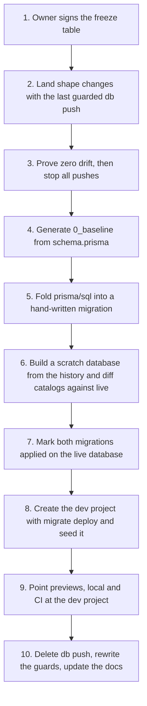

# Pre-launch schema freeze and migration cutover

This page is the plan for the day this database stops being managed by `prisma db push` and starts being managed by versioned Prisma Migrate files. It records one owner decision, already locked: **the shape of the schema is frozen before launch, and after launch the schema only changes by additive expand and contract.** Everything below follows from that decision, and nothing here reopens it.

The plan is labelled **(planned)** wherever it describes behaviour that is not on `dev` yet. The first section describes what is true today.

## 1. The decision in four sentences

1. Before launch, every change that is cheap now and expensive later is made once: drops, renames, `NOT NULL` tightening, type changes and enum value removals. After the freeze, the schema has the shape it will have for years.
2. At the freeze, the live database is **baselined**: a `0_baseline` migration is generated from `prisma/schema.prisma`, and the live database is told it has already been applied, without running it.
3. The hand-applied SQL in `prisma/sql/` (CHECK constraints, partial unique indexes, the exclusion constraint and the triggers) is folded into hand-written migrations, so a database rebuilt from the migration history comes up with every money invariant.
4. After launch, `db push` never runs again. Every change is a reviewed migration, destructive changes are split over several deploys, and no speculative columns are added (additive columns may deploy before compatible code).

## 2. Current state, as verified in the repository

| Fact                                             | Where it is true                                                                                                                                                                                                                             |
| ------------------------------------------------ | -------------------------------------------------------------------------------------------------------------------------------------------------------------------------------------------------------------------------------------------- |
| There is no migration history.                   | `prisma/migrations` does not exist, so there is no `_prisma_migrations` table and nothing for `prisma migrate deploy` to apply. `prisma.config.ts` already names `prisma/migrations` as the path, so the directory is the only gap.          |
| The schema is applied with `db push`.            | `npm run db:push` runs `db:push:schema` (`scripts/db/preflight-push.ts`, then `prisma db push`, then `scripts/db/apply-sidecars.ts --all`) and finishes with `scripts/ci/check-db-sidecars.ts`.                                              |
| Sidecars are applied by an owner, then asserted. | `prisma/sql/check-constraints.sql`, `prisma/sql/ledger-triggers.sql` and `prisma/sql/payment-legs-triggers.sql` are replayed statement by statement (split on `-- SPLIT`, each in its own short transaction with a 3 s `lock_timeout`).      |
| One Postgres project serves everything.          | Production, every Netlify deploy preview, local development and agent QA all read the same Supabase project, through `DATABASE_URL` (pooled, used by `lib/prisma.ts`) and `DIRECT_URL` (used by `prisma.config.ts`).                         |
| The read-only drift check is `migrate diff`.     | `npx prisma migrate diff --from-config-datasource --to-schema prisma/schema.prisma --script` prints what a push would do. `scripts/ci/check-db-live-drift.ts` runs it daily in `.github/workflows/db-live-drift.yml` against `dev`'s schema. |
| The destructive-statement allowlist is empty.    | `prisma/sql/known-drift.json` has empty `destructiveStatementsAllowed` and `enumLabelsInDbNotInSchema` lists. A populated list means a reviewed push is pending.                                                                             |
| Pull requests are checked on a throwaway DB.     | The `db-guards` job in `.github/workflows/ci.yaml` runs `db push` plus the sidecars on a `postgres:17` container and then `scripts/ci/check-db-sidecars.ts`. It cannot see the live database by construction.                                |

### 2.1 Why `db push` is banned against the shared database

`prisma db push` reconciles the database to the schema file and nothing else. Two consequences make it unsafe here.

First, it **drops what the schema does not mention.** The sidecar partial unique indexes use `NULLS NOT DISTINCT` and `WHERE` predicates that the Prisma schema cannot express, so they are absent from `prisma/schema.prisma` by design. The next push therefore plans to drop them. After a clean push, the only statements `migrate diff` still proposes are the three sidecar-owned drops (`appointment_feedback_level_key`, `consultant_earnings_occurrence_key` and `organization_earnings_split_key`), and the sidecars re-create the indexes straight afterwards. A bare `prisma db push` skips that re-creation and leaves the money invariants missing. The enforcer is `scripts/db/preflight-push.ts`, which refuses a plan that destroys or re-points an existing object unless the exact statement is allowlisted in `prisma/sql/known-drift.json`, and which the bare command bypasses.

Second, the database is **shared**, so a push from a worktree whose schema is behind the newest columns proposes to drop them, and a push is a production write. Prisma's own data-loss prompt is not a safeguard here: it counts non-null values, so dropping a column that is null on every row raises no warning at all.

### 2.2 What `migrate diff` cannot see

`migrate diff`, and therefore both the baseline and the drift check, compares what the Prisma schema can describe: tables, columns, enums, ordinary indexes and foreign keys. It is blind to `CHECK` constraints, exclusion constraints, partial unique indexes, functions and triggers. A live `CHECK` can therefore lag the sidecar file with `migrate diff` reporting nothing; the only comparison that catches it is `pg_get_constraintdef` against a freshly built database (step 6 below). The pieces `migrate diff` is blind to are exactly the ones that carry the money invariants: `occurrence_no_confirmed_overlap`, `ledger_txn_balanced`, `payment_legs_sum_to_amount` and the `ledger_*_immutable` triggers.

## 3. What the clean-slate schema issue proposes, and when

The clean-slate schema overhaul (#2077) proposes five groups of change. Under the locked decision, **all of it is a shape change and is either done before the freeze or becomes a multi-deploy expand and contract after launch.** None of it is explicitly post-launch; what differs is the cost of doing it late.

| Group in the issue                                                                                                                 | Cost if done before the freeze                           | Cost if done after launch                                                                                      |
| ---------------------------------------------------------------------------------------------------------------------------------- | -------------------------------------------------------- | -------------------------------------------------------------------------------------------------------------- |
| Primary key standardisation on `uuid` v7 and `Timestamptz` for the 280 naive `DateTime` columns                                    | One baseline; seed data is regenerated.                  | Every table is rewritten and every foreign key re-pointed; effectively a data migration of the whole database. |
| Money and rate naming (`*Paise`, `*Bps`), including the asymmetric `ConsultantPayout` and `OrganizationPayout` columns             | One rename pass with the code.                           | Each rename is three deploys (add, dual-write and backfill, drop) per column.                                  |
| Single-direction foreign keys (the `User.*ProfileId` mirrors, `Organization.billingAccountId` against `BillingAccount.ownerOrgId`) | Drop the mirror and its dual-write sites together.       | Needs a dual-write window and a backfill.                                                                      |
| Transitive and write-only columns and the dead models                                                                              | A drop in the same PR as the code that stops writing it. | The same drop, but only after a release that stops writing it.                                                 |
| Redundant indexes and missing foreign-key indexes                                                                                  | Free on empty or small tables.                           | Index builds on large tables need the concurrent-build recipe in section 6.                                    |

The owner decides scope. Section 9 lists the columns, enums and models that this plan puts in front of the owner as freeze candidates, with the evidence found in code at the time of writing. Several items in the issue's dead-column list have live readers today (for example `TwoFactor.failedVerificationCount` and `lockedUntil`, `RateCard.minGrossPaise` and `maxGrossPaise`, and the whole `RescheduleProposedTime` model), so the issue's list must not be executed without re-checking.

## 4. The cutover sequence (planned)



Run the steps in order. A human runs every command that touches a database; no agent runs `db push`, `migrate dev`, `migrate deploy` or `migrate resolve`.

### Step 1. Sign the freeze table

The owner marks each row in section 9 KEEP or DROP. Rows with a reader stay unless the owner explicitly chooses a coupled change that removes the reader in the same PR.

### Step 2. Land the shape changes (the last `db push` window)

Each approved drop, rename or type change goes through the existing guarded flow: the exact destructive statements from `npm run db:preflight -- --print` are added to `destructiveStatementsAllowed` in `prisma/sql/known-drift.json` with an owner and an expiry, the push is run once by a person, and the list is emptied again. Code that reads the old shape is changed in the same PR. This is the last time the repository uses `db push` against a database that holds data.

### Step 3. Prove zero drift and stop the pushes

Announce a push freeze across all worktrees, then run, read-only:

```sh
npx prisma migrate diff --from-config-datasource --to-schema prisma/schema.prisma --script
npx tsx -r dotenv/config scripts/ci/check-db-sidecars.ts
```

The diff must list only the three sidecar-owned index drops, and the sidecar assertion must report nothing missing. Anything else is drift that has to be fixed before a baseline can be trusted. If the schema is ahead of the database, the baseline would claim objects the live database does not have.

### Step 4. Generate `0_baseline`

```sh
mkdir -p prisma/migrations/0_baseline
npx prisma migrate diff --from-empty --to-schema prisma/schema.prisma --script \
  > prisma/migrations/0_baseline/migration.sql
```

`migrate diff` does not write `prisma/migrations/migration_lock.toml`; `migrate dev` does. Create it by hand, because Prisma uses it to refuse a migration run against a different database provider, and commit it with the baseline:

```sh
test -f prisma/migrations/migration_lock.toml || printf '%s\n' \
  '# Please do not edit this file manually' \
  '# It should be added in your version-control system (e.g., Git)' \
  'provider = "postgresql"' > prisma/migrations/migration_lock.toml
git add prisma/migrations && git ls-files --error-unmatch prisma/migrations/migration_lock.toml
```

This needs no database connection. Run against `dev` at the time of writing, it produces about 6,400 lines: 170 `CREATE TABLE` statements and 150 `CREATE TYPE` statements, and nothing else of interest. It contains no `CHECK`, no exclusion constraint, no trigger and no `CONCURRENTLY`, which is exactly the blind spot described in section 2.2. Review the file by eye for any `DROP`; a baseline from empty should have none. The `0_` prefix sorts before every timestamped migration that follows.

### Step 5. Fold the sidecars into a hand-written migration

Create the second migration from the three sidecar files, in the order `scripts/db/apply-sidecars.ts` applies them (`prisma/sql/check-constraints.sql`, `prisma/sql/ledger-triggers.sql`, `prisma/sql/payment-legs-triggers.sql`):

```sh
mkdir -p prisma/migrations/20261101000000_money_invariants
cat prisma/sql/check-constraints.sql prisma/sql/ledger-triggers.sql \
    prisma/sql/payment-legs-triggers.sql \
  > prisma/migrations/20261101000000_money_invariants/migration.sql
```

The `-- SPLIT` markers are SQL comments and are harmless in a migration file. Before committing, make three edits by hand:

1. **Delete commented-out and staged blocks** (the sections of `prisma/sql/check-constraints.sql` that are comments pending a reset), and remove ticket references from comments, per AGENTS.md section 1.5.
2. **Leave the `DROP ... IF EXISTS` then `CREATE` pairs as they are.** They make the file idempotent, which is what lets a fresh database and a retried deploy both work. They are also the reason this migration is never replayed on the live database (step 7).
3. **Keep `CREATE EXTENSION IF NOT EXISTS btree_gist`** at the top of the exclusion-constraint section. The shadow database and the CI container must have the `contrib` extensions, which the official `postgres:17` image does.

Files that only add things the Prisma schema can already express are not sidecars and are not folded in. For example, the pending `prisma/sql/reconciliation-cursors.sql` (#2309) adds nullable `lastReconciledAt` columns and ordinary indexes that are declared in `prisma/schema.prisma`; those objects are already inside `0_baseline`, so that file is deleted at cutover rather than migrated.

### Step 6. Prove the history reproduces the live database

Build a scratch Postgres 17 (a local container is fine; it is not the shared project), point a throwaway `DIRECT_URL` at it, and run `npx prisma migrate deploy`. Then run the same read-only catalog queries against the scratch database and the live one and diff the output:

```sql
SELECT conrelid::regclass::text AS tbl, conname, pg_get_constraintdef(oid) AS def
  FROM pg_constraint WHERE connamespace = 'public'::regnamespace ORDER BY 1, 2;

SELECT tablename, indexname, indexdef FROM pg_indexes WHERE schemaname = 'public' ORDER BY 1, 2;

SELECT tgrelid::regclass::text AS tbl, tgname, pg_get_triggerdef(oid) AS def
  FROM pg_trigger WHERE NOT tgisinternal ORDER BY 1, 2;

SELECT p.proname, pg_get_functiondef(p.oid) AS def
  FROM pg_proc p WHERE p.pronamespace = 'public'::regnamespace AND p.proname LIKE 'assert\_%' ORDER BY 1;
```

Any difference is a lagging or divergent live object. Fix it on the live database (an owner-run, reviewed statement) or fix the migration, and repeat until the output is identical. This is the step that protects the money invariants; the structure diff in step 3 cannot.

### Step 7. Mark both migrations applied on the live database

```sh
DIRECT_URL=<live direct url> npx prisma migrate resolve --applied 0_baseline
DIRECT_URL=<live direct url> npx prisma migrate resolve --applied 20261101000000_money_invariants
DIRECT_URL=<live direct url> npx prisma migrate status
```

`resolve --applied` records the migration in `_prisma_migrations` without executing any SQL. Both migrations are resolved, not deployed, on the live database, because both describe objects that already exist and the second begins by dropping and re-creating unique indexes that production traffic depends on. `migrate status` must report the database schema is up to date.

### Step 8. Create the dev project from the history

On the new development project (section 5), run `npx prisma migrate deploy`. This applies both migrations for real, and doing so against an empty project is the final proof that the history is self-sufficient. Then run `npm run db:seed` with `SEED_TARGET_CONFIRM` set to that project's host, which `prisma/seed.ts` requires.

### Step 9 and 10. Flip the environments and remove the old path

Point previews, local development and CI at the dev project (section 5). Then, in one PR: delete `db:push`, `db:push:schema`, `db:preflight`, `db:sidecars`, `db:constraints`, `db:triggers`, `db:leg-triggers` and the misleading `db:migrate` (`prisma migrate dev --name init`) scripts from `package.json`; delete `scripts/db/preflight-push.ts` and `scripts/db/apply-sidecars.ts` once nothing imports them (`scripts/ci/check-db-live-drift.ts` currently imports helpers from the preflight); point `scripts/db/sidecar-objects.ts` at the migration SQL instead of `prisma/sql`; delete `prisma/sql/*.sql`; and rewrite AGENTS.md section 2.3, `.claude/skills/schema/references/this-repo.md` and `docs/prisma/README.md` for the new posture.

## 5. Splitting the shared dev and prod database (planned)

The blast-radius argument is in #1873 and the preview-database failure history is in #2305. This section lists what has to move.

**Which project is which.** The existing project holds the real users and the real payment history, so it stays **production**. A new project becomes **development and preview**, built from the migration history and seeded (step 8). The reverse would mean copying production data, which is the riskier operation.

**What changes, by place:**

| Place                                       | Variables                                                                                                                                 | Change                                                                                                                                                                                                                                    |
| ------------------------------------------- | ----------------------------------------------------------------------------------------------------------------------------------------- | ----------------------------------------------------------------------------------------------------------------------------------------------------------------------------------------------------------------------------------------- |
| Netlify, production context                 | `DATABASE_URL`, `DIRECT_URL`                                                                                                              | Unchanged; the existing project.                                                                                                                                                                                                          |
| Netlify, deploy-preview and branch contexts | `DATABASE_URL`, `DIRECT_URL`                                                                                                              | New values pointing at the dev project. Netlify scopes variables by context, so the values differ per context without a code change. The values live in the Netlify UI, not in the repository, so verify them there.                      |
| Supabase Storage and auth keys              | `NEXT_PUBLIC_SUPABASE_URL`, `SUPABASE_URL`, `SUPABASE_SERVICE_ROLE_KEY` (read in `lib/supabase-storage-core.ts` and `lib/`)               | These belong to the project, so the dev project needs its own buckets and its own keys. Splitting the database without splitting these would leave previews writing files to production storage.                                          |
| Local `.env` in every worktree              | `DATABASE_URL`, `DIRECT_URL`, `SEED_TARGET_CONFIRM`                                                                                       | Point at the dev project. The `SEED_TARGET_CONFIRM` host check in `prisma/seed.ts` then refuses a seed aimed at the production host.                                                                                                      |
| GitHub Actions secrets                      | `DATABASE_URL`, `DIRECT_URL` (used by `.github/workflows/db-live-drift.yml` and `.github/workflows/race-condition-tests.yml`), `ENV_FILE` | Decide per workflow. The live drift monitor runs against production (the cron jobs run on the Netlify ticker, not in Actions); the race-condition suite should run against the dev project. Add a second secret pair for the dev project. |
| Webhooks and vendors                        | Razorpay, Stream, Resend, Novu                                                                                                            | The split creates no new webhook endpoint. Whether preview deploys use sandbox vendor keys is set in the Netlify UI and cannot be verified from the repository; confirm it before pointing previews at a database that holds test data.   |

**The build prerenders against the database.** Static and ISR pages prerender against the live database during `next build` (the troubleshooting table in `docs/deployment/netlify.md` records the `P2022` this causes). After the split, a preview build prerenders against the dev project and a production build prerenders against the production project. The consequence is an ordering rule: **the migration must be applied to the target project before the build that reads the new column starts.** A build is not the place to run `migrate deploy`; keep `npm run build` free of database writes.

**Seed.** The dev project takes the full synthetic seed (`prisma/seed.ts` and `prisma/seedFiles/`). Production keeps its existing rows. Which seed phases, if any, are reference data that production needs at launch (for example the TDS rate table in `prisma/seedFiles/15a-create-tds-rates.ts` and the platform cancellation policy in `prisma/seedFiles/15b-create-cancellation-policy.ts`) is an owner decision recorded in the launch tracker, not made here. Production never receives the faker data again.

## 6. After the cutover: how a schema change is made

### 6.1 The authoring loop

1. Edit `prisma/schema.prisma`.
2. Generate the migration without applying it: `npx prisma migrate dev --create-only --name <change>` against the **dev project** only. Read the SQL. Replace any `DROP`/`CREATE` pair that was meant to be a rename with `ALTER TABLE ... RENAME`.
3. Put any `CHECK`, exclusion constraint, partial index or trigger in the same migration file by hand, since `migrate diff` will not write it.
4. Open the PR with the migration, the schema and the code together.
5. Apply the merged migration to each project with `npx prisma migrate deploy`: the dev project on merge to `dev`, production at promotion, always **before** the application deploy that needs it. Never run it from an unmerged branch against a shared project.
6. Run `npx prisma generate` and the checks in AGENTS.md section 3.

### 6.2 Expand and contract rules

The full playbooks live in `.claude/skills/schema/references/expand-contract.md`. The rules that bind this repository are:

1. **A migration must be compatible with the code on both sides of the deploy.** During a rolling deploy, and while a queued job or a webhook retry runs yesterday's code, the previous release still talks to the new schema. A change that breaks that is not allowed in one step.
2. **Additive changes ship alone and early.** A nullable column, a new table, a new enum value and a non-unique index are safe to apply before the code that uses them.
3. **Destructive changes take at least two releases.** Drop, rename, type narrowing, `SET NOT NULL` on a populated table and enum value removal are done as expand, dual-write and backfill, cut over, and only then contract. The contract migration never ships in the release that cuts over.
4. **No speculative columns.** A column or enum value is added in the PR that first reads or writes it. Placeholder columns "for later" are what section 9 exists to remove; after launch they cannot be removed cheaply.
5. **Backfills are batched, restartable and outside the migration that adds the column.** Never one `UPDATE` over a whole table inside a migration.
6. **Set `lock_timeout` on every migration** that takes an `ACCESS EXCLUSIVE` lock, as `scripts/db/apply-sidecars.ts` does today with `SET LOCAL lock_timeout = '3s'`.
7. **Roll forward.** Recover a failed migration with `migrate resolve` and a new migration, not a down script.
8. **Constraints that validate existing rows use `NOT VALID` then `VALIDATE`**, as `occurrence_confirmed_requires_consultant_chk` already does.

**Worked example.** Rename `ConsultationPlan.price` to `pricePaise` after launch, for a seeded consultant's Basic Consultation plan listed at ₹2,500 (stored as `250000` paise). Release 1 adds a nullable `pricePaise`; the code writes both columns on every plan save and keeps reading `price`. A batched backfill copies `250000` into `pricePaise` for every existing plan. Release 2 switches every reader to `pricePaise` while still writing both. Release 3 stops writing `price`, and a following migration drops it. That is three releases for one rename, which is why the rename belongs in the freeze if the owner wants it at all.

### 6.3 Concurrent index builds

Since Prisma 7.4.0, `CREATE INDEX CONCURRENTLY` works inside a migration ([prisma-engines#5767](https://github.com/prisma/prisma-engines/pull/5767), [7.4.0 release notes](https://github.com/prisma/prisma/releases/tag/7.4.0)). A side effect is reported but unconfirmed ([orm#30640](https://github.com/prisma/orm/issues/30640)): each statement of a Postgres migration may commit on its own, so a half-failed migration would stay half-applied and be marked failed (`P3018`). The rehearsal in `.claude/skills/schema/references/runbook-cutover.md` decides this for the pinned 7.10.1. Until then, write migrations idempotently with one logical object per file.

At the cutover the question does not bite. The sidecar files contain no `CONCURRENTLY` (checked: none of the three uses it), and `0_baseline` builds its indexes on empty tables. It matters only for a post-launch index on a large table. The recipe that does not depend on the rehearsal is:

1. The migration contains a plain `CREATE INDEX IF NOT EXISTS "<name>" ...`. On a fresh or small database this is fast and correct.
2. Before deploying that migration to production, a person builds the same index by hand with the same name: `CREATE INDEX CONCURRENTLY "<name>" ...`, via `psql` or `npx prisma db execute --file <file>`.
3. Verify it is valid: `SELECT indisvalid FROM pg_index WHERE indexrelid = '"<name>"'::regclass;`. A failed concurrent build leaves an **invalid** index of the same name, and `IF NOT EXISTS` would then skip it silently.
4. Run `migrate deploy`; the statement is a no-op on production.

A concurrent **unique** index is stricter: it fails if duplicates exist and rejects conflicting writes while it builds, so it follows the ordered recipe in `.claude/skills/schema/references/change-catalog.md`.

## 7. The CI drift gate (planned, building on #2306)

The open pull request #2306 adds `scripts/ci/check-db-schema-required.ts` and a `schema-required` job in `.github/workflows/ci.yaml`. It diffs the pull request's merge-base schema against the branch schema, then asks the live catalog whether each added column, table, enum type and enum value exists, because a preview whose branch reads a column the shared database lacks returns 500 on every read of that model while its build passes. It also records 33 legacy statements in `prisma/sql/known-drift.json` so the daily monitor is green. **This plan keeps that gate and does not duplicate it.** What changes is its target and what surrounds it.

| Layer                  | Today                                                                                                                      | After the cutover (planned)                                                                                                                                                                                                                                                                                                                                                                                                                                                                                                                                                                                                                                                                                                                                                                                                                                                                                                                                                                                                                                                                                                                                                                                                                                                                                                      |
| ---------------------- | -------------------------------------------------------------------------------------------------------------------------- | -------------------------------------------------------------------------------------------------------------------------------------------------------------------------------------------------------------------------------------------------------------------------------------------------------------------------------------------------------------------------------------------------------------------------------------------------------------------------------------------------------------------------------------------------------------------------------------------------------------------------------------------------------------------------------------------------------------------------------------------------------------------------------------------------------------------------------------------------------------------------------------------------------------------------------------------------------------------------------------------------------------------------------------------------------------------------------------------------------------------------------------------------------------------------------------------------------------------------------------------------------------------------------------------------------------------------------- |
| Branch builds cleanly  | `db-guards` pushes the schema and sidecars to a throwaway `postgres:17`.                                                   | `db-guards` runs `prisma migrate deploy` on the throwaway container and then `scripts/ci/check-db-sidecars.ts`. This proves the migration history, not the schema file, builds the invariants.                                                                                                                                                                                                                                                                                                                                                                                                                                                                                                                                                                                                                                                                                                                                                                                                                                                                                                                                                                                                                                                                                                                                   |
| Schema has a migration | Not checkable; there are no migrations.                                                                                    | A new check runs `prisma migrate diff --from-migrations prisma/migrations --to-schema prisma/schema.prisma --script`. It needs a shadow database, and `prisma.config.ts` does not configure one today. The cutover PR adds `shadowDatabaseUrl: process.env.SHADOW_DATABASE_URL` to its `datasource` block (the field exists in the Prisma 7.10 config types). In CI that variable points at the throwaway `postgres:17` container that `db-guards` already starts; without it, Prisma would try to `CREATE DATABASE` on `DIRECT_URL`, which needs a privilege the shared Supabase role should not carry. It is never set to a Supabase project. The check also cannot use a bare `--exit-code`: the shadow database is built from the migrations, so it contains the three sidecar unique indexes (`appointment_feedback_level_key`, `consultant_earnings_occurrence_key`, `organization_earnings_split_key`) that `prisma/schema.prisma` omits by design, and the diff proposes dropping them. This is the same drift the live check sees today. The gate therefore reuses the filter in `scripts/ci/check-db-live-drift.ts`: ignore a `DROP INDEX` only for an index created by the sidecar migration, and fail on any other statement. A non-empty remainder means someone edited `prisma/schema.prisma` without a migration. |
| Preview will not 500   | #2306's `schema-required` reads the shared live database.                                                                  | The same job reads the **dev project**, which is the only database a preview has. Only **merged** migrations reach the dev project, through one serialized promotion step: `prisma migrate deploy` runs once per merge to `dev`, never from a PR branch. This is chosen over per-PR databases because the migration history is linear and shared: two unmerged branches would race on `_prisma_migrations`, and an abandoned branch would leave a row the other branches lack, which Prisma reports as drift. A per-PR database would also add infrastructure per pull request. The cost is that a preview of a PR that adds a column shows errors until it merges; #2306's gate fails that PR's check loudly instead of letting it look green, and such a PR is verified on a local scratch database. Contract migrations follow the same path, after the code that stops using the old shape is merged.                                                                                                                                                                                                                                                                                                                                                                                                                        |
| Live database matches  | `.github/workflows/db-live-drift.yml` runs `migrate diff` against `dev`'s schema, with an allowlist for the sidecar drops. | `.github/workflows/db-live-drift.yml` runs, against each project, `prisma migrate status` (pending or failed migrations), `prisma migrate diff --from-config-datasource --to-schema prisma/schema.prisma --script` (columns, enums and ordinary indexes changed by hand), and the catalog comparison from step 6 for CHECKs, exclusion constraints, triggers and functions, and keeps `scripts/ci/check-db-sidecars.ts`. `migrate status` alone only compares migration files with `_prisma_migrations`, so a manual change to the catalog leaves it green. The same three sidecar-owned index drops stay allowlisted, derived from the sidecar migration once `prisma/sql` is deleted.                                                                                                                                                                                                                                                                                                                                                                                                                                                                                                                                                                                                                                          |

A release pull request into `prod` also runs the whole-schema form, `check-db-schema-required.ts --live`, as the "Release schema gate" job in `.github/workflows/db-live-drift.yml` (see `docs/prisma/README.md`).

The workflows run on GitHub Actions, and `.github/workflows/ci.yaml` is currently disabled because the free minutes ran out. Until it is re-enabled the gate is inert and the proof is a local read-only run of the same commands. The daily monitor needs a sink outside Sentry, as noted in `docs/prisma/README.md`.

## 8. Risks specific to this repository

- **In-flight branches.** Every open schema-bearing branch has no migration file. After the cutover they must be rebased and given one (`--create-only`) before merging. State the freeze date in the PR template.
- **Failure of step 7.** If `resolve --applied` is mistyped, `_prisma_migrations` records the wrong name and the first `deploy` tries to re-run a migration. Run `migrate status` immediately after and treat any "not yet applied" line as stop.
- **A hidden live-only constraint.** Step 6 exists because the structure diff cannot see a CHECK that exists live and not in the file, or the reverse. Do not skip it.
- **Row-level security and the migrations table.** `_prisma_migrations` is created in the `public` schema, which Supabase exposes. Confirm the table is not reachable through the public API roles before launch (see `docs/compliance/04-rls-design-memo.md`).

## 9. Shape-freeze candidates (owner decides)

Method: for each name, a repository-wide search of application code, jobs, scripts, schemas and seed files, excluding `docs/`, `.claude/` and `prisma/schema.prisma`, plus a separate search of `__tests__`. A "reader" means code that selects, filters, branches on, or returns the value. A seed file that only writes demo data is listed as a writer and does not count as a reader. Whole-row reads (a `findUnique` with no `select`) return every column without naming it, so "no reader" means no named reader; that is the remaining unverified risk, and it is why each DROP is made in the same PR as its code and test sweep.

The recommendation is **KEEP** whenever any reader exists. A reader that only refuses or labels a value still counts as a reader.

| Candidate                                                                                                                                               | Readers and writers found (file: function)                                                                                                                                                                                                                                                                                                                                                                                                                                                                                                                                                                             | Recommendation and reason                                                                                                                                                                                                                                        |
| ------------------------------------------------------------------------------------------------------------------------------------------------------- | ---------------------------------------------------------------------------------------------------------------------------------------------------------------------------------------------------------------------------------------------------------------------------------------------------------------------------------------------------------------------------------------------------------------------------------------------------------------------------------------------------------------------------------------------------------------------------------------------------------------------- | ---------------------------------------------------------------------------------------------------------------------------------------------------------------------------------------------------------------------------------------------------------------- |
| `OverageEvent.chargeAttemptCount`, `OverageEvent.lastChargeAttemptAt` (and `@@index([chargeStatus, lastChargeAttemptAt])`)                              | No reader or writer anywhere in code, jobs, scripts or seeds; the schema comment says the timeout sweep gates on them, but `jobs/billing/timeout-member-overages.ts` claims on `chargeTimedOutAt` and `chargeStatus`, and `scripts/cleanup/sweep-abandoned-overage-charges.ts` writes `chargeFailureReason`. The two sibling fields `chargeTimedOutAt` and `chargeFailureReason` do have readers and writers.                                                                                                                                                                                                          | **DROP-pre-launch.** Both columns and the index that names the second are unused. Replace the index with `[chargeStatus]` only if a query plan needs it. KEEP `chargeTimedOutAt` and `chargeFailureReason`.                                                      |
| `OrganizationPayout.paRouteProvider`, `paReferenceId`, `form15caPartCRef`, `form15cbRef`, `rbiPurposeCode`, `fxRateUsed`, `firceRef`, `dtaaRateApplied` | No reader or writer for the persisted columns. The only mentions are `lib/compliance/form15.ts: prepareForm15References`, a stub that returns nulls and has no caller (it is re-exported from `lib/compliance/index.ts`), and `lib/compliance/tds.ts`, which computes a `dtaaRateApplied` in its return value but never stores it on the payout. `PayoutRailProvider` is referenced only by `paRouteProvider`, so it becomes unreferenced and goes too. `ConsultantProfile.rbiPurposeCode` is a different column with its own listing in `lib/data/consultant-public.ts`.                                              | **DROP-pre-launch.** Cross-border payouts are not enabled (see the docblock in `lib/compliance/form15.ts`), so these are placeholders. Re-adding nullable columns when the workflow is built is an additive change and costs nothing. Delete the stub with them. |
| `OrganizationPayout.payoutReference`                                                                                                                    | Read and written in `lib/payments/payouts/org-payout-service.ts` (selected, and set from `gatewayUtr`); covered by `__tests__/enterprise/live-payout-submission.test.ts`.                                                                                                                                                                                                                                                                                                                                                                                                                                              | **KEEP.** Live reader and writer.                                                                                                                                                                                                                                |
| `OrganizationTaxInfo.taxJurisdiction` and `enum TaxJurisdiction`                                                                                        | No reader and no writer; the column only carries its `@default(IN)`. The enum has values `US`, `JP`, `GB` and `EU` that nothing can produce.                                                                                                                                                                                                                                                                                                                                                                                                                                                                           | **DROP-pre-launch.** A multi-jurisdiction refactor is not scheduled, and it would reshape invoice columns anyway rather than reuse this enum. Dropping the column lets the type go with it.                                                                      |
| `ConsultantTaxInfo.lutValidUntil`, `ConsultantTaxInfo.lutNumber`                                                                                        | Neither is written by `app/api/consultant/tax-info/route.ts` (its upsert has no LUT field) nor read by `lib/payments/payouts/payout-service.ts`, `lib/payments/tax/tds-service.ts` or `lib/backoffice/user-360.ts`. The live `lutNumber` readers (`jobs/compliance/irp-uploader.ts`, `lib/compliance/irp-payload.ts`, `lib/payments/billing/create-org-invoice.ts`) read `OrganizationInvoice.lutNumber`, a different column.                                                                                                                                                                                          | **DROP-pre-launch** both consultant columns. **KEEP** `OrganizationInvoice.lutNumber`. A consultant LUT is an export-invoicing input that nothing collects.                                                                                                      |
| `BookingUtilization.platformBpsAtBooking`, `orgBpsAtBooking`, `consultantBpsAtBooking`                                                                  | Written only by the demo seed `prisma/seedFiles/14c-seed-org-appointments-and-feedback.ts`. No application read or write. The schema comment says settlement reads these, but settlement in `lib/payments/payouts/earnings-service.ts` does not name them.                                                                                                                                                                                                                                                                                                                                                             | **DROP-pre-launch.** The comment describes an unimplemented snapshot design. If the owner wants rate-card snapshots at booking time, build the writer and reader first, then add the columns in that PR. Update the seed in the same change.                     |
| `UsageLedgerEntry.minutesConsumed`                                                                                                                      | Written only by the same demo seed (`14c-...`); no application reader.                                                                                                                                                                                                                                                                                                                                                                                                                                                                                                                                                 | **DROP-pre-launch.** Update the seed.                                                                                                                                                                                                                            |
| `Organization.isGCC`, `parentCountry`, `parentEntityType` (and `enum ParentEntityType`), `aatoAboveEinvoiceThreshold`                                   | No reader or writer in code or seed; the e-invoice threshold comment says "enforcement deferred".                                                                                                                                                                                                                                                                                                                                                                                                                                                                                                                      | **DROP-pre-launch.** All four are unused placeholders. Add the threshold flag back in the PR that enforces it.                                                                                                                                                   |
| `OrgKybVerification.sumsubApplicantId`                                                                                                                  | No reader or writer.                                                                                                                                                                                                                                                                                                                                                                                                                                                                                                                                                                                                   | **DROP-pre-launch.** No Sumsub integration exists in the repository.                                                                                                                                                                                             |
| `DataBreach.principalNotificationChannel`, `principalNotificationNote`                                                                                  | No reader or writer. `principalsNotifiedAt` next to them is a separate column and is not part of this row.                                                                                                                                                                                                                                                                                                                                                                                                                                                                                                             | **DROP-pre-launch.** The free-form channel field already says it is waiting for an enum to earn its keep.                                                                                                                                                        |
| `RescheduleRequest.resolutionNote`                                                                                                                      | No reader or writer. Its comment describes a "return leg" reply that no route accepts.                                                                                                                                                                                                                                                                                                                                                                                                                                                                                                                                 | **DROP-pre-launch**, unless the owner wants the reply feature at launch; in that case wire it first, then keep.                                                                                                                                                  |
| `Referral.refereeRewardPaidAt`                                                                                                                          | No reader or writer. Its sibling `referrerRewardPaidAt` is written in `lib/referrals/vesting.ts` and stays.                                                                                                                                                                                                                                                                                                                                                                                                                                                                                                            | **DROP-pre-launch.**                                                                                                                                                                                                                                             |
| `OrganizationPayoutAccount.accountNumberEncrypted`                                                                                                      | `app/api/organizations/[orgId]/payout-account/route.ts` writes the constant empty string `noStoredAccountNumber` on create and update; the demo seed `prisma/seedFiles/14a-create-organizations.ts` writes sample values; nothing reads it. The sidecar header already says the drop is staged for a reset.                                                                                                                                                                                                                                                                                                            | **DROP-pre-launch.** The column is `NOT NULL`, so the route and seed must stop writing it in the same PR. Bank data is reference-only via `accountNumberLast4`.                                                                                                  |
| `LedgerTransactionKind.GRANT`                                                                                                                           | Declared and never posted. The only `GRANT` matches in code are unrelated strings (the referral-waiver action in `app/api/admin/referrals/waivers/route.ts`, a Stream role comment). `docs/finance/20-ledger/04-postings.md` records it as "declared and never posted". No `prisma/sql` file names it.                                                                                                                                                                                                                                                                                                                 | **DROP-pre-launch.** Postgres has no `ALTER TYPE ... DROP VALUE`, so removal recreates the type; that is free on the baseline path and costly after launch. Confirm no `LedgerTransaction` row holds the value first.                                            |
| `PaymentGateway.DODO_PAYMENTS`                                                                                                                          | No writer. Readers that refuse or label it: `lib/payments/constants.ts: UNIMPLEMENTED_GATEWAYS`, `lib/payments/validation/gateway-guards.ts`, `lib/labels/money-labels.ts`, `app/api/admin/disputes/route.ts`, and `__tests__/seed/money-row-invariants.test.ts`.                                                                                                                                                                                                                                                                                                                                                      | **KEEP.** It has readers. The owner may instead choose a coupled drop: remove the value and delete those guard references in one PR; adding the value back later is free, removing it after launch is not.                                                       |
| `PaymentGateway.STRIPE`                                                                                                                                 | No live client. Readers and writers: `lib/payments/constants.ts: UNIMPLEMENTED_GATEWAYS`, `scripts/payments/reconcile-payment-status.ts`, `scripts/payments/cleanup-abandoned-payments.ts`, `lib/labels/money-labels.ts`, `lib/appointments/payment-display.ts`, admin filters in `components/dashboard/shared/DisputesPage.tsx`, `components/dashboard/shared/PaymentsPage.tsx`, `components/dashboard/shared/RefundsPage.tsx`, the org payouts Zod enum, and demo rows in `prisma/seedFiles/11a-create-refunds.ts`, `prisma/seedFiles/11b-create-disputes.ts` and `prisma/seedFiles/validation/impossible-cases.ts`. | **KEEP.** Many readers, and seed rows hold the value. Related `PayoutAccountType.STRIPE_CONNECT` and `PayoutMethod.STRIPE_TRANSFER` still map to it in `lib/payments/payouts/payout-service.ts`.                                                                 |
| `PaymentGateway.CARD`                                                                                                                                   | No `PaymentGateway.CARD` use in code. The only reader is the `z.enum(["STRIPE", "RAZORPAY", "CARD"])` in `app/api/organizations/[orgId]/payouts/route.ts`, which accepts it only to refuse it, and the label test in `__tests__/appointments/detail-payment-scope.test.ts`.                                                                                                                                                                                                                                                                                                                                            | **KEEP.** It has a reader. A coupled drop (remove it from the enum and that Zod list together) is the owner's option, with the same asymmetry as `DODO_PAYMENTS`.                                                                                                |
| `RescheduleProposedTime` (model)                                                                                                                        | Read through the `proposedTimes` relation in `app/api/appointments/[appointmentId]/reschedule/route.ts`, `lib/appointments/consultee-affordances.ts`, `components/dashboard/shared/requests/RequestsInbox.tsx` and `components/dashboard/shared/requests/InboxRow.tsx`.                                                                                                                                                                                                                                                                                                                                                | **KEEP.** Live. The clean-slate issue lists it as dead; that is wrong.                                                                                                                                                                                           |
| `TwoFactor.failedVerificationCount`, `lockedUntil`                                                                                                      | `lib/auth/two-factor-lockout.ts` increments and compares the counter; `app/api/user/reauthenticate/route.ts` reads `lockedUntil`.                                                                                                                                                                                                                                                                                                                                                                                                                                                                                      | **KEEP.** Live. The clean-slate issue lists them as dead; that is wrong.                                                                                                                                                                                         |
| `RateCard.minGrossPaise`, `maxGrossPaise`                                                                                                               | Accepted and written by `app/api/organizations/[orgId]/rate-cards/[cardId]/route.ts`.                                                                                                                                                                                                                                                                                                                                                                                                                                                                                                                                  | **KEEP.** Has a writer and a validator. Settlement does not apply the bounds, so decide separately whether the feature is wanted.                                                                                                                                |
| `ConsultantProfile.panNumber`, `swiftBic`, `ibanOrAccount`, `rbiPurposeCode`                                                                            | Named in the public-field deny list `lib/data/consultant-public.ts`, in `lib/data/consultant-detail.ts` and `app/api/dashboard/consultee/[consulteeId]/route.ts` comments, and `panNumber` is accepted by `app/api/consultant/tax-info/route.ts`.                                                                                                                                                                                                                                                                                                                                                                      | **KEEP** pending a separate review. The deny-list references are readers; dropping the columns would also need those lists edited, which this plan does not assess.                                                                                              |
| `SupportFlowOutcome.helpfulRating`                                                                                                                      | Written with a compare-and-set in `lib/support/deflection.ts`.                                                                                                                                                                                                                                                                                                                                                                                                                                                                                                                                                         | **KEEP.** Live.                                                                                                                                                                                                                                                  |
| `LedgerAccountBalance` (model named in the clean-slate issue)                                                                                           | No model of that name in `prisma/schema.prisma` and no reference anywhere; `docs/finance/20-ledger/04-postings.md` records the snapshot as already removed.                                                                                                                                                                                                                                                                                                                                                                                                                                                            | Nothing to do. Already gone.                                                                                                                                                                                                                                     |

If the owner accepts every DROP row, the freeze removes 27 columns, three enum types that become unreferenced (`TaxJurisdiction`, `ParentEntityType` and `PayoutRailProvider`), the enum value `LedgerTransactionKind.GRANT`, one index, and the stub module `lib/compliance/form15.ts`.

## 10. Where in code

- `prisma/schema.prisma`: the schema and the freeze banner at its top.
- `prisma/sql/check-constraints.sql`, `prisma/sql/ledger-triggers.sql`, `prisma/sql/payment-legs-triggers.sql`, `prisma/sql/known-drift.json`: the sidecars and the allowlist.
- `prisma.config.ts`: the CLI datasource (`DIRECT_URL`) and the `prisma/migrations` path.
- `scripts/db/preflight-push.ts`, `scripts/db/apply-sidecars.ts`, `scripts/db/sidecar-objects.ts`, `scripts/db/sql-chunks.ts`: the push guard, the replay, the object parser and the splitter.
- `scripts/ci/check-db-sidecars.ts`, `scripts/ci/check-db-live-drift.ts`: the assertion and the live drift check; `.github/workflows/ci.yaml` (`db-guards`) and `.github/workflows/db-live-drift.yml`.
- `prisma/seed.ts`: the `SEED_TARGET_CONFIRM` host guard.
- `lib/prisma.ts`: the runtime connection (`DATABASE_URL`).

Related issues: the clean-slate schema overhaul (#2077), the preview schema gate (#2306, closing #2305), the shared-database split (#1873), the pending recovery cursor columns (#2309). Part of the finance production-readiness program (#2230).

## Deprecated & Superseded Approaches

- **`db push` plus owner-applied sidecars as the permanent model.** This is the current posture and is superseded at the cutover by the migration history. Remove `npm run db:push`, `db:push:schema`, `db:preflight`, `db:sidecars`, `db:constraints`, `db:triggers`, `db:leg-triggers` and `scripts/db/apply-sidecars.ts` when step 10 lands, and do not re-create a parallel replay path.
- **A "pre-MVP reset" followed by a "cutover" runbook.** Earlier docs split this into a pre-MVP reset runbook and a cutover runbook; both were retired. The reset is replaced by baselining the live database, which keeps real users and payments. References to those two files in older text are stale.
- **The `db:migrate` script (`prisma migrate dev --name init`).** It would generate a migration against the shared database. Delete it at the cutover; use `--create-only` against the dev project only.
- **A rehearsal database for schema-ahead branches (`REHEARSAL_DATABASE_URL`).** Removed earlier; the dev project from section 5 replaces it as the single non-production database.
- **Staged-for-the-reset SQL blocks in `prisma/sql/check-constraints.sql`.** Commented statements waiting for a clean schema are not folded into the migration (step 5). Either apply them as ordinary reviewed migrations after launch, validating existing rows first, or delete them.
- **Operator-applied additive SQL files beside the sidecars** (the pattern of `prisma/sql/reconciliation-cursors.sql`, #2309). After the cutover an additive change is a migration; do not create a new file under `prisma/sql`.
