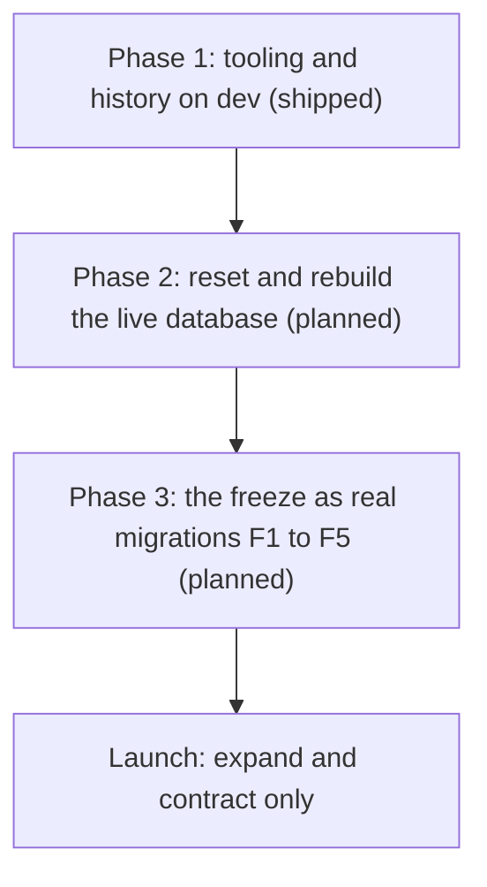

# Schema freeze and migration cutover

This page records the move of this database from `prisma db push` to versioned Prisma Migrate files, and the plan to finish it. It rests on owner decisions taken on 2026-11-09, recorded in [Schema freeze and the cutover from db push to versioned migrations](../decisions/2026-11-09-schema-freeze-and-migration-cutover.md): **the shape of the schema is frozen before launch, and after launch the schema only changes by additive expand and contract.** The step-by-step procedure for adding a migration is the schema skill's `.claude/skills/schema/references/multi-session-workflow.md`; this page is the background and the owner's checklist.

Behaviour is labelled **(shipped)** when it is on `dev` and **(planned)** when it is not. Sections 1, 2, 6 and 7 describe what is shipped; section 4 separates the shipped tooling from the planned live reset; section 9 is the freeze table, executed in Phase 3.

## 1. The decision in four sentences

1. Every schema change is a reviewed migration folder under `prisma/migrations/`, committed in the same pull request as the `prisma/schema.prisma` edit and the code that uses it. `db push` and the hand-applied SQL in `prisma/sql/` no longer exist **(shipped)**.
2. The history is `0_baseline`, generated from `prisma/schema.prisma` by `scripts/db/generate-baseline.sh`, plus 19 grouped, transaction-wrapped migrations that create every object the schema cannot declare (CHECK and exclusion constraints, partial and `NULLS NOT DISTINCT` unique indexes, triggers, a view, row-level security) **(shipped)**.
3. The live database is not baselined in place. Because its data is mock, it is dumped, upgraded to Postgres 17, emptied of its Prisma-owned objects, rebuilt by `migrate deploy` from the history and seeded, so `_prisma_migrations` records real applications from the first day. There is no `migrate resolve --applied` **(planned, Phase 2)**.
4. Before launch every change that is cheap now and expensive later (drops, renames, `NOT NULL` tightening, type changes, enum value removals) is made once, as real migrations, in Phase 3. After the freeze, destructive changes are split over several deploys and shipped in `_contract` folders that only an owner dispatch applies.

## 2. Current state, as verified in the repository

| Fact                                           | Where it is true                                                                                                                                                                                                                                                                      |
| ---------------------------------------------- | ------------------------------------------------------------------------------------------------------------------------------------------------------------------------------------------------------------------------------------------------------------------------------------- |
| There is a migration history.                  | `prisma/migrations/` holds `0_baseline`, 19 timestamped migrations from `20261109000001_revoke_data_api_grants` to `20261109000019_org_data_export_rls`, and `migration_lock.toml`. `prisma.config.ts` names that path.                                                               |
| Merged migrations are applied by CI.           | `.github/workflows/db-migrate.yml` runs on a push to `dev` that changes `prisma/migrations/**`: `scripts/ci/migrate-gate.ts`, `prisma migrate deploy`, `prisma migrate status`, then `scripts/ci/check-db-sidecars.ts`, through the session pooler (`DIRECT_URL`).                    |
| Destructive migrations need a dispatch.        | A folder ending in `_contract` is refused on push and applied only by a `workflow_dispatch` run whose input names the folder exactly.                                                                                                                                                 |
| Every migration is transaction-wrapped.        | `BEGIN; SET LOCAL lock_timeout = '3s'; ... COMMIT;`, enforced by `lintMigrationSql` in `scripts/ci/check-migrations.ts`. The one exception is a file holding a single `CONCURRENTLY` statement.                                                                                       |
| One Postgres project still serves everything.  | Production, every Netlify deploy preview, local development and agent QA read the same Supabase project, through `DATABASE_URL` (pooled, used by `lib/prisma.ts`) and `DIRECT_URL` (used by `prisma.config.ts`). That project is still the one built by `db push` until Phase 2 runs. |
| Pull requests build the database from history. | The `checks` job in `.github/workflows/ci.yaml` starts Postgres 17.6 in UTC, runs `migrate deploy`, then `scripts/ci/check-migrations.ts` and `scripts/ci/check-db-sidecars.ts`, then the `jest.db` tier. `prisma.config.ts` reads `SHADOW_DATABASE_URL`, which is CI-only.           |
| The live drift check filters three drops.      | `scripts/ci/check-db-live-drift.ts` runs `migrate diff` against the live database and tolerates only the drops of the `NULLS NOT DISTINCT` indexes that `sidecarOwnedUniqueIndexes` (`scripts/db/sidecar-objects.ts`) derives from the migrations. There is no allowlist file.        |

### 2.1 Why `db push` is gone

`prisma db push` reconciles the database to the schema file and nothing else, which made two things unsafe. First, it **drops what the schema does not mention**: the sidecar partial unique indexes use `NULLS NOT DISTINCT` and `WHERE` predicates the Prisma schema cannot express, so each push planned to drop them, and a bare push left the money invariants missing. Second, the database is **shared**, so a push from a worktree whose schema was behind the newest columns proposed to drop them, and every push was a production write. Prisma's data-loss prompt is no safeguard: it counts non-null values, so dropping a column that is null on every row raises no warning. A reviewed migration file, applied once by CI after merge, removes both problems.

### 2.2 What `migrate diff` cannot see

`migrate diff` compares what the Prisma schema can describe: tables, columns, enums, ordinary indexes and foreign keys. It is blind to `CHECK` constraints, exclusion constraints, partial unique indexes, functions and triggers, which are exactly the pieces that carry the money invariants: `occurrence_no_confirmed_overlap`, `ledger_txn_balanced`, `payment_legs_sum_to_amount` and the `ledger_*_immutable` triggers. Two guards cover the blind spot. `scripts/ci/check-db-sidecars.ts` asserts that every constraint, index, trigger, view and row-level-security table declared in the migration SQL exists, and fails on any table grant to `anon` or `authenticated`. A catalog comparison of `pg_get_constraintdef` and `pg_get_triggerdef` between two databases (the rehearsal in the schema skill) catches a live object that lags the migrations. Diffing the history against the schema always proposes the same three index drops, which are not a change and are never committed.

## 3. What the clean-slate schema issue proposes, and when

The clean-slate schema overhaul (#2077) proposes five groups of change. Under the locked decision, **all of it is a shape change and is either done before the freeze or becomes a multi-deploy expand and contract after launch.** What differs is the cost of doing it late.

| Group in the issue                                                                                                                           | Cost if done before the freeze                           | Cost if done after launch                                                                                      |
| -------------------------------------------------------------------------------------------------------------------------------------------- | -------------------------------------------------------- | -------------------------------------------------------------------------------------------------------------- |
| `Timestamptz` for the 280 naive `DateTime` columns (the `uuid` v7 primary-key conversion was not adopted; only new models may use `uuid(7)`) | One baseline; seed data is regenerated.                  | Every table is rewritten and every foreign key re-pointed; effectively a data migration of the whole database. |
| Money and rate naming (`*Paise`, `*Bps`), including the asymmetric `ConsultantPayout` and `OrganizationPayout` columns                       | One rename pass with the code.                           | Each rename is three deploys (add, dual-write and backfill, drop) per column.                                  |
| Single-direction foreign keys (the `User.*ProfileId` mirrors, `Organization.billingAccountId` against `BillingAccount.ownerOrgId`)           | Drop the mirror and its dual-write sites together.       | Needs a dual-write window and a backfill.                                                                      |
| Transitive and write-only columns and the dead models                                                                                        | A drop in the same PR as the code that stops writing it. | The same drop, but only after a release that stops writing it.                                                 |
| Redundant indexes and missing foreign-key indexes                                                                                            | Free on empty or small tables.                           | Index builds on large tables need the concurrent-build recipe in section 6.3.                                  |

The owner set the scope on 2026-11-09 (decisions 12 to 16 of the decision record). Section 9 lists the columns, enums and models that were put in front of the owner as freeze candidates, with the evidence found in code at the time of writing. Several items in the issue's dead-column list have live readers today (for example `TwoFactor.failedVerificationCount` and `lockedUntil`, `RateCard.minGrossPaise` and `maxGrossPaise`, and the whole `RescheduleProposedTime` model), so the issue's list must not be executed without re-checking.

## 4. The cutover sequence

A human runs every command that touches the shared database; no agent runs `migrate deploy` or `migrate resolve` against it, and none runs `db push`, which no longer exists.

### Phase 1. Tooling and history (shipped)

The cutover pull request put in place: `prisma/migrations/` with `0_baseline` and the 19 grouped migrations; `scripts/db/generate-baseline.sh`; `scripts/db/sidecar-objects.ts` and `scripts/db/plan-statements.ts`, which derive the expected objects from the migration SQL; `scripts/ci/check-migrations.ts`, `scripts/ci/migrate-gate.ts` and `scripts/ci/check-db-sidecars.ts`; `.github/workflows/db-migrate.yml`; and the CI steps "Start Postgres 17.6", "Build the database from the migration history", "Migration history lint" and "Database sidecar guard". It deleted `db:push`, `db:push:schema`, `db:preflight`, `db:sidecars`, `db:constraints`, `db:triggers`, `db:leg-triggers`, `db:migrate`, `scripts/db/preflight-push.ts`, `scripts/db/apply-sidecars.ts` and `prisma/sql/`.

Two migrations deserve a mention because they are about safety, not shape. `20261109000001_revoke_data_api_grants` replays the `anon` and `authenticated` REVOKE and default-privileges block straight after the baseline, so a rebuilt table is never readable with the anon key; it is guarded by a `pg_roles` check, and CI creates the roles first so the real branch runs there. `20261109000002_btree_gist_extension` moves `btree_gist` into the `extensions` schema, and the 13 trigger functions pin `SET search_path = public`.

The baseline is regenerated with `scripts/db/generate-baseline.sh` from the final `dev` schema after the in-flight schema pull requests land, and is frozen the moment the live database has applied it.

### Phase 2. Reset and rebuild the live database (planned, owner-run)

The live database holds mock data only, so it is rebuilt rather than baselined. The owner runs these steps in order, with the site in maintenance mode:

1. **Rebase the in-flight schema pull requests,** regenerate `0_baseline` from the final `dev` schema, and confirm the `DIRECT_URL` GitHub secret (the Supabase session pooler) exists.
2. **Put the site in maintenance mode.**
3. **Dump the database with a version 17 `pg_dump` client and prove the dump restores** into a scratch container. The Free plan takes no automatic backups, so this dump is the only way back.
4. **Disable the unused `pgjwt` extension,** then upgrade the project to the latest Postgres 17 in the Supabase dashboard. If the Free-plan upgrade is unavailable, stay on 15 and pin the CI container to 15.
5. **Drop the Prisma-owned objects in `public`** and the leftover `archive._gateway_drift_backup_20260728`.
6. **Merge the cutover** so `db-migrate.yml` runs `migrate deploy` against the empty database, or run `npx prisma migrate deploy` once by hand from the merged commit. The rehearsal applied 20 migrations to an empty Postgres 17.11 database in 1.35 seconds.
7. **Run the guarded seed.** `npm run db:seed` with `SEED_TARGET_CONFIRM` set to the project's host, which `prisma/seed.ts` requires.
8. **Verify.** `npx prisma migrate status` is up to date; `scripts/ci/check-db-sidecars.ts` is green; neither `anon` nor `authenticated` holds any table grant; the Supabase security and performance advisors show nothing new; and smoke tests pass on full-row readers of the money, booking and seat models.
9. **Promote `dev` to `prod` and turn maintenance mode off.**

The operational checklist, including the rehearsed drop of the app objects, the `btree_gist` drop before the deploy and the md5-to-SCRAM check after the upgrade, is `.claude/skills/schema/references/runbook-cutover.md`.

Row-level security on every table is deferred; the app connects as `postgres`, which has `BYPASSRLS`, so enabling it later with no policies cannot break the app. Whether to enable it is decided on the rebuilt database.

### Phase 3. The freeze as real migrations (planned)

The owner accepted every DROP and KEEP row of section 9 on 2026-11-09, re-audited for schema added since 2026-10-23. The freeze ships as five pull requests, F1 to F5, each under 150 files, none stacked, merged one after another: F1 drops, F2 relations and types, F3 payment renames, F4 plan and billing renames, F5 the Referral contract drill. Each is a real migration under the rules of section 6, and any destructive one lands in a `_contract` folder that the owner dispatches after the release that stopped reading the object. The Referral drill follows four steps: stop reading the columns and values, mark them `@ignore`, dispatch a `_contract` migration that remaps `QUALIFIED` to `QUALIFYING` and `REWARDED` to `VESTED`, recreates the enum and drops the columns in one transaction, then confirm `migrate diff --exit-code` exits 0.

## 5. Splitting the shared dev and prod database (planned)

The blast-radius argument is in #1873 and the preview-database failure history is in #2305. This section lists what has to move.

**Which project is which.** The existing project holds the real users and the real payment history, so it stays **production**. A new project becomes **development and preview**, built by `npx prisma migrate deploy` from the migration history on an empty project and then seeded; the history, not a dump, is the source of truth. The reverse would mean copying production data, which is the riskier operation.

**What changes, by place:**

| Place                                       | Variables                                                                                                                                 | Change                                                                                                                                                                                                                                    |
| ------------------------------------------- | ----------------------------------------------------------------------------------------------------------------------------------------- | ----------------------------------------------------------------------------------------------------------------------------------------------------------------------------------------------------------------------------------------- |
| Netlify, production context                 | `DATABASE_URL`, `DIRECT_URL`                                                                                                              | Unchanged; the existing project.                                                                                                                                                                                                          |
| Netlify, deploy-preview and branch contexts | `DATABASE_URL`, `DIRECT_URL`                                                                                                              | New values pointing at the dev project. Netlify scopes variables by context, so the values differ per context without a code change. The values live in the Netlify UI, not in the repository, so verify them there.                      |
| Supabase Storage and auth keys              | `NEXT_PUBLIC_SUPABASE_URL`, `SUPABASE_URL`, `SUPABASE_SERVICE_ROLE_KEY` (read in `lib/supabase-storage-core.ts` and `lib/`)               | These belong to the project, so the dev project needs its own buckets and its own keys. Splitting the database without splitting these would leave previews writing files to production storage.                                          |
| Local `.env` in every worktree              | `DATABASE_URL`, `DIRECT_URL`, `SEED_TARGET_CONFIRM`                                                                                       | Point at the dev project. The `SEED_TARGET_CONFIRM` host check in `prisma/seed.ts` then refuses a seed aimed at the production host.                                                                                                      |
| GitHub Actions secrets                      | `DATABASE_URL`, `DIRECT_URL` (used by `.github/workflows/db-live-drift.yml` and `.github/workflows/race-condition-tests.yml`), `ENV_FILE` | Decide per workflow. The live drift monitor runs against production (the cron jobs run on the Netlify ticker, not in Actions); the race-condition suite should run against the dev project. Add a second secret pair for the dev project. |
| Webhooks and vendors                        | Razorpay, Stream, Resend, Novu                                                                                                            | The split creates no new webhook endpoint. Whether preview deploys use sandbox vendor keys is set in the Netlify UI and cannot be verified from the repository; confirm it before pointing previews at a database that holds test data.   |

**The build prerenders against the database.** Static and ISR pages prerender against the live database during `next build` (the troubleshooting table in `docs/deployment/netlify.md` records the `P2022` this causes). After the split, a preview build prerenders against the dev project and a production build prerenders against the production project. The consequence is an ordering rule: **the migration must be applied to the target project before the build that reads the new column starts.** A build is not the place to run `migrate deploy`; keep `npm run build` free of database writes.

**Seed.** The dev project takes the full synthetic seed (`prisma/seed.ts` and `prisma/seedFiles/`). Production keeps its existing rows. Which seed phases, if any, are reference data that production needs at launch (for example the TDS rate table in `prisma/seedFiles/15a-create-tds-rates.ts` and the platform cancellation policy in `prisma/seedFiles/15b-create-cancellation-policy.ts`) is an owner decision recorded in the launch tracker, not made here. Production never receives the faker data again.

## 6. After the cutover: how a schema change is made

### 6.1 The authoring loop

The full procedure, with commands, is `.claude/skills/schema/references/multi-session-workflow.md`. In outline:

1. Rebase onto the newest `dev` and build a scratch database from the history alone, on a local Postgres 17 cluster in UTC. Never a Supabase project.
2. Edit `prisma/schema.prisma`.
3. Generate the SQL against a shadow database: `npx prisma migrate diff --from-migrations prisma/migrations --to-schema prisma/schema.prisma --script` with `SHADOW_DATABASE_URL` set. **`prisma migrate dev` is never used,** because it writes to whatever `DIRECT_URL` points at and can offer to reset the database.
4. Delete the three standing index drops from the output (`appointment_feedback_level_key`, `consultant_earnings_occurrence_key`, `organization_earnings_split_key`); they are `NULLS NOT DISTINCT` uniques the schema cannot declare.
5. Create `prisma/migrations/<YYYYMMDDHHMMSS>_<what_it_does>/migration.sql` with a timestamp later than the newest on `dev`, add `_contract` to the folder name if the change is destructive, and wrap the file in `BEGIN; SET LOCAL lock_timeout = '3s'; ... COMMIT;`.
6. Fix the SQL by hand where Prisma is wrong: replace a `DROP COLUMN` and `ADD COLUMN` pair that was meant as a rename with `ALTER TABLE ... RENAME COLUMN`, and write every sidecar object (CHECK, exclusion constraint, partial unique, trigger and its function with `SET search_path = public`) idempotently.
7. Prove it locally: `migrate deploy` on the scratch database, `scripts/ci/check-migrations.ts`, `scripts/ci/check-db-sidecars.ts`, and for booking, money or seat changes the `jest.db` tier on a database named `ci`.
8. Open the pull request with the migration, the schema and the code together. On merge to `dev`, `db-migrate.yml` applies an expand migration; a `_contract` folder waits for an owner dispatch naming it.

### 6.2 Expand and contract rules

The full playbooks live in `.claude/skills/schema/references/expand-contract.md`. The rules that bind this repository are:

1. **A migration must be compatible with the code on both sides of the deploy.** During a rolling deploy, and while a queued job or a webhook retry runs yesterday's code, the previous release still talks to the new schema. A change that breaks that is not allowed in one step.
2. **Additive changes ship alone and early.** A nullable column, a new table, a new enum value and a non-unique index are safe to apply before the code that uses them. They merge to `dev` and apply at once, which is also when production sees them.
3. **Destructive changes take at least two releases.** Drop, rename, type narrowing, `SET NOT NULL` on a populated table and enum value removal are done as expand, dual-write and backfill, cut over, and only then contract. The contract migration never ships in the release that cuts over.
4. **No speculative columns.** A column or enum value is added in the PR that first reads or writes it. Placeholder columns "for later" are what section 9 exists to remove; after launch they cannot be removed cheaply.
5. **Backfills are batched, restartable and outside the migration that adds the column.** Never one `UPDATE` over a whole table inside a migration.
6. **Every migration sets `lock_timeout`** with `SET LOCAL lock_timeout = '3s'` inside its `BEGIN` and `COMMIT`; `lintMigrationSql` refuses a file that does not, and refuses a session-level `SET` or `RESET`.
7. **Roll forward.** Recover a failed migration with `migrate resolve --rolled-back` after the transaction has rolled back, and a corrected file, not a down script. The wrapped file leaves nothing behind, so Prisma then reports `P3009` on every later deploy until the owner resolves it.
8. **Constraints that validate existing rows use `NOT VALID` then `VALIDATE`**, as `occurrence_confirmed_requires_consultant_chk` already does. A new CHECK that existing rows fail is a contract.
9. **A pending `_contract` folder blocks every later expand,** because `migrate deploy` applies pending migrations in order and cannot skip one. Dispatch the contract promptly, or keep its pull request unmerged until its release is ready.

**Worked example.** Rename `ConsultationPlan.price` to `pricePaise` after launch, for a seeded consultant's Basic Consultation plan listed at ₹2,500 (stored as `250000` paise). Release 1 adds a nullable `pricePaise`; the code writes both columns on every plan save and keeps reading `price`. A batched backfill copies `250000` into `pricePaise` for every existing plan. Release 2 switches every reader to `pricePaise` while still writing both. Release 3 stops writing `price`, and a following `_contract` migration drops it. That is three releases for one rename, which is why the rename belongs in the freeze if the owner wants it at all.

### 6.3 Concurrent index builds

Since Prisma 7.4.0, `CREATE INDEX CONCURRENTLY` works inside a migration ([prisma-engines#5767](https://github.com/prisma/prisma-engines/pull/5767), [7.4.0 release notes](https://github.com/prisma/prisma/releases/tag/7.4.0)). Postgres refuses it inside a transaction, which is why it needs its own file. The atomicity facts, rehearsed on 2026-11-09 with Prisma 7.10.1 on Postgres 17.11 (the underlying behaviour is [orm#30640](https://github.com/prisma/orm/issues/30640), still open):

1. An unwrapped migration is not atomic. `migrate deploy` commits each statement on its own: a file that created two tables and then failed left both committed and the migration marked failed.
2. An explicit `BEGIN; ... COMMIT;` restores atomicity. A wrapped file that failed left nothing behind.
3. `SET LOCAL lock_timeout` has no effect unwrapped and works wrapped; a plain `SET` leaks into every later migration of the same run.

So a file holding a `CONCURRENTLY` statement cannot be wrapped, and must hold **exactly one statement and nothing else**; then there is nothing to be half-applied. The recipe for an index on a large table is:

1. The migration is its own folder whose `migration.sql` is the single statement `CREATE INDEX CONCURRENTLY IF NOT EXISTS "<name>" ...`.
2. After it runs, verify the index is valid: `SELECT indisvalid FROM pg_index WHERE indexrelid = '"<name>"'::regclass;`. A failed concurrent build leaves an **invalid** index of the same name, and `IF NOT EXISTS` would then skip it silently on a retry, so drop the invalid index and rerun.
3. If the table is so large that the build could exceed the 15-minute limit of `db-migrate.yml`, the owner builds the same index by hand first, with the same name, and the migration is then a no-op.

A concurrent **unique** index is stricter: it fails if duplicates exist and rejects conflicting writes while it builds, so it follows the ordered recipe in `.claude/skills/schema/references/change-catalog.md`.

## 7. The CI gates

`scripts/ci/check-db-schema-required.ts` diffs the pull request's merge-base schema against the branch schema, then asks the live catalog whether each added column, table, enum type and enum value exists, because a preview whose branch reads a column the shared database lacks returns 500 on every read of that model while its build passes. It runs as `.github/workflows/schema-required.yml`. When it fails, its message now says that the objects reach the shared database when the branch's migration merges to `dev`, that nobody should apply them by hand (a hand-applied column makes the migration fail on merge), and that the pull request is verified on a local scratch database until then.

| Layer                  | Gate (shipped)                                                                                                                                                                                                                                                                                         |
| ---------------------- | ------------------------------------------------------------------------------------------------------------------------------------------------------------------------------------------------------------------------------------------------------------------------------------------------------ |
| Branch builds cleanly  | The `checks` job of `.github/workflows/ci.yaml` starts Postgres 17.6, builds the `ci` database with `migrate deploy`, runs `scripts/ci/check-db-sidecars.ts` and the `jest.db` tier. This proves the migration history, not the schema file, builds the invariants.                                    |
| Schema has a migration | "Migration history lint" runs `scripts/ci/check-migrations.ts` on a `shadow` database: linear folders, no edited applied migration, the transaction wrapper, and a history that produces exactly `prisma/schema.prisma` apart from the three standing drops derived by `sidecarOwnedUniqueIndexes`.    |
| Preview will not 500   | `schema-required.yml` reads the shared live database today. Only merged migrations reach it, through one serialized step, `db-migrate.yml`. A preview of a pull request that adds a column shows errors until it merges, and the gate fails that pull request loudly instead of letting it look green. |
| Live database matches  | `.github/workflows/db-live-drift.yml` runs `scripts/ci/check-db-live-drift.ts` daily, filtering only those three index drops, and fails on anything else. `migrate status` alone only compares migration files with `_prisma_migrations`, so a manual catalog change would leave it green.             |

A release pull request into `prod` also runs the whole-schema form, `check-db-schema-required.ts --live`, as the "Release schema gate" job in `.github/workflows/db-live-drift.yml` (see `docs/prisma/README.md`). After the split of section 5, the preview gate reads the dev project instead of the shared database **(planned)**. The daily monitor needs a sink outside Sentry, as noted in `docs/prisma/README.md`.

## 8. Risks specific to this repository

- **In-flight branches.** Every open schema-bearing branch that has no migration file fails the migration history lint. Each must be rebased and given a migration, generated against the shadow database, before merging. Two pull requests that each add a migration conflict by timestamp; whichever merges second renames its folder to sort later.
- **A merge to `dev` is a production write.** While one database serves both, a migration that merges changes production the same minute, so only expand migrations may merge freely. A dispatched contract breaks `prod`'s older code until `dev` is promoted; before launch that window is accepted and recorded.
- **An edited applied migration goes unnoticed by Prisma.** `migrate status` reports the database up to date after an applied file is edited, and also when the database holds migrations the local folder lacks (rehearsed). The git-based `check-migrations.ts` is the only guard, so rebase before trusting any status output.
- **A hidden live-only object.** The structure diff cannot see a CHECK that exists live and not in the history, or the reverse. Phase 2 removes the question by rebuilding from the history; afterwards `check-db-sidecars.ts` and the catalog comparison keep it removed.
- **Row-level security and the migrations table.** `_prisma_migrations` is created in the `public` schema, which Supabase exposes. Phase 2 verifies that neither `anon` nor `authenticated` holds any table grant (see `docs/compliance/04-rls-design-memo.md`).

## 9. Shape-freeze candidates (owner decided)

The owner accepted every DROP and KEEP row below on 2026-11-09. The freeze is executed as real migrations in Phase 3 (F1 to F5, section 4), per the decision record, which also lists extra drops found since and the clean-slate changes that ride along.

Method: for each name, a repository-wide search of application code, jobs, scripts, schemas and seed files, excluding `docs/`, `.claude/` and `prisma/schema.prisma`, plus a separate search of `__tests__`. A "reader" means code that selects, filters, branches on, or returns the value. A seed file that only writes demo data is listed as a writer and does not count as a reader. Whole-row reads (a `findUnique` with no `select`) return every column without naming it, so "no reader" means no named reader; that is the remaining unverified risk, and it is why each DROP is made in the same PR as its code and test sweep.

The recommendation is **KEEP** whenever any reader exists. A reader that only refuses or labels a value still counts as a reader.

| Candidate                                                                                                                                               | Readers and writers found (file: function)                                                                                                                                                                                                                                                                                                                                                                                                                                                                                                                                                                             | Recommendation and reason                                                                                                                                                                                                                                        |
| ------------------------------------------------------------------------------------------------------------------------------------------------------- | ---------------------------------------------------------------------------------------------------------------------------------------------------------------------------------------------------------------------------------------------------------------------------------------------------------------------------------------------------------------------------------------------------------------------------------------------------------------------------------------------------------------------------------------------------------------------------------------------------------------------- | ---------------------------------------------------------------------------------------------------------------------------------------------------------------------------------------------------------------------------------------------------------------- |
| `OverageEvent.chargeAttemptCount`, `OverageEvent.lastChargeAttemptAt` (and `@@index([chargeStatus, lastChargeAttemptAt])`)                              | No reader or writer anywhere in code, jobs, scripts or seeds; the schema comment says the timeout sweep gates on them, but `jobs/billing/timeout-member-overages.ts` claims on `chargeTimedOutAt` and `chargeStatus`, and `scripts/cleanup/sweep-abandoned-overage-charges.ts` writes `chargeFailureReason`. The two sibling fields `chargeTimedOutAt` and `chargeFailureReason` do have readers and writers.                                                                                                                                                                                                          | **DROP-pre-launch.** Both columns and the index that names the second are unused. Replace the index with `[chargeStatus]` only if a query plan needs it. KEEP `chargeTimedOutAt` and `chargeFailureReason`.                                                      |
| `OrganizationPayout.paRouteProvider`, `paReferenceId`, `form15caPartCRef`, `form15cbRef`, `rbiPurposeCode`, `fxRateUsed`, `firceRef`, `dtaaRateApplied` | No reader or writer for the persisted columns. The only mentions are `lib/compliance/form15.ts: prepareForm15References`, a stub that returns nulls and has no caller (it is re-exported from `lib/compliance/index.ts`), and `lib/compliance/tds.ts`, which computes a `dtaaRateApplied` in its return value but never stores it on the payout. `PayoutRailProvider` is referenced only by `paRouteProvider`, so it becomes unreferenced and goes too. `ConsultantProfile.rbiPurposeCode` is a different column with its own listing in `lib/data/consultant-public.ts`.                                              | **DROP-pre-launch.** Cross-border payouts are not enabled (see the docblock in `lib/compliance/form15.ts`), so these are placeholders. Re-adding nullable columns when the workflow is built is an additive change and costs nothing. Delete the stub with them. |
| `OrganizationPayout.payoutReference`                                                                                                                    | Read and written in `lib/payments/payouts/org-payout-service.ts` (selected, and set from `gatewayUtr`); covered by `__tests__/enterprise/live-payout-submission.test.ts`.                                                                                                                                                                                                                                                                                                                                                                                                                                              | **KEEP.** Live reader and writer.                                                                                                                                                                                                                                |
| `OrganizationTaxInfo.taxJurisdiction` and `enum TaxJurisdiction`                                                                                        | No reader and no writer; the column only carries its `@default(IN)`. The enum has values `US`, `JP`, `GB` and `EU` that nothing can produce.                                                                                                                                                                                                                                                                                                                                                                                                                                                                           | **DROP-pre-launch.** A multi-jurisdiction refactor is not scheduled, and it would reshape invoice columns anyway rather than reuse this enum. Dropping the column lets the type go with it.                                                                      |
| `ConsultantTaxInfo.lutValidUntil`, `ConsultantTaxInfo.lutNumber`                                                                                        | Neither is written by `app/api/consultant/tax-info/route.ts` (its upsert has no LUT field) nor read by `lib/payments/payouts/payout-service.ts`, `lib/payments/tax/tds-service.ts` or `lib/backoffice/user-360.ts`. The live `lutNumber` readers (`jobs/compliance/irp-uploader.ts`, `lib/compliance/irp-payload.ts`, `lib/payments/billing/create-org-invoice.ts`) read `OrganizationInvoice.lutNumber`, a different column.                                                                                                                                                                                          | **DROP-pre-launch** both consultant columns. **KEEP** `OrganizationInvoice.lutNumber`. A consultant LUT is an export-invoicing input that nothing collects.                                                                                                      |
| `BookingUtilization.platformBpsAtBooking`, `orgBpsAtBooking`, `consultantBpsAtBooking`                                                                  | Written only by the demo seed `prisma/seedFiles/14c-seed-org-appointments-and-feedback.ts`. No application read or write. The schema comment says settlement reads these, but settlement in `lib/payments/payouts/earnings-service.ts` does not name them.                                                                                                                                                                                                                                                                                                                                                             | **DROP-pre-launch.** The comment describes an unimplemented snapshot design. If the owner wants rate-card snapshots at booking time, build the writer and reader first, then add the columns in that PR. Update the seed in the same change.                     |
| `UsageLedgerEntry.minutesConsumed`                                                                                                                      | Written only by the same demo seed (`14c-...`); no application reader.                                                                                                                                                                                                                                                                                                                                                                                                                                                                                                                                                 | **DROP-pre-launch.** Update the seed.                                                                                                                                                                                                                            |
| `Organization.isGCC`, `parentCountry`, `parentEntityType` (and `enum ParentEntityType`), `aatoAboveEinvoiceThreshold`                                   | No reader or writer in code or seed; the e-invoice threshold comment says "enforcement deferred".                                                                                                                                                                                                                                                                                                                                                                                                                                                                                                                      | **DROP-pre-launch.** All four are unused placeholders. Add the threshold flag back in the PR that enforces it.                                                                                                                                                   |
| `OrgKybVerification.sumsubApplicantId`                                                                                                                  | No reader or writer.                                                                                                                                                                                                                                                                                                                                                                                                                                                                                                                                                                                                   | **DROP-pre-launch.** No Sumsub integration exists in the repository.                                                                                                                                                                                             |
| `DataBreach.principalNotificationChannel`, `principalNotificationNote`                                                                                  | No reader or writer. `principalsNotifiedAt` next to them is a separate column and is not part of this row.                                                                                                                                                                                                                                                                                                                                                                                                                                                                                                             | **DROP-pre-launch.** The free-form channel field already says it is waiting for an enum to earn its keep.                                                                                                                                                        |
| `RescheduleRequest.resolutionNote`                                                                                                                      | No reader or writer. Its comment describes a "return leg" reply that no route accepts.                                                                                                                                                                                                                                                                                                                                                                                                                                                                                                                                 | **DROP-pre-launch**, unless the owner wants the reply feature at launch; in that case wire it first, then keep.                                                                                                                                                  |
| `Referral.refereeRewardPaidAt`                                                                                                                          | No reader or writer. Its sibling `referrerRewardPaidAt` is written in `lib/referrals/vesting.ts` and stays.                                                                                                                                                                                                                                                                                                                                                                                                                                                                                                            | **DROP-pre-launch.**                                                                                                                                                                                                                                             |
| `OrganizationPayoutAccount.accountNumberEncrypted`                                                                                                      | `app/api/organizations/[orgId]/payout-account/route.ts` writes the constant empty string `noStoredAccountNumber` on create and update; the demo seed `prisma/seedFiles/14a-create-organizations.ts` writes sample values; nothing reads it. The sidecar header already says the drop is staged for a reset.                                                                                                                                                                                                                                                                                                            | **DROP-pre-launch.** The column is `NOT NULL`, so the route and seed must stop writing it in the same PR. Bank data is reference-only via `accountNumberLast4`.                                                                                                  |
| `LedgerTransactionKind.GRANT`                                                                                                                           | Declared and never posted. The only `GRANT` matches in code are unrelated strings (the referral-waiver action in `app/api/admin/referrals/waivers/route.ts`, a Stream role comment). `docs/finance/20-ledger/04-postings.md` records it as "declared and never posted". No `prisma/sql` file names it.                                                                                                                                                                                                                                                                                                                 | **DROP-pre-launch.** Postgres has no `ALTER TYPE ... DROP VALUE`, so removal recreates the type; that is free on the baseline path and costly after launch. Confirm no `LedgerTransaction` row holds the value first.                                            |
| `PaymentGateway.DODO_PAYMENTS`                                                                                                                          | No writer. Readers that refuse or label it: `lib/payments/constants.ts: UNIMPLEMENTED_GATEWAYS`, `lib/payments/validation/gateway-guards.ts`, `lib/labels/money-labels.ts`, `app/api/admin/disputes/route.ts`, and `__tests__/seed/money-row-invariants.test.ts`.                                                                                                                                                                                                                                                                                                                                                      | **KEEP.** It has readers. The owner may instead choose a coupled drop: remove the value and delete those guard references in one PR; adding the value back later is free, removing it after launch is not.                                                       |
| `PaymentGateway.STRIPE`                                                                                                                                 | No live client. Readers and writers: `lib/payments/constants.ts: UNIMPLEMENTED_GATEWAYS`, `scripts/payments/reconcile-payment-status.ts`, `scripts/payments/cleanup-abandoned-payments.ts`, `lib/labels/money-labels.ts`, `lib/appointments/payment-display.ts`, admin filters in `components/dashboard/shared/DisputesPage.tsx`, `components/dashboard/shared/PaymentsPage.tsx`, `components/dashboard/shared/RefundsPage.tsx`, the org payouts Zod enum, and demo rows in `prisma/seedFiles/11a-create-refunds.ts`, `prisma/seedFiles/11b-create-disputes.ts` and `prisma/seedFiles/validation/impossible-cases.ts`. | **KEEP.** Many readers, and seed rows hold the value. Related `PayoutAccountType.STRIPE_CONNECT` and `PayoutMethod.STRIPE_TRANSFER` still map to it in `lib/payments/payouts/payout-service.ts`.                                                                 |
| `PaymentGateway.CARD`                                                                                                                                   | No `PaymentGateway.CARD` use in code. The only reader is the `z.enum(["STRIPE", "RAZORPAY", "CARD"])` in `app/api/organizations/[orgId]/payouts/route.ts`, which accepts it only to refuse it, and the label test in `__tests__/appointments/detail-payment-scope.test.ts`.                                                                                                                                                                                                                                                                                                                                            | **KEEP.** It has a reader. A coupled drop (remove it from the enum and that Zod list together) is the owner's option, with the same asymmetry as `DODO_PAYMENTS`.                                                                                                |
| `RescheduleProposedTime` (model)                                                                                                                        | Read through the `proposedTimes` relation in `app/api/appointments/[appointmentId]/reschedule/route.ts`, `lib/appointments/consultee-affordances.ts`, `components/dashboard/shared/requests/RequestsInbox.tsx` and `components/dashboard/shared/requests/InboxRow.tsx`.                                                                                                                                                                                                                                                                                                                                                | **KEEP.** Live. The clean-slate issue lists it as dead; that is wrong.                                                                                                                                                                                           |
| `TwoFactor.failedVerificationCount`, `lockedUntil`                                                                                                      | `lib/auth/two-factor-lockout.ts` increments and compares the counter; `app/api/user/reauthenticate/route.ts` reads `lockedUntil`.                                                                                                                                                                                                                                                                                                                                                                                                                                                                                      | **KEEP.** Live. The clean-slate issue lists them as dead; that is wrong.                                                                                                                                                                                         |
| `RateCard.minGrossPaise`, `maxGrossPaise`                                                                                                               | Accepted and written by `app/api/organizations/[orgId]/rate-cards/[cardId]/route.ts`.                                                                                                                                                                                                                                                                                                                                                                                                                                                                                                                                  | **KEEP.** Has a writer and a validator. Settlement does not apply the bounds, so decide separately whether the feature is wanted.                                                                                                                                |
| `ConsultantProfile.panNumber`, `swiftBic`, `ibanOrAccount`, `rbiPurposeCode`                                                                            | Named in the public-field deny list `lib/data/consultant-public.ts`, in `lib/data/consultant-detail.ts` and `app/api/dashboard/consultee/[consulteeId]/route.ts` comments, and `panNumber` is accepted by `app/api/consultant/tax-info/route.ts`.                                                                                                                                                                                                                                                                                                                                                                      | **KEEP** pending a separate review. The deny-list references are readers; dropping the columns would also need those lists edited, which this plan does not assess.                                                                                              |
| `SupportFlowOutcome.helpfulRating`                                                                                                                      | Written with a compare-and-set in `lib/support/deflection.ts`.                                                                                                                                                                                                                                                                                                                                                                                                                                                                                                                                                         | **KEEP.** Live.                                                                                                                                                                                                                                                  |
| `LedgerAccountBalance` (model named in the clean-slate issue)                                                                                           | No model of that name in `prisma/schema.prisma` and no reference anywhere; `docs/finance/20-ledger/04-postings.md` records the snapshot as already removed.                                                                                                                                                                                                                                                                                                                                                                                                                                                            | Nothing to do. Already gone.                                                                                                                                                                                                                                     |

If the owner accepts every DROP row, the freeze removes 27 columns, three enum types that become unreferenced (`TaxJurisdiction`, `ParentEntityType` and `PayoutRailProvider`), the enum value `LedgerTransactionKind.GRANT`, one index, and the stub module `lib/compliance/form15.ts`.

## 10. Where in code

- `prisma/schema.prisma`: the schema and the freeze banner at its top.
- `prisma/migrations/`: `0_baseline`, the 19 grouped migrations and `migration_lock.toml`.
- `prisma.config.ts`: the CLI datasource (`DIRECT_URL`), the `prisma/migrations` path and `SHADOW_DATABASE_URL`.
- `scripts/db/generate-baseline.sh`, `scripts/db/sidecar-objects.ts`, `scripts/db/plan-statements.ts`: the baseline generator, the object parser that reads the migration SQL, and the plan-statement helpers.
- `scripts/ci/check-migrations.ts`, `scripts/ci/migrate-gate.ts`, `scripts/ci/check-db-sidecars.ts`, `scripts/ci/check-db-live-drift.ts`, `scripts/ci/check-db-schema-required.ts`: the history lint, the apply gate, the object assertion, the live drift check and the preview gate.
- `.github/workflows/db-migrate.yml`, `.github/workflows/ci.yaml` (the `checks` job), `.github/workflows/db-live-drift.yml`, `.github/workflows/schema-required.yml`: the workflows.
- `prisma/seed.ts`: the `SEED_TARGET_CONFIRM` host guard.
- `lib/prisma.ts`: the runtime connection (`DATABASE_URL`).

Related issues: the clean-slate schema overhaul (#2077), the preview schema gate (#2306, closing #2305), the shared-database split (#1873), the Session F tracker (#2700). Part of the finance production-readiness program (#2230).

## Deprecated & Superseded Approaches

- **`db push` plus owner-applied sidecars.** Removed: `db:push`, `db:push:schema`, `db:preflight`, `db:sidecars`, `db:constraints`, `db:triggers`, `db:leg-triggers`, `db:migrate`, `scripts/db/preflight-push.ts`, `scripts/db/apply-sidecars.ts`, `prisma/sql/*.sql` and the `prisma/sql/known-drift.json` allowlist. Do not re-create a parallel replay path or a drift allowlist.
- **Baselining the live database with `migrate resolve --applied`,** and the single `money_invariants` migration folded from the three sidecar files. Superseded by the reset and rebuild of section 4 and the 19 grouped migrations.
- **`prisma migrate dev`** against any shared database, and `migrate dev --create-only` against a dev project. Use `migrate diff` against a local shadow database.
- **A "pre-MVP reset" runbook followed by a separate "cutover" runbook,** and a rehearsal database for schema-ahead branches (`REHEARSAL_DIRECT_URL`). Retired; the dev project of section 5 is the single non-production database.
- **Operator-applied additive SQL files beside the sidecars.** An additive change is a migration; there is no `prisma/sql/` to put a file in.
