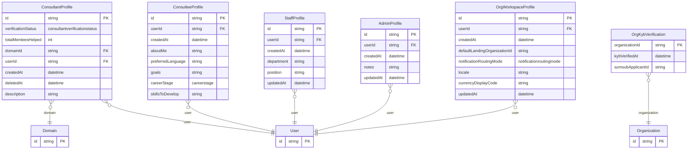
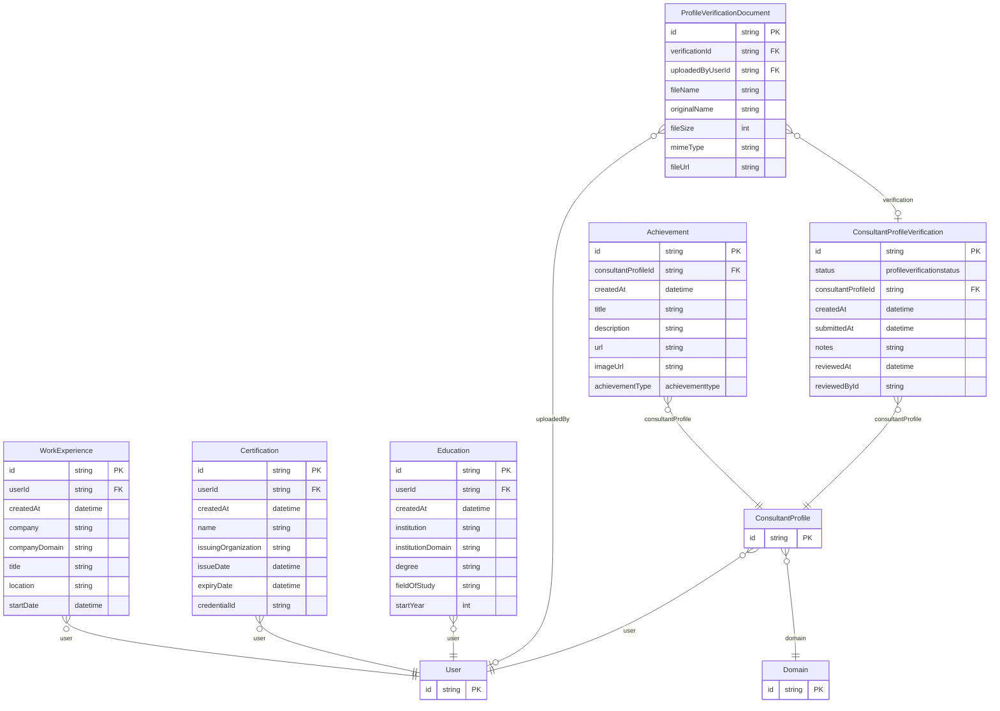
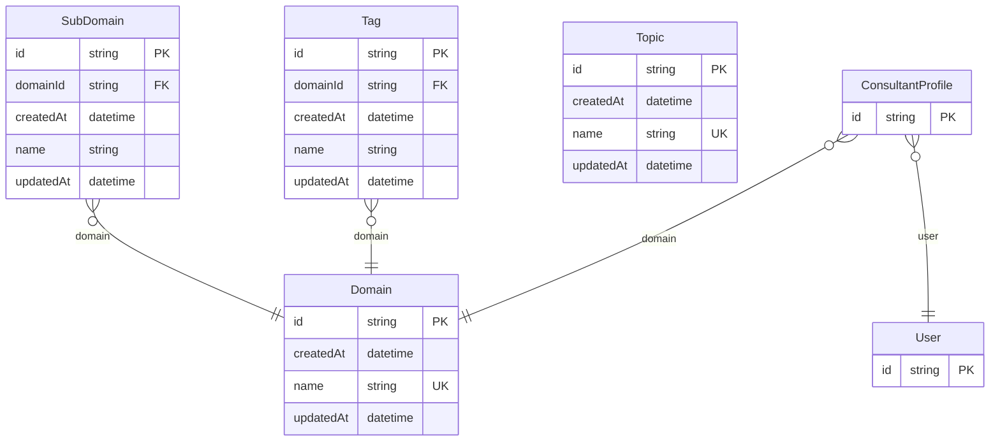

# Schema map — Identity & Profiles

Who a person is, what role they hold, and the background they bring.

Part 1 of 10 of the domain map. The
[map index](../00-schema-map.md) holds the master diagram, the enforcer
inventory and the enum reference.

## 1. Identity & Authentication

`User` is the single identity root. Every profile in the app hangs off it, and every money, booking and support row resolves to a person through it. The BetterAuth tables (`Account`, `Session`, `Verification`, `TwoFactor`, `Passkey`) own credentials; `SsoProvider` binds an external OIDC issuer to one organisation so an enterprise can assert its own domain. `OnboardingDraft` is a resumable server-side draft of the onboarding wizard, one row per user, deleted the moment onboarding completes.

```mermaid
erDiagram
    User {
        id string PK
        role userrole
        createdAt datetime
        name string
        email string UK
        emailVerified boolean
        image string
        phone string UK
    }
    Account {
        id string PK
        userId string FK
        createdAt datetime
        accountId string
        providerId string
        accessToken string
        refreshToken string
        accessTokenExpiresAt datetime
    }
    Session {
        id string PK
        userId string FK
        createdAt datetime
        token string UK
        expiresAt datetime
        ipAddress string
        userAgent string
        updatedAt datetime
    }
    Verification {
        id string PK
        createdAt datetime
        identifier string
        value string
        expiresAt datetime
        updatedAt datetime
    }
    TwoFactor {
        id string PK
        userId string FK
        secret string
        backupCodes string
        verified boolean
        failedVerificationCount int
        lockedUntil datetime
    }
    Passkey {
        id string PK
        userId string FK
        createdAt datetime
        name string
        publicKey string
        credentialID string UK
        counter int
        deviceType string
    }
    SsoProvider {
        id string PK
        userId string FK
        organizationId string FK
        createdAt datetime
        issuer string
        oidcConfig string
        samlConfig string
        providerId string
    }
    CookiePreference {
        id string PK
        userId string FK
        sessionId string UK
        essential boolean
        analytics boolean
        marketing boolean
        functional boolean
        consentGivenAt datetime
    }
    NotificationPreference {
        id string PK
        userId string FK
        allNotifications boolean
        inAppEnabled boolean
        emailEnabled boolean
        pushEnabled boolean
        mentions boolean
        directMessages boolean
    }
    OnboardingDraft {
        id string PK
        role userrole
        userId string FK
        createdAt datetime
        currentStep int
        payload json
        version int
        updatedAt datetime
    }
    Organization {
        id string PK
    }
    Account }o--|| User : "user"
    Session }o--|| User : "user"
    TwoFactor }o--|| User : "user"
    Passkey }o--|| User : "user"
    SsoProvider }o--o| User : "user"
    SsoProvider }o--o| Organization : "organization"
    CookiePreference }o--o| User : "user"
    NotificationPreference }o--|| User : "user"
    OnboardingDraft }o--|| User : "user"
```

- **Erasure is selective, not destructive.** When `User.erasedAt` is set, the PII fields are scrubbed to pseudonymous values and every active `Membership` is flipped to `MemberStatus.ERASED`. Financial rows — invoices, payouts, ledger entries — are intentionally retained, because IT Act record-keeping obligations outrank the erasure request. A `pseudonymousId` (SHA-256 of the user id plus a salt) lets historical audit rows still point at a deterministic actor without exposing the person.
- **`twoFactorEnabled` is mandatory for staff.** `lib/auth.ts` limits a `STAFF` or `ADMIN` session to credential plus TOTP sign-in; until the flag is set, the API and page guards only let that user reach `/auth/two-factor/setup`.
- **`OnboardingDraft.payload` is a JSONB blob, and the database enforces nothing about it.** A structural Zod schema at the write boundary (`utils/onboarding-draft.ts`) strips unknown keys, a `__v` generation marker quarantines a payload written by an older wizard, and `onboarding_draft_payload_size` in `prisma/sql/check-constraints.sql` caps the byte size. The trade is deliberate: the payload shape mirrors the wizard UI, so normalising it would couple database migrations to form tweaks.

## 2. Role Profiles

One `User` can hold several profile types at once, and the pairs are not exclusive: a consultant can also buy as a consultee, and a staff member can still be a consultee. `User.role` is the coarse label the guards read; the profile tables carry the domain state. `OrgWorkspaceProfile` is the operator-side seat inside an organisation, and `OrgKybVerification` is the organisation's know-your-business file.

- **`ConsultantProfile` is the revenue root.** Earnings, payouts, tax records, plan authorship and availability all key off `consultantProfileId`, never off `User.id` directly. That is why the earnings ledger and the org side can be joined on one identifier without a profile lookup.
- **`OrgKybVerification` is a gate, not a record of intent.** The organisation's status moves to `OrgStatus` values that the funding-rail permutation engine reads before it will accept a `LICENSE` or `INVOICE` rail.

## 3. Professional Background & Verification

Work history, certifications and education are consolidated at `User` level rather than per profile, so one person does not carry the same CV twice when they hold both a consultant and a consultee profile. `Achievement` is consultant-only because it hangs off `ConsultantProfile`. Verification is a two-level structure: a `ConsultantProfileVerification` submission and the `ProfileVerificationDocument` files that support it.

- **Verification is a reviewed state machine, not a boolean.** `ProfileVerificationStatus` moves through submission, staff review, and either approval or rejection with a reason; the documents are the evidence. `verificationDocumentsUploaded` is the owner column, and a rejection must be re-submitted rather than edited in place.

## 4. Consultant Taxonomy

How expertise is classified. `Domain` is the top level, `SubDomain` and `Tag` hang off it, and `Topic` is a separate flat vocabulary used to tag plans. `ConsultantProfile` carries one primary `Domain` plus a set of `SubDomain` and `Tag` memberships.

- **A plan's `Topic` set and a consultant's `Domain` set are separate vocabularies on purpose.** The marketplace filter needs a flat topic, while a consultant's expertise is hierarchical. Collapsing them would force a taxonomy change to become a data migration.
