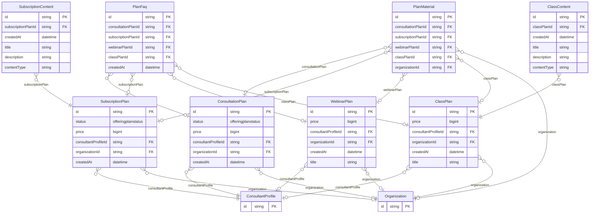
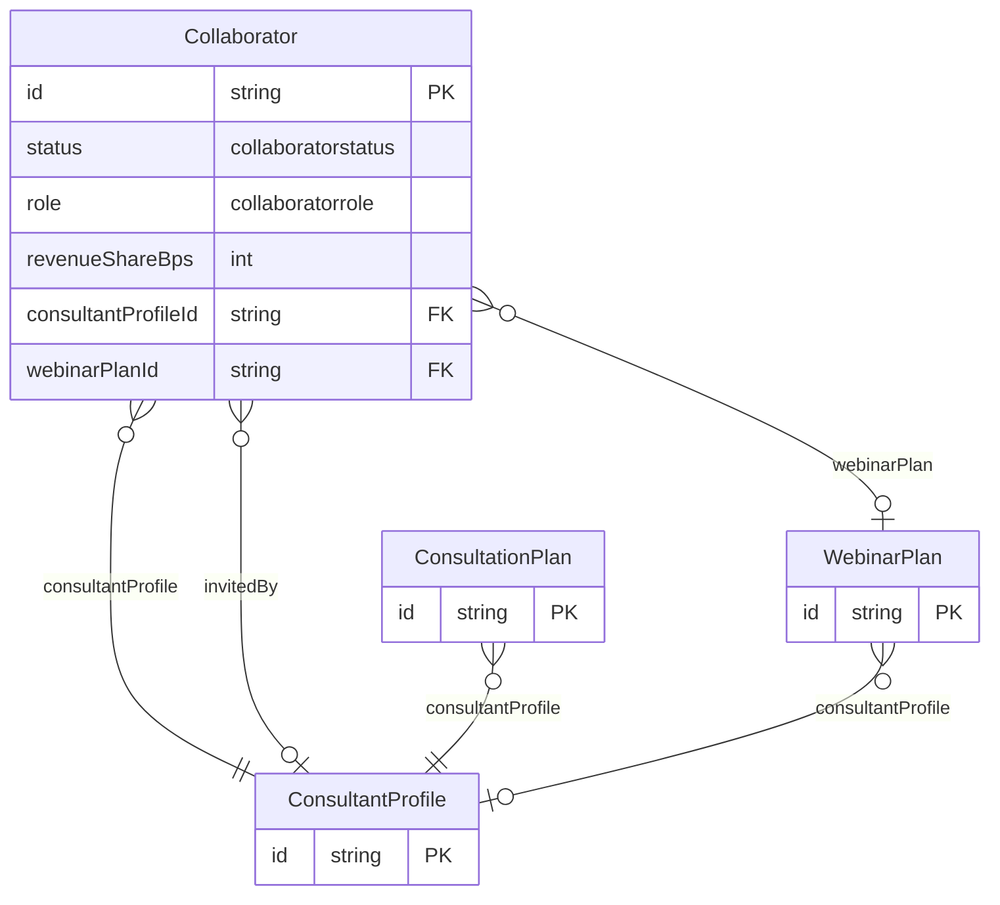
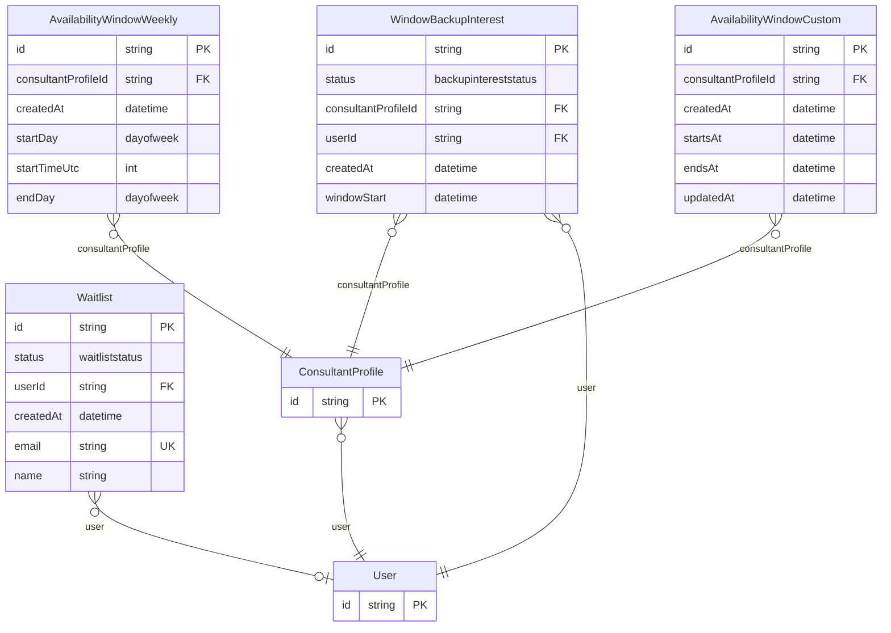

# Schema map — Plans & Availability

What is sold, who else sells it with you, and when you are open.

Part 2 of 10 of the domain map. The
[map index](../00-schema-map.md) holds the master diagram, the enforcer
inventory and the enum reference.

## 1. Service Plans & Curriculum

Four product shapes — a one-to-one consultation, a recurring subscription, a webinar, and a cohort class. All four carry the same buyer-facing content shape (`subtitle`, `targetAudience`, `whatsIncluded`, `imageUrl`, `slug`, a `PlanLevel`, and a polymorphic `PlanFaq` child list) and all four may be owned by a `ConsultantProfile` alone or co-owned by an `Organization`. `PlanMaterial` is the shared attachment list; it is polymorphic across the four plan types with exactly one foreign key set.

- **`archivedAt` withdraws a plan from sale without deleting the terms past bookings still resolve against.** A booking references the plan row; deleting the plan would orphan the booking's price, policy and cancellation tier.
- **`PlanMaterial` and `PlanFaq` are polymorphic, and the database enforces the XOR.** `PlanMaterial_single_plan_fk_check` in `prisma/sql/check-constraints.sql` refuses a row that points at zero plan types or more than one.
- **`SubscriptionContent` and `ClassContent` are deliberately not one table.** A class module is a unit of syllabus delivered to a cohort; a subscription session is one appointment in a one-to-one engagement, and the two products are free to diverge. See ADR 24 in `docs/enterprise/70-design-decisions/`.

## 2. Collaborators & Revenue Splits

One `Collaborator` row per co-host, teaching assistant or guest speaker on a plan, with a revenue share in basis points. The row is polymorphic across the plan types and the collaborator tiers are role-specific.

- **Four database constraints police this one table.** `collaborator_plan_xor` refuses zero or multiple plan foreign keys; `collaborator_role_matches_plan_type` refuses a webinar-only role on a class plan; `collaborator_tier_matches_role` refuses a role that outranks its tier; `collaborator_share_bps_in_range` keeps the split inside 0–10,000 bps. Two partial uniques — `collaborator_one_presenter_webinar` and `collaborator_one_presenter_class` — guarantee exactly one presenter per event type.

## 3. Availability, Waitlist & Backup Windows

Published availability is what makes a slot bookable. `AvailabilityWindowWeekly` is a recurring window stored in integer minutes since midnight UTC; `AvailabilityWindowCustom` is a one-off window. `Waitlist` queues a user for a plan that is full, and `WindowBackupInterest` records the user who asked to be told when a busy window frees up.

- **The 30-minute atom is the fundamental booking unit.** `startTimeUtc` and `endTimeUtc` are integers 0–1439, never timestamps, so a weekly window composes into identical 30-minute slots regardless of the consultant's timezone offset — the offset is a separate column.
- **A published window is a set of candidate slots, not a booking.** Slot reservation and the tentative-hold lifecycle live in the booking subsystem; the booking skill's doctrine on weekly versus custom rows and the union coverage rule is the authority there.
